# 麻省大学《操作系统 设计与实现｜CS 577 Operating Systems Design and Implementation 2020》中英字幕 p27 -27-Lec14 Screencast_ Linux kernel - Part 2 (03_12_20).zh_en -BV1iP2CBaEHr_p27-

So。Hi， everybody。 I was hoping I always hope that this thing works when I start especially today。

 So we're going to go on with the Linux lecture。 As Prashan said。

 there will be an email with instructions for people who could not make it to class today so you do not where you'll get all the information We'll do our best to make this work。

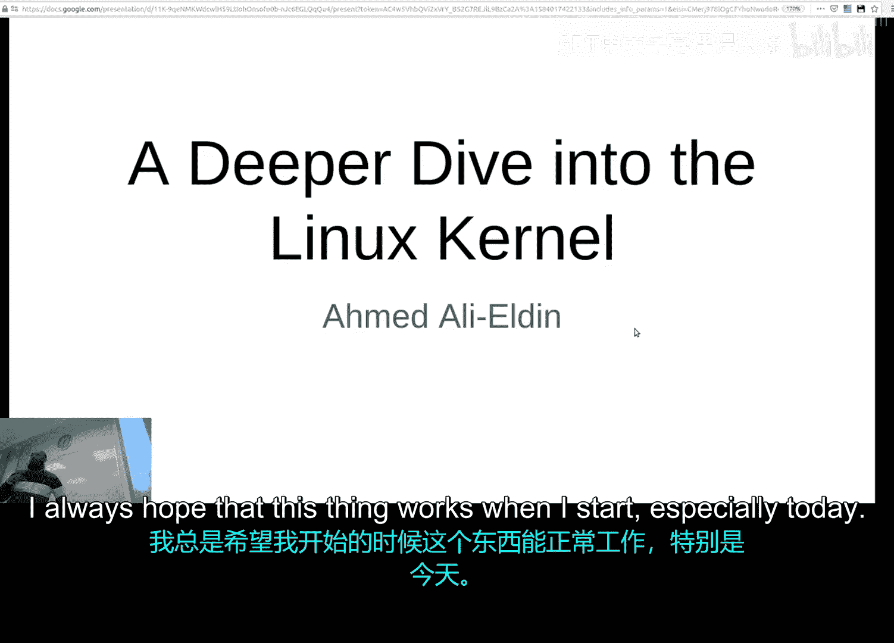

So。Last time when we started talking about Linux， we have covered basically roughly four chapters in the book。

The one was the introduction or these were like the first two introduction chapters。

 then we covered also process management。And we covered the process scheduling in Linux。

These were not very different in many ways from what you have studied in Linuxix。

 We have also hinted that there is data structures。

 kernel data structures that can that you can use in Linux， and we have basically。

We didn't go through them。 but， but we just mentioned some of those that are there their like double linked list and。

 and so on。 So today， we're going to build on what we have covered the first part of the lecture might be a little bit redundant in some sense。

 because this is schools is basically very similar in many ways。

 some very mind some very minute changes between the the， the， the Linux and Linux differences。

But then we' are going to take a much deeper dive into the interrupt handling mechanism that you have not covered the mimics almost。

 I mean， you have just touched upon it。And then we are going to actually talk about top halves and bottom halves。

嗯。So。System cools in Linuxuxes basically the only interface between user and。The actual kernel， okay。

 so。There is no way it's not like in Minex， where you have like the servers and， and so on。

That the only way between you and to go from， from user space to kernel space as a user is via system calls。

Okay， it's a single common layer between the user and the kernel。

 Almost everybody now strives to be compliant with Posex。 The Linux tries to be compliant。

 also with another。Standard SUS V， the single Uni specification。

Linux has been trying to minimize the number of system callss as much as they can。

And there are reasons for that。 We're going to quickly go through them。

All system calls and Linux need to return the type long。Okay。

Each system cool has a number just like Min。Nothing earth shattering。I'm going to try to。

More this a little bit。U。You have it's basically it's mostly architecture dependent because there are lots of things that that requires understanding of the architecture。

 So you have them in in the underscore cool underscore underscore table where you have all the entries for the cis Now。

 the difference between one of the major differences between Linux and Linux is that Linux had system calls per server。

 right， So each server had implemented its own system calls and exposed it to the users in Linux。

 you do not have that。 You just have whatever the number is today number of system calls and， and。

 and theyre all implemented sort of like。And the same table， I mean。

 they are all defined in the same table， not implemented in the same table and the cool the cool stack is very similar。

 So you go from the user space where you have the you call print on C or Python or something that talks to basically a library。

Usually in sea library。Where you call the print in the C library and the print in the C library actually calls right in the C library。

Right basically writes to a device。 and write basically is。Has one to one mapping to a system cool。

 So you go them to the kernel mode。Okay。

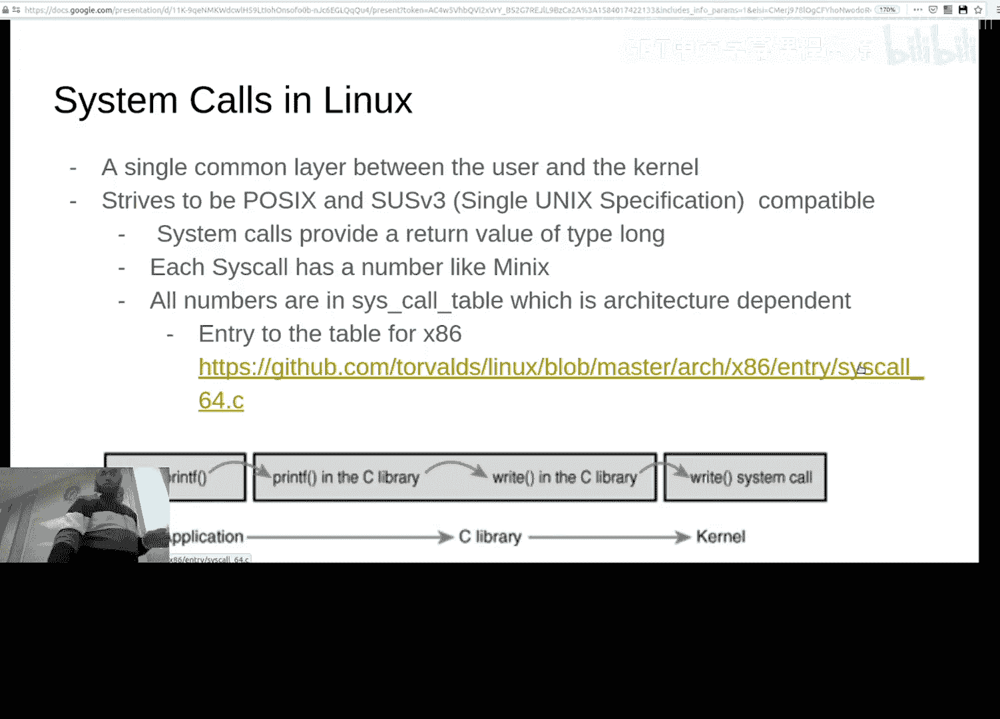

System cool definition。 This is how you define the system cool。

 Cis cool Cis cool underscore define 0。 Okay，0 here means that you're having0。Zero parameters， okay？

AndFor example， basically， this is a system cool that returns task I D。 Okay。

 virtual number of the task。 So this is， you do not need。Any parameters for this。

 you just need the get PID basically， it's， it's the get PID cool system cool。

 You do not need any parameters for that。 You get PID of your current courses， basically。Okay。😊。

And each system cool has defined handler， very similar to Linux。

 where you actually have the handler is actually what does the actual work。

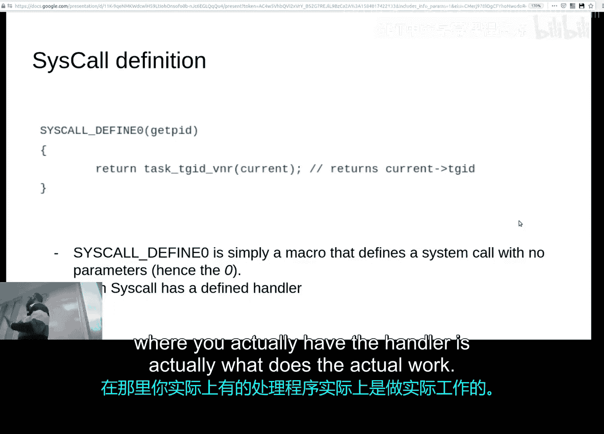

Okay。U。The way that system cools work in Linux is that system cool results in an interrupt。

 They actually result result in an exception， but people use the two terms interchangeably。

As we are going to say in a couple of slides， interrupts and Linux are basically hardware interrupts。

 they need to be stemming coming from the source should be hardware device。

 So it causes an exception or a trap。And the control is switched to the kernel space， okay。

You have a certain number that is defined for， for for the exception for system cools on， on Linux。

 and that's 128。 Okay， that's the interrupt number。 So all system cools have this interrupt number。

 Once you go there。 Okay， then you start basically looking at at the input at the parameters of your system cool to actually know what system cool are you actually using。

Okay。U。The system， the， the system cool handler for the。

 the general system cool handle handler that actually takes that system cool。

 cool is cool system underscore underscore cool。 This is where you actually try to go to the different system cools that you have。

😊，It's architecture dependent， obviously， on X 86， that the this system cool is actually implemented an entry underscore score 64 that S is assembly code。

 so it actually tries to go and read registers and stuff。

You pass the actual kernel to the actual kernel the system cool number via the E X register。

 one of the general registers in X 86。 that's how we actually pass the number， okay。

And this is done in user space。 So user so basically part of what your compiler does or your compiled language does or if you're。

 if you have an interpreted language， part of what what is being done is that you have the。

 the library， the， the system cool library， basically changing the E X register to actually go to the correct system cool number。

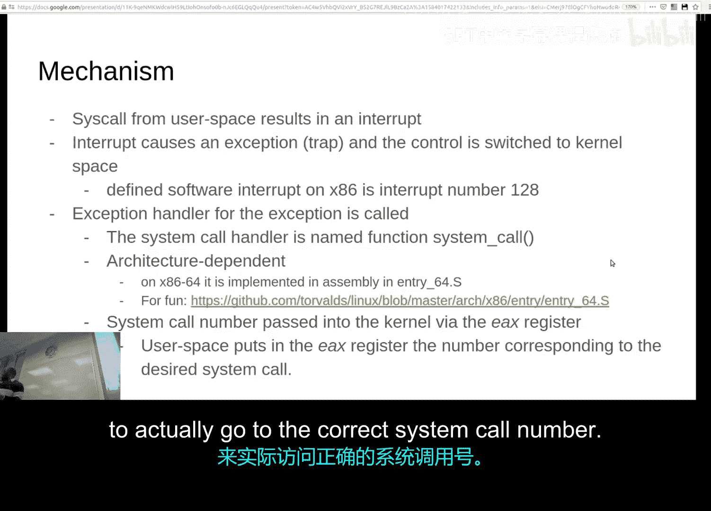

How to implement a system calling in Linux， This is actually a link to a pretty recent tutorial because this has changed over the years。

 and basically this is， this is from 2019。 So it it will work。 Okay。

 it's a little bit different compared to Linux， but not a whole lot different。

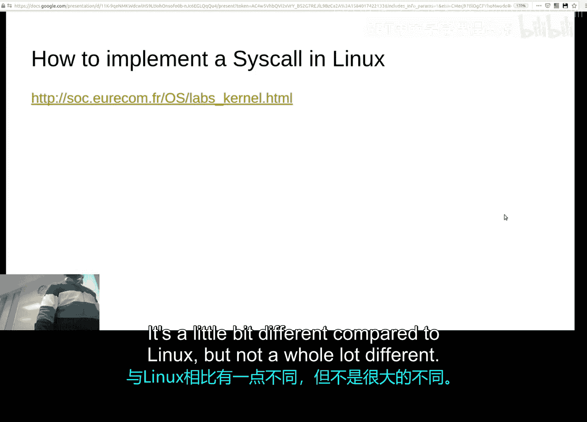

So now why not to implement the system cool。 So we。

 you guys have implemented the system cool as part of your， of， of your lab one， right。

But there are many， many reasons for you not never to implement an extra system cool in Linux。

 And in Linux， if it， if it ever picks up and becomes a system that everybody uses， right？

 So first of all， you need a system cool number。 and that number well， it， if， if it's my own。

Clonnel， if it's my own kernel version， if I'm changing my own kernel。

 then I can just like add some number and， you know， I'm happy。

 But then if you actually want to implement a system cool that actually does anything。 So if you're。

 if you're a hardware company trying to add a system cool to the， to the Linux， to。

 to the main Linux kernel， okay。😊，You cannot just like go on， on， on Github and， you know。

 push your changes and say， okay， I just added a system cool with number 500。 It doesn't。

 doesn't work that way。 So you need basically somebody to assign that to you。

 And that's basically that usually is quite hard。呃。

The other reason is that once you have system cool， you do not remove a system cool。 Do you know why。

Exactly， backwards compatibility。 You cannot just basically start adding system cool in random and。

 you know， decide that， oh， I'm， I'm just removing them。 Okay。

 and that's one of the main reasons that Linux tries to keep its system cool to real absolute low number。

 compared to Windows， which actually has thousands of system cools， okay。

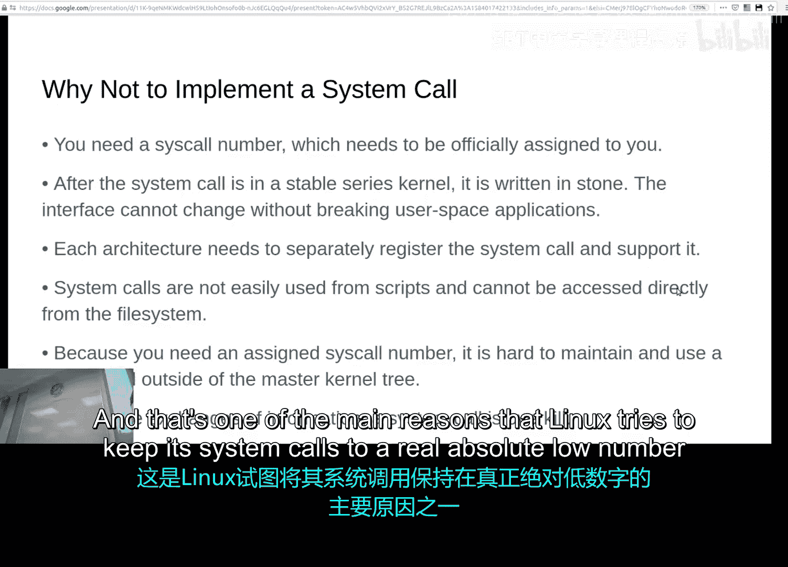

So you do not want to break user space applications in the coming 10 years。Now。

 each architecture needs to separately register the system code and support it。

 One of the main reasons that we run on Linux is that it's。Architecture independent。

 It runs almost on anything。 So if you have， if you have a small device or a large device。

 you want your。Coode to run， basically without caring about the architecture。

 So you run Linux and raspberry pies， but you aren also on the big fat servers。

 You not you run it on some， on some micros systemsstems and， and， you know， it covers everything。

 right， So if you change one number somewhere in some architecture， you want to make sure that that。

 that you can have that the system cool available for all other architectures， which is a pin。Okay。😊。

呃。Basically， the system callss are not easily used from script So。 I mean。

 now you have added your system cool。 It's not like the system the system cool exists in nowhere。

 You actually need it to add it to some language library， right， like the C， the， the C library。

 Otherwise， it's completely uses。 Nobody is going to code in system cool， right。嗯。Basically。

 maintenance becomes an issue because you have the numbers。 and basically。

 the system cool is almost always an overkill。For anything that you're going to do。 So in reality。

 nobody implements system goals except and， and， in labs。

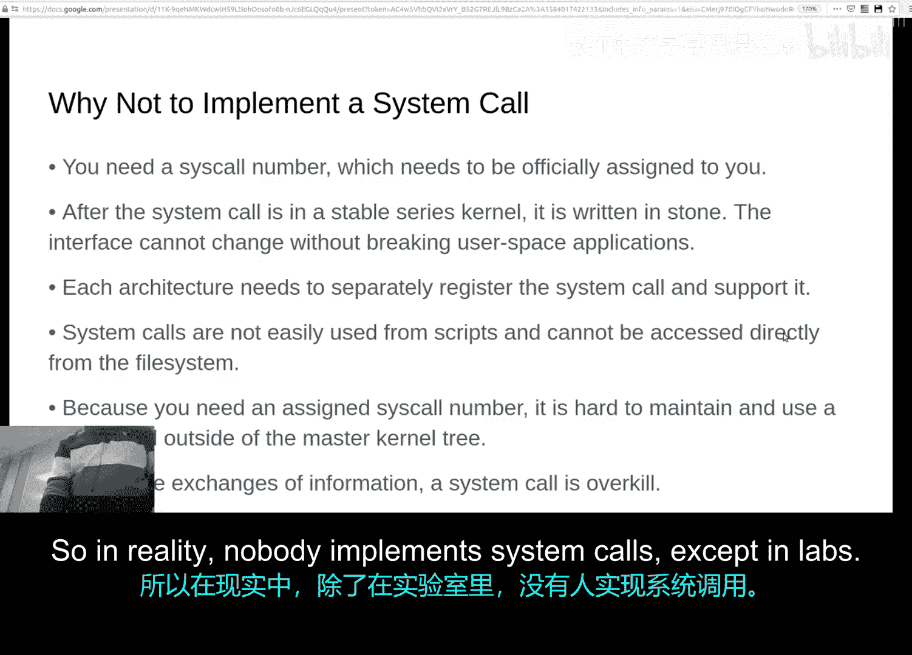

Okay。The other alternative is to actually build what is called the Linux kernel module。

 We'll talk about that later。 ass basically the Linux way the Linux way of actually adding servers sort of。

 it's not for adding servers， but it's for basically extending the kernel with some modularity some form of modularity where you actually hookup code to the kernel using simple command line that is mod probebe basically without even touching the internal kernel code。

 okay so that's that's something that we are hoping to be able to cover。呼福利。Okay。

Now to the main meat of this lecture， that's basically interrupts and interrupt handlers， okay。

So why interrupts？Basically， you have these very fast。Running chips， processors， basically。

 that run at。That can run hundreds of millions of of instructions。Or millions of instructions。In， in。

 in a second， right， or in a very short time， you， you have this very enormous capability。

 Most hardware does not run at the same clock speed of of of the processor， right？

 So you want something。 you want to be able to。Basically。

Make the processor talk to all the other very slow devices。And that way is basically interrupts。

 There are actually two ways to do it。 One of them is using interrupts。

 The other one is using pulling。 Most hardware that exists on earth works with interrupts。

 where basically， once the hardware is ready。It signals sends an electronic signal on the chip to to the processor saying that I have。

 I'm ready， okay。As a hardware。Very few。Hardware。Runs with pulling。

 pullinging basically means that the your processor will every some designated time units go and ask the。

 the the， the hardware if there's something ready for it。Okay。

 if there's something for the hardware to actually process。Okay。

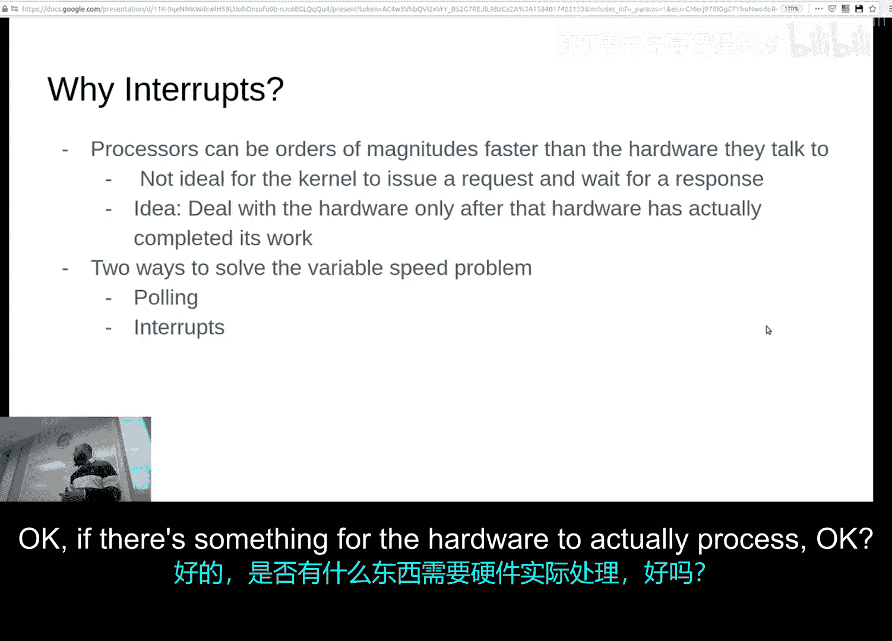

So。The the good thing about interrupts is that it enables hardware signal to the processor。

 so you have the keyboard， you have the mouse， you have your memory， chip， all of these things。

 there are ways over compared to the processor， your network and so on。

 so you have this way of making each card， every peripheral， everything， basically pull or sorry。

 interrupt the processor and tell it that theres something ready now for it。The the。

 the hardware then does not need to， we do not need to try to synchronize between the hard the different hardware chips。

 right， because that would be awful， basically trying to synchronize two computers。

 two processors is already harding。 Now， trying to con synchronize your entire。

Computer with 100 subsystems。 It's， it's， it's just never going to work。

 So everything works as inchronas now， electronic signals going from hardware to hardware to the to to hardware and the。

 and the processor that is basically called the interrupt controller。

 The interrupt controller is a very simple chip。Electron chip that basically has a vector table has a table that basically says that if I get a signal on this pin。

 then it's this。 If I get a signal on that pin， it's that。 So it's a very simple circuit， actually。

So it's and， on that。That chip enables the processor to basically talk to all kinds of hardware that the processor knows it exists or that the processor does not know it ever existed。

 So in many cases， you have a laptop。 You have a computer。

 And then there' is this nice piece of equipment that comes out new right and it's basically something that that was not there when your computer was made。

 but still you can actually run it when your computer via USB or using something different。嗯。

So each interrupt will have unique number， unique value。 Now。

 this take this with a grain of soul because it， in reality， not each interrupt has a number。

 and that's， that's a huge part of this lecture。 and these interrupt values are often called the interrupt request。

 I Rqs。 Okay， the the IRQ lines is basically your interrupt。 Any questions。No， the hardware。

 most hardware is much slower than the processor。Right。If you continue pulling。

If you basically to sit down and have your processor every 5 milliseconds， go and pull the keyboard。

 did， did he type anything， Then maybe I'm not typing I'm doing right now。

 And then the processor has to do。Cont switching， because if it's polling。

 then it needs to go and ask something about something。Right， so it needs to ask the keyboard if I'm。

 if I'm typing right now， which I'm not。Right， so it with processor resources。 You you。

 that's why you， you won't interrupt that basically。Push。Push notifications to the processor。儿。

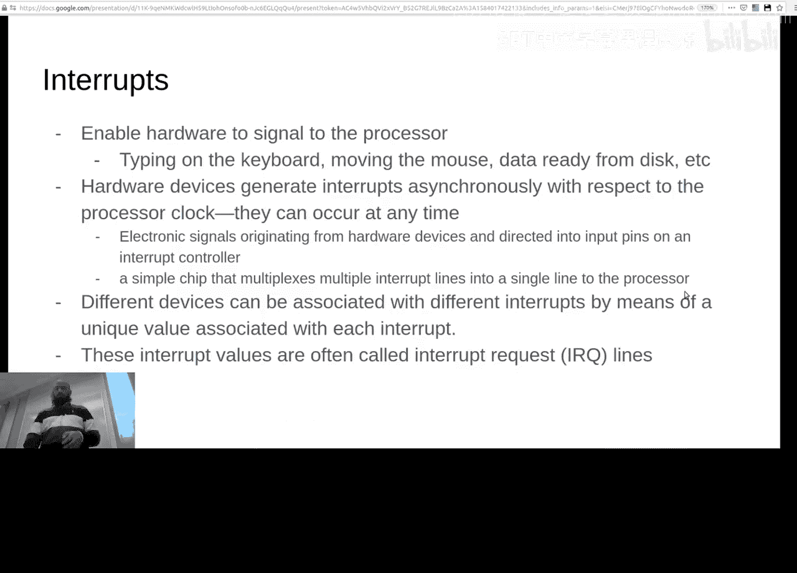

So each each IRQ line is assigned a number value。Okay。IRQ0， the number 0 is the timer interrupt。

 which is basically your your clock， your CPU clock。IRQ 1 is the keyboard interrupt。 So。

 and it goes like that。 I mean， there， there are bunch of numbers， okay。Unlike the schools。

 not all are not all I RQ numbers are defined。 So you have。

 you have basically a range of I RQ numbers that are just not defined。Okay。

There there is just like some number that that gets assigned dynamically to different hardware。

 and this enables basically the processor or your computer to talk to any hardware。

Because if we have。A number assigned to each interrupt。

Then I have already defined that this is this number is for the keyboard。

 That number is for the memory。 That number is for the mouse。

 But then there are 10000 types of mouse mice Now that each one of them。

 many of them in required very specialized drivers because they have all sorts of different buttons that do all sorts of weird things。

 You have 10000 keyboard layouts。 You have Chinese keyboards。 you have Arabic keyboards。

 you have Hebw keyboards。 So I mean， you cannot just like define everything right away。

 you need to actually have the system get updateded with the drivers。

And another example is that interrupt interrupts associated with the devices on the PCI bus are dynamically assigned。

 So you have a PCI bus and you have basically a range for the PCI bus components that you're going to connect。

嗯。The， the important notion is that a specific interrupt is going to be associated with a specific device。

 and we'll see how this is done。So the difference between interrupts and exceptions。

 I sort of said that already， basically interrupts our hardware。 exceptions are software。

 So when you have。So schools， that's the software， right？

Most people would just call everything interrupts。So， interrupt handles。The。

 the concept is is very similar to this is school handler。 Okay。

 each interrupt each device generates an interrupt that is basically associated to an interrupt handler。

 So you need to， and that's basically your device driver。

 So that is actually what you're doing when you install new device drivers。 You're just。

Teaching your processor how to handle。Theters。O。Besides all the other things， right。

 but a device driver is， in essence， stat。U。Basically。This enables the the processor。To， again。

 communicate with any device， but enables you also to basically update the drivers。Easily。

 because now what youre going to try to do when you when you get a new hardware is that you're going to install the new driver。

 But then if you want to update it， you you should just be able to update the interrupt handler。

 basically telling the the processor that now this is， this is what。what is needed to be done。

Devicice drivers can be implemented as in kernelal。 Many of them are。

But also can be implemented as an L K M Linux kernel module。Interrup handlers are re C。

 So they are not assembly。There is an interface obviously with assembly。

 but interrupt handlers in general or just C。They run in a special kernel context。

 which is called the the the interrupt context。 It's different from the user context。

 from the process context。 It's different from the kernel context。 It's an interrupt context。Okay。

The handler is atomic， and thus cannot block。So you want your entire handler to just run from the beginning to the end。

喂。嗯。Thus， this must be very quick because if you have something that is atomic running in the kernel。

 that basically means that， you know what。A device driver that goes haywi can just like。

 make your entire computer not， not reply to anythingcause， you know， it's， it's very slow。 It's。

 it's not looking and very slow。Even if your device driver works very well。

 but you still have things such as a 10 gig Internet card that just produces。

A lot of data packets that needs processing。And it requires copying and requires all sorts of things。

 And then all of a sudden， you have the faster Now。

 devices like the ni cardss can actually hug your entire processor。

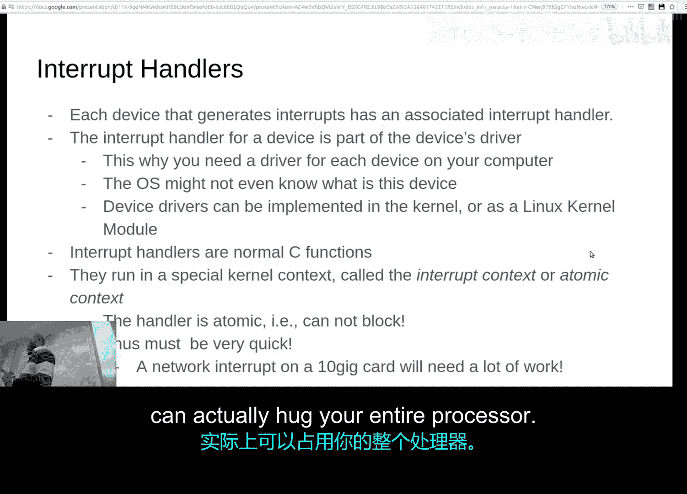

So the Linux way of actually solving that is that all device drivers are divided into two halves。The。

Top half and the bottom half， which sounds very， you know。Intuitive， right？So。

The top half is basically the first part of the interrupt handler。 And。

 and it is the real interrupt handler that that the kernel leads with with。

 And this should be basically things that you absolutely need to do。Right。

Everything that you absolutely do not need to do right now can wait。So， basically。

You run an interrupt handler upon receipt。Okay， and it's done block。So it just run。Until it's done。

And you perform only time， critical work。 Time， critical work should be。

That you act the sending device that you have received， the interrupt。 So you're going to process it。

And that you basically reset the hardware so that you can receive new interrupt on that。

 on that same on that same pin， because otherwise， if you do not reset your hardware。

 then all interrupt。 So if you， if you're typing and they type。And my interruptive handler does not。

 does not actually handle that。 Then I cannot type anymore until basically the that。

 that the hardware is reset。The bottom half， you do the rest of everything。我。

So let's go to the network， yeah。およ態。Sorry。你们在个。We on receiving the。Yes。

There can be other things that are time critical。 We'll actually give examples。Okay。

 so so there can be other things。 And we'll actually say when you should use what。

 when you should put your code in the bottom half and when you should put it on on the top half。

 So that's。So basically， you have a network card that receives packets from the network。 Okay。

 then the first thing that you should do is that you alert the kernel of the availability of the of these packets via and interrupt basically。

Now， the kernel response by executing the register interrupt for the， for the neck。

 for the network card。They interrupt runs， So the interrupt handler runs and xs to the ni dot。Okay。

 I'm processing this data。And now this is， this is what you were asking about。 So in in this case。

 you the， the network interface card， it has a network buffer， right。A hardware network buffer。

If you do not copy the data from that network buffer to your memory。Then what。

 what is going to happen is that you're going to overflow the buffer。

So once you receive that interrupt， then it's time critical for you to actually empty。The。

 the buffer move copy everything into the main memory so that basically you can。

Receive more network packet network network packets， okay。Does this only。咖贝。

That works because exactly。 So， so because you have direct memory access。 So now that'。

 that's exactly why were saying that this can be in the background。 Obviously。

 if you do not have DM M direct memory access， which is like very essential things now for most computers to actually perform。

 then youre sort of screwed because you have to wait until everything gets copied。

 Otherwise otherwise， you you know， you lose the data。

 So it works actually partially because of the direct memory access， DMA。Okay。So。So basically。

 the kernel now， when， when you have interrupt your interrupt handle acts copies data or gives the order to copy data and just let。

 you know， doesn't do anything after that。And then。It basically， it's done。 It， it clears the， the。

 the hardware and you， you can overrite the， the whatever is in the buffer right now。O。

There are new things when it comes to network。 There is， there is something that's called D PDK。

Which basically tries to even。You know， circumvent going through the kernel whenever you receive data because you have the because you have direct memory X。

 D PD K， what it tries to do is basically tries to minimize even the kernel requirement to handle this interrupt。

 It just like goes。magically。

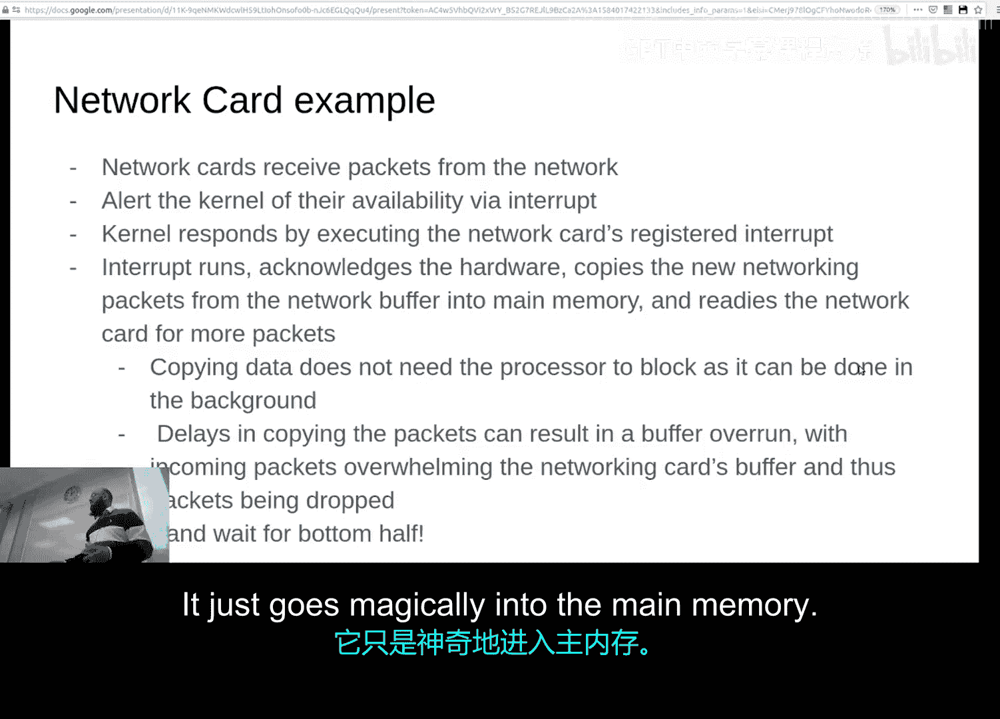

Andto， into the main memory。Okay。So。Each device is associated with one， the with one driver。Okay。

Each interrupt based driver registers1 handler only and I have interrupt based because if you have a pullinging based system for some reason。

 very few components work with pullinging for different reasons。

But basically almost all the things that you deal with registers and interrupt tanr。Okay。On success。

 and this is basically done using something that's called request underscore R RQ defined in slash Linux slash interrupt H。

 Okay， were， were most of the definitions for interrupt handling is， is done。 and on success。

 the request， R RQ returns 0， basically saying that okay。

 I have registered this interrupt handler to the kernel now。 So now the device can run。Okay。

 a common error is E busyy， which basically says that your I RQ is already in use。

 which basically means that well， this line or this number is already in use。

This is how this thing looks like。 So you have。The request I underscore I RQ。

 you have an you define an interrupt number， okay。And then you have some flags。

 talk about the flags in a little while。😊，And you have a name。 Okay， you have actually， sorry。

 you have the actual handler， which is a pointer to the actual code。 Okay， so before the flags。

You have the actual handler that points to the actual code。You have a name for for that device。

 and that's basically if you're logging or if you're looking through your D message。

 which is basically where you have all your logs and stuff， you'll see that name of the device。

And then you have something that cool Dev。 will talk a little bit about it when we talk about the flags。

 like next slide， I think。So， flags。So I started by telling you that。When。

 when you have an interrupt， everything gets blocked。In reality。

 you can' actually control that behavior。So you have a flag。

 one of the flags that you define when you actually attach device， when you attach a handler。

 Okay is the I RQ disabled flag。And this basically instructs the kernel to do one of the two things。

 if you have it as set， okay， that means that everything all interrupts are now blocked。

Nothing worse。 So if you have it set for your device driver， for your keyboard。

 that is basically telling your， your computer is that if you have an interrupt from my keyboard。

 everything else stops。 Nothing wes。Okay， no interrupts okay between when I'm typing and so on。Okay。

 so for most。And if you have it unset。That means that， well， everything else runs。

 so network my network card can basically interrupt。😡，My typing。But， you know。

No two key strokes will basically override each other。

 So you only disable interrupts that are like you。So which one do you think is used more。Sorry， yes。

 the second one， basically because you want your computer to work， right。The other one is the IRQF。

Ex example。Those things that I would do。开门。Okay， so。Yeah， I mean， I mean。

 you basically things that are complete， that you completely do not want anything to interrupt it。

That's， that's basically that this would be interrupted。That are， for， for example， if you。

 I think also some of the memory interrupts， or like that。So there there。

 there are very few who actually run that way。 but here's the thing。 you can actually define that。

So basically， if you're writing your own driver， it's up to you to actually set it in whichever way you you think。

 Now， if your driver will be accepted in the main Linux streamline， that's a different thing。

Probably people will frown upon it。 But yet again， most drivers do' not come like in Linux。

 So you download them from some weird place， right？

 So if you download some weird drivers from some weird place that nobody has looked at。

Then your weird device that you just attached will can overtake your entire computer because， well。

 the device driver designer decided that I'm setting this to whatever。So， I mean。

 that's why you shouldn't go around and then get device drivers from everywhere。

The second one is actually interesting。 The R the I， R QF timer。

 And that's basically the a flag that tells the system if it can use。

Meta data on this interrupt to actually as entropy as basically an input to its random number generator。

 Basically， there are no two random number generators。

 but still we need random number number generators for all sorts of different security purposes。

 privacy purposes， including in the kernel and including in some of the crypto libraries in the kernel。

So to get these random numbers， the kernel needs to do something that is more brilliant than just try to do the use the Python random number generator。

 which is just crap， right， So what， what it it， it does is that since interrupts happen at any time of the day。

 right。When you're designing your device driver， you can actually tell the kernel that， oh。

 by the way， you can use， for example， the time when my， my interrupt happened to actually。as。

As food for your random numbers in theor。And it can use all sorts of different metadata on the interrupt handler。

 So this is basically something that you're。Helping the kernel to be better with， okay。Now。

 if you're。System， for some reason， has interrupts that happen at certain times of the lead。Example。

 some of the some of the systems that do backup。Okay。They start exactly at the same time of the day。

 Every day right， should not be setting that for that that lag for， for these systems。

 because then you're， you're basically messing up your， your random number number generator。

The I RQ F shared and dev dev is actually one of the parameters that we talked about。

 The I RQ F shared is a is a flag that actually enables。Different， multiple devices。是 sorry oh。

Talking too much，So the so it enables multiple devices to actually share the same interrupt number。

And we'll talk a little bit about shared interrupt later。呃。No， I actually messed up two things。

 So the I R Q F sample random is the one that' is just for random number generator。 I'm sorry。

 I just， I just。Mesed up these two， the other one actually specifies that this handler is for the actual system timer。

 so it it's something that is probably going to be very high priority for the system to run right away。

O。

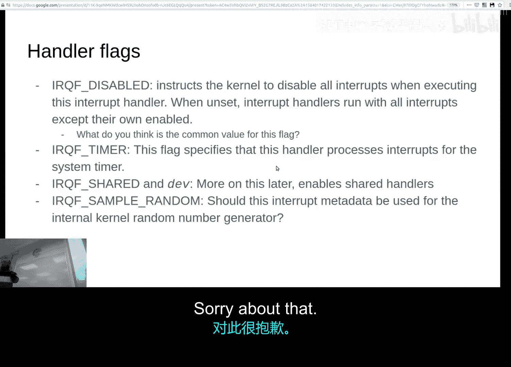

Sorry about that。So。Reentrancy and interrupt handlers。嗯。So when。

 when one of your interrupt are happening。It basically masks all other interrupts of the same kind。

 no matter what how you set the flags， okay。This is basically to prevent two interrupts of the same kind to overwride each other。

 so you wouldn't basically end up having interrupt the same interrupt overriding the second like happening at two times after each other and one of them overriding the other。

Some interrupts actually require masking all interrupts， as we said。

And the same interrupt handler is never invoked concurrently。 So you never have。

You have you never have it in two processors。 You have a multiprocesor system。

You have two processors。 You're not going to have it happening in parallel and two different processors。

啊。This basically makes writing interrupts much easier for the kernel， because all of a sudden。

 you do not need as， as a driver developer to think about concurrency issues。

So you just know that if the interrupt happens， nothing。

 that interrupt will not happen again until it's done， basically。Okay。So why interrupt sharing？

As we said， we have this kind of。Of chip。Right。That basically has a certain number of pins。

And this is the maximum number of interrupts that you are going to support。Okay。

So since you have a limited number of pen of pins and you have an infinite number of devices that you can attach。

Then you want to wait to be able to actually overbook these pins。

And the way that you do that is using interrupting。Okay。嗯。For interrupt sharing to work。

 you need the hardware to actually support that。 So you need the hardware to understand that it is sharing the interrupt handler number。

So when， when， so the the the。And， and you need the software， the the。

 the kernel basically to to know that， too。 So the way that this works is that once the kernel gets。

The interrupt number， say 5， say that this is shared between five different devices。

The camera should be able to go and pull each of these devices。

To check which one is raising that interrupt。So hardware you need hardware support that enables the kernel。

To actually pull the device if it has raised an interrupter or node。

 it is a very simple modification in terms of hardware。Typically， an extra register for you。Not much。

 Okay， but it， it allows you to basically support an infinite number of devices because all of a sudden。

Each device can basically say different things。 Obviously。

 if you're sharing and you're pulling all like 10000 devices。

 then what interrupts no no longer makes sense。 But luckily。

 nobody really runs 10000 devices on a single machine。 I mean， nobody does that。

And this is how the interrupt flow works。 So you have two devices。 They share the same IRQ number。

 okay。You basically go to the pick， which is your interrupt controller。Okay。

 and then the interrupt controller basically。Checks on each device。오케이。And once。

 once it knows which device is the one will basically go to。

 to the actual interrupt of that device and then run the。The actual handler。

 and once you run the actual handler， you just now you have done the most important parts of the work already。

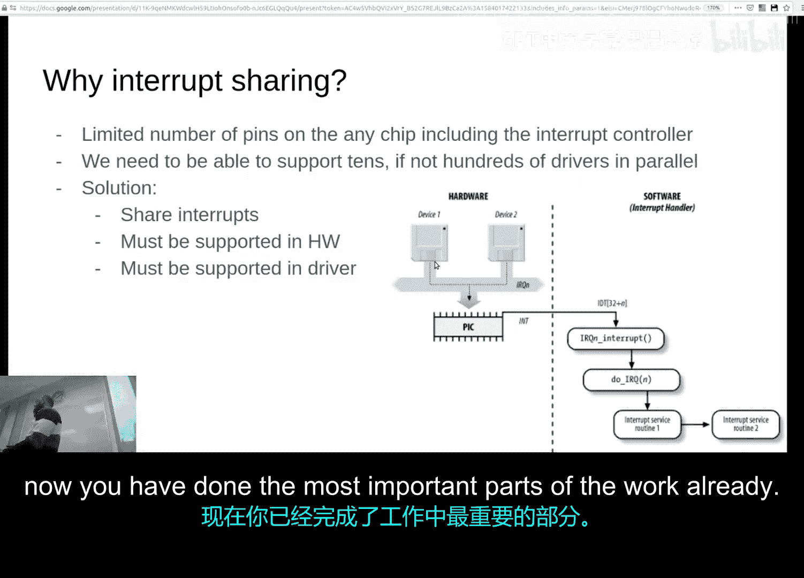

This is your interrupt vector table on Linux。So you have from 0 to 19 non maskable interrupt and exceptions。

 These are basically 19， the only 19 that you should basically。Hopefully， you use the do not share。

Flag with。 okay， then you have a bunch that Intel has reserved for whatever co processorcess that it has and different things。

And then you have basically different， different numbers for， for different and interrupt types。

 So external interrupts that are coming maybe if from USB or from your camera or something。

 they have numbers。 Then you have， system cools。 then you have， again， external interrupts。

 and the list goes on。 And then there's like even some that are for。

 for future use maybe Linux evolves into something different。 So they have kept like a bunch10 for。

 for。For themselves。Okay。So how do you implement an interrupt handler， you have the hardware。

 you generate and interrupt。 Okay， goes to the interrupt controller， goes to the processor。

 processor interrupts the kernel。Do I RQ is there an interrupt handler for this。Okay。

 it's either yes or no。 So do you have a registered device already or not， If not。

 then you just like， you know， exit If yes， then you go and run the interrupt handle， okay。

So for synchronization purposes that we' are going to actually cover。

 hopefully the next time we talk about Linux if we ever do that。

There there are ways to actually mask， interrupt on a single processor。In the multiprocess system。

 you might have 8 cores or 10 cores or 12。 I don't care， right。

 Each one of them will have its own interrupt handles。

There used to be a way in the old days where you just internally inside the kernel would call a single line that will basically mask stop all interrupts on all processors。

 Now， if you have lots of people using that to basically gain maximum。 you know。

 I I want maximum speed。 I want my device to look flashy and nice， give you the best output。

 then if you have people basically masking interrupts all the time and their device drivers。

 then your your， your， your computer is basically useless。Right，So Linux basically pulled that out。

 It used to be like that。 So now there， there is no global way to do that。

So if you are building a device driver that actually deals is with multiple processors。As。

 as a device driver developer， you need to actually start thinking about synchronization between the different。

Core processors are the different processors on the chip。Okay， and Linux gives you ways to do that。

 Some of them is basically synchronization mechanisms， looking and。

 and and sephos and these very nice， lovely things。

 But also it gives you some of these tools that are internal to the Linux system to the Linux kernel that you can actually use to to do。

 to enable some I some IQs or disable them and so on。😊。

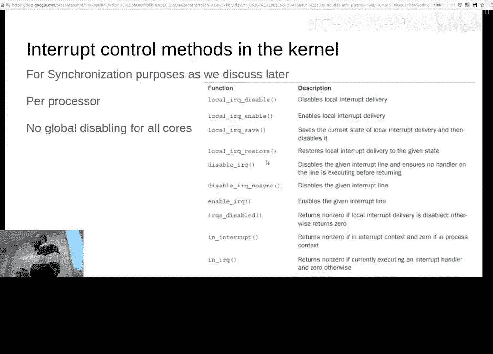

Bottom half。Okay， so nowa that we have covered the。

The most important part of your interrupt handler now what actually does the work。

It comes at the bottom half。This is basically where the actual driver is implemented， okay。

You should afford as much of the work as you can to the bottom half。

And that's basically because good drivers should make your computer work， not make it slower。Now。

When you're writing your bottom half code， you should know that this is basically a promise。To run。

Rather than a time to run。So when you are implementing things in the bottom half。

 that means that you cannot assume any syn any synchronization or any。When it will run， I don't know。

 the processor doesn't know。 the current doesn't know。 I mean。

 it will just run when there is time for it。However， typically。

 what happens is that right after you exit the handler。

 which is the most important part of the code where when you have all your interrupts masks and so on。

You actually start running your， your bottom half。Of the same code。Okay。

But then all interrupts are enabled back。

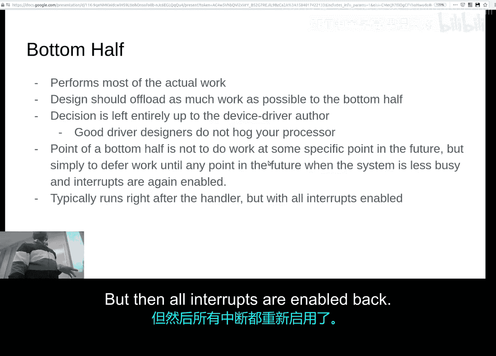

So。This is how you， I mean， there， there are no magic ruless for this that nobody， nobody actually。

Checks behind you， the people。 I mean， there are tons of drivers being written every day。

 But that is what you should keep in mind。If the work is time sensitive， it goes in the top half。

 If the work is related to the hardware， it goes to the top half。

If the work needs to ensure that there are no other interrupts that are interrupting that work， can。

 it can go to the top half because you can also do other things。

Everything else should go to the bottom half。 So in our network example。

Everything that we said should be in the top half， everything else like processing the packets。

 actually doing TCP IP P or whatever protocol that you're using should go in the bottom half， okay。

And there are no single way to implement bottom half。

 There are actually at least four different ways to build the bottom half in your Linux kernel。Okay。

All days， people actually had something that they called the bottom half。

It's actually a technique that is called the bottom half to implement the bottom half。

But that was until kernel 2。3。 then they started evolving。

 the way that the old bottom half worked is that it had 32 predefined。

 well definedfined bottom halfals that you can only use， which basically means that， you know。

 people back then thought it that I need hard disk。 I need memory， I need mouse， I need screen。

 I you know， bunch of of devices and that's it。呃。So we needed more than 32 bottom halves。

 And this quickly became a bottleneck， so。

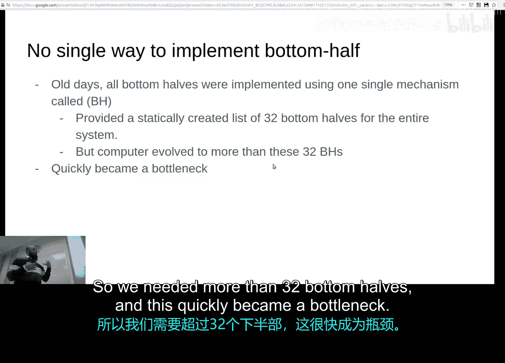

They started building these different mechanisms to actually improve the， the， the system。1。

 the first one was task queuees。 It's also that。Okay， so this was the。

 their first answer to the bottom half is not working。

 And the idea was that you define a family of cues sort of quite similar to the prior cues that you had in the scheduler and menix。

 But now for， for， for interrupts。 So you had a family of queuees。

 basically a bunch of cues with some priors。 and the kernel would go into each task queue。

 they were doubly linked lists。And basically， we go through the queuees and start dequeuing things one by one。

 Okay， based on their priority。Again， this is， this became a a bottleneck in terms of how the system was performing because there。

 for example， for networking the。It should， it cannot work that way with gig cards。

 even one gig cards。 it， it cannot work that way。 You cannot just have a task queue that that you have things as pockets come。

 They get tusks and so on。So now this is replaced by something that school work use。

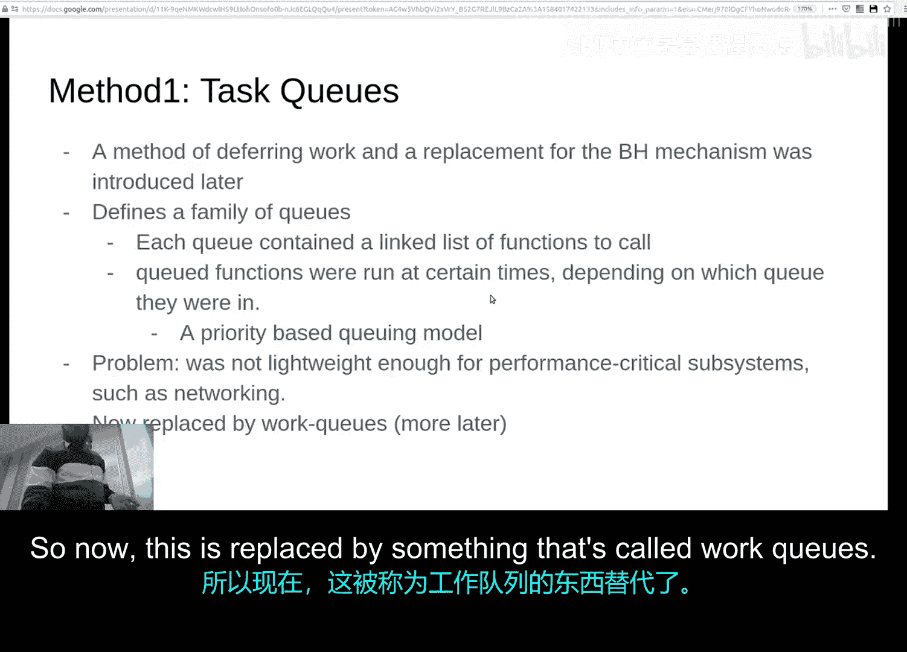

The two methods that most of the bottom haves are implemented in today are soft IQs and tasklets。

Soft IRQs is both of them are introduced in current 2。3。

Completely removed bottom half that very old system in current 2。5。

Soile cues basically says that there are 8。There are8 bottom halves， not even 32， just 8。Okay。

And these eight are defined， statically defined。You can add one if you want。 I mean， the。

 the the book has like multiple ways to add the software IQ or or but， but at the end of the day。

 nobody does。Okay。And then on top of that， the software IQ it has like these8 very well defined。

Ways to， to do the bottom half on top of that， there is the oslets。 So I Qs can run in parallels。

 The same soft I Q can run on two processors together。

 So it does not provide you with even any synchronization or anything。 It just runs， okay。Now。

 tasklets are implemented on top of soft IRQs。 They actually are they use two of the numbers of soft IQs because soft IQ also has a number table。

 Okay， so they have two numbers， one of them is for high per tasklets。

 One of them is for low tasklets。 and they run they are an implementation on top of soft IQ。

 So as everything in computer science， we do you know， more capsulation solves some problems， right。

 So we encapsulate the software IQs in the tasklets。

Sore cues are used when the performance is totally。I mean， important。 So a networking subsystem。

 it has its own predefined software Iqs。

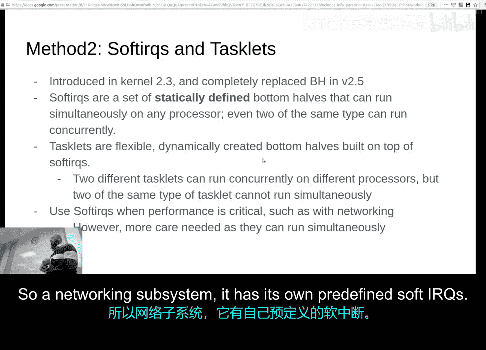

So this is a time summary of how things evolve。 So you had softwareQs in version 2。3 work queues。

 we'll talk about them。 were introduced and introduced in version 2。5。

 But then and these two were decommissioned in version 2。5。

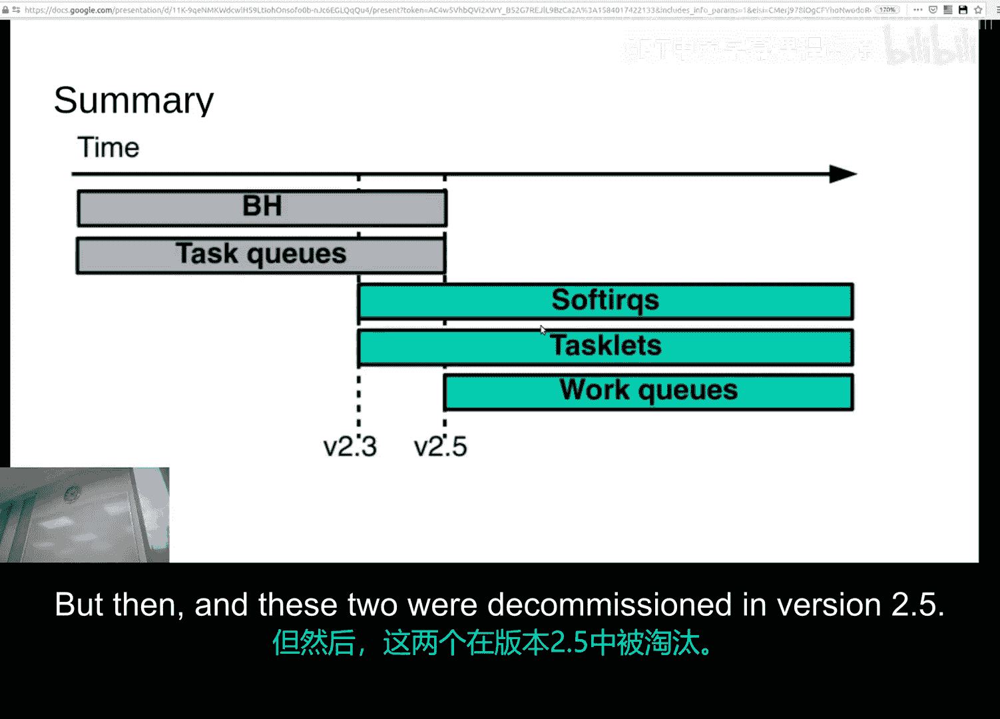

And in terms of performance versus is thefuse。So you have very high performance for software queuees。

 Theyre completely built and designed for basically the absolute to be the absolute fastest。

 You have teleks and in the middle。 and then you have work queuees。

 which are just super easy to use for implementing your driver， but they are less performing。

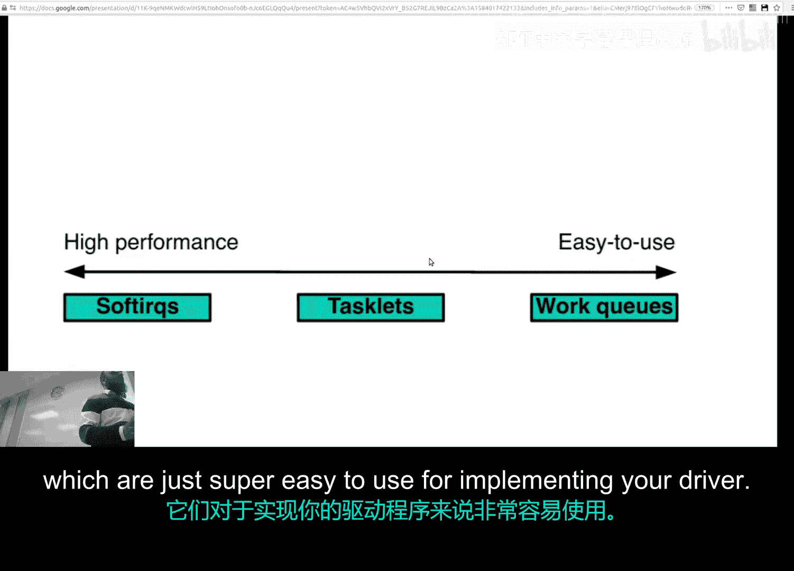

There is another way that's called thread interrupts。 We're not going to go through that， that much。

 thread interrupts is， basically。A way that basically says that， you know what？

AndInstead of even trying to implement the bottom half and the top half and everything。

 your top half is just acting， basically sending an acknowledge and。Then clearing the hardware。Okay。

 and then everything else is implemented as a kernel threat。

So if you have everything as a kernel thread， then what happens。

 it gets scheduled as a kernel thread。 So all of a sudden。

 you have this system that basically enables you to write an entire device driver by just writing a normal thread without thinking about top halves and bottom halves there will not cover it more in in the lecture。

So as I said， there are only eight software IQs and these are。啊。0 for high priority toslets。

1 for timers，2 for some network packets，3 for receive network packets， for， for block devices。

 which is basically your， your hard disk，5 for normal priority tasklets。6 for the scheduler。

7 for high resolution timers and 8 for RRC U looking。 These are the only eight I Qs that are defined。

 Typ， you only go you you only go for the software I Qs。

 You only deal with them as a programmer as a kernel developer if you're working on。

 on the network subs systemst or the I O subsystem， okay。So soft as we said。

 softwareQs are for high frequency high high threaded use because you can run them in parallel also。

 So you might be able to process multiple packets， multiple buffers。

 worth of net of network packets on different processors and parallel。

And use tasksks for everything else， okay？As everything is defined in the kernel。

 there is a tuslet structure that basically has all the tulet linked together。

And this is actually the definition from from the code。

 So you have basically something that points to your next tasklet。 you have the state of the tasklet。

 which can be basically， if it's scheduled， for example。

 So if a task if a tasklet is is scheduled running if you have multiprocessor systems。

 it will read that flag and see if， oh， it's already scheduled。

 I should not try to schedule that task kit because it's already running somewhere。 Okay。

 and as we said， tasklet cannot run。On two process processors at the same time。

 you have the count and you have also data that the taskki can use。This is actually。Basically。

 the what each field and the task list structure means。 Okay。

 so I think the only one that we did not。Covers the counts， which is the look counter。嗯。

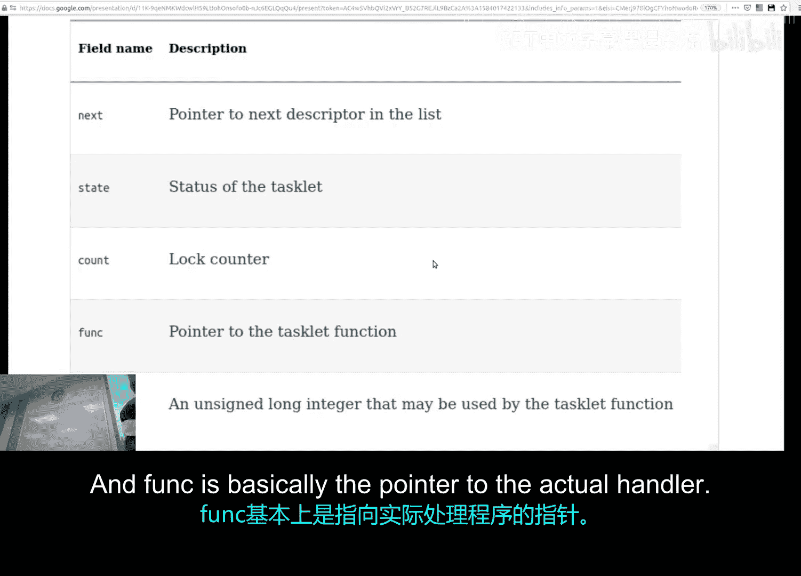

Fununk is basically the pointer to the actual handler。Now， if there are too many。

 so since a tasklets are implemented as soft IQs。 So in essence。

 they are soft IQs to the to the kernel of the are software IQs， right。Now。

 each software RQ has its own handler。 So if， if if you're going to the hyper tasklets。

 then the kernel will do something and that thing will be basically go to through the taskstruct the taskletstruct and basically go through them one by one。

 okay。However， it can be the case that you have lots of input coming in from software IQs。

 and you cannot， the kernel cannot just cope with all of them。Okay。

 so if there are too many software IQs， you can end up basically again hogging the entire system and not doing anything okay。

 because again， when when you finish an enter tender。

 you can go to the you go directly to the bottom half。嗯。

The sad thing also is that many of these software RQs can cool themselves。Basically， meaning that。

A softwareft IQ。Can， basically， if， if there is more data， for example， in the network buffer。

 it can just recallcool itself So it can start from all all over。 Do you have a question。あれそれる。

They're like architecture，No， no。assemblyI mean， th there are definitely parts where we， W。

 which are written assembly， but， but to to the most of it， no， nothing is R。

 almost nothing is written assembly。Make。Yeah，cause it's basically， I mean， the， the。

 the whole idea is that you have。They could so for example， the high tasklet IRQ， a soft IQ。

 it basically goes through a structure， structure and goes through each tasklet and tries to basically do the bottom halves for all the different interrupts that already heard。

 right？ the block devices again， what they what it is trying to is basically trying to read from a blog device。

 right。Most of it is going to be just like moving data and pointers and stuff。

A little bit of it can be device independent， but but that's very little， if any。All。嗯。

So case software kernel software IRQ is is basically a way of the。

 the way of the kernel to basically stop the system from getting completely overrun by the all the software IQs that are that are happening。

 the way it does that is that is that it takes。It's like the the， the thread that the， the。

 the thread that RQ was talking about， But what it does is that it basically takes some of these tasklets or some of these soft RQs and converts them into kernel threads。

 And if you convert something into kernel thread， then it gets scheduled at whatever time。

 It's no longer an interrupt handling process， it's more like as if there is a user process that is running。

 And you just need to run it。And it transactions with the lowest possible priorityity， which is 19。

 So basically you， you， you take these bottom halves and you even run them with the lowest possible priority。

 And this is typically what happens when you press a key and then press another and press another and your computer is completely huggedgged。

And then you see the letter is coming like， you know。And like after two seconds or something。

 because basically it's being overrun by softwares， so it just goes to case softwares。Okay。

So it's a kernel optimization。So the last thing is work uses。

 and this is a different way of deferring work。 and what it does is basically for there are many of these kernel softwareQes。

And there are many of these softwareQs， there are many devices。That need to sleep。Okay。Now。

Soft I cus and Tous are not built to sleep。 They are built to basically have some。Parts of the。

 like the， of the of the interrupt being completely run from A to Z with no sleeping。However。

 if you're fetching data， if you're reading from disk。

You actually need to sleep because you need to wait for for death anyway。 So the way that this。

 the work， the way that work use work is that they actually take any。

Bottom half and convert it into a kernel thread。 And then these kernel threads can just sleep whenever they're ready。

 they just， you know， they， they go through the normal processes。 It' basically blocking on Iu。

So you can block on eye and sleep and wake up and do all sorts of things as if it it was a normal kernel thread。

The way it does it is that does not it actually implements a special kind of thread that is called the worker thread。

W whichch is。There is one worker thread pair。Each processor。Okay。The worker threads are， again。

 threads。 They are just special threads， and there can be only one of them per processor。Okay。

And this is how this very nice。You know， architecture looks like。 so you have basically for each。

For each processor， you have worker thread， okay？And for each processor， you have a pair CPU。

Work Qstruct that basically has all the things that are now scheduled are going to be or to be scheduled on。

 on this， on this core。嗯，那。You have， basically。You can theoretically create other worker threads。

 although the system does not do that by default， but you as a programmer， for some reason。

 you can create a worker thread。 So actually in the book。

 he gives an example by basically saying that I'm going to create another worker thread that I'm going to cool Falcon。

 Okay， but that doesn't make any sense and nobody does that。So in theory。

 you can have a work queue structure that is one per worker thread。

 but usually there is just one one worker thread so these two will be almost the same。

And then you have。For all the bottom halves that you're going to schedule。

 you have a structure that basically links all of them together。 Now。

 one of them will get scheduled to the first worker thread。

 and one will get scheduled to the second worker thread and so on。 So you have a list of all。

And the list per processor and the worker third per processor。Stuff here。No。Yes。Yeah。Yeah。

And then since there， there is this mess between the bottom half， then we have。Soft I queue。

You have tasklets。You have worker threads。And， or you have work cu。And you have whatever other。

That things that you're going to use for the bottom half。

 There is a deep need for being able to look。For on， on。

 on on some of the data that these things are dealing with， because the same。

Parts of the same interrupt can be handled in different ways。

So parts of it will just be like the normmentator handler。 Part of it will just go and， you know。

 do software IQ or case software RQ。 Part of it will can be work。workQ tusk。

So this is the end of the lecture。I hope I did not bore you to death。Thank you。 Any questions。D。对案。好。

我知在。The top。 So the， so the， the， the， the， the top half should be atomic。

 basically should all run well， if you have all interrupts not not enabled。

 then it will just run all of it together， right？ And this is why you want the top half to be very short。

So by atomic context，It's atomic。Now， if you， if you have， if you enable all the other interrupts。

 except for the your same interrupt type， it's atomic in the sense that your same interrupt type。

Pn from your key。You do not need to actually do any looking between them。

 as you might be streaming something。When you're pressing your keyboard and stuff。

And like the top of in the bottom up， are they like。Mdules。啊で一回。好我。

So the top half schedules the bottom half。So the top half， the top half does all。A acknowledging。

 And then after acknowledging it clears the hardware and so on。 And then schedules the bottom half。

So it's like one process。Yes。Yes。Okay， thank you。

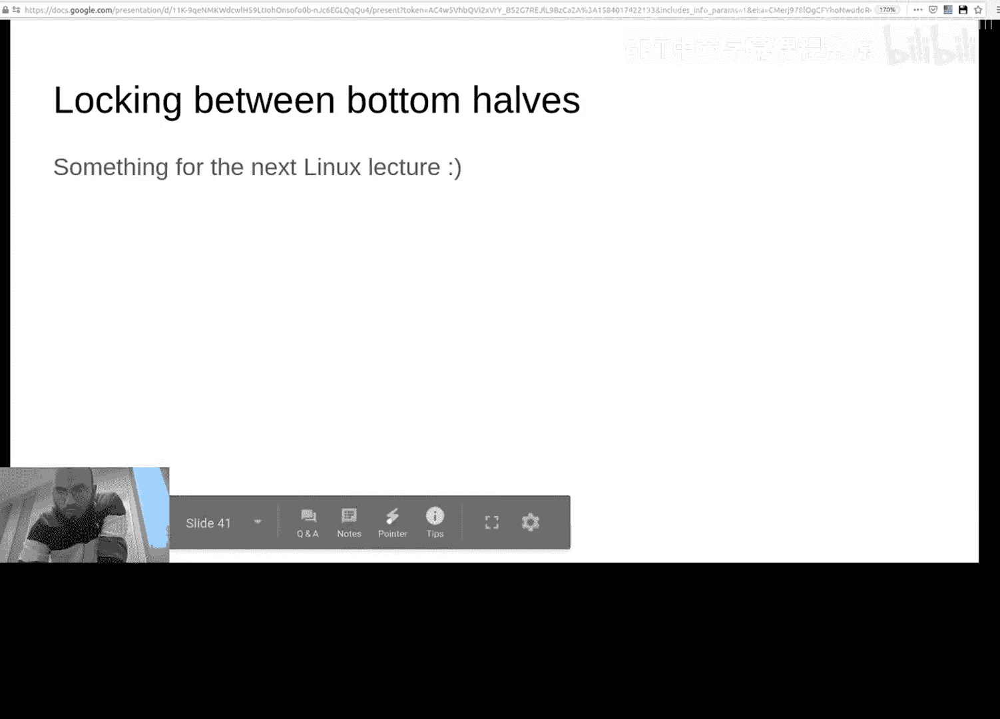