# 操作系统设计与实现：14：Linux内核 - 第二部分 (03/12/20) 🐧


在本节课中，我们将继续深入学习Linux内核，重点探讨系统调用和中断处理机制。我们将了解Linux如何管理用户与内核的交互，以及硬件设备如何高效地与CPU通信。

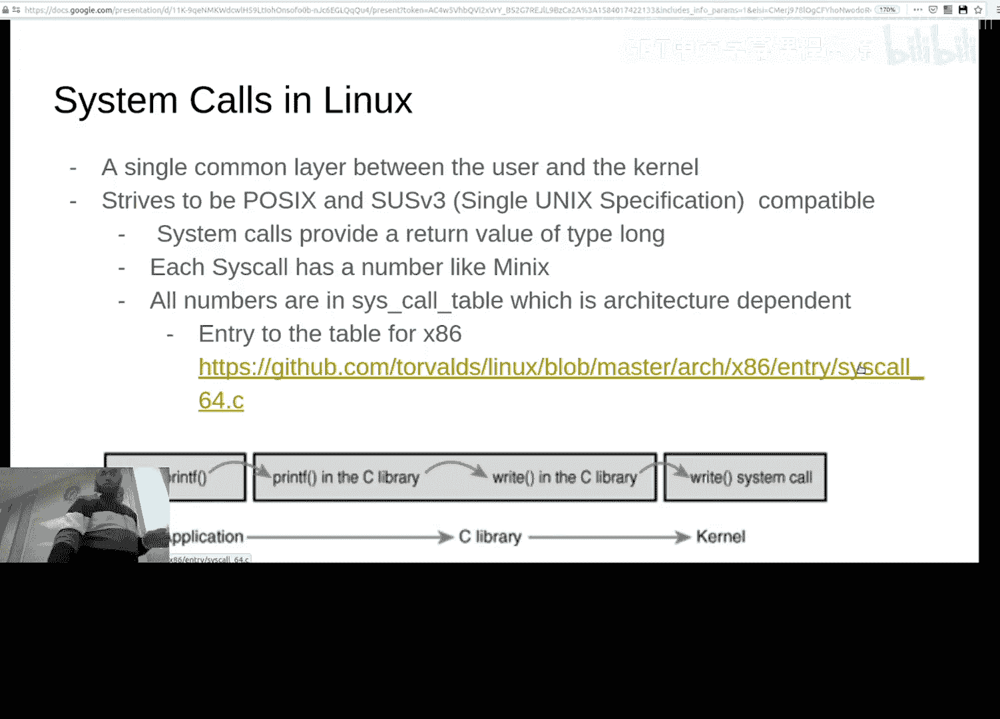

上一节我们介绍了Linux内核的进程管理和调度。本节中，我们来看看Linux中系统调用的实现方式，并深入探讨中断处理的核心概念。

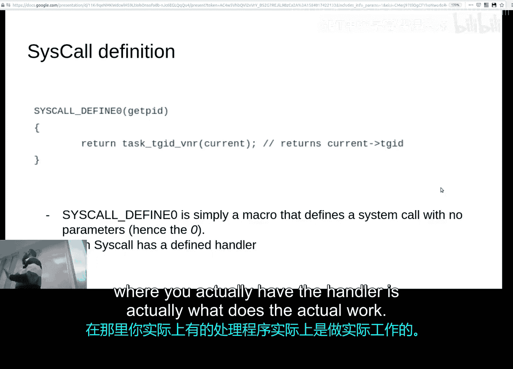

## 系统调用

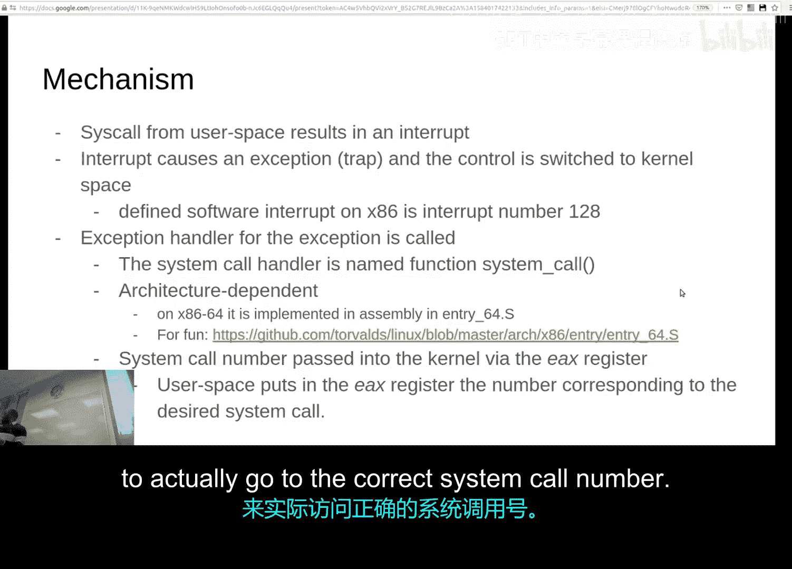

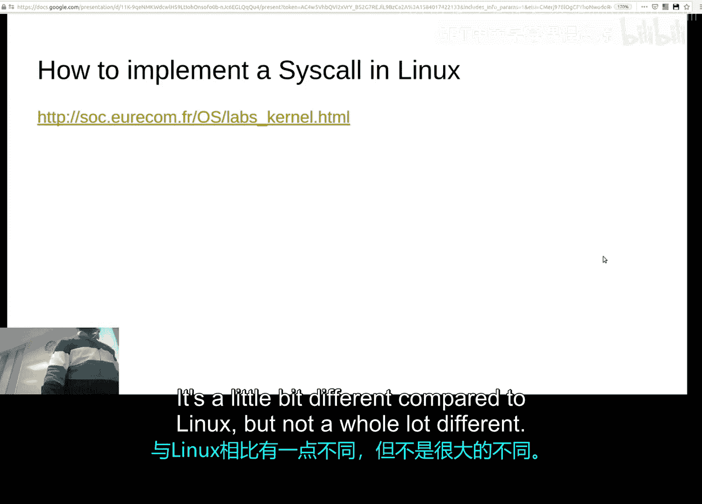

系统调用是用户空间与内核空间交互的唯一接口。与Minix通过服务器提供系统调用不同，Linux采用单一的系统调用层，并力求与POSIX和SUS V标准兼容。Linux致力于保持系统调用数量的精简。

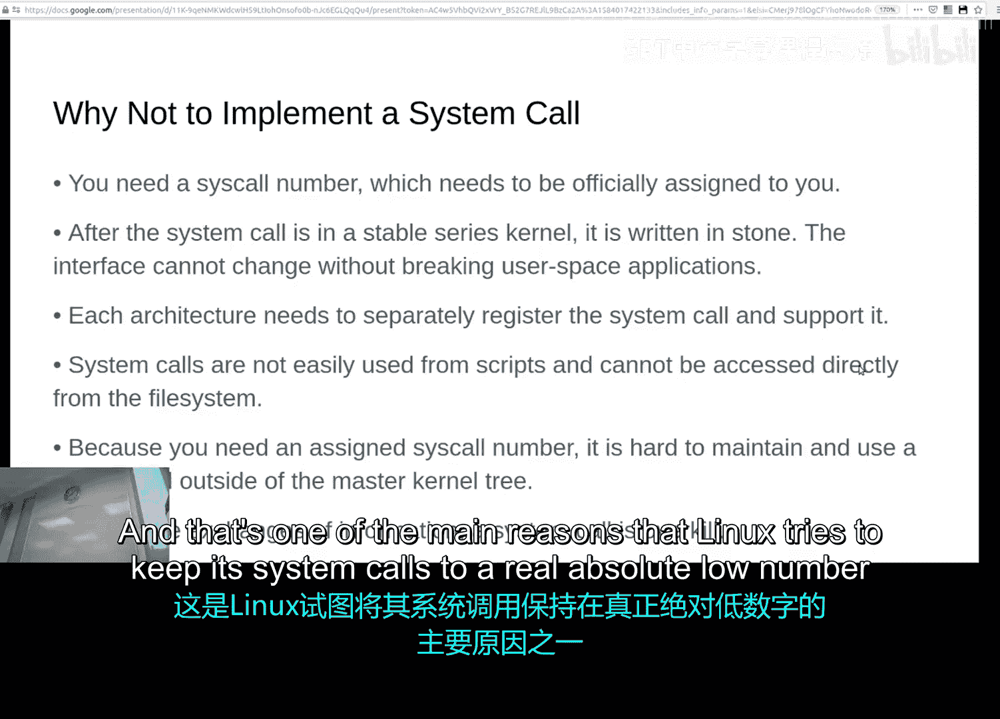

每个系统调用都有一个唯一的编号，并返回`long`类型。系统调用通过引发一个异常（陷阱）来切换到内核空间执行。

以下是系统调用的定义方式：
```c
SYSCALL_DEFINE0(getpid) {
    return task_tgid_vnr(current);
}
```
此代码定义了一个名为`getpid`的系统调用，它不需要参数（`0`表示参数个数），并返回当前进程的PID。

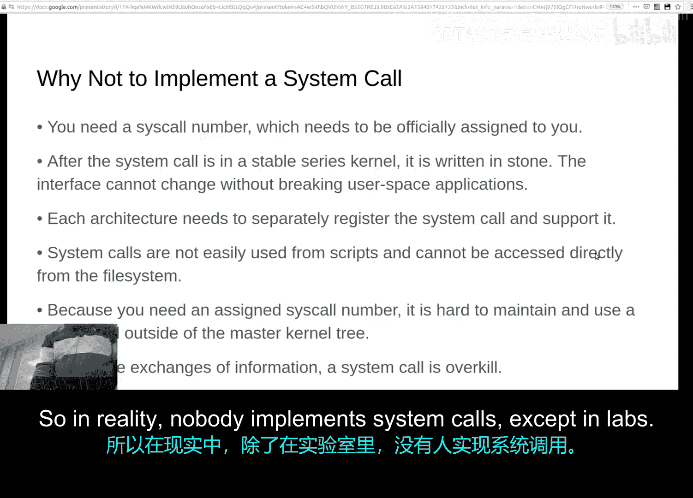

系统调用的处理流程如下：用户程序通过C库函数（如`write`）发起调用，该函数将系统调用号存入特定寄存器（如x86的`EAX`寄存器），然后触发中断`0x80`（或`syscall`指令）。控制权随后转移到内核中的系统调用处理程序。

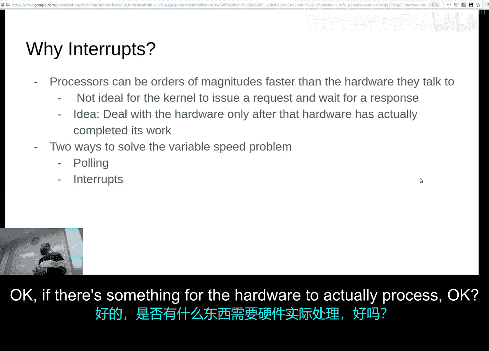

以下是实现系统调用的关键步骤：
1.  分配一个系统调用号。
2.  在内核的系统调用表中添加条目。
3.  实现系统调用处理函数。
4.  重新编译内核。

然而，向主线Linux内核添加新的系统调用非常困难，主要原因如下：
*   **编号分配**：需要向内核维护者申请一个全局唯一的系统调用号。
*   **向后兼容**：系统调用一旦添加，几乎永远不会被移除，以确保旧应用程序能继续运行。
*   **架构支持**：新系统调用需要在所有支持的CPU架构上实现和测试。
*   **使用不便**：需要更新用户空间的库（如C库）才能方便地使用新系统调用。
*   **过度设计**：对于大多数功能，添加系统调用是“杀鸡用牛刀”，并非必要。

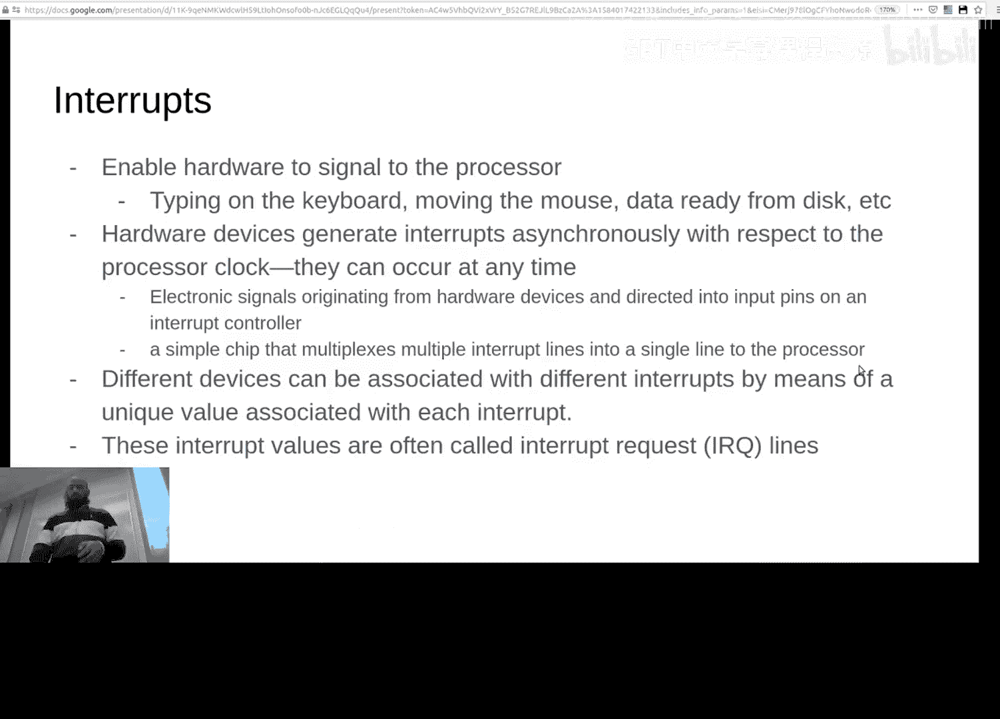

因此，更常见的扩展内核功能的方式是编写**Linux内核模块**，它允许动态加载代码到内核中，而无需修改内核源码或重启系统。

## 中断与中断处理程序

现在我们来探讨本节课的核心内容：中断和中断处理程序。

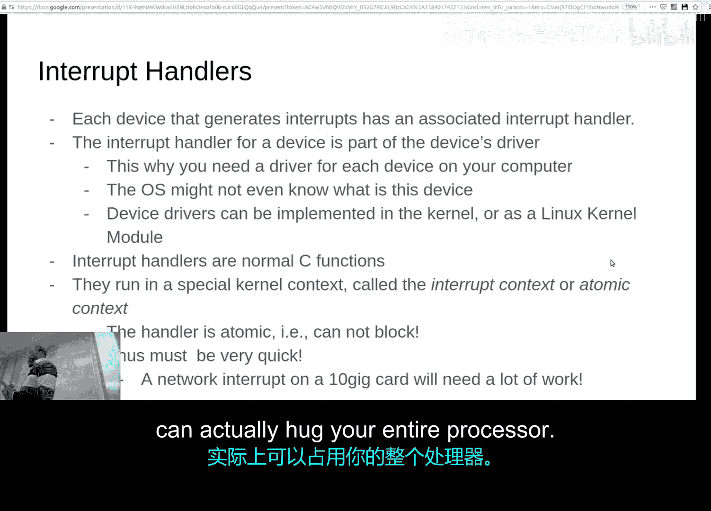

为什么需要中断？CPU的运行速度极快，而硬件设备（如键盘、磁盘、网卡）相对慢得多。中断机制允许硬件在准备好数据或需要服务时主动“打断”CPU，而不是让CPU不断地去询问（轮询）每个设备，从而极大地提高了效率。

中断使得硬件能够异步地通知处理器。中断控制器是一个硬件芯片，它管理着多条中断请求线，每条线（IRQ）都有一个唯一的编号。例如：
*   **IRQ 0**：定时器中断。
*   **IRQ 1**：键盘中断。

并非所有IRQ号都是预先静态分配的。许多设备（如PCI总线上的设备）的中断号是动态分配的，这为支持大量新硬件提供了灵活性。

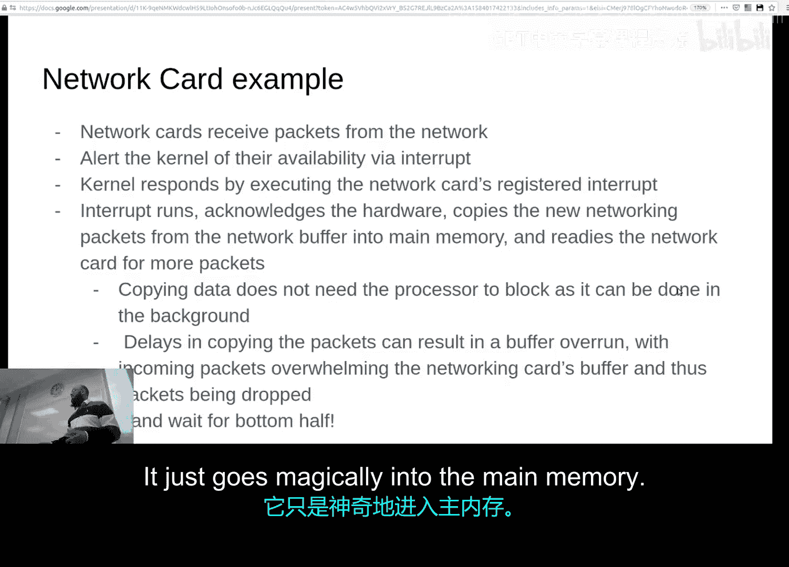

中断与异常的区别在于来源：**中断**来自硬件设备，**异常**来自CPU内部（由软件错误或系统调用触发）。

中断处理程序（或称中断服务例程）是与特定设备关联的函数，通常作为设备驱动程序的一部分。它们运行在一个特殊的**中断上下文**中，具有以下关键特性：
*   **原子性**：中断处理程序必须快速执行完毕，不能阻塞（例如，不能睡眠或等待资源）。
*   **不可重入**：同一中断处理程序不会在多个处理器上并发执行，这简化了驱动开发。

## 上半部与下半部

由于中断处理程序要求快速且不能阻塞，但实际设备操作（如处理网络数据包）可能很耗时，Linux采用了**上半部**和**下半部**的机制将中断处理分割开来。

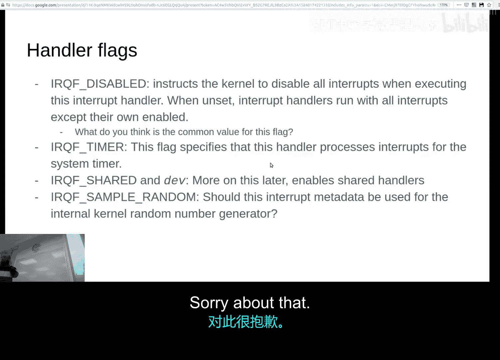

**上半部**是实际的中断处理程序，它在中断发生时立即执行，负责执行最紧急、时间敏感的任务：
*   对中断进行应答。
*   复位硬件以便接收新的中断。
*   将数据从硬件缓冲区复制到内存（例如，网卡数据）。

**下半部**负责处理剩余的大部分工作，这些工作可以稍后执行：
*   处理数据（例如，解析网络协议）。
*   执行可能阻塞的操作。

以网络卡为例：当数据包到达时，中断触发。上半部迅速将数据从网卡硬件缓冲区复制到内核内存，并确认中断。随后，下半部被调度执行，负责处理这些数据包（如TCP/IP协议栈处理）。

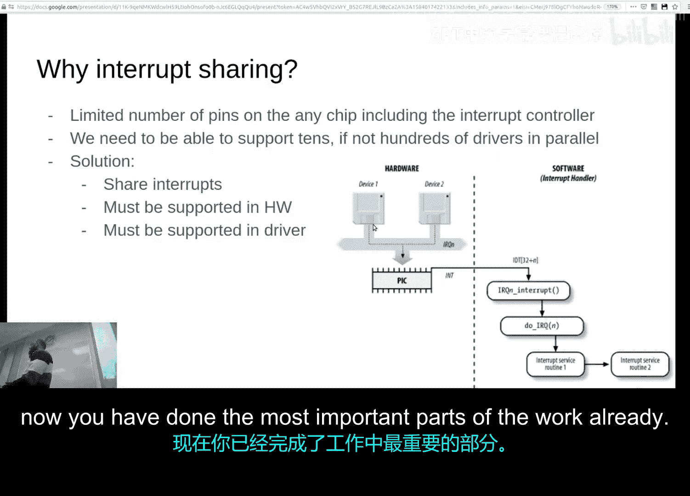

## 注册中断处理程序

设备驱动程序通过`request_irq()`函数向内核注册中断处理程序。该函数定义在`<linux/interrupt.h>`中。

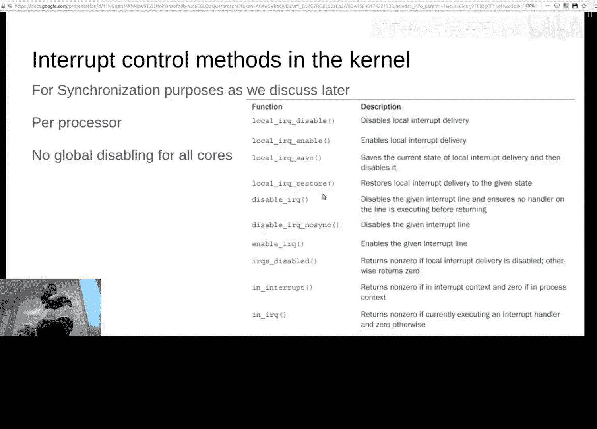

以下是`request_irq`函数的一个示例：
```c
int request_irq(unsigned int irq,
                irq_handler_t handler,
                unsigned long flags,
                const char *name,
                void *dev);
```
*   `irq`: 要申请的中断号。
*   `handler`: 指向中断处理函数的指针。
*   `flags`: 中断标志，用于控制中断行为。
*   `name`: 设备的ASCII名称，用于在`/proc/interrupts`中显示。
*   `dev`: 用于共享中断线时识别设备的唯一标识符。

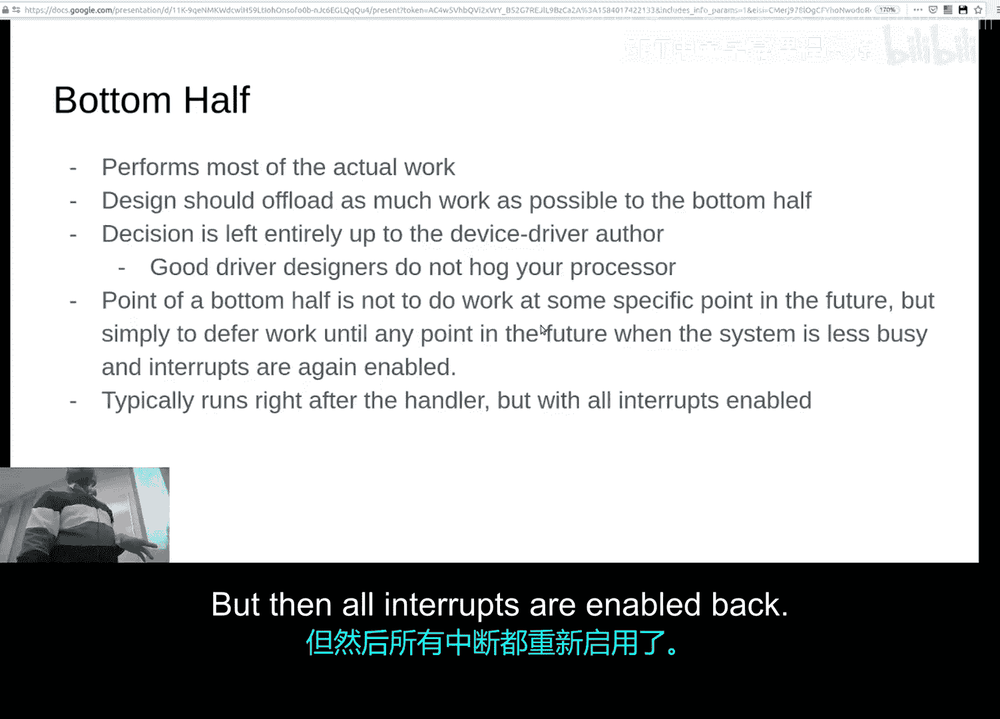

重要的`flags`包括：
*   `IRQF_DISABLED`: 设置后，在处理该中断期间，所有其他中断都会被禁用（谨慎使用）。
*   `IRQF_SHARED`: 允许多个设备共享同一条中断线。
*   `IRQF_TIMER`: 标记为定时器中断。
*   `IRQF_SAMPLE_RANDOM`: 告知内核可以将此中断的时序作为随机数生成器的熵源。

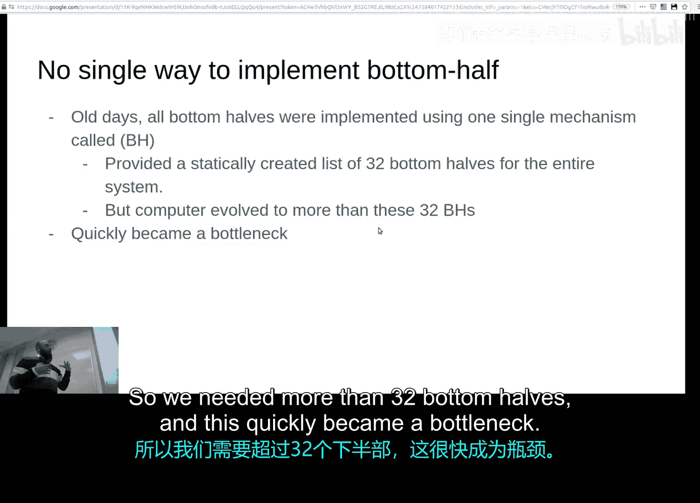

## 中断共享与同步

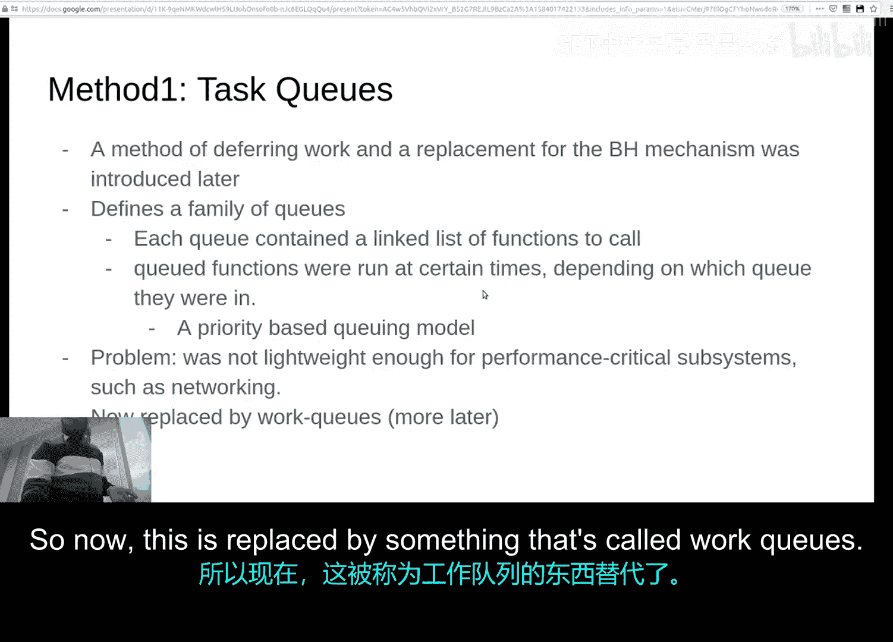

中断共享允许多个设备共用一条IRQ线，这对于IRQ引脚有限的系统非常重要。要实现共享，硬件和驱动都必须支持。当中断发生时，内核会调用该IRQ线上所有注册的处理程序，每个处理程序需要检查是否是其关联的设备产生了中断。

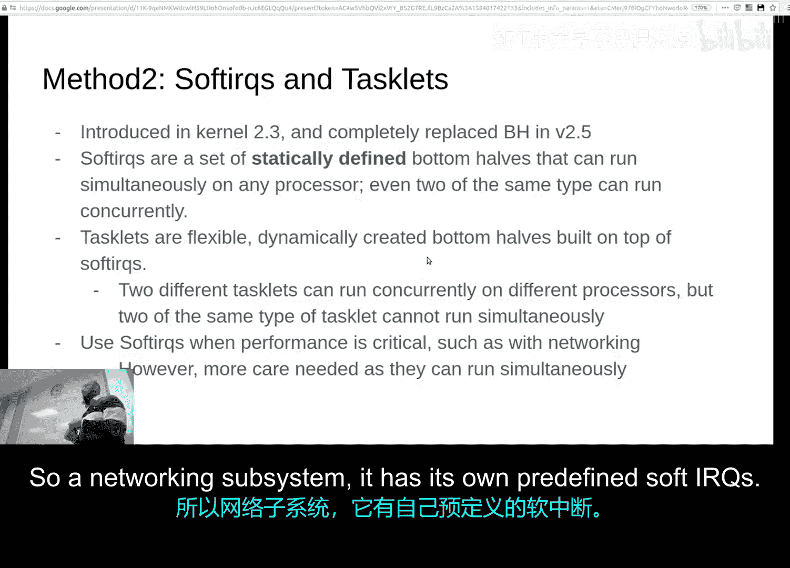

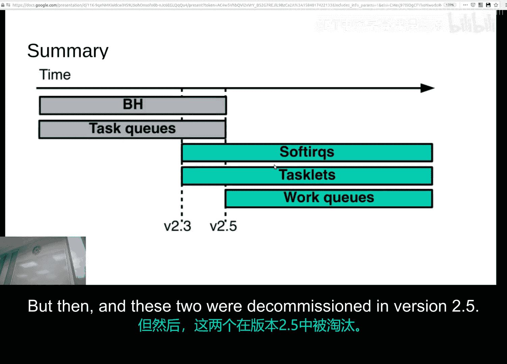

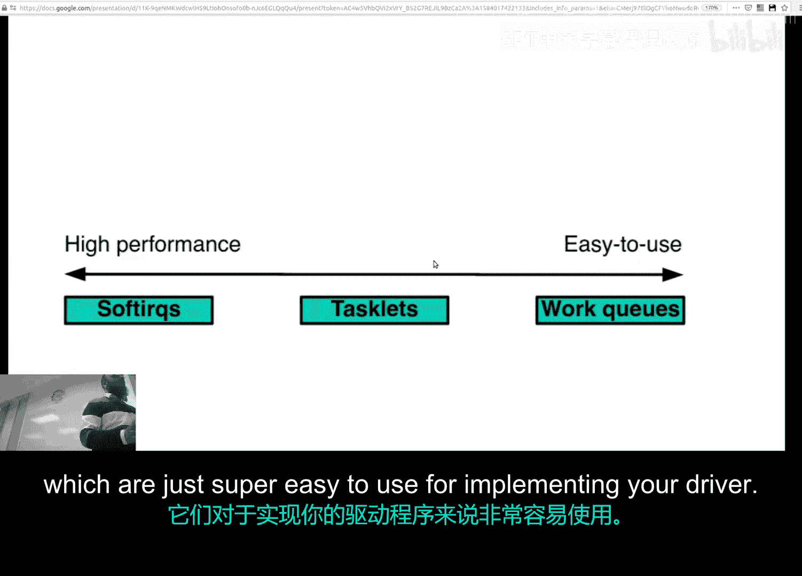

关于同步：
*   在单处理器系统上，可以禁用本地CPU的中断。
*   在多处理器系统上，没有全局禁用所有CPU中断的简单方法。驱动程序开发者必须使用自旋锁等同步原语来处理不同CPU间的并发问题。

## 实现下半部的机制

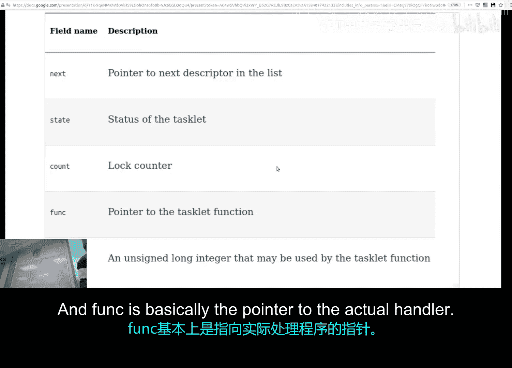

Linux提供了多种机制来实现下半部，以适应不同的性能和复杂度需求。

以下是几种主要的实现下半部的机制：
1.  **软中断**：静态定义，有固定的类型（如网络收发、定时器）。它们可以同时在多个处理器上运行，因此要求是可重入的。性能最高，但使用复杂。
2.  **tasklet**：基于软中断实现，但同一个tasklet不能同时在多个CPU上运行，这简化了编程。它们是大多数驱动程序下半部的首选。
3.  **工作队列**：将下半部工作交给一个内核线程执行。这个线程运行在进程上下文中，因此可以睡眠、阻塞，适用于需要执行可能阻塞的操作（如I/O）的下半部工作。使用最简单，但性能开销相对较大。
4.  **线程化中断**：一种较新的方法，其中整个中断处理（包括上半部）都被移到一个专用的内核线程中运行，进一步简化了驱动设计。

性能与易用性对比如下：
*   **性能**：软中断 > tasklet > 工作队列。
*   **易用性**：工作队列 > tasklet > 软中断。

`ksoftirqd`是一个每个CPU都有的内核线程。当软中断负载过高时，它会负责处理这些软中断，防止用户空间进程完全得不到CPU时间。

## 总结

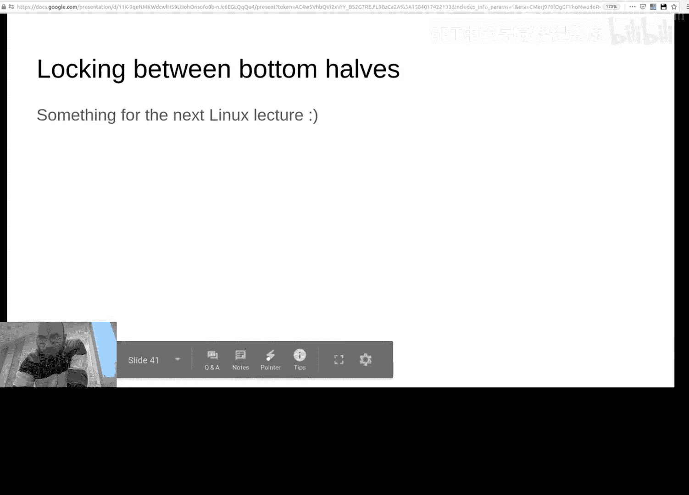

本节课中我们一起学习了Linux内核中系统调用和中断处理的核心机制。我们了解到系统调用是用户程序与内核通信的桥梁，但其添加和管理非常严格。中断是硬件与CPU高效通信的基础，Linux通过上半部/下半部机制巧妙地平衡了响应速度和处理复杂度。我们还探讨了实现下半部的多种方法（软中断、tasklet、工作队列），它们各有优劣，适用于不同的场景。理解这些机制对于深入操作系统内核和驱动程序开发至关重要。