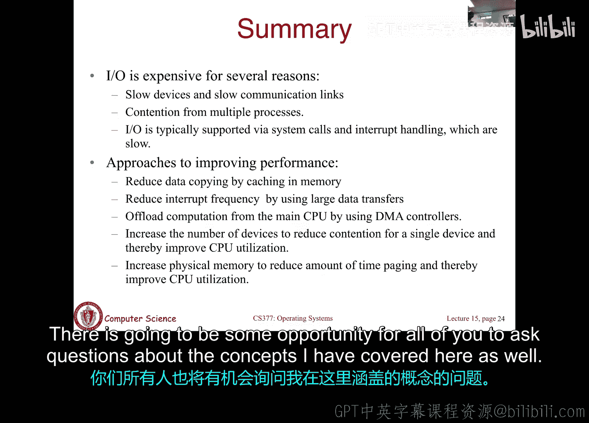
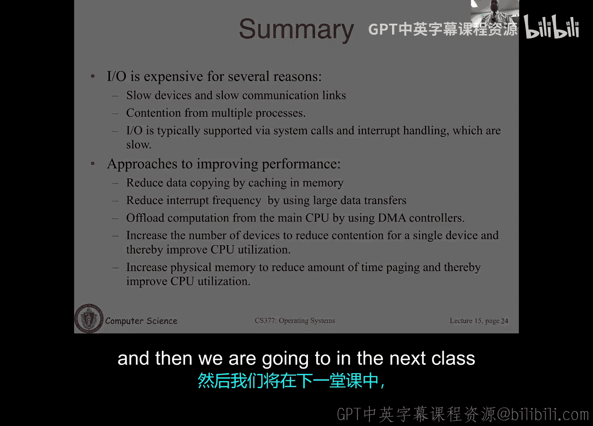

# 麻省大学《操作系统 设计与实现｜CS 577 Operating Systems Design and Implementation 2020》中英字幕 p29 -29-Lec15 Screencast_ I_O and Device Drivers - Overview (03_16_20).zh_en -BV1iP2CBaEHr_p29-

Okay so welcome to the first virtual lecture of the semester today we are going to talk about IO systems and as we have done in the past today's lecture is going to be on general concepts and then next time we are going to talk about mini specific IO systems and concepts so in today's class I'm going to cover a few things first is how IO hardware has influenced the design of operating systems how IO services are provided by an OS how does the OS implement those services and how can the IO performance be improved by the OS so let's start with the basics。

If you remember。In the very first few lectures I presented to you a slide that showed basic architectural concepts so we are going to visit that again。

 but look at it from the perspective of I devices and iOS subsist。

So if you remember the key components of that figure included a system bus， it included the CPU。

 it included memory and it included I devices and the system bus was the interface of the interconnect that allowed the processor to communicate with memory for I devices to communicate with the CPU as well as read or write data from from memory。

So keeping that picture in mind and I'm going to show you that picture again in just a minute the key components that we are going to focus on now are the IO devices themselves so typical IO device uses what is called a port mapped IO and later on we'll see a different method of performing IO called memory map iO as well so for now assuming a port mapped ios architecture each device is going to be assumed to have four registers for communication this includes the status register which is used to convey the status of the device to the processor and the status could be busy it could be ready or it could be an error then there is a control register which is where the CPU will write the control command to the IO device typically it could be a read or a write command and then there's a data。

Register for sending data。From the device to the CPU and the data out register where the data is being sent from the CPU to the device。

 So so those those are the four registers and then we have the controller itself for each device the controller is going to receive commands from the processor which is return to the controller register and then is going to translate them to device actions and we are going to。

Cover iO concepts very broadly， so this is going to apply to all kinds of devices。

 everything from the disk， printer， keyboard， mice。

 displays and things so that sort as well as all kinds of nontradal i devices such as joysticks or touch surfaces and things of that sort。

So， so here's the picture I wanted to show you， which is the slightly modified version of the picture we have seen before。

 So here we have the processor。 we have the memory and we have the system bus。

 but now looking at the i devices themselves will see that there are a number of them here。

 each i device actually has a controller and then there's the device itself。

 So all communication with the iio device actually happens through the controller for that specific device。

 So each device is going to have a controller which is what is being used to communicate to that device。

So looking at that picture in a little more detail that part of the system bus that is used to communicate with I devices could include what is called the PCI bus which is a peripheral bus there are other kinds of buses that are also used for I communicationication such as the USB bus and others and they will connect typically to me say a PCI bus。

Now as you can see the same concept apply here， this is part of the system bus that is specifically being used for Iio communicationication and you will see in the picture that there is for every device as a controller so for the graphics card ass a graphics controller and for the disk which is shown as an ID disk here there's an ID controller Now keep in mind that certain controllers can actually communicate with multiple devices every device needs a controller but some controllers can control multiple devices not just one an example here is the sy controller that communicate with multiple sy disks and there's a sy bus that is used to communicate with these disks and there is also an ID controller shown here which is used to control multiple disks and this case and if you remember how the USB ports look on your machine there is there maybe。

Multiple ports， so you can communicate with multiple USB devices using a USB bus。

Under USB controller。So， there are many kinds of i devices that you will see on a typical machine and they will range from things like a keyboard。

 a mouse to a graphics card to the network interface cards。And so on。

 And that all i devices are typically slow， but the speeds can vary dramatically by orders of magnitude and that is what this slide shows you'll see things like keyboard which might receive as few as 10 bytes per second depending on how fast you can type and then you have things like the gigab ethernet card on your machine where the communication is much faster you can have up 225 MBbit per second which is around a gigabit per second and so on。

 So so vast differences in speeds， but nevertheless by and large they're still slower than the processor and the memory on your machine。

Now， if you take a look at the kernel IO subsystem， which is in the OS。

 you will see that the way these devices interface with the rest of the OS includes two layers there is a device independent layer which is called the kernel IO subsystem in this picture and that is used to communicate with devices in a somewhat independent fashion independent of the specifics of the device themselves and underneath the device independent layer is the device dependent layer and these are all device drivers so each device driver has all of the code needed to communicate with that specific device so it encodes most of the device specific characteristics So so requests come through the kernel to the device independent subIO subsystem and then they are sent to the device driver for communication with the actual device for reading or writing from that actual device and and as you know the device driver。

Its really the lowest layer of the kernel that is used to interface with all kinds of i devices。

 and there has to be a device driver again for each device I device in the system。

So as I mentioned earlier， each device has ports or registers that are used to。

And ports are essentially addressed just as you have memory addresses and you have each memory location has an address that is used to communicate with that memory device So do i devices each of the ports of the I device essentially has an address and that's the address that is going to be used to communicate with that device And as it turns out on most of the Intel architectures are on Intel architecture as well as most of the other architectures these i addresses are also preallocated for certain kinds of devices。

 So for example， as is shown in this figure， the first range of addresses。

 which is0 through F are reserved for DMA controllers and then you might have the serial ports have a certain address range and so on。

 So if you have those devices those are the address ranges that are used for those devices for communication by the device。

Now going back a layer up to the OS there are several i services that an OS is going to provide there are highlevel services such as file system services that it will get to in a couple of lectures that are provided where you might have things like naming files and and so on now as it turns out i devices in Uniix are also given a file like abstractions so all i devices essentially appear as files they are in the slash dev directory of Uniix file system or our Linux file system and these are the devices these devices have specific names like slash dev slash mouse which will allow you to figure out what the devices and that is the device name that is used for communication by application so so Uni devices appear as files in the slash dev directory。

This access control， which is the same method that is used for files where you have readwrite permissions that tell you whether you can read or write to a device by specific users or app processes on your machine the other services that will get to also include allocating addresses for devices。

 buffering， caching for efficient communication， there's things like iO scheduling which is。

Useful when there are multiple users accessing that device。

 and then there are device drivers that provide services for accessing that device using device specific characteristics。

So we will now talk a little bit about various ways by which IO communications occurs and so the way to think about this is how do device drivers actually work and there are three things we are going to look at the first one which is the simplest is you implementing device drivers using polling。

So this is the simplest method where the CPU is going to use the four registers on that IO device and use those registers for communicating with the device so there are a number of steps that a CPU has to go through in order to read or write to a device so lets assume that you would like to write to a1 byte to a device。

To an iio device So the way the process works is the device driver is going to essentially busy weight and keep pulling the status register into the device id once the device is id the next iO operation can start and the device driver through the CPU is going to write a command to the register to the command register and in this case it's the right command and then it's also going to write the byte that it wishes to output to the data out register because if you're going to write you to actually tell the device what youre writing to it and then it is going to set the status register to command ready which tells the controller that the CPU has actually the device driver through the CPU has sent a new command to this device。

So once the controller receives this command or sees that command in the register。

 it is going to set the status register to busy which means now it' is executing that IO operation and then the controller is going to read the command register see that this is a right command it is going to take the byte from the data out register and then it is going to essentially try to write to that IO device if the operation succeeds the controller is going to then say that it is succeeded by starting the status to idL and。

In the CPU in the meantime is essentially the device driver in the CPU which is executing on the CPU in the mean is simply pullinging the device in a busy weight fashion。

 It's just checking the status register to see if it is actually completed the controller is completed the IO command and if so then you can start the next command and so on so if youre trying to read one byte to a device this is the way you're going to implement a device driver but as you can see since IO devices are themselves slow。

 this might take a while for the IO operation to complete in the meantime the CPU is just sitting there busy weighting which is going to waste CPU cycles so we need a better method to implement the device drivers it gets us to the next one so this is the simplest method its called polling better method that reduces or eliminates busy weight is to use interrupts So in this case。

All of the operations that。We talked about on the previous slides will still hold but what is going to happen is the device driver is no longer going to busy wait waiting for that command to complete instead it is going to wait for an interrupt so in this case the device driver will output the command to the command register it is going to write the bytete to output to the device to the output register and then it's just going to allow the CPU to execute other things and once the device has finished its operation it is going to raise an interrupt at this point you're going to basically use the interrupt vectoror come back to the kernel and then you're going to go back to the interrupt handler which is in the device driver and then essentially see what the status of the command was and say it is completed and then start the next operation。

So， so what interrupts allow you to do in this case is to reduce or eliminate in this case。

 busy wait。 So your IO operations are more efficient。 There is no wasting of CPU cycles。

And we have seen interrupts before and the same concepts are going to be used here where you have a interrupt vector or a table where you have intra handlers prereisters there are specific ones for IO operations there are many other kinds of interests but once we care about here are for IO operations so we are going to use those within the device drivers to allow communication with IO devices。

So moving on， the third type of device driver or IO method that we are going to look at is called direct memory access or DMA。

Now the previous two methods which is polling an interbased IO both assume that you are communicating with IO devices one byte at a time and if you have simple devices like keyboard where you might be typing that is okay but there are many devices where you might have to transfer large volumes of data examples could be a disk where youre trying to read or write blocks or larger files or the graphics card where you might be outputting an entire screen worth of pixels out to the monitor in this case trying to read or write one byte at a time it is going to be an extremely wasteful and also very slow so we need a better better method for larger volume of IO。

So that method is referred to as DMA or direct memory access。

 and as the name suggests what we have in this case it is an additional bio controller called the。

Can read or write directly to memory。 So in this case。

 rather than using data in a data out register a DMA controller as an address register。

 So the CPU is going to tell the controller what command it wants to issue maybe it's read or right and then it points the DMA controller to a location in memory。

 So if you're trying to write to a device you will write that data to to a block in memory and then provide that address to the DMA controller And then once DMA controller starts executing that operation it's simply going to read data from memory and directly outputted device without the CPU in the loop。

 So the CPU is no longer going to be part of the io operation it's essentially being performed by the DMA controller。

 So in this case the DMA acts like a proxy for the CPU the CPU is no longer in the io path once the command has been issued and data is either。

Being written directly from Ram to the device data is being read from the device into the Ram without see when the CPU can then execute other things in the meanwhile。

 So the one thing to。Keep in mind is that the DMA controller and the CPU are going to compete on the system bus for memory access because the CPU is now executing other processes and it might have to fetch data or instructions from Ram and the DMA controller is executing IO operation So it's also going to read or write from Ram but the system bus is going to arbitrate this concurrent access for us and this is still more efficient than having the CPU be involved in every byte of IO。

So here's a picture that shows us how that process that I described actually works。

 So you have one is the CPU is going to issue a command to the DMA controller and that command is going to be either read or write and then you have to specify a memory address where the DMA controller can read or write chunk of memory so you basically give it an address and the size and then the DMA controller in this case is trying to read or write a block of memory to a disk or write read or write to disk So it's going to take that request it is going to then take that chunk of memory and then either write it to disk or is going to read from disk and then write to that block of memory And once all that is done it's going to interrupt the CPU like before and then the CPU can look at the status of the command and if the data has been successfully read or write and it can then move on to the next command。

So with these three methods in mind， which include polling， intra based and DMA based。Communication。

 Let's look at some other services and abstractions that an O S is going to provide， so。

The OS provides a much higher level abstraction of devices and typically much of the the low level details are encapsulated in the device driver and the device independent layer within the OS is going to use even higher level abstractions to readdirect write to these devices so so each device is abstracted using a few different dimensions the first one is。

What is the unit of transfer is are you reading or writing a byte of memory。

 a byte of data to the ion device or are you reading or writing entire blocks and depending on which of the two it is the device either becomes a character based device or a block based device character based devices are ones where you are reading or writing one byte at a time examples of these would include things like the keyboard the mice and so on and block based devices are ones where you are reading or writing entire blocks of memory。

The second characteristic of a device is whether it is sequential or random in sequential mode you are reading or writing sequential so again keyboard you are going to read a sequential stream of input from the keyboard to the machine。

And but whereas for disk， you can read or write to any location on this。

 or it's a random access device。 The timing of how you are going to perform this io is also a characteristic of the device where you can be synchronous or asynchronous synchronous essentially means blocking communication to the device and asynchronous essentially means you can issue a command and then you can essentially go off and do other things So it's non-blocking i devices can be shared or dedicated there is also the speed of the device depending on the type of the device and the more other important characteristic is whether there's input device an output device or both things like disk you can read or write but in case of a keyboard。

 you're only going to read， it doesn't make any sense to write to a keyboard or the graphics card is essentially an output device where you're going to write。

 but you cannot read from a typical monitor unless， of course you are。That screen。

 in which case you can output and input from the screen as well。

So as I shown in the bottom here depending on the type of device you will get a different classification so for example a keyboard is a sequential device that is character based a disk is a block device that could be written either randomly or it can also have sequential reads or write to a disk。

So so the types of devices and their characteristics are also shown in an example here where some of the examples I mentioned are already there there are several others here so for example the transfer mode if it's character base you have things like terminals and keyboard block base is disk。

 the access method is sequential you will have things like a modem or a keyboard again and if it's random you will have things like disks and CDDRs。

 the transfer methodology asynchronous you will have things like tape devices it asynchronous which is nonblocking you will have keyboard devices i devices could be shared or dedicated shared devices could include things like disk and dedicated ones could be things like tape device speed would include characteristics like the latency。

 the seek time， the transfer rate， the delay between operations and so on。

And last but lastly it with that depending on whether the device is read only such as a CD write only such as a graphics controller or rewrite which as a disk you will have again different kinds of devices。

Let's take a look at block based and character based devices in a little bit more detail and then when we come to Min specific the lecture next time we are going to go into this law into a lot more detail and look at how the device drivers themselves are implemented for block and character based devices。

So as I said before， block based devices include things like disk drives commands that you issue to block based devices are things like read。

 write seek and so on and then depending on whether the IO is itself raw which means you're reading or writing raw blocks or file based which means you are actually reading a writing files the file system layer within the OS is then going to translate them to raw command you will have different kinds of aes we might also have memory mapped iO to files which I'm going to get to in a later slide or you can directly use DMA based communication。

Now if you have character devices such as keyboards， mouse， serial ports and so on。

 the commands are going to at a higher level the commands are going to be get or put which then at a lower level essentially become read or write to the command registers and then there are libraries that may be layered on top that allow you to read right to these devices。

Now an important characteristic of all of these device drivers is to somehow manage the mismatch between the speed of the IO device on one hand and the speed of the processor on the other and as I showed you earlier there is going to be devices with very different types of characteristics and that operate at very different speeds and then theres a processor which typically ends up being much faster than most of these devices。

So an important question an OS designer has to address is how are you going to manage this mismatch because the device might be reading or writing at certain speed which is very different from the rate at which a CPU might be reading or writing to memory so this is handled through a technique called buffering where you have pieces of memory both on the device itself and also some memory that is used by the OS on RA that is going to be used to manage this mismatch so on the device side you have iO buffering where you have a small piece of memory on the device So the device will then read or write from that memory and then the controller is going to provide that to that whatever has been read or read or return into that piece of memory to the OS and then the applications。

So in case of a disk， for example， you will have a disk buffer on the hard hard drive itself。

 which is where you are going to first read or write things and then the disk controller and the DMA controller will read from that memory buffer and then transfer it to a buffer and physical memory。

Then the DMA controller is going to interrupt the CPU when it's done if you have simpler devices where you have the data in or data out registers。

 that is basically the memory on the device but， but for other more sophisticated devices you have more memory for example。

 another example is a graphics card where specs for the graphics card will tell you how much memory on that graphic card which acts as the buffer as well。

Now， in addition to the buffer on the device side， theres also going to be a buffer on the OS S side。

 which is essentially going to be a memory buffer that the OS S manages。

 and this is again to deal with speed mismatches， so。

So what would happen in this case is you were going to read or write to a memory buffer and then if you are doing DMA you are going to tell the DMA controller to read or write from that buffer and send that data to the device or if you are reading data from the device to first put that data in the buffer before telling the CPU that the operation has completed so this is going to minimize the time where the CPU has to be in the loop for communication with the IO device。

Now interestingly on the OS side， this buffer is also going to act as a cache which means that all recently read or written data to the device is going to be also held in the buffer for some period of time it's not like for once you have finished an IO operation the data in the buffer is discarded youre going to keep it in the cache now the most useful purpose of having the cache is the file system which does a lot of IO to the disk so by keeping data in the cache you can reduce the number of slower disk operations and the idea is whenever our process is trying to read a file you are going to first see if the disk blocks of that file are first in the OS before cache If so your operation can be satisfied directly from the buffer cache and only if you have a cache miss are you essentially going to go to the disk to retrieve that data。

So the two examples shown here are what happens when you issue a read or a write command or the disc。

The first step is always to check whether the data is in the cache in the case of a read operation so as shown here。

 if the block is in memory， you are just going to return the block from memory which is from the buffer cache。

 otherwise you are going to actually issue a read operation to the to the disk。I in case of right。

 what you can do is you can essentially take the right operation and then essentially write it to the buffer cash。

And then return and later on you can actually flush that block to disk now depending on whether you do that or you actually directly write to your disk you are going to get two types of caching policies and I mentioned this to caching policies also earlier in the course and they are referred to as right through or right back。

The right through policy when you have right operation you are going to write the cache。

 but also write to the disk at the same time。 So the data propagates all the way through the cache to the I device the right back policy the data is actually written to the cache。

The buffer cash and the right operation returns and the process is given the impression that the right operation is completed。

 but the right has actually only gone to the buffer cash and at the later O is going to flush that to flush that written block or the dirty block to the disk Now there are tradeoffs between the right through policy and the right back policy The right through policy is more reliable because all i operations immediately get sent to the i device this way if the machine has a failure then any unwritten data that's in the buffer cash is not lost unlike。

In the right back policy， the right back policy because you are writing data to the buffer cash and then writing it to the I device at a later time。

 if you have a failure of the OS or a power failure then any unwritten data to the device is going to be lost even though the the applications have been told that the operation is actually completed。

So right back policies are faster， they are a performance optimization but they are less reliable than the right through policies many file systems today still use the right back policy because they optimize or the tradeoff that they go for is performance or reliability which is better from an applications perspective but occasionally when there are failures you might have loss of unwritten blocks on your file system。

So if you not try to put all of these things together what is a typical read call is shown in this picture so this is a DMA based IO so the user process is going to request a read from a device the OS is first going to check if the data is already in its buffer cache If so you have a cache hit the read operation can return and there is no communication with the iO device but if there is a cache miss then the OSs has to tell the device driver to perform a read the device driver is going to invoke the DMA controller it's going to essentially give it the address of the block to be read and its going to point it to a block of memory in Ram or in the buffer cache where that data has to be put。

Then the CPU then goes off towards other things executes other processes and in the meantime the DMA controller is going to essentially transfer the data from the disk to the kernel buffer well from the disk first to the disk buffer and from the disk buffer to the kernel buffer and then once that operation is completed it' is going to send an interrupt to the processor that is going to cause the interrupt handler to be invoked the device driver executes again it is going to take that data and then。

Hand it to the application and then basically put the process back in the readyicule where it can execute and actually take that red data and do whatever it needed to do。

 So then the process， once it gets scheduled is going to begin execution following the rate system call。

 So this is all the steps that you to perform going all the way from the application to the Os to the device driver and the device itself for a typical read call。

Okay， and so the steps are also shown in this picture。

Im not going to repeat all of the steps again but as you can see you start with the application which is executing on the processor。

 you first check in the buffer cache which is shown there and then if you have a cachet you are done otherwise you go send that to the disk controller and the DMA controller which together perform the operation using the memory buffer and then interrupt the CPU once you are done。

So。So this is basically slide is putting all of what I said in this previous few slides together into the request lifecycle for IO so you start always with the application process which is triggering the IO operation typically in this if you are thinking about file IO you have a process thats simply trying to read or write from a file using a user library the user library makes a system call because iO operations are sensitive or privileged operation only the OS can perform it the system call essentially then it works。

The device driver within the kernel， the device driver essentially in this case。

 if it's a disk operation， is going to invoke the disk controller and the DMA controller。

 the DMA controller is going to perform the operation I did forgot to mention that you will also check the buffer cache before you send that I device the I operation to the disk driver But once you get to the disk driver you're going to use the DMA controller and the disk controller to perform the operation once the operation completes。

 you're going to essentially make a interrupt and then hand that block to the process which can then continue execution from where it was left where it left off。

So。I have one other thing to mention all of what we talked about uses a concept called port map Iio where the discs or the devices are resumed to have ports where you are reading or writing to that IO device。

 another method of IO which we really haven't touched upon in this course and we won't do much of this even for Linux is what is called memory map I。

There to understand the differences。 there are three pictures shown on this slide。

 The pictures shown a is port map Iio， where the memory and i devices have two different and distinct sets of addresses。

 So remember that memory has address， which are memory location。 And I said i devices are ports。

 Each port also has an address。 And these are distinct addresses。 So port。

5 is going to be different from memory address5。 So they so because they are distinct address spaces。

 Now that's how port mapped io works or PM in memory mapped i O I devices address is integrated with memory address。

 So there is a single address space。 So maybe the first end locations in this case could be memory addresses and the latter locations are essentially addresses that look like memory addresses。

 but essentially are addresses of ports。So in memory map IO IO devices are simply addressed as if you are addressing a memory pointer or memory location。

 you simply read or write a memory location which just happens to be a special address the address actually is an IO address and then by in doing so you are reading or writing to an IO device itself。

Many embedded devices essentially use memory map Iio。

 but more sophisticated machines essentially provide port map Iio memory map Iio is much simpler because you do not have to deal with ports or anything like that you're simply reading or writing memory locations so all i devices are mapped to some address range which goes beyond the size of physical Ram so you just extend the memory addresses that you can address and have some of them be I devices So that is shown in picture B so in this case the gray box essentially refers addresses that refer to I devices and the rest of the box essentially refers to memory addresses。

Now many machines are going to also provide a hybrid option which is shown in figure C where they support port map as well as memory map I so you can use either one depending on which one is more convenient so you can still use port map I to communicate with devices but some devices can be addressed using the memory map mechanism and so thats your hybrid method many sophisticated machines essentially allow you to do either one depending on which one is better for the application。

So keep that in mind because we have really not talked about how memory mapped IO actually works because although you have memory like addresses from application standpoint。

 the CPU still has to then take those memory addresses and then read or write or not the CPU rather the OSS to take those memory addresses and then actually read or write to the device underneath so underneath you still need device drivers and so on to actually do the IO it is just a better abstraction for the rest of the kernel and for the applications themselves。

So， in summary， I devices are slow and as a result。

 we have to employ all kinds of mechanisms to deal with these speed issues。

So we looked at three different ways for communicating with IO slow IO devices。

 The first one was polling based where the CPU essentially busy wait waiting for a slow IO device to complete the second one was intra based where the CPU went off and did other things while the IO operation was in progress and the third one was DMA based where you essentially off its sle of slow IO to different controller and that controller was responsible for dealing with with slow IO and we looked at number of mechanisms to actually improve IO performance where basically had to deal with buffering so you had buffering on the device itself to deal with speed mismatches we had buffering on the OSight to deal with speed match matches and you also had a buffer cache where frequently access data I stored to allow you to deal with a slow device by reading or writing directly to a cache before you may read or write to a device。

And we looked at both the right through and right back policy that you can implement in your cash that gave you a trade off between performance and reliability。

 The overall goal here is to improve the utilization of the CPU while still dealing with slow I devices。

And keep in mind that there are many i devices on the machine and all of them are essentially accessed to the system bus。

 So the system bus has to arbitrate between multiple ongoing ios on your machine and the CPU that is also accessing data from memory So all of which is why it is an important component in the in the overall system。

So with that， we have gone through very quickly。overview of key concepts of I devices and how device drivers works at a very high level and in the next class I am actually going to go into details of Mins and discuss how Min actually implements these concepts。

And because this is a virtual class， the lecture is shorter than usual and I'm hoping to allow all of you to ask questions using an online Zoom mechanism or through Piazza so that we can actually have some discussion going because this has just been a lecture that I delivered there is going to be some opportunity for all of you to ask questions about the concepts I've covered here as well。

So with that I'm going to stop here and then we are going to in the next class talk about meaning specific concepts。

