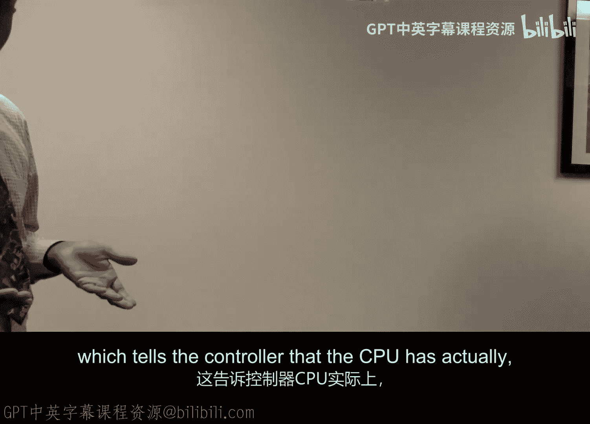
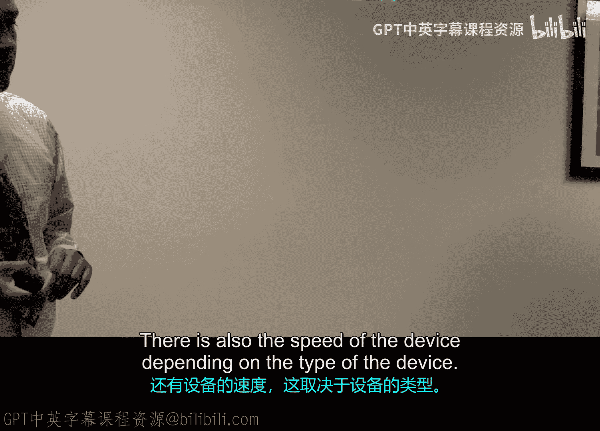
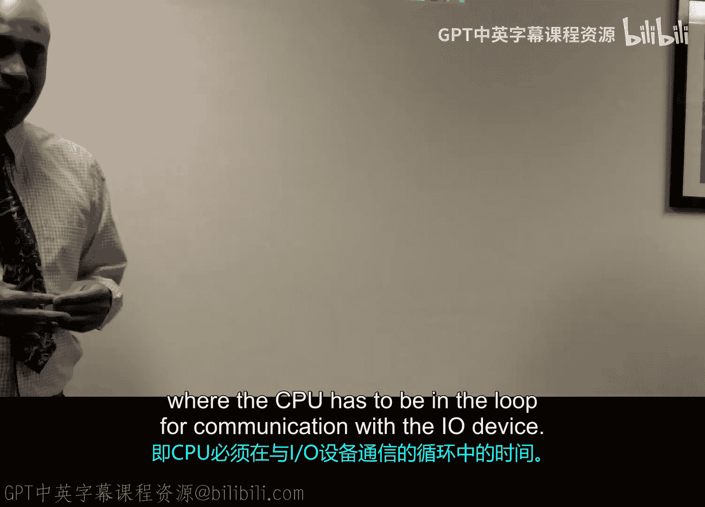

# 麻省大学《操作系统 设计与实现｜CS 577 Operating Systems Design and Implementation 2020》中英字幕 p30 -30-Lec15 Video_ I_O and Device Drivers - Overview (03_16_20).zh_en -BV1iP2CBaEHr_p30-

。

Okay， so welcome to the first virtual lecture of the semester。

Today we are going to talk about IO systems and as we have done in the past。

 today's lecture is going to be on general concepts and then next time we are going to talk about mini specific IO systems and concepts so in today's class I'm going to cover a few things first is how IO hardware has influenced the design of operating systems。

How I services are provided by an OS， how does the OS implement those services and how can the IO performance be improved by the OSs。

 so let's start with the basics。If you' remember。In the very first few lectures I presented to you a slide that showed basic architectural concepts。

 so we are going to visit that again， but look at it from the perspective of iOS devices and iOS subsyist。

So if you remember， the key components of that figure included the system bus， it included the CPU。

 it included memory， and it included I devices and the system bus was the interface of the interconnect that allowed the processor to communicate with memory for I devices to communicate with the CPU as well as read or write data from memory。

So keeping that picture in mind and I'm going to show you that picture I again in just a minute the key components that we are going to focus on now the IO devices themselves so a typical IO device uses what is called a port mapped IO and later on we'll see a different method of performing IO called memory map IO as well so for now assuming a port map IO architecture each device is going to be assumed to have four registers for communication this includes the status register which is used to convey the status of the device to the processor and the status could be busy it could be ready or it could be an error then there's a control register which is where the CPU will write the control command to the IO device typically it could be a read or write command and then there's a data。

Agister for sending data。From the device to the CPU and the data out register where the data is being sent from the CPU to the device so so those are the four registers and then we have the controller itself for each device and the controller is going to receive commands from the processor which is returned to the control register and then is going to translate them to device actions and we are going to。

Cover IO concepts very broadly， so this is going to apply to all kinds of devices。

 everything from the disc， printer， keyboard， mice。

 displays and things of that sort as well as all kinds of nontraditional i devices such as joysticks or touch surfaces things of that sort。

So here's the picture I wanted to show you which is a slightly modified version of the picture we have seen before。

 so here we have the processor we have the memory and we have the system bus but now looking at the IO devices themselves will see that there are a number of them here each IO device actually has a controller and then there's the device itself so all communication with the IO device actually happens through the controller for that specific device so each device is going to have a controller which is what is being used to communicate to that device。

So looking at that picture in a little more detail。

 the part of the system bus that is used to communicate with I devices could include what's called the PCI bus which is a peripheral bus。

 there are other kinds of buses that are also used for I communicationation such as the USB bus and other sudden they will connect typically to we say a PCI bus。

Now as you can see the same concept apply here， this is part of the system bus that is specifically being used for I communicationmunication and you will see in the picture that there is for every device there's a controller so for the graphics card there's a graphics controller and for the disk which is shown as an ID disk here there's an ID controller now keep in mind that certain controllers can actually communicate with multiple devices every device needs a controller but some controllers can control multiple devices not just one an example here is the Scy controller that communicates with multiple sy disks and there's a sy bus that is used to communicate with these disks and there is also an ID controller shown here which is used to control multiple disks and this case and if you remember how either the USB ports look on your machine there is。

Multiple ports so you can communicate with multiple USB devices using a USB bus。

Under the USB controller。So there are many kinds of i devices that you will see on a typical machine。

 and they will range from things like a keyboard， a mouse to a graphics card。

 to the network interface cards。And so on and all our devices are typically slow but the speeds can vary dramatically by or of magnitude and that is what this slide shows。

 you'll see things like keyboard which might receive as few as 10 bytes per second depending on how fast you can time and then you have things like the gigabit ethernet card of your machine may the communication is much faster。

 you can have up 225 meits per second which is around a gigabit。P second and so on。

 so wash differences in speed， but nevertheless by and blood is' still slower than the processor and the memory on your machine。

Now if you take a look at the kernel IO subsystem which is in the OS you will see that the way these devices interface with the rest of the OS includes two layers there is a device independent layer which is called the kernel IO subsystem in this picture and that is used to communicate with devices in a somewhat independent fashion independent of the specifics of the device themselves and underneath the device independent layer is the device dependent layer and these are all device drivers so each device driver has all of the code needed to communicate with that specific device so it encodes most of the device specific characteristics so so requests come through the kernel to the device independent subIio subsystem and then they are sent to the device driver for communication with the actual device for reading or writing from their actual device and and as you know the device driver。

It's really the lowest layer of the kernel that is used to interface with all kinds of ion devices and there has to be a device driver again for each device I device in the system。

So as I mentioned earlier， each device has ports or registers that are used to communicate with it and ports are essentially addressed just as you have memory addresses and you have each memory location has an address that is used to communicate with that memory device so do I devices。

 each of the ports of the I device essentially has an address and that's the address that is going to be used to communicate with that device and as it turns out almost most the Intel architectures are on Intel architecture as well as most of the other architectures these I addresses are also preallocated for certain kinds of devices so for example as is shown in this figure the first range of addresses which is zero through F are reserved for DNAA controllers and then you might have the serial ports have a certain address range。

So if you have those devices， those are the address ranges that are used for those devices for the communication by the device driver。

Now going back a layer up to the OS， there are several iOS services that an OS is going to provide。

 there are highle services such as file System services that I will get to in a couple of lectures that are provided where you might have things like naming files and so on now as it turns out。

IO devices in UniX are also given a file like abstraction so all iO devices essentially appear as files they are in the s dev directory of or Uniix file system or our Linux file system and these are the devices these devices have specific names like s dev/lash mouse which will allow you to figure out what the devices and that is the device name that is used for communication by application so so UniX devices appear as files in the slash devm directory is access control which is the same method that is used for files where you have read write permissions that tell you whether you can read or write to a device by specific users or processes on your machine other services that will get to also include allocating addresses for devices buffer caching for efficient communication。

There's things like IO scheduling， which is。Useful when there are multiple users accessing that device and then there are deviceed drivers that provide services for accessing that device using device specific characteristics。

So youll now talk a little bit about various ways by which IO communication occurs and so the way to think about this is how do device drivers actually work and there are three things we are going to look at the first one which is the simplest is you implementing device drivers using pullinging so this is the simplest method where the CPU is going to use the four registers on that IO。

Devicice and use those registers for communicating with the device。 So。

 so there are a number of steps that CPUs to go through in order to read or write to a device。 So。

 so let's assume that you would like to。Right to one byte to a device to an I device so the way the process works is the device driver is going to essentially busy rate and keep pulling the status register until the device is id once the device is right the next time operation can start and the device driver through the CPU is going to write a command to the register to the command register and in this case it's the right command and then it's also going to write the byte that it wishes to output the data out register because if you're going to write youre to actually tell the device what you're right into it and then it is going to set the status register to command ready which tells the controller that the CPU has actually the device driver through the CPU has sent a new command to this device。

So once the controller receives this command or sees that command in the register。

 it is going to set the status register to busy which means now it's executing that IO operation and then the controller is going to read the command register。

 see that this is the right command it is going to take the byte from the data out register and then it is going to essentially try to write to that iOS device。

If the operation succeeds， the controller is going to then say that it has succeeded and by setting the status to idle and。

In the CPU in the meantime， is essentially the device driver in the CPU。

 which is executing on the CPU in the meanwhile， is simply pulling the device in a busy wait fashion。

 it's just checking the status register to see if it is actually completed。

 the controller is completed。And if so， then you can start the next and so。

 So if you're trying to read one bitete。To a device this is the way you are going to implement a device driver but as you can see since i devices are themselves slow this might take a while for the I operation to complete in the meantime the CPU is just sitting there busy waiting which is going to waste CPU cycles so we need a better method to implement these device drivers it gets us to the next one so this is the simplest method it's called polling a better method that reduces or eliminates busy weight is to use interns so in this case all of the operations that。

We talked about on the previous slides will still hold but what is going to happen is the device driver is no longer going to busy wait waiting for that command to complete instead it is going to wait for an interrupt so in this case the device driver will output the command to the command register its going to write by technique to output to the device to the output register and then it's just going to allow the CPU to execute other things and once the device has finished its operation it is going to raise an in at this point you're going to basically use the in vectoror come back to the kernel and then you're going to go back to the intratangr which is in the device driver and then essentially see what the status of the command was and say it is completed and that start the next operation。

So， so what interrupts allow you to do in this case is to reduce or eliminate in this case busy weight。

 so your IO operations are more efficient， there is no wasting of CPU settles。

And we have seen ins before and the same concept is going to be used here where you have an intra vector or a table where you are intratless pre registers。

 there are specific ones for IO operations there are many other kinds of interests but the ones we care about here are for IO operations so we are going to use those within the device drivers to allow communication with IO devices。

So moving on the third type of device driver or IO method that we are going to look at is called direct memory access or DMA both assume you communicating with I devices one byte at a time and if you have simple devices like keyboard where you might be typing that is okay but there are many devices where you might have to transfer large volumes of data examples could be a disk where you're trying to read the right blocks or larger files or the graphics card where you might be outputting an entire screen worth of pixels out to the monitor in this case trying to read the right one byte at a time it's going to be extremely wasteful and also very slow so we need a better method for larger volume of IO。

So that method is referred to as DMA or direct memory access and as the name suggests what we have in this case there is an additional Iio controller called the DMA controller that can read or write directly to memory so in this case rather than using data in the data out register the DMA controller is an address register so the CPU is going to tell the controller what command it wants to issue it's read or write and then it points the DMA controller to a location in so if you're trying to write to a device youll write that data to buffer to a block in memory and provides that address to the DMA controller and then once the DMA controller starts executing that operation its simply going to read data from memory and directly output it to the device without the CPU in the loop so the CPU is no longer going to be part of the Iio operation its essentially。

Being performed by the DNA controller so in this case the DM acts like a proxy for the CPU the CPU is no longer in the iO path once the command has been issued and data is either being written directly from RA to the device or data is being read from the device into the Ram without see when the CPU can then execute other things in the mean so the one thing to。

Keep in mind is that the DMA controller and the CPU are going to compete on the system bus for memory access because the CPU is now executing other processes and it might have to fetch data or instructions from RA and the DMA controller is executing I operation so it's also going to read or right from now but the system bus is going to arbitrate this concurrent axis for us and it is still more efficient than having the CPU be involved in every byte of I。

So here's a picture that shows us how that process that I described actually works。

 So you have step one is the CPU is going to issue a command to the DNAA controller and that command is going to be either read a write and then you to specify a memory address where the DNA controller can read the right chunk of memory so you basically give it an address and the size and then the DNAA controller in this case is trying to read or write a block of memory to a disk or write read a write to disk So it's going to take that request it is going to then take that chunk of memory and then either write it to disk or is going to read from disk and then write to that block of memory once all that is done。

 it's going to interrupt the CPU like before and then the CPU can look at the status of the command And if the data has been successfully write or written。

 it can then move on to the next command。So with these three methods in mind， which include polling。

 intra based and DM based。For communication， let's look at some other services and abstractions that an Osis going to provide。

The OS provides a much higher level abstraction of devices and typically much of the lowle details are encapsulated in the device driver the device independent layer within the OS is going to use even higherle abstractions to readdirect write to these devices so each device is abstracted using a few different dimension the first one is what is the unit of transfer you're reading or writing a byte of memory byte of data to the other device or are you're reading or writing entire type blocks and depending on which of the two it is the device either becomes a character based device or a block based device character based device are once where you're reading or writing one byte at a time examples of these would include things like the keyboard。

 the mice and so on and block based devices are once where you are reading or writing it blocks of。

The second characteristic of a device is whether it is sequential or random in sequential mode you're reading or writing sequential so again keyboard you're going to read a sequential stream of input from the keyboard to the machine。

And but whereas for this， you can read or write to any location on this。

 so it's a random access device。

The timing of how you're going to perform this I is also a characteristic with the device where you can be synchronous or asynchronous synchronous essentially means blocking communication to the device an asynchronous essentially means can issue a command and then you can essentially go off and do other things so it's nonbing I devices can be shared or dedicated there is also the speed of the device depending on the type of the device and the more other important characteristic is whether it's input device and output device or both things like this you can read or right but in case of a keyboard you're only going to read it doesn't make any sense to write or keyboard or the graphics card is essentially an output device where you're going to write but you cannot read from a typical monitor unless of course you're a touch screen in which case you can output and input from the screen as well。

So as I shown in the bottom here， depending on the type of device you will get a different classification so for example a keyboard is a sequential device that is character based。

 a disk is a block device that could be written either randomly or it can also have sequential reads or right to a disk。

So the types of devices and the characteristics are also shown in an example here where some of the examples I mentioned already there there are several others here so for example the transfer mode if it's character base you have things like terminals and keyboard block base disk the access method is sequential you will have things like a modem or a keyboard again and if it's random you will have things like disks and serial norms。

 the transfer methodologyology is synchronous， you will have things like tape devices。

 is asynchronous which is nonblocking， you will have keyboard devices i devices could be shared or dedicated shared devices could include things like disk and dedicated once could be things like tape device speed would include characteristics like the latency。

 the C time。The transfer rate then between operations and so。

And but last it that depending on whether the device is read only such as a CD。

 write only such as a graphics controller or rewrite or desk youll have different kinds of devices。

Let's take a look at block based and character based devices in a little bit more detail and then when we come to Min specific the lecture next time we're going to go into this law into a lot more detail and look at how the device drivers themselves are implemented for block and character based devices。

So as I said before， block based devices include things like this drives commands that you show to block based devices are things like read。

 write， seek and so on， and then depending on whether the I is itself raw。

 which means you're reading or writing raw blocks or file based which means you're actually reading or writing files the file system there within the OSs then we would translate them to raw commands。

 you will have different kinds of accesses we might also have every map IO two files which I'm going to get to in later slide or you can directly use DNAA based communication。

Now if you have character devices such as keyboards， mouse， serial ports and so on。

 the commands are going to at a higher level， the commands are going to be get or put which then at a lower level essentially become read or right to the commander registers and then there are libraries that will be layer on top that allow you to read write to these devices。

Now an important characteristic of all of these device driverss is to somehow manage the mismatch between the speed of the IO device on one hand and the speed of the processor of the other。

 and as I showed you earlier， there is going to be devices with very different types of characteristics and that operate at very different speeds。

 and then there's a processor which typically ends up being much faster than most of these devices。

So an important question that OS designer has to address is how are going to manage this mismatch because the device might be reading or writing at certain speed。

 which is very different from the rate at which a CPU might be reading or writing to memory。

So this is handed through a technique called buffering where you have pieces of memory both on the device itself and also some memory that is used on by the OS on RA that is going to be used to manage thismat so on the device side you have IO buffering where you have a small piece of memory on the device so the device will then read or right from that memory and then the controller is going to provide that whatever has been read read or written into that piece of memory to the OS and the applications。

So in case of a disk， for example， you will have a disk buffer on the hard hard drive itself。

 which is where you are going to first read or write things and then the diskconroller and Medi controller will read from that memory buffer and then transfer it to a buffer and physical memory。

AndThen the D controller is going to enter the CPU when it done if you have simpler devices where the data in or data out registers。

 that is basically the memory on the device but for other more sophisticated devices you have more memory for example。

 another example is a graphics card where specs for the graphics card we tell you how much memory on that graphic card which acts as the buffer as well。

Now in addition to the buffer on the device side there's also going to be a buffer on the OSs side。

 which is essentially going to be a memory buffer that the OSs manages and this is again to deal with speed in mis matches。

So what would happen in this case is you are going to read or write to a memory buffer and then if you are doing DMA you are going to tell the DMA controller to read or write from that buffer and send that data to the device。

 or if you're reading data from the device to first put that data in the buffer before telling the CPU that the operation is complete。

So this is going to minimize the time where the CPU has to be the loop for communication with the iO。

Now interestingly on the OS side， this buffer is also going to act as a cache which means that all recently read or written data to the device is going to be also had in the buffer for some period of time it's not like for once you have finished an IO operation data in the buffer or discard you're going to keep it in the cache now the most useful purpose of having the cache is the file system which does a lot of Iload to the disk so by keeping data in the cache you can reduce the number of slower disk operations And the idea is whenever a process is trying to read a file you're going to first see if the disk blocks of that file are first in the OS buffer cache if so your operation can be satisfied directly from the buffer cache and only if you have cache miss you're essentially going to go to the disk to retrieve that data。

So the two examples shown here are what happens when you issue a read or a write commander that this。

The first step is always to check whether the data is in the cache in the case of a read operation so as shown here if the block is in memory you' are just going to return the block from memory which is from the buffer cache。

 otherwise you are going to actually issue a read operation to the disk。in case of right。

 what you can do is you can essentially take the right operation and then essentially write it to the buffer cache。

And then return and later on you can actually flush that block to disk now depending on whether you do that or you actually directly write to your disk you are going to get two types of caching policies and I mentioned this to caching policies also earlier in the course and they are referred to as right through or write back。

the right through policy when you have right operation， you're going to write the cache。

 but also write to the disk at the same time。 so the data propagates all the way through the cache to the i device。

The right back policy， the data has actually returned to the cache。

The buffer cache and the right operation returns and the process is given the impression that the right operation is completed。

 but the right has actually only gone to the buffer cache and at a later point the OS is going to flush that to flush that written block or the dirty block the disk Now there are tradeoffs between the right through policy in the right back policy the right through policy is more reliable because all i operations immediately gets sent to the i device this way if the machine has a failure then any unwritten data that's in the buffer cache is not lost unlike in the right back policy the right back policy because you're writing data to the buffer cache and then writing it to the i device at a later time if you have a failure of the OS or power failure then any unwritten data to the device is going to be lost even though。

The applications have been told that the operation is actually complete。

So right back policies are faster， they are a performance optimization but they are less reliable than the right through policies。

 many file systems today still use the right back policy because they optimize of the tradeoff that they go for its performance or reliability which is better from an applications that blocks through moving file system。

So if youre not try to put all of these things together what is a typical read call is shown in this picture so this is a DMA based IO so the user process is going to request a read from a device the OS is first going to check if the data is already in its buffer cache if so your cache hit the read operation can return and there is no communication with IO。

But if there is a cache miss， then the OS has to tell the device driver to perform a read。

 the device driver is going to invoke the DMA controller。

 its going to essentially give it the address of the block to be read and it's going to point it to a block of memory in RA or in the buffer cache where that data has to be put。

AndThen the CPU then goes off those other things executes other processes and in the meantime the DMA controller is going to essentially transfer the data from the disk to the kernel buffer from the disk first to the disk buffer and from the disk buffer to the kernel buffer and then once that operation is completed it's going to send an interrupt to the processor that's going to cause the interrupt handler to be moved the device server executes again it's going to take that data and then。

Add it to the application and then basically put the process back in the ridicule where it can execute and actually take that red data and do whatever it needed to do so then the process once it gets scheduled is going to begin execution following the read system call so this is all the steps that you know to perform going all the way from the application to the OSs to the device driver and the device itself for a typical read call。

And， so the steps are also shown in this picture。I'm not going to repeat all of the steps again。

 but as you can see you start with the application which is executing on the processor。

 you first check in the buffer cache which is shown there。

 and then if you have cache yet you're done， otherwise you go send that to the disk controller and the DMA controller which together perform the operation using the memory buffer and then interrupt the CPU once you're done。

说。

So this is basically slide is putting all of what I said in this previous few slides together into the request lifecycl for IO so you start all of us with the application process which is triggering the IO operation typically in this if you are thinking about file IO a process that is simply trying to rewrite from a file using the user library the user library makes a system call because IO operations are sensitive or preent operation only the OS can perform the system called essentially then in works。

The device driver within the kernel， the device driver essentially in this case if it's a disk operation。

 is going to invoke the disk controller and the DMA controller。

 the DMA controller is going to perform the operation I did prefer to mention that you will also check the buffer cache before you send that I deviceice the I operation to the disk driver but once you get to the disk driver you're going to use the DMA controller and the disk controller to perform the operation once the operation completes you going essentially make an interrupt and then send that block to the process which can then continue execution from where it goes left very left off。

So。I have one other thing to mention all of what we talked about uses a concept called Port Matt tile。

 where the discs of the devices are resume to have ports where you're reading or writing to that ion device。

Another method of iO， which we really haven't touched upon in this course。

 and we won't do much of this even for minutes is what is called memory map time。Now。

 to understand the differences， there are three pictures shown on this slide。

The picture shown a is port mapio where the memory and i devices have two different and distinct sets of addresses so remember that memory has address which are memory location and I said i devices supports each port also has an address and these are distinct addresses so port。

5 is going to be different from memory address file so so because they are distinct address spaces now that's how port mapped iO works or PM in memory mapped iO i devices addresses is integrated with memory address。

 so there's a single address space So maybe the first end locations in this case could be memory addresses and the latter locations are essentially addresses that look like memory addresses。

 but essentially our addresses of ports。So in memory map IO。

 I devices are simply addressed as if you're addressing a memory point or a memory location。

 you simply read or write a memory location which just happens to be a special address。

 the address actually is an IO address and then by doing so you are reading or writing to an IO device itself。

Many embedded devices essentially use memory mat， but more sophisticated machines essentially provide port man。

Memory map I is much simpler because you do not have to deal with ports or anything like that you're simply reading or memory locations。

 so all i devices are mapped to some address range which goes beyond the size of physical RA so you just extend the memory addresses that you can address and have some of them be i devices so that is shown in picture B so in this case the gray box essentially refer addresses that refer to i devices and the rest of the box essentially refers to memory addresses。

Now many machines are going to also provide you a hybrid option which is shown in figure C where they support port map as well as memory map I so you can use either one depending on which one is more convenient so you can still use port map I on a commator devices but some devices can be addressed using the memory mechanism and so that's your hybrid method。

 many sophisticated machines essentially allow you to do either one depending on which one is better for the application。

So keep that in mind because we have really not talked about how memory map IO actually works because although you have memory like addresses from application standpoint。

 the CPU still has to then take those memory addresses and then read or write or the CPU rather OSS to take those memory addresses and then actually read or write to the device underneath。

 so underneath you still need device drivers and so on to actually do the IO。

 it is just a better abstraction for the rest of the kernel and for the applications themselves。

So in summary， I devices are slow and as a result， we have to employ all kinds of mechanisms to deal with these fluid issues。

So we looked at three different ways for communicating with IO slow I devices。

 the first one was pollingbased where the CPU essentially busy waits rating for a slow IO device to complete the second one was intra based where the CPU went off and did other things while the I operation was in progress and the third one was DMA based where you essentially offload at sle of slow iO put different controller and that controller was responsible for dealing with with slow I and we looked at number of mechanisms to actually improve IO performance where basically had to deal with buffer so you had buffering on the device itself to deal with speed mismatches that buffering on the overight to deal with speed matchmatches and you also add a buffer cache where frequently access data stored to allow you to deal with slow device by reading or writing directly to a cache before you may read or write to a device。

And we looked at both the right through and the right back policy that you can implement in your cash that gave you a trade off between performance and reliability。

The overall goal here is to improve the utilization of the CPU while still dealing with slow i devices。

And keep in mind that there are many i devices on the machine and all of them are essentially accessed to the system bus。

 so the system bus has to arbitrate between multiple ongoing is on your machine and the CPU that's also accessing data from memory so all which is why it's an important component in the overall system。

So in that， we have gone through very quickly。Overview of key concepts of IO devices and how device drivers works at a very high level and in the next class I'm actually going to go into details of Min and discuss how Min actually implements these concepts。

And because this is a virtual class， the lecturelet。

Is shorter than usual and I'm hoping to allow all of you to ask questions using an online Zoom mechanism or through Piazza so that we can actually have some discussion mode because this has just been a lectures that have delivered there's going to be some opportunity for all of you to ask questions about the concepts I've covered here。

So that I'm going to stop here， and then we are going to in the next class。

 talk about meaning specific concepts。

