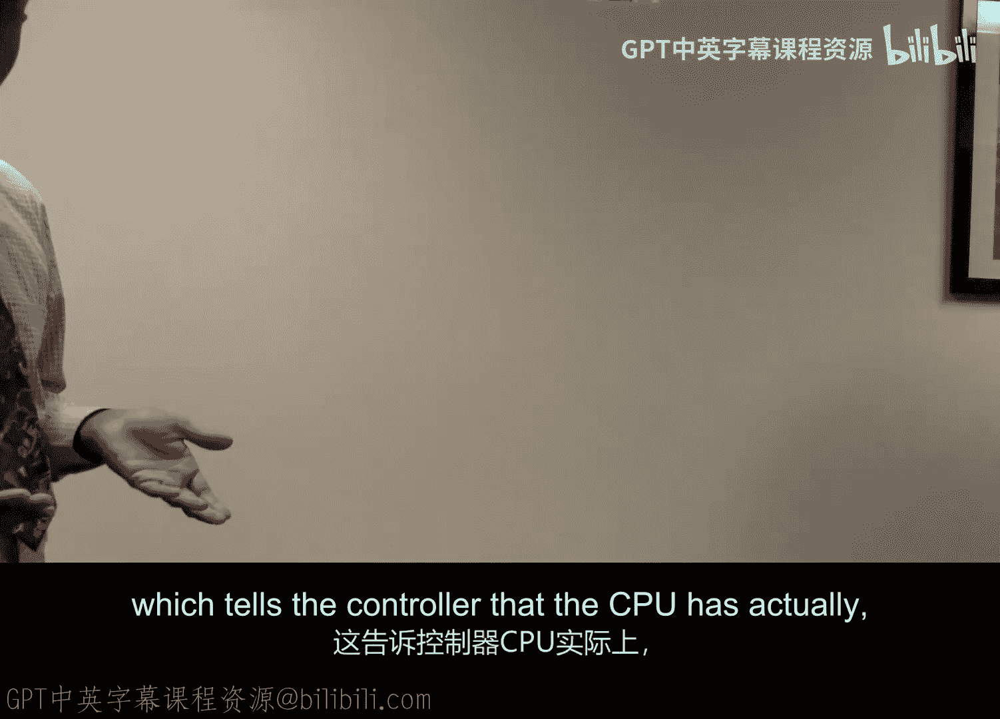

# 操作系统设计与实现：15：I/O与设备驱动概述 🖥️

在本节课中，我们将学习操作系统如何与输入/输出设备进行交互。我们将探讨I/O硬件如何影响操作系统设计、操作系统如何提供I/O服务、如何实现这些服务，以及如何通过操作系统提升I/O性能。

## I/O硬件与系统架构

上一节我们介绍了课程概述，本节中我们来看看I/O硬件的基本架构。如果还记得最初的几节课，我们展示过一张描述基本架构概念的幻灯片。现在我们将从I/O设备和子系统的角度重新审视它。

该图的关键组成部分包括系统总线、CPU、内存和I/O设备。系统总线作为互连接口，允许处理器与内存通信，也允许I/O设备与CPU通信以及从内存读写数据。

典型的I/O设备使用一种称为**端口映射I/O**的机制。在这种架构下，每个设备通常有四个寄存器用于通信：
*   **状态寄存器**：用于向处理器传达设备状态（如忙碌、就绪或错误）。
*   **控制寄存器**：CPU向I/O设备写入控制命令（如读或写）的地方。
*   **数据输入寄存器**：用于将数据从设备发送到CPU。
*   **数据输出寄存器**：用于将数据从CPU发送到设备。

每个设备还有一个**控制器**，它接收来自处理器的命令（写入控制寄存器），并将其转换为设备的具体操作。这个概念适用于所有类型的设备，从磁盘、打印机到键盘、鼠标、显示器，以及游戏手柄、触摸屏等非传统I/O设备。

下图展示了一个修改后的系统架构图，突出了I/O部分：

如图所示，处理器、内存通过系统总线连接。与I/O设备的所有通信都通过该设备专用的**控制器**进行。用于I/O通信的系统总线部分可能包括**PCI总线**（一种外围总线）等。其他总线如USB总线通常也会连接到PCI总线。请注意，一个控制器可以控制多个设备（例如，SCSI控制器控制多个SCSI磁盘，USB控制器管理多个USB端口）。

## I/O设备的多样性

机器上存在多种I/O设备，从键盘、鼠标到显卡、网卡等。所有I/O设备通常都比处理器和内存慢，但不同设备之间的速度差异可能非常巨大。

以下是不同设备速度的示例：
*   键盘：可能低至每秒10字节。
*   千兆以太网卡：可达约每秒125兆字节（约1吉比特/秒）。

尽管速度各异，但I/O设备总体上仍比处理器和内存慢。

## 内核I/O子系统

了解了硬件基础后，我们来看看操作系统如何组织这些设备。I/O设备与操作系统其余部分的接口包括两层：
1.  **设备无关层**（内核I/O子系统）：以相对独立于设备具体细节的方式与设备通信。
2.  **设备依赖层**（设备驱动程序）：包含与特定设备通信所需的所有代码，封装了大部分设备特定特性。

I/O请求通过内核到达设备无关子系统，然后被发送到相应的设备驱动程序，以便与实际设备进行读写操作。**设备驱动程序**是内核中用于与所有I/O设备接口的最低层，系统中每个I/O设备都必须有对应的驱动程序。

## I/O端口与地址

如前所述，每个设备都有用于通信的端口或寄存器。就像内存地址用于访问内存位置一样，I/O设备的每个端口也有一个地址。在大多数架构（如Intel架构）中，这些I/O地址是预先分配给特定类型设备的。

例如，以下是一些预分配的地址范围：
*   地址 `0x0000` 到 `0x000F`：保留给DMA控制器。
*   串行端口有特定的地址范围。

设备驱动程序使用这些地址范围与设备通信。

## 操作系统提供的I/O服务

回到操作系统层面，操作系统提供多种I/O服务。除了我们将要在后续课程中讨论的高级服务（如文件系统服务，涉及文件命名等），还包括以下内容：

在Unix/Linux系统中，I/O设备也被赋予类似文件的抽象。所有I/O设备都作为文件出现在 `/dev` 目录下。例如，`/dev/psaux` 可能代表PS/2鼠标。应用程序通过这个设备文件名与设备通信。

以下是操作系统提供的主要I/O服务：
*   **访问控制**：使用与文件相同的读写权限机制，控制特定用户或进程能否读写设备。
*   **设备地址分配**：为设备分配地址。
*   **缓冲与缓存**：为高效通信进行缓冲和缓存。
*   **I/O调度**：当多个用户访问同一设备时非常有用。
*   **设备驱动程序**：提供使用设备特定特性访问设备的服务。

## I/O通信方式

现在，我们来谈谈设备驱动程序实际工作的几种方式。主要有三种方法：

### 1. 轮询

这是最简单的方法，CPU使用I/O设备上的四个寄存器与设备通信。以下是向设备写入一个字节的典型步骤：

1.  设备驱动程序不断轮询状态寄存器，直到设备空闲。
2.  设备空闲后，CPU通过设备驱动程序将命令（写命令）写入控制寄存器。
3.  CPU将要输出的字节写入数据输出寄存器。
4.  CPU将状态寄存器设置为“命令就绪”，通知控制器有新命令。
5.  控制器看到命令后，将状态寄存器设置为“忙碌”，表示正在执行I/O操作。
6.  控制器读取控制寄存器，识别为写命令，从数据输出寄存器读取字节，并尝试写入I/O设备。
7.  操作成功后，控制器将状态设置为“空闲”。
8.  在此期间，CPU（运行设备驱动程序）一直在忙等待，轮询状态寄存器以查看操作是否完成。

**缺点**：由于I/O设备本身很慢，CPU在等待期间只是空转，浪费了CPU周期。

### 2. 中断驱动I/O

为了减少或消除忙等待，可以使用中断。在这种情况下，前面描述的步骤仍然成立，但关键区别在于设备驱动程序不再忙等待命令完成，而是等待中断。

工作流程如下：
1.  设备驱动程序将命令输出到控制寄存器，将字节写入数据输出寄存器。
2.  然后，它允许CPU去执行其他任务。
3.  设备完成操作后，会发出一个中断。
4.  中断使CPU通过中断向量表跳转到内核中的中断处理程序（位于设备驱动程序中）。
5.  中断处理程序检查命令状态，确认完成，然后启动下一个操作。

中断允许消除忙等待，使I/O操作更高效，不浪费CPU周期。操作系统使用中断向量表来处理各种中断，其中包含专门用于I/O操作的中断。

### 3. 直接内存访问

轮询和中断驱动I/O都假设每次与I/O设备通信一个字节。对于键盘这类简单设备可以接受，但对于需要传输大量数据的设备（如磁盘读写大文件，或显卡向显示器输出整屏像素），一次一字节的方式极其低效且缓慢。

更好的方法是**直接内存访问**。顾名思义，这种方法使用一个额外的I/O控制器——**DMA控制器**，它可以直接读写内存。

工作流程如下：
1.  CPU告诉DMA控制器要发出的命令（读或写），并指向内存中的一个位置（缓冲区地址）。
2.  如果要向设备写入，CPU将数据写入内存的缓冲区，并将该地址提供给DMA控制器。
3.  DMA控制器开始执行操作后，直接从内存读取数据并输出到设备，无需CPU参与。
4.  CPU在此期间可以执行其他任务。
5.  操作完成后，DMA控制器像之前一样中断CPU，CPU检查命令状态并继续。

**注意**：DMA控制器和CPU会竞争系统总线以访问内存，因为CPU执行其他进程时需要从RAM获取数据或指令，而DMA控制器也在执行I/O操作。系统总线会仲裁这种并发访问，但这仍然比让CPU参与每一个字节的I/O操作更高效。

下图展示了DMA过程：
1.  CPU向DMA控制器发出命令（读/写），并指定内存地址和大小。
2.  DMA控制器读取或写入该内存块到磁盘。
3.  完成后，DMA控制器中断CPU。
4.  CPU查看命令状态，若成功则继续下一个命令。

## 设备抽象与分类

操作系统提供了比设备驱动程序更高层次的设备抽象。设备无关层使用更高级的抽象来读写这些设备。每个设备可以从几个不同维度进行抽象：

以下是设备的主要分类维度：
*   **传输单元**：
    *   **字符设备**：以字节为单位读写（如键盘、鼠标）。
    *   **块设备**：以数据块为单位读写（如磁盘）。
*   **访问方法**：
    *   **顺序访问**：按顺序读写（如键盘输入流、磁带）。
    *   **随机访问**：可直接访问任何位置（如磁盘）。
*   **时序**：
    *   **同步**：阻塞式通信。
    *   **异步**：非阻塞式通信，发出命令后可执行其他任务。
*   **共享特性**：
    *   **共享设备**：可被多个进程同时使用（如磁盘）。
    *   **专用设备**：一次只能由一个进程使用（如磁带机）。
*   **速度**：设备的延迟、寻道时间、传输速率等。
*   **I/O方向**：
    *   **只读设备**（如CD-ROM）。
    *   **只写设备**（如图形控制器）。
    *   **读写设备**（如磁盘）。

*（图示：设备分类示例）*

*（图示：设备特性与示例）*

## 块设备与字符设备

让我们更详细地看看块设备和字符设备。在下一节关于Minix的课程中，我们将深入探讨如何为这两类设备实现驱动程序。

**块设备**（如磁盘驱动器）：
*   命令包括 `read`， `write`， `seek` 等。
*   I/O可以是**原始的**（直接读写原始块），也可以是**基于文件的**（通过文件系统读写文件，文件系统会将文件操作转换为原始块命令）。
*   也可以使用**内存映射I/O**访问文件（后续会讲到），或直接使用DMA通信。

**字符设备**（如键盘、鼠标、串口）：
*   高级命令是 `get` 或 `put`，在底层则转换为对控制寄存器的读写。
*   通常有库函数层叠在上面，方便应用程序读写这些设备。

## 缓冲与缓存

所有设备驱动程序的一个重要特性是管理I/O设备速度与处理器速度之间的不匹配。不同设备的操作速度差异很大，而处理器通常比大多数I/O设备快得多。

操作系统设计者需要解决如何管理这种速度不匹配的问题。这通过一种称为**缓冲**的技术来实现。

**设备端缓冲**：
*   设备本身有一小块内存作为I/O缓冲区。设备先读写这块内存，然后控制器将数据提供给操作系统和应用程序。
*   例如，硬盘上有磁盘缓冲区；显卡上有显存。

**操作系统端缓冲**：
*   操作系统管理的一块内存缓冲区，同样用于处理速度不匹配。
*   例如，读写操作先针对内存缓冲区进行。如果使用DMA，则告诉DMA控制器从该缓冲区读写数据并发送到设备；如果从设备读取数据，则先放入缓冲区，再通知CPU操作完成。
*   这可以最小化CPU参与I/O通信的时间。

有趣的是，操作系统端的缓冲区也充当**缓存**。所有最近读写设备的数据都会在缓冲区中保留一段时间。这对于文件系统特别有用，因为文件系统涉及大量磁盘I/O。将数据保留在缓存中可以减少较慢的磁盘操作次数。

**缓存工作流程**：
*   当进程尝试读取文件时，操作系统首先检查该文件的磁盘块是否已在OS缓冲区缓存中。
*   如果是（**缓存命中**），则可以直接从缓冲区缓存满足读取请求。
*   如果不是（**缓存未命中**），则需要到磁盘获取数据。

下图展示了针对磁盘的读写命令在缓存中的处理流程：

对于**读操作**：
1.  检查数据块是否在内存（缓冲区缓存）中。
2.  如果在，直接从内存返回数据块。
3.  如果不在，向磁盘发出读操作。

对于**写操作**：
1.  将数据写入缓冲区缓存。
2.  然后返回。之后，操作系统可以将该块刷新到磁盘。

根据写入时机，有两种缓存策略：
*   **写穿透**：执行写操作时，同时写入缓存和磁盘。数据立即传播到I/O设备。更可靠，但可能较慢。
*   **写回**：执行写操作时，只写入缓存并立即返回，给进程一种写操作已完成的印象。稍后，操作系统再将这个“脏”块刷新到磁盘。性能更好，但可靠性较低，因为如果系统在刷新前发生故障（如断电），已告知应用程序完成但未实际写入磁盘的数据将会丢失。

许多现代文件系统出于性能考虑，仍使用写回策略。

## 典型I/O请求生命周期

将上述所有内容整合起来，一个典型的基于DMA的读调用过程如下图所示：

1.  **用户进程**请求从设备读取数据。
2.  **操作系统**首先检查数据是否已在缓冲区缓存中。
    *   如果**缓存命中**，读取操作立即返回，无需I/O通信。
    *   如果**缓存未命中**，则继续。
3.  操作系统通知**设备驱动程序**执行读取。
4.  设备驱动程序调用**DMA控制器**，告知要读取的块地址，并指向RAM中缓冲区缓存的一个内存块用于存放数据。
5.  **CPU**转而执行其他进程。
6.  **DMA控制器**将数据从磁盘传输到内核缓冲区（先到磁盘缓冲区，再到内核缓冲区）。
7.  操作完成后，DMA控制器向处理器发送一个**中断**。
8.  中断导致**中断处理程序**（设备驱动程序的一部分）执行。
9.  中断处理程序获取数据，将其提供给应用程序，并将进程放回就绪队列。
10. 进程被调度后，从读系统调用之后继续执行。

## 端口映射I/O与内存映射I/O

我们讨论的所有内容都基于**端口映射I/O**的概念，即设备拥有端口，通过读写这些端口与I/O设备通信。

另一种I/O方法是**内存映射I/O**。为了理解区别，请看下图展示的三种情况：

*   **图A - 端口映射I/O**：内存和I/O设备有两套独立且不同的地址空间。内存地址和I/O端口地址是分开的。
*   **图B - 内存映射I/O**：I/O设备地址与内存地址集成在单一的地址空间中。I/O设备被映射到物理RAM大小之外的某个地址范围。访问这些特殊的内存地址实际上就是在访问I/O设备。
*   **图C - 混合型**：同时支持端口映射和内存映射I/O，可根据便利性选择使用哪种方式。

内存映射I/O更简单，因为无需处理单独的端口，只需像读写内存一样操作。许多嵌入式设备使用内存映射I/O，而更复杂的机器可能提供端口映射或混合方式。需要注意的是，尽管从应用程序角度看是内存地址，但底层仍然需要设备驱动程序来实际执行I/O操作，这只是为内核其余部分和应用程序提供了更好的抽象。

## 总结

本节课中我们一起学习了操作系统I/O与设备驱动的核心概念。

**关键要点总结**：
1.  I/O设备速度较慢，操作系统需要采用多种机制来处理这种速度差异。
2.  我们探讨了三种与I/O设备通信的方式：
    *   **轮询**：CPU忙等待，效率低。
    *   **中断驱动**：CPU在I/O操作期间可执行其他任务，消除了忙等待。
    *   **DMA**：将繁重的I/O任务卸载给专用控制器，CPU干预最少，效率最高。
3.  我们学习了多种提升I/O性能的机制，核心是**缓冲**：
    *   **设备端缓冲**：处理速度不匹配。
    *   **操作系统端缓冲**：同样用于速度匹配，并作为**缓冲区缓存**，存储频繁访问的数据，减少对慢速设备的直接访问。
4.  缓存策略涉及**写穿透**与**写回**的权衡，前者更可靠，后者性能更优。
5.  所有这些机制的共同目标是**提高CPU利用率**，同时有效管理慢速的I/O设备。
6.  机器上存在多种I/O设备，它们都通过**系统总线**访问，因此系统总线需要仲裁CPU和多个I/O设备对内存的并发访问。

总体而言，I/O子系统的设计旨在在CPU高效执行和I/O设备相对低速操作之间取得平衡。

在下一节课中，我们将深入Minix操作系统的具体实现，详细探讨这些概念在Minix中是如何实现的。

