# 麻省大学《操作系统 设计与实现｜CS 577 Operating Systems Design and Implementation 2020》中英字幕 p31 -31-Lec16 Screencast_ Minix I_O and Device Drivers (03_17_20).zh_en -BV1iP2CBaEHr_p31-

Okay， so in today's lecture we are going to continue our discussion from last time where we were talking about the IO subsystem and today we are going to focus on the Linux subsystem and we are going to look at both the device independent IO subsystem code within Min as well as the device drivers that are presented in Min and how they are implemented and so on。

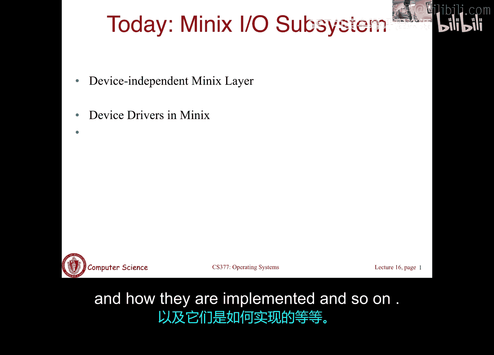

So。What this slide shows us is the high level layered architecture of the IO subsystem in Min and as we can see at the very lowest level we actually have the hardware which are the IO devices in this case。

 the hardware typically interfaces with the rest of the machine through interrupts and hence as far as the lowest layer of Linux is concerned within the kernel we have interrupt handlers and those interrupt handlers interface with the device drivers as well as upper layers in the IO subsystem software stack。

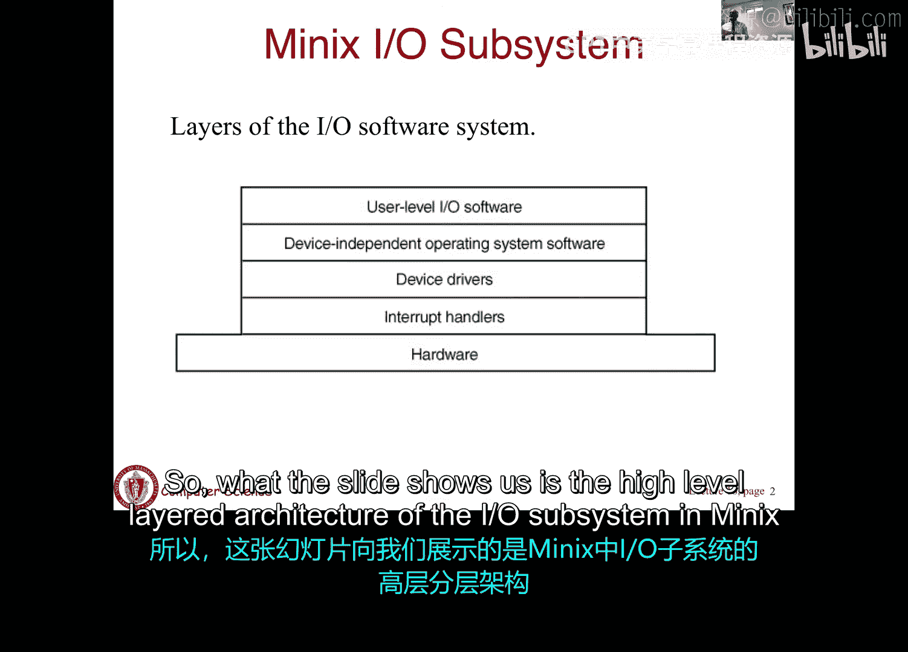

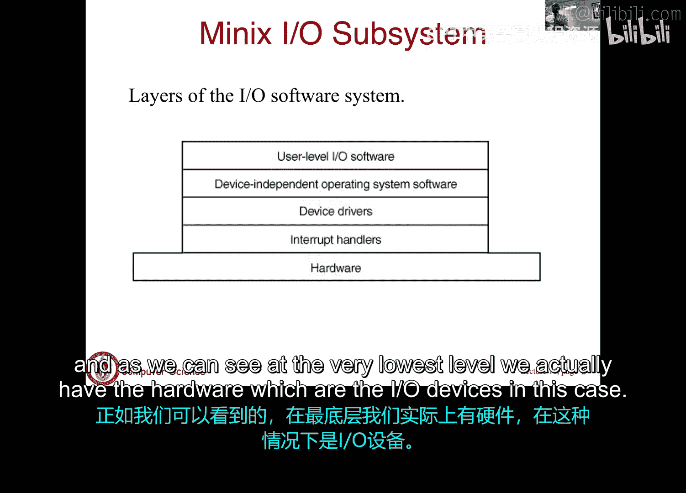

Setting above the interrupt handlers are the device drivers and there is a device driver for each device as we have seen last time a device consists of the device itself and a device controller and the device driver is responsible for interfacing with each device so we have this device driver layer and you have one device driver per device that is going to be interfacing with the device itself the device driver includes all the device specific code all the specific details of how to communicate with the device encapsulated in each device driver。

Setting about the device drivers is the device independent OS code and so this is scored as we will see that deals with devices at a higher level of abstraction such as block devices and character devices as well as interfacing with user level software and so on and then about this is the user level software etc。

Now this picture although we are discussing it in the context of Min is actually general and any OS kernel will employ this architecture for interfacing with i devices now in the Min specific context some of this code that we see in this stack is actually part of the kernel some of it is in various system level tasks including device drivers that we see are user level processes the file system tasks and so on so so we are going to see how this picture is realized in the Linux context by taking these various layers and putting them in different components within Min。

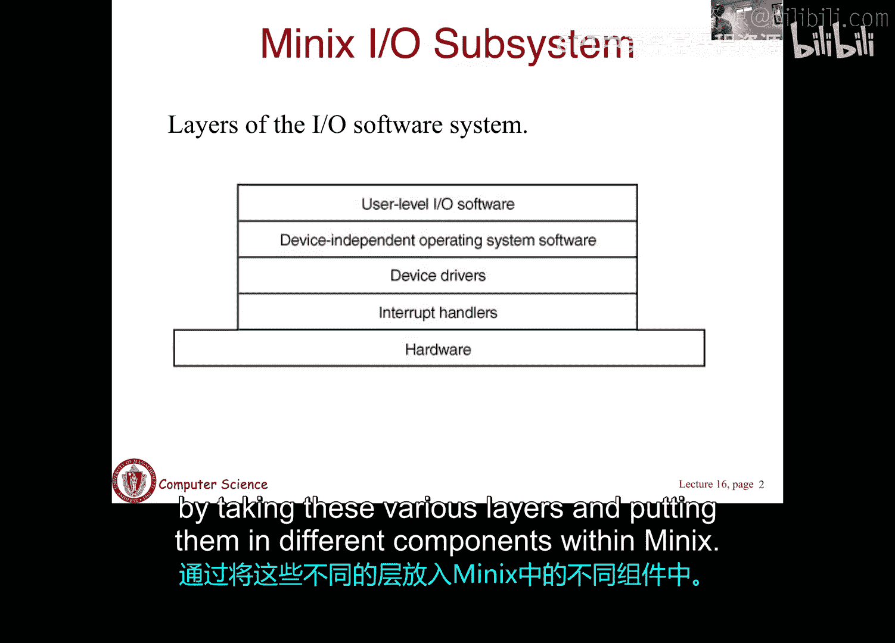

So。As far as the highest level layer is concerned which is the device independent layer。

 there are several different functions in it as as is been shown here。

 you need a uniform interface to communicate with all device drivers because this code is independent of any device specific details so it needs standard interface to communicate with all of the device drivers and it includes other functions that are common across device drivers such as buffering which we saw last time is used to deal with mismatches between the device speeds and the CPU speeds it includes error reporting or error handling because i devices are slow and youre dealing with hardware there could be errors and then you got to decide how to deal with these errors so some of that is encapsulated and this layer and higher level tasks like allocating and releasing devices。

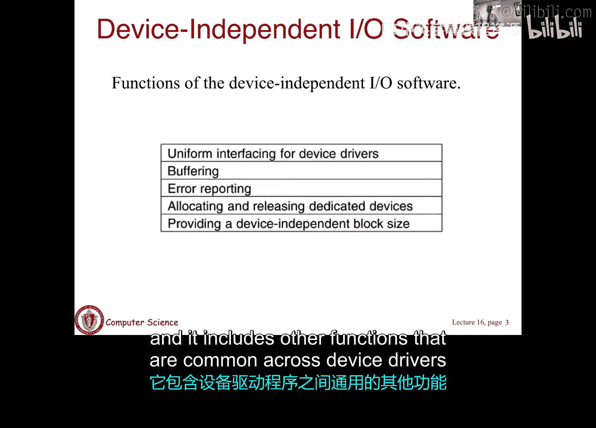

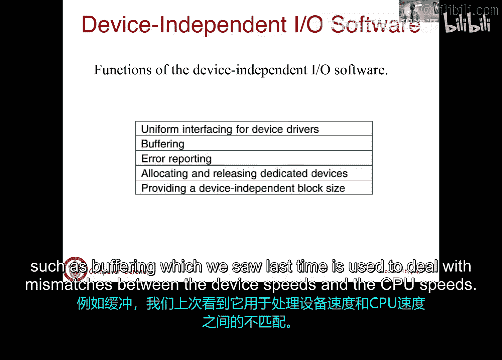

Deciding the size of the block that is used to communicate with the device driver。

 all of these functions are actually handled at the device independently layer。

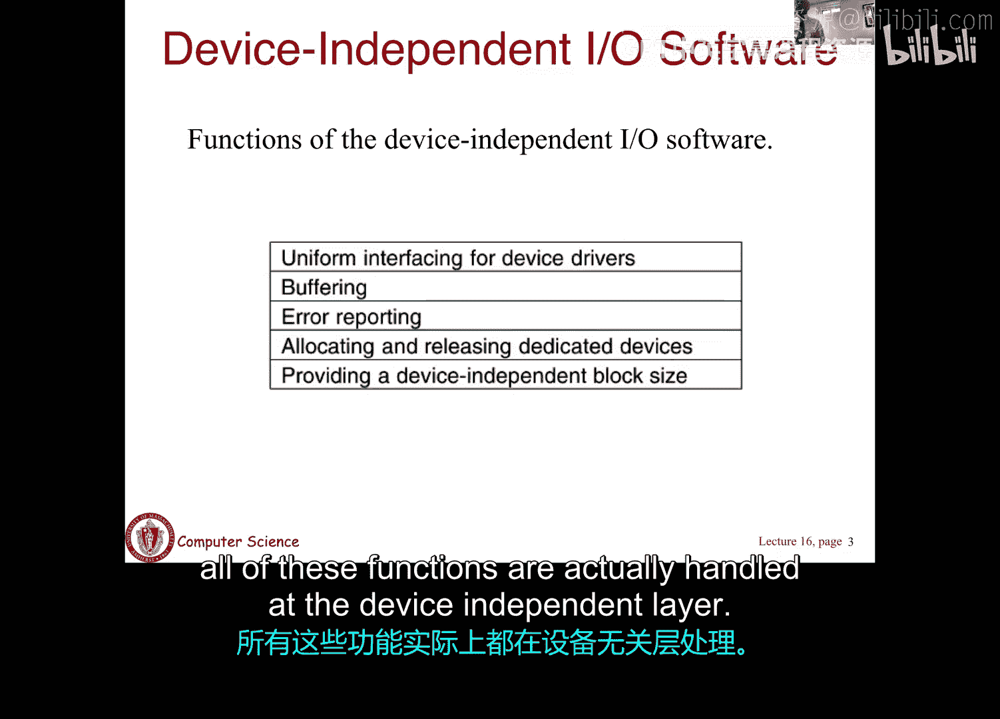

Now this picture iss a cartoon picture， but it tries to illustrate how device drivers are built in two different contexts。

 One is where the OSs does not have a standard interface and one where there is Now the first picture is supposed to illustrate how you can build device drivers even though the OSs does not provide a standard interface in this case each device driver implements device specific code but exports its own interface to the rest of the OSs and the interface is one that makes the most sense for that device。

 including how you write to the device， how you write to the device。

 how you can send other kinds of commands to the device and so on。 Now the the。

The Lego like pieces since they are of different shapes。

 what this is supposed to indicate to us is that the interface in terms of how the device driver interfaces with the rest of the kernel is different in case of each device driver because each device driver is doing its own thing it has its own interface that it has implemented。

The figure on the right， which is labeled B， actually shows a different。

Way of implementing device drivers In this case， the OS kernel has standardized the interface for device drivers。

 So what that means is the OS has said the kernel has said that all device drivers must support these functions that are used to communicate with it and every device driver has to adhere to that standard So there's a common way by which the rest of the OS actually interfaces with device driver and hence every device driver has to support exactly the same interface and all of the details of how those interfaces are realized are inside the driver so so that interface needless to say must be general enough so that it supports a large class of devices regardless of the hardware details in the first figure each device driver could implement its own interface which means that you could decide based on the type of the device。

interface should be and some devices could have more functions in their interfaces and some less in in the figure B every device driver supports exactly the same interface in some side it has to be a union of what you need from all of the devices that you want to support in your system。

Now， I should also say that most operating systems used to in the old days were did not have a standard interface so they look more like the figure labeled A。

 but now pretty much any general purpose OS has a standard way by which you implement a device driver so they look more or less like B so that is going to include Linux as well。

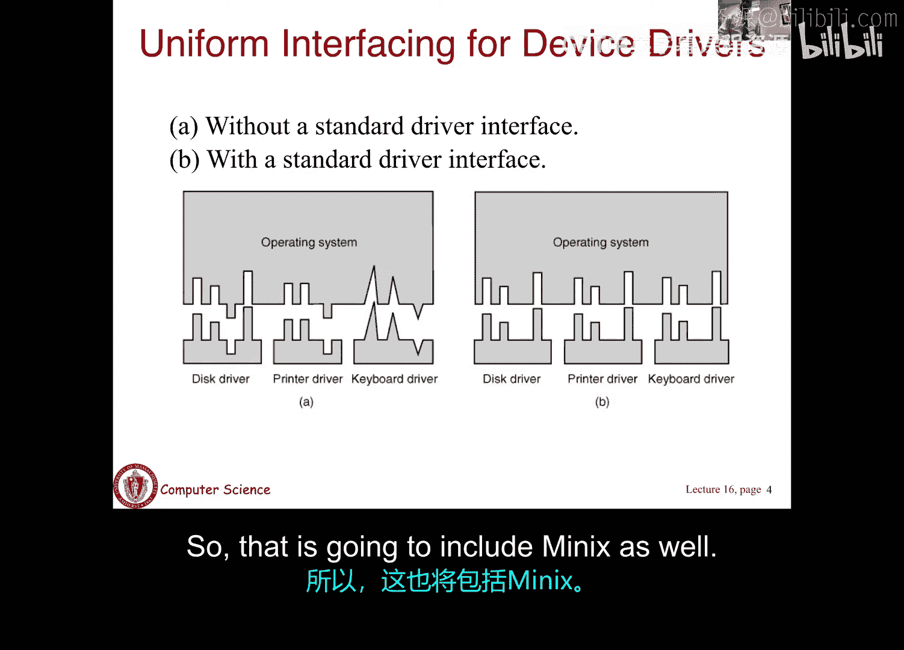

Now as far as the user space IO is concerned。 remember that Min is a micro kernel。

 So as we have seen in the past and I'm going to show you again， many of the device driver。

 not many all of the device drivers actually are implemented as user space processes most of the kernel tasks are also implemented as user space processes and so。

 So a lot of the IO code actually resides outside the kernel。

 there is still some code that is inside， but a lot of it is outside。

 So it's instructed to see how a typical iO request is handled in the context of using user space software and so on。

 So so this is a layered picture that shows how requests from user processes are handled at different layers and then all the way down to the hardware and all the response So at the top level。

 have the user processes itself it could be any processes that is trying to make an iO request。

 let's say for simplicity， youre trying to。ReadFrom a file， That's an IO request。

So the user process is going to issue the read request that' is going to come to some device independent software in case of Min this is going to be a system process that typically is going to be a file system process which is going to basically handle your read request and the device independent layer in addition to interfacing with user processes in case of Min is going to implement various features that I discussed two slides ago which include things like naming and protection deciding block sizes。

 implementing buffer caches and so on。So this device independent software then takes the request and decides determines rather which device is supposed to handle it and it handed it off to that right device driver so remember that there will be more than one device in your system there could even be more than one disk in your system in case of a read call you have to decide which device that I request is going be handled by and you have to hand it to the specific device driver。

So in this case the device driver is responsible for implementing device specific code in terms of how that command read command in this case is going to be issued to that device and so on。

 it will have the ports that we had discussed last time that allow you to read or write data have a status register command registers and so on so the device driver is going to set up these device register and then maybe wait for an interrupt to come from the device when the request is done and。

So。Once the command has been issued you just wait in the device driver and then eventually there is going to be an interrupt from the device controller that tells the device driver the request is finished and you see that the reply is now going to percolate up from the device driver back to the device independent software and back to the user process where it is going to receive the results of its read command。

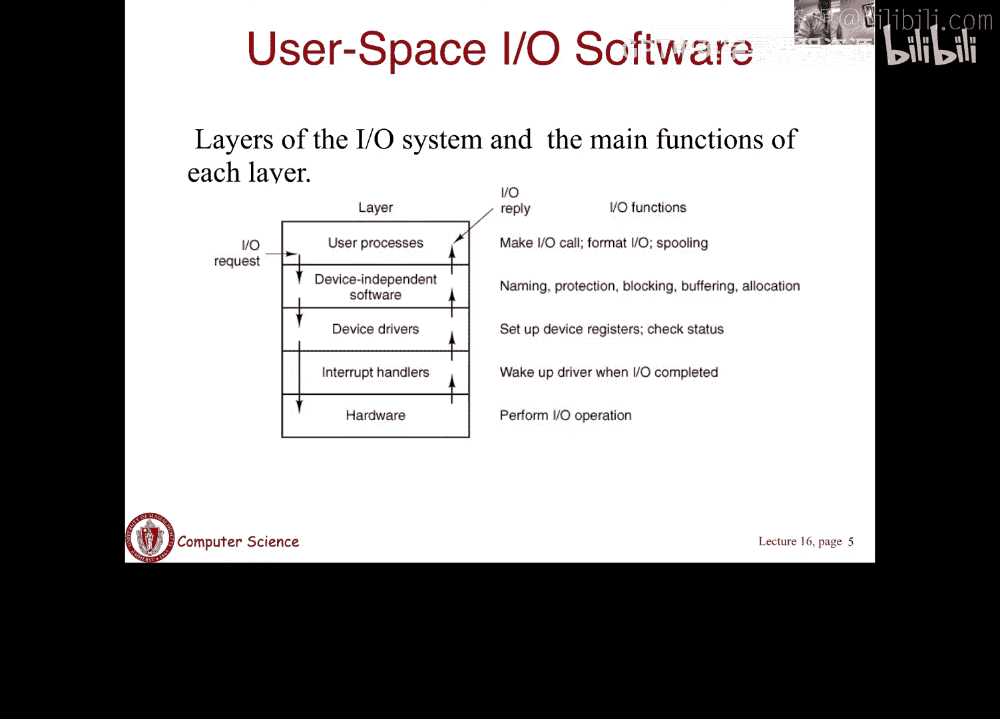

So now let's look at some more details of how some of this is implemented in Min as I had mentioned Min device drivers run in user space and you've seen this previously as well because the kernel is bare bones it implements system task a clock task and some IPC everything else in Min is actually handled in user space so all device drivers run in user space theres one process for each device driver so each device driver is simply a user process so what this also means is that device drivers cannot actually access either kernel memory or iO ports this is of course different from monolithic kernels where the device drivers not only sit inside the kernel they are the lowest level of the kernel and they are directly interfacing with the hardware in this case although that highlevel concept is true device drivers are not neither inside。

the kernel nor are the lowest layer of the kernel they are sitting outside in user space and yet they must somehow access all of the devices and do whatever a typical device driver does。

So so what this means is user space device drivers need a mechanism to communicate with their iO devices。

 but all of that has to go through the kernel and depending on what the device driver is trying to do there will be different levels of access it might need So this slide actually talks about four different types of iO accesses that a typical device driver might need the first one is the device driver it simply needs access to some memory thats outside data space This is not for interfacing with an IO device this maybe for other reason So for example。

 we are soon going to see a ra disk driver where the data for this Ram disk is stored in a different region of memory and the device driver here will near access to that piece of memory so that's the first kind of access the second type of access is what a typical device driver does。

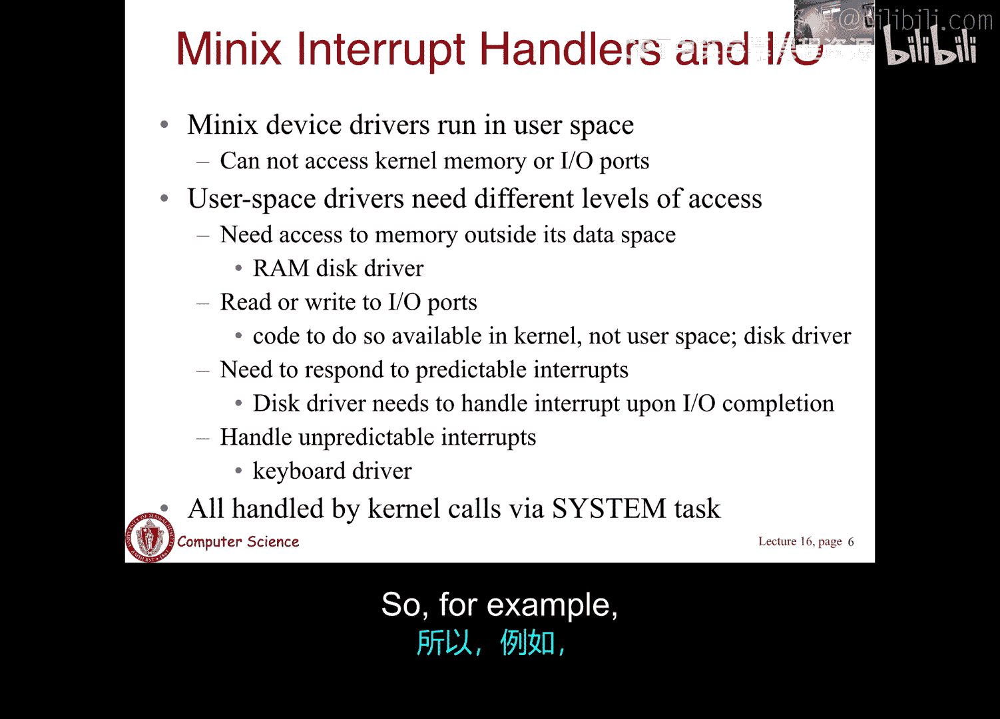

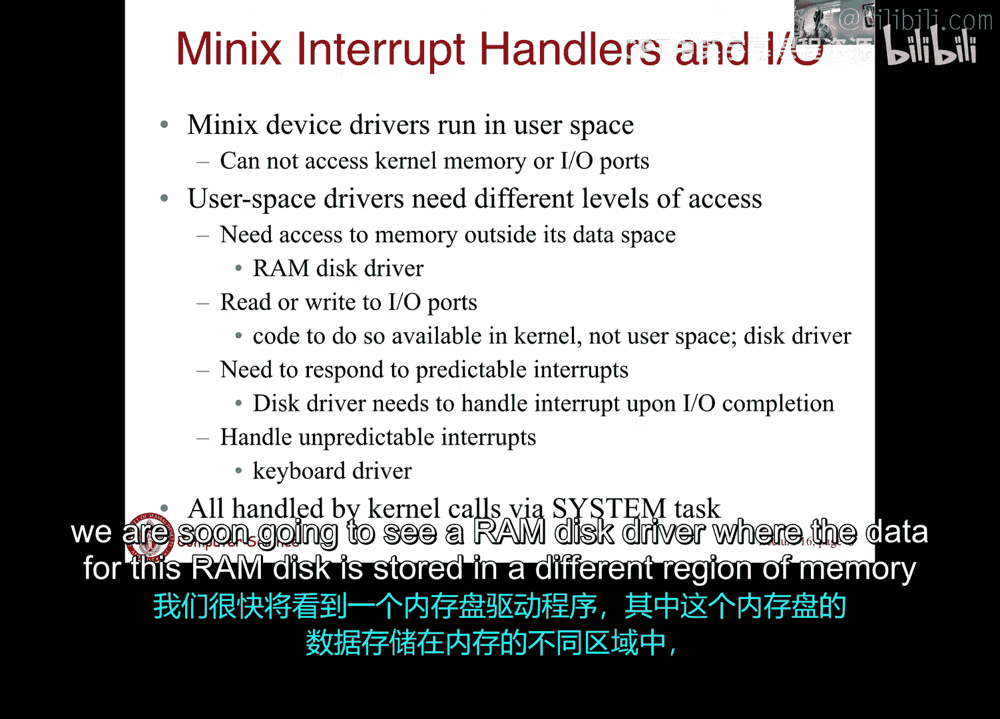

whichch is the abilityator to read or write to iO ports and since iop ports can be only accessed through the kernel the code for accessing them even in Mines in the kernel and the device driver has to essentially use kernel calls to access。

X is these IO ports。The third task that a device driver has to perform is handle interrupts。

 typically in a monolithic kernel when the device controller issues an interrupt。

 you essentially go to the interrupt handler， which is typically handle by the device driver In this case。

 the device driver is a user process So the hardware interrupt is actually going to come to to the Linux kernel not to the device driver and the Linux kernel needs to be able to handle this interrupt by essentially forwarding it to a device driver so all device drivers need to be able to handle interrupt and here we are going to distinguish between predictable interrupts and unpredictable interrupt predictableictable interrupts are one that you know are going to arrive because you have。

 let's say an IO request outstanding if you issued an IO request the device driver is going to wait for an I interrupt that will signal its completion。

 So that's in our case a predictabletable interrupt。

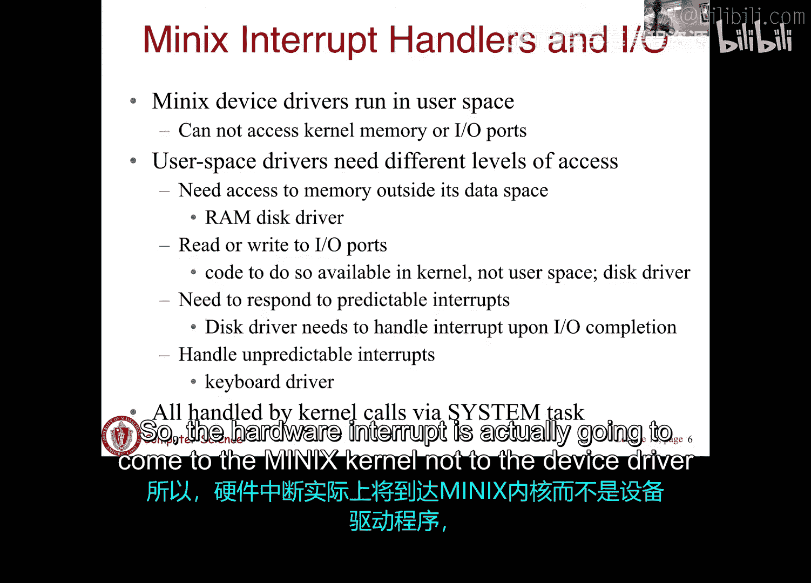

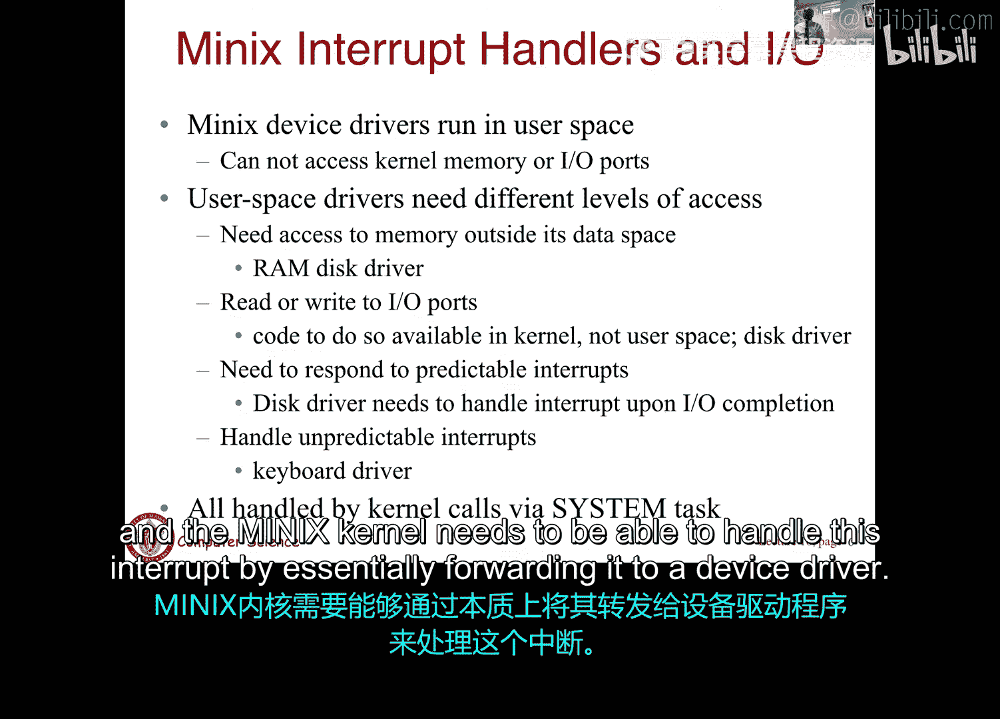

Unpredictable interrupts are those that we don't know when they might occur examples might be network packets arriving on your ethernet interface card。

 you don't know when communication is likely to occur A packet might arrive at an arbitrary instant or a keyboard interrupt is also an unpredictable interrupt because you don't know when the user might type the next keystroke it may happen in a few seconds or few hours and the OSs is not neither the OSs nor the device driver actually knows when that is going to occur So we will refer to these kinds of interrupts as unpredictable interrupt regardless of whether interrupts are predictabletable or unpredictable they have to be handled by the device driver which sits in user space and the way this is going to be done as we will see shortly is through messages that go between the kernel and device drivers now。

Having said that all of the accesses that device drivers need from the kernel are actually implemented in the system task within the Min micro kernelnel and let's look at each of these four types of iaces in a little more detail so the first one is where the device driver needs access to some region of memory that is outside its address space and the example we gave here was one of our Ram disk so in this case we are going to leverage a functionality of the system task because the system task is within the micro kernelnel it has the ability to access any processes data segments so in addition it can also make certain segments belonging to other processes accessible to a given process so we are going to use that functionality to take let's say memory segments belonging to the Ram disk which is essentially going to be a piece of memory and make it accessible to the Ram。

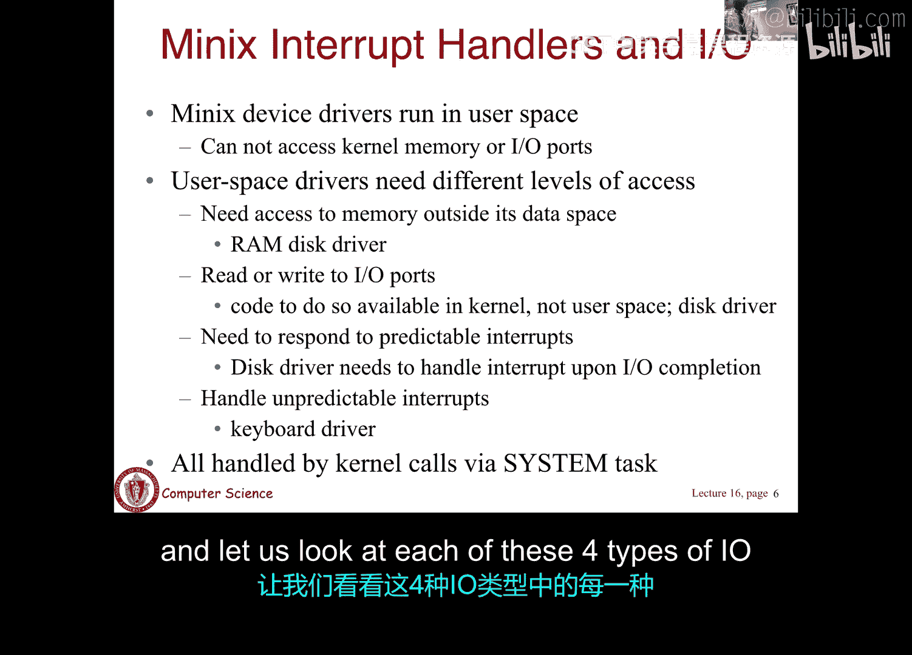

D driver normally you would not be able to do this because the RamD driver is a user process that can only access its own stack and heap it cannot access some other region of Ram and in this case the Ram disk resides outside the address space of the RamD driver so we are going to use the system task to make this possible。

Another example where this is needed is where the console driver or the graphics driver really needs access to memory belonging to a video adapter or a GPU or a graphics card so in this case the graphics card memory is not going to be accessible directly to the driver but the system task can take that piece of memory and make it accessible to the driver so that it can directly read or write to it whereas you could normally not do that。

So the second concept is where the Min kernel has to provide access to IO ports to device drivers and typically IO ports are going to be not accessible to drivers in user space。

And again， we are going to leverage the system task that is going to perform IO on behalf of the device driver and we will see how the hard driver is actually going to use it to perform IO through the system task。

The third thing that we are I spoke about in the previous slide is where you are to handle predictable interrupts So here again we are going to leverage the system task so the system task has a generic interrupt handler which is called the generic handler that it has instantd any interrupt that comes in is handled by this generic interrupt handler and it is then going to convert this interrupt into a message specifically a notification message and send it to the right device driver for handling So interrupt essentially become messages messages are then sent to the driver and then each driver is essentially going to be sitting in a loop waiting for a message so its going to be doing a blocking receive call which waits for a message from in this case the system task and when that message is sent to the driver it's going to receive it and handle So this is how we are going to allow interrupts which arrive at the microcurner to essentially get forwarded to a device。

はい。And the last type of Io access that a device server needs are ones where you need to handle unpredictable inters and because by definition interrupts。

AndThen Linuxix or any other OSs for that matter are unpredictable。

 you don't know how frequently they occur。 You might have a second interrupt while the first one is still under process and so on。

 So and furthermore， you don't even know the source of where the interrupt is coming from。

 It may come from any device， for example， an ethernet card， a keyboard， a mouse and so on。

 So the way you have to deal with this is slightly different from a predictable task or a predictable interrupt。

 a predictable interrupt。 a device driver knows that the interrupt is going to come from a specific device because it has issued a command to that device it is expecting an interrupt to come from the device So it can specifically do a receive for a message from that device in the case of unpredictable interrupt you cannot you don't know where the interrupt is coming from So you cannot receive from a specific device because you don't even know which device is going to cause the interrupt So you have to deal with this somewhat。

lySo so you can do several things first is that interrupt handling has to be fast because the longer it takes the other interrupts might that are also unpredictable that arrive in the meantime may not get handle so you want extremely fast interrupt handling you want to do both non- blocklocking sends and nonbing receives because you can do equivalent of things like polling or asynchronous receives so that you don't actually block on a specific device and a combination of these methods are actually used in the context of men to handle unpredictable interrupt。

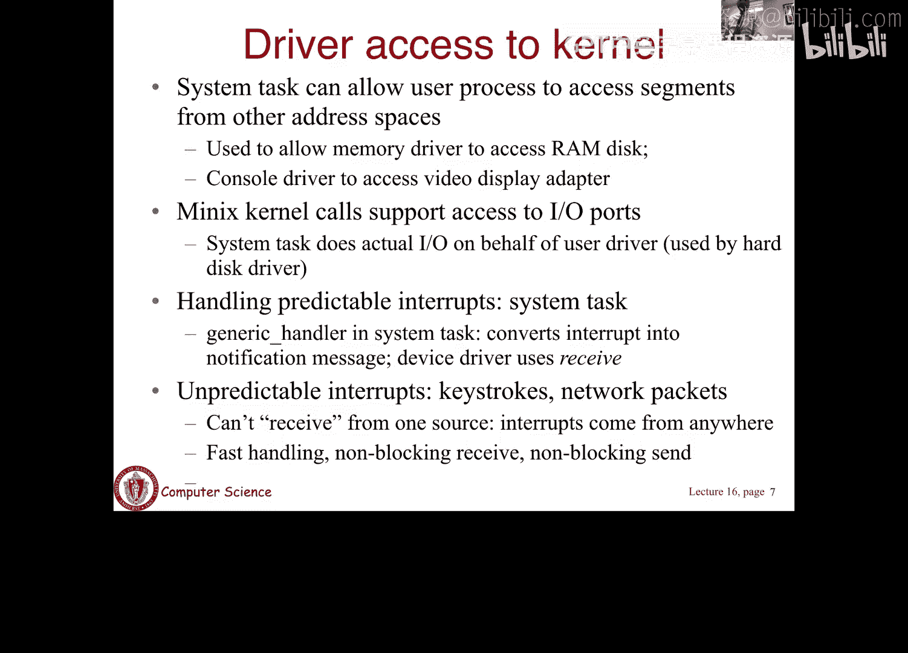

Now this picture with those concepts， this picture shows us again how device drivers are implemented both in a monolithic kernel and in mini so the picture to the right shows us a typical monolithic kernel and you see the horizontal line is device is the one that divides the kernel space from user space so everything about that line or user processes everything below is the monolithic kernel。

So the way that the IO works is user processes issue IO requests a file IO request or do something that triggers IO the request then comes down to the kernel In this case。

 the file system is going to receive that request it translates it into a read of a block it hands that to the device driver so that's how a device driver is going to then handle or receive that request and handle it Now the picture to the left label a shows us how Linux device driver work and as I already mentioned the only thing we have inside the kernel is a very bare bones micro kernel which has basic capabilities for handling things like interrupts and message passing and so on as we can see the device driver is a user process that sits outside the kernel the file system is a user process or a system process that sits outside the kernel and all user processes run outside So in this case。

When the user process issues a read call， it is going to arrive at the file system process。

 the file system process is going to hand that to the device driver to perform a discre the device driver is going to essentially issue a request to the diskcontroller through the system task and then it's going to just wait for an interrupt to arrive the system task at some later point is going to receive an interrupt from the diskcon saying that your read is completed and that is going to be received it's going to be turned into a notification message and sent after the device driver the device driver is expecting this interrupt so it's sitting in a receive waiting for this interrupt when the message is received it's going to handle that interrupt get the contents of the read hand that to the system task file system task step5 and then in step 6 which is where the read is finished。

From a system perspective is hand the contents of the reader handed back to the user process。So。

 so you can see this the the how an I request involves multiple components that are basically used to handle the the request。

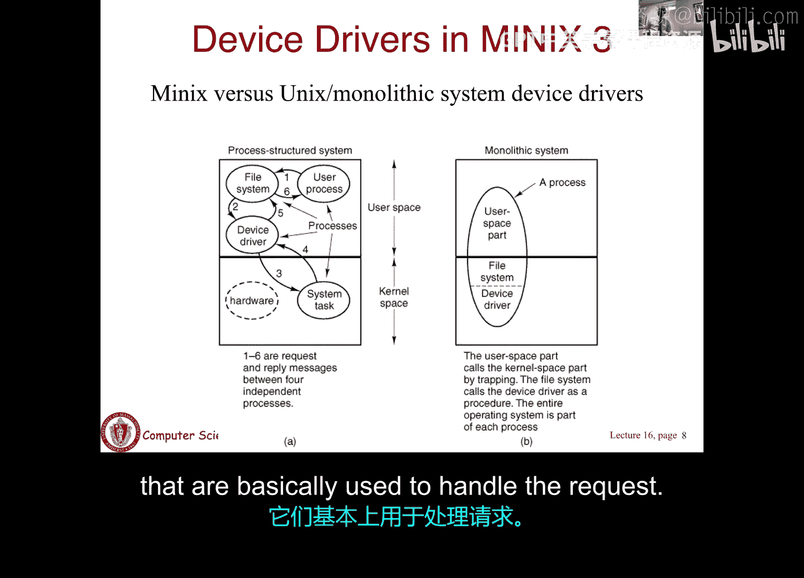

Now delving into a little more details of how Minix drivers work each as I already mentioned。

 each driver runs as a userbased process for each type of device there is as a driver because you need a driver for each i device and each of them runs as a full user process they communicate the system task through message passing and typically well see that simple drivers can be written in Min in just a single file and you will go if you go through the drivers's directory in the Linux in the Min Github you will see that there are several folders each folder represents a device driver I'm going to talk about some of them in class but I would encourage you to go and look at the source tree for Linux and look at how some device drivers are written and you will see that simple ones are maybe one file and some are maybe more than one but by and large the simple ones。

written in a single file， which means they are fairly simple and compact to write now as far as the structure of each of these diverse is concerned each of them has to accept requests from other processes that could be the file system process or the current system task or something else and carry out whatever request is actually being sent to them。

All drivers in Mins are strictly sequential， they do not support concurrency to keep them simple so some of the synchronization primitives that you might need in a multithreaded kernels do not not require and in Min so it is much simpler to write a device driver and by and large as I said they need to do three things they need to receive a message they need to process that message and send a reply。

Now each device driver needs to gets two types of request。

 a work request that comes from either the file server process or something else and interrupts that come to the device driver from the kernel so these are the two types of requests or messages that drivers can receive and you use the receive call to essentially receive interrupt messages as well as other kinds of messages and while you are handling any request whether it's interrupt or some other request because this is single threaded and sequential。

 all other requests are going to arrive and just wait so youre basically theyre going to keep them pending and is especially true during interrupt handling but also during processing of other requests so it is essential that the processing of requests happen quickly because there may be things like urgent interrupts that are come in and if they are to wait for a while that makes the system less responsive。

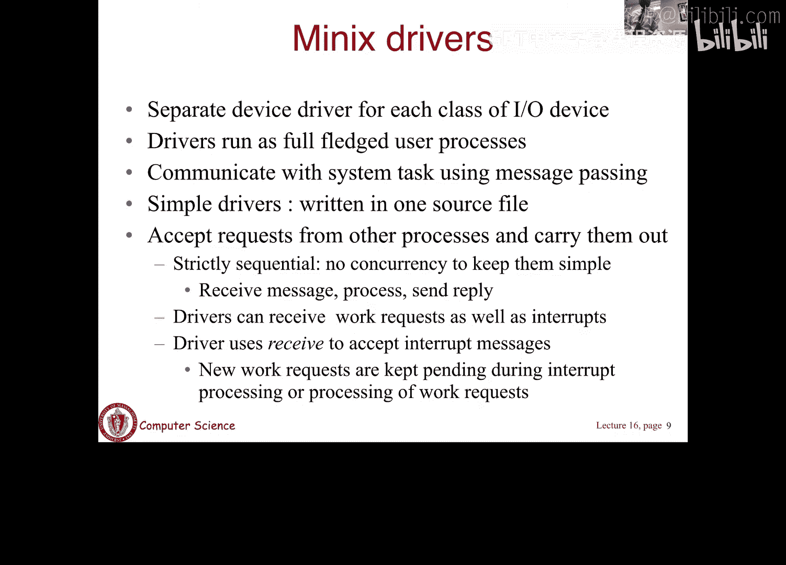

So this slide just shows us some example types of messages that a device driver。

 a generic device driver needs to handle。 I'm not going to go through all of them。

 but I just want to to look at these because the first table here shows us the type of request messages that are sent and the second types and shows us some of the reply messages and you will see that typical fields of a message will include things like the type of the message which is going to be the operation that is requested there is essentially the device number that is basically used to address the device I should mention here something that I should have mention earlier that device in Uniix in general as well as Min are going to be numbered So each device has a number and typically what you have are something called the major number and a minor number for each device the major number for a device tells us the type of a device So major number one could be disks。

Number two could be graphics card and three could be network cards and so on so those are classes of devices and a minor number refers to a specific device within that class So you might have major number one which is disk class and minor number one which is disk one of the disk class or device one of the disk class and so on。

 So so in this case the device field that is shown here is actually the minor number which is specifically addressing a certain type of device you don't need a major number here because the device driver already knows what type of device it is going to handle So it needs to just know which device within that class to actually send that request to or is that request meant for。

And then you have other fields like what process requests that IO the byte count or the Iocal code which I'm going to talk in a little bit the position on the device and so and as far as reply is concerned again you know the reply type which is what kind of a reply it is typically in this case it' is always going to be driver reply saying this is a reply from the driver and then it' is going to talk about the process number and what bytes。

 the status that says what bytes how many bytes were transferred or the error number。

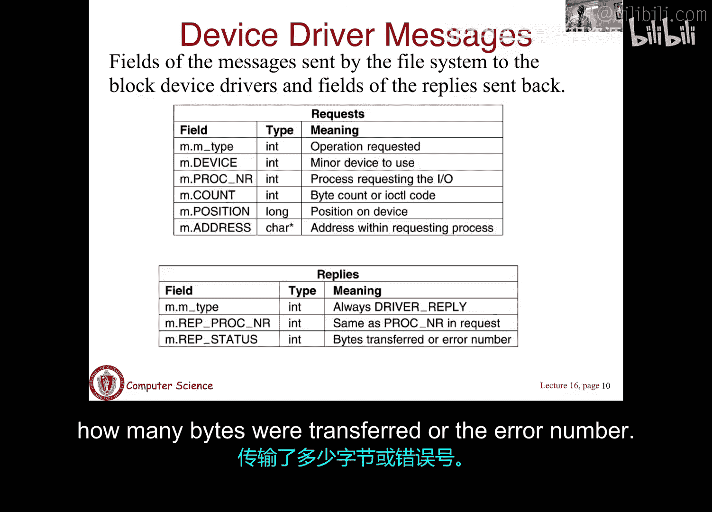

Now this figure rather the slide shows us a typical pseudo code of a device driver and you will see that all i drivers essentially involves sitting in the loop waiting for a request to arrive and that is basically being done through the receive call saying I can receive any message and then once the message has been received。

 you essentially look at the type of the message and then you handle it so you could have a read message or write message or other kinds of message so you basically do whatever you need to do to handle those requests in this case if it's a read you call a device read which is where the code for actually reading from that device is implemented in the driver and so on。

And then once you are done you basically send back a reply thats the last line of that while loop and then you continue and wait and you accept the next request and so on so its a strictly sequential while loop that implements a typical device driver in Linux and what we are going to do is actually soon look at several types of device driver and try to understand how some of the code that is implemented by the device actually differs from device to device。

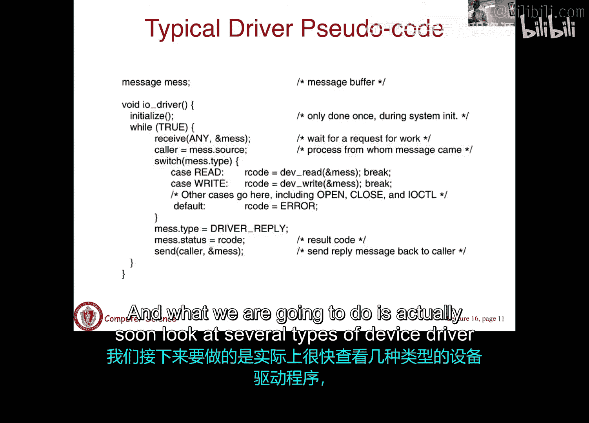

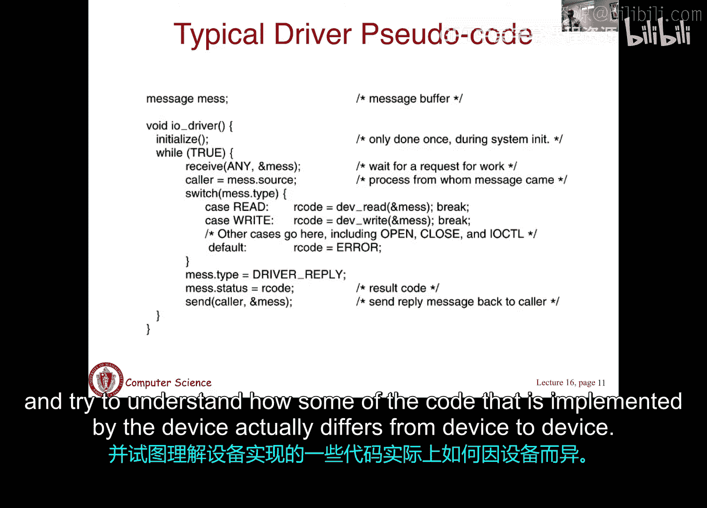

So we'll specifically look at three or four different types of devices there are two block devices and two character devices so we look at for as far as block devices are concerned we look at the Ram disk and hard disk driver as far as character devices are concerned we look at the terminal driver and keyboard driver now recall that from the last class and mention that all devices are either going to be block devices or character devices block devices are those where the unit of I is essentially a block of data and character devices are those where the unit of I is one character or one byte at a time keyboard is an example of a character device because each key press generates one byte that tells us what that key press is。

Whereas a disk is an example of a block device because you are reading or writing entire blocks of data from that disk at one time so keep that distinction in mind because we are going to look at how Linux implements block devices as well as character devices and we look at four examples in in a little more detail now before we get to whether there is a block device or a character device lets start with a device independent layer。

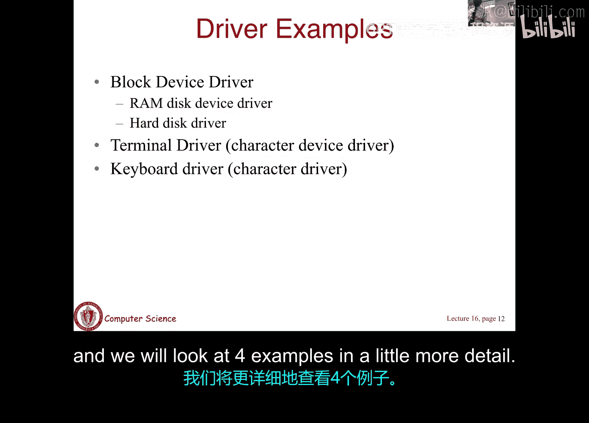

Now in case of Linuxix the designers decided that IOS handling is closely tied to file system file handling because the disk is a very common device that is present in all machines and disk IOS certainly is very closely related to file IO so what they decided is all device independent code is going to sit within the file server process now this is simply a design decision there is no need to do this you could have had a separate iO process that did IO handling in the file server process that just specifically looked at file system handling but in this case they put all of the code in the file server process so some of the device handling code you will actually see sits in the BFS process or the file server process and we are going to look at the file server process in two classes from them。

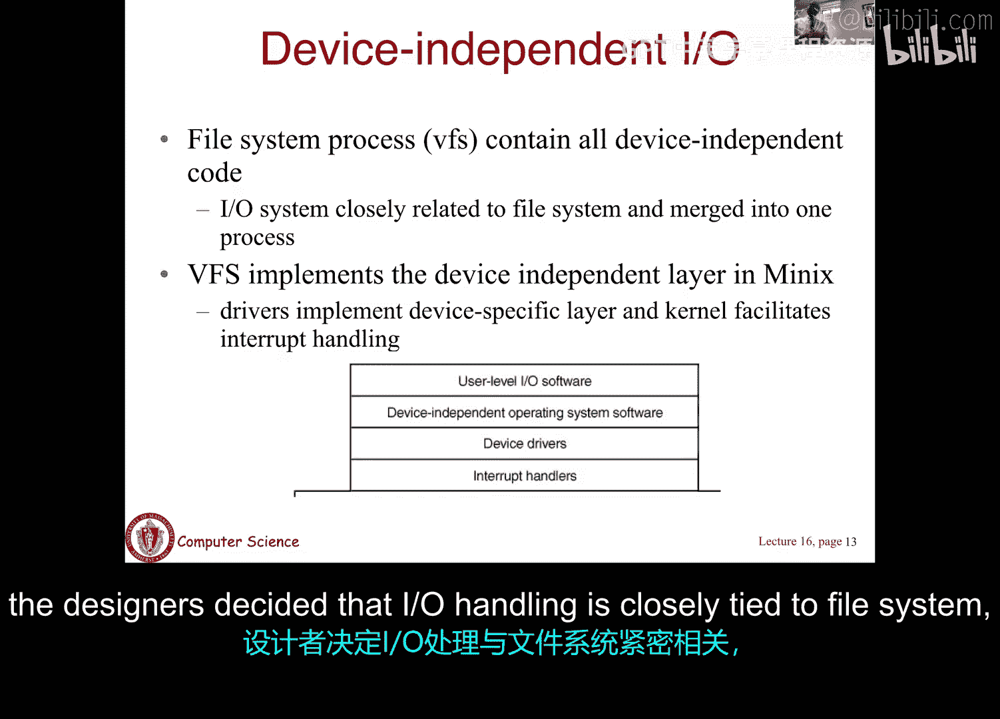

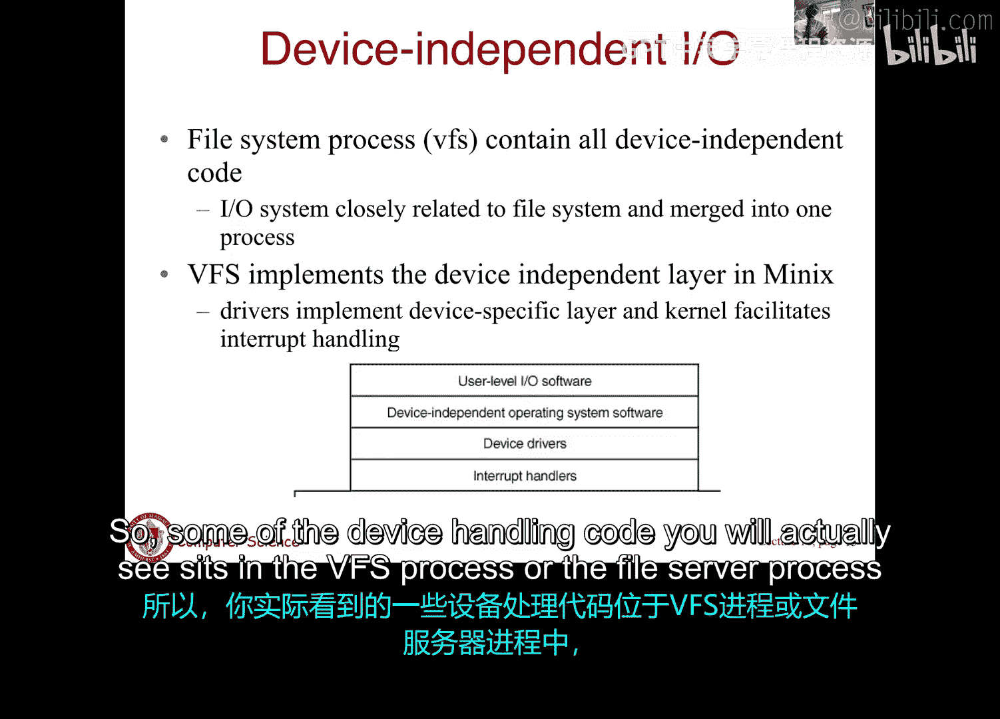

So that is something you want to keep in mind and the VFS process implements the device independent layer I showed you this picture earlier in the class where。

Some generic handling of interrupts and so on is actually implemented。

Ex me the handling of interrupts is done by the device driver。

 but the device independent code is implemented within the VF VFS process。

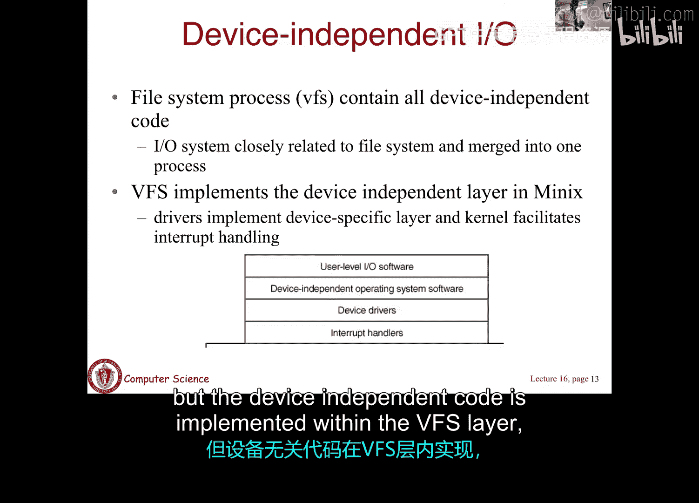

So here is now a simple pseudocode for a block device driver and you will see that this structure is not different from the pseudocode for a device driver that I showed you earlier clearly the pseudocode for the device driver is going to apply to both block devices and character devices So the structure is by and large always going to be very similar and here we have a generic pseudocode for a block device driver again you see that there is an inite while loop where you sit and you receive a message and then you look at whether it's a read or a write and now youre going to essentially look for device specific or block specific reads and writes and then youre going to call those message and what you see here are essentially function pointer so in the case read。

 you see something that says star entry point pointer dev read So that star entry is essentially a function pointer which means that you can use this code。

To call different reads for different types of device driver， because this is a general sort of。

So you can essentially instantiate with with functions for handling the disc block drivers and other kinds of block drivers like graphics cardss and so on。

 so this gives you a very generic structure to implement these various kinds of IO requests。

And then once you are done handling this you are going to also just send back the reply through to the send command so what is also shown here but now as a comment but without any code is in addition to readwrite of course you have to do other things like open a device close the device it will talk a little bit about IO controller or Ioctails in just a little bit。

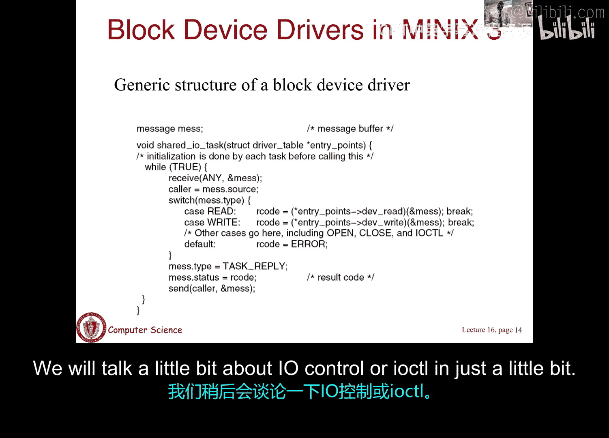

So typical block devices need to handle six types of operation so within that while loop that I showed you in that switch statement you will have to handle a readr。

 but you also need to handle open close iO control and scatter I so I think the names of these message types indicate what the operation does open says you open a device for IO just as you have to open a file for IO the device driver also has to open a device for IO close tells you that you can close the device are done with the device read and write allow you to read or write or the device Ioctels or Ioc CTtl which are called ioctels or IO control our messages that allow you to get and set parameters specific to the hardware so for example you might have things like transmission speed to the device parity of the device in some cases you might be able to set the chunk of data that。

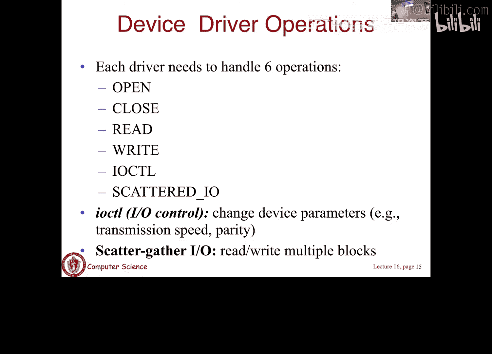

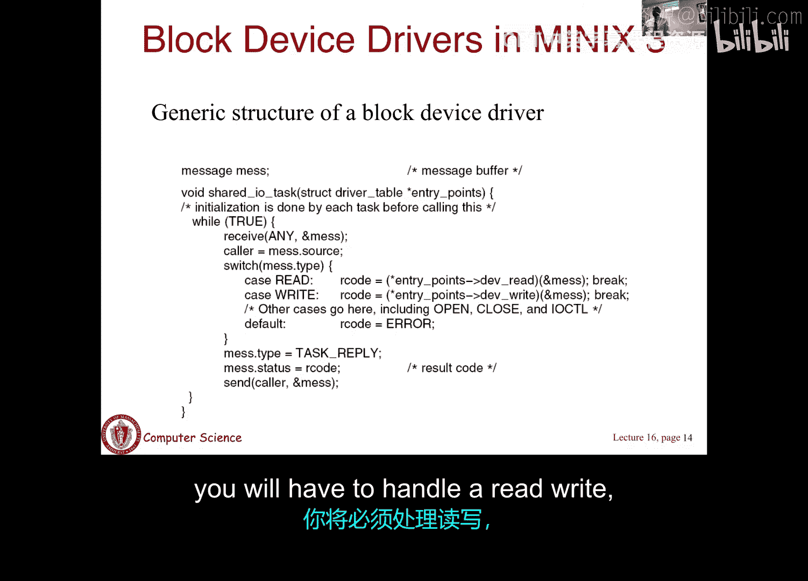

YouUse to say read or write to the device so some of these parameters can be controlled through software and the command that is used within Uniix in general as well as Linux is called Iocals or IO control so that is implemented by every device driver to allow you to change device specific characteristics that you might need to control after boott at runtime when the last operation is called scattered Iio and this is basically an operation that is part of a general concept called scatter gather IO。

Now， in scatter gather IO， what happens is you are trying to read multiple blocks or write multiple blocks at a time。

So so what happens is rather than reading or writing one block at a time。

 you issue concurrent requests read requests So you basically scatter them out。

 they go off to the device let's say the disk and the disk performs concurrent reads and then you gather all of the responses and you construct one reply message and send it up。

 So so this is called scatter gather So you allow it's essentially one way to think of this is batched i you batch multiple request and you send them out because they random scatter。

 meaning they go to different locations on a disk in case of a disk score if you're trying to write to different parts of a screen they will scatter to different portions in a graphic card And then in case of a disk at least you have the gather operation where the replies come back and you essentially gather all of the requests and so on。

 So so devices such as disks you are going to implement this operation for more efficient I。

And basically bash this request and get higher throughput So this is going to be an addition to the read and write。

 which allow you to read one block at a time or write one block at a time。

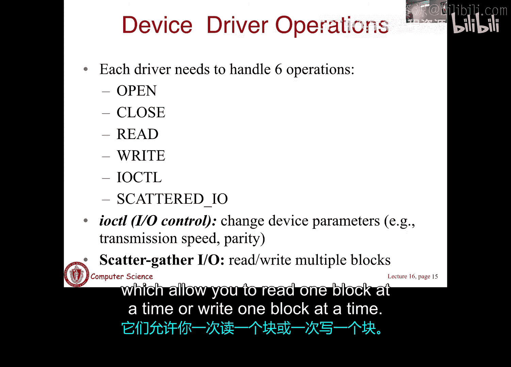

So with that concept now let's look at some specific block device driver we'll start with a simple one called a Ram disk Ram disk is very similar to hard disk except that the contents of this disk set in memory now clearly memory is a volatile device so you cannot actually use it for long term persistent storage of files so you are going to use Ram disk for as a temporary storage region but this portion of memory essentially looks like a disk rather than memory now what's the difference between a disk and memory in case of Ram you can address individual words and Ram so you give a memory address in terms of a pointer and you can go address that specific memory region now disks are block devices which means that the granularity of i is one block you cannot access one word or one byte within the。

the IO operations as you read the entire block or write an entire block。

 So so when a region of memory is being used as a Ram disk。

 you can think of io being done in terms of blocks or essentially pages or something like that where you can only the Ram disk driver allows you to read or write entire blocks not not portions of a block at a time。

 So that's something you want to keep in mind。 So now why do you need Ram disk。

 typically most of your files are actually going to be stored on a persistent storage device such as actual hard disk but Ram disks are especially useful when you are booting your machine。

 So before you have access to the hard disk， you can construct a temporary Ram disk。

 you can load the boot image which is the kernel part of the boot image or other things within the boot image into the Ram disk So now that portion of memory looks like a user process。

So， it looks like a hard disk and you can then access that hard disk through through the Ram disk as if you are reading or writing files to the local disk。

So so that's the concept of a Ram disk and it is used by most un like operating systems for access to files during the boot process before the actual hard disk becomes available so you basically bootstrap the OS through a small Ram disk then you access the hard disk and then you can load the remaining files from the hard disk and so on so now as far as a Ram disk driver is concerned the typical block driver is going to read or write a block So the Ram disk is going to essentially have a preallocated region of memory where you can read or write this blocks and then theres a file system that is going to be running on top of that Ram disk now the Linux Ram diskk driver actually uses six much more simpler drivers to implement Ram disk functionality and those are listed in this slide and each of them looks like a device So if you remember what I said。

Last time you basically access devices through a file name and a file system interface。

 All devices are essentially present in the slash dev directory within Linux or even in Uniix and the name of a file tells you what kind of devices it is and we have six different devices that are access through the slash dev interface and that implement a Ram disk functionality So slash dev slash Ram is the actual Ram disk so that device is going to essentially when you try to read or write to that device it looks like a file because it looks has a file name and that quote unquote file essentially points to a Ram disk in memory so so you can basically go and read or write blocks from that Ram disk slash dev s memory is a device that essentially allows you to access physical memory by addressing it。

Now this is essentially only accessible to the kernel and the kernel can use this interface to actually read or write to specific regions of memory。

 The Rams driver is also going to use this this device s dev km as you can imagine is essentially a device that refers to kernel memory So this is the part of Ram where the kernel resides and that entire region of the kernel address space is exposed to the Rams driver through a device called slash km So in this case byte off so again。

 it looks like a file， the entire region of memory although it's not really a file it's just a region of memory and you can offset any byte and that points you to a specific region of kernel memory slash dev slash boot is a device that is used during boot time it holds the boot image and your two other device s null which is an output device that allows you to write to an output and output is discarded and s dev。

which is an input device。 Basically， if you try to read from the device。

 it is going to only allow you to read a0 every time。

 So typically it is used to zero regions of memory。

So the code for the Rams driver is in the driver's folder in the Linux sub and you can see it under the Ram disc and the memory folder that is scattered between those two because as I said the Rams driver uses six different devices to implement its functionality。

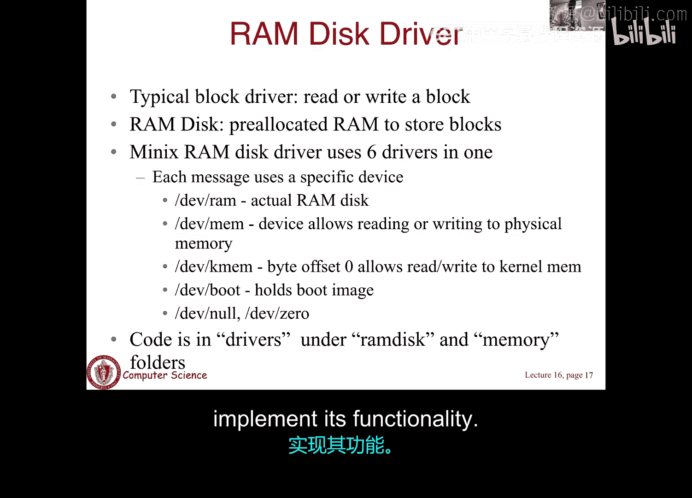

So the next driver that we are going to talk about is the hard disk driver now typically you have different types of hard disks the old style has been magnetic hard disks which are spinning discs they look like CDdRs they are circular platter that spin and you have data that' is written to them in terms of cylinders which are essentially platters each cylinder essentially has concentric circles that are called track you right data on the track and each track is divided into sector we are going to look at disks again in the next class and I'm going to show you some pictures that illustrate how this are done but for the purposes of this class all we need to know is the hard disk driver takes the disc geometry which is cylinder track and sector and this addresses which are essentially going to refer to cylinder number a track on that cylinder and a sector and just turn that into a linear addressable space which is。

Loical block address so essentially you can take all the sectors on the disk doesn't matter what geometry they are in and you can just number them0 through n and now you can just access them as sector0 and sector1 and sector 2 and so on those are logical addresses and they can simply be translated within the device driver to physical addresses which are each logical block number essentially becomes a sector a track and a cylinder number so so that mapping can be done internally so devices hard disk can be accessed either through through a logical block address or through a physical block address。

Now within minutes the code for the hard disk driver is in the 80 slash w N folder and that essentially refers to Winchester drives because another name for hard disk in the old days used to be Winchester drives and that is where the code is stored and the thing I do want to mention is it' from a hardware perspective you can actually more than one disks connected to your machine so you can have more than one ID disks or more than one seta disk Seta is just acronym that stands for serial 80 attachment it a hardware standard that allows you to essentially interface with a disk so you can have up to four disks and to figure out which disk you're reading or writing to as I said youre going to have a major number and a minor number So slash dev slash c0 D0 is going to refer to the first number C0 refers to。

The class called disk and D0 says disk 0 within that class and D1 will say disk1 if you're more than one in your machine。

 So I would encourage you to actually go into your Linuxix virtual box V and type the Df command and you will see a whole bunch of devices that are mounted and you will see things like slash dev slash D0 which is the disk and you might see additional suffixes there and say that's a partition within that disk that get mounted as the root directory and so on and so forth。

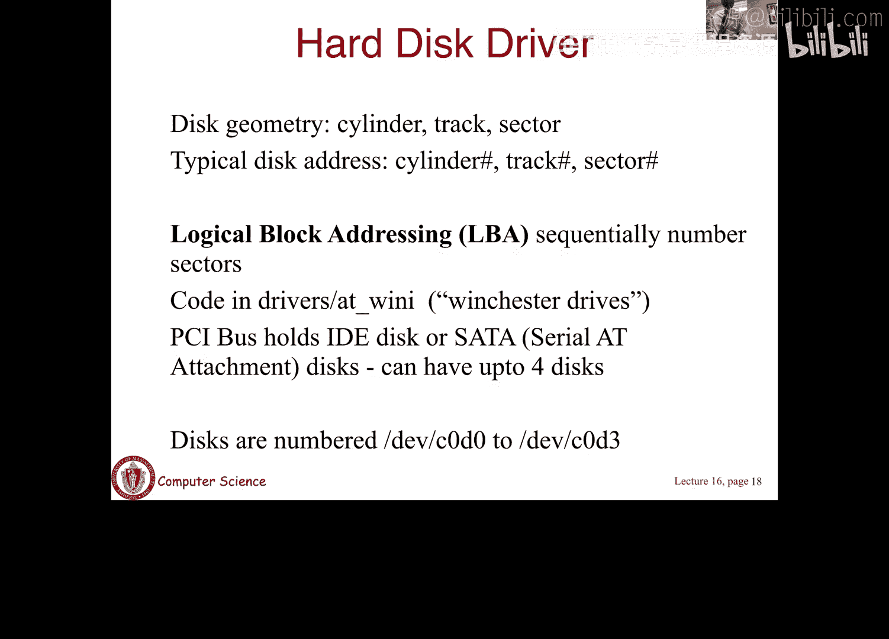

Now the disk driver has to interface with the disk controller and the way you are going to do this is the controller will essentially have ports as we mentioned last time each device has a port so you have control register which is a control port where you can essentially。

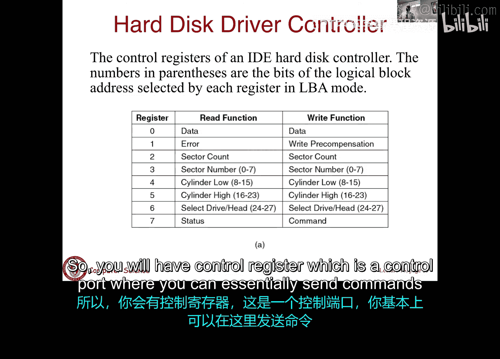

Sent commands。And the table here shows us the different types of register values you can write and what they mean so you can essentially have multiple registers in the control register not not just one in the case of the ID hardness and you can essentially say I want to do a read or I want to do a write and you can specify the address either in the LBA mode which means it's a logical address or you can specify them as as a cylinder track in the sector which is a physical address you can address either way typically you would like to do it logical and then the controller can do translation for you so again this slide essentially shows us the fields of the drive and head register which basically again which tells us how you're actually doing the addressing the device driver has to read or write registers here in this case right to this values the specify addresses of what you're going to read or write。

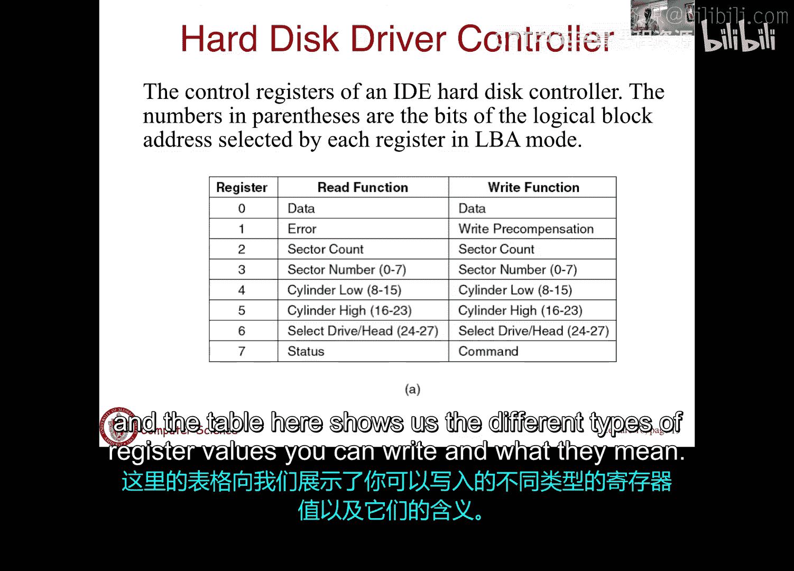

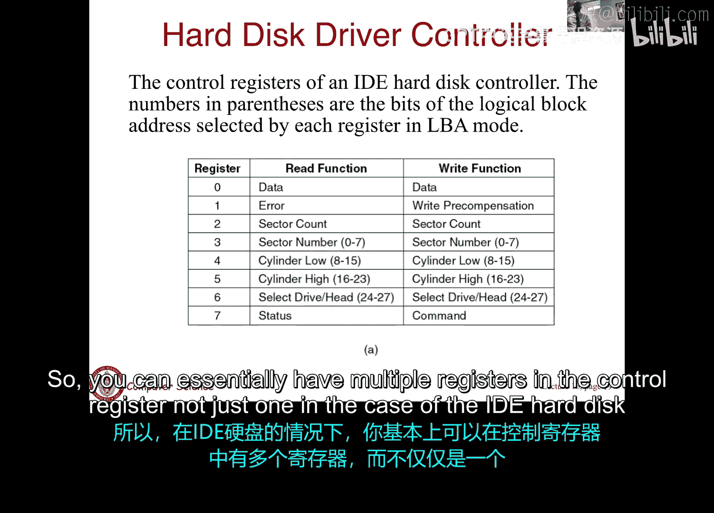

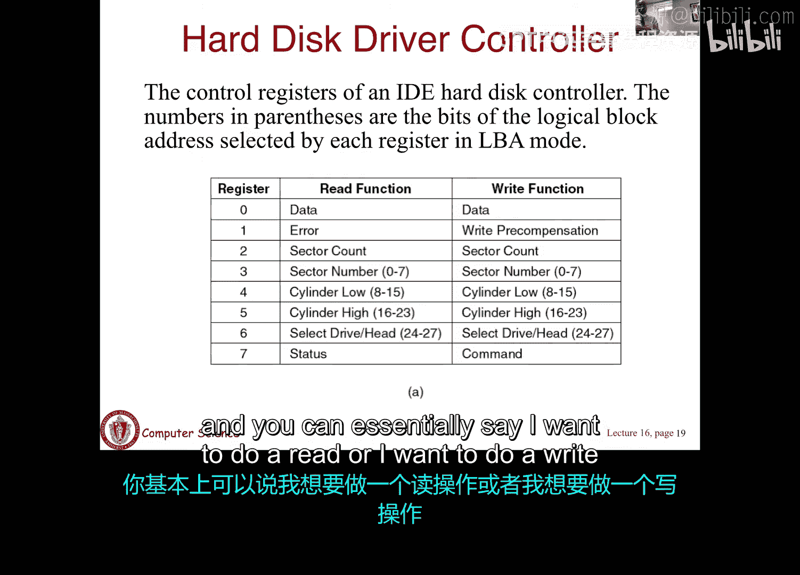

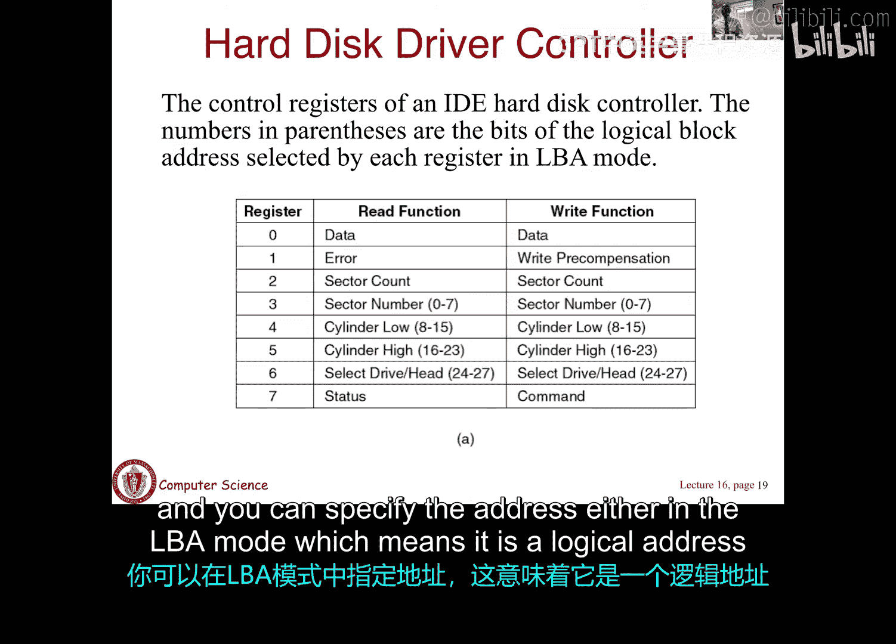

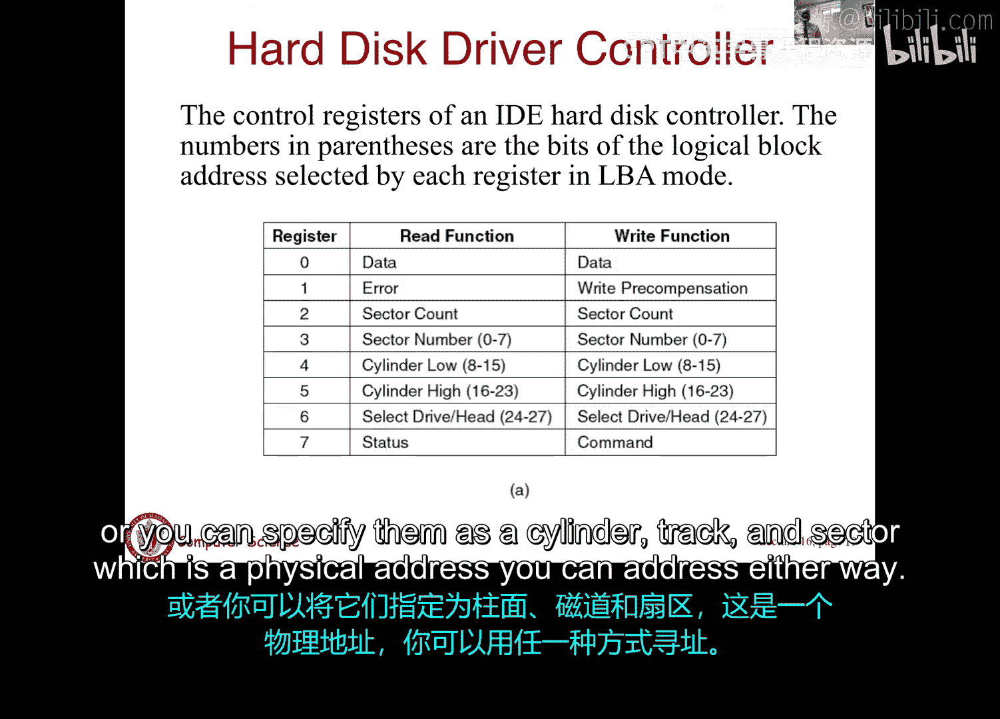

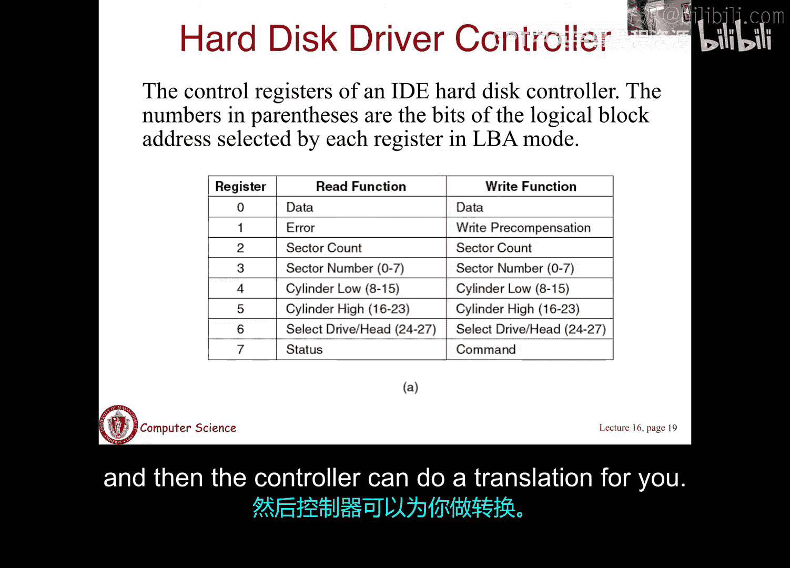

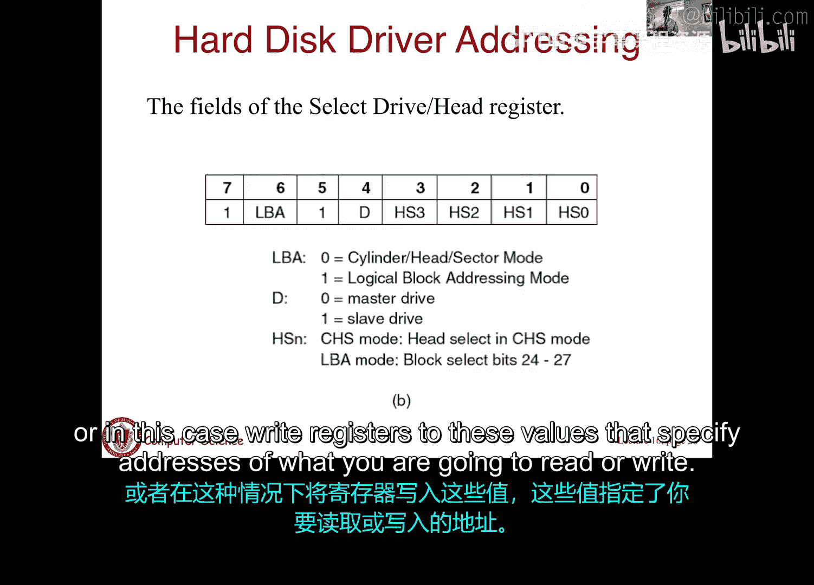

Okay， so again you can use the LBA mode if the LB field is0。

 you are essentially using the cylinder head sector mode if it's one year ago using the LBA mode and then you can specify the address in the right format within the diskr。

So I'm going to now quickly move on to two other types of two other types of devices which are terminals and keyboard so typically they are character devices but we see that terminals don't have to be they can be block or character based what this figure shows is the various kinds of terminals a terminal is a generic concept within Uni that refers to all kinds of monitors where you can actually see output from your machine and then there are different kinds of monitors that have evolved over the ages and you will basically see that some of them are memory mapped interfaces some of them use serial rs2302 interfaces still others use network interface monitors or terminals can come in many different flavors depending on whether they are connected to your graphics card in which case they become memory mapped terminals whether they are using a simple R30 to serial interface these are the old style terminals。

where you can simply see a character console but nothing more that uses an RS 230 to interface or you can actually use an actual network to communicate with the remote terminal in this case X terminal where the communication to the terminal actually goes over a network and so terminal drivers as you can imagine are quite complex depending on what type of terminal letters is how you are communicating with that terminal and so on so lets go into this in a little more detail。

So this figure here shows us memory map terminals so this is the standard kind of monitor that you will see today where you have a graphics card or a graphics adapter and you connected a monitor to that graphics card so keep in mind here that the input and output are different The input is coming from a keyboard so there is a keyboard driver that is separate and then the output is going to a graphics card and the graphics card is displaying that output onto a monitor。

So you will see that the graphics card essentially has some video memory that's separate from physical memory Okay so the video Ram or the graphics Ram is separate from physical memory and typically to output something to a monitor you have to write to that video memory and based on what youve written the graphics controller is essentially going to take that content and display at the right location the monitor typically these are memory mapped that if you remember what I mentioned last time a memory map Iio essentially means that you take the device memory and you make it as part of physicalm so in this case video Ram just becomes an extension to physical Ram so you can think of actual ra and video Ram and you concatenate the two so you have one larger address space and so some addresses when you write to those addresses you write to video Ram and some addresses when you write to them or read from them you basically address。

😊，Psical Ram so so you are using memory map Iio which makes it very simple to write to a graphics card you just write to a specific address and then the graphics controller simply outputs whatever your return to the screen。

So here is an example of a very simple character display displays come in two types。

 one is character and one is bitmap。 character display simply show you it's like a console or external。

 It simply shows you characters So in this case you are not outputting pixels your outputting character so you can write a to the screen and its going do display a and so so what happens is you take your screen and essentially you have a screen that is in this case shown in to your right it has 25 characters sorry 25 lines by 80 characters So there are so you can output the number of characters you can output is 80 by 25 so you can think of that as an array。

So your video Ram is going to essentially mirror what is the screen so there's an array in video Ram and you can essentially write a character to to think of this as a two dimensionmenal array。

 So if you write a specific character to a specific region of that array that character is going to be displayed at that location on the screen So there is a one to one mapping between the two dimensional array that is represented by the video Ram and what is actually represented on the screen So to output something on the screen you're simply going to write to a specific region of this video Ram specific location of this two dimensional array in the video Ram and the corresponding character is going to be shown So what is shown here as you can see is at the bottom you' have essentially written ABCD and then ABCD appears on the screen and the mapping here is from the lowest line of the video Ram is the top line of the screen but ignore that for a moment so you can write to any region and that character is going to appear。

So so that is how you can work with character displays now you have other kinds of displays are bitm so those are the displays we have on our laptops on our phones and on on our desktops so here rather than writing characters the screen is essentially a set of pixels。

And so each pixel can be written to individually so you can essentially decide the color of the pixel and so on and then you have a video Ram where each so again it's a two dimensional array but each entry is now a pixel as opposed postal character so you can address each pixel individually by writing a value to that pixel and that value is a color code so you can say it you can and its the color code specifies what color the pixel is going to display on the screen so simply by writing to that video Ram you can essentially change the color of any pixel and so on on the screen。

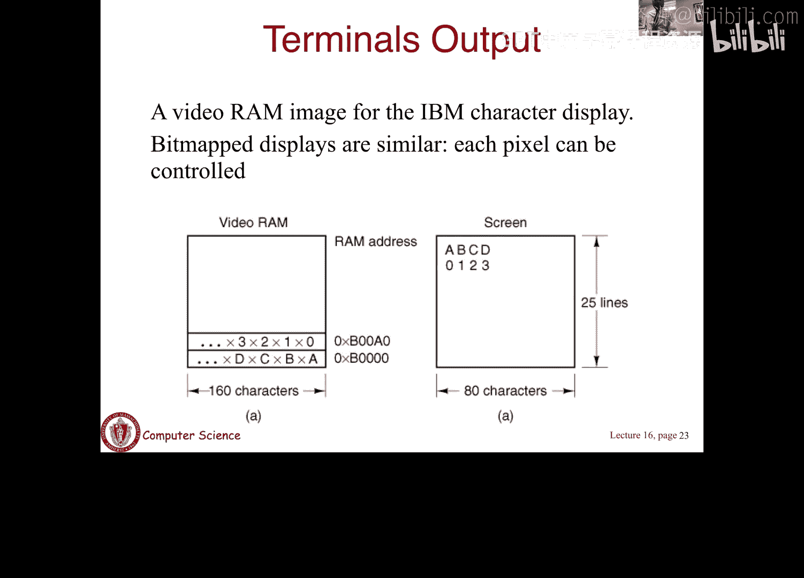

So those are memory mapped terminals you also have character terminals or other Rs 232 terminals where these are character terminals but you are not using a graphics adapter you are using a serial interface so as is shown in this picture the terminal actually in this case is the one shown to the right it has both a display and a keyboard so it is basically both an input and an output device and you have a serial cable that is connected from your computer to the terminal the serial cable allows to way communication it allows you to send characters to the screen it also allows you to read keyboard input from the keyboard and read it here so so you have a Rs 232 driver that is basically going to take whatever characters you're writing that converts it into serial command send it over the serial interface the serial commands are basically using a protocol。

U art， which we really don't need to go into， but U art allows you to do serial communication。

 so it allows you to both transmit and receive the terminal to the terminal。

Now these are no longer used in practice， but there are some special cases。

 embedded systems and so on where they are still used。

 but you will not see RS 232 terminals connected to a laptop or a PC but theres when you go to embedded devices and things of that sort you might still use RS232 for communicating with with a terminal。

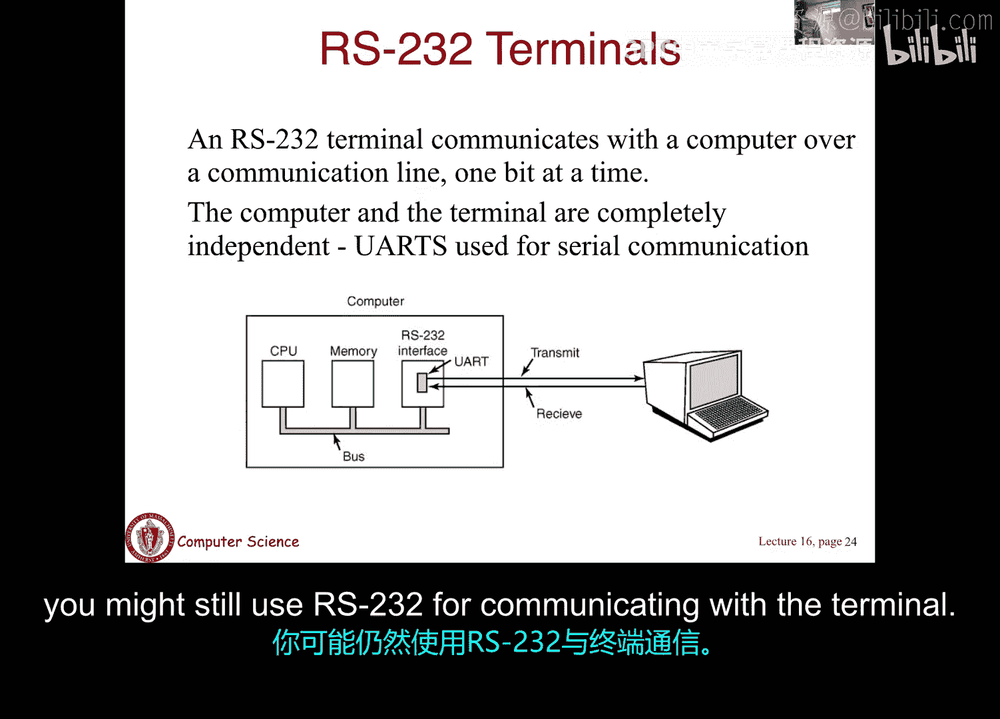

Now the way this terminals work is essentially you have a buffer pool which is like a circular buffer where you can read or write so keyboard input arrives and it essentially sits in a circular pool and then the device driver in this case is going to keep reading those characters and then processing them and so on and to write also you have this kind of buffer that is being used to output to the terminal。

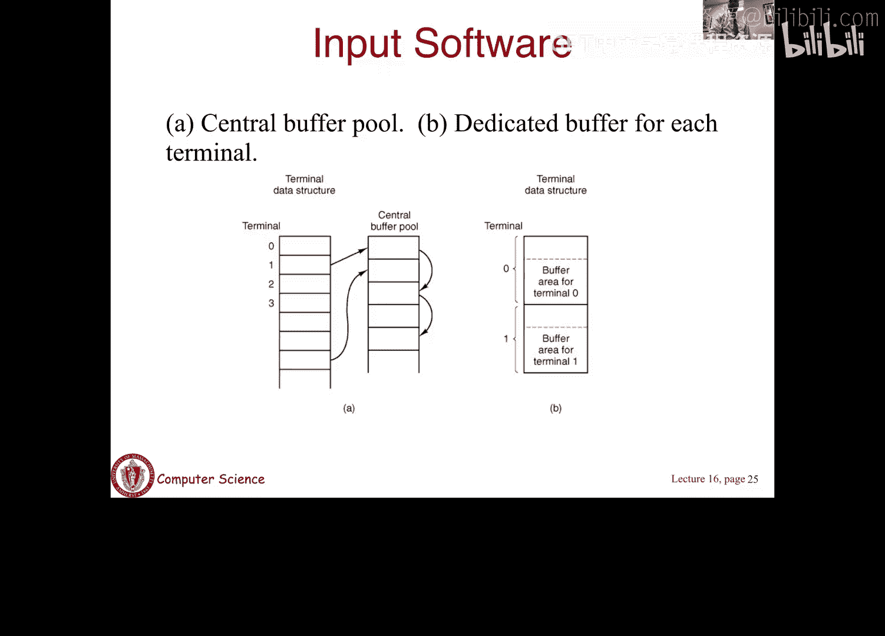

Now very quickly the terminal driver has to in this case do a few different things you can read from the terminal again the read commands essentially arrive to the VFS server and then on behalf of a user process and then are handled by the device driver the read only is true if you are using an R232 terminal if you have a standard graphics card or the monitor you are not going to be reading from it except that more modern monitors might have a touch screen in which case they become both input and output but in only the older Rs232 terminals actually have a keyboard that is part of the terminal device but not modern screens except for touch screen you can of course write to the terminal which is your outputing characters or pixels to the terminal or you can essentially use Ioctel commands which allow you to set terminal parameters how frequently do you want to communicate case of the graphics card this is maybe the frequency of output are you。

30 hertz or 60 hertz or are it changing the resolution and so on。

 So these are all done through the IR T command。

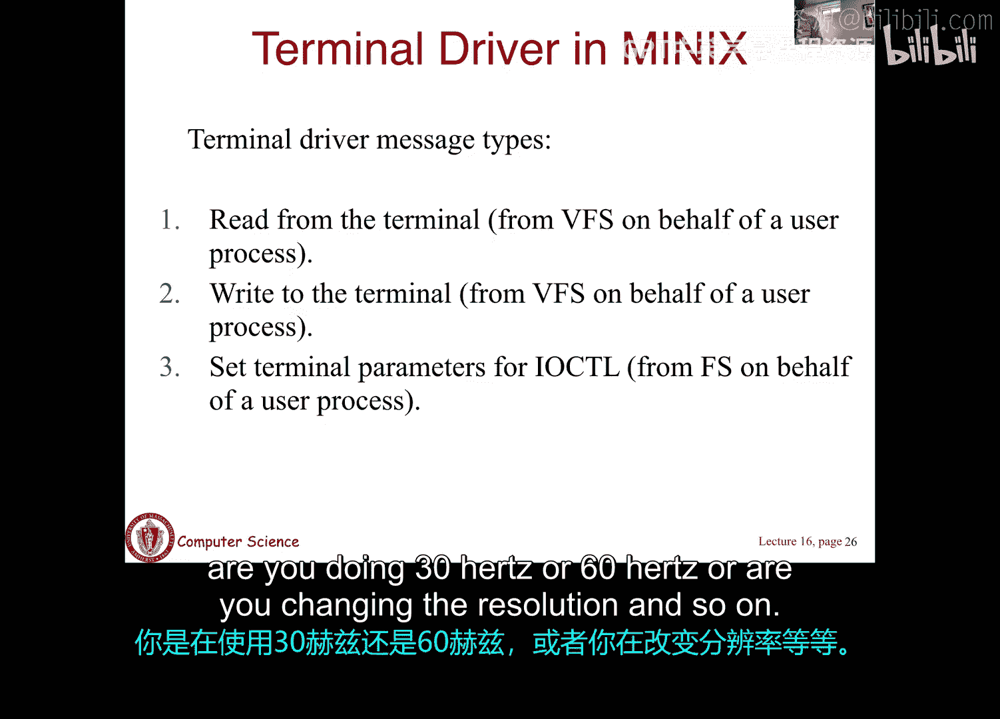

You also need to handle certain other types of messages such as there was an IO from the screen which could be a keyboard interrupt。

 you might have to also do things like standard things like opening and closing devices and so on。

So all of that is shown in this picture here where your user process that is trying to read from a terminal。

 let's say its a touch screen you want to see if some there's been some touch input you basically since the device is exposed as a file you essentially hand it through the file server process so you read from the file server process that sends it to the TT wide driver in this case that the terminal driver the terminal driver is going to ask wait for a receive from the system task whenever there's a keyboard input that generates an interrupt it comes to the system task。

 the system task makes a notification message sends it to the terminal driver let's step4 and then the terminal driver is going to essentially read from the buffer and then decide what it needs to do and then finally hand that input to the user process for handling。

The output is very similar， you have a terminal task it is going to do a right it' is going to go through some event handler and then output characters to the screen and then you flush to the screen and remember that di level concept as if if it is a memory map device you have a video Ram where you are essentially writing this output to the video essentially uses the graphics card controller to output that to your screen。

And the last。Driver I want to talk about very briefly is the keyboard driver and typically on most machines。

 the keyboard driver is separate from the terminal driver except in Rs232 part of the same device but typically the keyboard could be a USB keyboard and the graphics card is separate So so the keyboard driver is actually very simple every time you press a key on your keyboard it generates an integer code gets generated that represents what key has been pressed。

 So for every key on your keyboard there's an integer code So a key would have a code and the B key would have a code and the function key would have a code and so on and some of that mapping is actually shown in this in in this figure here So every time you press some key it generates a code that code goes and sits in a small buffer and the keyboard generates an in the keyboard driver is then going to have to go and read that keyboard input。

From the keyboard buffer and then hand it to whatever process was actually receiving that input at the current time and any time theres some process that is designated as active and that's the one that's going to receive input now I should also mention that because you can press this key key on your keyboard very rapidly theres a small buffer on your keyboard which will buffer this and this is done because the keyboard driver may not be able to process inputs as quickly as you press them sometimes you hold a key and press it down it generates rapid amount of input and typically you may not be able to handle it so you buffer them and then you wait for the keyboard driver to receive them one character at a time because it is going to be doing one character at a time processing so。

Again I would encourage you to go and look at some of these drivers in the source code of Min some of them are very simple。

 some of them are little more complicated the device drivers are in the drivers directory some of the other code which is the device independent code you are to go into the VFS system process and look in the file server process and as part of the final project we will have to implement a very simple device drivers which instructive to go and understand how all of this works so with that I' am going to end this today and then in the next class we are going to switch to the file systems and file server process within Min and so on which will be the last big component of this course。

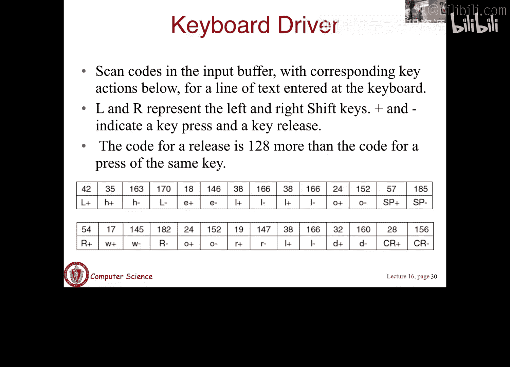