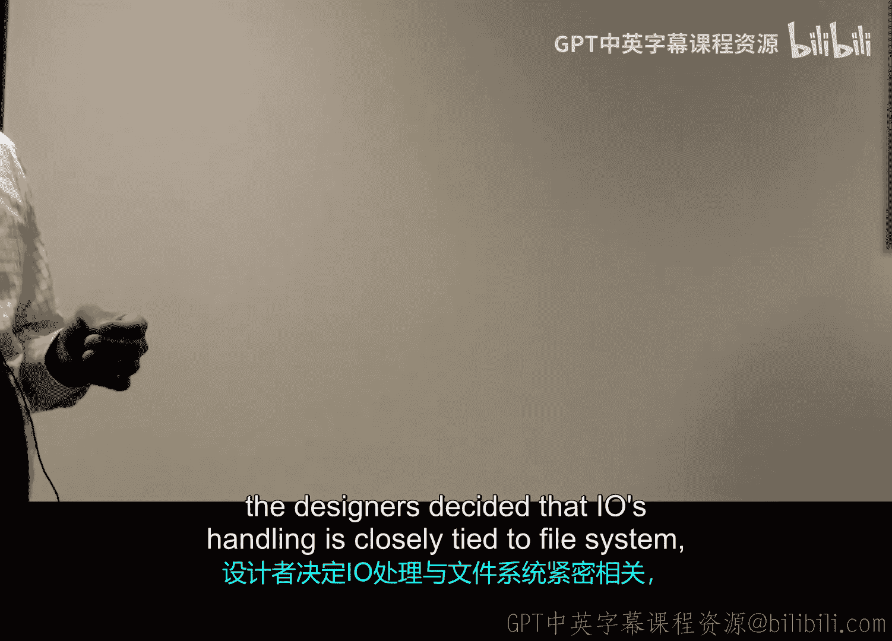

# 操作系统设计与实现：第16讲：Minix I/O与设备驱动程序 (03/17/20) 🖥️🔌


## 概述

在本节课中，我们将继续讨论I/O子系统，并聚焦于Minix操作系统。我们将学习Minix中设备无关的I/O子系统代码，以及设备驱动程序的实现方式。课程将涵盖I/O子系统的分层架构、设备驱动程序的设计模式，以及Minix如何通过用户空间进程实现设备驱动。

---

## I/O子系统的分层架构

上一节我们介绍了I/O子系统的基本概念，本节中我们来看看Minix中I/O子系统的具体分层架构。

下图展示了Minix I/O子系统的高层分层架构：


*   **最底层是硬件**：即实际的I/O设备。硬件通常通过中断与机器其余部分交互。
*   **内核中的中断处理程序**：位于内核最底层，负责与设备驱动程序及上层I/O子系统软件交互。
*   **设备驱动程序层**：位于中断处理程序之上。每个设备都有一个对应的驱动程序。设备驱动程序包含所有与设备通信的特定代码和细节。
*   **设备无关的操作系统代码层**：位于设备驱动程序之上。该层以更高的抽象级别（如块设备和字符设备）处理设备，并与用户级软件交互。
*   **用户级软件**：位于最顶层。

虽然我们在Minix的背景下讨论此图，但这种架构是通用的，任何操作系统内核在连接设备时都会采用类似结构。在Minix的具体实现中，此堆栈中的部分代码位于内核，部分则位于各种系统级任务（包括作为用户级进程的设备驱动程序、文件系统任务等）中。

---

## 设备无关层

设备无关层是I/O子系统中的关键抽象层。它位于设备驱动程序之上，提供统一的接口和通用功能。

以下是设备无关层的主要功能：

*   **统一的驱动程序接口**：需要与所有设备驱动程序通信的标准接口，因为此层代码独立于任何设备特定细节。
*   **缓冲**：用于处理设备速度与CPU速度不匹配的问题。
*   **错误报告与处理**：I/O设备速度慢且涉及硬件，可能出错，此层封装了部分错误处理逻辑。
*   **设备分配与释放**：管理设备的分配和释放。
*   **块大小决定**：决定与设备通信时使用的数据块大小。

所有这些功能都在设备无关层中处理。

---

## 设备驱动程序的设计模式

设备驱动程序的设计模式主要有两种，区别在于操作系统是否提供了标准接口。

下图展示了这两种模式：


*   **图A（无标准接口）**：每个设备驱动程序实现设备特定代码，并向操作系统其余部分导出自己的接口。接口形状各异，意味着每个驱动程序与内核交互的方式都不同。
*   **图B（有标准接口）**：操作系统内核标准化了设备驱动程序的接口。所有设备驱动程序必须支持用于通信的相同函数集，并遵守该标准。因此，操作系统其余部分与设备驱动程序交互的方式是统一的。

大多数早期操作系统类似于图A，但现在几乎所有通用操作系统（包括Minix）都采用类似图B的标准接口方式。

---

## 用户空间I/O与请求处理

Minix是一个微内核，因此许多设备驱动程序（实际上是所有驱动程序）都作为用户空间进程实现。大量I/O代码驻留在内核之外。

下图展示了一个典型I/O请求在用户空间软件上下文中的处理流程：


以下是处理步骤：

1.  **用户进程**：发出I/O请求（例如，读取文件）。
2.  **设备无关软件（文件系统进程）**：接收请求，实现命名、保护、决定块大小、实现缓冲区缓存等功能。确定应由哪个设备处理请求，并将其传递给相应的设备驱动程序。
3.  **设备驱动程序**：实现设备特定代码，设置设备寄存器（如命令寄存器、状态寄存器），并向设备控制器发出命令。然后等待来自设备的中断。
4.  **中断处理**：设备控制器完成任务后，向内核发送中断。内核（系统任务）将中断转换为通知消息，发送给对应的设备驱动程序。
5.  **回复传递**：设备驱动程序处理中断，获取读取的数据，然后将回复向上传递回设备无关软件。
6.  **返回用户进程**：设备无关软件最终将读取结果返回给用户进程。

---

## Minix设备驱动程序的实现细节

了解了整体流程后，我们深入探讨Minix设备驱动程序的具体实现细节。

在Minix中：
*   所有设备驱动程序都作为用户空间进程运行。
*   每个设备类型有一个驱动程序进程。
*   这意味着驱动程序无法直接访问内核内存或I/O端口。



因此，用户空间设备驱动程序需要通过内核提供的机制与I/O设备通信。典型的设备驱动程序需要四种类型的I/O访问：

1.  **访问自身地址空间外的内存**：例如，RAM磁盘驱动程序需要访问存储磁盘数据的内存区域。
2.  **读写I/O端口**：通过内核调用（系统任务）来访问。
3.  **处理可预测中断**：例如，发出I/O请求后等待完成中断。内核将中断转换为消息发送给驱动程序。
4.  **处理不可预测中断**：例如，网络数据包到达或键盘按键。发生时间未知，需要快速处理，通常采用非阻塞发送/接收或轮询等方法。

所有这些访问都由Minix微内核内的**系统任务**实现。

---


## 设备驱动程序的结构与消息类型

每个Minix设备驱动程序都作为一个独立的用户进程运行，结构简单。驱动程序通常只需做三件事：接收消息、处理消息、发送回复。

驱动程序接收两种主要类型的请求：
1.  **工作请求**：来自文件服务器进程等其他进程。
2.  **中断**：来自内核（系统任务）的通知消息。

驱动程序需要快速处理请求，因为它是单线程且顺序执行的，其他请求会排队等待。

以下是设备驱动程序需要处理的典型消息类型示例：

**请求消息字段**：
*   `m_type`：请求的操作类型（如读、写）。
*   `DEVICE`：设备号（通常是次设备号，用于指定同类设备中的具体设备）。
*   `PROC_NR`：发起请求的进程号。
*   `COUNT`：字节数。
*   `POSITION`：设备位置（如偏移量）。

**回复消息字段**：
*   `m_type`：回复类型（通常是`DRIVER_REPLY`）。
*   `PROC_NR`：回复给哪个进程。
*   `REP_STATUS`：状态。
*   `REP_COUNT`：传输的字节数。

一个典型的设备驱动程序伪代码如下：


```c
while (TRUE) {
    receive(ANY, &message); // 接收任何消息
    switch(message.m_type) {
        case READ: do_read(&message); break;
        case WRITE: do_write(&message); break;
        // ... 处理其他消息类型
    }
    send(message.PROC_NR, &reply_message); // 发送回复
}
```

---

## 块设备与字符设备示例

设备分为**块设备**（以数据块为单位进行I/O，如磁盘）和**字符设备**（以字符/字节为单位，如键盘）。我们将看几个Minix中的例子。

### 块设备驱动程序

块设备驱动程序需要处理六种类型的操作：
1.  `OPEN`：打开设备。
2.  `CLOSE`：关闭设备。
3.  `READ`：读取设备。
4.  `WRITE`：写入设备。
5.  `IOCTL`：I/O控制，用于获取或设置硬件特定参数。
6.  `SCATTERED_IO`：分散-聚集I/O，用于批量处理多个读写请求，提高效率。

#### 示例1：RAM磁盘驱动程序

RAM磁盘使用内存区域模拟磁盘的块设备。常用于系统启动时加载内核映像。

Minix RAM磁盘驱动程序通过六个简单的设备文件实现其功能：
*   `/dev/ram`：实际的RAM磁盘。
*   `/dev/mem`：访问物理内存。
*   `/dev/kmem`：访问内核内存。
*   `/dev/boot`：启动时保存引导映像。
*   `/dev/null`：输出设备，写入的数据被丢弃。
*   `/dev/zero`：输入设备，读取时总是返回零。

#### 示例2：硬盘驱动程序

硬盘驱动程序将磁盘的几何结构（柱面、磁道、扇区）转换为线性逻辑块地址（LBA）。设备可以通过LBA或物理地址（CHS）访问。

硬盘控制器有一组寄存器（控制端口），驱动程序通过写入这些寄存器来发送命令（如读、写），并指定地址模式（LBA或CHS）。

设备文件命名如 `/dev/c0d0`，其中 `c0` 表示控制器0（或磁盘类），`d0` 表示该控制器下的磁盘0。

### 字符设备驱动程序

#### 示例3：终端驱动程序

终端是一个通用概念，指可以显示机器输出的显示器。类型多样：
*   **内存映射终端**：现代显示器，连接到显卡。通过写入显卡的**视频RAM**来输出内容。视频RAM可以是字符数组（字符显示）或像素数组（位图显示）。
*   **RS-232串行终端**：老式终端，通过串行电缆连接，使用UART协议通信。包含显示器和键盘。
*   **网络终端**：如X终端，通过网络通信。


终端驱动程序需要处理 `READ`（从终端读，如触摸输入）、`WRITE`（向终端写）、`IOCTL`（设置终端参数，如分辨率、刷新率）等操作。

#### 示例4：键盘驱动程序

键盘是典型的字符输入设备。每次按键会生成一个唯一的整数**扫描码**。扫描码被存入一个小缓冲区。键盘控制器产生中断，键盘驱动程序从缓冲区读取扫描码，并将其传递给当前活动的进程。

---

## 总结


本节课我们一起学习了Minix操作系统中I/O子系统与设备驱动程序的设计与实现。我们了解了I/O子系统的分层架构，包括硬件、中断处理程序、设备驱动层、设备无关层和用户软件。重点探讨了Minix作为微内核，如何将设备驱动程序实现为用户空间进程，并通过系统任务和消息传递机制与硬件交互。我们还分析了块设备（如RAM磁盘和硬盘）与字符设备（如终端和键盘）驱动程序的具体示例及其工作原理。这些知识为理解操作系统如何管理多样化的硬件设备奠定了基础。