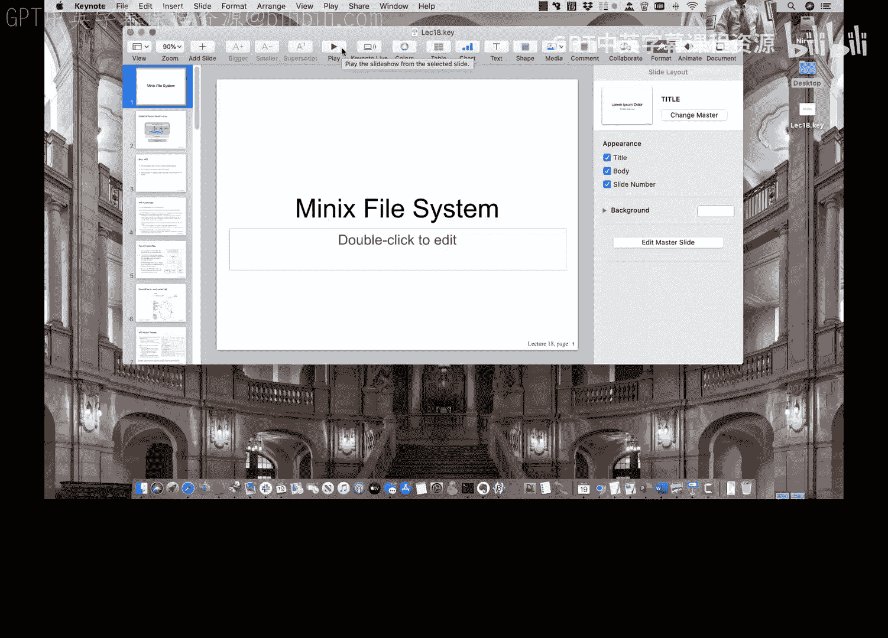
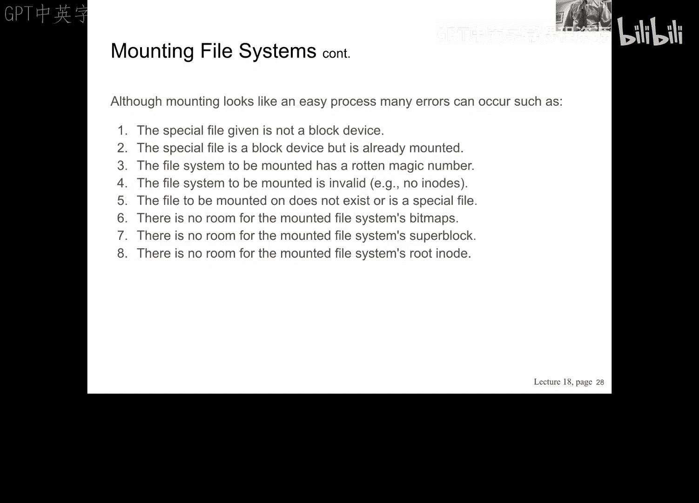

# 麻省大学《操作系统 设计与实现｜CS 577 Operating Systems Design and Implementation 2020》中英字幕 p35 -35-Lec18 Screencast_ Minix File System and File Server (03_19_20).zh_en -BV1iP2CBaEHr_p35-

Okay so we will continue the discussion from where we left off last time。

 which was basically a discussion of general concepts in file systems and how operating systems kernels provide support for file systems so with that background today we are going to look at the Min file system in particular and see how Min can actually enable the implementation of multiple file systems as well。

So。Before I get into Min I want to present a concept that is used by many Uniux like operating systems。

 including Min which is called the virtual file system or the VFS so a VFS is essentially layer within the within the OS kernel that allows you to have different file systems present in in the OS and yet provide an abstraction that allows access to this file system So as is shown in this figure the VFS layer or which is also called the VFS switch sits above the implementations of different file systems within within the kernel and this picture actually is Linuxux specific but the same concepts are going to apply to Min as we will see shortly so you see underneath the VFS layer are different file system so there's a EXT file system theres a riser file system and so on and the VFS。

Layer is actually sitting on top of these file systems and providing a file system independent abstraction to the rest of the OS and to user processes。

 So what happens is system calls that are file system specific always come to the VFS layer first when the VFS layer then examines which file system is responsible for processing that call and then it is simply going to forward that call to a specific module that implements the file system。

 So if it is a read on a EXT3 file system the VFS layer is going to then invoke the read or forward that read to the EX3 implementation of read and so on and so forth。

So this mechanism allows us to add new file systems to the OS kernel very easily because you just have to write that file system to work with the VFS layer and then everything about the VFS layer is going to be file system agnostic。

So the same concepts are actually going to be true in Linuxix as well。

 except that unlike this picture where we have a Linux kernel which is monolithic and all of these components reside inside the kernel we are going to have in Linux these components being separate system processes so in Linux we have a server process which is called the VFS process the VFS process as the name suggests is implementing the virtual file server or the virtual file system functionality in addition to several other functions but that is by and largege what it mainly does and as shown in the previous slide it is essentially a user process or a system process that sits between the actual user processes and the file system or file server processes that implements specific file system functionality so the VFS which essentially is implemented by。

VFS process and as we will see each file system in Linux is going to be a separate user process that is going to interact with this VFS process。

Now we will see that not only is a file system a separate process。

 each mounted partition of a file system is also going to be a separate process。

 So I'm going to talk a little bit about the functionality provided by the VFS layer of the VFS server process in Linux and you will see today that the slides actually have more content on them as compared to some of the previous classes this is because all of the classes are recorded going forward and I wanted the slides to be more informative than just presenting highleve bullets and explaining more of that so you will see more details on these slides going forward as well so coming back to VFS VFS as I said。

 provides an abstraction to the other file server processes it implements a number of data structures and function functions but by and large it is responsible for two or three different things the first is it implements the projects。

ystem call interface that allows user processes to invoke these system calls and it also supports a few additionalleC calls so you will see here that the two classes or system calls that are implemented in the VFS are all the file management system calls which you include and there's a long list of them on this slide so these include file specific ones such as open close readr directory specific ones that allow you to create directories and whatnot system calls that allow you to change file attributes like change more change directory and so on as well as several others that are specific to mounting and un mounting file systems。

And the VFS process also supports several process management system calls。

 remember that there are other processes such as the VM and the PM that also implement lot of the process specific functionality。

 but there are a couple of calls that are process specific but also tied closely to the file system and those calls are actually supported implemented rather by the VFS process specifically the select call that allow you to actually。

Deal with allow you to deal with some file I as well as file descriptors and file position manipulation calls are implemented by the VFS layer and the process and the VFS layer also the VFS server rather also interacts with the process manager when you are to deal with things like for and Exec and so on。

 because some of this when you start a new process required to read a new file from disk and that call is actually handled by the VFS process。

The second key set of functions that are implemented here are to track endpoints for device drivers because the VFS layer is or the server the VFS server rather。

 So also the process where all of the i O function functions flow through so so it has to track。

What kinds of device drivers that present character device drivers。

 block device drivers what their device names are because if you remember last time I mentioned that are two classes I I mentioned that all devices also have file names that reside in the slash dev director So when you are accessing a device through this file name that call actually has to flow through the through the VFS process So the process has to track the endpoints which are the drivers that are going to be responsible for implementing device specific functions and can forward the calls to those drivers when when they when they are received。

So here in this slide we have a picture that shows us the typical control flow of how an IO request will flow from a user process to a specific file system what is not shown here are things that are handled at a device driver layer and below those functions were described in an earlier lecture that's still the case so we are only looking at file system specific layers and processes in this in this picture so as I shown you have a user process that is a read system call and that read system call is are going to arrive at the VFS process which in Min is implementing our VFS functionality or the VFS switch functionality and in this case let's say it is a read to a Min first file system so it is going to take that read request and then forward it to one of the Min file server processes in this picture you will see that there are three different。

Partitions that are mounted theres a root partition s there's a slash user partition and a slash form partition and each of these could be separate processes sitting within within the system and depending on which partition the read is reading the file from you will actually forward it to the right right process as well so so very quickly the user process executes a read the VFS is going to verify that the read is on a valid file and then forwards the request to the file server that is going to handle it the file server is going to read that data remember that in doing so it has to deal with the block drivers and device drivers and the hard disk and so on which we have looked at separately and once you read the data you're going to copy it back to the user process and reply to the VFS process that it has executed the request and the VFS process can then subsequently process other operation。

Now shown in this picture is a more detailed version of the simplified picture that I showed earlier。

 I put this picture only here because one of the labs of the projects is going to require some modifications to the file server and the implementation of a file system so it's instructive to understand whatever I showed in the previous slide how it actually is implemented in more detail within Linux so so that the processes by the same it is just that more steps are shown here that implement the higher level description I've presented previously so in this case rather than doing a read we have a different system call so it is called stat that's going to look what status of files and so on so you have a user process that that executes a small program thats a snippet of which is shown in this slide that called stat on a particular file。

And so so that request is going to come to the VFS process。

 the VFS process is then going to essentially do a lookup to the root partition。

 the root partition is going to then essentially resolve that request by actually going to the device driver and trying to read the file。

 read read the file or not read the file， read the directory and so on and then。

You will basically eventually get back a request in this case the stack is on a file that actually belongs to the slash user partition as you will see in that snippet of code so the root partition actually needs to the file server process handling the root partition needs to forward that to the slash user file server process so the figure is also illustrating that although you have a single Min file system on the disk you have multiple partitions each partition is its own independent Min file system so slash is an independent Min file system partition and slash user is one so theres a file server process for each of them so it's not just one server process for all devices it's one server process for each partition so you will see that in this case the request gets forwarded to the slash user file server process and。

eventually after it is processed through the device driver。

 you are going to send back a reply to the VFS process and then eventually to the user process so multiple processes。

 system processes are involved in handling the system called as is typical in most of the calls that are coming to the file system。

Okay， so。With that control flow background， let's talk about some more details of how the VFS process is implemented Now one of the things that is true of the VFS process which we have not encountered so far is that it implements threading it implements threads to handle concurrent I requests because that that's a good way to handle concurrency now it's worth noting and as I've also mentioned previously。

 Minix has no support for kernel level threads at all。

 so we have not actually encountered threads so far in any of the other components within within Minix but this is one of the places where threads are used extensively。

And and because Min has no support for kernel level threads。

 BFS threading is actually implemented using a user level threads library， which is called S thread。

So this thread is a user level library that was written specifically for system processes so if you need to write a system process that works with the micro kernelnel you can actually use this user level threads library and it will allow you to implement threading functionality of course there are other threads packages that are also available for user processes this one was written specifically to make the VFS process concurrent。

So the way it works is through a standard master slave process architecture where there is a main thread that is waiting for request and there are a set of or a pool of worker threads whenever the main thread is going to receive a request it is going to look for an id worker thread and hand that request to that worker thread and once the worker thread is finished with that request it is going to go back to the idL pool again that is a very standard way by which you write any concurrent or multithreaded server and the VFS server also uses the same concepts to implement a multithreaded worker pool architecture。

Now it's worth noting that in this architecture， if you start with a certain number of worker threads and you get more simultaneous requests than you have worker threads than you are going to have to wait meaning that once all the worker threads are busy and a new IO request arrives that request will be queue in more sophisticated servers the size of the worker thread pool itself can be varied dynamically so for example in the Apache web server you have a dynamic worker pool but the size of the pool actually varies based on the load that you see in the system。

 but in Linux you have a much simpler static worker thread pool which means that if you are more concurrent request than you have worker threads then some of those requests will have to wait until a new thread becomes available。

So the VFS server is going to use these worker threads to interact with all the file server processes and it does so asynchronously so while waiting for a reply a worker worker thread is blocked so it is synchronous on a per thread basis but in general the whole process is not going to block because you are using in this case user level threads and remember that in user level thread packages if one thread blocks all threads are going to block and the entire process blocks since we don't want that to happen each thread has to use asynchronous IO or asynchronous request because if you makes a blocking call then all of the other threads get blocked as well so so while waiting for a reply a thread is going to be waiting but in an asynchronous fashion which allows other worker threads to execute。

And when you receive a reply from the other files or a process。

 that worker threat can continue execution and eventually finish processing of that request。

Now this picture here， which I'm not going to go into too much detail shows us the three types of worker threads that a VFS process supports and they're called a normal thread which just does normal work theres a deadlock thread which actually is a deadlock resolver if there is a problem deadlock in the system that's the one that is going to be used and then there's a system worker thread that is used for by the process manager and and to handle notifications from kernel the micro kernelnel and so on so the normal threads handle requests that come from user processes。

 the system threads handle requests that come from other system tasks such as the process manager or the kernel and the deadlock thread is actually handling deadlocks in the system。

Now I'm going to also go through a little more detail of where some of the code for the VFS process resides。

 it is spread across multiple files but all of them are in the VFS folder in the servers directory within within the Linux source tree so here are some of the key data structures that are shown on this slide so there is Fpro there is V mount there is v node there is flip there are a couple others on the next slide so Fpro is essentially our process file table if you remember the concepts I talked about last time I said there are file tables that are maintained for each process so in this case you essentially have the fpro data structure that is implementing that functionality。

V mount essentially tracks all mounted file system within that are currently presented within the system and it will have information like the device major number。

 minor number， the mount flags and several other attributes。

The Vn data structure as the name suggests essentially is going to track all the iNots in your system so essentially for every disk file you are going to have an in and all of those are tracked in the Vn table the flip or data structure which is basically the file position table or every open file you are going to have an offset that tells you where that file is where the file pointer is pointing to and the flip data structure is going to track that for us。

And there are a few others like the lock data structure that allows us to lock certain parts of a file。

And as as has been noted here， it is basically used in advisory locking at the process level not within the kernel。

 the select essentially is used to implement a select call and then there is essentially a Dmap object that is going to be mapping from the device minor number toward a device major number excuse me。

 to a specific device driver so that you can forward the request to the appropriate device driver。

Now I should mention that because the VFS process is concurrent， it has multiple threads。

 many of these objects will need locking， but the type of locking that is used will vary from object to object based on how threads actually access them。

And at the bottom of the slides are several pointers where some more information about these data structures is available and the best place of course is to go to the Min sourceory and then look at some of these files to understand these data structures better。

So now lets come to locking again this is the first time we are encountering threading within the kernel and whenever you have threads you have a need for synchronization because if there are multiple threads that access the same object then you are going to have race conditions and problems with multi multiple threads trying to overwrite one another so you need to implement mutual exclusion or locking to avoid these problems。

Now we'll get to how each of these objects implements locking but what is shown on this slide are higher level design requirements and we'll see that VFS locking uses a set of design principles that are very similar to asset properties if you have taken a course in databases you would have heard the term asset properties which is an acronym that stands for atomicity consistency isolation and durability and relational databases implement concurrency and locking using asset semantics now file systems don't use database semantics like asset properties but they have their own set of requirements and the requirements are listed here I'm just mentioning that some of them have a similar flavor to asset properties although I should also say that this is really not providing database like asset semantics at all it's a weaker form of guarantees。

So the first is you want consistency on the replicated data which means that any system call that access the accesses data structures like that modify things like file sizes when you write to a file you might end up making the file bigger so that requires us to update the file size so any system call that makes these kinds of changes have to be mutually exclusive within the within the VFS process so there has to be some isolation which means that。

When system calls are composed of multiple requests。

 you are to ensure that the result of a system call should not be impacted by what is happening elsewhere。

 so it should look like this system call executed by itself and you do not even know that there are system calls executing that's called the isolation property which is similar to how database transactions were integrity of objects essentially says that you should keep objects in a consistent fashion so。

Since locking is itself a blocking operation we will see that integrity of locks requires some extra locking functions and some of this is non-preemptive。

 so you want to ensure that you maintain the integrity of all objects in the kernel you have no deadlock requirements which seems to be an obvious requirement that we have whenever your threading and youre acquiring all kinds of locks you want to ensure that you are not going to have any deadlocks very easy principle that you can use even in user level code that you write which is also used here is to order the operations in terms of how they acquire locks so so Linuxix also does the same thing or the VFS in Linux does the same thing and it is going to essentially avoid conflicts between locks by keeping an order and acquire locks in that order which always ensure that there are no cycles deadlocks or caused when your cycle and。

Locks are acquired。So we can avoid that by simply enforcing an order we don't want any starvation in the system where because of locking so we need to make sure that all system calls execute efficiently。

 you must ensure that you one request does not block other requests。

 you must also ensure that read only operations can be congcurrent。

And we will see how some of this is implemented so within the VFS process we essentially have three types of locks which are very similar to readwrite locks okay I hope some of you heard the concept of a readwrite lock a typical lock essentially is mutually exclusive which means any thread that holds a log blockss all other threads that are trying to acquire the log so that is a standard lock which means that only one thread can hold that lock at any given time。

Now readrite lock generalize that concept a little bit by allowing a bit more concurrency and what this says in a readrite lock is that multiple threads can acquire the lock in read mode where they are only reading the object but not modifying that object。

But if you are trying to modify the object you have to acquire the lock in write mode which means that it now looks like a normal lock where only that thread holds the lock and all other readers as well as writers in the system are blocked from accessing the object so so the Linux and VFS also support a similar concept and this allows you to have more concurrency during read but safety during write where only one writer can write to a data structure。

So there are actually three types of logs there is a T TL read which is a standard read log that allows multiple readers to read that object。

 There's a T TL write which is a write lock that allows only one writer to hold a log no readers or writers a allowed and there is something called a T TL read serial which allows you to hold read logs on multiple parts of the file so you can hold a log on only a part of the file rather than the entire file or or resource rather than the entire resource so read logs are somewhat similar to write locks in that。

You can essentially you dont block other concurrent reads。

 but you can be upgraded to a right lock and then the thread will block until the last read lock has left and so on so think of this as a way to serialize some of the reading when you don't want full concurrency。

So again， there is a link at the bottom that has some more information on these locking primitives within the VFS layer and we will see that there are other parts of the system or the Min system that also use locking and use the same concept。

Now earlier I mentioned that to avoid deadlocks， Linux will Linux requires that code has to acquire locks in a certain order and that order is shown here So you see a set of tasks or data structures here going from Fpro to exact v mode v node flip and so on and that's the order in which that's order that here to respect So what as an example thread cannot lock an f object if it actually holds a lock on something down that chain such as a V mode and so on。

 so you wont only hold one lock at a time and that if you hold a lower level lock you cannot actually acquire a higher order lock until you release that first So I think that's the general concept。

 and if you do that that you will not have any cycles because you always holding locks in increasing increasing order thats shown in。

picture and that basically means you cannot hold a lower ordered lock and get a higher ordered lock to get that cause a dead lock so this concept is respected in many parts of the code which is in things like v mode v node flip lock and so on so all of these code has to respect this order but there are several other details of what the locking does what kinds of locks are actually acquired in each of those components that we are going to look at next。

So let's start with the v mount locking。 So here we are trying to grab a lock when mounting and unmounting processes so this locks entire Vn and the main goal here is if you're trying to unmount a process when there are still active IO operations that is unsafe because there are still read reads and write that are going to files within a partition and you are trying to unmount an entire file system So you don't want that to happen and this is done by using a lock and as is shown here the way you actually do that is when you try to read you hold a concurrent log that's a read lock that's mentioned as TLL underscore concur So read operations and are essentially allowed to proceed in a concurrent fashion when you。

Want to do a right you are essentially going to use serial which basically means that you are going to wait for all the readers to finish and then you are going to be the only one that has the lock and then you can proceed and so you can use this to do create and modify and then exclusive essentially is actually a real right lock where you are going to block everyone else until until the read is finished or until that write is finished。

Now。If you look at the next data structure which is Vn or open file locking again you have similar concepts when you want to do a read or open the file in read mode you are going to essentially provide lock the Vn using a read lock when you want to do operations such as create open destroying V nodes or R nodes you are going to use the the serial mode and when you want to do write access youre going to hold write lock so by and large reads use the concurrent read lock right use write locks and when you want to serialize operations make sure they go on at a time you use the serialized lock which looks like write lock but it serializes operations。

Now as far as locking the flip object is concerned this is the is a table that stores the file offset for each open file so so there are two variables in here which is the flip code or the F count which says how many processes have opened that file for reading or writing and for each of that process your flip position which is the offset within the file okay and in this case you are just going to use a mut text lock so essentially the locking order is going to help us in this case where。

You don't。 you basically hold a simple new text log。 And whenever you hold you have a flip。

Oject on a process file descriptor， you essentially lock the Vn。

 which implicitly means that the flip object gets locked as well。

And there are several other concepts other data structures there is essentially the log data structure itself and here you need mutual exclusion for grabbing the lock on because you need a lock on the lock essentially to implement this the lock functionality so so we assume here that our threading model is nonpreemptive which means all accesses to the structures are automatically atomic so thats how you are going to implement integrity of the log object if you are doing a select then you essentially use one large global mut text which is a simple solution no concur allowed and when you are talking about device drivers and so on again you essentially access them in a non-blocking fashion so you don't even need don't need a lock in this case。

Now let me say a few words about how crashes are handled by the VFS process VFS process is also going to play an important role in all kinds of crash recovery when your broad device drivers crash when the file system process crash then you got to do something because remember that the VFS process is essentially the process that is routing requests to all of these other processes which are device drivers file system processes and so on so you are to say answer the question what is going to happen if one of these processes crashes because the user process might still send a request to the VFS server and then the VFS server will find that there is no process to forward it to so the way this is done is somehow the VFS processes to track and the health of these processes whenever they crash then you got to see whether you can recover from them so now if the device drive。

itself crashes， then the file system process that is interfacing with a device driver will try first to restart the driver and if it is not able to do that then the VFS process will try to restart the driver through through a restart mechanism。

The characterracer devices are similar process， but in this case it is the VFS process that is going to try to recover or restart these drivers。

So those are device driver crashes so they're either handled directly by the VFS process or the file system process that's interfacing with the device driver now you could also ask what happens if the server the file server process itself crashes in this case first thing is that the VFS server has to do some cleanup because if the process is crashed all open files that are whether accessing data from that file system etc are no longer valid so you're going to mark them invalid。

 clean them up and so on and then all pending requests are also going to have to be terminated and then you have to try to restart the file server process and try to recover from the crash by making integrity checks and so on So so the VFS process is going to be responsible for doing some of this and in this context I also want to remind you of another component that we。

Talked about long time ago， which was called the reincarnation server or the RRS process then the goal of the reincarnation server was also to restart processes when they fit okay so so the VFS server is playing a role here the reincarnation server could also have been used to do similar things。

Now I will move on to talking about the Min file system itself the discussion thus far has focused on theF the VFS server process。

 but it is also instructive to understand how the Min file server process is implemented and how it stores data and disk as part of the Linux file system。

So the interesting thing about the way this is implemented is first of all the Linux file system is a completely user level process that works with a partition it is written as if it is a network server process which means that it receives messages from in this case the VFS server but though messages could have come from anywhere else as well if so so they good part is you can make modifications to the file system without having to touch any of the rest of the kernel which is a nice functionality that we have here so long as the interface to the VFS layer is not changed everything else internally can be changed without having to know anything about the rest of Linux。

The other point that the Linuxix file system designers speak is they've written the process in a standalone fashion that you can actually move this to a non Linux OS as well because it's written in C you can compile it so it just looks like a process that is receiving messages from outside and then reading or writing to partition so rather than receiving messages from the VSS layer。

 you could essentially easily turn that into on another system a process that is receiving messages from some other component and then implement a user space file system so it's very easy to use this concept to implement a user space file system。

I mentioned this because as part of the project we will be looking at implementing a user space file system as well and so this gives us a way by which we can implement a process and some data structures that are independent of the OSQ。

Now the picture on this slide shows us the layout of a Linux file system Okay so essentially a Linux file system is created on a disk partition。

 it is going to have all of the information that are needed to store files which and as well as the metadata information such as iNot so as is shown in the picture if you think of the disk as a sequence of blocks。

The first block is going to be the boot block the second block is going to be a super block the next few blocks are going to store i notess Okay so these are all met this is all met data information and then all subsequent blocks are going to be data blocks where you actually store blocks on the file that's how the file system is laid out。

And in this context I want to mention that this this data structure or not data structure。

 this layout rather is going to work for any type of underlying storage device。

 whether it' is a USB thumb drive， whether it' is a floppy disk which we don't use anymore。

 of course， or whether it is actually in hard disk or an SSD， the same layout is going to be used。

Now I want to bring back a picture that I had shown you in lecture 5 when we were talking about the boot process so this is the same picture as the previous slide but it shows you how that logical sequence of blocks is actually laid out on a disk of magnetic hard disk because that's remember I mentioned last time that you have essentially track cylinders and tracks and sectors and so on so you will see here that the first sector is essentially the master boot record that is a disk specific block that's not a file system block and then that has pointers to partition then you have essentially partition one that is shown here and that partition one is essentially this block you can have multiple partitions in which case this array is going to be replicated in each of those disc partition so each partition can have its own boot block and super block and so on。

That is what you want to keep in mind and you will see that the first block of a partition is the boot block。

As the first block of the disk is the master boot record。

 so these are all concepts you want to keep in mind in terms of how blocks are laid out on a disk。

 how blocks are laid out on a partition and a file system。

So let's talk a little bit about each of these entities， the boot block， the superb。

 the inodes and so on。 Now if you remember again， the discussion from lecture 5 when I was talking about how the OS boot up so once you look at the master boot record on the disk it is going to point you to a boot partition the boot partition will actually have the first block as it's as the boot block。

 the boot block is going to have a little small snippet of executable code the size of that boot block is 1024 bytes so it's two disk sectors and when you essentially start booting you are going to read from that boot block and read those instructions into memory and start executing those instructions and more details of how you figure out where the instructions are we actually discussed in lecture 5。

 So if I would instruct you to go back to that lecture and look at some of the。

That we had on the lecture slides that gave us more details of how the boot process itself were so once the system has booted you are not going to use the boot block anymore that' is only used in the boot process but the rest of the file system you are still going to use which includes the super block and the ins and things of that。

Now not all partitions have to be bootable but we still assume that the first block is the boot block if the file system is not a bootable partition then you will have entry or a field in in that boot block called a magic number that says this is not a bootable partition so there is no code to load from the boot block but the boot block is always present regardless of whether its a bootable partition which means it has boot code like the root partition or its a non-boable partition like slash user where there is no boot code present。

Now the picture here shows us the super block of the Linux file system this is very similar to some of the concepts I was talking about briefly towards the end of the last lecture so the super block is essentially distinguish block in the file system that's always stored at the beginning of the file system so it appears directly after the boot block it has information。

 important information about the file system itself so you will see it has things about the inots and what is the maximum file size and what are the number of zones and things of that sort that are specific to that file system So when you create the file system you can actually specify this parameter by default the format program for the file system may have some default parameters but you could say create a file system with thousand i nodes or 500 inots and then basically you will do so and some of that information。

Is going to get recorded in in the superb。Now there are several data structures I should also mention before the superb。

 so although the superblock is stored on disk when you mount this file system a copy of the superb is also kept in memory so that the VFS or rather the MFS or the Linux file system process can use it to access other information。

And whenever you modify the super block in memory， it has to be written back to disk as well。

Now the file system is also going to maintain many data structures in the form of bitmaps that allow us to track things like free iNots and free blocks in the file system and things of that sort so the inode bitmap tells us of all the iNots that are kept which iNots are in use which means they are actually valid files and which iNots are empty which means they can be used to create new files and as far as disk blocks or the data blocks for a files are concerned they are allocated in terms of two to the power and blocks so you allocate them in chunks of two to the power and and these chunks are referred to as zones in context of Linux so you basically have multiple zones and then in each zone you can actually have specific blocks。

Now this zone concept allows us to allocate blocks next to one another when you create a new file that' is merely a heuristic it is not a requirement。

 it allows us to not have the blocks of a file spread across the disk which can increase seek overheads if they were stored on the magnetic disk and so on。

Okay， now。To create a file you first had to get a free in and then to allocate data for the file you to scan the list of blocks and try to find at least one free block if not a sequence of free block and the point are so some of these data structures are actually there in the supern as you if you go back to the previous slide here you will see that towards the end there are some entries that point to the in bitmap and the zone bitm those are the last two entries in the the table that shown in this super block picture。

Okay now here is a picture of what an inode looks like The concept is very similar to the multilevel index inode I showed you last time so the first few entries of the iodeode are going to store the user who created the idea of the user who created the file the group file and so on you will essentially have the size of the file access time of the file last modification time and so on and then you have block pointers which are called zone pointers here you will see that there are seven direct pointers referred to as zone zero through zone 6 So are direct disk block pointers。

 the point to blocks that are stored on this so if your file has less than six seven blocks you are going to access them to direct point if it grows beyond7 you are going to have an indirect zone pointer that itself going to point another block where there are multiple pointers so you have one level of indirect and then you can also have double indirect。

As is shown here there is an unused entry that is kept for future use if you want to support even larger files in the file system。

 you can use that entry to create a triple indirect。

 which is also what I mentioned in the last class。 So exactly the same concepts are true here。

Now one interesting thing you have to note here is as far as the in is concerned each in has an ID that is the number that that is a unique ID for a file so essentially from the file systems perspective files are number and the number of a file is essentially the in number okay so if you type Ls minus I on any Uniix file system you will essentially see file names with the in numbers that are associated wge that tell you internally how does the OS identify files file names are the mechanism by which users identify file but the OS itself or the file system uses numbers that are associated with the file to identify now the interesting thing here that you will see in this picture of an in is the file name is actually not included in the in itself。

file loads file names are actually kept in the directory structure so think of a directory as a table where for each file in that directory you have a file name and that file name points to a number that refers to the iode so the mapping between names to in numbers are stored in the directory and once you the number that is associated with the file you look up that specific in and then you get this data structure which gives you access to all of the other information in the file okay so the important point I'm making is the name of the file is actually not stored in the in itself its stored in the directory。

Now as far as how to get to a specific iode because iOs are kept in a known location。

 you can and they of a fixed size as you will see here there are 64 bytes in size you can directly find the location of a in specific in so going back two or three pictures。

So you will see here in this picture in the file system layer the ins essentially are stored right after the superb and each block data block on the disk is 1024 bytes each inode is 64 bytes and so you can essentially say find the offset of every in because they are stored in sequence in other words there is no table telling us where inode 17 is stored you just compute that using a simple equation it's offset 64 times 17 starting with the beginning of the inode blocks that are shown in this picture so that is how once you actually go to a table directory and find the file name and find it a file ID or the inode number you are going to index into these blocks or specific offset and you can read that inode from that location。

Okay so there are a few other data structures to keep in mind was what does file system block cache and I mentioned that both when we talked about device drivers as well as very briefly last time and this is basically an LRU cache which cache is recently read data blocks for a file for by the file system so the idea is if you're going to repeatedly do io on the blocks you don't have to read it over and over again from the disk you keep it in the buffer cache and then you just modify or read from that buffer cache and then remember also last time I said when you modify a block。

 it becomes dirty and dirty blocks can be written to the cache using a write through or a write back mechanism most file systems opt for performance or reliability and use write back So when you write to a block of a file it's only going to come to the buffer cache and modify the corresponding cache block and then the right is going to return。

At a later time the block is going to get evicted from the cache and put on disk or you are going to have a sync operation that writes it to this or in many file system of your periodic background process when theres no file activity is going to write out all the dirty block so that they eventually go to this Okay so so thats how the block cache is actually implemented。

Now Linux file system looks like any other UniX file system。

 which means that there are partitions each partition has to be mounted using the mount operation before you can actually access that so the mount operation essentially takes a partition and attaches it to some part of the file system hierarchy Okay so that's what is shown here saying you have a root file system and then you mounted a slash user file system and then you basically mount two more file systems which basically allows you to extend that file system hierarchy So from the user's perspective。

 they don't actually see that different partitions are mounted。

 it looks like one uniform file system hierarchy starting from slash and then you just descend down the hierarchy and the fact that your crossing mount point etc is only known to the OS but you don't actually see this unless you know that that's a mount point explicitly。

Okay， so。As far as the mounting process is concerned you use the mount system call to do this and you un mount using the U mount system call。

 there are all kinds of issues that can arise such as errors and you try to mount and so on and all of those things are essentially going to be handled by the VFS layer theres a list of these shown here but I'm not going to go into the details of this error handling except to say that they are implemented within the VFS layer and specifically in many cases。

 the files or process that implement that file system functionality。

Okay so with that I'm going to end the lecture on Min file system so just to briefly recap we talked about two concepts we talked about the VFS server process and how it uses the VFS switch concept to implement to allow multiple file systems to be implemented each file system is also its own server process or each mounted file system its own server process they collaborate with the VFS process to implement file system functionality and I talked about the Linux file system that is the key file system that Min implements and how that implements some of the file system functionality using a user process so we'll end that discussion here today and then next time will' talk about a new concept within the OS which is networking。

