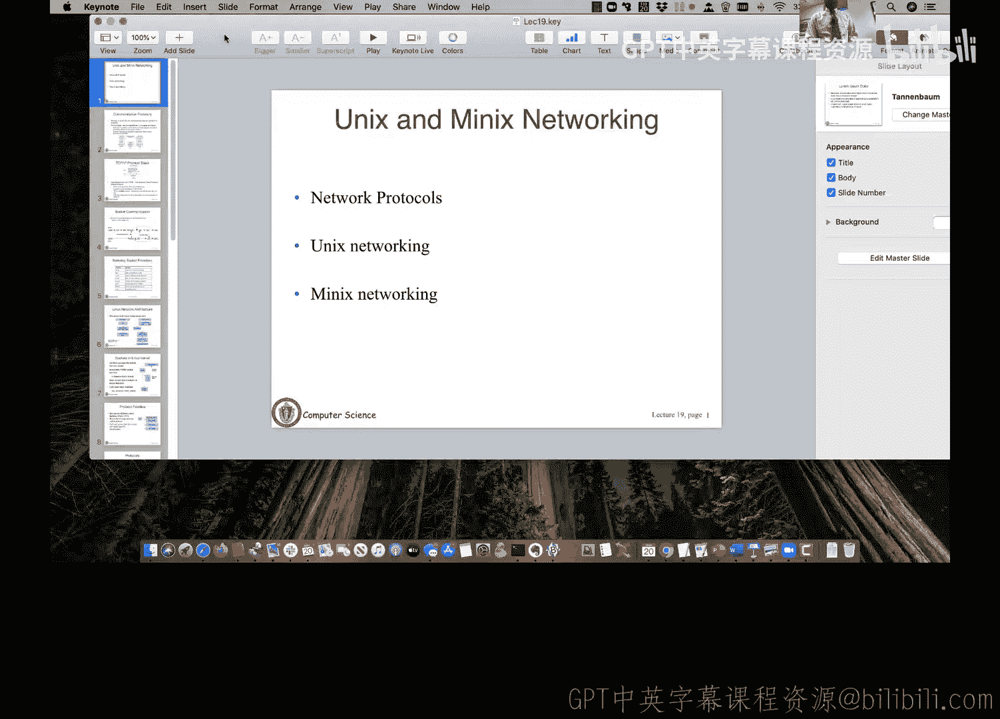
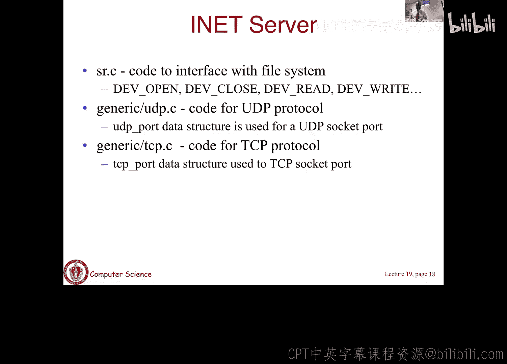
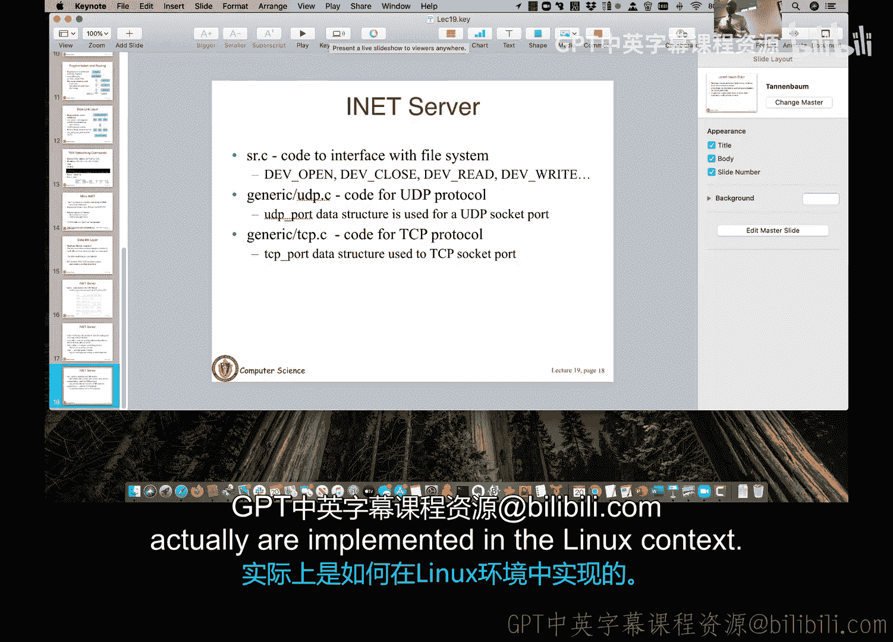

# 麻省大学《操作系统 设计与实现｜CS 577 Operating Systems Design and Implementation 2020》中英字幕 p37 -37-Lec19 Screencast_ Minix Networking (03_20_20).zh_en -BV1iP2CBaEHr_p37-

Okay so in today's lecture we are going to talk about networking concepts as they relate to both the Uni like monolithic kernel such as Linux and Linux so last time if you remember we talked about file systems file server processes and so on and we are done with that part of the course and today we are going to switch gears and talk about networking concepts so this is also the last major topic as far as Linux is concerned and in the next few classes we are going to switch back to Linux and talk about how so many of the concepts we have covered in the past few classes memory management IO and so on relate to Linux。

So， coming back to today's class we are going to talk about very quickly network protocol concepts at a very high level。

 then I am going to talk a little bit about UniX networking specifically from the perspective of the Linux OS and then I am going to talk about how many of the concepts are implemented in the Linux microcurl。

So first let's talk a little bit about networking protocols or communication protocols so what is a protocol a protocol is a set of rules for communication that are agreed to by the parties involved in that communication so that's a very general concept a protocols are used in many different domains that go beyond computer science but in the context of networking protocols are used for communication over a network and we have something called a protocol stack which is how the networking subsystem is organized into layers an example of a protocol stack is shown in this figure where we have essentially three machines A B and C that are shown and A and B are the sending machine and the receiving machine the sender and the receiver host source in the。

Nation as they are called， and B is an intermediate node also called a router。

So you will see that each of these machines has an OS that runs a network protocol stack and the network subsystem is organized using layers so going back to the very first classes if you remember I talked about using a layered architecture and I also said that this architecture is especially common in a networking subsystem。

And so this figure illustrates that concept and you will see this protocol stack here is called the Iso or the overs size stack and you will see that this stack actually has seven different layers starting from the physical layer。

 the data link layer， the network layer， transport layer session layer presentation layer and application layer so we'll talk about some of these key layers in the next slide。

 but as far as this protocol stack is concerned a few concepts that applied to the layer architecture apply each layer presents an interface to the layer above it using the interfaces provided by the layer below it So what that means is each layer in this protocol stack can only communicate with the layer above and the layer below it so so。

The network layer， for example， has to use the functions provided by the data link layer and provide a network protocol abstraction to the transport layer。

 for example。Now the protocol stack here shows an idealized approach of seven different layers。

 but not every protocol stack has to implement all of them。

 they will have some of the key layers but not necessarily all of them。

So that is something to keep in mind and I'll talk about the layers that are present in the TCP IP protocol stack in a moment。

 but let me also say something about node B that sits between node A and C here so node B is an intermediary node that is in this case called router。

So the way network protocols work is they assume that when you send a message from the source to the destination。

 that message is going to be sent in terms of one or more network packets。

 these packets are going to be sent over the network but because there may not be a direct connection between A andC a direct network connection between ANC that packet has to go through intermediate nodes that are called routers the goal of routers is simply to take incoming packets。

 look at the source address and a destination address which is going to be present in the packet and then decide which node to send it next so although in this figure we have only one routers sitting between ANC typically you may have more than one routers involved in forwarding that packet so that it eventually gets to destination node which in this case is C。

So let's look quickly at the TCPIP protocol stack and what you will see here is that you have the data link layer。

 the network layer and the transport layer， but some of those other layer that will present a session layer and the presentation layer are not really present in theCI protocol stack what that means is any functionality that was necessary in the session layer and the presentation layer are all done by the application process itself so so let's now look at a little more detail I'm going to start at the top at the very top you have an application process that might be trying to communicate let's say it's a browser process if it's a browser process it's going to use an application layer protocol for communication which in this case is going to be the HtTP protocol so that's our application layer protocol at the other end which is not shown here will there will be another process in this case that's going to be a web server so the web browser and the client and。

A server and the server machine are the two application layer processes that are communicating using HttP。

Now as far as the application layer processes are concerned。

 they don't actually care about how the HtTP communication takes place in terms of the transport and the network and the data link layer they just understand htTP and when they get when you send a message you construct an htTP message at the other end you receive a message you receive an HtTP message and you understand what the fields of the message are and so on so so in some sense each layer is implementing a protocol that is somehow agnostic of the protocol that are underneath so the browser wants to send now a packet to this web server so it's going to construct an HtTP packet and it is going to hand it to the next layer below it now suppose you wanted this message to go securely over the network because maybe you are communicating with a web server that represents your bank website so in this case。

You might actually have a session layer although that's not a separate layer in the TCPI context it's a library that may be attached to the application process so in this case the session layer might provide us with SSL or secure encryption so all of the htTP packets are encrypted by the session layer and the sender they are sent encrypted over the network and at the other end you basically receive the packet and the session layer you decrypted and then you hand back the original message to the server process so in this case the presence of the session layer is not necessarily known to the application process it's just sending and receive htTP messages but you can use this layer to provide encryption functionality for example。

So so when you have HtTPS messages， they are automatically constructing HTTP messages that use the SSL encryption layer below it。

Now as that message percolates down the protocol stack it is going to arrive next at the transport layer so in the TCPI context which incidentally stands for TCP stands for transmission control protocol and IP stands for internet protocol so in the TCPI protocol stack TCP is the protocol that is implementing the transport layer functionality and IEP is the layer protocol that implements the network layer functionality。

So TCP and its sister protocol which is called UDP implement transport layer functions TCP is an end to end protocol which means it is responsible for end to end communication at the source and the destination in terms of handling lost packets if you send a packet and it gets lost over the network TCP is responsible for detecting losses and retransmission it is responsible for rate control which means it determines at what rate or what speed should the packets be sent because network conditions can change over time and so on。

TCP sister protocol UDP also provides transport layer functions but it is a much simpler protocol in that it does not provide functions such as rate control or error or detecting lost packets and so on so you just in case of even you are using UDP you can simply start sending packets if they get lost UDP is not going to handle those losses there are to be dealt with the application layer and so on。

So in any case the STTP message now let's say which is encrypted arrives at the TCP layer。

 the TCP layer adds some headers and then hands it to the IP layer the IP layer which is the network layer is responsible for bulk or the work in terms of sending it out and forwarding it over the network on a hub by hop communication so IP or the network layer does hub by hop communication whereas transport layer always does end to end communication。

So in this case the IP protocol is going to add header such as the source address。

 the destination address which is the IP address of the web server and so on and then hand it to the data link layer which in this case is shown as8 IE 8 or2。

 x so that's a standard I standard and there is a family of protocols called 822。 x 8 or2。

3 stands for wired ethernet 8 or2。11 stands for Wii-fi and so on so that's a family of protocol that implement the data link layer functionality so the IP message is then taken by the data link layer you add a header to it and then you send it over the physical layer which is the actual medium so this could be the wire or this could be in case of wirered ethernet or it could be the just in case a wireless you just send it over the air so essentially a wireless。

Channel between in that case， wireless access point and the next access point of the router。

So so that is very briefly the TCPI protocol stack now if you are taking a course in networking you would have gone into all of this in a lot more detail in this class we dont need to go into the details of networking we just need to know that there is a protocol stack and we are going to actually look at how the OS is going to implement this protocol stack right now because。

The user process implements most of these functions such as HtTP as well as all kinds of other protocols such as FTP and SMMTP and whatnot。

 we are not going to look at the user level protocols for today's lecture Instead we are going to focus on the data link layer which for the purposes of today's class is going to be ethernet or wided Ethernet。

 the network layer which is going to be IP and the transport layer which is going to be both TCP and UDP we are going to see how these three layers are actually implemented in an OS kernel。

Now typically most Uni like operating system provide an abstraction to user processes for using the TCPIP protocol stack and that abstraction is called a network socket think of socket as some an abstraction that is similar to files the file system provides a file abstraction you can read or write to files and then that data is stored on a disk the network subsystem provides a socket abstraction and you can read or write to the socket abstraction and then that data is going to be sent over a network just as a file system stores the data to a file when you write a file descriptor when you write a socket descriptor that data is actually sent over a network or you can receive data from a socket over a network。

So this abstraction of sockets is what is actually used for communication using the TCPI protocol。

 but the abstraction is general and we will see that the same abstraction can be used for other protocol families。

 not just the TCPI protocol stack。The picture here shows。

Very simple client and a server that are communicating over a network using socket communication and each box represents a system call well not a system call。

 but it's a positive socket call that is used to enable this communication So initially both the client and the server have to create a socket which is two endpoints that are going to be used for communication the server is then going to bind that socket to a port number in the networking context every socket has a port number So for example web servers listen on port 80 network port 80 when you do SS you communicate port 22 So ports are essentially addresses on a machine that represent endpoints the IP address allows you to address the machine and port numbers allow you to communicate to specific endpoint which is where a process is listening to。

there may be multiple processes that are involved in communication。

 each of them is given an ID which is called a port number that is their address on that machine for communication or that is their endpoint address for communication so the server has to bind to a port number to listen on that port which is its local address or the local endpoint on that machine。

And then it starts listing， which means that it is waiting to receive packets and then it can essentially do accept。

 which is where it' is actually waiting to receive a message。Now， the client， on the other hand。

 also has to open a socket as you can see in this picture and then to communicate with the client server。

 it basically just does a connect at that point the connect and and the client and accept on the server are both going to establish a TCPI connection between the two machines till this point there is actually no network communication between the client and the server and except and the connect actually establish a connection。

 an actual network connection which allow the two processes and the two machines to communicate now that there is a duplex network TCPI connection between the client and the server you can essentially use standard read and write calls to communicate so you can write to a socket。

 the client can write an htTP message to a socket and then it will get sent to the server and the server can then read from its socket to receive that message and then it can send a reply by writing to its socket and then the reply is going to go or send。

back to the plant so you will see that there are multiple reads and writes that will occur that allow you to have duplex communication and eventually once you are done with this communication you can just close the socket description。

Now while read and write are standard calls that are used to read or write from sockets。

 you can also use send and receive and implement equivalent functionality so send is the equivalent of write and receive is the equivalent of read all of these are blocking calls which means that if you read from a socket but there is been no network data that has been received from the other end you are going to block until you actually get a packet similarly when you write you are going to wait until the write returns in this case the write is going to write to OSs buffer and then it' is going to return just as file system writes right to OS buffer buffer cache and return and then the data is going to be sent over the ether interface at a later time。

So keep this picture in mind now this slide actually summarizes the Po socket calls that we just encountered going to go through them quickly again so the socket call is used to establish an endpoint bind binds that endpoint to a local address which is the port number as I mentioned the IP address is already determined for the machine the port number that you bind to Listen announces your willingness to start accepting network packets and then accept basically actually establishes a connection by blocking until a client connects to the server and then connect is used at the client end to connect to a server that is accepting connections using except and then you use send and receive which are as I said equal and to read and write to send and receive data and close closes the connection。

So this is a PoX interface that is defined by BSD sockets。

 any OS that implements socket communication and adheres to the PoOSSX standard as to implement these functions。

 typically there will be system calls in many OS kernels but in some cases there may be library calls that are implemented over other system calls。

Okay， so with that socket background let us now look at how socket communication TCPI and the data link layer are implemented in the Linux context and then I am going to switch to the Linux context so the next remaining time in this lecture we are going to essentially first look at Linux and then we are going to look at Linux。

So this picture here on this slide shows us how socket communication works and it also relates the communication within the Linux kernel to file communication so to your left you see the file path access path and to the right you see the socket access path。

So if you are reading or writing to a file you are read a right request are going to arrive at the VFS layer and the VFS layer might actually hand that to the file system if you have a local file system such as EXD4 or it could hand it to a network file system if you are things like NFS or SAbar drives or Ikazi which allow you to read a write files from a server okay so the VFS layer can handle both network file system and the EXT file system。

Now if the VFS layer is actually dealing with a network file system or network storage。

 that communication has to actually come back to the network path because those packets are going to go over the eitherthernet driver to a different machine。

 but if the VFS communication goes to the local disk or a local file system then it just goes directly to the disk driver or the file system in the disk driver。

 so there are two path out of a VFS layer depending on whether you are reading or writing to a local disk or a network or a network file system。

So now looking on the socket access path when you read a write to socket it is first going to arrive to the protocol families layer。

 this is somewhat similar to the VFS layer where you can have more than one protocol families be plugged into it just as the VFS layer allows you to plug in multiple file systems here you can have more than one protocol families typically most Uniix like file systems will support at least two INE which is the internet protocol or the TCPIP protocol and UniX sockets which I'll come to in just a moment。

And then you are going to go to the actual implementation。

 the protocols itself so say that you are trying to send this packet over or using the Inet protocol family so that packet is going to be sent to the protocol box that is shown there where you have the transport layers U TCP and UDP as well as the IP layers and then once its being processed by those two layers you are going to send it over the network interface and you can have different network interfaces such as ethernet which is 822。

11 and w-fi which is shown here as 82 sorry ethernet is 802。3 and w-fi which is shown as 802。

11 So once you give it to the network interface card it's going to get sent out over the network channel using the device driver。

So I am now going to look at the socket access path and we will look a little bit about in more detail on the protocol families and the protocols and network interfaces themselves。

 but lets start with the sockets interface how is that implemented in the Linux kernel。

So essentially Linux implement system calls like socket Connect except all of the ones that I mentioned earlier。

 they all implement the Pos interface which is somewhat independent of the protocol itself the Po interface is standardized so that it iss not directly dependent on TCpiI in the future you might have other protocols that use the same standard at least in Uniix you also have something called Unix domain protocol where you can communicate internally without using the network stack using Unix domain sockets which are what processes can use to send or receive messages to one another so locals send and receive use Uniix domain sockets whereas networks send and receive use networking sockets so both of those can be supported using the socket socket Pos socket interface。

So you will see that the main call within Uniix is called cis socket which is the implementation of socket and essentially you have a handler table which which is going to track all the open sockets and then once you decide which endpoint this is for you essentially call the right handler and there are lower level functions that are supported here which are such a socket create socket deletes and so on so that is the socket layer within the Linux kernel。

Now the next layer down， if you go back we are just going down the socket access path。

 so we just looked at the socket axis， so the next layer down is essentially the protocol families so。

Essentially this layer is as I said analogous to the VFS layer in the file system。

 this is the layer that allows you to implement multiple protocol families。

 the two that are implemented are essentially the inE family which allows you to do TCPI communication and the UniX family which allows you to use sockets for interprocess communication within the machine rather than using the network communication across machines。

Now this is extensible through new implementation of modules and function pointers。

 so the interface allows you to plug in a new module that implements a new family and there are function pointers that you can use to instantiate the interfaces of that protocol family。

And there are calls like create that allow you to initialize a particular family when you boot up the machine。

So lets say that the socket call has come to the protocol family layer and you are using TCPI communication。

 so it is going get it is going to invoke the INE families specifically within the protocol families。

So the INE family can itself support multiple protocol so you can have multiple families of protocol within each family you can have multiple protocol in INE specifically we have an implementation of both TCP which is our transport layer protocol that does reliable communication and UDP which is also a transport layer protocol but it does unreliable communication now as I shown here。

You have essentially the two boxes that are shown here are boxes that implement the TCP functions and the UDP functions and this protocol functions are stored in something called protocol ops with the protocol operations and there are many operations such as bind and listen and connect and so on and you will see that the stream ops which implement TCP theres an innet bind that implements TCP IP bind and inE listen that implements listen for TCP and connect that implements connect and so on and that the lower box which shows you inE Dop which stands for datagram operations。

 implement the UDP and you will see that not all functions need to be instantiated in each protocol for example because there is no end to end communication or establishment of channel between the sender and the receiver in UDP the listen call is nu。

You will see that so not all functions have to be implemented it depends on the protocol family now conversely if the same code can implement certain functions you can also share it across protocol families so ined bind for example you will see is the same in both cases so use the same function to implement the bind function but connect are different for TCP and UDP they have their own implementation within each protocol。

Okay so now let's talk a little bit about how packets are created and sent and so on。

 So you have essentially the TCP send message function which is used to send a TCP message it uses a socket buffer data structure so your network packet is essentially copy it into a socket buffer and then you essentially transend it to the TCP transmit function which is then going to essentially send it over over to or put it on a queue for transmission so so the socket buffer data structure is key to implementation of of the socket abstraction and that buffer is used by TCP and IP and so on and sent all the way down to the network head so so that's a memory buffer that is essentially process to the protocol stack as the packet gets processed through multiple layers。

Now。Because you have to essentially decide where to send this packet using IP which is the network layer that implements routing there are additional functions that are implemented within IP that have to do with fragmentation as well as routing So what's fragmentation so suppose that you wanted to send a large message from one machine to the other over the network typically the TCPI protocol is going to have a maximum packet size that it's willing to use for sending packets So if your message is larger than the max packet size。

 the message is going to be chopped up into smaller packets。

 each of which is of the max size and then it's going to be sent over and that process is called fragmentation where you take a larger message you partition it into smaller network packets and transmit them。

At the other end， you are to do something called reassembly where since you are to reconstruct the original message and they received as independent packets。

 you have to take data from all of those packets and you are to reassemble the message all of that is being done at the IP layer。

 So the IP layer is also responsible for fragmentation and reassembly of larger messages。

 It also does routing as I mentioned， that's a key function of the IP layer。

So so routing simply involves looking at what is called a routing table and trying to figure out the best match for this packet based on the source address。

 the destination address， the source port number and the destination port number the routing table is going to tell us what is the next node to send it to so if you're a router you received a packet you look at this routing table and it tells you what's the next route if you're a sender you're going to essentially say what's the first node in the in the chain that I'm going to send this to so all of that is being done through routing and in the Linux kernel context there are three multiple tables you can look one is the route cache which allows you to actually look at recently cache entries and then find a match if you cannot find match in the cache then you actually look at the routing table itself which is which is called a Fb forwarding information base and if you still don't have it there you are going to then use the slow routing path。

Which is you're going to look at what to do with the packet or send it to the default gateway and things of that。

Now once the IP layer has processed this packet， you' are going to then send it over to the data link layer。

 which in our case is going to be ethernet Now the way ethernet driver actually works is it essentially has a circular buffer where it has queued packets for transmission and then it is going to take the packet at the head of the buffer and send it up So the buffer has a head and tail the IP layer is going to keep app to the tail of the circular buffer and the driver is going to take packets from the head of the buffer and start transmitting it so this allows the buffer mechanism allows you to deal with speed mismatches because the rate at which you can send maybe different from the rate at which the user process is generating packets so you just cu them in a buffer and it's a circular buffer which means it has a max size so the packets are ind and tail and ded from the head。

So thats the basic concept And what I shown here are some details of how Linuxux actually implements these functions you will see in this picture theres a middle box which looks like a buffer and that's the circular buffer I was talking about so there is a device queue transmit function which takes a socket buffer and it en queuees it into this buffer and then you will see that underneath the lower part of the device driver is going to now take DQ package from the buffer and then actually use the the start transmit or the start transmit function to actually start sending them out on your interface。

Now in this context I should also mention that there are additional functions that Linux kernel supports which are not shown here so for example you can do network packet scheduling you can decide if there are different sends different processes how to schedule packets that are being sent across by different processes by allocating things like weights to each process that says that that allocates network bandwidth to each process so in that case your buffer is no longer a simple 54 buffer here in this picture we are showing the54 buffer where there is no attempt at scheduling across processes but if you have allocated things like weights and you are doing fair scheduling or lottery scheduling across processes you might have virtual cues one for each process or each socket and then your packets going to your virtual queue which might be multiplex or made to look like a logical queue and then your。

Go goinging to decide based on lottery scheduling or other mechanism like fair scheduling which Q to Dq from and that that processes packet gets sent out next so those functions are also implemented in the Linuxux kernel but not shown in this simplified picture which is the default way where you just use a simple 54 Q or a 54 scheduler to send out packets。

Okay， so with that background on Linuxux， I'm going to start switching to Linux。

 and before I do that， I just wanted to tell you all a little bit about some highlevel networking commands that you can use to manipulate network interfaces and so on So first for every machine or we are going to assume that there is a link and a network interface which could either be an ethernet interface or a wi-fi interface in all cases。

 the interface actually has an address called a Mac address and it's a hex string that is an example of which is shown here。

 So each ethernet card will have a unique Mac address or each wifi card will have a unique Mac address that allows it to essentially that is used for communication over a wireless la or a wire the addresses have to be unique just as IP address publicly routeable IP address。

have to be unique ethernet addresses also have to be unique so when you buy a machine which has an ethernet card。

 the vendor has already predcided the ethernet address IP addresses are assigned when the machine boots up but ethernet addresses are hard coded and by the by the manufacturer on the the ethernet card。

And IP addresses are also shown here as examples， you could have a 192 address which is a private IP address。

 it is used in a na environment where you have maybe a home router so you will have either a 192 address or a 10do address that those addresses are private which means they are only unique to your network but not UD globally。

Publicly routeable addresses such as 128，119242 that shown here。

 they have to be unique across the world which means this can be only one machine that has that address。

 but private addresses can be reused within a land。

 you cannot use them to route over the internet but they can be used within a land for communication。

Now with that quick background on Mac addresses and IP addresses。

 a few commands that you can try is one is the Ping command that allows you use say ping and you specify an IP address that allows you to that sends a packet to the other machine and sees if the machine is up and typically if the ping is enabled on the other machine you are going to get a response and also measure the roundtri time for your packet to go from the send to the receiver。

 if configurefig is an administrative command that is used to assign IP addresses first it is to IP addresses to Ethernet drivers and Ethernet cards。

 as well as configure other details of the card， including whether the the interface is up or down and things of that sort。

And the nettt and the route commands are used more in the Linux context rather than the Linux context to either set routing tables or view routing table。

 So if you do Netat minus Rn on any Linux machine or even on a Mac you are essentially going to look see the routing table that is actually being used so at the bottom picture on this slide actually shows you an example of a routing table on an Ubutu machine and so you will see that there is something called a gateway that's basically the next hop if the destination is set to 0。

0。0。0， that's not a real IP address that simply means that any packet that needs to go out which is essentially represented as a string of zeros are going to get sent to the gateway node which is the next router in the in the path between that client machine and wherever else you' are trying to send that packet。

And you will see that's also associated with the interface ET at0 which is the ethernet card on that machine and so on。

 so you can use Netat minus RN to examine the current routing tables。

 you can manipulate the routing tables manually using things like route or other networking utilities typically when you boot up these ethernet interfaces are initialized you might use either a statically specified IP address or use DhCP to fetch an IP address and assign it to an interface and then set the routing table So typically all of that is done by the OS when you boot up but a system administrator administrator or a user can make these modifications to the routing tables and interfaces as well。

So with that background let's now move on to Min and the TCPIP protocol within Min is implemented as a system process。

 not surprisingly unlike all other system processes This one is called the Inet process just as VFS was the file server process in PM process manager INnet essentially implements the Internet protocol which is the TCPI family the code for this server process can be found in the server's innet directory and it collectively implements the ethernet layer。

 the IP layer and a TCPIP layer with one caveat because the Ethernet card is actually an IO device the device driver for the Ethernet card is going to be found in the devices directory。

So depending on how many you will need one driver for a card and there are many different hardware vendors for cards so you might have multiple ethernet drivers sitting in the drivers directory the innet server itself is going to use more generic abstractions to communicate with any ethernet card independent of what manufacturer or what device driver is actually being used so the code for the ethernet driver or the ethernet layer rather is split between innet and the device drivers but the IPTCP and UDP code all sit within the innet directory。

And so the code can be found both in inNet and inNet generic directories and I'm going to show you a little bit of the details but I encourage you to go and look at this code at the Linuxix sub at the bottom of the slide is as a URL for a webage where there is an annotated version of some of the files that are found in the inNe directory with one caveat those annotations are for Linux version 2 not version 3 and have been some changes between version2 and version 3 as far as networking code is concerned but a lot of the details in that that are shown in that annotated webp page are still true they still are going to apply to Linux version 3 which is what we are using in this course。

So let's start with the data link layer okay so the data link layer users can use any kind of hardware for communication that includes things like ethernet modem wi-fi cards as well as other card so you can use any of these interfaces to communicate each of them will have their own device drivers and within each of those types of interfaces。

 you could have cards from different vendors and each vendor has there has to be a driver for each vendors interface so so to do this and furthermore a particular machine might have more than one cards installed on it So for example your laptop will have both could have both wired interface as well as a w-fi chip that implements a wireless interface and both of those could also be active and so the way this is handled is you basically use the device major number and minor number。

So the major number specifies the class of the device。

 which in this case are data link layer devices， the minor number identifies which specific card it is if you have more than one card on your machine。

And the data link layer is going to use the IO control or the Ioctel calls when you initialize the card to set various parameters such as communication speed and so on。

 Now keep in mind that the drivers in Linux run as user processes separate from other system processes So so ethernet driver is going to run as a separate user process separate from the innet driver itself and all of the concepts that I talked about two or three classes go where you had a server process and and the device driver and the VFS process that all communicate still holds in this case。

 the ethernet driver will run at its own process the innet server will run as its own process the VFS server runs at its own process and they all coordinate with one another to send a network packet out。

As we will see， so all of because this is a block driver。

 all of the concepts we talked about that concern and are concerned in block driver also apply to this to this case。

So let's delve into the code just a little bit so within the inNnet directory you are going to see innet do C source file which is the main function for the innet server and it is responsible for handling messages of various kinds that are going to come in like any other process you are essentially going to have a main while loop where you are going to wait for a packet rather a message then process the message and send a reply and some of the message types that are handled within innet are shown here that is not an exhaustive list but are shown here which is open a device close device do an IO control on the device read and write to the device and so on now within Linux both。

The ethernet card is which is an actual hardware device。

 as well as the T CP P P protocols are essentially accessed to a device interface as we will see in just a moment。

Now the the innet server is also going to receive messages from the VFS process and the reason for this is because we are using a slash dev interface。

 which is a file interface for communication if you read or right to a device using a file abstraction those packets are first going to come to the VFS layer and then get handed over to the innet server the innet server of course has to also talk to the data link layer which is shown here as Dl s is ethernet card。

So that's the main function。 There are several other files in that directory that are noteworthy The buff dot C file is responsible for buffering code that is for sending and receiving network package there is the Linux ethernet code which is the generic code for sending or receiving or ethernet card and that code is going to interface with the device driver that actually does the sending or receiving Okay so this is the device independent ethernet code that thats in the innet server and then the device specific one is going to be in the device driver innet underscore con do C allows us to configure various networking devices and you will see in this file if you go and look at some of the comments you see that it has to initialize dev s dev s Eth thats the ethernet device slash dev IP which is not a real。

It is the IP protocol， but you access it through the s dev slash IP mechanism。

 your slash dev slash tCp slash dev slash uDP does implement the UDP and tCP protocol so we are using within the Linux OS we are using this abstractions also to enable communication with protocol through protocols。

The MQ do C is the message Q structure， so that is essentially a network packet that we are going to create and you essentially have a list of packets that is being tracked by MQ list data structure and MQ type is one message entry which is essentially a network packet that we are going to use for communication。

Now the interfacing with the file system in the VFS layer is all being done through one file which is Sr。

c and here you will see called such a Dev and dev closed every dev right that I talked about earlier are actually implemented and then you have code for the UDP protocol and TCP protocol that are essentially stored in the generic UDP。

c and the generic TCP。c and what I have not mentioned here is there is also a file called IP。

c which implements code for the IP protocol so the transport layer is in UDP。

c and TCP doc for UDP and TCP respectively and the network layer is implemented in IP doC which implements the network layer protocol。

So with that that was a quick run through of some networking concepts within Uniix。

 how they are implemented in Linuxux and how they are implemented in Linux so that completes the very quick overview of the network subsystem again I provided pointers to specific files as well as other URLs and I encourage you to go and look at those resources to understand this in a little more detail。

So let's stop here today and starting next time we are going to essentially switch gears and start doing a more of a deep dive into the Linux kernel so we understand how some of these concepts actually are implemented in the Linux context。

