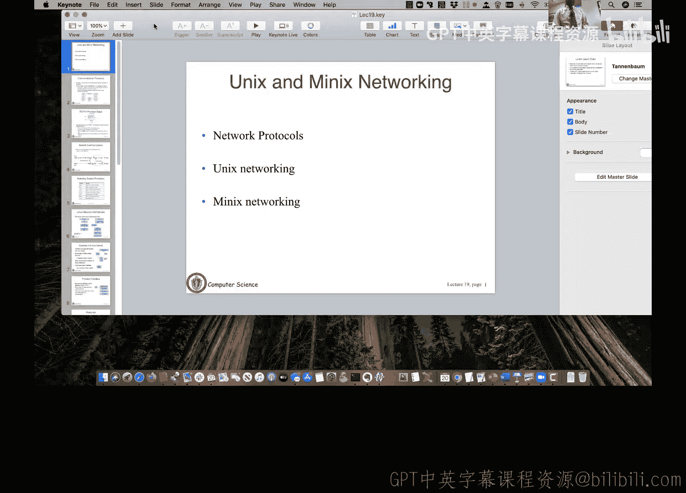
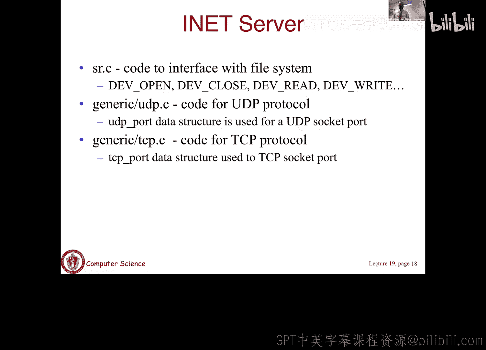
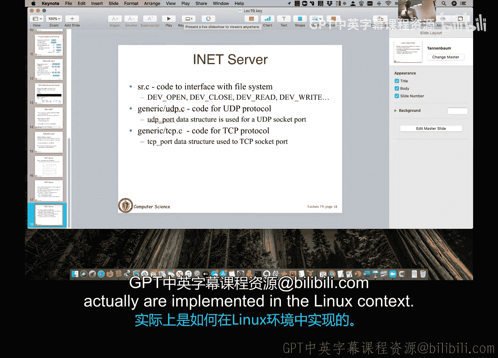

# 操作系统设计与实现：第19讲：网络子系统概述 🌐

在本节课中，我们将学习网络协议栈的基本概念，了解其在类Unix操作系统（如Linux）中的实现方式，并探讨Minix微内核架构下网络子系统的具体设计。我们将从高层协议概念开始，逐步深入到内核实现细节。

---

## 网络协议栈基础

上一节我们介绍了文件系统和服务器进程。本节中，我们将转向网络概念，这是本课程关于Minix的最后一个主要主题。

### 什么是协议？

协议是一套通信规则，由参与通信的各方共同约定。在网络环境中，协议用于通过网络进行通信。网络子系统通过**协议栈**组织成多个层次。

一个典型的协议栈示例如下图所示，其中包含三台机器A、B和C。A和B分别是发送方和接收方主机，而B是一个中间节点，也称为**路由器**。

每台机器的操作系统都运行着一个网络协议栈。这种分层架构在网络子系统中尤为常见。图中展示的是ISO/OSI七层模型，包括：
1.  物理层
2.  数据链路层
3.  网络层
4.  传输层
5.  会话层
6.  表示层
7.  应用层

分层架构的核心概念是：每一层都使用其下层提供的接口，并为其上层提供一个接口。例如，网络层必须使用数据链路层提供的功能，并为传输层提供网络协议抽象。

需要注意的是，并非所有协议栈都完全实现这七层。TCP/IP协议栈就是一个典型的例子。

---

## TCP/IP协议栈详解

现在，让我们更详细地了解TCP/IP协议栈。与OSI模型不同，TCP/IP栈没有明确的会话层和表示层，这些功能通常由应用进程自身实现。

以下是TCP/IP协议栈的关键层次及其功能：

*   **应用层**：例如，浏览器进程使用**HTTP**协议与Web服务器通信。应用层进程只关心HTTP消息的构造和解析，不关心下层如何传输。
*   **传输层**：由**TCP**和**UDP**协议实现。
    *   **TCP** 提供可靠的、端到端的通信，负责处理丢包检测、重传和速率控制。公式表示为：`可靠数据传输 = 序列号 + 确认 + 重传`。
    *   **UDP** 则简单得多，不提供可靠性保证，只是简单地发送数据包。
*   **网络层**：由**IP**协议实现。它负责**逐跳**通信和路由选择，将数据包从源主机通过网络中的路由器转发到目的主机。它还处理**分片**（将大消息拆分为多个数据包）和**重组**。
*   **数据链路层**：例如以太网（802.3）或Wi-Fi（802.11）。它负责在直接相连的网络节点间传输数据帧。
*   **物理层**：实际的传输介质，如网线或无线信道。

数据包在协议栈中的流动过程如下：应用层消息（如HTTP）向下传递，经过传输层（TCP/UDP添加头部）、网络层（IP添加头部）和数据链路层（如以太网添加头部和尾部），最终通过物理层发送出去。

---

## 套接字（Socket）抽象

大多数类Unix操作系统为用户进程使用TCP/IP协议栈提供了一个抽象，称为**网络套接字**。你可以将套接字视为类似于文件的抽象：文件系统提供文件描述符用于读写磁盘，网络子系统则提供套接字描述符用于读写网络。

以下是一个简单的客户端-服务器使用套接字进行通信的流程：

1.  **创建套接字**：客户端和服务器都调用 `socket()` 创建通信端点。
2.  **绑定地址**：服务器调用 `bind()` 将套接字绑定到一个**端口号**。端口号是机器上用于标识特定通信端点的地址（例如，HTTP服务通常使用端口80）。
3.  **监听连接**：服务器调用 `listen()` 宣布其愿意接受连接。
4.  **接受连接**：服务器调用 `accept()` 阻塞等待客户端连接。
5.  **发起连接**：客户端调用 `connect()` 连接到服务器的地址和端口。
6.  **数据传输**：连接建立后，双方可以使用 `read()`/`write()` 或 `send()`/`recv()` 进行双向通信。
7.  **关闭连接**：通信完成后，调用 `close()` 关闭套接字。

这些调用构成了**BSD套接字**接口，是POSIX标准的一部分，在大多数操作系统中以系统调用的形式实现。

---

## Linux内核中的网络实现

了解了套接字背景后，我们来看看TCP/IP和数据链路层在Linux内核中是如何实现的。下图展示了Linux内核中套接字通信的路径，并与文件访问路径进行了对比。

*   **文件访问路径**：读写请求到达**虚拟文件系统层**，VFS可以将其导向本地文件系统（如ext4）或网络文件系统（如NFS）。
*   **套接字访问路径**：读写请求首先到达**协议族层**。该层类似于VFS，允许插入多种协议族，最常见的是 **INET**（实现TCP/IP）和 **UNIX**（用于本地进程间通信）。
    *   对于INET族，数据包会进入**协议实现层**，经过TCP/UDP（传输层）和IP（网络层）的处理。
    *   最后，数据包被交给**网络接口层**（如以太网驱动），由设备驱动程序通过物理网络发送出去。

### 关键实现细节

1.  **套接字层**：实现 `socket()`, `bind()`, `connect()` 等系统调用，维护一个套接字句柄表。
2.  **协议族层**：通过模块和函数指针机制，支持多种协议族。例如，INET族内部包含TCP和UDP两种协议的具体操作（`proto_ops`）。
3.  **数据包发送**：应用数据被复制到 **`struct sk_buff`** 结构中。这个套接字缓冲区是内核中网络数据包的核心数据结构，在协议栈各层间传递。
4.  **IP层功能**：
    *   **路由**：根据路由表决定数据包的下一跳。路由查找可能涉及路由缓存、主路由表（FIB）和默认网关。
    *   **分片与重组**：处理超过最大传输单元的数据包。
5.  **数据链路层与驱动**：网络接口驱动通常使用一个**环形缓冲区**来排队待发送的数据包。IP层将数据包添加到缓冲区尾部，驱动从头部取出并发送。这种缓冲机制可以处理速率不匹配的问题。更高级的内核还可能在此实现**网络数据包调度**，为不同进程或套接字分配带宽。

---

## Minix中的网络实现

现在，让我们将焦点切换到Minix。在Minix中，TCP/IP协议是作为一个系统进程实现的，称为 **INET进程**（类似于VFS是文件服务器进程）。

### 代码结构

*   INET服务器的代码位于 `/servers/inet/` 目录。
*   它集体实现了以太网层、IP层、TCP和UDP层。
*   一个重要的区别是：以太网卡作为I/O设备，其**设备驱动程序**位于 `/drivers/` 目录。因此，以太网相关代码分布在INET服务器和具体的设备驱动程序中。
*   IP、TCP、UDP的代码则完全位于INET目录中。

### 关键源文件

以下是 `servers/inet/` 目录下一些重要的源文件：

*   `inet.c`：INET服务器的主函数，包含消息处理循环，负责处理来自VFS或其他进程的各类消息（如打开设备、读写等）。
*   `buf.c`：负责网络数据包缓冲的代码。
*   `eth.c`：通用的以太网代码，与具体的设备驱动接口。
*   `ip.c`：实现IP协议（网络层）。
*   `tcp.c` / `udp.c`：分别实现TCP和UDP协议（传输层）。
*   `sr.c`：处理与VFS文件系统的接口，实现 `dev_open`, `dev_read`, `dev_write` 等操作。

在Minix中，网络协议栈的各个部分（驱动、INET、VFS）作为独立的用户进程运行，它们通过消息传递进行协调，这体现了微内核的设计哲学。

---

## 网络管理命令

在深入代码之前，了解一些基本的网络管理命令很有帮助：

*   **MAC地址**：每个网络接口（以太网/Wi-Fi）的唯一硬件标识符，由制造商固化。例如：`00:1A:2B:3C:4D:5E`。
*   **IP地址**：
    *   **私有地址**：如 `192.168.x.x` 或 `10.x.x.x`，仅在局域网内唯一。
    *   **公有地址**：全球唯一，用于互联网路由。例如：`128.119.242.52`。
*   **常用命令**：
    *   `ping <IP地址>`：测试与目标主机的连通性和往返延迟。
    *   `ifconfig`：查看和配置网络接口（分配IP地址、启用/禁用接口等）。
    *   `netstat -rn` 或 `route -n`：查看当前系统的路由表。路由表会显示数据包根据目标地址应被发送到哪个网关（下一跳路由器）。

---

## 总结

本节课中，我们一起学习了网络子系统的基础知识。我们从**协议栈**和**TCP/IP模型**的高层概念出发，探讨了**套接字**这一重要的编程抽象。然后，我们深入分析了Linux宏内核中网络协议栈的实现路径，包括套接字层、协议族层、IP路由以及设备驱动缓冲机制。最后，我们了解了Minix微内核如何将网络功能（INET进程）与设备驱动分离，并通过进程间通信实现完整的网络协议栈。

网络子系统是操作系统复杂性的集中体现，它融合了并发、IO管理、协议处理等多种技术。理解其设计对于掌握操作系统全貌至关重要。

从下次课开始，我们将转换方向，更深入地探讨Linux内核，看看我们学过的内存管理、IO等概念在Linux中是如何具体实现的。

