# 麻省大学《操作系统 设计与实现｜CS 577 Operating Systems Design and Implementation 2020》中英字幕 p39 -39-Lec20 Screencast_ Linux - Synchronization and Timers (03_22_20).zh_en -BV1iP2CBaEHr_p39-

Hi， so I hope you guys are doing fine。Doing your your part of social distancing。

 having fun while doing that。And missing the school as much as we are missing it today。

 we are going to talk about Linux kernel synchronization and timers。 and this is basically a lecture。

That is a little bit different from most of the other lectures that you guys have already studied in the sense that I don't think that this has been covered into this amount of details with respect to minutes。

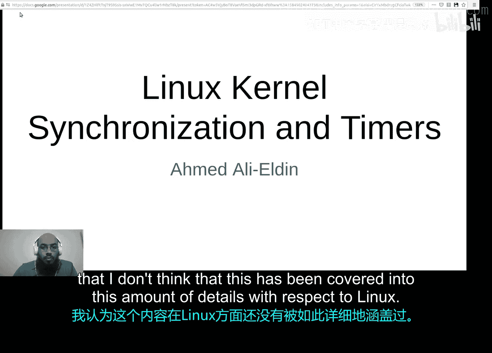

So let's start but by discussing what we'll cover and we'll cover basically two major pieces。

 the first one is kernel synchronization methods， the second one is times a the kernel。So。Basically。

 one thing that we have discussed in my last in my last lecture is that we'll have Zoom times for people to ask questions on the Linux lectures。

 Obviously， these lectures are going on YouTube so you can even ask questions and put comments on in the comments of YouTube even by by the second and then we can answer them。

 But also， if you would like more deep discussion， if you would like to。Talk to one， at least to me。

 Then the easiest way is actually to schedule an online meeting。In the beginning。

 I thought I I'll just put a Zoom link and tell you guys that I'll be here from this time to that time。

 but then I realized that some of you might have already gone to your home countries or to a different time zone or。

Or will have your own restrictions。So I thought that basically sending an email。

Scheduling a meeting with me is much。Better for you guys。 So basically。

 the ways we work is that you send me an email。 Tell me that I'm in this time zone。

 I'd like to meet to discuss this， and I'm happy to， to accommodate you guys。 Obviously， if there。

 there are some collisions with some other things that I need to do， I'll tell you， but。

 but we'll find some time that will work for both of us。

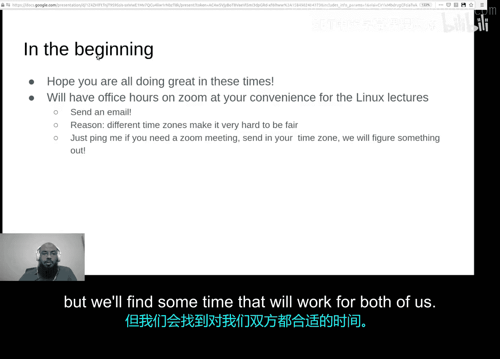

So basically， why synchronized， There are different reasons for for。

The kernel developer to synchronize the Linux internally in the kernel。

 obviously there are also similar reasons for a program developer who is writing parallel programs to synchronize。

And the most important of this is that you have basically multiprocess。

That can basically run have multiple cores。 So the in Z Phi has 72 cores。 Each core has two threads。

 So we are talking now about 144。virtual courses that are going to run in your system。these courses。

 they are basically there to enable you to do better parallel processing。

 actually Intel is trying to sell this as something that you would use for deep neural networks because it's a CPU。

 it's not a GPU so it can go a long way in terms of how it's designed and what it can support。

But still， I mean， if you have parallel simulation， if you have parallel program。

 if you're using Hadoop， if you if you have all sorts of things that require you to do some form of synchronization。

Then you basically look at the different primitives to do that。

The other reason is that you have lots of shared resources in the kernel that includes task lists for a lists for example。

 so you have a task list that the all different kernel subsystems would touch upon so the scheduler would look at the task list the network cards。

 the network subsystem would actually add tasks to the list and so on and so forth。

Knel code is also preemptive， which means that at some points you can basically get an interrupt or you can get a timer interrupt that basically or a scheduler interrupt that basically means that you're going to be kicked out of the core and some other process is going to be running on the core next。

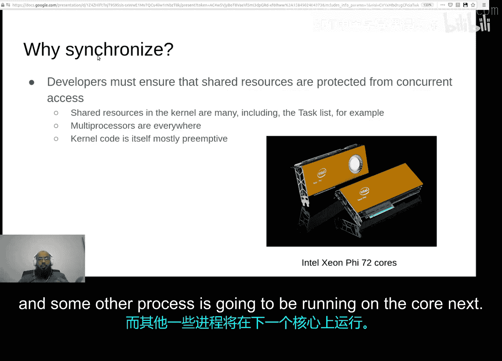

So a few things that that you guys have studied in your。And in your undergrad course。

 one of them is that there are critical regions and race conditions。

And critical reasons are basically areas in the code which axis says and manipulates share data。

These critical reasons need to be。Basically protected from multiple excesses。

 multiple parallel excesses。 at the same time。 Atity is basically the。

 the feature that you run these critical regions and。

Such that from the beginning you run at them from the beginning to the end with no interruptions。

 So an atomic operation， either the entire operation happens or nothing happens。

Race conditions is basically when you have two threads of execution that can simultaneously execute within the same critical region。

 so two threads of execution that can actually access the same critical region basically making a race between these two threads on whose changes will go first。

So this is a race condition example， so you start with a variable that has a value of 7 and you have two threads for each of them trying to increment it and and this is basically classical operating systems you probably have seen this and your under gap coer and basically you can end up with with the state that is undefined so if the two threads are trying to increment the value。

 then youd expect the value towards the N to be9， but if you have race conditions then this value can basically be something else。

There are multiple。Places where the colon can have races。

One of the the most important of which is basically the， the task queuees， the network queuees。

 or you have basically linked lists that are accessed by。Several。Tens。

 maybe even sometimes hundreds of other different procedures that can access these cus。

And that basically means that these are critical condition。 These are critical regions in your。

 in your current subsystem。 When you access them， you need to think about them。 Yeah。

 you need to protect them。Also， one thing to note is that these are the obvious ones。

 but there are many ones that are not actually obvious and these are actually problematic because they are much harder to protect。

 You need to really think if any other task is going to access your or any other thread is going to be able to access your data。

So in this example， if you have two functions manipulating the Q。

 a Q function that is adding new tasks to the end of the Q and the Q function that removes the head of the queue for processing。

 this is very typical a very typical kernel primitive and then imagine that two processors are trying to queue two new tasks and you have no atity so each one of them is trying to add a new tasks to the end of the queue。

And basically， they are racing on whom will get the end of the queue。

 So you can end up with corrupted data or basically。A state that is undefined。So。

Andqueuing is not one single instruction in almost all systems。

 so you basically need to have this implemented with atity。Now。

 you have also started locking and locking in the kernel is actually advisory and voluntary。

 basically meaning that the kernel the kernel developer gets to choose。

If he or she will use a lock or not nobody is going to force that。

 obviously there are code reviews and everything， but if you're working on the kernel side of things。

 no one is going to basically fix whatever mess you have created unless they discovered。

The Linuxux has implement implemented a handful of different looking mechanisms that the kernel programmer can use。

 and we are going to look at them in more details in a few minutes。

There the most significant difference between the various mechanisms is the behavior when you have a look and we're not talking about lock like as you guys have studied them already in undergrad or courses。

 but rather they we're looking at the behaviors in more。In deeper details。

 So you have the busy weight and the sleep approach。 the busy weight， you basically sit。

 have the kernel doing have the thread looping， waiting for the block to be released。

 And in that case， you are actually wasting post or time。

And the other approach is that you sleep and sleeping basically means that you have context which and the kernel evicts this。

Sleeping or this this thread that is waiting for a lock until basically the lock becomes available。

 and then the kernel wakes up the thread to acquire that lock。

Ls are implemented using atomic operations that ensure no races exist because it would be a really horrible thing if the lock itself has a race condition when you try to acquire it。

 so basically acquiring a lock and releasing a lock， both of them are atomic operations。

The implementation is architecture specific。 Okay， so most of the systems use test and set atomic instruction。

 which is basically a single。An instruction architecture and for each architecture that basically tests if the lock is。

 is acquired。 If so， then it will exit either busy waiting or sleeping。

 if it's not acquired by anybody， then it sets the lock。

 And this is an atomic instruction in the kernel。 So no。

 nothing can basically not in the kernel story in the architecture。

 nothing can basically bring this dis operation to two parts。

X86 has a relatively similar instruction that is called Comp X on the right hand side you see an example which is basically you try to lock the queue if you succeed。

 you acquire the lock， you exit the queue and then you unlock the queue。

The second thread when it tries to log the queue， it fades because the first thread has already basically acquired the queue and then it waits or it sleeps and if it succeeds。

 it acquires lock access the queue and unlock locks the queue。So。

What different parts of the kernel code as concurrency issues because we need to understand this in order to be able to write safe kernel code。

 the first one is interrupts because an interrupt can occur asynchronously at almost any time as we study in the last lecture。

And interrupting the currently executing code basically kicking the code that is running on the core right now and basically doing a context switch for having the upper half that the upper half of of the interrupt to be handled and then maybe even running the bottom half because as we said the top half and the bottom half they run after each other So Iqs and tasklets。

 this is the bottom half now so you have an interrupt the interrupt runs the top half and the top half basically a the soft Iqs or the tasklets and these run right after the interrupt the kernel can also decide to raise or schedule soft Iq or tasklet in the middle of whatever you're doing in kernel code。

 whatever your codinging so because basically there are too many soft Iqs now or too many tasklets that need to be processed now。

And this would in would interrupt the currently executing kernel code。 I。

 I'm noting here that we are talking about。Clonnel development。

 we are not talking about programmers side of things user space， we are talking about in the kernel。

 right， so you're writing your own driver， you're writing your new file system。

 you're writing something of that sort。Colonnal preemptions because the kernel is preemptive。

 one task and the kernel can preempt another basically so even the kernel code as we said is preemptive。

 so basically some of these different subsystems can just be schedule now because it's their time sleeping and synchronization with user space we have talked and indeed details on how basically some of the applications user space applications can have high priorityity because basically they are real time applications and we want to give the user the impression that the kernel and operating system is very responsive。

So a askingkin the colon can sleep and thus invoke the scheduler resulting in the running of a new process。

Sysymmetrical multiproces， so two or more processors can execute kernel code at exactly the same time。

 this is not available for for all architectures， but it it's something that is again architecture specific。

So now that we have discussed these very nice ideas， and we have talked about how kernel is very。

 I mean， we should be very careful when we are coding inside the kernel as on。

And other cool reviews on everything。The general developers are humans， they make mistakes。

 and these mistakes actually appear as race conditions and as all sorts of cr issues that come like security bugs and so on。

So in two days in 2019 Google phone 300 race conditions inside the kernel。

 they actually developed two very cool tools， one of them is called Katy San and the other one is called Caey San。

These are two links for these two tools， you can actually use them to find grace conditions in the kernel you're running right now and the Linux kernel that you're running right now。

they're very interesting tools。 and I think lots of the ideas in these tools。

 you can actually take them and use them in the future if you're developing code that is for。

For basically applications where you really want to make sure that there are no such race conditions。

 basically applications that are mission critical。So I know that there are lots of bored people out there。

And maybe you would like to see if Min has delete conditions。

So there is actually a tool that is quite similar to these two tools again from Google。

 it's called T sanitizer。And you can take this tool and try to basically see how do you run it on Linux。

 Now， this is not a homework。 This is just for bored people to have fun because， you know。

 we need to have some fun in this unusual time。Some notes。

How do you what should you think about when you're designing kernel code basically and you know？

Its very easy to think that these are very intuitive things。

 but this is where many kernel programmers feel， so it's easier to build from the very beginning in the design fees concurrency。

Dhan to detect after implementation。 So you you want to your design。

 your building of the design itself。To have concurrency as a first class citizen。So there。

 there are multiple things that that you want to consider。 One of them is that。

Local data for a threat。Most probably needs no looking。

 so if it's internal data in the thread and you're sure that no other thread is going to access that data because sometimes some people do that。

 so it's local data， then you need no looking for that thread even if it's kernel thread right？

But you must make sure that no other thread in your program is going or in any other program can access this data。

 So basically you have it as private okay。Data local to a task is similarly usually only accessed by the specific task and it runs on one processor at a time。

 So again， if you have a task， you should be again careful in making sure that， you know， my task。

This this part of the data and the task is internal to the task。

 no other program is going to access it so I can basically run without thinking about looking okay。嗯。

Then the the global kernel data structures that are shared。 Okay。

 you have many of these all across the kernel。And you need to lock them on accessing these。 Okay。

 now how do I know if anybody else is accessing this data structure。

 There are two very easy ways to know that。 first of all， if it already exists。

 then somebody already is accessing it。 So that's that's your first to。Now。

 the second one is that maybe I built， I'm the first one who developed this data structure。

 so maybe maybe 10 years later， five years later or three years later。

 I need to add some functionality and I forget about it。

 So searching for if that data structure exists is is important。

One very important thing is that you're looking data。

 not code so one mistake that many people do is that you know we write a okay I'm going to look everything right because that makes that would truly make my life much easier but just you know I look everything in my code and then you know I'm pretty sure that it's concurrency is fine but you shouldn't do that because if you do that a you're slowing down your code hoibly as we'll see and B you're actually locking code now and it doesn't make sense to look code you just need to lock data and you just need to lock share data。

O。There are some kernel jargon， basically when you are describing your code。

 it can be interrupt safe， it can be SP safe， and it can be preemp safe。

Interrupta means that you have thought about interrupts and interrupt handlers okay so it's save from concurrent axis from an interrupt handler basically so if there is an interrupt handler your code will not mess up the interrupt handler and the interrupt handler will not mess up your code again concurrency and symmetrical multipoing you called SMP save preempt safe is basically when your kernel code is safe from kernel preemption so if you get preempted you can still function very well。

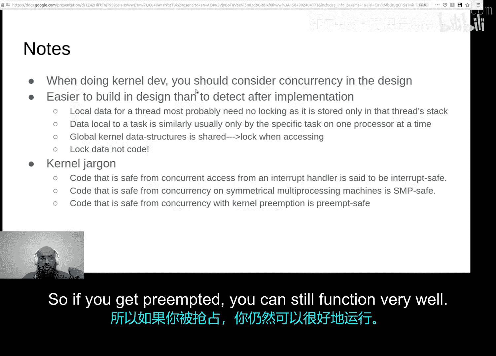

When exiting data， you need to ask the following questions and this is a list of very simple questions that help you design your system。

 so is the data global can a thread of execution other than the current one exit it？

Is the data shared between process context and interrupt context。

 which is an important question to ask？Is a shared between two different interrupt handles。

Example of such data can be basically your network card queuees because these are basically these can be shared between the interrupt context when you get a new packet and the process context when you actually when you actually try to process the data into the network queuees。

If your process is preempted while accessing this data can the newly scheduled process access the same data okay can the current process sleep on anything so you have basically you're reading this enormous amount of data from memory or from your disk so you're doing a memory work as you have discussed in the memory lectures trying to access data from that is outside the TLB or trying to access data that is actually on the。

On the hard disk。 So now can the current process block on anything basically sleep on anything if it does。

 what state does that leave any shared data in， okay。So basically。

 can somebody free the data that I'm using， so can somebody just come in and take that variable and zero it or basically remove it。

What happens if this function is called again on another processor so you have many functions that can be called multiple processors。

 one of them is again the functions that handle the network load because processor one can start handling packets and processor two can start handling packets in parallel so I mean you need to make sure that in that case nobody basically misses the other the data structures such that it becomes corrupt or unusable。

So given all of that， what kinds of concurrency can I use to actually make my data safe because as we are going to discuss。

 there are multiple ways to do concurrency remember deadlocks this is basically the dining philosopher's problem you can read about it if you have forgotten what it is but basically what it says is that look ordering is important if I try to acquire lock a and then try to acquire it again for example this is the simplest dead log that can happen and this is surprisingly something that can happen because if you're sometimes people do not they're not take into account that they are going to be preempted and then they get preempted and then when their code runss again they try to acquire the lock once more and then there's dead log because you are trying to acquire lock that is that you already own。

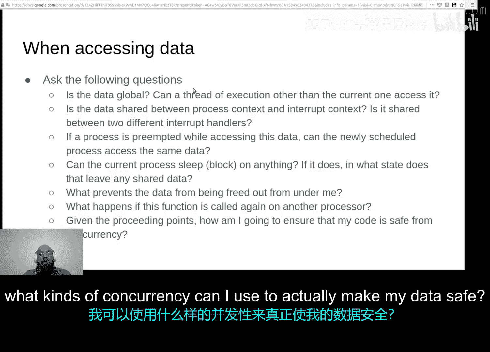

And you will never get out of that。 You can review that in your 3，7。

7 or whatever courses you have taken and。

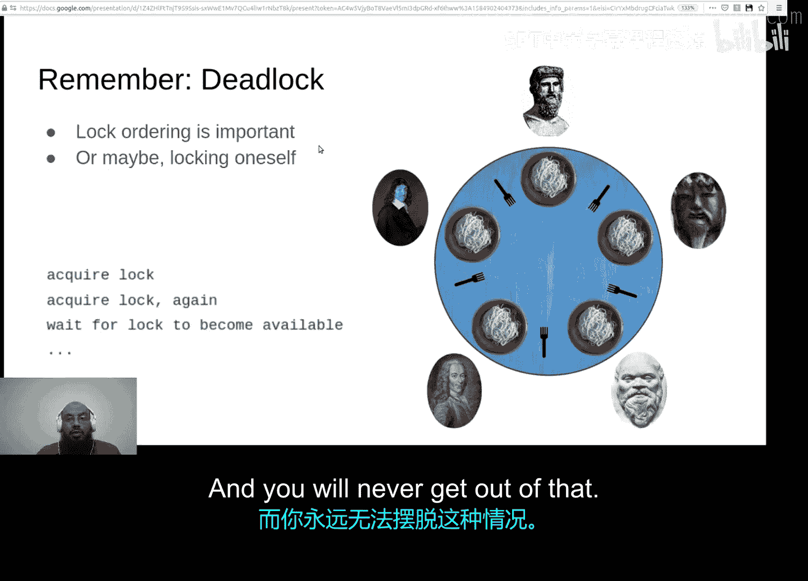

And operating systems。So there is an issue that is low contention where you basically have popular looks that can keep lots of threads waiting so if you have data structure that is being used by multiple different threads。

 multiple different proceeds，Then this can basically kill your scalability because all of these locks are trying to access sorry。

 all of these threads are trying to access the same lock。

And some of these logs can become basically a source of contention。

 They can even become a buttonneck in the kernel。 You can actually。

 you can actually measure how bad your looking is in the kernel using logtt。

 You can read more about it in that link。And this is basically， I mean。

 this is what you would expect with scalability。 you add more cores。

 you want your execution time to be had for perfect scalability or you want it to be cut into one third or cut into one fourth。

 Okay， but if youre not scalable， then your execution time will be con。

 if you are somehow what' scalable you're going to basically。

Go from and instead of having with having your time with four courses with two course。

 you'll have your time with maybe four course。So you want to make sure that you're getting the most bang for your buck basically by having perfect capabilityability。

 however， there is no such a thing as perfect capabilityability in most systems。

 so you're going to have some performance losses。

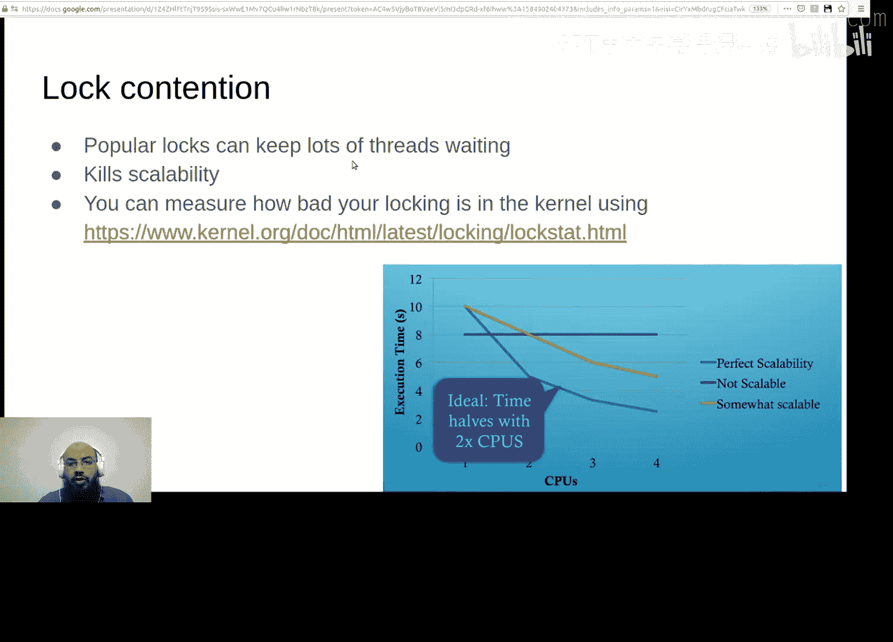

Okay there are also lock overheads。 This is something that many people do not think about。

 which is basically this is actually measured this graph is measured on a Windows machine。

 but nevertheless I couldn't find the graph for Linux but this also applies to Linux whenever you lock basically you're going to do lots of you know operations。

 there is a fine line between coarse grain locking and fine grain locking。

 so if youre if you're doing coarse grain locking basically locking multiple different data objects with a single lock。

Then what you might end up doing。 I mean， you have one lockford for a lot of things。

Then you reduce the number of locks that the number of times you are going to try to lock。However。

Well， that basically means that lots of data structures are going to be locked at the same time and lots of different threads that try to access these different data structures can actually suffer because they cannot access data structures。

2 fine grain locking， on the other hand。Which means that you're， you're doing lots of fing。

Each lock actually requires some time。To， to basically get to get the lock basically because because it's it's。

 I mean， there there is an operation that needs to be done。

 You need to go and check if the lock is is acquired by somebody or not。 and this takes time。

So basically increasing the number of lock or decreasing the time between cool the locking mechanisms and the kernel。

 basically if you have it every 31 microseconds versus if you have it 10 nanoseconds。

 10 microseconds versus if you have every 3。1 microseconds， so I mean， you see。

IfSo you call a lock 31 microseconds later， you another you call another lock and so on。

Versus every 10 microseconds， you see that there is some performance penalty， but it's not a lot 3。

1 microseconds， you get a larger performance penalty。Now， at 100 nanoseconds， you almost get， I mean。

 you， you reduced your performance to one8 of what you get。 if you call a lock every 31 microseconds。

So basically， you need to consider that。The trade of when you're looking at adding a lock or not。

Yeah。So we now focus on the different kernel synchronization methods and the kernel actually provides multiple such methods。

 the first of which is basically it provides a set of methods， well there are different methods。

 some of them are looking and some of them are just atomic kernel operations and atomic kernel operations or a group of operations that if you if you use them。

 the kernel guarantees to you that these operations will happen occur with atity so they either fully open or they do not happen。

These operations can be divided into two kinds， the integer atomic kernel operations and the bitwise atomic kernel operations we'll start with the integer atomic kernel operations and these are special methods that guarantee atity for things such as addition reading some variables and so on。

These methods work on some special data types， these are atomic data types for example the equivalent anomic to an end data type is an atomic underscore T which is actually a data type that is like an atomic integer。

And these data types are defined in the type with each file。Linkked over here。

You also have a file where the atomic operations themselves so the types are defined in the top link。

 but the operations themselves like add and read and so on are defined in these three files that I have linked over here one of them is atomic。

 H which is for 32 bit operations Atomic 64 underscore 32 do H which is for some operations that are common between 64 bit and 32 bit processors and operations that are 64 bit but are happening on a 32 bit processors and atomic 64 underscore 64 which is for 64 bit operations on 64 bit machine this is an example of such operations。

Which is the architecture atomic ad。And this basically adds an integer to the atomic variable。

 So this method this operation takes as input to inputs。

 The first one is is the number that you're going to add and it's a normal in。

And atomic underscore T is basically a pointer to the atomic data type that this integer will be added to obviously this atomic underscore T pointer should be predefined and the way that it works is that it's actually it runs an assembly instruction that locks the operation adds the the first。

Parameter， the first input to the second input okay。

 and basically does all sorts of things to make sure that this is done in an atomic way。

 And there are many atomic integer methods that are defined。 By the way。

 there are also long methods so you can actually and there's long data type。

 you can check the data types and the previous link and the different operations。

 you start by basically initializing an atomic variable。 And to do that。

 you basically call the atomic and。Cool method that basically takes in as input the initialization value of the of that variable。

 And then basically the return is a pointer to an atomic T data data type。 Okay。

 and then you have an atomic read okay， which basically reads the the value in and。

Atomic underscore T data type， atomic set to change the value， Okay。

 atomic add atomic subtract increased decrease， which is basically incremented by one or decreement by one subtract and test and basically add a negative number Okay。

 and there is like a bunch of these different。Methhoods that you can use。

 There are actually more of these， okay。The bitwise kernel atomic operations。

 they do not operate on special data structures because these operations they operate on memory so they now the bitwise kernel atomic operations are basically a bunch of methods again in the kernel that exist so that you cant change bits in different bits in your memory or in your data structures or data types atomically so they can operate on any memory location or any memory edit okay。

This allows the user to safely perform bitwise operations of memory。Again。

 defined in bit of dot H as they are actually。Also architecture dependent， this is for x86。

The arguments are a pointer and a bit number。 so basically you set bit to0 for example。

 Okay so you give it a pointer to the word or the memory address that you're going to change and you give it a0 set bit1 again this is this is this is set the bit1 now obviously you cannot set a bit to 10 right because it's a bit so there are also quite a few operations that you can use bitway so that if you're manipulating any of the kernel data structures or if you're manipulating flags for example。

 as as there are multiple tag for example， the dirty bit or the and memory which you have looked at previously and you should know of I mean do you can do this atomically and this can be basically apply to any address space sorry to any memory address okay。

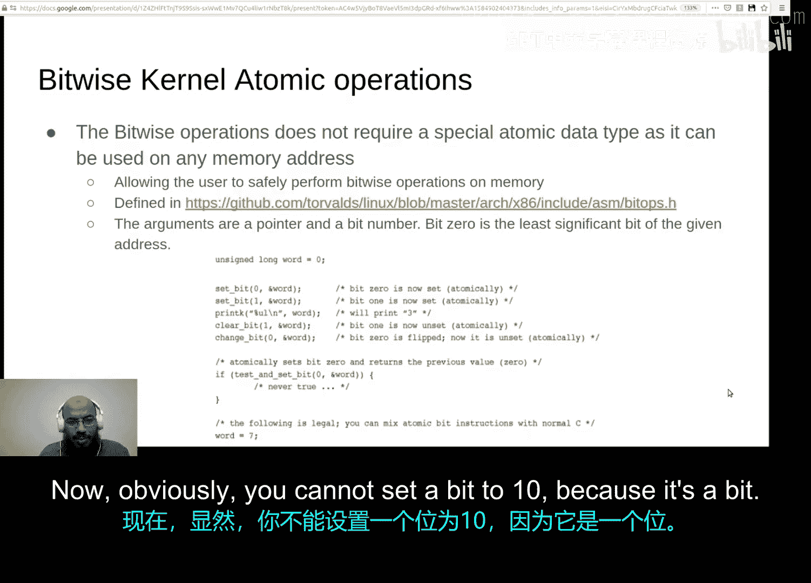

And there are a few of these operations。Okay。For each atomic bitwise operation。

 there is non atomic equivalent that can be used。 Now， this is important to note。 I mean。

 changing a bit in。An address should be done atically right if because that's that's the best thing。

 I mean， you're you're playing with the memory and you want this to be done atically。However。

 theomic there are nonatomic equivalents that that exist at least actually so if you have the like the test bit or the set bit。

 these will be underscore underscore test bit， okay。Yeah。

There are two reasons to use the nonatomic operation， one of them。

Is that if a lock already protects the data， the second one is if the data does not need to be locked。

And these atomic operations can be much faster than the atomic operations on some architectures。

 so on some architectures this is actually something that helps you to be faster than by just using the atomic operation。

We now go to the second primitive that the provides for kernel programmers to actually provide synchronization。

And that's kernel spinlock， spinlock is a lock that can be held at most by one thread of execution。

And basically， if if acquired by one thread。Then all the other thread， if they try to acquire it。

 they will just pin。 Okay， they they will busy loop， basically doing nothing。

 waiting for the lock to become available。The rule of thumb is that you hold a spin look。

 If weighting is less than the duration of two context switches。 And the reason is that。

You're coming。You try to acquire this the lock right so now you are actually on being you are actually running on the processor。

If you are not able to acquire the spin lock， you just set and spin， right？Now。

 the other option that you'd have is to basically signal to the system that， you know。

 I need to sleep now。Sign to the kernel that you need sleep now and thus the kernel evicts you。

 and there there is two there is a context switch。 Now that this means that this。

Operation that was trying to acquire the lock will be evicted which is one context switch so all its data will be flushed then the TLB will be flushed and so on and then it will go into sleep into the sleep state and then when it wakes up then all its data now needs to be reloaded on the CPU and that's the second context switch so if you're going to wait for a time that is less than two context switches then you're just going to do a busy loop because it makes sense to wait for it right。

Now。The implementation of spinbox is architecture specific。

And it's mostly used in interrupt handle handlers after dis able in local interrupt。 So this is。

 this is actually the menu use of spin locks。 Okay。

 because interrupt handlers should be pretty fast and should basically be able to finish whatever they they need as fast as they can。

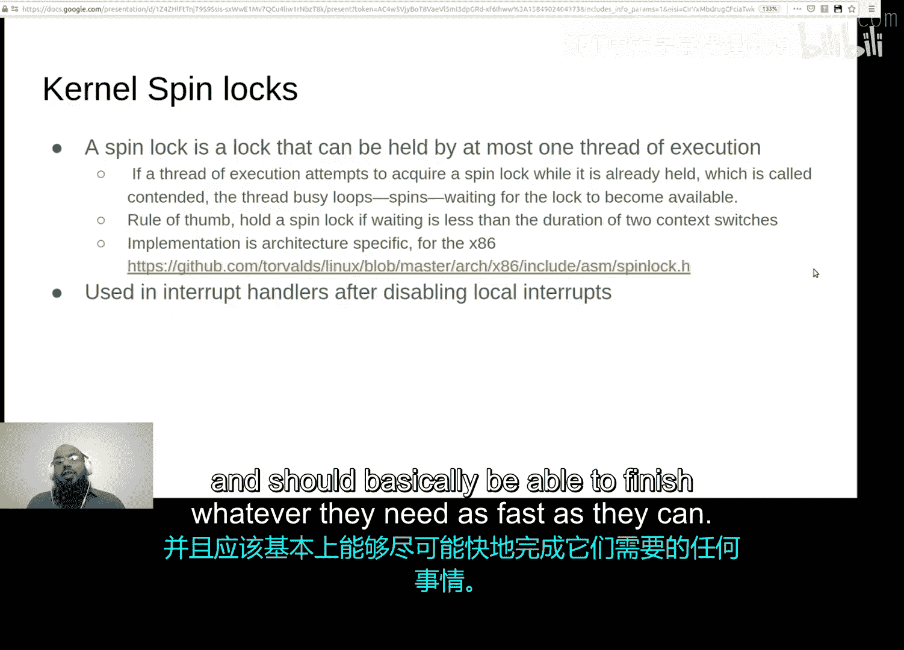

So here are some spin lock methods， the first one is basically if you're trying to acquire given lock。

 you call spin lock spin lock IRQ disables local interrupts and acquires given lock。

Spin lock RQ save saves current state of local interrupts。

 disables local interrupts and acquires given lock。

 spin unlock to basically unlock the lock and so on， and there is also the initialization of course。

Now， another usage of spin locks is what we call read writer spin lock。And the idea is simple。

And many operations， you have two different path of operation。 One of them is for readers。

 and one of them is for writers。Basically， if you're writing。

 you demand that no one should be reading with me， right， right， because I'm writing。

 I'm changing the data。 So if somebody reads the data， then it then。

The the data read will be in in some corrupt state。However。

 if are there are multiple readers trying to read， then basically all of them can read together as long as there are new writers that are trying to write。

If there are multiple readers then no writer should be able to write because now all the readers should be should try to。

I should finish the readings before the writers start writing。So。

This is basically when you use a reader writer's Penlock and you probably have studied that already in your undergrapped course。

Reader writer block methods， these are basically how you use read writer block and again you have read lock。

 you have write lock and these are two different locks and then you have the IRQ versions of them and you have the IRQ save of them and you have unlock and so on and so forth。

Now we turn our attention to semaphos， which is a different kind of locking you should also have studied that during your undergrad。

 actually semaphos are sleeping lock， they are a more generalized form of locking and。Basically。

 the way it works is that if the semopho is not available， the tusk sleeps in the weight queue。

 once the semopho is available， it wakes up some of these sleeping tuss and tries to run them。

Smis are used for locks that are held for a long time because then you can go to sleep and then whenever if it's going to take three seconds for me to acquire the lock it doesn't make sense to wait with a spin lock just that's three seconds of doing nothing。

And obviously， during that time， you can get interrupted and you can， well。

 you can get interrupted and you can get preempted with the timer。

With the timer interrupt and the scheduler and so on。

 so basically you're wasting a lot of time doing nothing and doing context switching to just go into something that's pin lock。

 so these are sleeping lock。嗯。A task can sleep while holding a sepho that's the main idea behind it。

 and there are two types of ses in the kernel。 one of them is the binary or mu se。

 and this is actually the separate implementation of the se。

And the other one is counting se sehor and in the kernel。

 you almost always initialize it with a count of one if you know if you remember your undergrad course sehors where basically would allow you to have even look that occurs when there are five different threads running in parallel for example。

 Now in the kernel there is no such a thing as five different threads trying to access the same data without corrupting the data maybe for some of the reading work but yet again you have read writer looks and they are very efficient。

 so it doesn't make sense to initialize the se with with a large number。

 but yet again it's a bit weird that you have a muotics。

And you have counting sepho that you always initialize with one。 We'll talk about the difference now。

 basically also for for for， if you would like to look at the definition。

 the implementation of sephos and the kernel。 These are the two files。

And these are the different methods for a se， so you have a se initialize。

 which initializes lock antiques as input and integer。

 which is the number of threads that can enter the sepho before the se basically disables anyone else from entering inside and as I said this int is almost always initialized to one。

Then you can initialize the meotics， which is basically a binary se， it's either0 or 1。

 and then you have the locking and unlocking mechanisms and you need to look at your under course to basically look at the up and down mechanisms and sehors。

Yeah。So。The main idea is that emotics adds constraints over a sepher because a seford basically has almost no constraints。

 basically it's a counting lock you can have five threads entering。

 so I mean it almost has no constraints。The Mutics， basically。

Puts a lot more constraints so that users do not mess up the system by just using ses。

So only one task can hold a metics at a time。Whoever lock a muotics must unlock it。

 That is not the case for sephos。 So sephos for example。

Can be used when you have very complicated synchronization between the kernel and user space where the kernel can lock can acquire the lock。

 and you would like the user space process to be able that basically maps to the thread for some reason to be able to unlock the kernel the kernel lock so I。

In the sepho implementation you do not even have this of me acquiring the lock。

 me releasing the lock， it's basically me acquiring the lock anybody can release my lock which can be useful in some very complicated coronary cases so that's the second difference and that's actually a huge difference and that's one of the main reasons that that actually mutes are there and sehors are there and theyre initialized to one because of these complex synchronization mechanisms。

Recursive Luxin and Lus are not allowed； that is you cannot recursively acquire the same me a couple of times you can do that with the Sedo。

A process cannot exist while holding emotics。In the se。

 a process can exit while holding the se because another process can unlock it right so I mean another process from our site can basically unlock the se。

And a muotics cannot be acquired by an inter handler or bottom half these are the rules of meticses。

Okay， so basically when you use spin locks versus ses and meotices。

 you now know when to use a meoticex， basically if these are the conditions that you're going you want to sleep。

 you do not want spin lock and you want all of these conditions to happen。

 but now there is a much general comparison between when to use spin lock versus a seer and this is basically the the the comparison If you want overhead looking then that's a spin lock short lock whole time spin lock long lock whole time meoticex is almost always preferred okay。

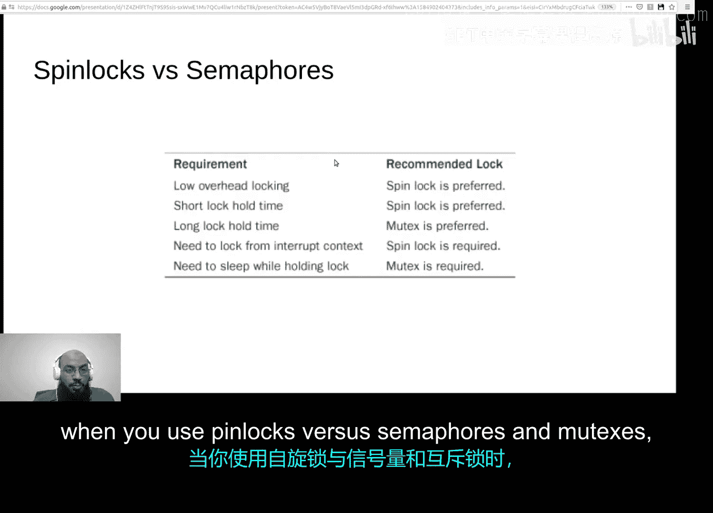

Need to look from interrupt context， spin lock is required as you can opt use aotics。

 need to sleep while holding a lock， a muotics is required and in some cases s。Yeah。哦。

As you have noticed， I'm recording this into shorter videos because I do not want to basically overrunm you guys so you can watch it in shorter video length and full lamp okay。

So another primitive that another method synchronization method that the kernel provides for users is the completion variables。

It's just another way to build a cinema like looking mechanism。

Basically the way it works is that one task waits on the completion variable while another task performs some work when the other task has completed the work。

 it uses the completion variable to wake up any waiting tasks it's basically another implementation of the seer。

Which is basically has。Nicer semantics if I see， where you basically have you initialize a completion task and you wait for a completion task and basically once you complete you signal the other task。

This is， this can be useful for some looking mechanisms。 It's， it's， it's definitely much。

Much more user friendly compared to mes and， and。A se， but， but you know。

 you'll find you can search the kernel for when it's used basically。

 it's used in multiple places in the kernel。One historical obsolete kernel was the big kernel lock。

 It's no longer part of Leos， however it's actually described in the book。

 so I thought I should tell you that his obsolete does no longer does not exist anymore and it was basically a global spin lock It was。

The big kernel lock was something that is horr that you could use to log the entire kernel with some different semantics than what we have discussed over with the spin locks。

 the enormous spin locks， and the metices， the sephos and the completion variables。

There is another kind of locking mechanism that is called sequentialion locks。

 and these are basically useful to provide the lightweight and scalable locks for use when you have many readers and a few writers。

One bad thing about the reader writer log is that。If you have too many readers。

The writers come in and they block because the readers。

 there are like 100 readers and they just keep adding and basically there is no way for the writer to acquire the look as long as all of these readers have the reader lock okay。

So the the kernel programmers design a new way in order not to star the Reuters。

 And the way it works is that now it puts the burden on the reader to actually make sure that the data read is consistent。

It's a very interesting idea。And it works by maintaining a sequential counter， okay。

Whenever the data in question is written to。A lock is obtained by the writer。

 and the sequence number is incremented， and again， no two writers can acquire the lock together。

Okay， the sequence number starts from 0 when you initialize that， look， you get a  zero， okay？

So when the first Reuter comes in。It changes this zero to1。Okay， and when it's done with the writing。

 when it releases the lock， it adds another one to the one。 So now you have a2。Now， readers。

 they just come in and do not try even to look at the writer logs， Okay。

 they just come in and read the data。And prior to reading the the data。

 they read the sequence counter。 So suppose that。The reader came in and read zero。

 started reading the data and once it' is done with the reading it reads the sequence counter once more now it is a 1 okay so now that means that some writer is trying is changing the data so the reader has to wait until basically and reads again the data and until the data becomes a2。

Okay。😊，And basically this way， if the values are even， a right is not underway。

If the values are different for reader from when it started reading and when it ended reading。

 then that means that there is a corruption in the data or there is change in the data or the reader read obsolete data。

And if the number is odd， then the odd number signifies that there is writing pose that is currently happening。

Now this works if you have very few writers and a lot of readers。

 so this is a very important looking primitive because it actually gives you a lot of power。

Now we are going to shift our focus to something that is slightly related to the previous two parts of the lectures which are both looking and basically dangerousrous and that is timers and time management and the Linux kernel。

The kernel notion of time is basically derived from the hardware？

Almost all hardware provides a system timer that the kernel uses to basically measure passing of time。

This system timers is basically an electronic。Chhiip and electronic time sew。

 like such as the digital clock or the frequency of the processor。 This is architecture dependent。

 and each architecture implements this differently。The system timer goes off。

 often called hitting or popping at a pre programmegrammed frequency。

 This frequency is called the tick rate。And every time the system timer ticks， it's， it's one tick。

 okay。When this timer goes off， it issues an interrupt and that is called the interrupt timer， okay。

And the interrupt timer basically occurs every tick and has a special interrupt tender。I take。

 basically， the time。It takes for between two different ticks is equal to one over the tick rate。

 so suppose that you have a timer that takes 100 times every second。

 then basically you get you're going to have the interrupt handler for the timer interrupt kicking in every one over 100 seconds。

 every 10 milliseconds。This is very important for many kernel functions， especially scheduling。

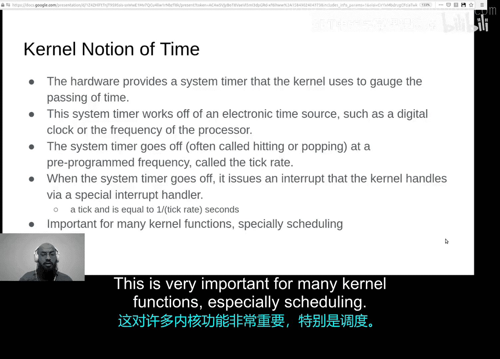

The takeer rate is called the Hertz HZ。😊，The frequency and this is basically a this is now a program on the system but based on some preprocesor defines。

Now。Previously， it was a hard coded number， so basically Linux had have been shifting between different values for Hz。

 but now its it's actually something that you can change It's the parameter that you can change when you when building your your kernel or you can change why the at boot before you boot the kernel and reboot and then you get to the new you start with the new hertz。

 Okay this is defined in parameter H as you can see these two different files basically。

The default tick now is once every 10 millisecondsPrevious Linux started with once every 10 milliseconds。

 they changed that to once every one millisecond and then they changed back to once every 10 milliseconds giving you the power to program this number。

The most important thing is that when you are writing kernel code。

 you should never assume anything about HZ， because the user can change it at any time。

 and it's also architecture dependent。 The book actually has a table that is outdated on on the HZ default values for different architectures。

There are different leaders， right？ You can have one。 you can have a tick every one millisecond。

Or you can have it tick every 10 milliseconds， or you can have it tick every one second。 I mean。

 you can change that， right。Now， there are pros for higher values。

 increasingncasing the tick rate means that the timer interrupt runs more frequently。

 So every 1 millisecond， every even 500 microconds， whatever you choose。Consequently。

 that means that you have work that is being done more often。

 basically once every time the timer takes， you basically go in and do some work。

 the timer interrupt。That's actually sometimes a good thing because all time events have a higher resolution。

 you can now control your your kernel at a much better fine grain。ああ。And。Basically。

 fine grain tick values or or or or you know， occurrences。

The accuracy of all your time events improves significantly if you go from 10 milliseconds to 1 milliseconds you can have a plus minus 5 millisecond error rate and and your 10 millisecond value。

 but you can have plus minus。05 milliseconds error rate in if you use 1 millisecond。

System code such as pull and select that optionly employee timeout value execute with improved precision measurements such as resource usage or the system uptime are recorded with a final resolution。

 actually it's actually important for resource usage especially because if you have if you have higher fine green values。

 then you can actually get much more accurate resource usage data。Oh。

AndPro preemption occurs more accurately， because basically assume that a given process is running and has two onlyise seconds of its time slice remaining。

ItSo you start a process basically and it requires two more milliseconds， okay。

The scheduler should basically preemp the running process and begin excluding a new process after2 milliseconds。

 however， a timer interrupt does not look。Until basically 10 milliseconds。

 that means that you're wasting 8 milliseconds waiting for the timer interrupt to actually kick in the scheduler again。

O。Cons of higher values。A highererarchtic rate implies more frequent timer interrupts and interrupts come at a cost basically it comes at an overhead cost and the processor must spend more time executing the timer interrupt handle。

 sometimes it's not even needed because basically your system is id So you're just increasing your power consumption。

 you're more frequently thrashing of the processor cache if you if you have a single operation a single。

Application that is running right now， then why basically keep switching it back and forth。

The higher that it rate， the more time the processor spends actually into timer interrupts。Now。

 many operating systems now work with what is called a ticks operating system mode。

And Tless operating system mode is an interesting idea which basically says that the system dynamically schedules the timer interrupt in accordance with pending timers。

So instead of basically running the timer every  one millisecond or every 10 millisecond。

The interrupt is dynamically scheduled， so the kernel calculates a value for the interrupt。😊。

And if the next timer is set to go off in  three milliseconds。

 the timer interrupt fires in 3 milliseconds and part of your timer interrupt routine now。

 you calculate if there is no work for 50 millisecond for 50 more more milliseconds。

 then it doesn't make sense for you to fire that timer interrupt once more。

Until 50 milliseconds goes off。This actually saves a lot of power idle systems。

 this is how you enable the operation of your kernel as a Texas operating and the tless mode。

Actually， this is now， I think I'm not entirely sure it was the default in Windows 8。

I believe it was the default in Mac OS for a long period of time。

 I was unable to verify that it is still the default wave of operation of Mac OS。

 but Windows 8 was like that， I think Mac OS 10 or something I'm not a Mac person so I'm not sure of the version but you'll find lots of discussions on the internet on this so Laris has that feature。

 I mean many operating systems today support tickless operations。

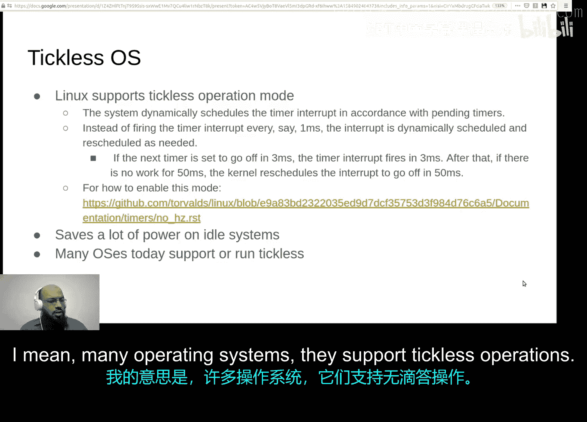

。An important variable in the kernel is the Gs variable。

 and it is a global variable holding the number of ticks that have occurred since the system boot。

systemystem and up time can be calculated easily using diffs by basically looking at diffs over hertz。

 so if you have been running if you have 1000 ticks and you tick 100 times per second。

 that means that you have an up time of 10 seconds。This is defined in this file。

The Js variable has always been an an unsigned long。

It actually has a different implementation between 32 bit and 64 bit architectures。

In 32 bit architectures， you basically glue together two different 32 bit memory address memory locationss to basically get your 64 bit。

呃Giffy value。In most cases， you only need to look at the first 32 bits because what you care about usually is just how long has it been since something has happened。

ok。😊，With a tick rate of 100， a 32 bit di variable overflowing about a little bit over a year， okay。

 actually a lot over a year， so one year and three a month almost。With。Jeff is value of 1000。

 this happens every 40 to 9。7 days， so a little bit over a month。

 one and half well month well one month and 20 days this is actually important for one running service。

 it's not like your system will crash if it overflows basically if you go from zero to 64 bit to the full 64 bits。

 your system will not crash or the full 32 bits， your system will not crash。

 but rather the kernel needs to do work to actually make sure that the overflow does not screw up your normal system operation。

So。That's why we have 64 bit Giffy of all kernels， okay。

And the kernel has primitive has techniques to handle wraparound correctly。

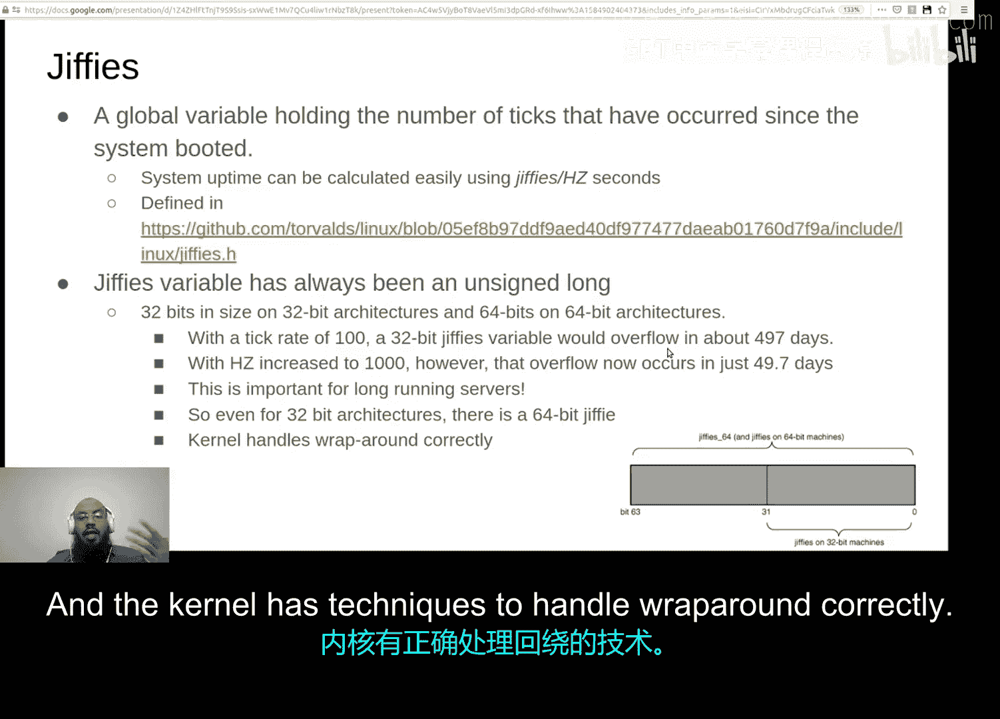

Hardware clocks and timers one of the hardware clocks that we need to talk about is the real time clock。

 which provides a nonvolatile device for storing the system time。

RRTC is basically chip an electronic chip that is usually lyinging on on your motherboard and it is powered by way of a small battery that is included in the system board usually you're well I have never needed to change the battery I am not sure if anybody has so this battery is enough to run it for ages basically on the PCR picture。

The RTC and the CMmoOS are typically integrated， basically the bias and the RTC are typically integrated such that both of them are operated from the same battery。

 and this is how you basically keep your bias data from being host。

Carlonel reads the RTC and uses it to initialize the wall time。

 which is stored in the next time variable and the wall time is basically the date to day。

The system timer provides a mechanism for driving an interrupt at a periodic read。嗯。

And that's our second。Timer basically， so the first one is the artist is here。

 the second one is the system timer。And this is used to provide mechanism for driving interrupted periodically。

 This is basically the HZ that we were using。 So you have two different clocks。

 one of them is the RTC， one of them is the HZ sorry is is the system timer。

 the RTC is actually almost only used when you initialize when you start the system that's when you read it and then you store its value in time and the X time variable where the system timer is something that that runs periodically。

Now again， this is architecture dependent， so some architecture。

 different architectures implement a system timer differently。

And this is how the X86 timer basically system timer is programmed。

'ss it's basically the programmable interrupt timer。

 which you can change and change basically the HZ value of it so basically can change how it works and the pit existed on all PC machines since the dust the ages of the dose So 1980s basically。

The parallel programs the pit on boot to drive the system time and interrupt so that's why you need to if you change the electricity。

Frequency you need to restore your system。The timer interrupt handleer is a very important handleer for multiple reasons。

It's broken into two pieces again an architecture dependent part and an architecture independent routine the architecture dependent part does at least the following functions these are the important functions for the timer interrupt handle first it obtain the X time lock and locks basically the value of the X time variable。

嗯。Protects access to the differences 64 value also， and a all time value X time。

 So it basically lock all the time。The time memory， the time variables that are stored in memory。

Then it acknowledges or resets the system timer as required。

 so you basically know that system timer should start again counting whatever number of tick。

 sorry whatever number of hertz before it tick。Periodically saves the updated wall time and the real time clock。

 so basically adding to your wall time， your date and time of the day， adding its value。Then the new。

The new measurement basically and the real time clock and cool the architecture depend on time and tick periodic and tick periodic is actually very simple。

Well， it's a very simple。Method because function， because what it， it。

 it's basically what it does is that it cool few other routines in different parts of the kernel to just make things work。

 okay。The architecture dependent independent routine tick periodic performs most of the work and this is basically increment the extra js count by one because you have acquired X time lock you can just incremented without doing anything。

 update resource usages， such as consumed system， CPU user time， memory usage。

 average memory usage and so on for all the currently running processes。

 which you get on top and Etop。Run any dynamic timers that have expired there you can in the kernel。

 add your own timers whether to talk about it in a few minutes or in a minute or something。

Exce the scheduler tick basically calling the scheduler to run now because now it's time for the scheduler run。

 update the whole time， which is Jordan X time and calculate the load averages and this is defined here。

This is the actual function from from the Linux kernel as you see。

 it basically gets a right sequential lock on the Jeffs lock and then it adds the time to k time。

And unlocks the Gus lock and then update processes times for different processes going through different processes and called the CPU profiling。

 And then there there are a bunch of other things that it does this is just small code snippet from the tick periodic。

The time of the day， which is basically when what we see right now its Sunday for 20 or whatever。

 and it's defined in this file。And the way it does it is that it has the x time to TV underscore。

 which underscore sec value and this stores the number of seconds that have elapsed since January 1st。

 1970 UTC time。And this is what we call the Linux epoch so every time you actually get a tick you increment that number。

Now， dynamic kernel timers， some operations require the kernel to actually set timers for these operations。

 basically saying， let's start this after some time。Or， or this should run after X， ticks， and so on。

So these are called dynamic timers or kernel timers。

 and these are essential for managing the flow of time in the kernel code。嗯。You basically。

 they're very simple to， to， to build， basically initialize a time with an expiration with an expiration time。

And specify function to execute upon that expiration time。

 so you basically say that this function will run in two seconds and you set a timer that expires in two seconds and then after two seconds the kernel will just run this function。

You activate the timer and every time there is a thick。

 okay the timer basically will decrease decrement。Until the given function runs after the timer expire。

Timers are not  psyelic and the timer is destroyed after it expires。

 so you build a timer for a function。And there are defined methods to manipulate it。

 and these are existing timers of H this fine。This is how the timer list。

 which is actually where the definition of a timer is。

And you basically have the expird date and expires and you have a pointer to the function that you're going to run。

 Okay and you have some flags and you have。A list that we talk about very now。

 basically the timer implementation you have the timers are stored in a linkeded list and in order to make sure that the kernel does not need to go and search an internal turn linked list for which timer has expired and run it。

And to optimize insertions and basically taking timeers out and executing them。

The current partition is timers into five groups based on their expiration value。

And timers basically move down through the groups as their expiration time rules closer。

 so you have basically things that will run in a very long time， things that will run sooner， sooner。

 sooner and things that will run now， the partitioning ensures that in most execution executions of the timer。

 the software queue， the kernel has to do little work to find the expire timers。

Other methods for the name execution beside the timers。

 you can just add something that is called short delay and you can add the microsecond delay。

 nanosecond delay and millisecond delay using one of these three functions Okay and this actually does not use difference This has a different implementation inside the kernel。

With this， I conclude today's lecture， thank you and I will see you soon。

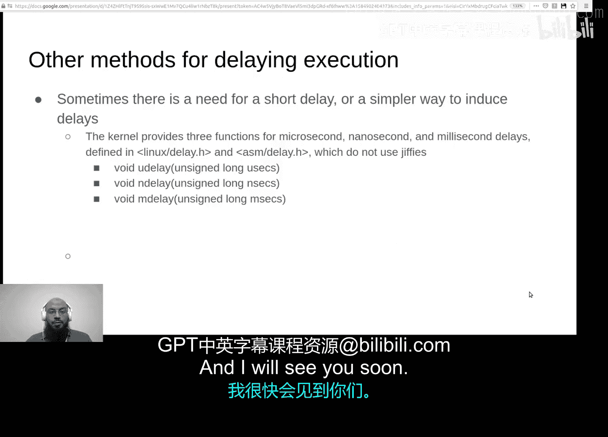