# 麻省大学《操作系统 设计与实现｜CS 577 Operating Systems Design and Implementation 2020》中英字幕 p40 -40-Lec21 Screencast_ Memory Management in Linux (03_23_20).zh_en -BV1iP2CBaEHr_p40-

Hi， welcome to our second virtual Linux lecture。Today were going to cover a topic that you have actually covered in a lot of details。

 so it's going to be just the difference are some of the main highlights trying to shed light on some of the things that are very unique。

To the Linux memory management。Oh。Menex have， I mean， not just menex。

 but lots of app operating systems share a lot of ideas and and how they they do memory management。

 And， in fact， almost。Not almost， but many of the concepts that you should have studied in your undergrad operating systems course。

Actually is reflected into the Min design and into how the Min handles memory。So with that in mind。

 well just work on basically looking into some of the different aspects of Linux。Again。

 I hope that you guys are social distancing， sitting at home， I don't know。

 adding popcorn or doing something， bringing a series or something。

 but I hope that you and your entire families are doing well。

So in this lecture we will talk over three different parts into the Linux memory management subsystem。

 The first one is how the system does kernel memory allocations。

The second one is user space memory management， and the third one is caching in memory。So。

Before we start， we should take a look at some numbers that every programmer should know。

You should basically always think when you when you're reading and writing data if you're， I mean。

 that is regardless if you're doing that in the kernel or somewhere else。

About where will your data end up to be。 You should you should not never make assumptions on where it will be。

 but you should rather think about where it can be so basically。If you're fetching data。From。

 from from a server in Europe。That's typically 150 milliseconds away from you。PFor each packet。

 basically。 Okay， so if you're， if you're。Sending and receiving lots of packets。

 you have to factor this into how your system will work。

This is now important if you're building a highly responsive server while thinking about okay。

 maybe some parts of my service can go into script or something can run on user side。

 some parts of my code will run on the server side。

 maybe it should utilize the CDN that is closer to the user in Europe and so on。

Then you have also a time factor when you're trying to fetch1 megabyte sequentially from disk scan。

 basically from disk， these numbers are not for an SSD， they are for an HD。

Obviously you can do way better now with an SSD， but still there is a significant delay when it comes to fetching data from disk。

 even seeking data from diskk， so where the data will end up because you remember you hardwareware class。

 you basically have a spinning motor that actually needs to physically move to go to the correct sector。

 for example， in HDD。Now you have much shorter。Performance penalty when when you go to memory around 250000 nanoseds。

And you might be thinking that， okay， why are we talking in nanoseds now。

 because basically your fastest thing is fetching data from the L1 cache and this takes around half an nanosecond。

These numbers do change year by year， but the hierarchy of memory。Is still the same。In fact。

 in many cases， when you get what is called now software B in both the software size and the software performance。

Basically， you have the hardware doing these amazing great strides to make the hardware very fast。

And in the opposite side， you find software that is doing stupid things to make that makes the entire system feel like it's something from the 1980s。

I'll give you my favorite example。Windows 10。Its actually one of the worst。

Pieces of software that I can think of。 And many people would disagree with me。 but。

 but basically the idea that in understand， you have this mechanism that they came up with that accesses disk。

Very frequently， making the entire operating system very sluggish。 I mean。

 I just bought a machine for my wife。And and basically。

 the performance there was way worse than a machine that I have that Ive had for 12 years old。

 And it's not an issue with with the hardware and the hardware is fine。

 It's an issue with how the system was designed。 It accesses this way too many times actually had to go and buy an SSD。

 which which I mean， I never knew that this would be the case because I've been running on Linux for quite a while。

And now the performance is way better， because SSD are way faster。 But yet again。

 why do I build a system that accesses the hard disk that frequently thinking that this is a way to actually make your system more performant。

 And the worst part of it， I cannot't remember what was that feature。

 but I tried to disable it like 5，6，7 different ways。 I could not。

 maybe I'm I do' not know anything about Windows， but maybe also the。

The programmer has thought that you know oh， new brand brand new hardware very fast。

 that may just access this click crazy， everybody is going to get an SSD okay。

 but still your performance is way worse than running on in an old Linux machine。

 it was actually slower than my mobile phone。So when we talk about these things。

 we should always think about what courses are we introducing in our software。

 and this is especially important if you're writing server side code， for example。

If you if you're building a web service and you start accessing this way too many times you're going screw up performance。

 if you're writing a database and you you're trying to access disk way too many times game performance will get hurt badly and so on。

 so you want your system to performance and typically doing that requires you to actually understand the trade these tradeos between the different numbers So Concottcott has been actually calculating a guy from Berkeley has been has been fetching these numbers yearly he has the numbers for 2020 and this link and you can actually look at these performance numbers with how do they change each year。

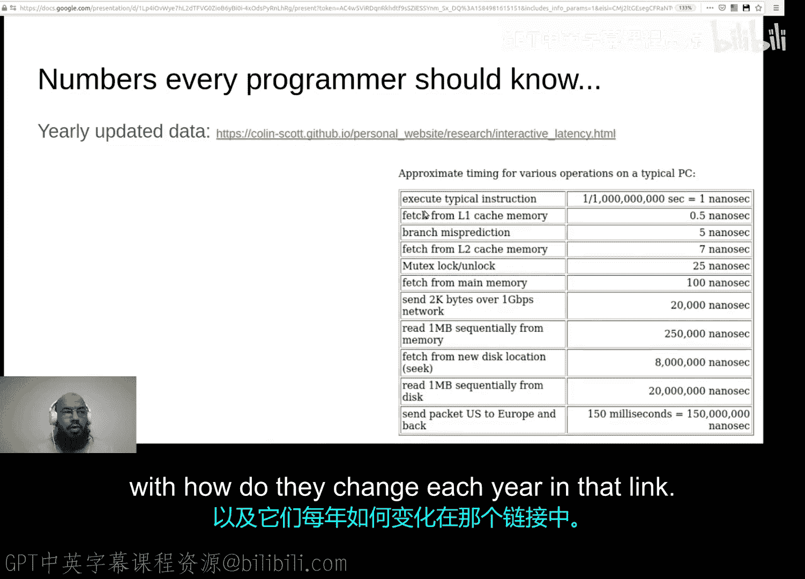

In that link。Okay， so now。Now that we have established that that basically accessing memory is way better than accessing。

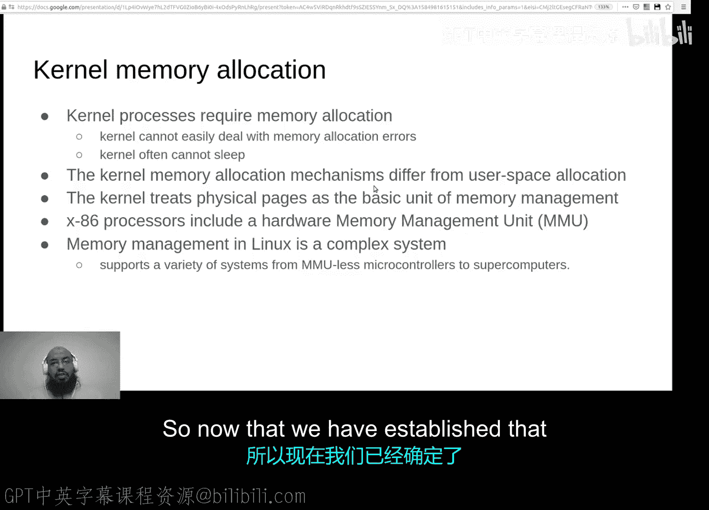

It's way better than accessing disk， obviously accessing that the processor cache is even much better。

 but the processor cache cache is a very course resource。

 usually typically very small so you cannot really put so much into it so most of your program data will end up in memory anyways。

 right。

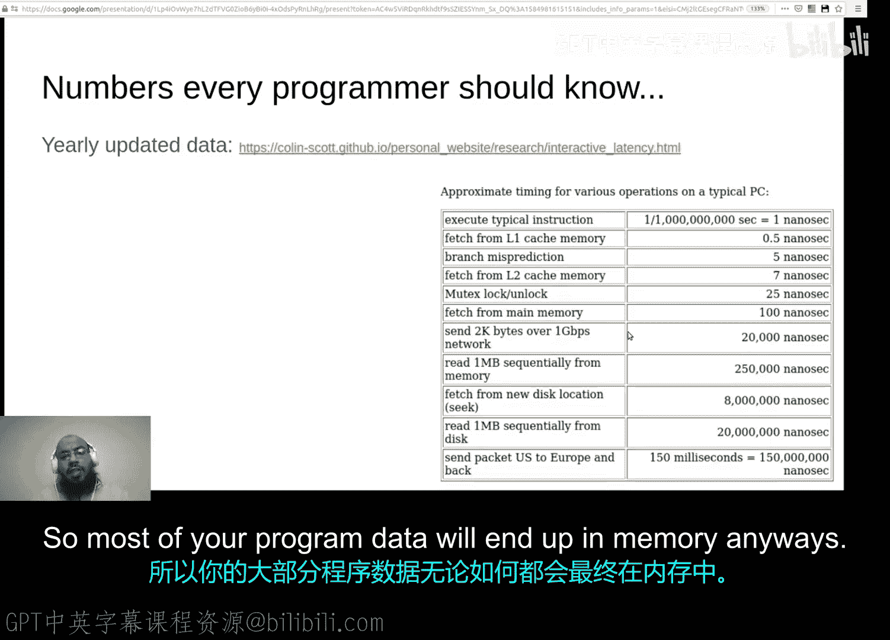

So now we need to think about how what is the memory access pattern for three different parts of the kernel right the first one is basically the kernel itself trying to allocate memory to its own processes。

 the second part is basically when there is an application that requires memory and the third part is basically if the kernel can build internal caches to make to basically mask accessing the when we talk about this Io in the next lecture in Linux。

So kernel memory education， the all processes that exist would require memory。

 actually one definition of a process is that it it's memory it's some memory locations that are assigned with some code that runs on and manipulates this memory。

 very few if any， I don't think that there are any programs that you can write without having educated memory that includes the kernel。

 so all processes， all subsystem require memory education。

Now the huge difference between when you allocate memory in the kernel and when you do that in user space is that the kernel cannot easily deal with memory allocation errors。

 so I mean if you end up corrupting some data， the kernel would happily shoot itself in the head if you decide to do so it is wow。

 you're the master， you're the programmer right？And in many cases， the kernel often cannot sleep。

 so some parts of the kernel will not sleep， some kernel threads will sleep。

 but the kernel itself will not sleep。So。there are a few differences between the kernel memory allocation and how user based allocation occurs。

The kernel treats physical pages as the basic unit of memory management again。

 pages as very similar to what we have been discussing。

The X 86 processors include the hardware memorym management unit that you have talked about in the next lecture。

And memory management in Linux is way more complex than how it is managed in Linux。

 as we will shortly see okay。One huge reason of this variability or of this comp complication is that you're trying to basically support everything from a mobile phone。

To a microconter to a supercomputer。 So you need this and each one of them has vastly different memory pictures。

 So I mean， how do you actually support all this with a general kernel。

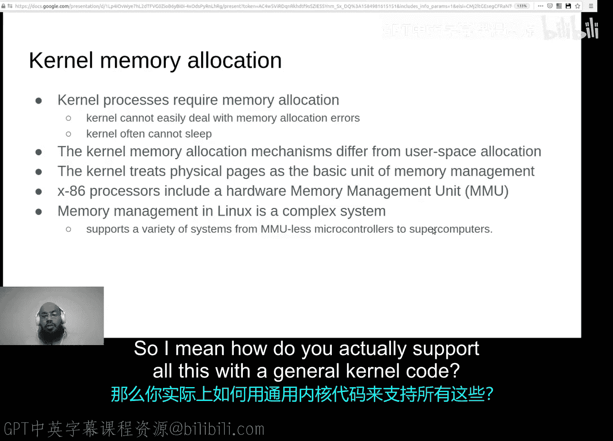

Could。So now that we have talked about pages， this is actually slide detour of how the kernel does。

The education internally for the criminal processes。Let us take a look at basically pages in Linux。

 So you have basically studied in the Linux lectures that pages has the full size of 4 kiloB。

And this was the case in the kernel。But。Since version 2。6。3。

 the kernel started supporting something that is called huge pages。

Along with the four kilobyte pages。And the rationale was quite simple。

On a machine basically with 8 kilo8 sorry， pages with the full size is4 kB where the in the days of the third2 bit processors。

64 B processors have 8 kilo pages。 Okay， but， but pre 2。6。3，4 kilob pages where the norm。

So on a machine with 8 kilobyte pages and 32 gigabys of memory。

Physical memory would be divided into around 4 million and 200，000 distinct pages。On the 64 B Linux。

 okay， you， you can have up to 128  TBys of virtual address space。And up to 64 TB of physical memory。

So you see， when systems were in the 32 B space， it was pretty normal to basically have something in the order of 4 million pages。

While when you go to 64 B Linux， you can have up to 64 terabytes of physical memory attached to your machine。

So now if you try doing your caitations， you'll find that you will have an enormous number of pages。

That you need to access and to search and to manage okay。So assigning memory is relatively cheap。

 you basically as say that okay， page number X with this memory walk with this memory tree pattern。

Should go to this physical page， however， the management itself is very expensive because every memory access requires a page walk。

 you actually try to find it using the page tables and so on and segmentation and the segmentation structure that exists and so on。

And then it typically takes 10 to 100 CPU cycles to actually do a single page work。 Okay。

 so now we have。Something like 4 million and 20000 distinct pages。

If you're accident taking all these 4 million pages， so you're running a toy memory utilization。

Then you can see how many CPU cycles you'll be wasting when you try to access this okay。In addition。

 one of the optimizations that we had was the TLB and TLB can typically hold up to 1024 entries it's actually a very expensive piece of hardware to add to the processoror。

This is basically out of 4 million distinct pages above 8 kilobyte pages。

 64 bit processor and turn2 gigabyte of memory is actually quite common even in laptops today。

 so I mean we're talking about really not a very high end setup。

So every time you can store up to100 pages， 1024 pages and page addresses and the TLB。

Out of 4 million list pages okay so and every time you have a context switch。

 you will need to flush your TLB and flushing as you know。

 has quite a high cost when it comes to basically wasting resources because you're and because then you will need to reload your TLB and so on and so forth。

So it is actually quite expensive to manage very very large memory systems when it comes to the management overhead。

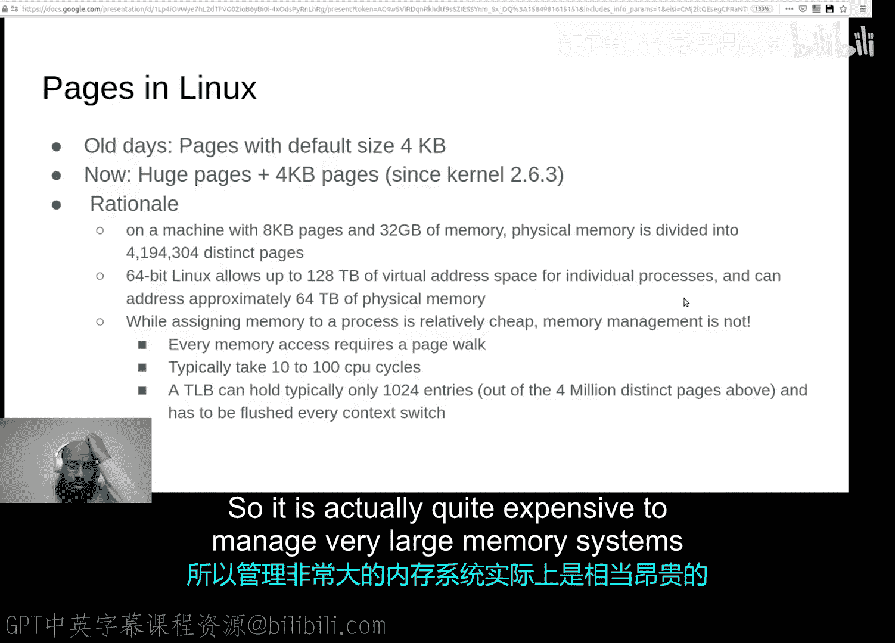

Also， there are many large memory applications that exist today。 Okay。

 it's very typical that you will get a database。 This is actually from an or these numbers are for an Oracle database where you have 17 gib of data。

And and 1000 connections basically happening on the on， on， on， on the， on the database， right。

 it's an online database basically， okay。This would use approximately 4。4 million pages。

 our entire 64 gigabyte roughly。And the page size the， the page table size will be 16 Gi。

Having larger page sizes。Might enable us to significantly reduce memory walks for such an application if we basically can。

 for example， have maybe two MBte pages right and then each table can fit in or many of the tables will be able to fit in a single page or maybe have larger pages and then you can fit a table a single table in a page and then your memory ws will be much less because now page sizes are much larger which means that if your page size is one GB for example and you're using 16 then you can have 16 pages basically for the entire application so you're not going to go back and forth。

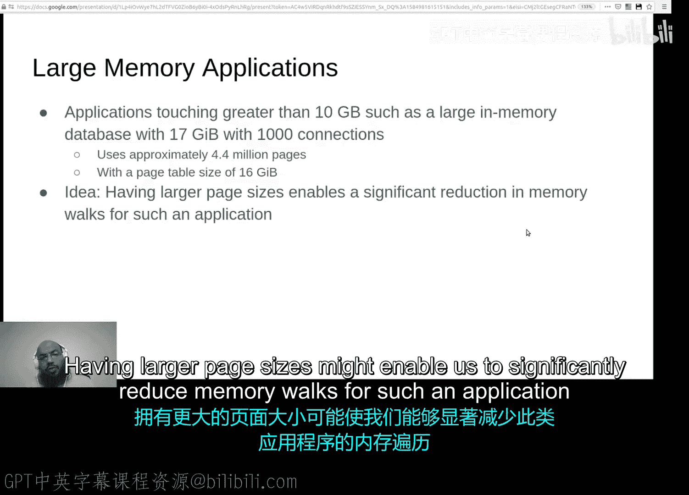

Now。This is the idea behind huge pages。On X86 processors now。

 it is possible to map 2 megay and even one GBab pages using entries in the second and the third level page tables。

 just the page tables that you have studied in your undergrad class and that you have set in your Linux class。

 your third level pages。And your second level pages in the table can be that， right？嗯。In that case。

These pages are called huge pages。The idea is that using huge pages will significantly reduce the pressure on the TLP on the TLB improving the TLB heat rate and thus improving the overall system performance so now if you have only 16 pages right in our previous example。

嗯。And you take these 16 pages and put them in in the T LB。 You can fit the entire。

16 pages and the TLB， right？In fact， you have more than 16 because this would be your second and third of the page tables。

So it allows power users to choose the correct page size for for their application。

 So if you know that your application can make use of one。Gabyte pages， then use it。However。

 it causes fragmentation in the memory because now it's so the idea of having smaller pages that you can fit the page anywhere when you have empty blocks in your memory and your physical memory。

 but now all of a sudden cannot do that because you have these huge pages if that wouldn't fit anywhere。

Oh。

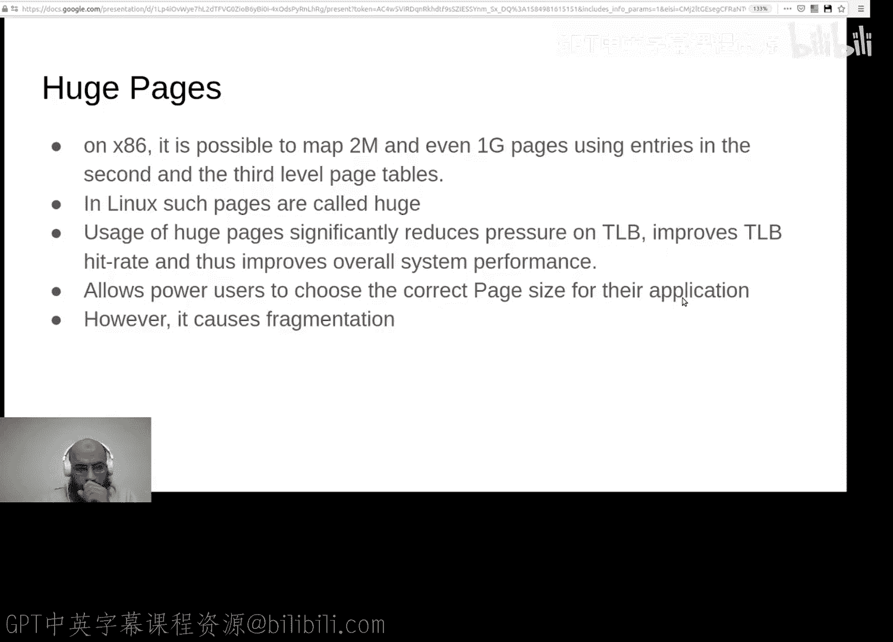

So this is how a system with huge pages will typically look like。 Okay， it'll have a mixture of。

 of basically。normalmal pages and huge pages and typically I mean because because you have you're not going to run only on huge pages because you have all your kernelial processes that are running and they do not need one2te or2 megabyte pages。

 you have multiple applications that are actually optimized on the 4K memory sizes。

 the 4K page sizes。So youll have a mix of both， and this is how Linux operates can operate today。

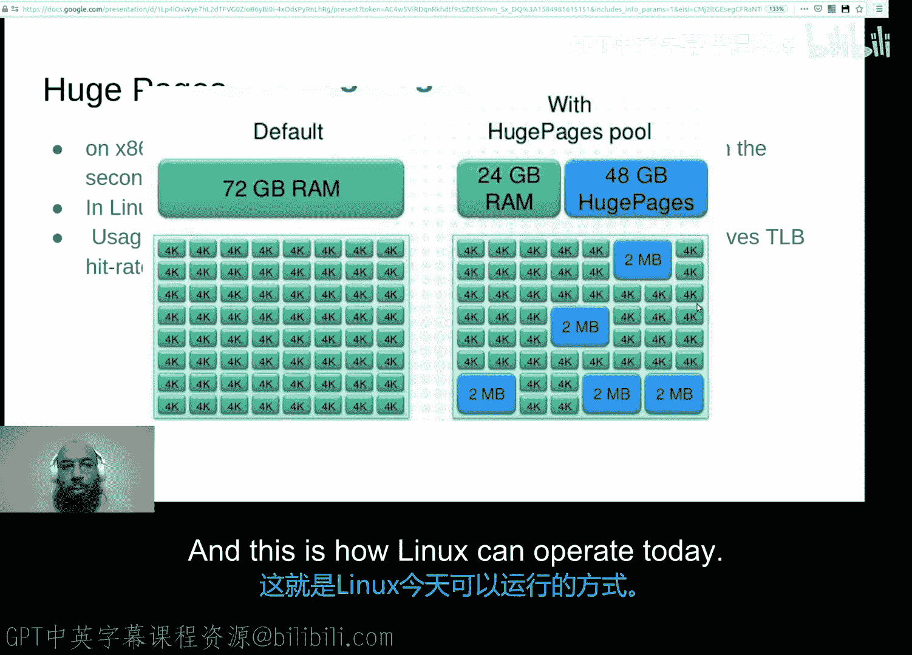

NowPreviously you were asked you were instructed to actually start to actually define the huge pages yourself。

 and assign them to the applications yourself， as I said， the power user。Again， in a later Linux。

Version， they came up with the idea of transparent huge pages， THB。

 and this builds an above concept and is the default for all applications today。

 so you no longer need to actually do this assignment by hand。

As as as was the case in the version of 2。6。3。 But the idea is that if an application ask for a large memory chunk。

 give it a huge page instead of small one。 So if if your application comes in and says。

 I need to megabytes of memory， So instead of assigning it。500 pages。

You're just assigned at one page with2 megabys。O。And。

On this way you you can actually do this transparency。

 Now this is enabled by default in your Linux system。 however。

 you need to actually instruct it to enable huge pages to work。Okay。😊。

So you need to actually do some kernel configuration。

 very simple command line configurationag that you can actually look up on the internet to actually enable it's enabled by default for all applications but to actually make applications make use of this or make the kernel make use of this。

So this is an optimization that was introduced in the kernel， so is it any good okay。Now。

 lots of people hate it。 Okay， actually， one of the main applications that people viewed will will use。

This these huge pages， which are Oracle databases， they actually have even links that instruct people to disable them because it improves performance because the application。

Has some optimizations， the database has some optimizations that depend on the 4 kB or 8 kb size of a page。

However， many others say that you know this is basically because the application developers are locked into their old way of thinking。

 you can actually get a lot of performance gains， maybe 10， 15。

 sometimes more percentage by just using huge P。So the first link。Discuses some of these。

Some of the gains， the second link basically tells you please stop huge pages。

 the third link actually discusses huge pages and some more details。

One thing to note is that many of the today's modern。Our research based applications。

 they run on something that is called DPDK。 I'm not going to go into the DPDK system。

 and many of them actually require you to use huge pages for them to work。Okay。

So now this is a research problem。 If you are interested into how to into。Operating systems research。

So we go back to memory in the kernel and discuss it in more details now。Yeah。

So back to memory and the kernel， right now。The kernel does not use huge pages。

 I just thought that this is a time to introduce huge pages because we're talking about pages now in the Linux kernel。

The kernel actually uses the normal size pages and the kernel represents every physical page on the system with astruct page。

 okay， structure， this is defined in MMm types do H。

And the kernel has no way to track which tasks are using a page。It's。Actually。

 the the the struck pages， if you're reading from the book， the Robert Love book。

You will find a much simpler definition than than what exists today in the actual Linux。could。So。

Basically， knowing that this is where the structure exists。 And you can look at the。

At the documentation for for for for the for the structure， is's actually pretty well。Dcumented。

The page structure is associated with physical pages， not virtual pages。

 this is something that you should understand that now we're talking about physical pages and not virtual pages。

And。Basically， since you have thisstruct for each。Physical page。

You can end up actually with just the combination of these。

Page structures for for large memory system can well exceed 100 megabytes。

 So just just the structure that describes the each page okay。Yeah。

And one of the important things that you should understand the in the stock page is the page flags。

The flags pay field stores the status of the page。This would include things such as is this page dirty or if it is locked in memory。

Now， locking， we understand。What is a dirtyty page and memory。As well discuss later。

 you you can actually use what when when when you use。Your memory as a cache。For your disc。

You actually can dirty。Memory pages while not writing back to the to the desk。

 So there are multiple multiple occasions where you actually write to the memory。

And your memory is not stored anywhere else。 So that that's how the page becomes dirty。

There are at least 32 different flags that are simultaneously available to control or to actually to describe each page。

So there， there are various options for you to choose。And。Also， one。

 another a second thing that that thestruct contains is， is a method for the， or variable for。

Some variables for the kernel to track the pages and track how the pages are changing。

One of these variables is the underscore count field， which stores the usage count of the page。

That is basically how many references there are to this page， how many。

Applications have been are using this page， How many threads are using this page。

 How many tasks are using this page。This is the this is the way that that the memory subsystem and the kernel would actually remove a page once no one else is trying to access it。

When this count reaches negative one， no one is using the page and it becomes available for use in a new allocation。

 so you basically this is how you know that well this memory page is no longer needed by any other application or by any other application。

 I should be basically repurposing it for anything。

The virtual field in the pages's virtual address has the pages sorry is the page's virtual address。

 so can this is yet another way for the kernel to do the mapping between physical pages。

 which are described instruct page and their virtual address space。

And now the kernel also needs to know who owns the page。

Possible owners include user processes then kernel data。

 So it's it's a page that the kernel owns kernel could paid cash and so on。

 So this is another thing that the kernel this is another field that exists in thestruct page。

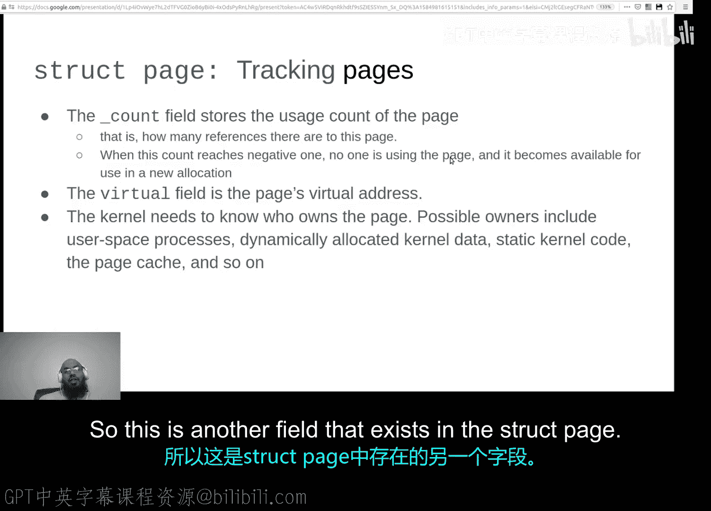

Memory zones。Because of hardware limitations， the kernel cannot treat all pages as identical， right？

Some pages will three。There are many different kinds of pages， okay。

So the kernel basically divides pages into different zones。

 basically saying that this is page of type A or in zone A， this pages are of type B。

 so they go in Z B， The kernel uses zones basically to group pages that are similar in some ways。

This is basically because there are the kernel needs to deal with lots of different hardware with with。

With different memory addressing schemechemas。So some hardware devices can perform DMA direct memory axis。

To only certain memory addresses。Others， some architectures。

 can physically do DMA to larger amounts of memory and they can actually access almost anything using DMA。

So these differences in the undirect memory axis is basically the。

The ability of device to access memory directly。Rather than going through the processor。So。

This basically makes it of paramount importance that the kernel covers for all different hardware types。

 covers for all different。Page properties that can exist。So the the zones。

 the kernel zones are defined MMm zone dot H。 this is linked to that file。

 and there are four main kernel zones okay。

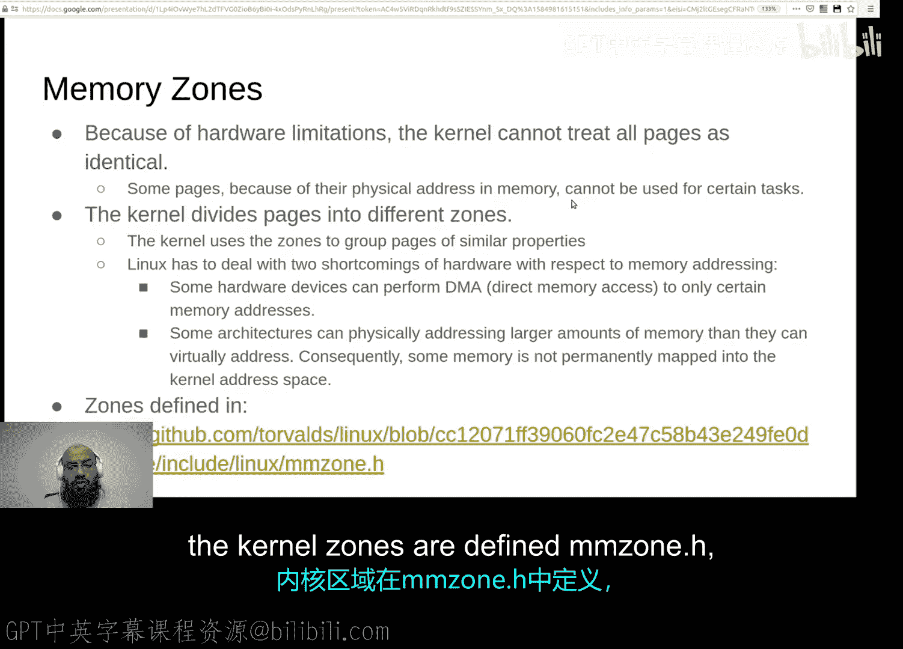

I need to basically say that the actual use and layout of the memory zone is highly architecture dependent and not all zones need to exist for all architectures。

We'll talk about this in a few seconds， so each zone is is represented by stop zone that is defined in the MM zone that each file that I just put reference to。

And this zone contains and these four zones are either zoned underscore DMA。

Zone underscore the MAA 32， zone normal， and Z highM。Sot underscore DMA。

 this dome contains pages that can undergo DMA， so pages that have direct memory access enabled so multiple devices can access them using direct memory access。

嗯。Z DM 32 is similar zone but。Is accessible only by 32 B devices。

 So maybe you have 64 bit devices on your on your on your computer and。Im 32 bit devices。

The zone contains pages that that。Only support 32 bid devices now。As I said。

 depending on the architecture， depending on what you have in your computer。

 where a computer is a much more general definition than your laptop。

You might have zone DMA or Z underscore DMA 32， so if all your DMA enabled devices are 64 bit。

 then then you will not have the zone DMA 32。Similarly， if all them are2 bit devices。

 then you will not have the zone underscore DM。Then the third one is zone normal and this zone contains normal regularly map pages。

And。And zone high memory contains the high memory， which are pages not permanently mapped into the kernel space。

呃。Basically， on a 32 bit processor， Zone highm， X 86 system basically or our processor in general。

 Zone highm will be all memory above the physical 196 MBby。 So if you have a 32 bit。Processor。

And that 32 bit processor basically is has an attachment of 8 gigaby of memory， okay。

4 gigab of memory，2 gig of memory， and I think above the 896 mebyte mark of physical memory will go into the zone high man。

If you have a 64 bit processor， x86 processor。Then Z highim M does not even make sense。

So it's empty because all memory will be directly mapped。So。

Normal high are basically if you have direct memory mapping， okay， or indirect memory mapping。

 So it's it's it's actually。Important to understand that this that for example， in most x 86。

 64 bit processors today， you'll probably have only two zones used。

 which is Z underscore DM MAA and zone underscore normal because the highM is not needed and the EMA 32 is not needed。

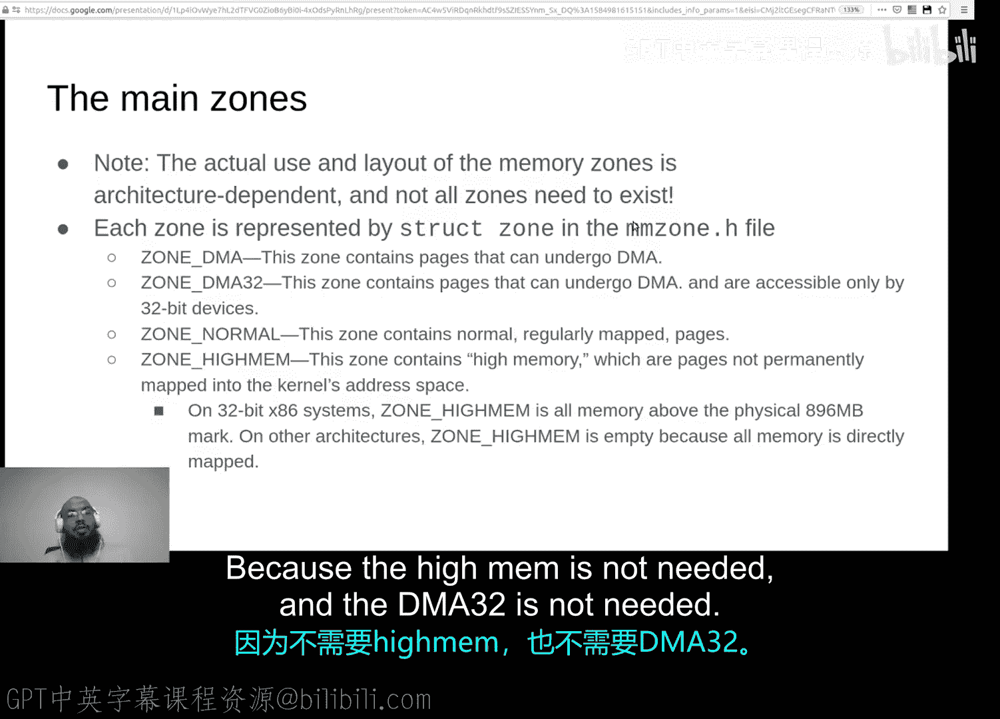

So how does the kernel allocate pages internally， these are the。Methods that the kernel use。

 that the kernel uses。To allocate internal memory。A look underscore the square page。

 this would allocate a single page， a single memory page。

I don't underscore pages and this will locate multiple pages。

Get free page allocates a single page and returns a pointer to its logical address。

Get three pages again and if it's two to the power of order pages and returns the pointer to the first logical address。

 get zero page will give you a page that has all your okay。

And it returns the pointer to its logic edge。If you look at all this， they either take one。

Prirameter or two inputs。 Basically， the GFP mask will talk about very and very shortly。

 And the order。 the order is basically， you allocate pages in order of。

Tos so you either allocate one page2 to the power0， okay， you allocate two pages， four pages。

 eight pages， 16 pages and so on， okay。So this is how now if you want to allocate three pages。

 then you do a log pages or one and you do an page right after that now you have your three pages。

 different pointers， but it is what it is okay。So， basically。

This is the way that the kernel internally uses to allocate memory pages。What is the GFP mask？Well。

 there are multiple things that you can ask of a page。Okay。

 one of them is that you can basically control， for example。

 if that page is allocated in different zones， for example， So if it's normal， if it's in the normal。

 if it's in the normal zone。Then you do not need to specify。

 but if you want to attend the DMA or DMA3 or the highM zones。

 you actually need to specify by the flags that are towards the bottom。Now， you can also control the。

How the allocation， how the allucator actually works。For example， is this？

Can the allucator sleep while trying to allocate the pages to you？

Can the allocator basically access the high the emergency pool and we'll talk a little bit about them of memory。

Can the locator start this guyu so if it fails to basically allocate a pitch。

 should it basically start swapping？Can it start the file system？

Can't use called pages so pages that have not been used previously。

Should it grant you a warning if it fail？Okay， or if there are issues with the education。

Should should the allocator continue trying to allocate。These pages。

 even if so you have one or two cases， one of them is basically okay。

I try to allocate there is plenty of memory。 I'm just getting the page。 The other one is oh。

 I do not get the page I should repeat and try to relocate once some of the pages are cleaned。

No field basically is like repeat forever okay so the location cannot feel this is you're allucating something internally for the curtain and this thing can never fail。

And you can have it as， well， you should never try the same。 no matter what， I mean， you try it once。

 if it feels。You， you're not going to， totry the allocation。

So there are multiple such options and the mask basically the GFP mask is basically these are different bits。

 are each of them is a predefined bit as we said and thestruct of that defines the page。

And you can have all sorts of combinations between these。 So instead of that。

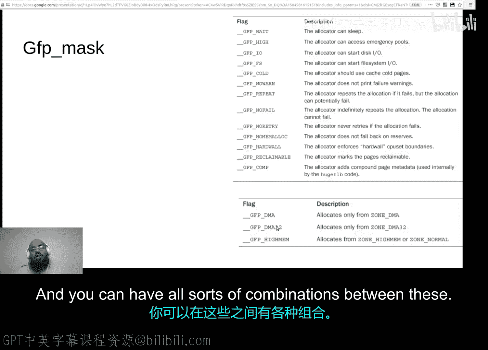

They， the the， the kernel actually provides you with with some flags that you can use instead of basically mixing and matching whatever you want。

 So I wanted to never try。

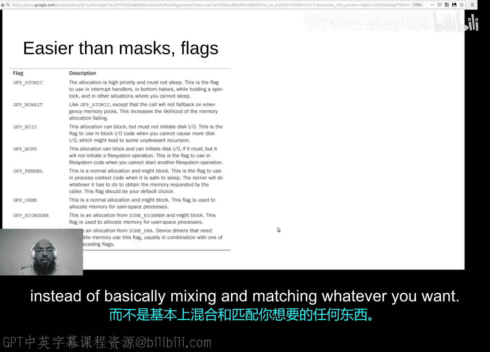

Start the file system。Can't sleep。And compounds add a compound page met datata。

 So they are like for huge TLB basically。 So I mean， you can have all sorts of these combinations。

 So instead they provide you with some flags that you can just use and if you use them。

 it will it will basically use the right masks so that you don not't need to think about them and and allocate the pages as you wish。

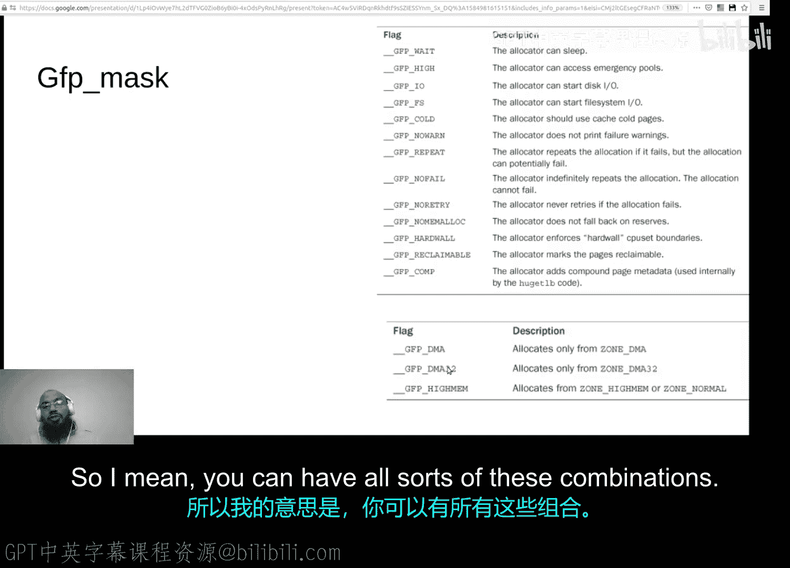

So basically GFP atomic， the location is high priority， must not steep。

 and this is what you would use in interrupt handlers for example， in bottom halves。

Or white holding is spin lock。 Okay， when you cannot sleep basically， So you need a page。

 I have a spin lock。 I'm gonna interrupt。 I'm a what half。 I can't sleep。Okay， GFP， no weight。

Is like atomic。Except that the cool will not fall back on emergency memory pool。

 so it will not basically try to free memory for you to use， okay。

And this basically means that it can feel the atomic will actually try to evict things from memory。

 we'll try to do all sorts of things， we'll talk about the emergency pools later and so on。Okay。

No I O， I might be basically saying that you know what。

 no matter what you should never do IO in this， I I I need to block I can block。

 but I should never do this IO。嗯。Okay， this is basically what you should use in block IO code when you cannot code more Deu okay because you might end up basically so so if youre if you're doing Deu and you need memory for that Deu。

And so so basically if youre， let's say that you have an in memorymory cache。

And you're trying to fetch some data from from this。

 so you already start an I operation and or you you're already going to start an eye operation and to store that data。

 you need some pages on your memory。So what。What you end up doing if you basically enable the system to cool IO again is that if it doesn't find memory it calls IO again and then another IO starts now you need to handle this IO operation。

 get into the memory， but well I cannot basically find memory because memory is constraint now so I start another disk IO because you know I'm trying to push things from memory to diskcan back so I can end up with a recursion that never ends and I can end up with the loop that is crazy。

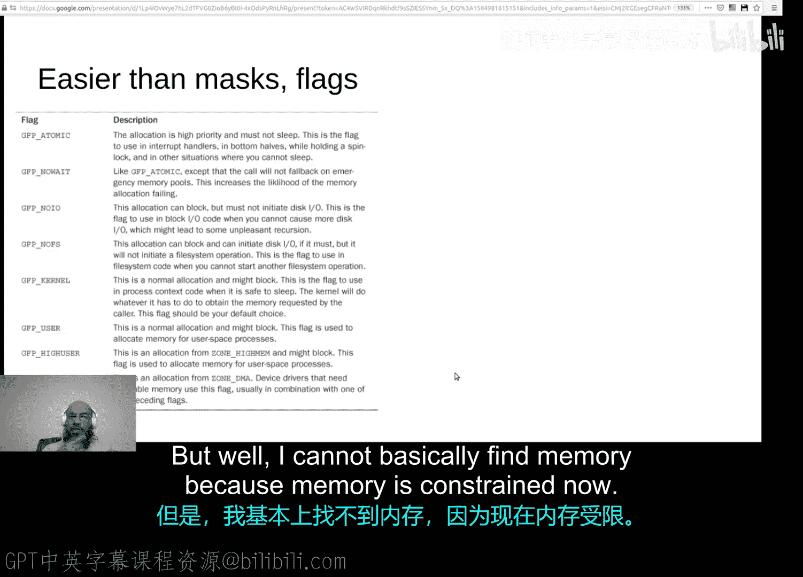

Okay。And there are many such flags that you can use when allocating your memory pages internally inside the curve。

So now we have talked about how we actually allocate pages using the all pages， these schools。

 basically the page， all pages and get free page。Similarly。

 we need to talk about how do three pages and the kernel provides you three main functions。

One of them is underscore and free pages that takes a pointer to the page and how many pages you're going to actually show the order of the pages that you're going to free after this page okay。

The second one takes an address to the page， not a pointer to the page。

 the third one takes an address to a single page and it removes a single page only。

Now you must be careful to free only pages you allocate， you're the kernel。

 you're writing code in the kernel， okay。So you have an absolute power to free any pages in the kernel memory。

 including， for example， freeing pages that the kernel actually uses。

That the internal currently uses you can even free your entire task structure right so basically killing your internal kernel so if you're writing kernel code you should not be basically you should only free pages that you have allocated。

 not somebody else has allocated。And you should not go and try to flee all pages or locationss。

And in different areas， unless you know what you're doing， obviously。

 you're the shutdown command or something in you're freeing memory。

So make sure that you never corrupt your data by just shooting yourself in the foot。Okay。

So this is an example of how you would allocate pages and delocate them。

So you basically unsign long page and basically。You you because you're getting the page address so you you initialize the the variable and then you get the free pages。

 you say that it's DFB kernel。 So you use that flag。And you say that you need 8 pages。 Okay。

2 to the3。So if you do not get a page， if， if not page， so if the page is still not defined。

Then you have insufficient memory in your system and you must handle this error。Okay。

 and you return no memory。If if you have a page now if page basically page is now the address of the first of the eight contious contigious pages。

You start basically all sorts of things that you need writing， reading。

 playing with the repeat pages。 And once you're done。

 you free the pages by just passing in the address and the order， how many pages you need to free。

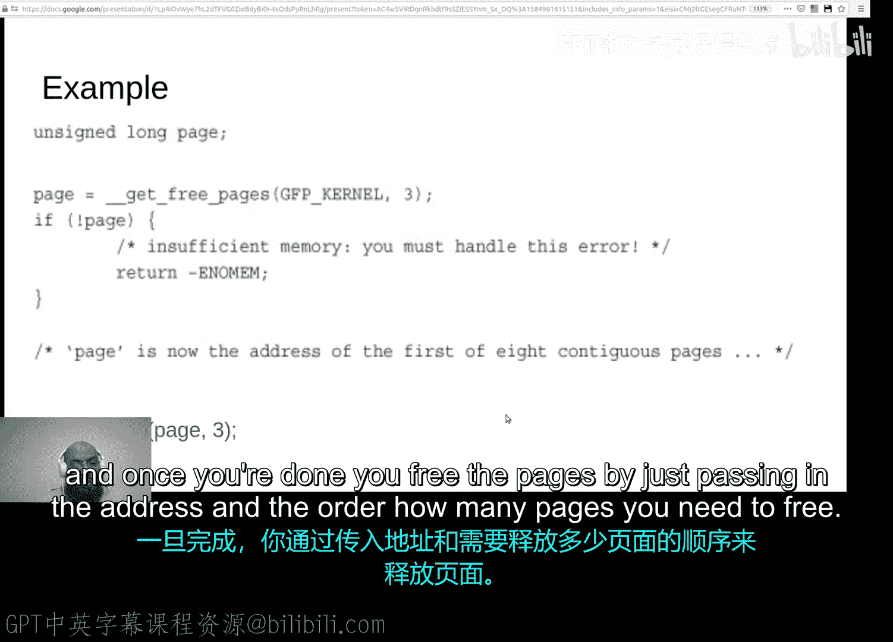

Now all of this， we have been talking about allocating whole pages。

 but in many cases you do not need a whole page， you'd rather need some small memory， right。

 maybe1 kiloB of memory。So in that case， you use kernel malloc or the malloc， okay？

And K is used if you need physically contigious contagious memory， okay。

 which is mostly something that you would need when you're dealing with hardware devices。

 when you're doing the allocations for hardware devices。

And V Maoc is something that you use if you need virtually contigious pages。Okay。A contiguous memory。

 sorry。So the way that you use it is that you give it the size that you're going to need and you give it the same flags that we discussed previously when we were talking about a pages。

Now the function returns a pointer to a region of memory that is at least。

The size and byte so you you so basically you can ask 1 kilob，10 kilobytes， 15 kilobytes。

 whatever kernel allocation always succeed okay， unless there is not enough memory。O。

And in that case， you've got no。And you need to handle the error appropriately。

There is a counterpart for KMO and VMO， which is K3 and V3。And in that case。

 youll just call it with a pointer to the page that that you created。Okay。嗯。And the kernel。

 since VM lock actually is is used to assign only virtually contigious memory。

It's less performant than KmaO because pages that you get from it basically can be all over the page table。

 so use KmaO to get better performance。

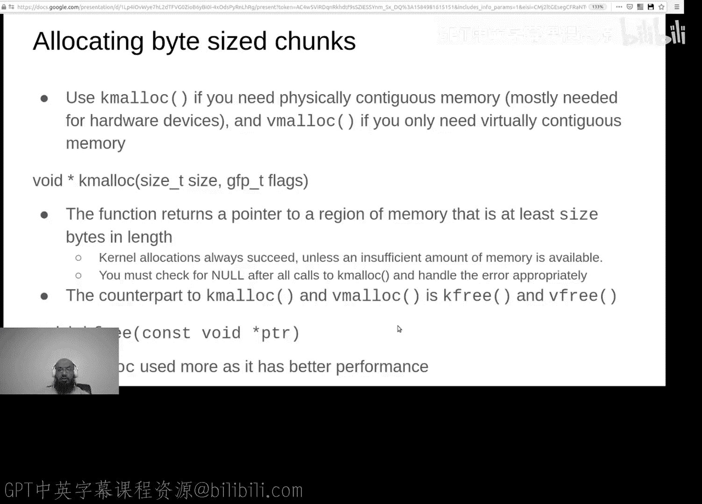

We now turn our attention to another major difference between how the Linux kernel design and Linux and many other systems and this is the slab layer。

The labla layer acts as a generic data structure caching layer。So the idea is very simple。

When you assign memory， it in K MaO， for example， and VMlo。

You might have assigned the memory for using it for something specific。

 but now you have that memory and you start doing data probe， using it for hand data。

 you no longer need it for the data for this data， but you since the location has already been done。

 maybe you can reuse it for something different。So most kernel programmers used to introduce free lists in their code。

 this is basically a memory that was allocate for a data structure that and the data structure no longer exists。

嗯。But instead of basically using V3 or K3。The， the。

Programmers basically decided that or many programmers。

 what they do is that they have a list of free memory pages that they can reuse。

So rather than the allocating the memory。The Free list has basically is a long list of whatever memory that was allocated already to your process and that you can use for another data structure。

It acts like an internal caching layer in the kernel for the different processes。

It can be from problematic when the memory becomes scarce because basically each process is holding a list。

Of， of pages that it doesn't it's not really using。

 So it might be all of these pages can be basically， I mean， I entire remember can be free。

 Nobody' is really using it。Still， since you have， you keep it as a reserve basically for future usages。

 you end up basically messing up your your memory allocation by just having all your entire memory free。

 but no one using it。So to enable the kernel more control。

 the kernel provides the slab layer for all of these sorts of free memory lists。

 so you have the huge free memory list instead of multiple。Free memoryness。

And now programmers or kernel programmers should never do the free memory lists again。

It is implemented in Slab to C and the definition is in slab do H there are some basic tenets for the slab there first that frequently used data structures in the kernel tend to be allocated and freed often。

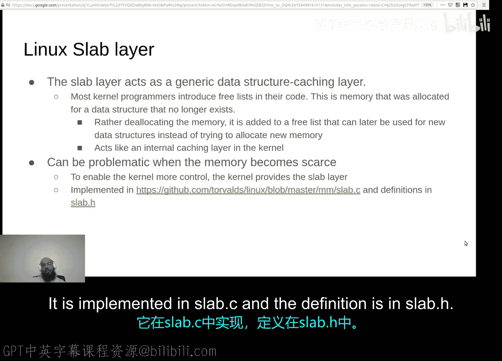

So basically， let's cache them。Frequent allocation。

 the allocation can result in memory fragmentation。

 so let's basically keep the keep whatever allocation we got first for as long as we need。

 this is especially important when you think about how the kernel has been dealing with very small memory systems。

To prevent this， the cached frees are arranged contigiously。So， basically。

When you use the slab there， you want to make sure that， well。

 it's sort of a cache of memory allocation。That that， that is contagigious。

Because free data structures return basically to the free list。

 there is no resulting fragmentmentation。The free lists should provide improved performance during frequent allocation the allocation。

 okay because basically you do not need to do a memory work or you do not need to get memory allocated in reality are just like using memory that has already been allocated。

If the loator is aware of concepts such as object size。

 page size and total cache size can make actually much more intelligent decisions because now you know that there is this there are1 pages that are already available so maybe I can basically use these same pages in a much more intelligent way than just trying to allocate new memory。

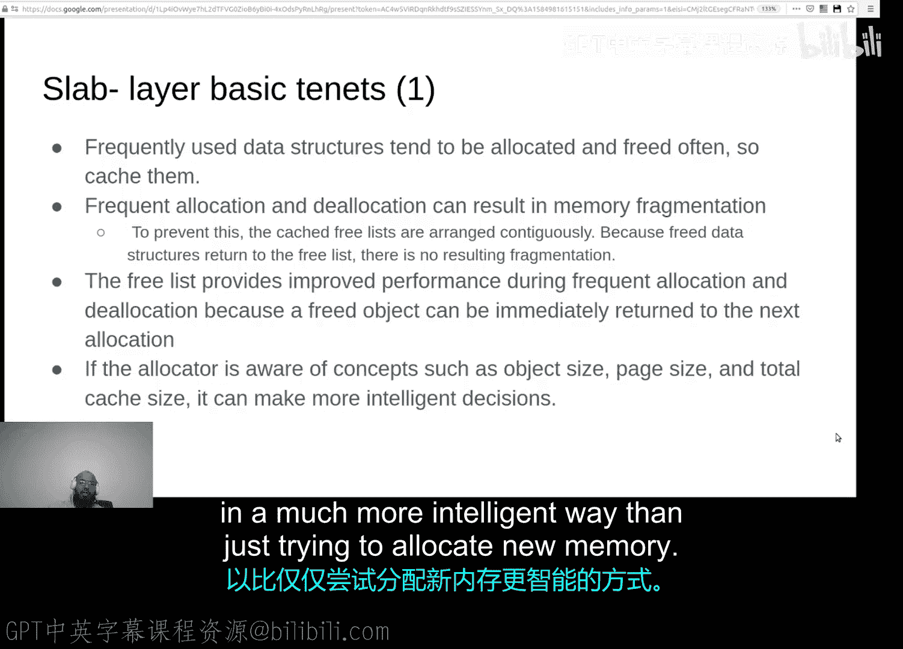

Now there are some things that where the lablab they are actually very useful and these are architecture dependent。

 one of them is that if part of the cache is made per processor。

 so separate and unique to each processor and the system。

Alls and freeze can be performed without an SP lock so you basically。

It reduces the lock because if each， if the slab layer is pair processor。

 then you do not really need to think about what other cores。

 what other processors are doing with the memory because well this memory has already been allocated to my processor。

 so it's my processors and since the my processor never freed it so it exists for whatever is running on my processor now。

嗯。If there's new architecture and new architecture systems。

 please go back to your hardware class for that。You can actually fulfill locations from the same memory node as the requester。

 so you do not end up going to another memory bank。嗯。

And stored objects can be colored to prevent multiple objects from mapping to the same cache line。

 and memory coloring is we're not going to go into these these。 So how does what is the slab design。

 It looks like that， okay。The slab layer divides different objects into different subgroups。

 each one of them is called a cache。And the each cache is divided into multiple slabs， okay。

And each sb is divided into objects。There is only one cache per object type okay。

 and basically for example， you will have a cache for process descriptors， Okay。

 so a free list for task structures。You'll have one cache for network for network buffers。Okay。

 or or for memory that that deals with network buffers。It have one cache for。for the different。Ks。

Of of， of objects that exist in your system。KmealO is actually not implemented on top of slab。

 so Kallog does not try to get you memory from the physical memory。

 It actually tries to starts an optimization the optimization that it does actually tries to get the memory from the slab there memory that has been already allocated。

And this basically enables came out to be highly performing。嗯。Basically。That each object。

Has the data structure or is basically the data structures that are being cached。

And each lab is in one of three states， true， partially or empty。So。

Basically on the full partial or empty part， if your slab is marked as full。

 this means that well all the objects in this slab have been taken。

 so it doesn't make sense to try to allocate there。

 the kernel actually tries to use the partial slabs first。Okay。

And then starts so the way it gorges that you never touch the full slabs or never try to allocate memory into the full slabs。

 you try to allocate memory in the partial slabs if you have no partially filled slabs。

 you then start filling the empty slabs now you have nothing in the no empty slabs。

 then you try to allocate new memory。嗯。Historically the kernel stack was actually preset to one page in the beginning it was set to two pages。

 two normal sized pages， basically2，4 kilobyte pages or two8 kilobyte pages then somewhere in the middle basically people started saying that having two pages for kernel stack actually her performance。

 so they started making it a single page that is a little bit larger than the normal page。

 so an 8 kilobyte page on a 32 a bit architecture and a 16。A kilobyte page on 64 bit architecture。

But。Hiser， it was non dynamic。 O， so the stack was non dynamic。However。

 since 2016 new approaches have been selected suggested including the virtually mapped kernel stacks。

 so if you're reading this part in the book， the book is obsolete actually the kernel does have methods and mechanisms to actually enable the stack to not be as rigid as it used to be。

 so now it can be dynamic actually。So if you're reading the book， this is this part is obsolete now。

 and this is a very interesting link on how the virtually mapped kernel stack started。

 you'll find lots of material on LWN。That not that actually discusses this addition to the kernel。

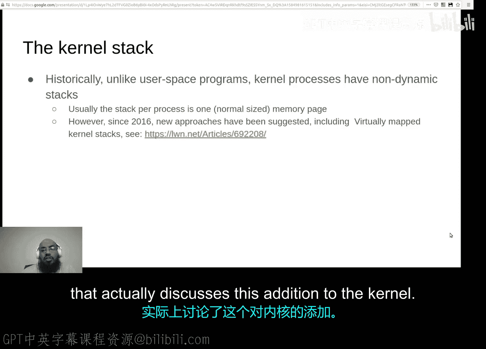

So now we have complicated things a lot。 Right， now how does the slide， how。

 how does this go with my page tables that goes with my user space memory that goes with my virtual memory and so on。

AndNow basically if you're looking at the entire memory subsystem in Linux。

 it's actually very complex。 I actually blur this from a presentation。

So this is a link to the entire slide deck。So， basically， you have。Cnal dynamic memory。

 and you have user space memory。Okay， you have slab， you have the body systemeducator。

 the body systemeducator is basically here page tables。

Or your the the the system partially your page table or what。

 what manages memory as in Linux and as in as the way you have studied in your undergrad courses。

 and you have the physical memory。 And this is how。The system looks right now。

 so you have the old physical memory on the left， okay。We are now ignoring zones， Nma， Son。

 so you have page memory。And you have kernel code and static data at the bottom。And。

 and then you basically。you have on the right hand side that the users of the memory。

 which is the kernel and the user space memory。userr space memory has the environment then the stack。

 then the shared memory， then the he， then shared libraries， then the code。

While kernel memory has the kernel dynamic data and then the kernel module code signalig。

 these are basically the kernel data structures that exist for different kernel processes and the code of the kernel。

So you try to get memory using a VMO or KMO， actually it's even missing here KM so it's even a more simplified figure。

So in the kernel， you try to get memory using the VMO or KO。Okay。

Which actually tries first to get it via no， actually， came lock is here。

 it actually goes to the slab alloccator。 I'm sorry， just doesn't have a box。 So。

 so you have k that goes to the slab allocator。The slab allucator either returns memory that can be used or well。

 we have no more memory in the slab， so we go to the body system allocator。

Wwhich basically is sort of the entire memory management that has been discussed with paging and so on from physical to virtual to physical translation and so on。

 so you try to get memory from the body system edcator。

And the bud system educator uses the virtual memory management component。To actually get。

The to the actual physical memory。O。And that's the direction for the kernel data。

 and then the kernel data ends up in the bottom。Part of the memory。

Now the user space memory is more interesting because what you are going to do is that you're going to call the memory allocation function and then this memory allocation function will go via the body system allocator and the body system allocator will do the virtual to physical and physical to virtual memory。

Hand hand， and then it will assign memory and the page memory。

 So it's a fairly complex system where lots of it。 And this is actually even more simplified。

 more simplified than than than what actually happens and and。In real life。

 so so basically memory architecture in the Linuxux is very， very complex。

 This is basically what you can take from this。 Now。

 we have been talking mostly about the kernel space， except for when we were discussing this figure。

 So let's talk about the process as a space basically。

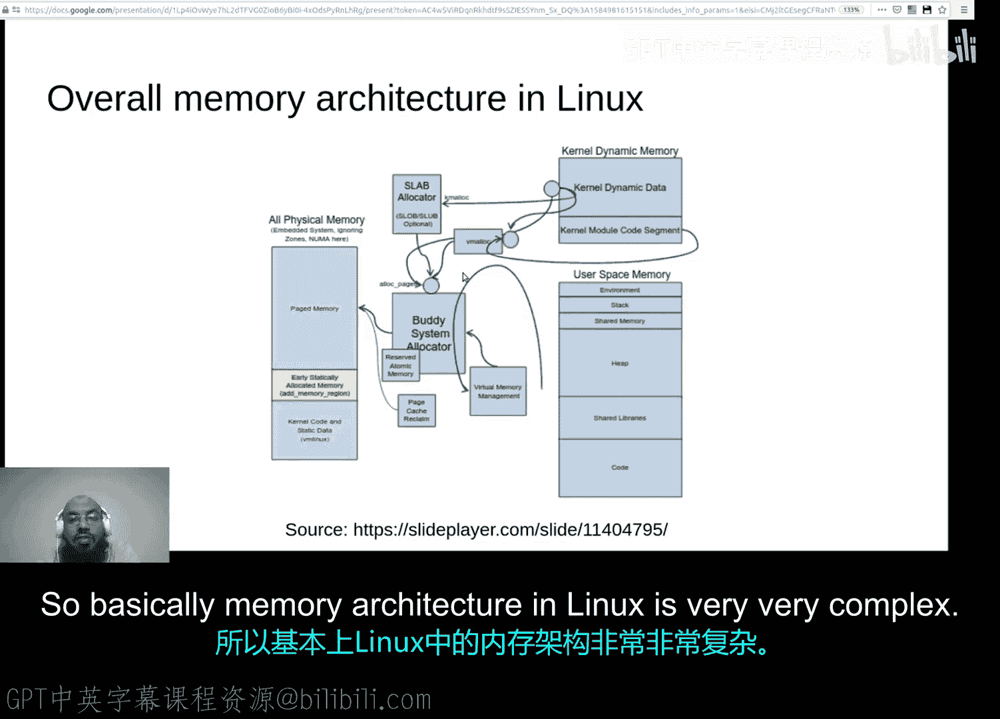

The otherer space layout is mostly determined by the application。Or determined at compile time。

 So link directors can influence this。Operating systems usually reserves part of the other space to map itself。

 which is the upper D on x86 Linuxux。

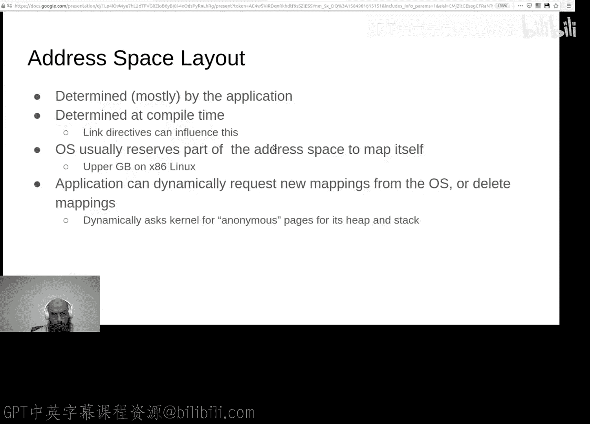

Or basically in this figure， it's like the bottom part。

 It's the upper D because we go for memory from top to bottom。

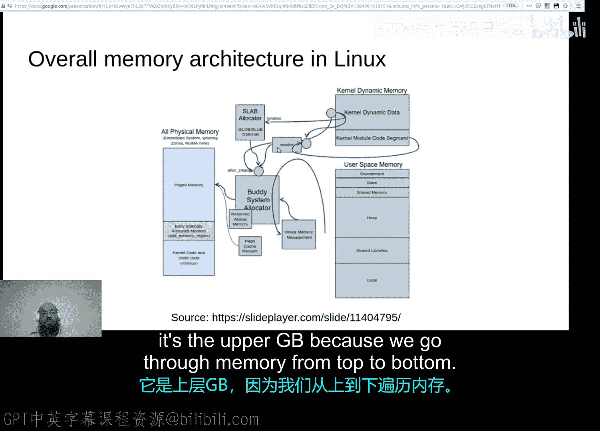

Applications can dynamically request new mappings from the operating system or delete mappings and basically dynamically ask the kernel for anonymous pages for its he and stack。

The application has no clue what's underlying。 So it it's basically asking for memory。

 and that is all that it understands。So now the kernel needs to use。

Take these requests and honor them and provide the application with their required memory。

And this can。Entailed， basically swapping。Because the memory is full。

 every lots of applications are using parts of the memory。

 this can entail basically evicting some unused memory。

This can entail fragmentation at fragmented different memory pieces。I mean， to the application。

 the application doesn't know any of these underlying details。

It just knows that it needs this much amount of memory。

You can actually take a look sneak peek up the memory layout for some applications。

 especially using the L command， which prints the shared libraries required by each program。

And where they are in the memory。 So basically， what does the LS command require？

It requires Linux VDSO， but also it requires Lepsy and this is basically where Lipsy is。

 and this is where the memory address of the shared library is。So basically。

 these are all shared libraries， which if you look at this graph， sorry， if you look at this figure。

 it's the shared libraries that are above the code and the user space memory。

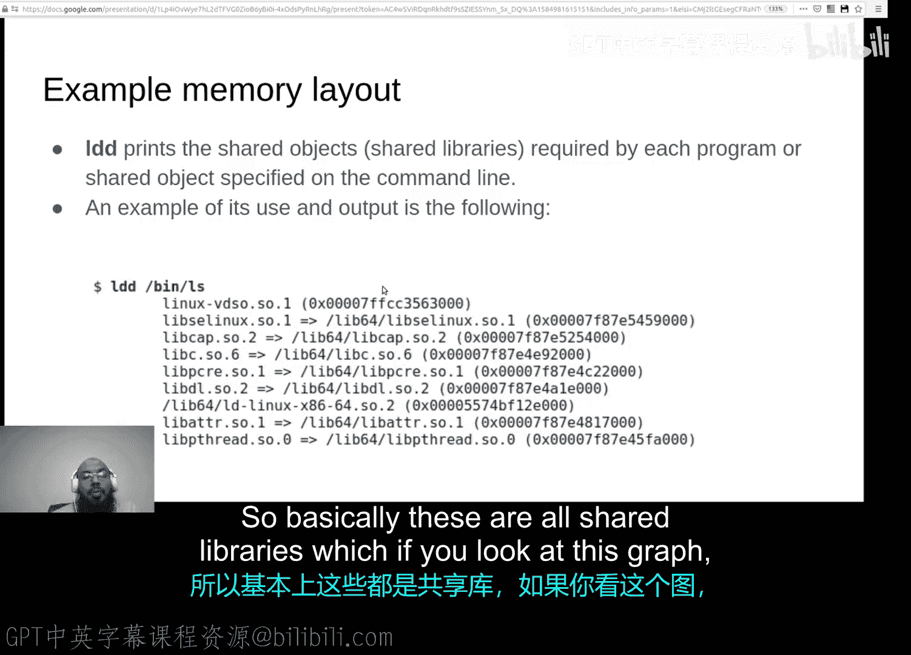

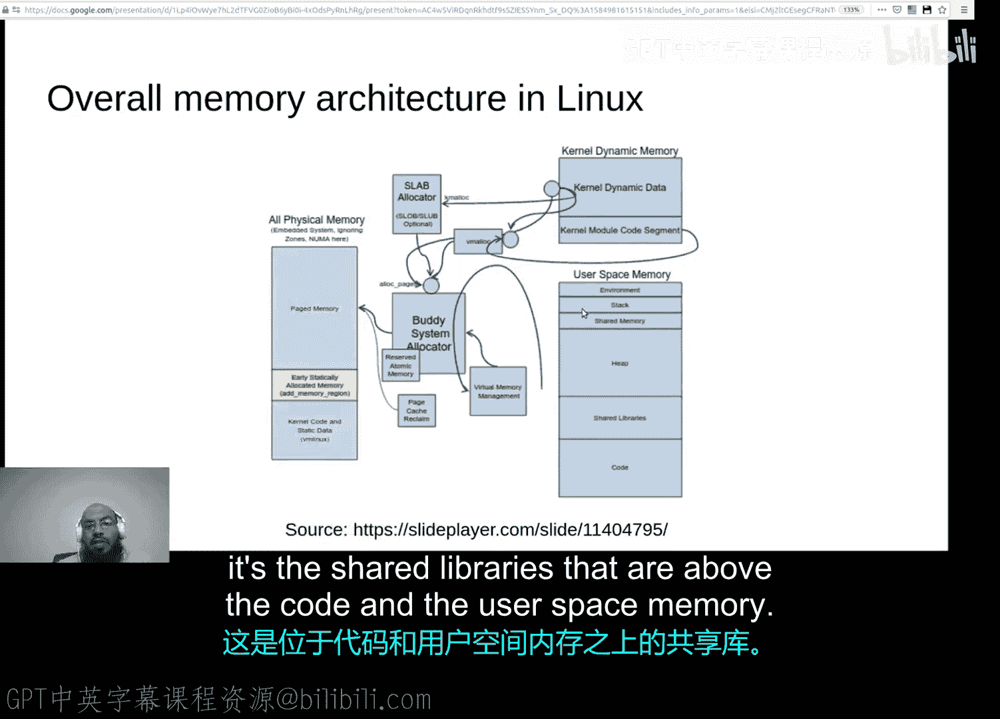

So。There are different virtual memory areas， and Linux represents portions of a process with a virtual memory areastruct or a VMA。

Sorry about the the break。 So before we talk about the VM area struck。

 lets look at the different course primary areas that exist。

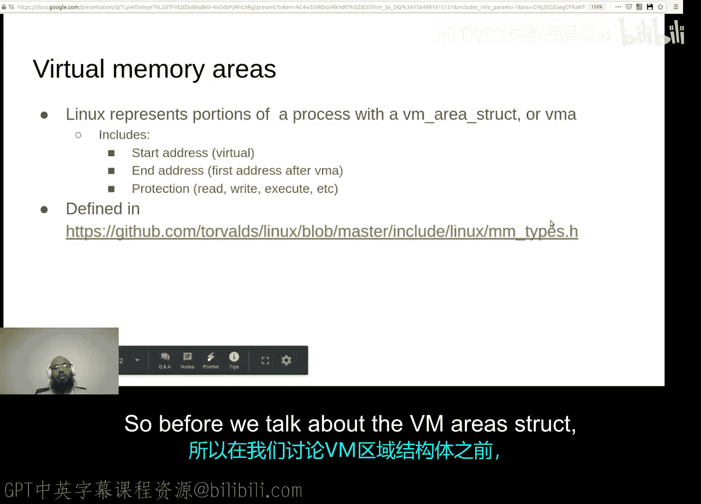

For example。You have a memory map of the executable files code。

 and this is usually called the text section。You have a memory map of the executable Fire's initialized global variables。

 and this is called the data section。A memory map of zero page containing all uninitialized global variables。

This is also called the BSS section。A memory map of zero page used for processor user pay stack。

 so you start with stack。An additional text data be a section for each shared library。

 such as the C library and dynamic linker that these are basically the things that we looked at with the LD command。

Any memory map files， any shared memory segments。Any anonymous memory mapping such as those associated with Maoc。

So this is basically different parts of the memory areas for a process。

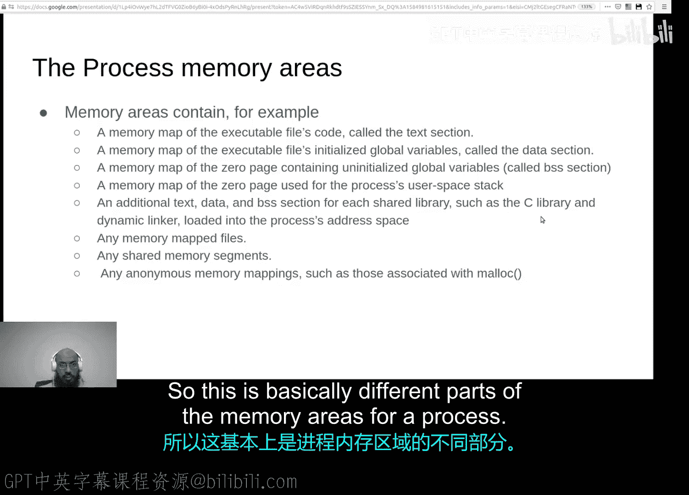

So Linuxux represents portions of process with a VM area structure or VMA。

And this includes its start address， its end address and the protection of this area。 Now， we were。

 when we were talking about the kernel。The kernel memory we did not talk about protection here we need to consider protection and the kernel。

 the kernel can access any part of memory in any way it wants， right？But now。

And the virtual when we're talking about user processes。

 protection becomes important because not all users will have read execute access to the different memory areas。

So， basically。The VM areastruct enables or the VMA enables the kernel to actually look at this and the start address。

 the virtual start address， the virtual end address for each VM area of a process and basically enables protection for each of these areas because for the same process for example。

 you might have different protections for different parts of the memory。The memory types， sorry。

 the VM area structure is defined in MM underscore types that H。嗯。

Now the kernel represents a processor's address space with a data structure called the memory descriptor。

And this basically contains all information related to the process address space。

 so you have the VMA for certain parts of the memory， for certain areas of the memory。

 and then you have a data structure that basically has everything that is related to this process。

And this is called the MM M underscorestruct。O。Again， define an MM underscore types that H。

It's very well documented in the code。 so you can take a look。

And the memory descriptor associated with a given task is stored in the MMm field of the task process descriptor。

You can look at the MMM field there you to basically look see where and the task and the task processes thescriptor and the task struck basically。

 you will find an MM field that that basically links to thestruct MMMstruct over here。Okay， now。

There are lots of。Complications where the user with the address space and the post address space for users。

 I have chosen to actually cut a lot of the descriptions here。

A because a lot of this is common with minutes。B， because some of them are very de。 So， for example。

 searching。Searching between the different memorystructs and how to find data between the different virtual memory areas and how does it link to the MMMstruct？

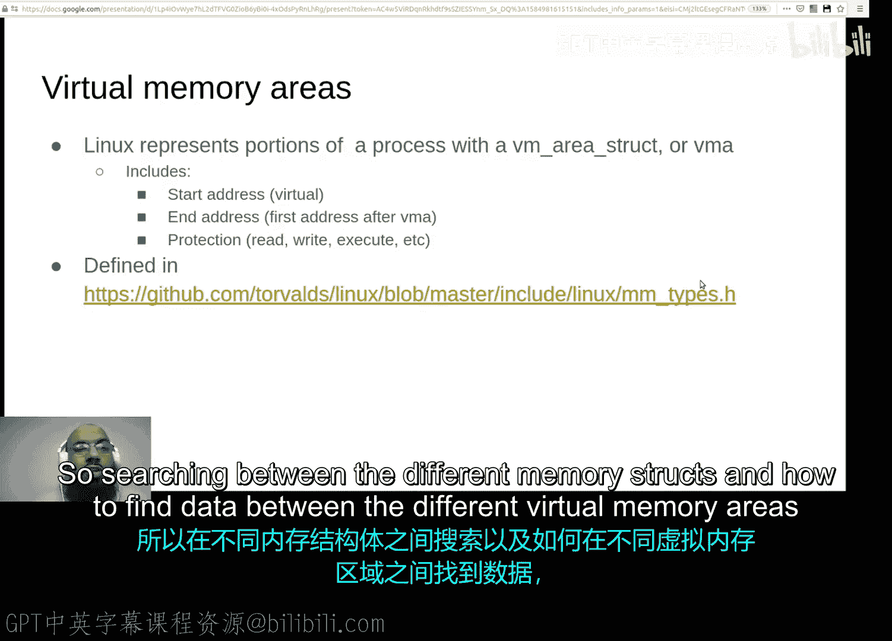

It's really something that that you will probably never use on your entire life and。

Design is in many ways。Well， I'm not going to say complicated but compvol it。

 so it it's basically I didn't see a lot of value into adding these details to you guys。

The page cache and page right back。This is actually an important part which of the memory system is actually somewhere between the memory and the file system。

And the page cache is the idea is that Ram is orders of my views and magnitude faster than disk。

 so the page cache consists of physical pages in Ram。That actually map two physical blocks on a disk。

 Okay， so the idea is that you read from disk story and Ram。And or storesortative memory。

 and basically use。The these pages instead of writing and reading to the disk directly。

The size of the page cache is dynamic， it can grow to consume any free memory and shrink to relieve memory pressure。

 so basically in many occasions， if you're reading a huge file， for example， a huge text file。

But you're at the same time running heavy processinging on or running an inmemory database。

Where everything is just a memory or running some processes that are memory bound。

Then the page cache can increase or decrease based on how much empty memory。

 how much free memory exists。The storage device that is being cached is called the backing store。

Because basically it stands behind the cache and the cache is trying to reflect the reality of the backing story。

 So it is the canonical version of the cache data basically this is the true version of the cache data。

嗯。Entire files are usually not cached。 Some files would be entirely cached。

 but it does not need to be that way。It depends on what parts of the file you're actually accessing。

So this is actually something to keep in mind。

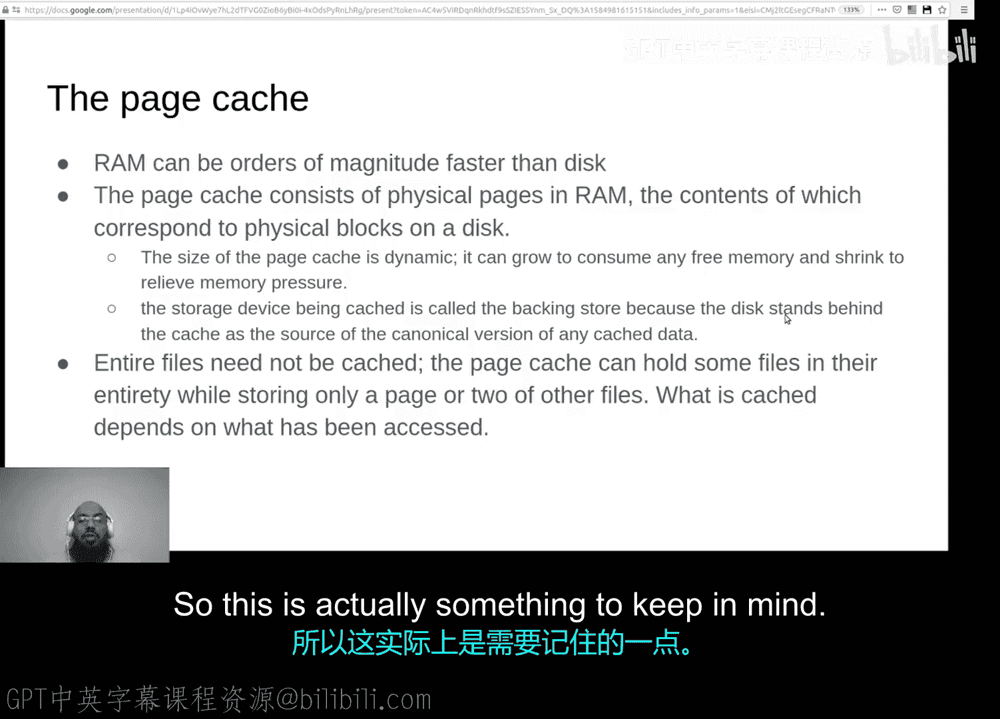

So now。You are reading and writing from this file。 Reading is fine because you are not changing any data。

 but writing to a file。Requires that you change whatever is in the cache。

And there are one of three strategies to write to a cached version of a file。

 The first one is that you don't know right。And that basically means that you write to the stored file on disk。

And when you do that， your cache gets invalidd and needs to be repulated from the。 So all rights go。

 do not go to the cache。 They go to the disk。 Now， this comes at a large cost because what you're doing is。

 in reality， your， your。You're going to be invalidating your caches often if you're writing a lot and you're going to be writing to disk directly。

 which actually can mean。That it takes time to write to disk basically so you can have delay and performance issues。

And。In addition， you can have very weird consistency consistency issues。

So write through cache is another way is another strategy where what you do is that whatever you write to the disk。

 you write to the cache in parallel。This basically makes your cache coherent all the time and it's quite simple because you are going to write to both。

However， it comes at some performance courses as we will discuss in the third strategy。

 which is right back， which is the default policy in Linux。

The right back caching policy requires that you write first to the cache so everything gets written to the cache and does not get written to the disk。

 The reason that you're doing that is that as we said disk seeks on HDs Now these numbers would change with newer hard SSDs。

 but many hards are still。Are arere still H Ds， which which basically means that there， there is。

That there there is a spinning real motor that actually needs to spin physically to go to。

To the sector what you're going to read。So this， if you're writing。

 often this comes with quite a large cost in terms of seek time and it can actually result in thing in your performance。

So the way that write back caching works is that you write to the cache and once you have sufficiently large amount of data to be written to the disk。

 you start writing them。Now。There are a couple things that one should mention here，1。

One of them is that you cannot wait for too long， because if you're。

Computer restore and you take too long to actually cache write write the cache。

 then all of the data that you have written will be lost。

So there's a fine line between how often you write to the actual disk and how you actually do the collective writing。

And this comes back to our discussion of dirty pages when we were talking about different flags for the struck page and one of them was that it can be dirty and here dirty means that it goes to a dirty list and there's a full dirty list of pages that the kernel needs to write back to the backing store。

OnceOnce the desk is done with basically copying or once the kernel is done with copying the data from the dirty pages to the backing store。

 then what happens is that these pages are no longer dirty and this flag is changed。

Right is thus performed in bulk， optimizing access to slow disks and applications can force immediate right backs with a sync system pool。

 so you can actually。Forge your system， if you're writing the program where you think that I should be forcing my system for right now。

 you can do that easily using the sync system code。

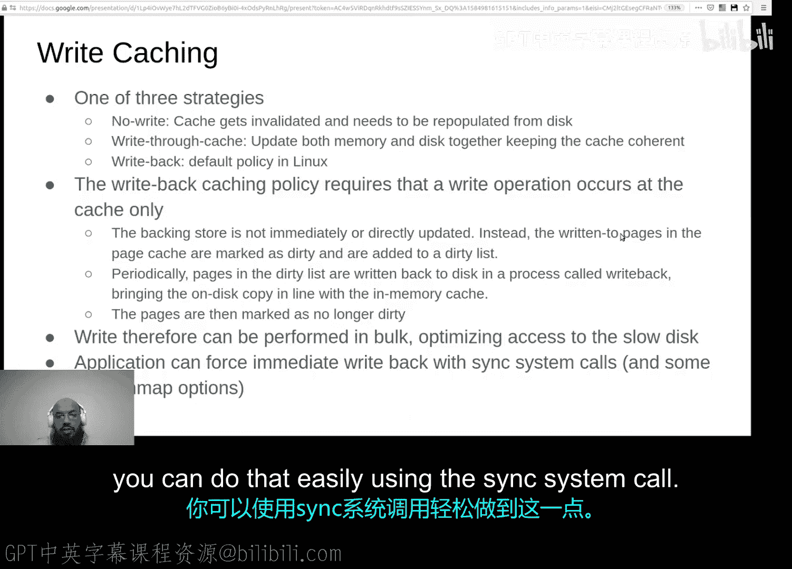

The Linux page cache is。Basically， a page and the page cache can consist of multiple non contigious physical desk blocks basically。

 so you might have them from different ports， okay。And before。You try to do any page Iu。

 you check and your page cache and your Linux page cache。

The overhead of searching and checking the page cache， however。

 could not the benefits from the cache because if you have different pages that are all over the memory。

 and you need to search a huge page cache multiple times。

 it can actually invalid and not any benefits from having the cache in the first place。

So some parts of this search is implemented as an efficient credits。

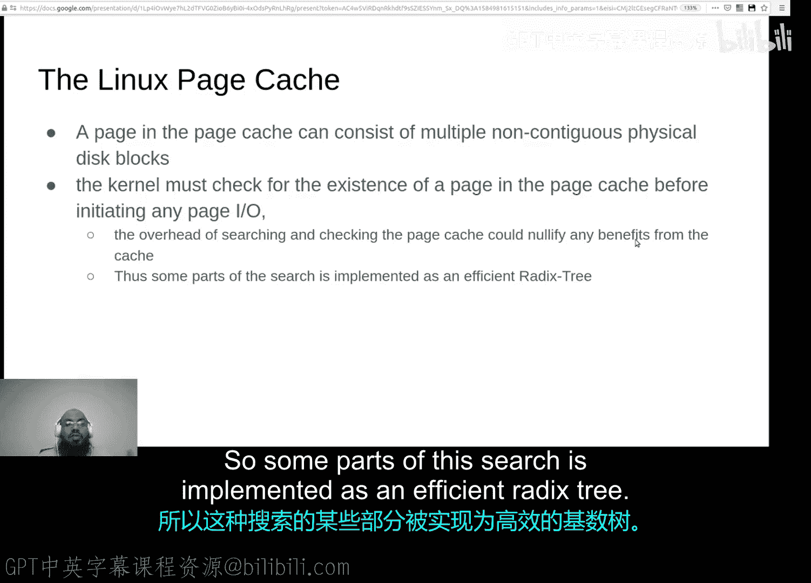

three。Cash for emission。And kernel caches and processes can continue assign memory basically for as long as is needed。

 okay。So， you basically。Start considering cache acclamation when you hit a rule and hitting a rule happens when you have low memory。

 if you're going to hibernate， if you have a free memory target that you should have。

 but you all of sudden have less than that much amount of memory。

Memory pages can be divided into one of four categories。The first one is unreclaimable。

 so these are free pages that you cannot basically reclaim， for example。

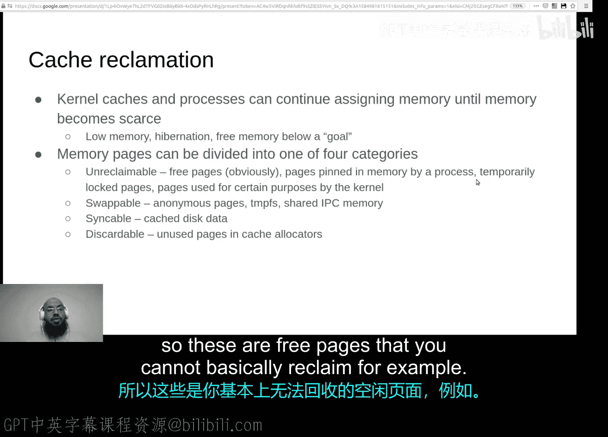

Pages pinned in a memory by process。 Sometimes you can do page pin for by process。

Some pages that are locked， you canclaim them。And some kernel pages。

Swapable pages are pages that are like anonymous pages that were requested by the user space。

 These can just be swapped to disk， for example， there are other kinds of pages that can be swappable also。

Then there are syncable pages。 And these are cache disk data。

 And And that is to reclaim these pages you only need is basically to。Either。嗯。To either。

Reduce your cache size okay and keep smaller amounts of data your in your Linux cache。

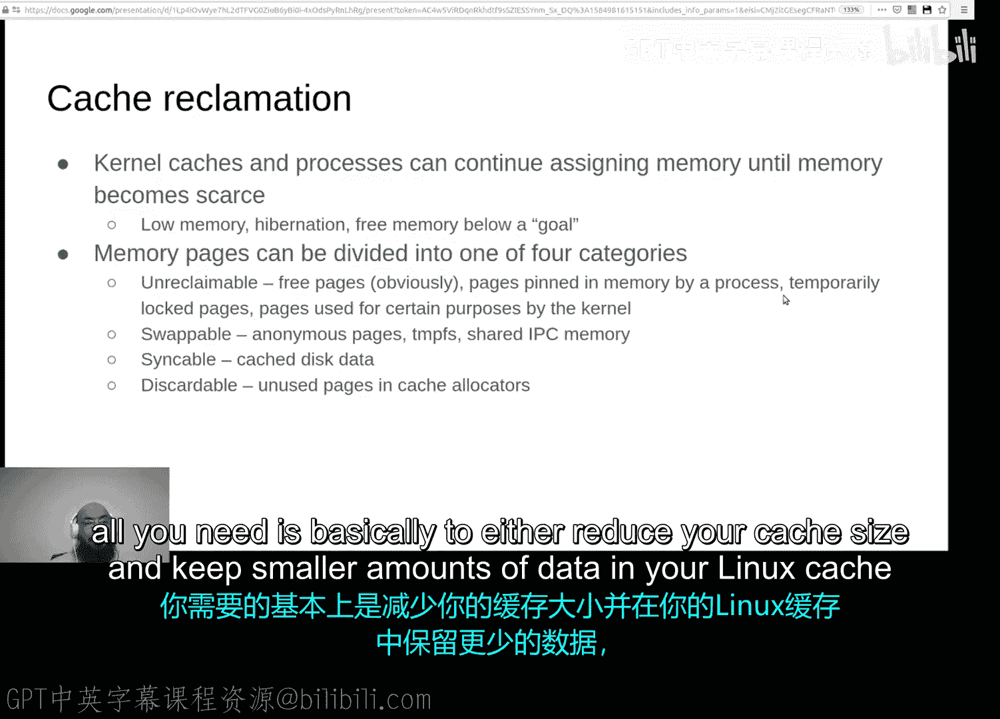

Or maybe looking at dirty pages that have not been used for a while writing them。

 mean there are multiple different ways to accurately thinkable pages。And discardable pages。

 And these are pages that have been not been used for a long while in the cache allocators。

Cash eviction policies， there' is the least recently used。

 which you probably have covered multiple times now in this course and in other courses。

 the Linux ways that it has a tool list strategy。 It's actually like at least recently used。

Tool list or tool list approach。one。So the tool lists are basically an active list and an active list。

 The active list are pages that are hot pages that are touched pages that are not available for e。

Okay。And the inactive pages are pages that can be cache e。

Pages are placed on the active list only when they are accessed while already resing on the active list。

 so pages pages start on the inactive list and then they move to the active list when they get read。

 for example。And Nox tries to keep the tool list in balance so that。

Your bottom list has the all the the bottom， the half of all the pages。That you have not accessed or。

 or the。The least axis。Pages。Basically taking the medium page and and taking all pages below that page and saying that these are the least exit pages。

And then the top list， which is basically the hot list or the activist。 And this is not。嗯。

This is not。This are， this is not etable。This approach is also known as LRU2。

 and it can be generalized to endless with LRU N。With this。

 we conclude today's lecture on memory management， the next lecture will be the last lecture in the course and it will be on file systems。

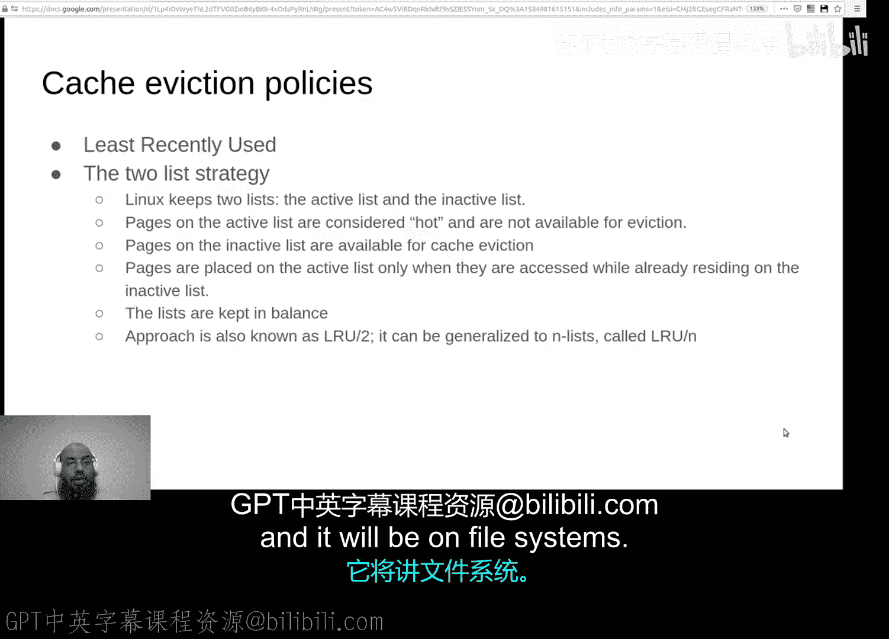