# 操作系统设计与实现：第21讲：Linux内存管理 🧠

在本节课中，我们将学习Linux操作系统中内存管理的核心机制。我们将探讨内核如何为自己分配内存、如何为用户空间进程管理内存，以及如何使用缓存来提升系统性能。理解这些概念对于编写高效、可靠的系统软件至关重要。

---

## 内核内存分配

上一节我们介绍了课程概述，本节中我们来看看内核如何为自己分配内存。所有进程，包括内核子系统，都需要分配内存。内核内存分配与用户空间分配的一个主要区别在于，内核不能轻易处理内存分配错误，并且某些内核部分不能进入睡眠状态。

内核将物理页作为内存管理的基本单位。这与我们在之前课程中讨论的页概念非常相似。X86处理器包含硬件内存管理单元（MMU）。然而，Linux的内存管理比许多其他系统更为复杂，因为它需要支持从手机到超级计算机的各种硬件平台，每种平台都有不同的内存特性。


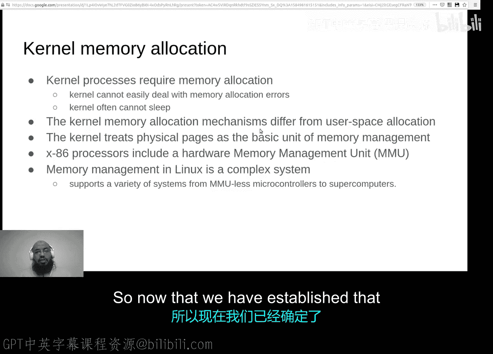

### 页与巨页


在Linux中，页的典型大小是4KB。但从内核版本2.6.3开始，Linux引入了对**巨页**的支持。其基本原理很简单：在拥有大容量内存的系统中，管理数百万个小页会带来巨大的开销。每次内存访问都需要进行页表遍历，这可能消耗10到100个CPU周期。

例如，在一个拥有32GB内存、页大小为8KB的64位系统上，物理内存会被划分为大约420万个不同的页。而TLB通常只能容纳1024个条目。每次上下文切换都需要刷新TLB，这会带来很高的性能成本。


巨页（例如2MB或1GB）可以显著减少TLB的压力，提高TLB命中率，从而提升整体系统性能。对于像大型数据库这样需要大量连续内存的应用，使用巨页尤其有益。

**巨页示例**：
```c
// 应用程序请求2MB内存，内核可以分配一个2MB的巨页，而不是512个4KB的页。
```

然而，巨页也可能导致内存碎片，因为大块连续内存可能难以找到。最初，巨页需要用户手动配置。后来，Linux引入了**透明巨页**，它会自动尝试为请求大内存块的应用分配巨页，这现在是默认启用的优化。

### 内核中的页表示


内核使用一个名为 `struct page` 的结构体来表示系统中的每个物理页（而非虚拟页）。这个结构体定义在 `<linux/mm_types.h>` 头文件中。


`struct page` 中的一些关键字段包括：
*   **标志位**：存储页的状态，例如是否脏页、是否被锁定在内存中。
*   **引用计数**：存储对该页的引用数量。当计数变为-1时，表示没有人在使用该页，该页可用于新的分配。
*   **虚拟地址**：存储该页对应的虚拟地址。

仅这些结构体对于大内存系统就可能占用超过100MB的空间。


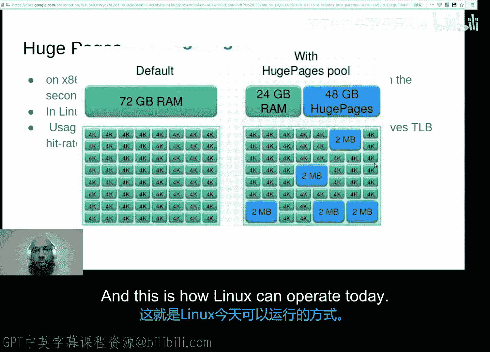

### 内存区域

由于硬件限制，内核不能将所有页视为相同的。因此，内核将页划分为不同的**区域**。区域用于以某种方式对相似的页进行分组，主要是因为不同硬件设备的内存寻址能力不同（例如，某些设备只能对特定内存地址进行DMA）。

主要的区域有四个，定义在 `<linux/mmzone.h>` 中：
1.  **ZONE_DMA**：可用于直接内存访问的页。
2.  **ZONE_DMA32**：仅可由32位设备进行DMA访问的页。
3.  **ZONE_NORMAL**：正常映射的页。
4.  **ZONE_HIGHMEM**：高端内存，指未永久映射到内核地址空间的页。

区域的实际使用和布局高度依赖于体系结构。例如，在64位x86系统上，通常只使用 `ZONE_DMA` 和 `ZONE_NORMAL`。

### 分配和释放页

内核提供了一系列函数来分配和释放物理页。

以下是内核用于分配内部内存的主要函数：
*   `alloc_page(gfp_mask)`：分配单个页。
*   `alloc_pages(gfp_mask, order)`：分配 2^order 个连续的页。
*   `__get_free_page(gfp_mask)`：分配单个页，并返回其逻辑地址的指针。
*   `__get_free_pages(gfp_mask, order)`：分配 2^order 个连续的页，并返回第一个页逻辑地址的指针。
*   `get_zeroed_page(gfp_mask)`：分配一个填充为零的页。

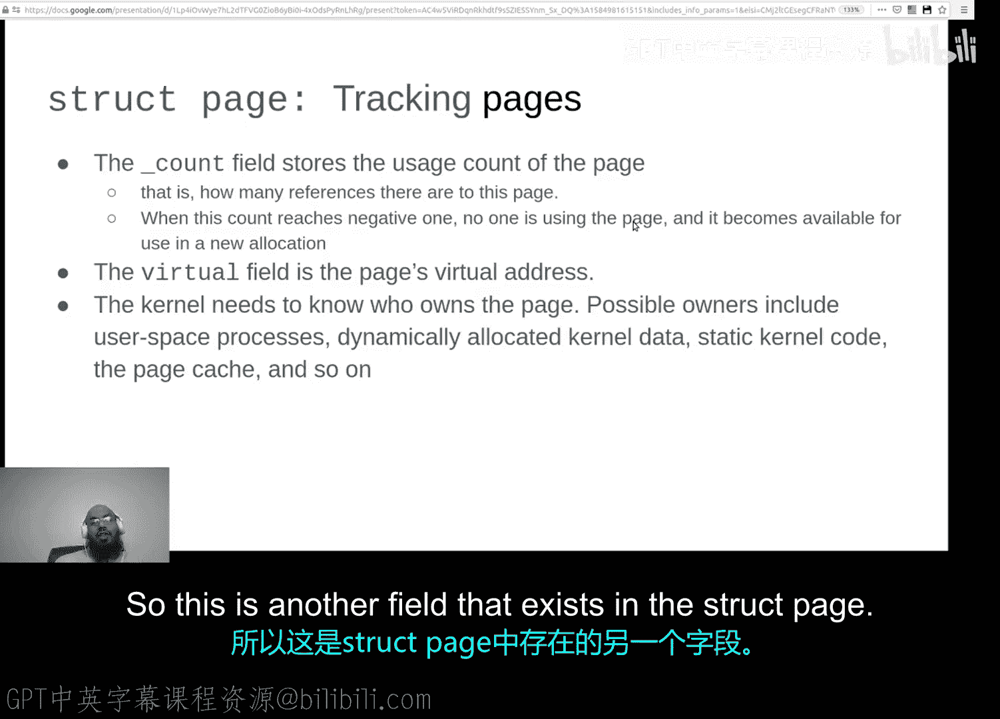

**GFP掩码**：这些函数都接受一个 `gfp_mask` 参数，它是一组标志，用于控制分配行为，例如：
*   分配器在尝试分配时是否可以睡眠？
*   分配器是否可以访问紧急内存池？
*   分配失败时是否应触发警告？
*   应该从哪个内存区域分配？

内核提供了一些预定义的组合标志以简化使用，例如：
*   `GFP_ATOMIC`：高优先级分配，不允许睡眠。用于中断处理程序等场景。
*   `GFP_KERNEL`：常规的内核内存分配，允许睡眠。
*   `GFP_NOIO`：不允许启动I/O操作来释放内存。

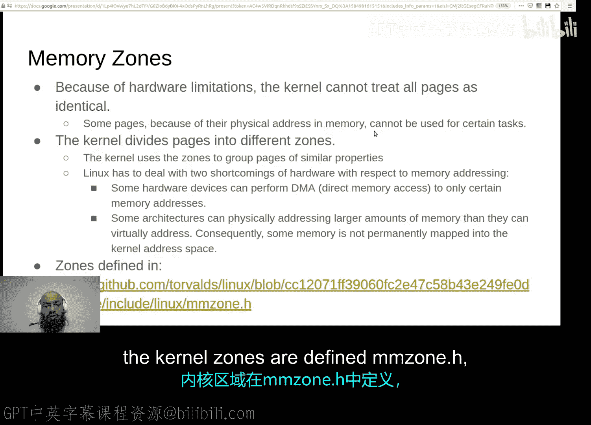

释放页的函数包括：
*   `__free_pages(page, order)`
*   `free_pages(addr, order)`
*   `free_page(addr)`

**重要**：在内核中编程时，必须只释放自己分配的内存，错误地释放其他部分使用的内存会导致系统崩溃。

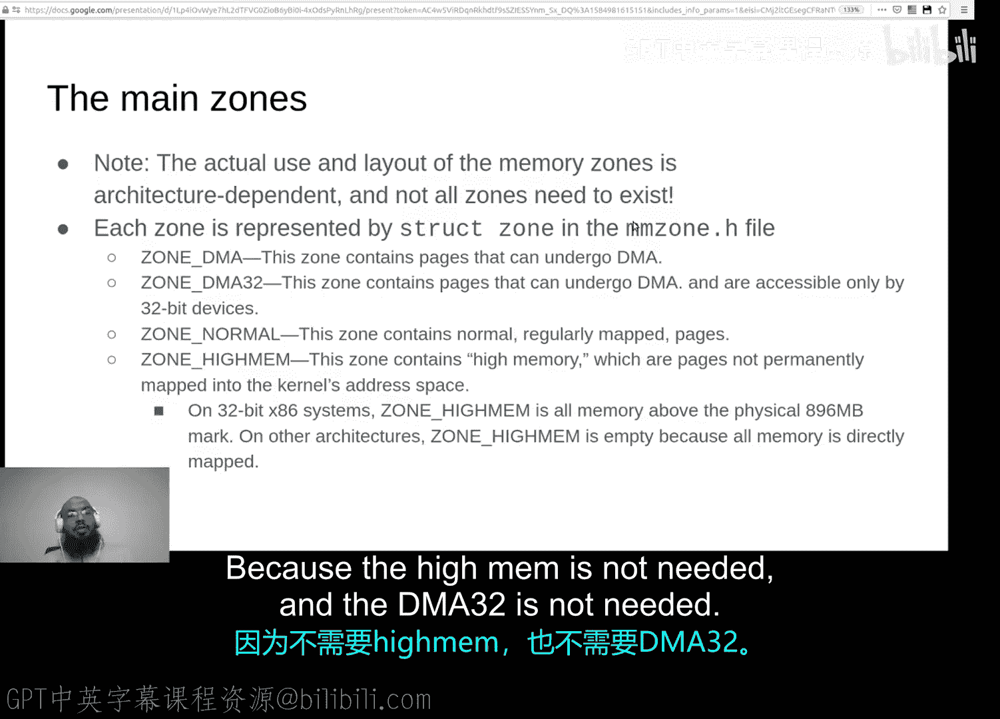

**分配与释放示例**：
```c
unsigned long page;
page = __get_free_pages(GFP_KERNEL, 3); // 申请 2^3 = 8 个页
if (!page) {
    /* 内存不足，处理错误 */
    return -ENOMEM;
}
/* 使用这8个连续的页... */
free_pages(page, 3); // 释放这8个页
```

### Slab分配器

我们讨论了如何分配整页，但很多时候内核只需要一小块内存（比如1KB）。为此，可以使用 `kmalloc` 和 `vmalloc`。
*   `kmalloc`：分配**物理上连续**的内存，性能较高，常用于硬件设备交互。
*   `vmalloc`：分配**虚拟地址上连续**但物理上可能不连续的内存。

频繁地分配和释放小型对象会导致内存碎片。早期，内核程序员会为特定数据结构维护自己的空闲列表，但这在内存紧张时会造成问题，因为每个进程都可能持有一堆未使用的“备用”内存。

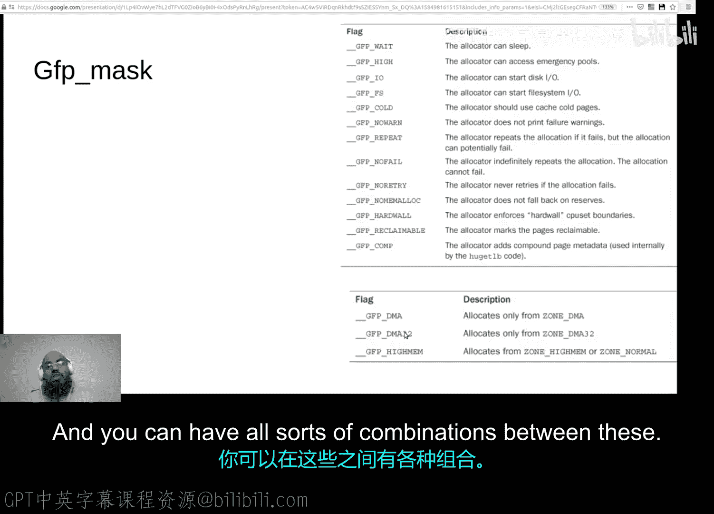


为了解决这个问题，Linux内核引入了 **Slab分配器**。它作为一个通用的数据结构缓存层。其核心思想是：缓存频繁分配和释放的内核对象（如任务描述符、inode等），这样下次需要时可以直接从缓存中获取，避免了重复分配和初始化开销，也减少了内存碎片。

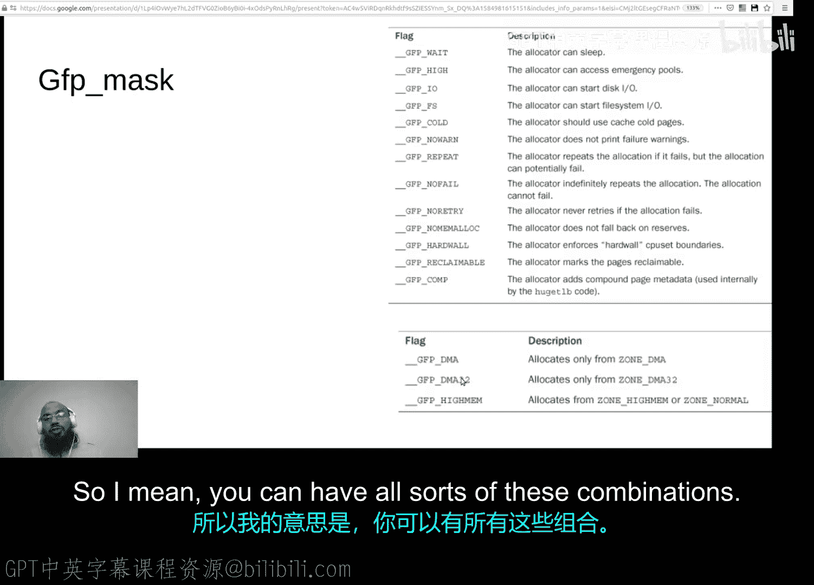

Slab层将对象按类型分组，每个类型对应一个**缓存**。每个缓存由多个**Slab**组成，每个Slab又被划分为多个**对象**。Slab有三种状态：满、部分满、空。分配器会优先从部分满的Slab中分配对象。

`kmalloc` 就是建立在Slab分配器之上的，这使得它对小块内存的分配非常高效。


### 内核栈

历史上，内核栈的大小是固定的（例如，在32位系统上是8KB，64位系统上是16KB）。但从2016年左右开始，内核引入了**虚拟映射内核栈**等机制，使得内核栈可以更加动态，这超出了传统教材的描述。


---

## 用户空间内存管理


上一节我们深入探讨了内核自身的内存管理，本节中我们将视角转向用户空间，看看内核如何为应用程序管理内存。

用户空间的布局主要由应用程序在编译时决定，链接器可以影响此布局。操作系统通常会将地址空间的一部分保留给自己使用（例如，在x86 Linux上，内核占用高地址部分）。

应用程序可以动态地向操作系统请求新的内存映射（例如，通过 `malloc` 为堆申请匿名页），或删除映射。应用程序本身并不了解底层物理内存的细节，如是否发生了交换、内存是否碎片化等。它只是发出请求，内核负责满足这些请求。


### 进程地址空间与VMA


Linux使用 **虚拟内存区域** 来描述进程地址空间中的一段连续区间。一个进程的地址空间通常由多个VMA组成。

一个进程的VMA可能包括：
*   可执行文件代码的映射（文本段）。
*   已初始化全局变量的映射（数据段）。
*   未初始化全局变量的零页映射（BSS段）。
*   用于用户态栈的零页映射。
*   每个共享库（如C库）的文本、数据、BSS段。
*   任何内存映射文件。
*   任何共享内存段。
*   与 `malloc` 相关的匿名内存映射。

每个VMA由 `struct vm_area_struct` 描述，它包含了该区域的起始地址、结束地址和访问权限（读、写、执行）。这个结构体定义在 `<linux/mm_types.h>` 中。

内核使用一个名为 `struct mm_struct` 的**内存描述符**来管理一个进程的整个地址空间，它包含了该进程所有VMA的信息以及其他内存相关数据。这个描述符的指针保存在进程描述符（`task_struct`）的 `mm` 字段中。

---

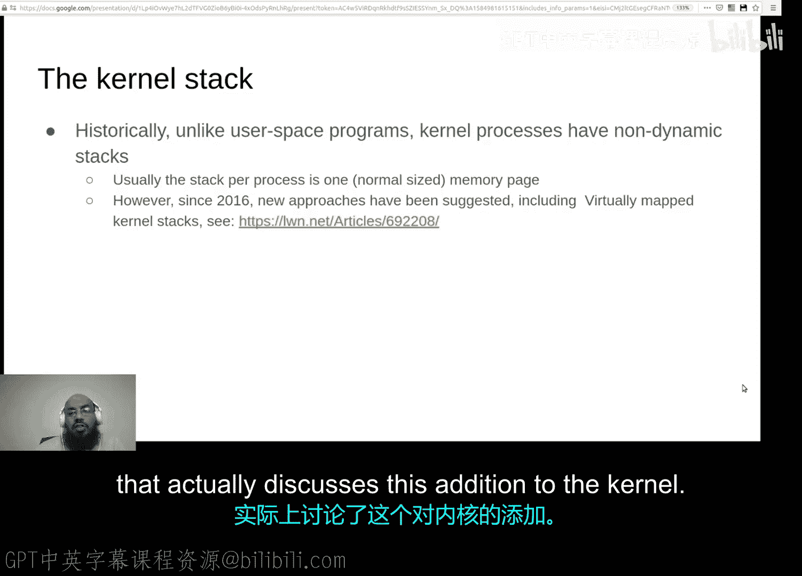

## 页面缓存与页面回写

我们已了解了内核和用户空间的内存管理，本节将探讨一个介于内存和文件系统之间的重要机制：页面缓存，它对于系统性能至关重要。

由于RAM比磁盘快几个数量级，Linux使用**页面缓存**来缓存磁盘数据。页面缓存由RAM中的物理页组成，这些页映射到磁盘上的块。其大小是动态的，可以增长以消耗任何空闲内存，也可以在内存压力大时收缩。

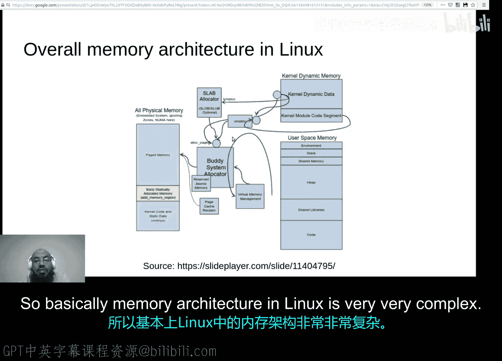

被缓存的存储设备称为**后备存储**，因为它是缓存数据的权威版本。通常不会缓存整个文件，而是根据访问模式缓存文件的部分内容。

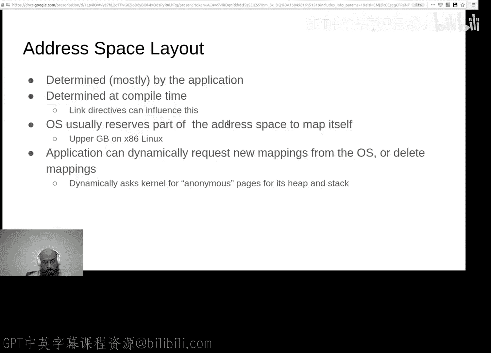

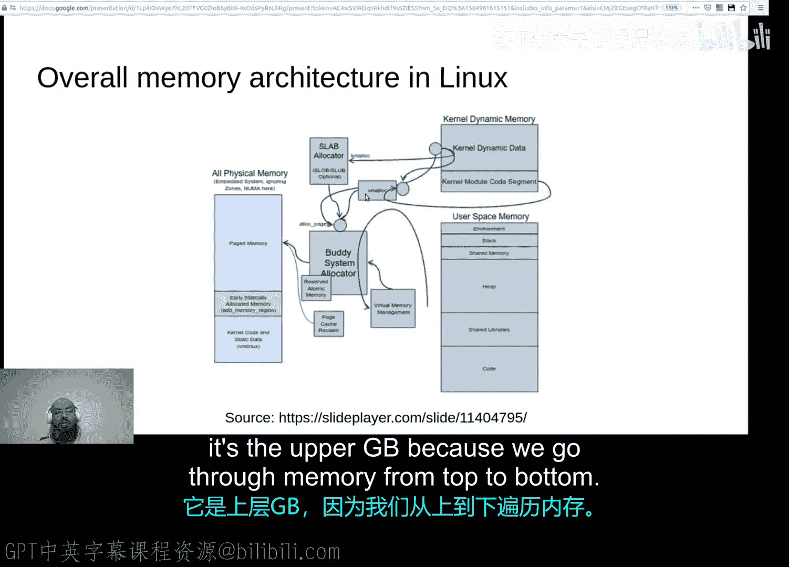

### 写策略


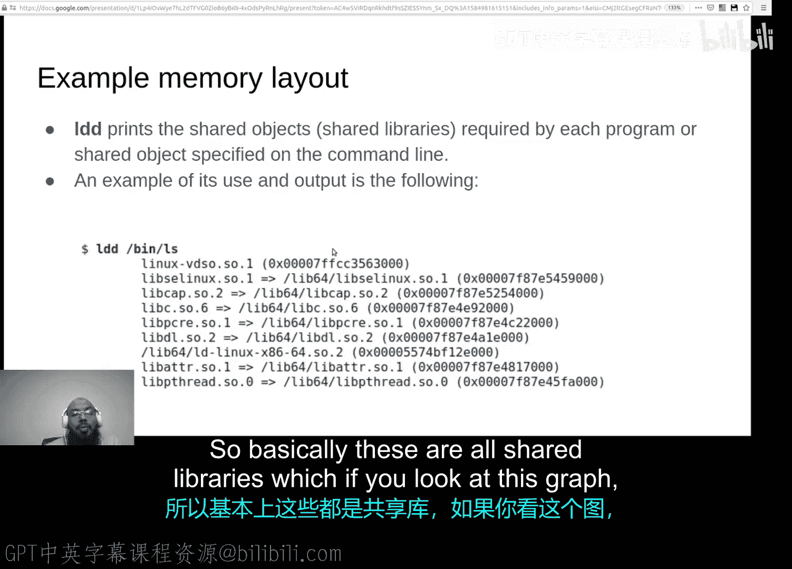

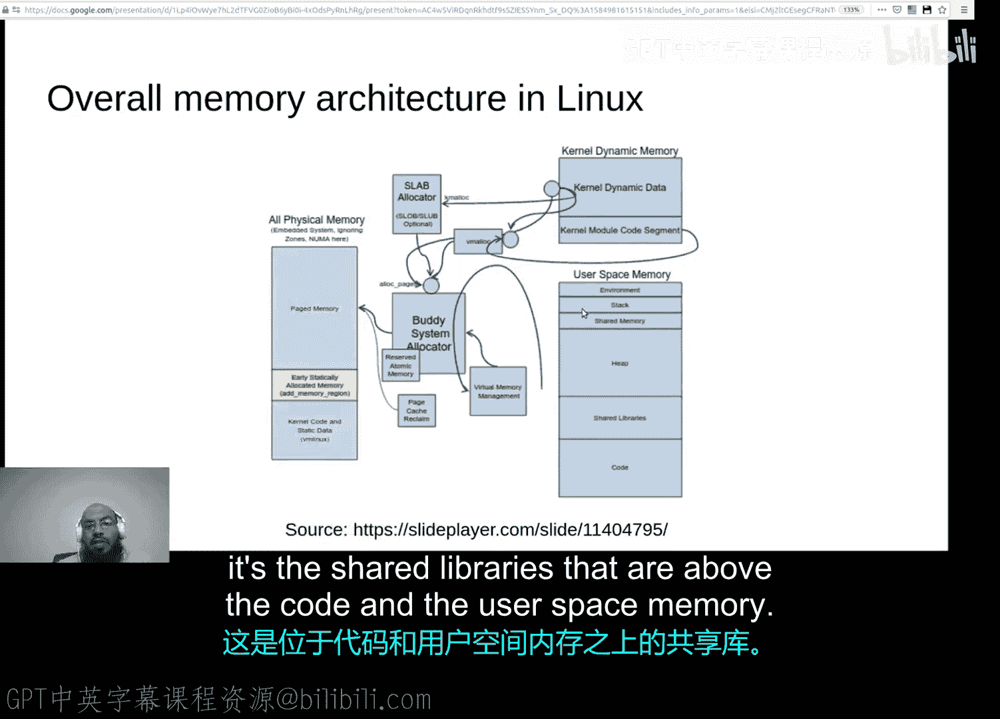

当向缓存中的文件写入数据时，有三种策略：
1.  **不写缓存**：直接写入磁盘，同时使缓存失效。性能差，可能导致一致性问题。
2.  **写透缓存**：同时写入缓存和磁盘。保持缓存一致性，但每次写入都有磁盘I/O开销。
3.  **写回缓存**：**Linux的默认策略**。数据只写入缓存，将该页标记为“脏”。内核会在之后某个时间点（例如，脏页积累到一定数量，或系统调用 `sync`）将脏页批量写回磁盘。这优化了对慢速磁盘的访问。

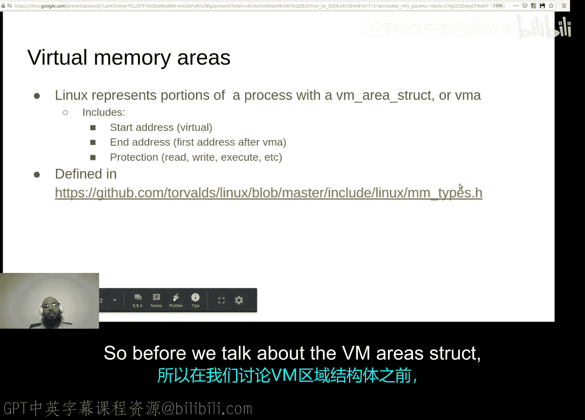

脏页会被加入一个脏页列表，等待被写回后备存储。应用程序可以使用 `sync` 系统调用来强制立即回写。

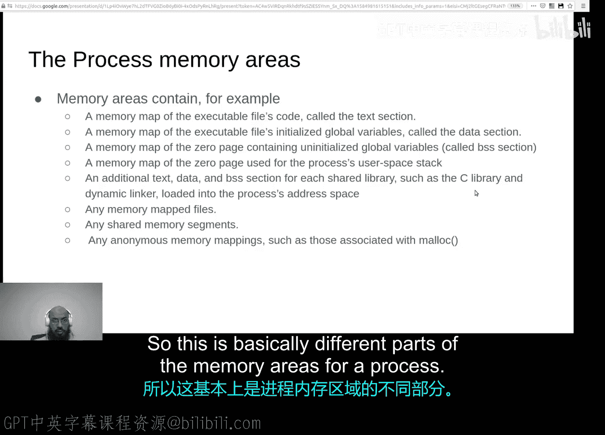

### 缓存回收

内核缓存和进程可以持续分配内存，直到触及某个限制。当系统内存不足时，就需要回收缓存。

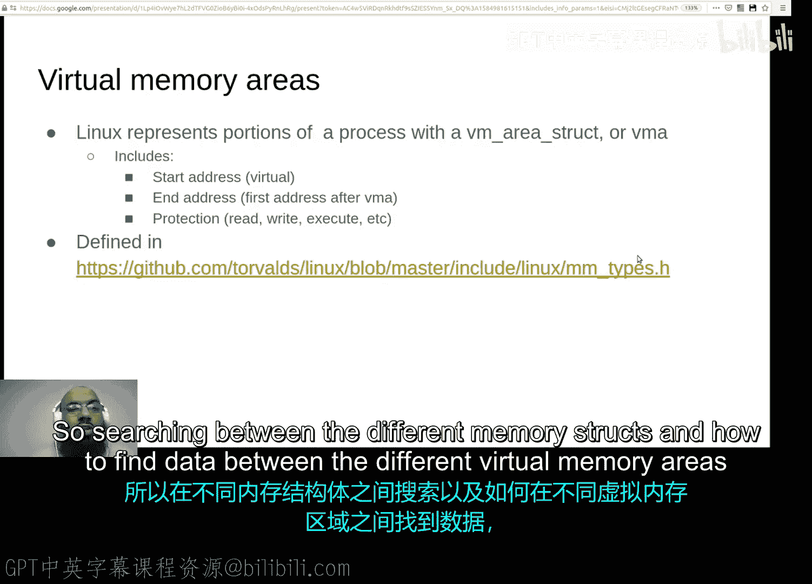

内存页可以分为四类：
1.  **不可回收页**：例如被进程锁定在内存中的页、某些内核页。
2.  **可交换页**：例如用户空间申请的匿名页，可以被交换到磁盘。
3.  **可同步页**：缓存了磁盘数据的页。回收它们只需减少缓存大小或将脏页写回。
4.  **可丢弃页**：缓存中长时间未使用的干净页，可以直接丢弃。

### 缓存置换策略


Linux页面缓存使用一种近似**LRU**的“双链”策略。它维护两个链表：
*   **活跃链表**：存放最近被访问过的“热”页，这些页不适合被换出。
*   **非活跃链表**：存放最近未被访问或访问较少的页，这些页是缓存回收的主要候选者。

新页或首次被访问的页通常加入非活跃链表。当非活跃链表中的页被再次访问时，它会被提升到活跃链表。内核努力保持两个链表的大小平衡，并根据需要将活跃链表尾部的“较冷”页移回非活跃链表，或将非活跃链表头部的页回收。这种方法也被称为LRU/2，可以推广到LRU/N。

---

## 总结 🎯

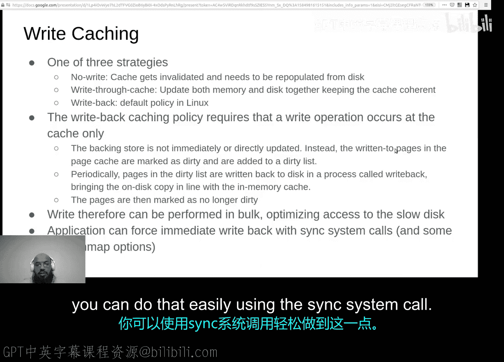

在本节课中，我们一起深入学习了Linux内存管理的三个核心方面。


首先，我们探讨了**内核内存分配**，了解了物理页、巨页的概念，内核如何通过 `struct page` 管理物理页，以及如何根据硬件限制划分内存区域。我们学习了使用 `alloc_pages`、`kmalloc` 等函数进行分配，并认识了Slab分配器如何优化小块对象的分配。

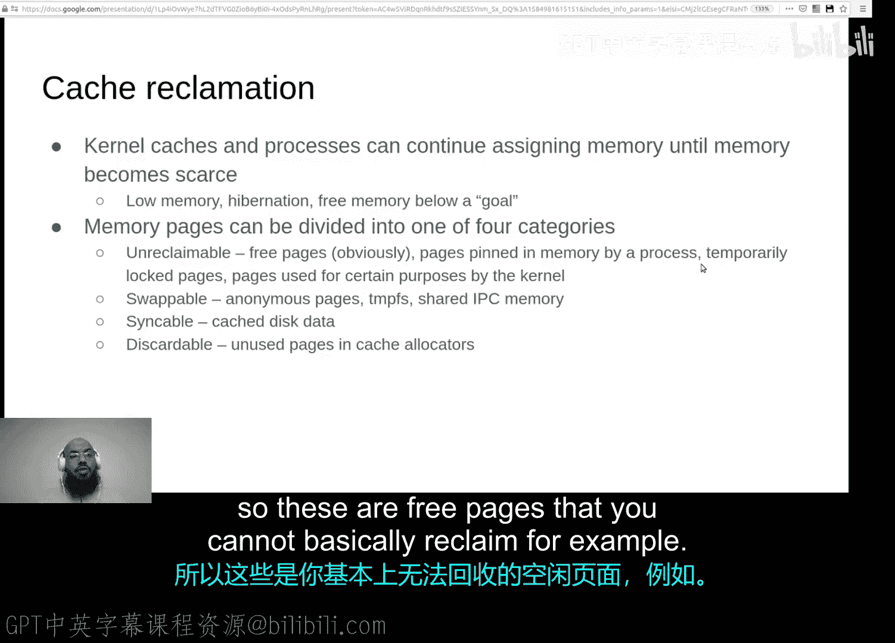


其次，我们转向**用户空间内存管理**，理解了内核如何通过虚拟内存区域和内存描述符来组织和管理进程的地址空间，为应用程序提供透明的内存服务。


最后，我们研究了**页面缓存与回写机制**，这是提升I/O性能的关键。我们分析了写回缓存策略的优势，以及当内存不足时，内核如何对可回收页进行分类并采用类LRU算法进行缓存置换。

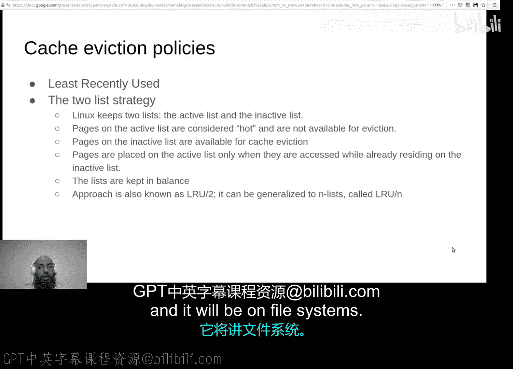

这些机制共同构成了Linux高效、灵活且能适应从嵌入式设备到数据中心等各种场景的内存管理子系统。理解它们有助于我们编写更高效的程序，并对系统行为有更深刻的洞察。下一讲，我们将学习本课程的最后一个主题：文件系统。