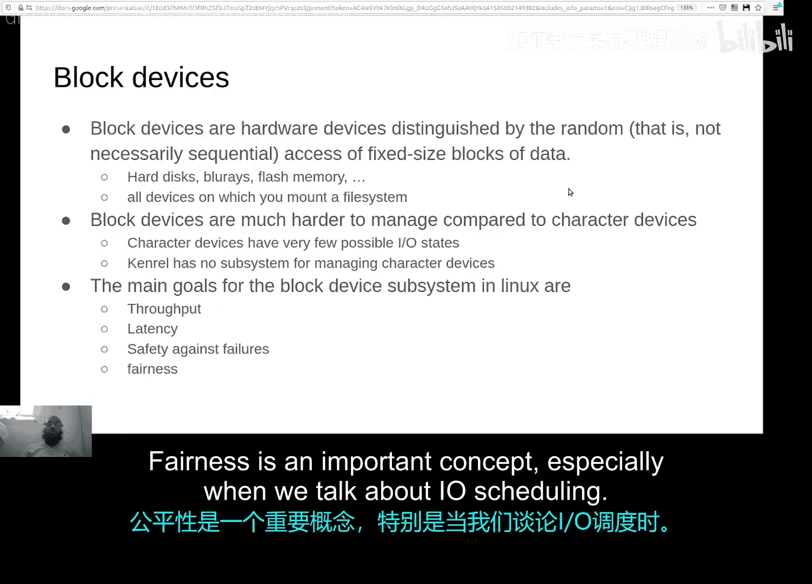
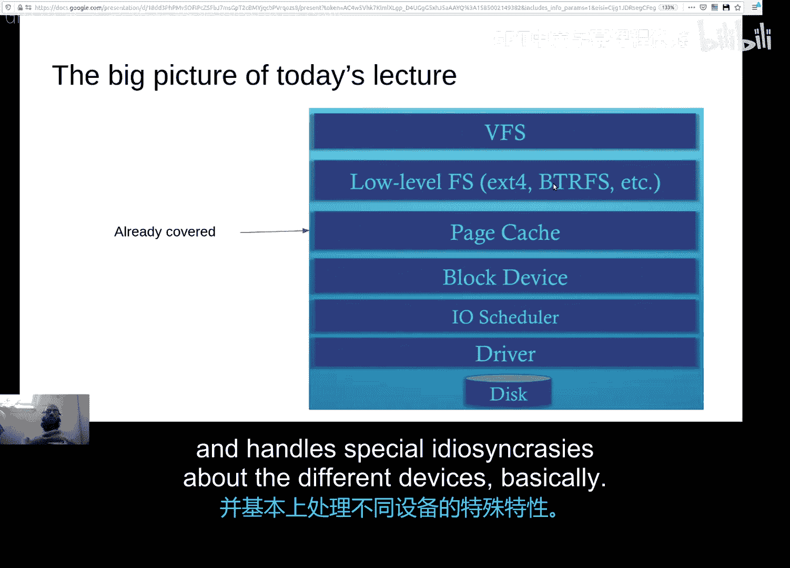
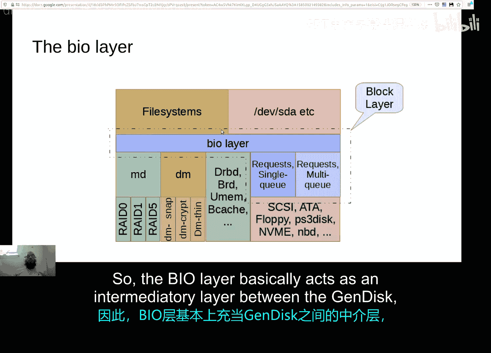
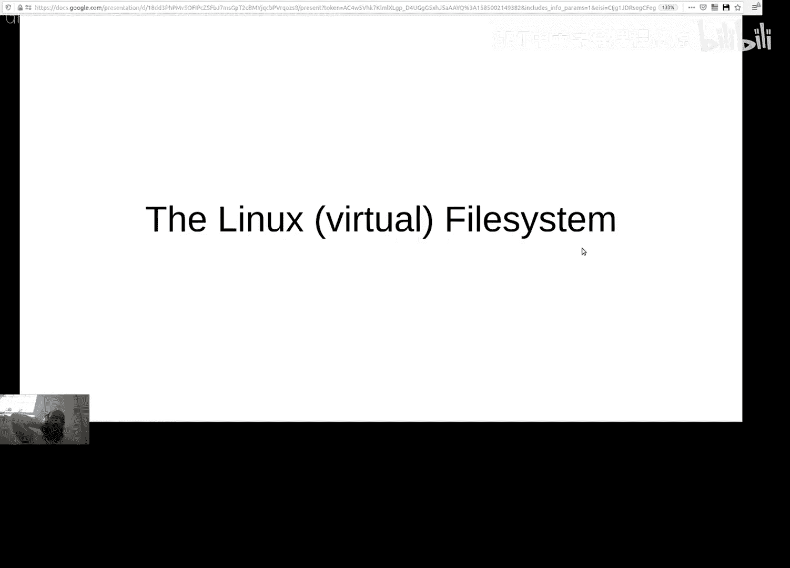
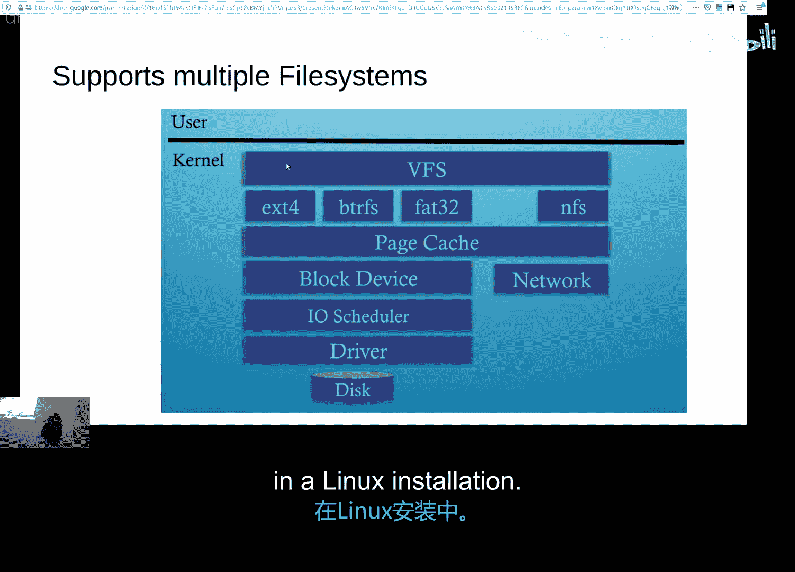
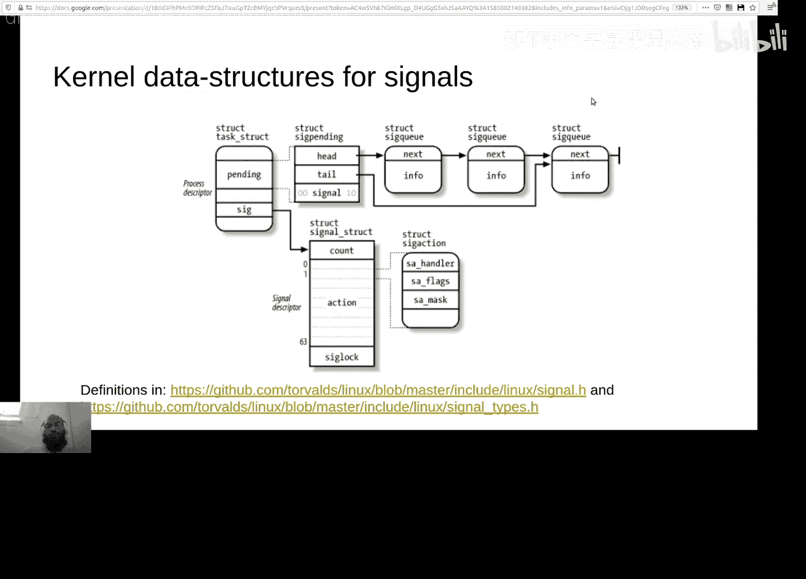
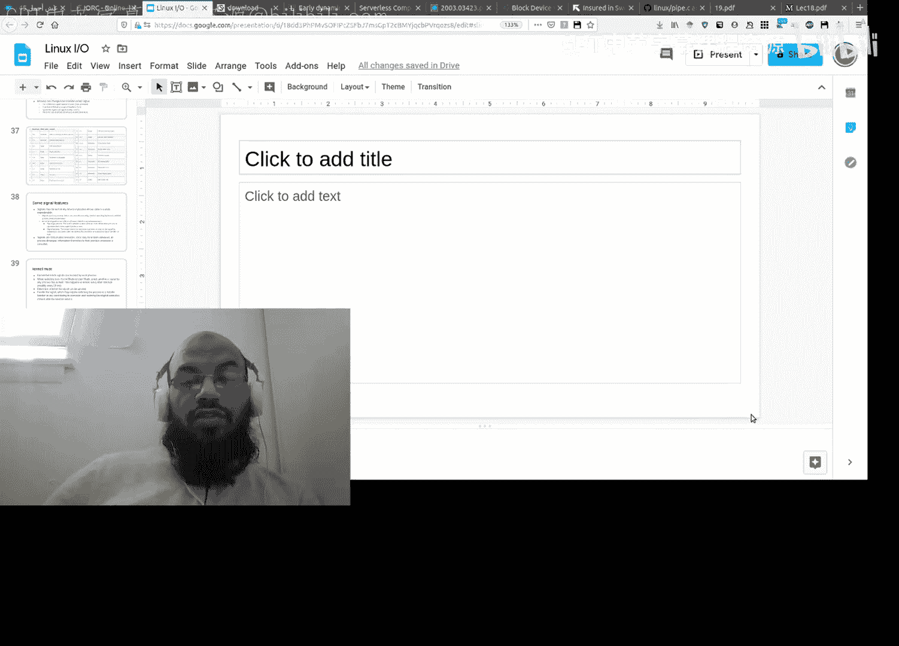

# 麻省大学《操作系统 设计与实现｜CS 577 Operating Systems Design and Implementation 2020》中英字幕 p41 -41-Lec22 Screencast_ Linux I_O (03_24_20).zh_en -BV1iP2CBaEHr_p41-

Hello and welcome to the last Linux lecture Today we're going to cover actually quite a few topics three of them are deeply connected。

 one of them is a little bit of an old bull out The three deeply connected ones or block IO file systems and pipes signals are a little bit of an old bull here but we thought that it doesn't make sense to actually finalize the course without even touching upon the concept of signals in UniX systems I'm making disclaimer here that。

呃。There are some new sources that I've used in this lecture。

 these includes the excellent lectures by Dan Porter and also a book that you can access via the UMass library for free。

 it's actually really book so you can even access it on the website I think now for free during the period。

So we'll start with discussing how Linux handles block devices。

And you have covered quite a bit of information already about block devices B devices are basically hardware devices that are distinguished by by the random access of fixed size blocks of data That means that there is no requirement for you to access the data in sequence There are many block devices that exist today some of them you actually are central to your computer like your hardest blueries flash memory Cd rooms and so on in Linux all these devices will be mounted to the file system I believe that is actually similar to Linux if I'm not mistaken。

Now， as Prachanant has touched upon there are two kinds of devices en large IO devices。

 one of them is the characteror device and the other one is the block device character devices have very few possible IO states。

 for example， your keyboard has basically the states of the number of keys and maybe some other combinations if you。

if you click shift or function or the function key， or if you have some special keys。

 key combinations。 But at the end of the day， there。

 there are finite combinations and these finite combinations are actually not that large。

The kernel thus has no subsystem to manage the character devices and character devices management is mostly handled by the drivers for these devices。

However， block devices are a different story because they they。

That are they basically provide you with an infinite combination of how you can put the data。

 how you can manage the data， what blocks you read and so on。

 there are just too many combinations for the system to leave this for different drivers。

 So so Linux actually provides a whole block device subsystem。

And the main goals for this subsystem is to increase the overall throughput of the devices。

 decrease the latency of these devices， to have safety against failures and to have fairness and fairness is an important concept。

 especially when we talk about iOS scheduling。

The big picture of today's lecture， well there is the virtual file system that will cover a little bit lower level file systems like the extended third extension and EXD4 we are actually going to touch upon them very lightly today then there is the page cache which we covered and the last lecture then the block device and the IO schedulealr both of which will actually start with the lecture and then there is the actual driver for the disk or for whatever block device you're using and that driver basically handles all hardware translations needed and handles special idioynch idioynchosis about the different devices basically。

So this is the anatomy of a block device you basically have and for historic reasons。

 hard disks used to be basically consisting of like magnetic disks where you had a motor that extra your teeths and you basically divided the hard disk into sectors into segments and so on and so forth。

So。Historically， this was the figure on the right hand side is the historical figure of how all these devices were thought of。

A blog device basically has a most addressable unit that is called a sector and the sector。

 as I said， comes from the history of how hard disks were。

Seercis vary between devices and architectures， but they are typically between 512 bytes to4 kilobytes。

These are cooled by some people also， I mean， the sector is also has a second name and the third name and these are device blocks or hard sectors。

The software however， does not have the same hardware limitations because the hardware。

 I mean the hardest， it had a physical actual limitation on how things are and similarly all block devices are like that there are physical limitations right the software on the other hand does not have the same limitations。

So the software imposes its own smallest logically addressable unit， and that is a block basically。

The kernel performs all disk operations in terms of blocks。

The block size can be no smaller than the sector so the smallest possible block that you can get is the sector size。

 so if the sector size is 512 bytes， then this is your smallest block if it's 4 kilobytes then your smallest block is 4 kilobys。

The block size can be a multiplier of a cat can have multiple times the equivalent of the data stored in the sector。

 so it can be2 megabytes， for example。The kernel basically requires that a block be no larger than the page size and that's why I actually said 2 megawabys。

 so if you have huge page pages as we have discussed in the last lecture。

 then you can have larger block sizes， but if you're sticking with the largest page size that you actually have in traditional Linux。

 then we are talking about 4 kBs or8 kBs， 16 Ks possibly。

These software blocks are sometimes also called the file system blocks or IO blocks。So。Basically。

 the way that that this system that that the interaction between the physical block I O device and the。

And the kernel， basically the communication between these two happens through buffers and bufferheads。

A block basically that is being read by the kernel is stored in memory。

And then that block is stored in what we call a buffer。

The buffer basically serves as the object that represents a desk block and memory so you have。

You have a sector。That is on the actual physical device。

And then the kernel basically aggregates a group of sectors saying that this is my block。

And then each block is mapped in memory or to a buffer in memory。

A single page can hold one or more blocks in memory right because if your block size is small。

 then one memory page can actually be multiple times multiple blocks in your system。Sorry。

 forgive me。The kernel requires some associated control information to accompany the data。

 obviously is you have basically now some mappings between an actual physical device which has some sectors and then some blocks and then you have now another level of interaction。

 which is the buffer。So each buffer is basically associated with a descriptor or what we call a buffer head。

 the buffer head definition is in the link that you see and the purpose of the buffer head is to describe the mapping between the undesk block and the physical inmemory buffer。

This basically acts as as a descriptor of this buffer to block mapping and the data structure of and this is the main purpose。

 the only rule of the data structure in the kernel Now traditionally the buffers and buffer heads had a lot more value into the system。

 they were actually used to manage the。All block devices。

 but this has changed with the introduction of what is called the biostruct that we will talk about。

Shortly， this is how the bufferhead structure is in the kernel。And basically， has a few pointers。

 a few strokes， and it tries to map the blocks on the actual physical device to the buffers that exist in memory。

So now we shift our attention to the biolayer and the biolayer basically is something that that is the actual interface between the file system and the actual devices。

Now， let us look at the at the bioder。And more details。First of all。

 all block devices in Linux are presented by a general structure that is called Gendik。

 It's basically a generic disk structure。 It basically it's supposed to encompass。

A very generic view of all the different block devices that can exist。

The bioio layerer itself carries read and write requests and asserted other control requests from the blog device。

Pass the Gen diskk and onto the driver。 So the bio layerer， the biolayer basically acts as。

An intermediary， an intermediary layer between。

The gender the generic definition of the device and the actual device driver。

A bioio identifies a target device。And offset in the linear edge piece of the device。

 So it basically。Identifies which device are you trying to read or write to the offset in the edge space。

 basically what data you're trying to read。The size of the data you are trying to read。

And some memory where the data would be copied to or from。The each block IO request。

 so each request that is issued to the bio layer is represented by a biostructure that is calledstruct bioio。

And this is data structure that basically tries to map where what you're going， what pages， what。

What parts of the device are you going to read or write from。Okay。

This is basically the basic container for block IO operations。Okay。

And it represents the blockeye operations that are active as a list of segments。

A segment is basically a chunk of a buffer that is contagious in memory。So the， the whole。

 the so purpose of having this。Strt is to actually try to represent all active I operation as a list of segments。

 And each segment is basically。Some has some data that needs to be written。

The actual individual buffers need not to be contagigious and memory。

 so you do not need basically to be writing from pages that are next to each other and memory might be writing from different pages。

 different bits and pieces to your physical device。

And the biostructure provides the capability for the kernel to perform block IO operationss or even a single buffer from multiple locations in memory。

 so it's basically it's the way that the kernel with which the kernel can actually write to and from and read from devices。

 the block devices。And this is how the biostruct looks like。

 it's actually defined in BLK underscore score types the H。

And a lot of its its control mechanisms are embeddeded each the book， the old book， actually。

 the robotov book describes it an older version of the data structure that is obsolete and that and they even point to a different file。

 So this this is the new up to date。Structure that exists in today's Linuxux。

So important fields in the structure， the first one is the by IOVc。

 which is an array of BV structures， these structures are used as lists of individual segments in this specific block IO operation。

Basically each bioiove is treated as a vector of the form page offset set and length。

 describes basically a specific segment that you're going to read or write。

The physical page where it lies， the location of the block as an offset into the page because you might not be writing the entire page。

 you might be writing a single word in that page back to the block IO device。

And the length of the block starting from the given officer。 So it basically。It， it gives you。

And an array。Of the different things that are you need to read or you need to write to the block IO system。

A deeper bio understanding is beyond the scope of this lecture。

 but however there is a very nice reading， I point you to that reading reading that basically describes the layer a more it is and it's more much more up to date compared to the book actually most of the stuff in this lecture is very different from what the book describes some very general ideas are still there but most of the stuff you actually will find on LWM。

net or and some other blog post or sometimes in the kernelnal code itself。

So how are bias actually used？嗯嗯呃 in the current人。This is actually done using request cues。

Basically block devices， each block device maintains request cues to store their pending block IO requests。

And。Each。Of these requests is represented by request descriptor。There are two things to note here。

 One of them is that you have the actual request and each request is represented by request structure that is defined in BLK dev dot H。

But also you have a request queue that basically is a doublely linked list。

That maintains all these requests together。ThisThis is basically for each device to know what are depending requests for it to process。

So as long as a request queue is not empty， the block device driver associated with the queue grabs the request from the head of the queue and submits it to the associated block device。

So the idea here is basically to have a queue of tasks for each of these block devices to be able to process them Now you can have two kinds of cues the first one is what we call single request queue and the single request queue what we're saying is basically for each block device there is one single queue from which the device needs to process。

The different tasks， the different Io tasks， read and write tasks， basically modify tasks。

 whatever these are。Traditionally， most storage devices were made up of a set of spinning circular platters with some magnetic coating。

 so basically magnetic and these magnetic drives you typically had a head that would move seeking and rotating until treats a certain part in the device to read from it or to write to it。

 such a device can only process a single request at a time basically because while you have a single head。

And there is a substantial cost in moving from one location to another。

 as you have discussed in the Min block device lecture。

Now you have you can build the scheduler to to schedule basically what。Or which？

Requests can get processed first。And this is what we call single Q scheduler in this case。

And the single Q scheduler， what it does is basically it collects multiple bias。

Basically multiple requests to read and write。And tries to。

 to basically zip them to represent contagigious operations into a smaller number of requests。

 So basically， if you are trying to write to2 to2。Sectors that are next to each other on the disk。

 Then what your goal， what this algorithm will try to do is basically。

 it will try to make sure that you do both。Operations。

Next to each other so that you do not need to seek a lot and you do not need to rotate a lot and instead of basically going into these doing these operations into whatever order they came with because then you will have to see and rotate and maybe one of them will be on one end of the disc and the other one will be on this other end of the disc。

 but then you will have to go back to the first end of the disc for the next cry to read operation。

Yeah。So。So this is one key task when you're building such a system over a single queue。

The other thing is that you want to queuee these requests in an order that minimizes seek time while not delaying important requests unduly。

 so doesn't make sense， for example， to even if you're going to do a lot of seek and rotate。

To delay real time。Applications， basically applications that should be highly responsive because you're trying to basically reduce reduce the numbers of Si and rotation time。

For interactive applications， you want the application to be responsive rather than having higher throughput at the disk they not really care that as much about your disk throughput as long as your application is functioning in the way that you would like it to be。

And actually trying to solve that， this problem is the。Is the。

Source of all the complexities in IO schedulers。Yeah。

You also need to enable the underlying driver to be able to pick some of these requests or to feed the underlying driver with these requests to be scheduled on the IO on the block IO device。

And you want the driver to be able to notify thequewing layer， the scheduler。

 basically the single queue scheduler of any updates in the driver basic notifications when these requests are complete。

There are also many reasons for having multiple request cues to。

 so single request cues they stem from the fact that well we had magnetic disks， but now for example。

 with devices such as SSDs，You can actually process multiple requests。

 multiple I requests in parallel。Because you no longer have a head， you no longer need to seek。

 and you no longer need to rotate。As also we get more and more processing cores in our system。

Traditionally， what you would need is basically if you had a single queue。

Is that this queue will need to be locked when one of these processors would try to do any changes to that Q。

 basically if any of the cores try to schedule an IO operation it will need to acquire lock to access that queue now if you have one core or two cores。

 it works okay but if you have 16 or 32 cores， it becomes an issue because sometimes that the request cus for IO can become a bottleneck because all 32 cores are trying to access the queue。

 and then they will need to acquire pin lock to do that。

So Linux introduced the concept of software staging queuees。

And softwareft staging queuees are basically。Ces that can be added for their software cues that are added for each of the CPUs。

So if you have 32 CPUs， then you will have 32 software staging queuees。And request from each。

Processor are added to these cues， so each processor adds to its own cu。

And then each processor does not need to lock on for all other 32 processors at once。

And then based on what hardware you have， you can even translate these 32 software cues that exist for the course to 32 block driver queuees。

So for example， if you're running with SSD MVME， you can actually process all 32 requests in parallel。

For some other devices， for some other devices， these 32 CPU software cues need to be basically zipped into one single queue for that device。

So this way you actually enable the CPUs not to block as they were over the IO devices and you make it a problem to the driver itself to actually handle these 32 CPU queuees。

 these basically software queuees。You can read more about this in this LWN post。

So now that we have established the fact that there are cues in the system。

 now you need to schedule how these requests get handled and similar to process schedulealrs。

 you have also an IO schedulealr。And the I use Kir is between the page cache and disk， okay。

 it flies between the page cache and disk and。You have requests in the form of Tpo。

 basically you have a block number， read or right， and buffer address。

These right requests can be reordered based on some heuristic， for example。I can say that， well。

 I'd like everything that lies in two adjacent sectors to be written at the same time。

And the reason now is that IO is very slow compared to most other system components and even on SSDs you still need a multiq IO Schr because maybe youll end up with too many CPU queuees that the SSD device can still not handle。

 so you need to basically piggypack things and make sure the multiqes are handled correctly with an I Schr。

The IIS schedule， from a scheduling point of view， what it does is that it devised the resources of deskk IO among all pending block IO requests in the system。

It does that by merg and sorting of pending requests in the request queue。

 basically trying to find requests that are touching areas that are next to each other， for example。

 and the device in the block IO device。These iOS indicators require some understanding of the disk model that they are working on or that they are dealing with。

And there is an inherent。Knledge that these iOSos scrs will be actually unfair to some requests at the expense of improving the overall performance of the system。

There are multiple IO schedulers available， in fact。

 there are probably as many IO schedulers as there are process schedulers if not more。However。

 many of the IO schedulers， including almost all the IO schedulers that are described in the book are now obsolete in the first and the second book。

 both of them actually。But looking at how this evolved is actually interesting。

 so we're going to describe some old and new hardware scheduler。And as we said。

 they basically all of these IO schedulers operate on the request queuees。

So one of the very first scals we'll just jump into that is the elevator algorithm。

 which was developed by Nnuus for kernel version 2。4。

And the idea was simple when a request is added to the queue。

 it is first checked against every other pending request to see whether it is a possible candidate for emerging。

 so basically when whenever you get a new request you try to actually make sure that if that you put it in the queue in the correct order。

 so basically you put it next to the memory location that sorry the block IO location that it is going to be closest to。

If a suitable location sector wise is in the queue， the new request is inserted there。

This basically keeps the queuees sorted by physical location and desk。

If no such suitable insertion point exists， the request is inserted in the tail of the queue。

This actually this is the code for the elevator algorithm。

 it actually still is supported in the Linux kernel。

So the first obsolete kernel that we're going to talk about is the noop scheduler。Sorry。

 the first obsolete kernel schedule IO scheduler that we're going to talk about is theOP scheduler。

And it was based on the elevator algorithm that we just described and where the code we just also pointed to。

The idea behind the new schedule is that it provides minimal sorting of requests。

 never allowing G to be moved ahead of a right or vice versa。

This allows one request to overtake another。If in line with the elevator algorithm。

 so you make sure that reads do not take overtake ride。

Or so normally it happens before brights and then you use the elevator algorithm。

For measuring between requests。Apart from this simple sorting。

 NP is basically a first and first out queuing system。Okay。

This is the old code it's actually hosted on the Spotify Gitthub， and this is， as I said。

 an obsolete scheduler。The second one we're going to talk about is the deadline IO Sdner。

 one of the issues with the noop Sdner and the elevator algorithm is that since they try to sort of place。

Requests where they should come。Looking only at their special characteristics when it comes to the block I O device。

 this means that some requests。That， for example， why far away in the in terms of sectors that require lots of seek time and lots of rotation time can end up std or can end up severely delayed。

The deadline Iiocar was designed to actually fix this and the deadline collects batches of either read right requests that were all submitted at add clues to the same time the idea is pretty simple you maintain request queue sorted by physical location and desk that is yours for scheduling as long as note a time quota a certain time quota is not expired once fill this queue is used to schedule operations so you have a queue of a very limited size。

And you try to sort things into this queue based on some。

Based is on the special characteristics of the block device。However， you also have a timer。

 a deadline running on that you。一嗯。You， in order to basically have sort of an。

First and first out or deadline scheduler， the queue also implement sorry the scheduler also implements two other queuees。

 one of them is a read requests where there all read requests are sorted in a5 of Q and write requests are also sorted in a5 of Q。

And。If the request at the head of either the right 5 of Q or the read 5 of Q expired。

 so basically the request has been there， the request at the head of the read 5 of Q。

 the right 5 Q has been lying there for 500 milliseconds or more that if equal is 500 milliseconds actually。

The schedule then begins servicing requests from the5 queue。

So basically what were doing is that if if I get lots of write requests for example。

 and now they are being star by the read request once 500 milliseconds have passed the deadline scheduler will actually see that the right requests have not been serviced for 500 milliseconds and then will actually start scheduling these before any other requests similarly for reads and in case you basically have lots of requests coming in。

 then you will end up filling the。The special the spatial queue。

 which is sorted based on the physical location and desk quickly before the deadline passes and then you will do all your your writing and reading based on that the code for actually this was introduced for single cues in the beginning。

 but now it only exists for multiple cues and the code for the multiple queue version of this is available in this link。

Now there was a complete fair Q scheduler， it was called the CFQ and it remained as the Linux default IO scheduler for a long while now this has changed I think since 2017。

The BFQ IO scheduler replaced the scheduler called the CFQ scheduler。

 and the BFQ scheduler is a budget fairquewing IO scheduler。

It uses proportional share measured in the number of sectors， so when basically for each process。

 each process gets basically assigned a number of sectors and this is sort of their quota or their budget during some time。

And basically this enables the since each process or and or thread gets a fraction of IO throughput。

 then we are allowing all different processes and all different threads to gain access to the IO device。

Thus， making sure that there is fairness between the different threads and between the different tasks。

This basically in addition， also the algorithm explicitly privileges the of time sensitive applications。

 these are basically interactive and software real time applications。

And the algorithm has a mechanism to actually try to detect these software real time applications and interactive applications within the queue and service them before anything else。

This is the implementation of the BFQ scheduler。Finally。

 there is actually some very good material on the BFQs scheduled by the designers of the algorithm on the first link in this page。

 you can go there and that they have all sorts of nice descriptions and tutorials and also performance measurements。

The last scalder were talking we're going to talk about is called the Kber IO Scalder。

 and this is intended for fast multicu devices。This is again， an MQ， a multiq。Skiid nurse。嗯。嗯。

The idea is that basically the IO requests passing through the KI scheduler are split two primary cues。

 one is for synchronous requests which are reads and one is for synchronous requests which are right the ideas that basically reads are much less tolerant to delay compared to writes because basically reads many applications will block on read doing nothing until they the actual data。

 but most applications would not block on writes and will not wait on the right operation to end。

And the number of operations， both reads and writes。

Sent to the to the driver cues to the dispatch queuees is are strictly limited thus basically making sure that you do not end up with an endless number of reads starving all the rights or an endless number of rights starving all their Es。

 but rather always have them balance。 So limited sized queue basically and there is very clean code with description in this link。

So which I schedulers should you use？The only thing that I can tell you is that you should benchmark your application。

 one scheduler can be way better than another one in terms of performance。

 but in many cases actually in many cases if you do not do this kind of benchmarking。

 you might be fooled by by basically some of the performance numbers that exist online。

 while it's actually in many cases very very close schools。

 sometimes it's not even clear should you use one Iio Schr over the other for many generic applications。

Now we turn our attention to the second part of the lecture， which is closely tied to the first one。

 which is basically the Linux virtual file system。

We were talking about the block IO， which is basically the Ios scheduler and the block devices。

 both of them are way down in the system， but then the virtual file system provides an interface between a Linux user。

And the various file systems that Linux supports。So。

Unlike many other systems and unlike even older operating systems。

There is a deeper need to be able to support multiple different file systems in a Linux in installation。

The VFS is basically a substantial piece of code。 It's not just an APIR wrapper。

 but it basically provides sort of。A level of abstraction between the user and the different file systems that the user can use。

It has many applications and many functionalities， one of them is to cache the file system met data。

 coordinates data caching with the page cache， which we talked about in the last lecture。

 it enforces the common access control model between the various different kinds of file systems that Linux supports。

And it actually implements complex common routines， such as par path lookups。

 file opening and file handle management。 We also very soon talk about。

Different functionalities for the VFS， including supporting special file systems， like the pipe FS。

嗯lo。So why do we have different file systems in the first place a fire system is in essence a hierarchical storage of data。

 adhering to a specific structure， you are trying to use it to represent and manipulate data files and folders on the computer。

However， we have different file systems because each file system tries to cater to a different audience。

So there are different optimizations for each file system depending on their go。

 some file systems are more optimized towards storage。

 some others are more optimized towards full tolerances， for example。

There are also different in their capabilities， basically the largest size of the file that they can hold or the largest number of files and directories that they can have。

Some file systems are optimized for some more specialized hardwares or specialized storage systems。

There is actually a very good list of all the file systems that or many most of the file systems that exist today in Wikipedia and the good comparison between these different file systems also live in Wikipedia。

I again need to remind you that the file system is mounted at a specific onepoint in a global hurricane known as the namespace。

The primary objects of the VFS or the virtual file systems。

 many many of them you have actually talked about in the Linux lecture。

 the first one is the super block object， which represents a specific mounted file system。

 the in object which represents a specific file， the entry object which represents a folder basically or a directory entry。

And the file object， which represents an open file as associated with a process。

There are lots of similarities between the Linux and the Linux virtual file system and many similarities between what you see in Linux and what you typically study in an undergraAT operating systems class。

There are special file systems in Linux and these say I'm not even sure if they exist in Linux。

And this enabled the administrator to manipulate some of the kernel data structure and to implement spatial features for the operating system。

 one of these example file systems is the BD file system which is basically the file system for block device drivers。

 so block device drivers， they exist in a file system space。

The pipe F S special system which exists for pipes we talking about it in more details in a little bit。

And the Pro system， which is mounted on slashproO， and this acts as a general access point to kernel data structure。

So。Let's talk about the PythF as an example special system。Pips have existed in UniX systems forever。

They are a way for interpo communication and they have been very popular since their inceptionability。

A pipe is a one way flow of data between processes。

 all data written by pose to the pipe is routerted by the kernel to another process。

 basically a pipe provides you pair descriptors， one for read， and one for write。

The parent creates a pipe。Fork， then communicate with the child。

This is all supported by the P P system， it's against， as I said。

 the special file system that exists and that is actually very well integrated in the VFS。Okay。

It is implemented as a set of VFS objects which have no correspondingp disk images。

Then the implementation of pipe is in the link that you see in this slide。

Let us look at how pipes work in more details。First off， let's look at a general anatomy of pipes。

 pipes may be considered open files that have no corresponding image in the mounted file systems。

So a process creates a new pipe by means of the pipe system cool。

 which returns basically to file descriptors， the first file descriptor is for reading and basically you can read from that file descriptor using the read system cool and the second one is for writing and you can write to that file descriptor using the right system call。

The process passes these descriptors to its descendants through the fork system cool。

 thus sharing the pipe with them。So let's look at more concrete example， Ls quite more。

What would happen you happens when you call Ls pipe more is that in the beginning the shell does the following。

It invokes the pipe system cool because it see that there is a pipe and presss the pipe basically。

Let us assume that the pipe returns the pipe returns to file descriptors。

 the first one is file descriptor3 and the second one is file descriptor 43 will be for your read channel and for it will be the right channel now。

It will invoke to For twice。The first work。Generates a trial process that executes the LS program。

 the second fork generates a trial process that executes the more program。

And it then invokes the closed system called twice to release the file descriptors 3 and4。Now。

 the children。When they start their operation， first the first trial， which is the LS program。

Performance the following operations it copies。File descriptor 4。

 which is the right file descriptor to one of its own file descriptors。

 which it calls file descriptor 1 for simplicity。From now on file Descriptor 1 refers to the pipes right channel basically。

 so it kind of makes an alias or makes a copy or hoops a new file descriptor to file descriptor 4。

It invokes the closed system called twice to release find descriptors 3 and 4， no longer needs them。

 it has find descriptor 1。And it executes it invokes the exact V system call to execute the program。

 This is basically how the program runs。And the program L writes its output to the file that has file descriptor of 1。

Which is the standard output。It writes that into the pipe。Now the second child process。

Must execute the more program。And what happens here is that again。

 it invokes Do2 to copy Phi descriptor 3 to its own file descriptor0。

 and from now on Phi descriptor 0 refers to the pipepe3 channel。

It invokes the closed system called twice to release for both file descriptors 3 and 4。

 so it closes both of these file descriptors。And it invokes the exact V system call to execute more by default that program reads its input from the file that has Phi descriptor0。

 the standard input， and it reads from the pipe。So now that we have covered one of the special。

F system， let's quickly glance over one of the less special file systems。

 one of the normal Linux file systems that that Linux has had for y， and this is extended here， EXT3。

EXT3 is basically built on EX32， which was built on EXT1 and now there is EXT 4 that is built on EXT3。

And EXT3， some of the main ideas that EXT3 provides is that it supports immutable files。

This is actually part of EXT also。These are files that cannot be modified， deleted or or renamed。

And they are a pen only files。Also， the file system prelos disk data blocks to regular files before they are actually used。

Basically， when the file making it much easier to increase the file size without any issues。

As there are already several reserved physical blocks。

 and this also allows the file to grow more organically with no fragmentation。

The file system also partitions disk blocks into groups。

Each group includes data blocks and IOs stored in adjacent tracks。Basically。

 this allows the system to lower average disc seek time。

Finally the final or not the final one more idea and this is actually special to EXT3 is that it's a Jordaning file system and Jordaning avoids the time a time consuming check that needed to be automatically performed on a file system when it was abruptly amounted。

For example， as a consequence of a system crash or a hard reset of the system。In fact。

 most of the difference between EXT3 and EXT2 is in the failure handling。

 and this is basically the main idea behind the EXT3。

 yet again Linux need to support both EXT2 and EXT3 file systems。

Now we turn our attention to the final part of the lecture， which， as I said。

 is a little bit of an old bull， and that is signals。

Signals are basically the opposite of interrupts they are a way for the kernel to send a signal slash and interrupt to the applications to the user programs a signal is a very short message that may be sent to a process or a group of processes the only information given to the process is usually the number identifying the signal and there are a number of preident signals that Linux and most Linux systems have。

There in standard signals， you do not have arguments。

 you do not have a message or you do not have any other accompanying information。For example。

 they are one of the most popular or some of the most popular signals is SIO， for example。

 which signifies， which tells the user process that IO is done。Our sickki。

 which basically orders or forces all processes to exist。

And signals are basically a set of micros whose name starts with the prefix SigG and this is how you。

 I mean， many of them are probably very well recognizable for many of you。

Signals serve two main purposes one of them to make a process aware that specific event has occurred and the second one is to force a process to execute signal handler function included in its code。

And a process can change how it handles certain signals。

 so it can use a different signal handleer function from the one that is already implemented in the kernel。

 it can use the kernel default。It can ignore the signal and it can block the signal。

 which basically means that it does not deal with the signal now it just blocks it and it will deal with it later。

These are some of the some signals， I mean， there are way many more。

And you can actually read more about signals and I mean。

 in many places including obviously Wikipedia， but also in the second book that I have added today。

So some of the features that the kernel needs to think about to implement for signals to work correctly。

First of all。Signals may be sent at any time to a process who the the state is usually unpredictable。

 so signals are just like interrupted， but they go the other way。

Signals sent to process that is not currently executing must be saved by the kernel until that process resumes execution。

 so if that process is sleeping， the signal is not just going to get lost。

The kernel distinguishes between two different phases related to signal transmission。

The first one is signal generation。🤧。And that is when the extra signal is generated from inside the kernel。

And the kernel updated data structure of the destination process。

 basically the task stopped to represent that a new signal has been sent。

Signal delivery is a whole different issue though， because if the process is sleeping or the talk is sleeping。

 then you cannot basically deliver it until it wakes up。

So the kernelel forces the destination process to react to the signal by changing its execution state。

By starting the execution of a specified signal handler or booth。Secondhand are consumable resources。

 so once they arrive to the application， they no longer exist in the system。

So the kernel must remember which signals are blocked by each pose when switching from kernel mode to user mode。

 check whether a signal for any pose has right。This happens almost every time there is a timer interrupt so once every 10 milliseconds。

 if you were working with 100 Hz。Determine whether the sign can be ignored basically either based on the implementation of the actual application or do something else。

Handle the signal， which may require switching the process to handle their function at any point during its execution and restoring the original execution context of that the function returns。

This is how the kernel data structures for signals look。

They are actually mostly defined the kernel data structure are mostly defined in signals under score types do H and the signals do H。

And these are basically the different signals as stored in the system。

With this， we conclude the last lecture and we really hope that you guys have enjoyed the course。

If you have any questions， please do send them。We hope that you stay safe you and all your loved ones。

 thank you and well I don't know when we will see each other， but stay safe。

