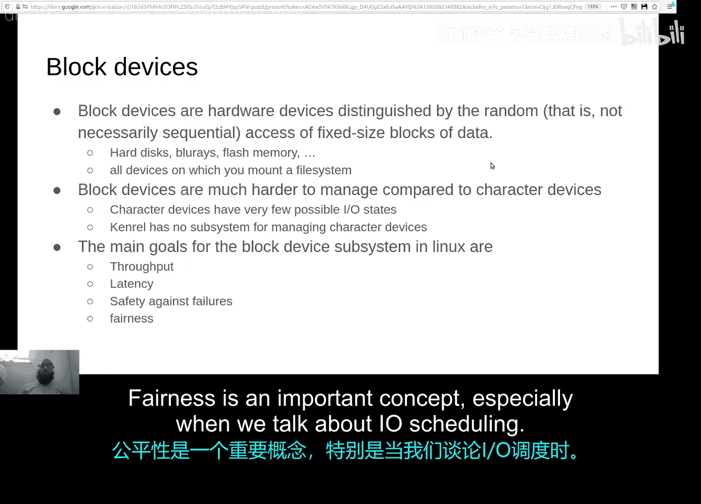
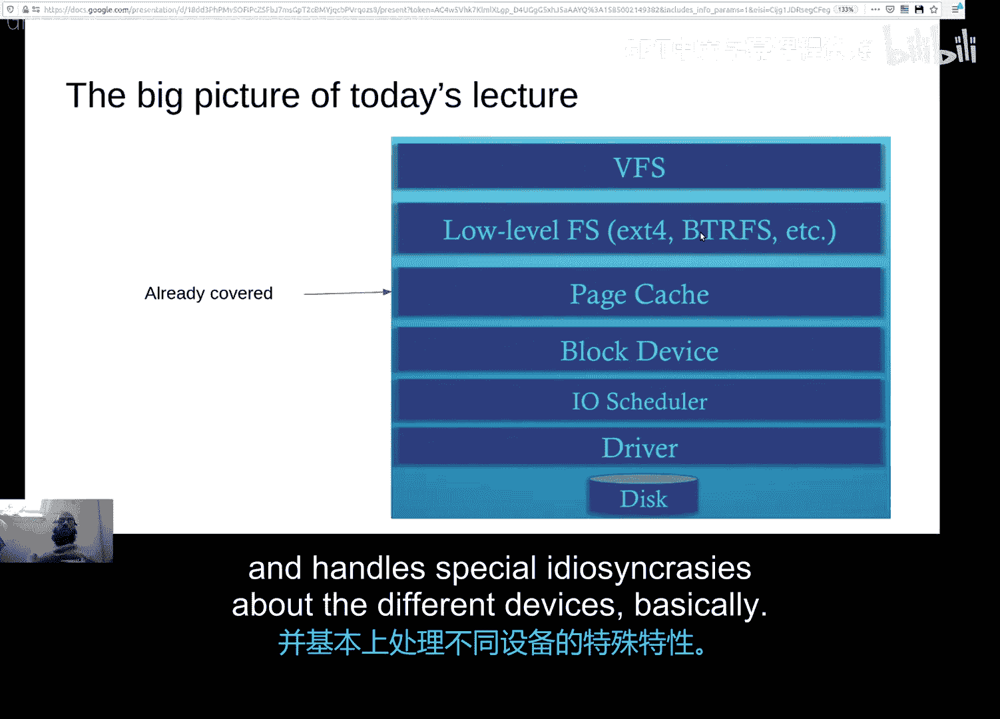
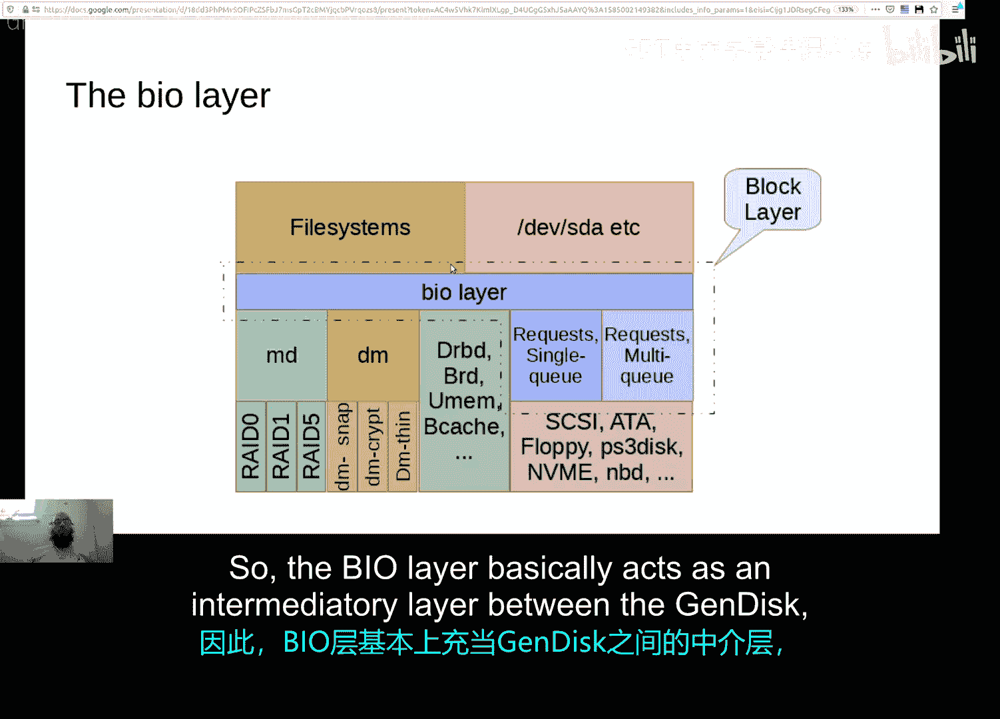
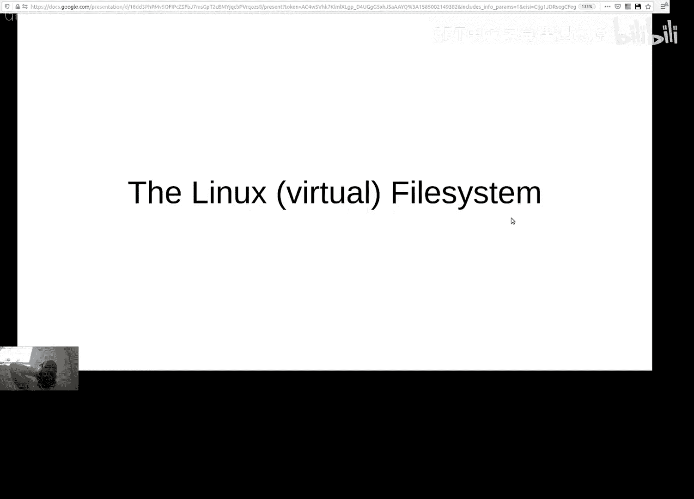
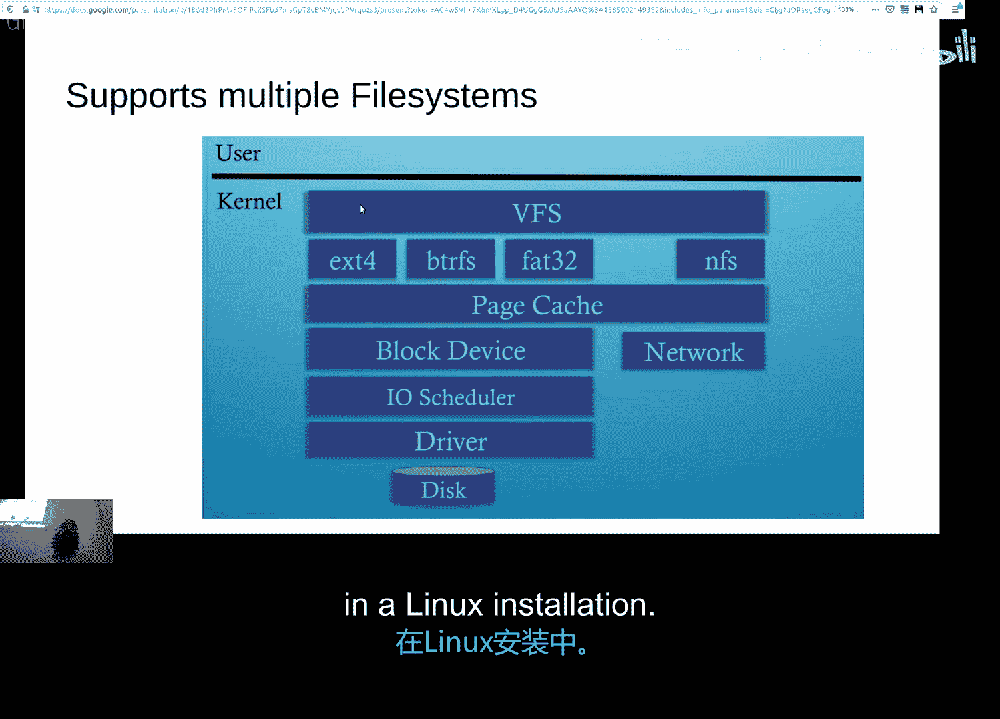
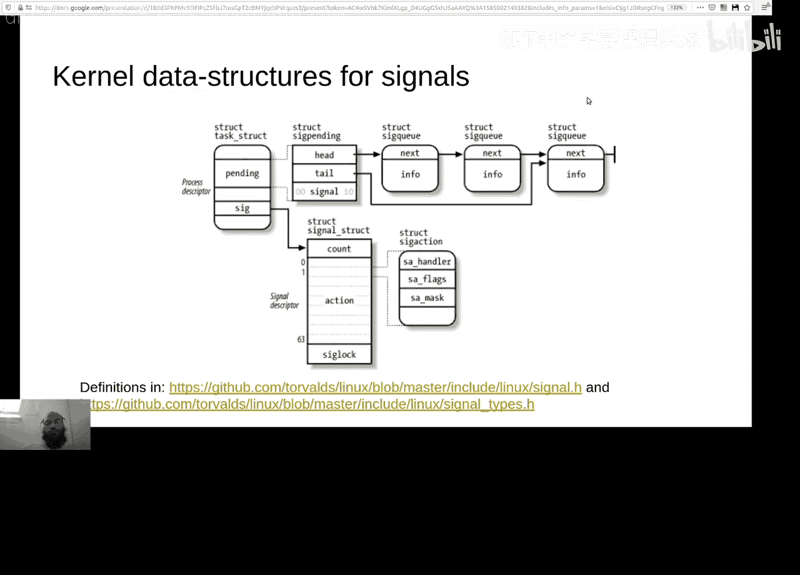
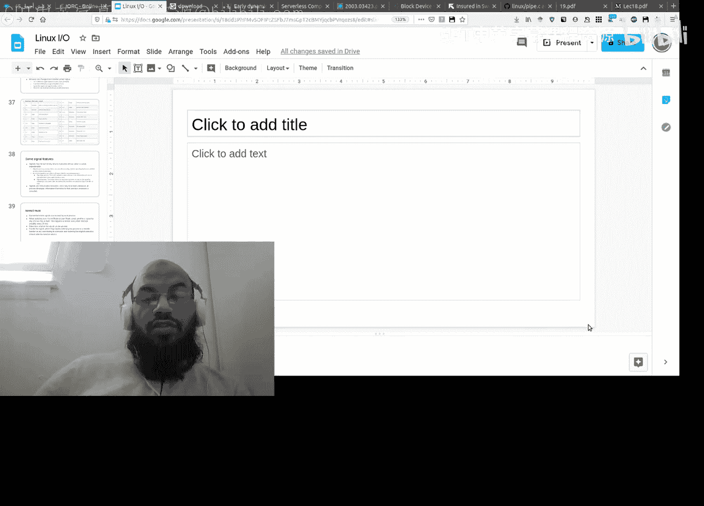

# 操作系统设计与实现：Lec22：Linux I/O (03/24/20) 📚

在本节课中，我们将学习Linux操作系统中关于I/O处理的几个核心主题。我们将深入探讨块I/O、文件系统和管道，并简要介绍信号机制。这些内容构成了Linux内核处理数据输入输出的基础。

---



## 块设备 I/O 💽



上一节我们介绍了I/O的基本概念，本节中我们来看看Linux如何处理块设备。块设备（如硬盘、SSD）以固定大小的数据块为单位进行随机访问，这与需要顺序访问的字符设备（如键盘）不同。内核为此专门设计了一个子系统来管理块设备，其主要目标是提高吞吐量、降低延迟、确保安全性和公平性。

### 块设备的结构

块设备的基本可寻址单元称为**扇区**，其大小通常为512字节到4KB。然而，软件层面定义了一个逻辑上的最小可寻址单元，称为**块**。块的大小必须是扇区大小的整数倍，且不能超过内存页的大小。例如，如果页大小为4KB，块大小可以是4KB、8KB等。

内核通过**缓冲区**和**缓冲区头**来管理内存中的块数据。每个缓冲区都与一个描述符（即缓冲区头）关联，该描述符记录了磁盘块与内存缓冲区之间的映射关系。其核心数据结构可简化为：
```c
struct buffer_head {
    sector_t b_blocknr;        // 磁盘上的块号
    struct buffer_head *b_this_page; // 页面中的其他缓冲区
    struct page *b_page;       // 存储缓冲区的内存页
    // ... 其他字段
};
```

### BIO层



BIO层是文件系统与块设备驱动程序之间的接口。每个块I/O请求都由一个`struct bio`结构表示，它描述了要读取或写入的目标设备、偏移量、数据大小以及内存位置。

`struct bio`包含一个`bio_vec`结构数组，每个`bio_vec`描述了一个在内存中连续的数据段，其形式为`(page, offset, length)`。这使得内核能够从内存中多个不连续的位置聚合数据，执行一次块I/O操作。关键字段如下：
```c
struct bio {
    struct bio_vec *bio_iovec; // 指向bio_vec数组
    sector_t bi_sector;         // 磁盘起始扇区
    unsigned short bi_vcnt;     // bio_vec的数量
    // ... 其他字段
};
```

### 请求队列与调度

每个块设备都维护一个**请求队列**来存储待处理的I/O请求。当队列非空时，设备驱动程序会从队列头部取出请求并提交给硬件处理。

对于传统的机械硬盘等单次只能处理一个请求的设备，Linux使用**单队列调度器**。它收集多个`bio`请求，并尝试将它们合并、排序，以最小化磁头寻道和旋转延迟，从而提高吞吐量。

随着多核处理器和SSD的普及，**多队列调度**被引入。它为每个CPU核心创建独立的软件暂存队列，避免了多核争用单一队列锁带来的性能瓶颈。驱动程序可以根据硬件能力，选择并行处理这些队列或将它们合并。

### I/O调度算法

I/O调度器位于页缓存和磁盘之间，负责决定请求的处理顺序。其核心目标是在提高整体性能的同时，兼顾公平性。以下是几种重要的调度算法：

以下是几种重要的调度算法：

*   **NOOP调度器**：基于简单的电梯算法，对请求进行最小程度的排序，并遵循FIFO原则。它确保读请求不会超越写请求。
*   **Deadline调度器**：为请求设置过期时间（如读请求500ms）。除了按磁盘位置排序的队列外，它还维护按提交时间排序的FIFO读/写队列。当队列头部的请求即将过期时，调度器会优先处理该队列，以防止请求被饿死。
*   **BFQ调度器**：一种基于预算的公平队列调度器。它为每个进程/线程分配一个以扇区数为单位的预算（比例份额），确保所有任务都能公平地获得I/O吞吐量。它还会显式地优待交互式和实时应用。
*   **Kyber调度器**：专为快速的多队列设备（如NVMe SSD）设计。它将同步读请求和同步写请求分配到不同的队列，并严格限制发送给驱动程序的请求数量，以平衡读写操作，防止一方饿死另一方。

选择哪种调度器取决于具体应用场景，最佳实践是对自己的应用进行基准测试。

---

## Linux虚拟文件系统 (VFS) 📂

在了解了底层的块I/O之后，我们向上看，看看Linux如何通过虚拟文件系统为用户提供统一的文件访问接口。VFS是内核中的一个抽象层，它屏蔽了不同具体文件系统（如EXT4、XFS、Btrfs）的差异，为用户和应用程序提供一致的操作界面。

VFS不仅仅是一个API包装器，它还负责缓存文件系统元数据、与页缓存协调数据缓存、实施统一的访问控制模型，并实现路径查找、文件打开等复杂通用例程。

### VFS的核心对象

VFS定义了几种核心对象来描述和管理文件系统：

*   **超级块对象**：代表一个已挂载的文件系统实例。
*   **索引节点对象**：代表文件系统中的一个文件（或目录）。
*   **目录项对象**：代表路径中的一个目录组成部分，用于缓存目录结构，加速路径查找。
*   **文件对象**：代表被进程打开的文件，包含文件的打开模式、当前读写位置等信息。

### 特殊文件系统示例：管道

管道是一种特殊的文件系统，它没有对应的磁盘映像，完全在内存中实现，用于进程间通信。管道提供单向数据流，一端写入，另一端读取。

当一个进程调用`pipe()`系统调用时，内核会创建一个管道，并返回两个文件描述符：一个用于读取，一个用于写入。通常，父进程创建管道后，会调用`fork()`创建子进程，子进程继承这些文件描述符，从而实现通信。

例如，执行命令 `ls | more` 时，shell会：
1.  调用`pipe()`创建管道。
2.  两次调用`fork()`创建两个子进程。
3.  第一个子进程（执行`ls`）将其标准输出重定向到管道的写入端。
4.  第二个子进程（执行`more`）将其标准输入重定向到管道的读取端。
5.  `ls`的输出被写入管道，`more`则从管道中读取并显示。



### 常规文件系统示例：EXT3



EXT3是Linux上历史悠久且广泛使用的日志文件系统。它在EXT2的基础上增加了**日志功能**，这极大地改善了系统崩溃或意外断电后的文件系统恢复速度。EXT3的主要特性包括：

*   **日志**：在将数据实际写入磁盘前，先在日志区域记录即将进行的操作。发生故障时，只需重放日志即可恢复一致性，避免了冗长的全盘检查。
*   **块组**：将磁盘块划分为多个组，每个组包含相邻磁道上的数据块和索引节点，这有助于降低平均磁盘寻道时间。
*   **预分配**：为常规文件预分配磁盘数据块，使得文件增长时更连续，减少碎片。

---

## 信号机制 📞

最后，我们简要探讨一下信号机制。信号是内核向用户进程发送异步通知的一种方式，可以看作是“反向的中断”。它用于通知进程某个特定事件已经发生（如定时器到期、子进程终止），或要求进程执行特定的信号处理函数。

### 信号的基本特性

信号是一个短消息，通常只用一个整数来标识。Linux定义了一系列标准信号，例如：
*   `SIGIO`：通知进程I/O操作已完成。
*   `SIGKILL`：强制终止进程。
*   `SIGSEGV`：表示进程进行了无效的内存访问。

进程可以自定义对信号的处理方式：使用自定义处理函数、采用内核默认行为、忽略信号或暂时阻塞信号。

### 内核的信号处理

内核处理信号分为两个阶段：
1.  **信号产生**：内核因某个事件（如硬件异常、其他进程发送）而更新目标进程的`task_struct`，表示有一个新信号待处理。
2.  **信号递送**：在内核即将将控制权交还给用户态进程时，检查该进程是否有未决且未被阻塞的信号。如果有，则内核会强制进程切换到对应的信号处理函数去执行，执行完毕后再恢复原来的执行上下文。

由于信号可能在进程执行的任何时刻产生，内核必须妥善保存那些发送给非运行状态进程的信号，直到该进程恢复执行。

---

## 总结 🎯

本节课我们一起学习了Linux I/O系统的几个关键部分。我们从最底层的**块设备I/O**开始，了解了块、缓冲区、BIO层以及复杂的I/O调度算法，它们共同协作以高效、公平地管理磁盘访问。接着，我们探讨了**虚拟文件系统**，它作为抽象层，统一了各种文件系统的访问，并以管道和EXT3为例说明了特殊和常规文件系统的工作方式。最后，我们简要介绍了**信号机制**，这是内核与用户进程进行异步通信的重要工具。





希望本课程能帮助你建立起对操作系统，特别是Linux内核设计与实现的深入理解。请保持安全，我们后会有期！