# 002：分布式系统架构

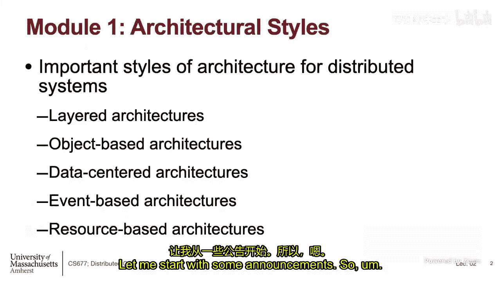

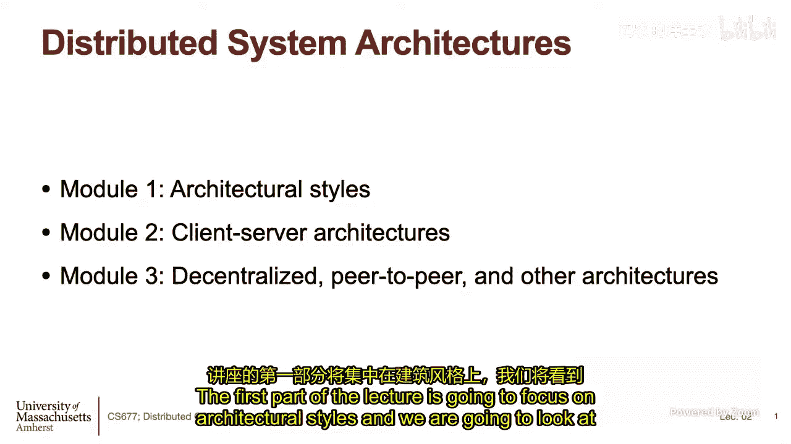

## 概述

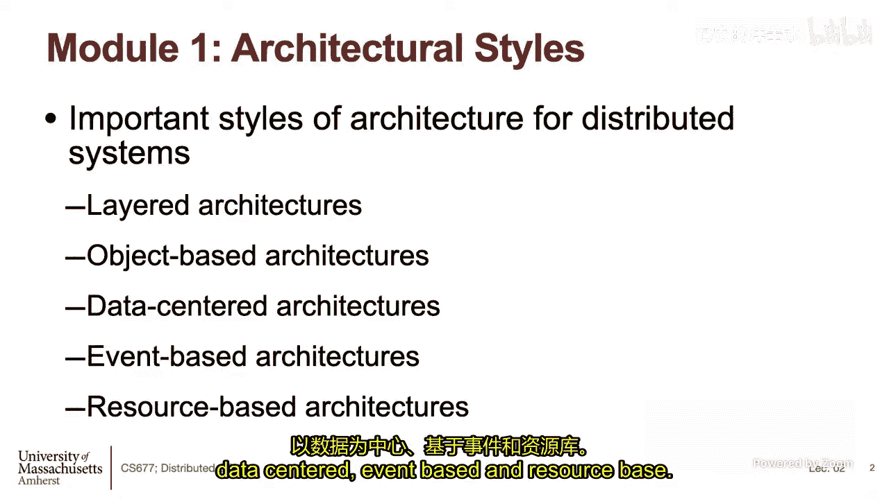

在本节课中，我们将学习分布式系统架构。我们将探讨几种不同的架构风格，包括分层架构、面向对象架构、事件驱动架构、共享数据空间架构和面向资源架构。此外，我们还将深入了解客户端-服务器架构及其变体，如客户端-代理-服务器架构，并介绍去中心化的点对点系统以及自管理系统的概念。

---

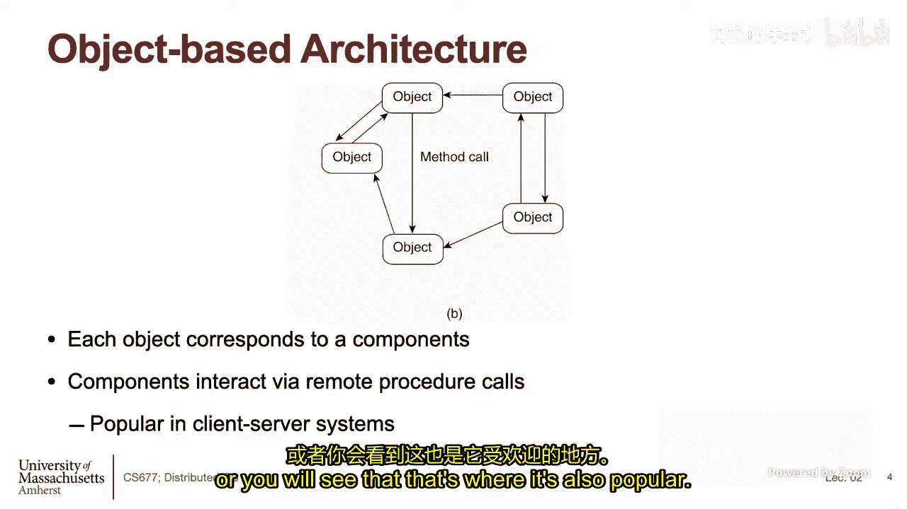

## 第一部分：架构风格

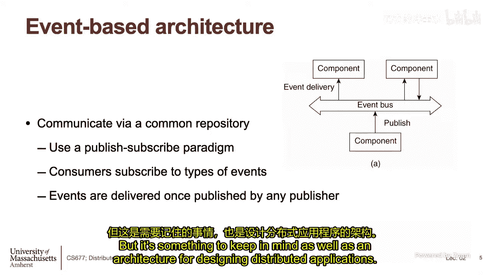

上一节我们介绍了课程概述，本节中我们来看看分布式系统的几种核心架构风格。架构定义了系统的组件视图，即系统由哪些组件构成以及它们如何交互。

### 分层架构 🏗️

在分层架构中，系统组件被组织成一系列层级。每个层级只能与其直接的上层和下层通信。例如，第 **i** 层只能与第 **i-1** 层和第 **i+1** 层通信，而不能直接与第 **i+2** 层通信。这种设计模式在网络协议栈（如TCP/IP栈）中很常见。在分布式系统中，多层应用是分层架构的典型例子，其中应用被划分为多个“层”或“层”，每层只与相邻层交互。

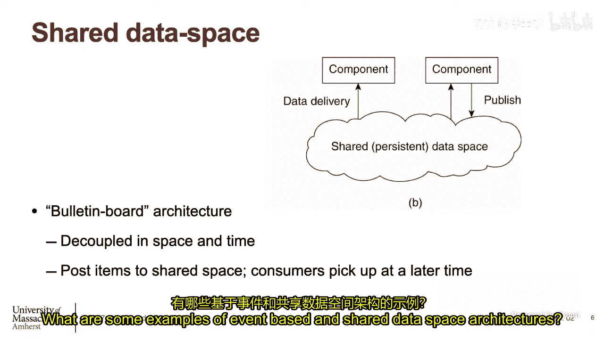

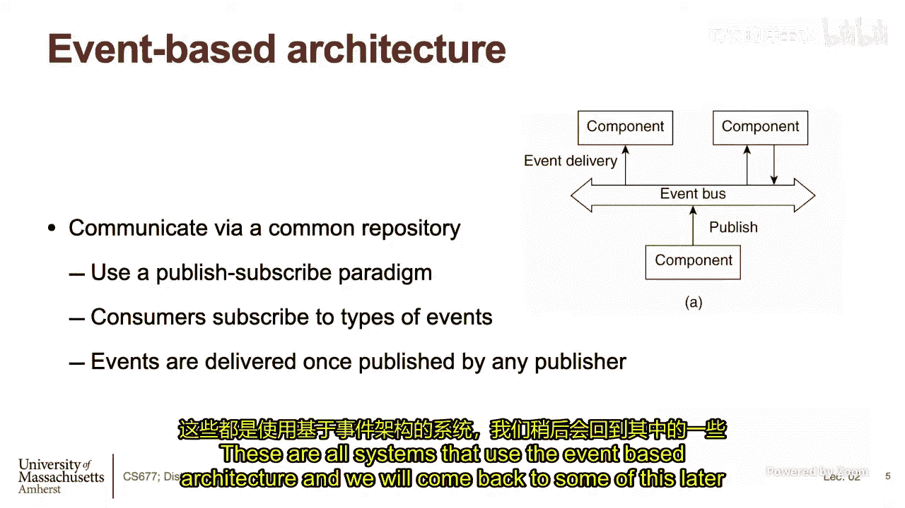

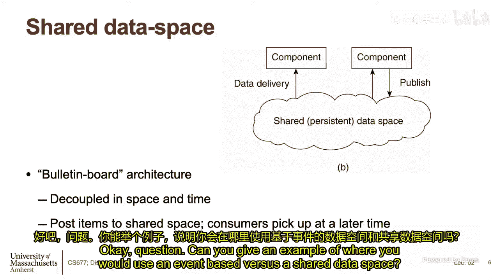

### 面向对象架构 🧱

面向对象架构借鉴了面向对象编程的思想。系统的组件被设计为对象。与单进程的Java程序不同，这些对象可以是分布在多台机器上的独立进程。对象之间通过调用其他对象的公共方法进行通信。与分层架构相比，这种架构提供了更大的灵活性，因为任何组件都可以调用任何其他组件的方法。远程过程调用（RPC）是这种架构的常见实现方式。

### 事件驱动架构 ⚡

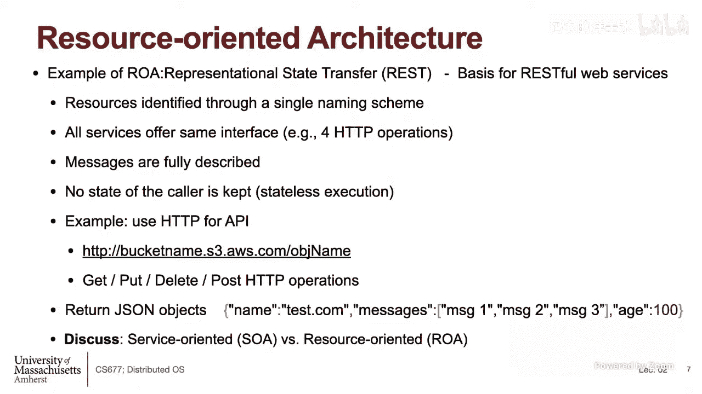

在事件驱动架构中，系统组件分为两类：**生产者**（发布者）和**消费者**（订阅者）。生产者生成数据或事件，消费者处理这些数据或事件。两者之间的核心组件是**事件总线**。事件总线负责确保生产者发布的事件被正确地传递给订阅了相应事件的消费者。这是一种发布/订阅模式。

以下是事件驱动架构的核心概念：
*   **生产者/发布者**：生成事件。
*   **消费者/订阅者**：消费事件。
*   **事件总线**：路由事件，确保它们被传递给正确的订阅者。

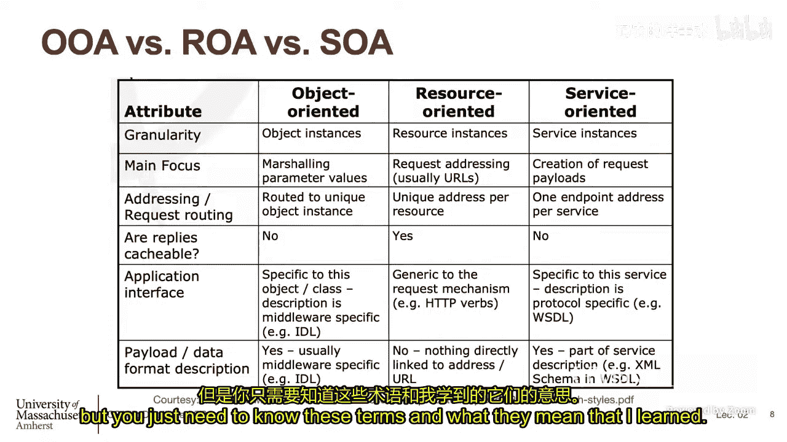

### 共享数据空间架构 📋

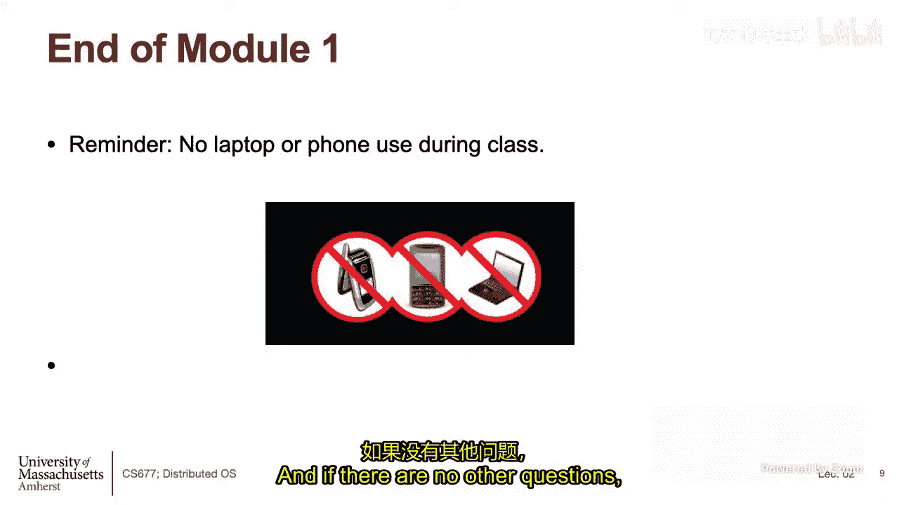

共享数据空间架构，也称为公告板架构。在这种架构中，组件同样分为发布者和订阅者。发布者将信息（“通知”）发布到一个共享的、中心化的数据空间（如数据库），而不是直接发送给特定接收者。订阅者随后可以查询这个数据空间，寻找与其兴趣匹配的信息。这是一种间接的、基于共享存储的通信方式。

### 面向资源架构 🌐

面向资源架构，通常指**RESTful**架构。在这种架构中，所有资源（如数据、服务）都通过唯一的URL标识。组件间使用标准的HTTP方法（如`GET`、`POST`、`PUT`、`DELETE`）对这些URL进行操作来实现通信和状态转移。响应通常以JSON等格式返回。这是现代Web服务的基础架构。

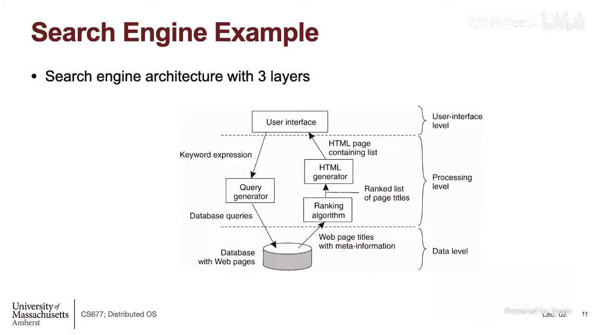

---

## 第二部分：客户端-服务器架构

上一节我们介绍了多种基础架构风格，本节中我们聚焦于最经典的**客户端-服务器**架构及其演进。

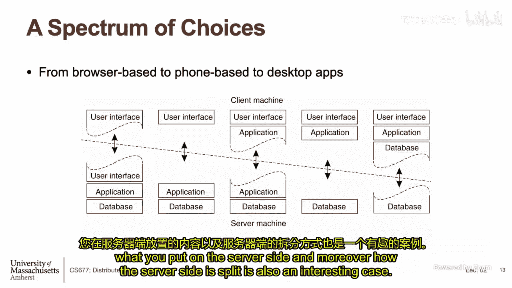

### 基本概念与交互时序

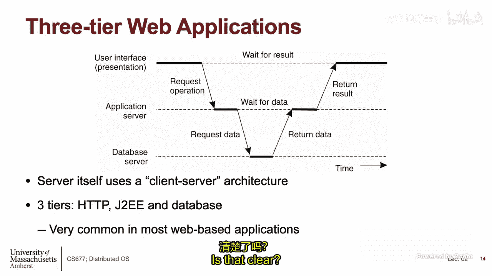

在客户端-服务器架构中，一些组件（**服务器**）提供服务，另一些组件（**客户端**）请求和使用这些服务。最简单的形式是一个服务器为多个客户端提供服务。

我们可以用时序图来理解这种交互。在时序图中，时间沿水平轴推进，每个组件有一条生命线。虚线表示组件在等待，实线表示组件在执行。例如，客户端发送请求后等待，服务器接收请求后处理，然后返回响应，客户端收到响应后继续执行。

### 多层应用示例：搜索引擎

一个典型的多层应用示例是简易搜索引擎，它包含三层：
1.  **用户界面层**：客户端浏览器中的搜索框。
2.  **处理层（应用层）**：服务器端，负责查询生成、数据库检索、结果排序和HTML页面生成。
3.  **数据层**：存储网页索引的数据库。

这种设计清晰地分离了关注点，是分布式应用的常见模式。

### 架构设计谱系

在实际设计中，三层（用户界面、应用逻辑、数据）可以灵活地部署在客户端和服务器端，形成不同的架构变体。例如：
*   所有三层都在服务器端，客户端只有简单的界面（如传统Web应用）。
*   用户界面在客户端，应用逻辑和数据在服务器端（如搜索引擎）。
*   用户界面和应用逻辑的一部分在客户端（如手机App），另一部分应用逻辑和数据在服务器端。
*   用户界面和应用逻辑在客户端，仅数据在远程服务器（如某些桌面应用）。

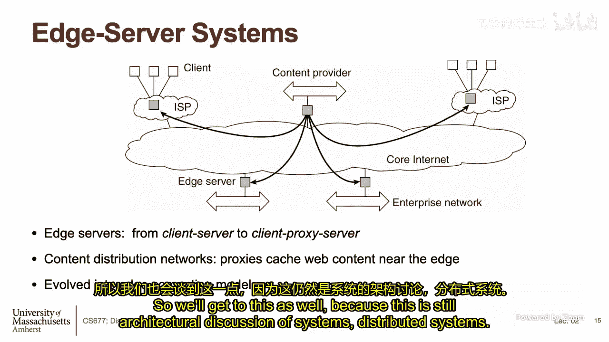

这种灵活性允许开发者根据性能、安全性和开发复杂度进行权衡。

### 客户端-代理-服务器架构

为了提升可扩展性和降低延迟，引入了**代理**组件，形成客户端-代理-服务器架构。代理服务器部署在靠近客户端的网络边缘。

以下是其工作流程：
1.  客户端将请求发送给代理。
2.  代理检查是否能本地处理请求（例如，请求的内容已缓存）。
3.  如果可以，代理直接响应客户端，请求结束。
4.  如果不可以，代理将请求转发给原始服务器，并将服务器的响应返回给客户端。

这种架构的好处是：
*   **减轻服务器负载**：代理处理了部分请求。
*   **降低客户端延迟**：代理离客户端更近。
*   **提升可扩展性**：可以部署多个代理来服务大量客户端。

内容分发网络（CDN）和边缘计算都源于此架构思想。

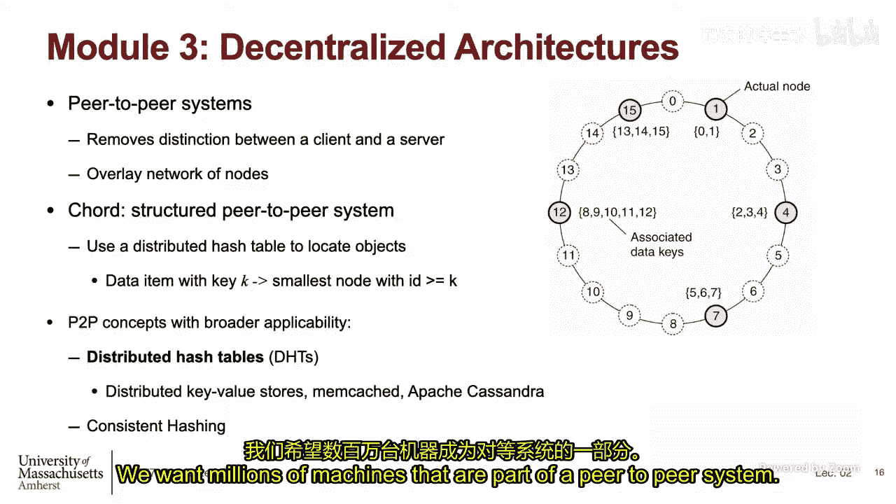

---

## 第三部分：去中心化与点对点架构

上一节我们讨论了以服务器为中心的架构，本节中我们转向完全去中心化的**点对点**架构。在P2P系统中，所有节点（称为对等点或节点）地位平等，既可以充当客户端请求服务，也可以充当服务器提供服务。

### 结构化P2P系统：分布式哈希表

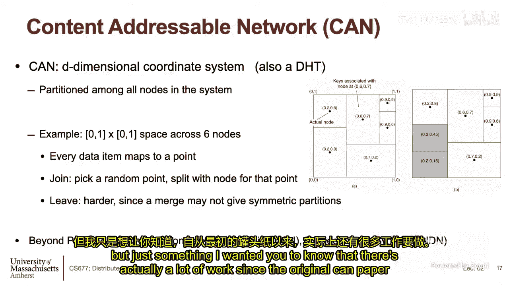

结构化P2P系统的核心是实现一个**分布式哈希表**（DHT）。DHT将整个哈希表的数据分布到网络中的多个节点上。

**Chord环示例**：
在Chord系统中，节点和数据的键被映射到一个环形标识符空间（例如0到2^m-1）。每个节点负责环上从它自身到前一个节点之间的一段标识符区间。当一个节点加入或离开时，只需要调整相邻节点的责任区间，从而实现数据的动态分布和查找。

**内容可寻址网络**：
CAN是另一种DHT，它将键空间视为一个多维笛卡尔空间（例如二维网格）。每个节点负责空间中的一个特定区域（一个“区域”）。查询通过在这些区域间路由来定位数据。多维键可以通过拼接转化为一维键，其表达能力是等价的。

### 非结构化P2P系统

在非结构化P2P系统中，节点之间随机连接，没有固定的拓扑结构。当需要查找某个资源时，系统采用**泛洪**机制：查询请求被发送到发起节点的所有邻居，邻居再转发给它们的邻居，直到找到拥有该资源的节点或达到跳数限制。这种方式简单但会产生大量网络流量。

**超级节点架构**：
为了减少泛洪带来的开销，非结构化P2P系统（如早期的Skype）引入了超级节点。网络被划分为多个组，每组选出一个能力较强的节点作为超级节点。超级节点负责维护组内所有普通节点的资源信息并处理查询。这样，泛洪仅发生在超级节点之间，大大降低了普通节点的负载。

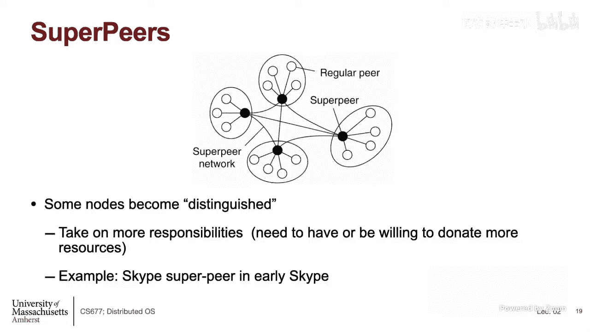

### BitTorrent：协作式文件分发

BitTorrent是一个用于大文件分发的流行P2P协议，它结合了多项创新：
1.  **文件分块**：将大文件分割成许多小块。
2.  **并行下载**：下载者同时从多个拥有不同块的节点下载，提高下载速度。
3.  **跟踪器**：一个中心化或分布式的服务器，用于记录哪些节点拥有哪些文件块。
4.  **激励机制**：采用“tit-for-tat”策略，优先为那些为自己上传数据的节点提供下载服务，鼓励节点贡献上传带宽，防止“只下载不上传”的自私行为。

---

## 第四部分：自管理（自治）系统

上一节我们探讨了去中心化系统，本节最后我们来看看具有智能的**自管理**或**自治**系统。这类系统能够监控自身状态，并根据预定义策略自动采取纠正措施。

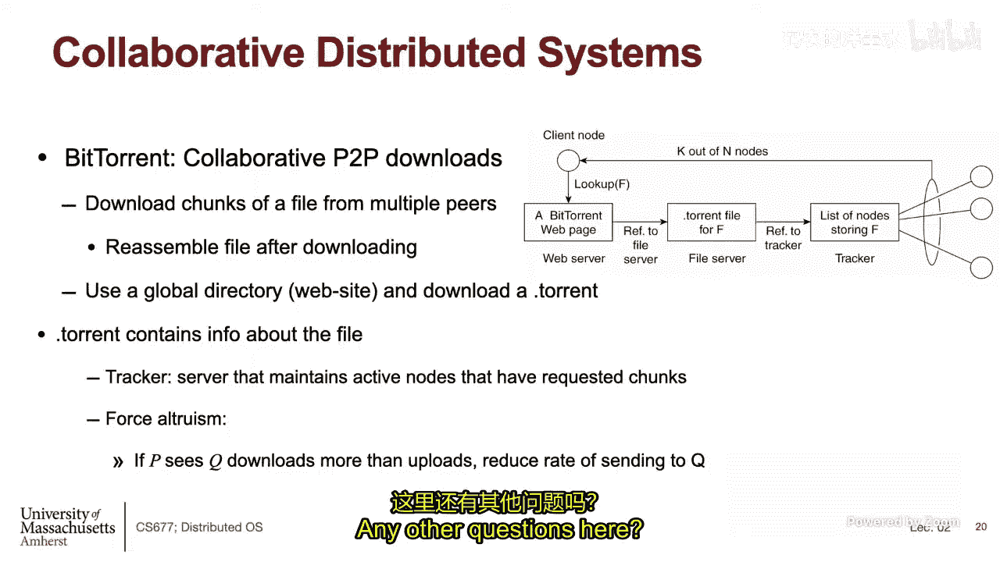

一个典型的例子是**自愈系统**，它能够检测组件故障并自动启用备用组件接管工作。更广泛的自管理应用体现在云平台的自动伸缩功能上：系统持续监控网站负载，预测未来需求，并在负载升高时自动配置更多服务器资源，在负载降低时缩减资源，从而在无需人工干预的情况下保证性能并优化成本。

---

## 总结

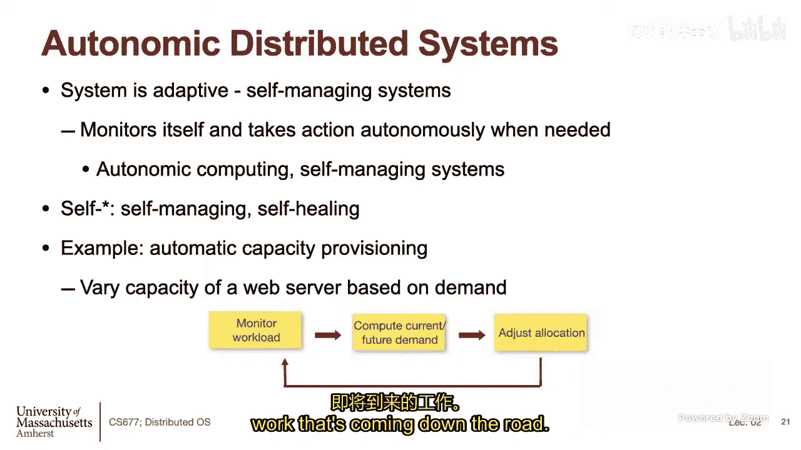

本节课我们一起学习了分布式系统的核心架构。我们从分层、面向对象、事件驱动等基础架构风格入手，深入剖析了经典的客户端-服务器模型及其多层、代理扩展形态。接着，我们探索了去中心化的点对点世界，了解了结构化DHT（如Chord、CAN）和非结构化P2P（如超级节点、BitTorrent）的工作原理。最后，我们介绍了能够自我监控和调整的自管理系统。这些架构思想为设计和理解复杂的分布式应用奠定了坚实基础。