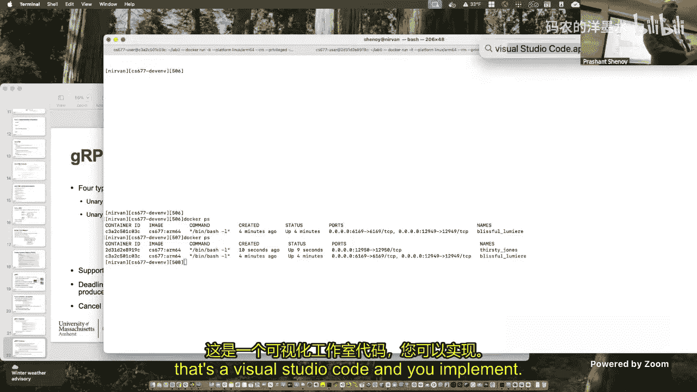
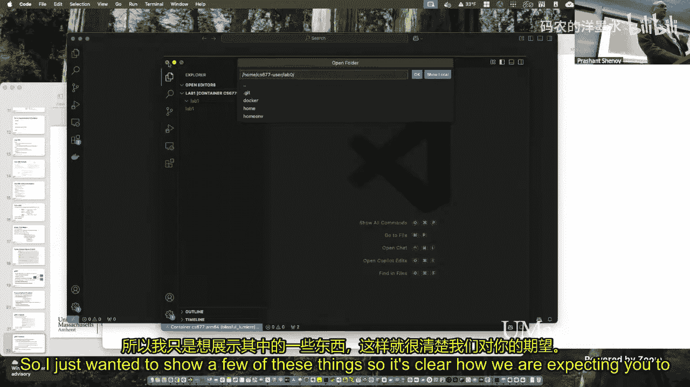
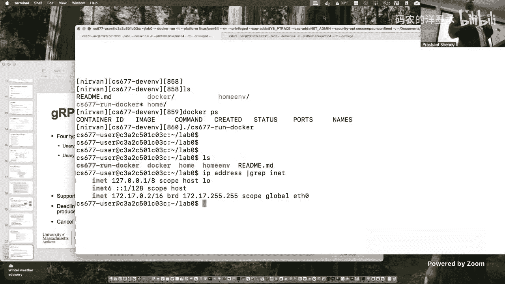

# 004：远程方法调用 🚀

在本节课中，我们将继续讨论远程过程调用，并深入探讨远程方法调用。我们将了解RMI在不同编程语言（如Java、Python、C）中的实现方式，并介绍轻量级RPC、异步RPC等不同模型。课程最后，我们将介绍如何使用Docker容器进行实验开发。

## 概述 📋

上一节我们介绍了远程过程调用的基本概念。本节中，我们将看看远程方法调用，这是RPC在面向对象编程（特别是Java）中的具体实现。我们还将探讨RPC的不同变体，如轻量级RPC和异步RPC，并了解如何在Java、Python、C和gRPC等不同环境中实现远程调用。

---

## 轻量级RPC模型 ⚡

轻量级RPC是RPC的一个特例，其中客户端和服务器进程位于同一台机器上。由于两者在同一台机器上，我们可以优化RPC运行时系统，绕过网络协议栈的处理，从而提高效率。

### 工作原理
在标准RPC中，存根代码会生成消息并通过网络发送。在轻量级RPC中，由于客户端和服务器在同一台机器上，我们可以使用共享内存缓冲区进行通信，而不是通过网络套接字。

**核心思想**：客户端将RPC调用的参数放入一个共享内存缓冲区，然后通知服务器进程。服务器从缓冲区读取数据并执行方法，最后将结果写回缓冲区。这种方式避免了网络协议处理的开销。

**关键步骤**：
1.  客户端将参数压入栈。
2.  客户端通过系统调用（trap）通知操作系统内核。
3.  内核将包含参数的栈内存区域共享给服务器进程的地址空间。
4.  服务器进程从共享内存读取参数，执行被调用的方法。
5.  服务器将返回值放入共享内存，并通知客户端。

**优势**：相比基于套接字的网络通信，直接读写共享内存缓冲区效率更高，因为它消除了协议栈处理、消息构造和网络传输的延迟。

---

## RPC的不同调用模型 🔄

除了标准的同步RPC，还存在其他几种调用模型，它们的区别主要在于客户端与服务器的交互方式，特别是客户端等待什么（或不等待）。

以下是几种主要的RPC模型：

*   **同步RPC**：客户端发起RPC调用后，会**阻塞并等待**，直到从服务器收到响应。这是最常用、最直观的模型。
*   **异步RPC**：客户端发起RPC调用后，**不等待调用完成或回复**。它只确保调用请求已送达服务器，然后立即继续执行。服务器处理完请求后，会通过另一个（异步）RPC调用将结果发送回客户端。
*   **单向RPC**：比异步RPC更简单。客户端发起调用后立即继续执行，**甚至不等待调用请求到达服务器**。它不期望也不处理任何回复。
*   **多播RPC**：客户端的一个RPC调用会**同时发送给多个服务器进程**。这在服务器复制（replication）的场景中很有用，例如需要向多个副本发出相同请求时。

对于本课程中的大部分任务，你将使用默认的**同步RPC**模型。但了解其他模型有助于你理解在构建不同风格的分布式服务器时可能用到的技术。

---

## 远程方法调用 🖥️

在Java世界中，远程方法调用是实现RPC思想的主要方式。RMI允许你像调用本地对象方法一样调用远程对象上的方法，从而在分布式系统中实现面向对象的编程抽象。

### RMI架构
RMI的架构与RPC类似，但使用了面向对象的术语。
*   **远程对象**：其方法可以被其他进程远程调用的对象。
*   **接口与实现分离**：你需要为远程对象定义一个接口（声明其公共方法），而实现则驻留在服务器上。客户端只需要接口。
*   **存根与骨架**：在Java中，客户端存根称为**代理**，服务器存根称为**骨架**。这些代码由工具自动生成，负责网络通信、参数编组等底层细节。

**调用流程**：
1.  客户端调用代理对象上的方法。
2.  代理将方法调用信息（方法名、参数）序列化，并通过网络发送给服务器。
3.  服务器端的骨架接收网络消息，反序列化，并调用实际远程对象上的对应方法。
4.  方法执行后，返回值被序列化并通过网络发送回客户端代理。
5.  客户端代理反序列化返回值，并将其返回给调用者。

### Java序列化
在RPC中，我们需要处理数据表示差异（如大端序/小端序），这通过编组/解编组实现。在Java中，这个过程更简单，因为Java内置了**对象序列化**机制。序列化可以将对象转换成与硬件无关的字节流。因此，在RMI中，参数和返回值通过Java序列化进行传输，自动处理了平台差异。

### 参数传递
在RPC中，参数通常按值传递，不能传递指针（引用），因为指针在远程机器上没有意义。
在Java RMI中，规则略有放宽：
*   **标准Java对象**：作为参数传递时，按**值**传递（即对象被序列化，副本被发送）。
*   **远程对象**：如果一个对象本身支持RMI（例如，实现了`Remote`接口），那么它作为参数传递时，可以按**引用**传递。这是因为接收方已经具备通过RMI机制定位和调用该远程对象的能力。

### 服务器定位（绑定）
客户端如何找到服务器？这通过**命名服务**（在Java中称为RMI注册表）实现。
*   **服务器**：启动时，将其远程对象注册到RMI注册表。
*   **客户端**：首先联系RMI注册表，根据名称查找远程对象的引用（存根），然后通过该存根进行方法调用。
绑定可以是显式的（客户端主动调用`lookup`）或隐式的（在首次方法调用时由运行时系统自动处理）。

### 同步问题
服务器进程可能同时处理多个客户端的RMI请求（多线程服务器）。如果这些并发请求修改服务器的共享状态，就必须使用同步机制（如锁）来防止数据损坏。
在Java中，可以使用`synchronized`关键字来确保同一时刻只有一个线程执行某个方法。但需要注意，这种锁是服务器进程内的。在分布式场景下，如果持有锁的客户端崩溃，可能导致服务器死锁，这需要更复杂的**分布式锁**机制来解决，我们将在后续课程中讨论。

---

## 不同语言中的RPC/RMI实现 🌐

### C/C++ 中的 RPC
这是最原始的RPC系统。开发过程涉及一个特殊的接口定义文件（`.x`文件），并使用`rpcgen`工具。
**开发流程**：
1.  编写接口定义文件（`.x`），描述RPC方法和数据结构。
2.  使用`rpcgen`编译`.x`文件，自动生成客户端和服务器存根代码、头文件以及XDR（外部数据表示）例程。
3.  分别编写客户端和服务器的主逻辑代码。
4.  将自动生成的代码与你编写的代码一起编译，生成可执行文件。
这个过程（编写IDL，用工具生成存根）是许多RPC系统的通用模式。

**服务器定位**：在Unix世界中，使用**端口映射器**进程作为命名服务。服务器启动时向端口映射器注册自己（服务名、版本号、监听端口）。客户端首先查询端口映射器以获取服务器的端口信息。

### Python 中的 RMI (Pyro)
Pyro（Python Remote Objects）为Python提供了类似Java RMI的功能。
**基本用法**：
1.  定义一个包含远程方法的类。
2.  创建一个Pyro守护进程（daemon），并将你的类实例注册到该守护进程。
3.  服务器启动事件循环，等待RMI调用。
4.  客户端可以通过硬编码的对象URI（不推荐）或查询Pyro命名服务来获取远程对象代理，然后调用其方法。

### gRPC (Google RPC) 🏗️
gRPC是一个现代、高性能、跨语言的RPC框架。
**核心特性**：
*   **语言无关性**：客户端和服务器可以用不同语言编写（如Java服务器，Python客户端）。
*   **基于HTTP/2**：使用HTTP/2作为传输协议，支持双向流、头部压缩等特性。
*   **使用Protocol Buffers**：作为默认的接口定义语言（IDL）和序列化机制。

**Protocol Buffers**：是一种语言中立、平台无关的序列化数据结构机制。你需要在`.proto`文件中定义数据结构和服务接口，然后使用`protoc`编译器生成目标语言的代码（用于数据序列化和RPC存根）。

**服务定义示例**：
```protobuf
service GreetingService {
  rpc SayHello (HelloRequest) returns (HelloReply) {}
}
message HelloRequest {
  string name = 1;
}
message HelloReply {
  string message = 1;
}
```

**丰富的调用类型**：gRPC不仅支持同步和异步调用，还支持流式RPC：
*   **客户端流**：客户端发送一系列消息，服务器返回单个响应。
*   **服务器流**：客户端发送单个请求，服务器返回一系列消息。
*   **双向流**：客户端和服务器都可以发送一系列消息。

---

## 实验环境与Docker容器 🐳

为了确保统一的开发环境，本课程将使用Docker容器进行所有实验和编程练习。

### 使用容器
1.  **启动容器**：运行实验目录中的`run-docker`脚本。这会在后台启动一个Docker容器，并为你提供一个容器内的终端。
2.  **访问代码**：实验代码会自动挂载到容器内的特定目录（如`lab0/`）。在此目录下的修改会持久化到你的主机文件系统。
3.  **运行多个容器**：如果需要多个容器（例如，分别运行客户端和服务器），可以使用`run-docker -f`命令启动新的独立容器。
4.  **查看容器信息**：使用`docker ps`命令查看运行中的容器及其映射的端口号。使用`ip addr`命令查看容器的IP地址。这些信息用于配置网络通信。
5.  **使用VS Code开发**：你可以使用Visual Studio Code的“Remote - Containers”扩展直接连接到正在运行的Docker容器，在熟悉的IDE中编辑和调试容器内的代码。

### 注意事项
*   确保在实验目录内进行编码，以保证文件被持久化。
*   避免在容器内再次运行`run-docker`脚本。
*   使用统一容器环境可以避免“在我机器上能运行”的问题，简化调试和评分。

---

## 总结 🎯



本节课我们一起学习了远程方法调用的核心概念与实现。
*   我们首先探讨了**轻量级RPC**，它通过共享内存优化了同机进程间的远程调用。
*   接着，我们回顾了多种**RPC调用模型**，包括同步、异步、单向和多播RPC，理解了它们各自的应用场景。
*   然后，我们深入研究了**Java RMI**，了解了其面向对象的远程调用方式、序列化机制、参数传递规则以及同步问题。
*   之后，我们概览了在**C/C++**、**Python (Pyro)** 以及现代框架 **gRPC** 中实现远程调用的不同方法，特别是gRPC的跨语言特性和流式通信支持。
*   最后，我们介绍了如何使用**Docker容器**来建立统一、可靠的实验开发环境。





掌握这些基础知识对于后续实现分布式应用至关重要。接下来的实验将使你有机会亲手实践这些概念。