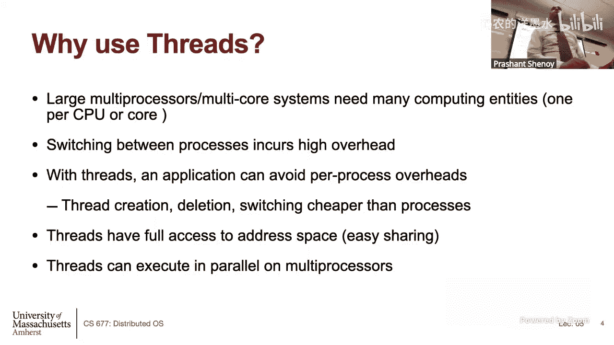
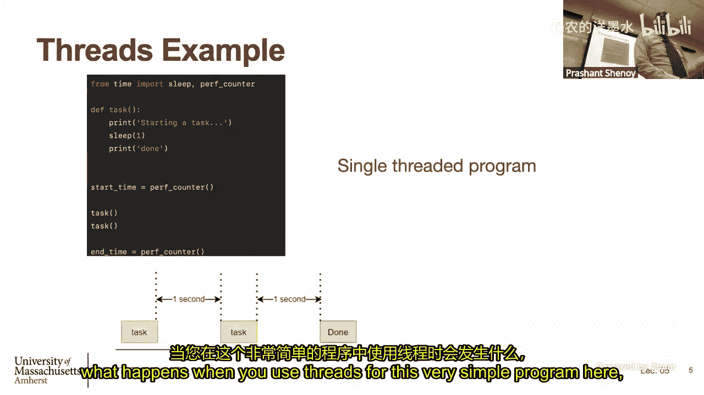
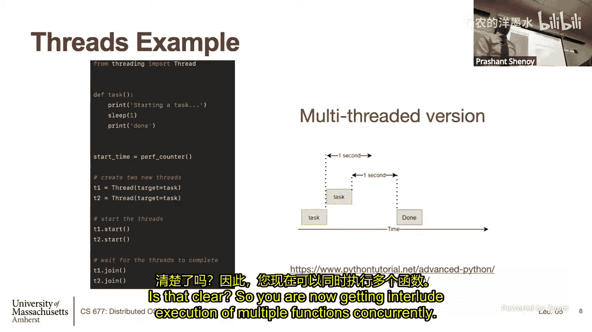
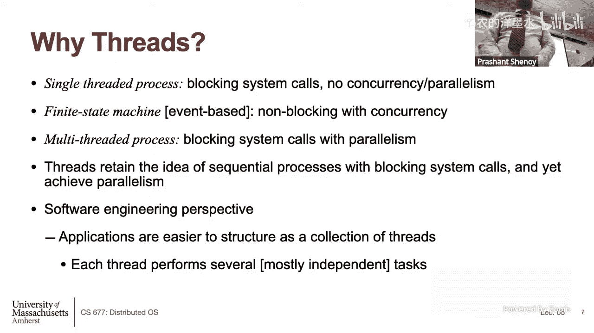
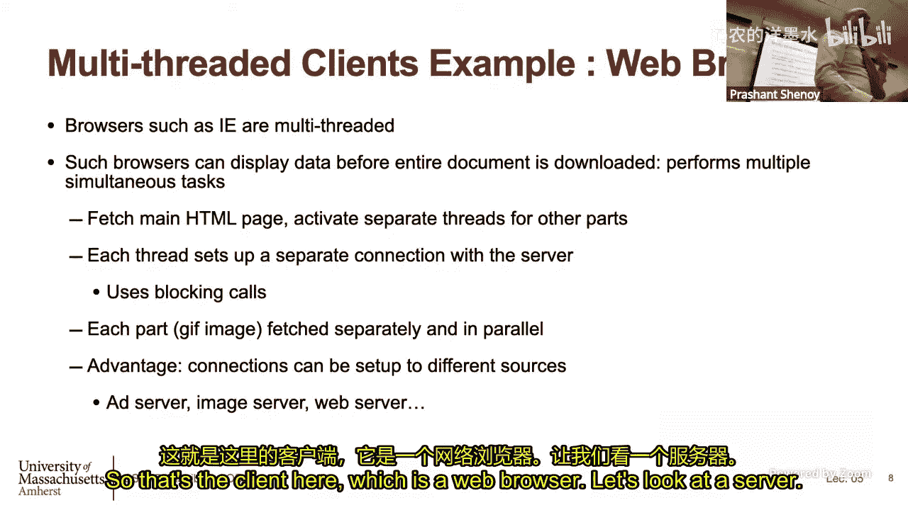
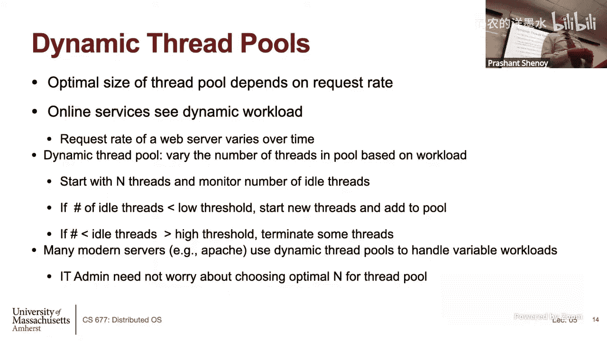
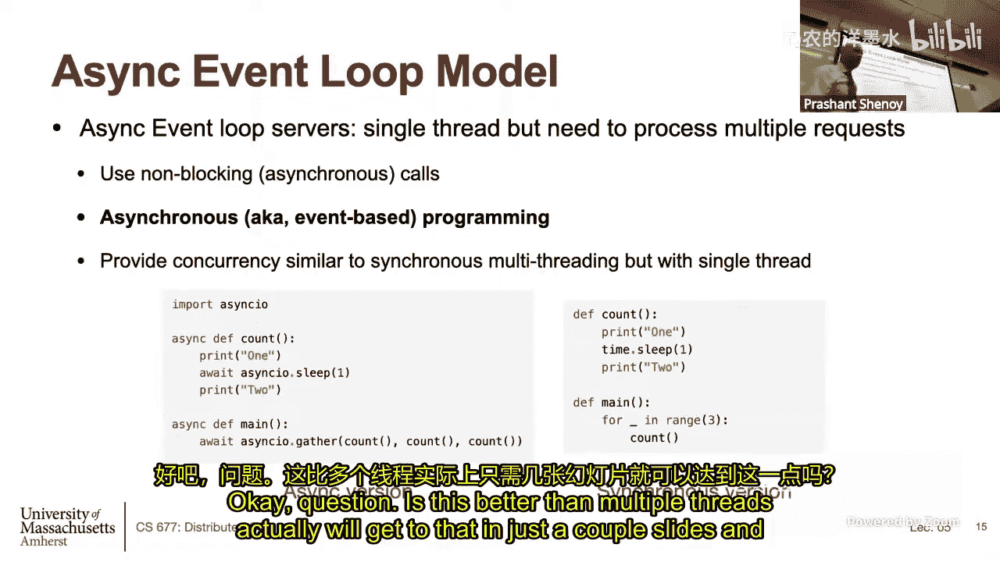
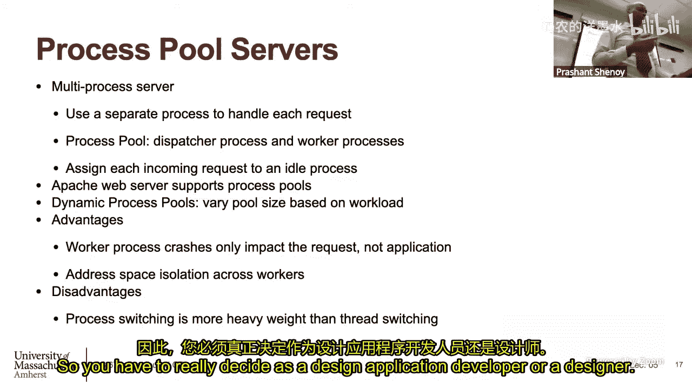
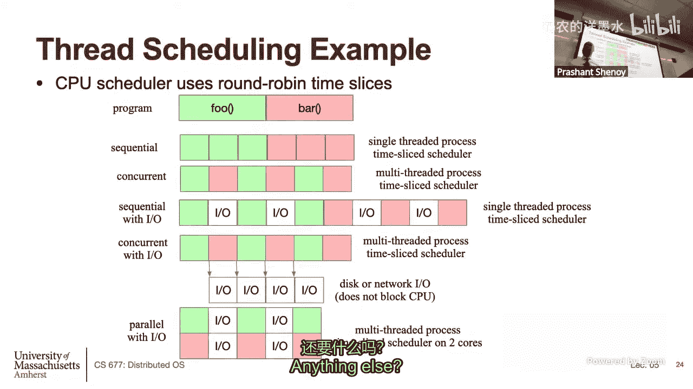

# 005：并发模型

在本节课中，我们将要学习分布式系统中的并发模型。我们将从线程的基本概念开始，然后探讨如何使用线程或类似功能来构建服务器应用程序。最后，我们将讨论线程的调度机制，为后续的调度主题打下基础。

## 进程与线程

上一节我们介绍了课程安排，本节中我们来看看并发的基础概念：进程与线程。

一个传统的进程，根据操作系统本科课程的定义，是一个正在执行的程序。当运行一个程序时，操作系统会创建一个进程来执行它。

从底层来看，进程拥有分配给它的内存，这部分内存区域称为地址空间。地址空间包含进程将要执行的代码和所需的数据（变量等）。此外，还有一个执行代码的部分，我们称之为控制线程。传统进程只有一个控制线程，意味着在任何给定时刻只能执行一条指令。

线程则是对进程概念的泛化。在一个多线程进程中，一个地址空间内可以有多个控制流并发执行。所有线程共享同一个地址空间，因此它们可以访问进程的所有数据。这可以在某些情况下实现并行性。但只要有线程执行，就需要使用同步机制，因为当多个线程访问共享数据时，必须使用锁等同步原语来保护数据，否则数据可能被破坏。

以下是线程与进程的关键区别：
*   **共享资源**：线程共享进程的地址空间和资源（如打开的文件）。进程通常拥有独立的地址空间。
*   **创建开销**：创建线程比创建进程开销小。
*   **切换开销**：在同一进程的线程间切换（上下文切换）比在进程间切换开销小。

## 为何使用线程？

上一节我们了解了线程是什么，本节中我们来看看使用线程的优势。

使用线程主要有以下优势：
1.  **并行性**：当进程运行在具有多核或多处理器的机器上时，每个线程可以在不同的核心上执行，从而实现代码的并行执行。
2.  **高效的上下文切换**：在同一进程的线程间切换比在进程间切换成本低得多，因为线程共享内存地址空间，只需保存和恢复寄存器状态。
3.  **低廉的创建与销毁开销**：创建线程比创建进程开销小，因为进程已经存在，无需重新分配内存。
4.  **并发性**：即使是在单核机器上，线程也能提供并发性。当一个线程因I/O操作而阻塞时，其他线程可以继续执行，使得整个进程能够持续取得进展。

## 线程应用示例

理解了线程的优势后，我们通过具体例子来看看线程如何应用。

考虑一个简单的单线程程序，它顺序调用一个函数两次，每次函数执行都会睡眠一秒。其时间线是顺序的：第一次调用完成（包括睡眠）后，才开始第二次调用。

现在，我们使用两个线程来执行相同的任务。主程序创建两个线程，每个线程负责一次函数调用。即使在单核CPU上，执行也会交错进行：当第一个线程执行并进入睡眠（阻塞）时，CPU调度器会切换到第二个线程执行。这样，两个函数调用实现了并发执行，无需等待前一个调用完全结束。

## 服务器并发模型

在客户端（如浏览器）中，线程常被用于划分不同功能模块（如网络通信、页面解析、渲染）。在服务器端，线程则主要用于并发处理多个客户端请求。

一个典型的多线程服务器架构包含一个调度器（或监听器）线程和多个工作线程。调度器线程等待传入的请求，一旦收到请求，便将其分配给一个空闲的工作线程进行处理。这种设计允许服务器同时服务多个客户端。

以下是几种常见的服务器并发模型：

### 1. 顺序服务器
这是最简单的模型，服务器在一个单线程的无限循环中顺序处理请求。其优点是实现简单，缺点是每个请求必须等待前一个请求处理完毕，导致响应时间较长。

### 2. 每请求一线程模型
对于每个到达的请求，服务器动态创建一个新线程来处理它。新到达的请求无需等待即可被分配线程进行并发处理。缺点是频繁创建和销毁线程会带来开销。

### 3. 线程池模型
为了减少线程创建开销，服务器在启动时预先创建一组（N个）工作线程（线程池）。调度器线程将到达的请求分配给线程池中的空闲线程。如果所有线程都忙，后续请求必须等待直到有线程空闲。线程池大小N需要根据服务器负载进行预估。

### 4. 动态线程池模型
这是线程池模型的增强版。线程池大小根据当前负载动态调整。如果空闲线程数低于阈值，则创建新线程加入池中；如果空闲线程数高于阈值，则终止一些线程。这样可以在运行时自适应地优化资源使用。

### 5. 多进程模型
与多线程模型类似，但使用多个进程而非线程。调度器进程将请求交给工作进程处理。优点是进程间地址空间隔离，一个工作进程崩溃不会影响整个服务器，鲁棒性更强。缺点是进程间上下文切换和通信开销远大于线程。

### 6. 异步事件循环模型
此模型使用单线程，但所有I/O操作都采用非阻塞方式。服务器通过一个事件循环处理各种事件（如网络请求到达、磁盘I/O完成）。当一个操作需要等待时，线程不会阻塞，而是去处理其他就绪的事件。这模拟了多线程的并发性，但编程模型更复杂。

## 模型比较与选择

上一节我们介绍了多种并发模型，本节中我们对它们进行比较。

在效率方面，我们可以对这些模型进行排序（从高到低）：
*   **单核系统**：异步事件循环 > 多线程 > 多进程 > 顺序服务器。（异步模型无上下文切换开销）。
*   **多核系统**：多线程/多进程 > 异步事件循环 > 顺序服务器。（异步单线程模型无法利用多核优势，但可扩展为多线程事件循环的混合模型）。

选择哪种模型取决于设计目标：
*   **追求极致效率（单核）**：考虑异步事件循环。
*   **需要利用多核并行性**：多线程或多进程是更好的选择。
*   **强调鲁棒性和隔离性**：多进程模型更有优势。
*   **简单性和开发效率**：顺序服务器或每请求一线程模型可能更简单。

## 并发与并行

我们经常听到并发和并行这两个术语，它们含义不同。

*   **并发**：指系统能够处理多个任务，这些任务的执行在时间上可以重叠。通过时间片轮转，单个处理器可以交错执行多个线程，使它们“同时”取得进展。并发不要求多核。
*   **并行**：指多个任务真正在同一时刻同时执行，这要求有多核或多处理器支持。

简而言之，**并发是关于结构，并行是关于执行**。多线程编程提供了并发的能力，而硬件多核使得并行成为可能。

## 线程实现与调度

最后，我们来探讨线程是如何实现和调度的。

线程的实现主要有两种方式：
1.  **用户级线程**：线程管理完全由用户空间的库实现，操作系统不知情。优点是创建、切换开销极小，调度策略灵活。缺点是由于OS不知情，一个线程阻塞会导致整个进程阻塞，且无法利用多核CPU。
2.  **内核级线程**：线程由操作系统内核直接支持和管理。优点是内核知道所有线程，因此一个线程阻塞不会影响同一进程内其他线程的执行，并且可以充分利用多核。缺点是线程操作（创建、切换）需要系统调用，开销比用户级线程大。

现代操作系统（如Linux、Windows）通常使用混合模型或一对一的模型，将用户线程映射到内核线程，以兼顾性能和功能。

线程调度由操作系统内核完成。内核采用时间片轮转等调度算法，为每个可运行的线程分配一小段CPU时间。当时间片用完或线程阻塞时，内核会切换到另一个线程。在多核系统上，内核调度器可以将不同线程分配到不同核心上真正并行运行。

---

本节课中我们一起学习了分布式系统中的核心概念——并发模型。我们从进程与线程的基础知识开始，探讨了使用线程的优势，并分析了多种服务器端并发架构（如线程池、异步事件循环）的优缺点及其适用场景。我们还明确了并发与并行的区别，并简要介绍了线程的实现与调度原理。理解这些模型是设计和构建高效、可扩展分布式系统的基础。