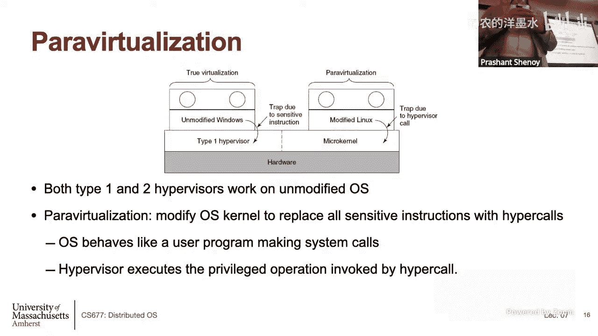
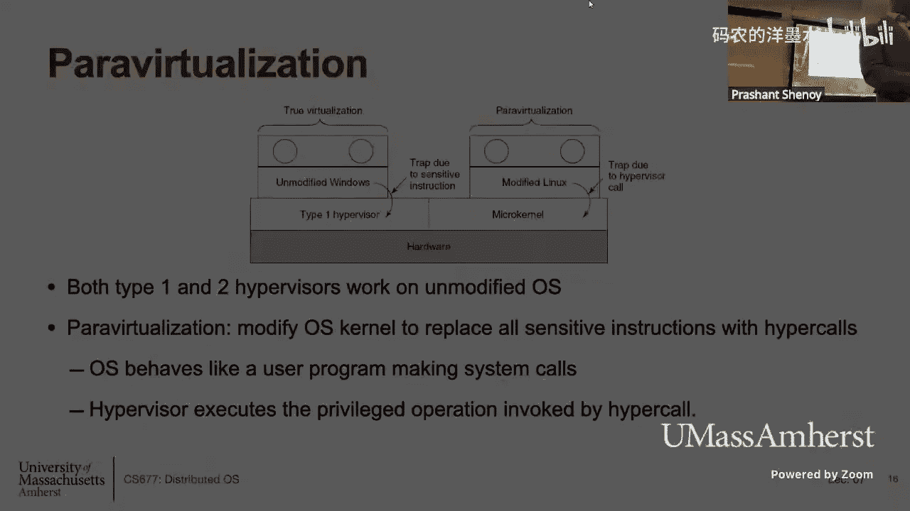

# 007：虚拟化入门

在本节课中，我们将要学习虚拟化的核心概念。我们将从分布式调度系统的最后两个案例研究开始，然后深入探讨虚拟化的定义、历史背景、不同类型及其工作原理。课程内容将尽可能简单直白，确保初学者能够理解。

## 分布式调度案例研究：Mesos

上一节我们介绍了集群调度模型，本节中我们来看看两个现代调度框架。第一个是Mesos，它是一个开源集群管理器，旨在动态分配资源。

Mesos采用双层调度方法。Mesos调度器本身负责将服务器资源动态分配给不同的计算框架（如Spark、TensorFlow），然后每个框架再使用分配到的资源运行具体任务。这与传统的静态分区方法不同，后者需要预先将服务器固定分配给特定框架。

以下是Mesos的核心机制：

*   **资源提供**：Mesos调度器构造“资源提供”，主动向框架提供一定数量的资源（如CPU核心、内存）。框架可以选择接受、部分接受或拒绝该提供。
*   **动态分配**：框架根据自身任务队列的需求决定是否接受资源。当任务完成，框架会释放资源，Mesos可以重新将这些资源提供给其他框架。
*   **无需负载感知**：研究表明，即使Mesos不知道各框架的具体负载情况，仅通过这种提供机制和公平分配策略，也能有效满足各框架的需求。

## 分布式调度案例研究：Borg

接下来，我们看看谷歌内部使用的大规模集群调度器——Borg。Borg的设计目标是管理数万台服务器和数十万个作业，并确保高可靠性。

Borg将数据中心划分为称为“单元”的组（通常包含约一万台机器）。调度器将作业匹配到具有足够空闲资源的单元上。Borg的一个关键特性是支持**抢占**。

以下是Borg的主要设计目标与机制：

*   **作业类型**：Borg同时调度交互式作业（如搜索、Gmail）和批处理作业（如数据分析、模型训练）。交互式作业拥有更高优先级。
*   **抢占机制**：当高优先级作业需要更多资源而系统无空闲服务器时，Borg可以从低优先级作业中回收资源（通过终止或挂起任务）。
*   **高可靠性**：Borg调度器（协调器节点）被复制多份（通常五份），并使用Paxos共识协议来维护状态，即使部分副本故障，系统也能继续运行。

## 虚拟化概述

现在，让我们切换主题，开始学习虚拟化。虚拟化是分布式系统中的一项基础技术，我们将在接下来的几节课中详细探讨。

虚拟化的基本定义是：**一种通过扩展或替换现有接口，来模拟另一接口或系统行为的技术**。本质上，它是一层软件，用于模拟其他系统的行为。

## 虚拟化的历史与动机

虚拟化技术起源于20世纪70年代，最初由IBM开发，旨在解决一个商业问题：让客户能在新的主机上无需修改地运行旧的（遗留）软件。这样，客户在升级硬件时，既能获得新机器的性能，又能保护原有软件投资。这促进了虚拟化技术的早期发展。

## 虚拟化的类型

根据所模拟接口在计算机系统层次结构中的位置，虚拟化可以分为几种类型。

以下是主要的虚拟化类型：

*   **硬件虚拟化**：模拟CPU指令集等硬件接口。例如，在Intel处理器上模拟ARM处理器。
*   **操作系统虚拟化**：模拟系统调用接口。例如，Docker和Linux容器技术。
*   **应用程序虚拟化**：模拟库函数接口。例如，Java虚拟机（JVM）或苹果的Rosetta 2（用于在ARM Mac上运行x86应用）。

本节课我们将重点讨论硬件虚拟化。

## 硬件虚拟化详解

硬件虚拟化主要有三种形式：模拟、完全（原生）虚拟化和半虚拟化。

### 1. 模拟
在模拟中，虚拟化层通过软件完整模拟一台物理计算机的所有硬件组件（CPU、内存、磁盘等）。它可以在一种硬件架构（如ARM）上模拟另一种架构（如x86）。缺点是速度较慢，因为每条指令都需要翻译。例如：VirtualBox、QEMU的模拟模式。

### 2. 完全（原生）虚拟化
在完全虚拟化中，虚拟化层暴露的硬件接口与底层物理硬件接口**完全相同**（例如，都在x86上）。这允许虚拟机内的指令直接在物理CPU上执行，无需翻译，因此速度更快。

一个关键问题是：既然接口相同，为何不直接在物理机上运行程序？答案是**隔离性**。虚拟机提供了一个与主机隔离的沙箱环境，用于测试、开发或同时运行多个操作系统（如Windows主机上运行Linux虚拟机）。常见工具有VMware Workstation、Parallels、Multipass。

### 3. 半虚拟化
半虚拟化需要修改客户操作系统内核，将其中的敏感指令替换为对虚拟化层的直接调用（称为“超级调用”）。这样无需硬件特殊支持也能获得高性能，但缺点是需要使用特定的、修改过的操作系统。例如：Xen hypervisor、VMware ESXi的某些模式。

## 虚拟化的实现：Hypervisor

实现硬件虚拟化的软件层称为**Hypervisor**或**虚拟机监控器**。它主要分为两类。

### 类型一 Hypervisor（裸机Hypervisor）
这种Hypervisor直接安装在物理硬件上，是启动后运行的第一层软件。它直接在硬件上创建和管理多个虚拟机。性能高，常用于数据中心和云环境。

**工作原理**：依赖于CPU的一个关键特性：所有敏感指令（内核态指令）也必须是特权指令（执行时会产生陷阱/中断）。当虚拟机中的客户操作系统（以用户态运行）执行敏感指令时，会触发陷阱，控制权交给Hypervisor。Hypervisor代表客户OS执行该指令，然后返回。现代Intel VT和AMD-V技术提供了此支持。

### 类型二 Hypervisor（托管Hypervisor）
这种Hypervisor作为应用程序运行在主机操作系统之上。用户可以在现有系统（如Windows或macOS）上安装并运行它来创建虚拟机。

**工作原理**：当客户OS执行代码时，Hypervisor会动态扫描其指令流。如果发现敏感指令，它会将其**动态替换**为对Hypervisor自身的函数调用。Hypervisor随后通过主机操作系统的系统调用（这本身也会触发陷阱）来完成该操作。这种方式无需特殊硬件支持，但性能开销通常高于类型一。例如：VirtualBox、VMware Workstation。

## 总结

本节课中我们一起学习了分布式调度的两个现代案例（Mesos和Borg），并深入探讨了虚拟化技术。我们了解了虚拟化的定义、历史动机和不同类型，重点剖析了硬件虚拟化的三种形式（模拟、完全虚拟化、半虚拟化）及其实现载体——Hypervisor（类型一和类型二）的工作原理。虚拟化通过提供隔离环境、支持遗留软件和提升资源利用率，成为现代分布式系统和云计算的核心基石。下一节课我们将继续探讨操作系统级虚拟化等更深入的内容。