# 010：云计算 ☁️

在本节课中，我们将要学习云计算。我们会将之前关于虚拟化的讨论联系起来，看看它如何应用于数据中心和云计算。然后，在课程的第三部分，我将讨论Kubernetes和编排，以及它们与数据中心、云计算和我们的容器虚拟化的关系。

## 数据中心概述

上一节我们介绍了虚拟化技术，本节中我们来看看这些技术如何应用于大规模的计算环境——数据中心。

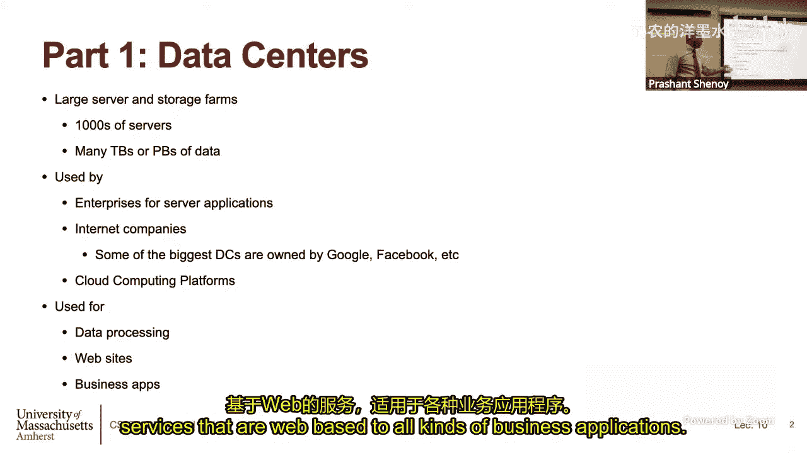

数据中心是一个用于容纳和运行大量服务器的设施。有些应用需要非常多的服务器，容纳这些服务器的设施就被称为数据中心。它们也被称为服务器农场或存储农场，具体取决于规模。数据中心的规模各不相同，可能拥有数千台服务器，也可能拥有数十万台服务器。在这些数据中心中，存储容量可以达到PB级别。

以下是数据中心的主要用途：
*   **企业应用**：各种公司都普遍使用数据中心。数据中心是企业运行各类服务器应用的地方。例如，大学的数据中心会运行像SPIRE（用于注册）和Canvas（学习管理系统）这样的应用。
*   **互联网公司**：像谷歌、Facebook和微软这样的互联网公司大规模使用数据中心。它们提供的各种服务，如谷歌地图、谷歌文档、YouTube和社交媒体应用，都运行在数据中心的众多服务器上。
*   **云计算平台**：云计算平台运行在数据中心上，并向最终用户和客户提供这些资源。

运行在数据中心上的工作负载类型包括数据处理工作负载、基于网络的在线服务以及各种商业应用。

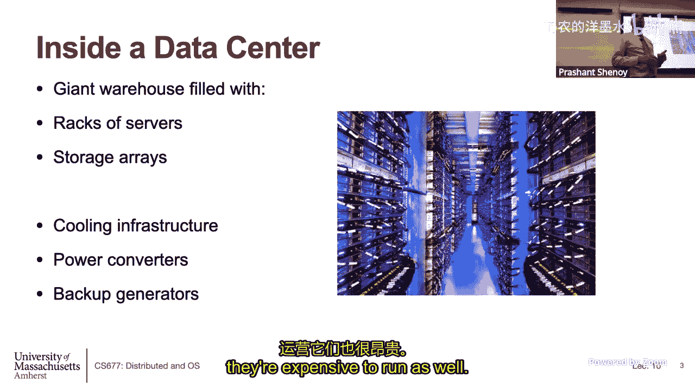

上图展示了一个数据中心的一个通道。你应该在脑海中形成这样的画面：你去过超市，超市的布局是有一条条通道，通道两边是货架，货架上放着杂货或食品。数据中心就像一个大型超市（通常更大），里面有通道，而这些通道里放置的是服务器。图中展示的就是这个大型设施中的一个通道，你可以看到一排排的服务器机架。有很多这样的通道，每个通道都有自己的服务器组。

这些是非常庞大的设施，是一个巨大的仓库或建筑，里面摆满了服务器机架、存储阵列等。要建设一个数据中心，不仅需要为所有服务器供电的电力基础设施（服务器会消耗大量电力，尤其是带有GPU的服务器，GPU非常耗能），还需要冷却基础设施。因为服务器在计算时会产生大量热量，需要大型冷却设施来防止服务器过热。此外，还需要备用发电机，以防电网停电时能保持服务器运行。不用说，建设这些数据中心非常昂贵。我们后续会有更多讲座讨论能耗问题以及如何提高能效，但今天我们先不深入讨论这些材料。我只想让你知道，数据中心产生的电费可能高达数百万美元，这与家庭电费完全不同。

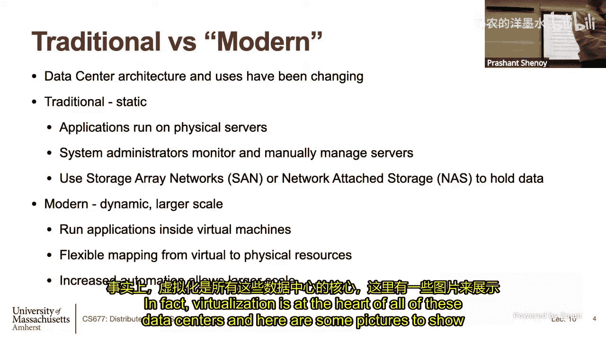

## 数据中心的演进

数据中心已经存在很长时间了，因为几十年来一直有服务器在运行业务应用和其他应用。但多年来，它们的设计方式发生了变化。

更传统的数据中心模型被称为静态模型。在这种模型中，有物理服务器，你基本上是将应用程序部署在服务器上。系统管理员手动管理哪个应用程序运行在哪台服务器上，为它们分配多少存储空间等，所有这些都由一组人类系统管理员处理，他们监控需求，并在需求变化时更改分配。这就是几十年来数据中心的设计和构建方式，直到虚拟化技术的出现使事情变得容易得多。

现在，应用程序不再直接运行在物理服务器上。这些物理服务器通常运行一个**Type 1 管理程序**（我之前讲过），然后你在这些服务器上构建虚拟机，应用程序运行在虚拟机内部。这使得将应用程序映射到服务器变得更加灵活。例如，如果某台服务器负载过重，你可以将该虚拟机实时迁移到其他未充分利用其资源的服务器上。因此，应用程序到服务器的映射不再需要是静态的。你可以调整虚拟机的大小，如果服务器负载过重，可以移动它，这带来了更大的灵活性。总而言之，现代数据中心广泛使用虚拟化技术。实际上，虚拟化是所有数据中心的核心。

以下是展示这些概念的一些图片。

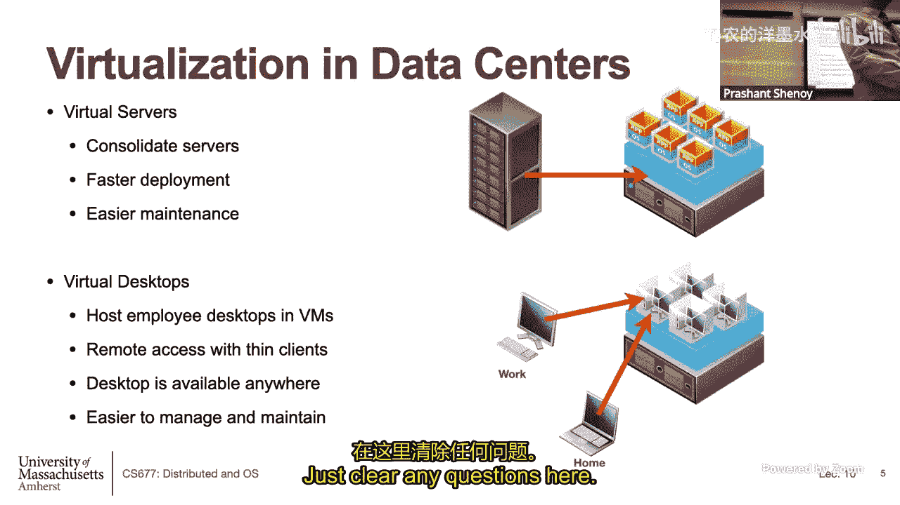

我将讨论两个用例。这是一个服务器机架。我之前展示的数据中心图片里有很多通道，通道里就是机架。机架基本上是一堆服务器的堆叠。服务器顶部那个蓝色的东西本质上就是管理程序。服务器运行着管理程序，你会看到有六个虚拟机在这台服务器上运行。每个虚拟机都有自己的操作系统，然后运行某个应用程序。本质上，每个虚拟机都是一个虚拟服务器。从外部看，它就像一个服务器，你可以登录、重启等，只不过它是作为虚拟机运行在物理服务器上。这使我们能够做各种事情。图中展示的是将一组应用程序整合到一台服务器上。与其让这些应用程序运行在单独的服务器上，不如在服务器上划分出一个切片，即一个虚拟服务器（虚拟机）。该虚拟机分配了该物理服务器上的一部分资源（一定数量的CPU核心、一定量的磁盘、一定量的内存），然后你在里面运行一个操作系统和一个应用程序。现在，你可以将六个这样的服务器打包到一台物理服务器上，而不是六台不同的服务器。你可以有一台更大的服务器，构建六个更小的虚拟服务器，然后运行你的应用程序。这使事情变得更高效，部署更快（因为你使用虚拟机部署），维护更容易（因为你可以移动它们等）。这是虚拟服务器的一个用例。

但还有另一个用例，我们也讨论过，那就是虚拟桌面。在虚拟桌面中，我之前展示过**Type 2 管理程序**，这些是你将在笔记本电脑上运行的管理程序，Multipass就是一个例子，上次我还展示了Parallels等。你可以在其中运行操作系统和应用程序。现在想象一下，不是在你的笔记本电脑上运行，而是有一台服务器运行着虚拟机，然后服务器运行一个桌面操作系统（而不是服务器操作系统），并在其中运行某人的应用程序。因此，你的数据和计算不在本地机器上，而是在某处的服务器上。你的机器连接到该服务器，服务器运行一个完整的类似PC的环境（实际上是一个虚拟机和其中的应用程序），你连接到它并进行所有计算。

这意味着你的数据、应用程序不在本地机器上，而是在服务器上。本地机器只是连接到该服务器并进行所有远程计算。你可以拥有图形环境（不一定有SSH，但可以），这是一个完整的图形环境，你可以连接等。在这个例子中，你看到工作中的用户，那里没有显示PC，只有一个显示器和键盘，因为你实际上是连接到远程服务器中的PC并在那里进行所有计算。你可以回家，使用另一台机器（比如家用笔记本电脑），但不是在笔记本电脑上实际运行应用程序，而是连接到数据中心服务器，然后在那里进行计算。这些被称为虚拟桌面。在许多场景中，这比让用户在本地运行应用程序更受欢迎。例如，你去超市收银台，扫描物品时有一台电脑，那台电脑通常不是本地运行的PC，而可能是运行在其他地方的虚拟机。那台进行扫描的电脑只是连接到其他地方，屏幕上显示给你的是运行在云数据中心某个地方的应用程序。这些是你可以用数据中心做的一些例子。你可以有服务器应用程序、虚拟桌面和应用程序。

## 虚拟化的优势：实时迁移

现在，我将展示我们上次讨论的内容，但更多是在数据中心背景下，说明如何使用实时迁移等功能。

我们已经说过，一台服务器可以被分割成多个虚拟机。例如，现在假设有两台物理服务器（非虚拟化）。一台是Windows机器，一台是Linux机器。橙色应用程序运行在Windows上，蓝色应用程序运行在Linux上。这是普通的服务器，没有虚拟化。

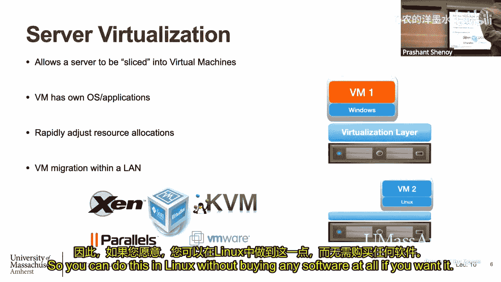

现在假设有一台服务器（顶部那台）运行着Type 1管理程序，你想使用虚拟化来运行这些应用程序。会发生什么呢？你不会将它们运行在物理服务器上，而是构建两个虚拟机：一个虚拟机运行Windows（VM1），你在其中运行橙色应用程序；第二个虚拟机运行Linux，你在其中运行另一个应用程序。现在，你使用虚拟化在一台服务器上运行这些应用程序。

这应该很清楚是如何工作的。但这给我们带来了什么？为什么我们不采用之前的方式呢？这里有一些你可以思考的地方。假设Windows机器上的负载增加了。如果你之前将其运行在物理服务器上，那台服务器会变得过载，你实际上无法再运行该应用程序，因为机器负载太高。在这种情况下，虚拟机也会变得过载，因为你在其中一个虚拟切片内增加了负载。但由于这是虚拟环境，你可以做一些在物理机器上无法做到的事情。特别是，如果数据中心有另一台服务器，我可以将该虚拟机实时迁移到那台服务器上。这样，原来运行在这里的虚拟机就移动到了那里，我释放了第一台服务器上的资源。现在，我可以运行那个虚拟机，因为它现在有更多资源可用。

这可以相当简单地完成，因为我在上一节课中解释了如何在不中断的情况下实时迁移虚拟机。但如果是物理服务器，你想这样做，就必须去购买额外的服务器，然后物理地移动、复制所有数据、重新创建等。这需要人类管理员来执行此任务，耗时更长。在这里，你可以在几分钟内快速完成。但对于物理服务器，即使有服务器，也可能需要几个小时或几天。在这里，你可以在几分钟内完成。因此，虚拟化使我们能够随着变化调整虚拟机的分配。我可以给该虚拟机更多或更少的资源，可以使用迁移移动虚拟机等。这种灵活性水平使管理员能够以更简单的方式做事。实际上，还有一个称为编排层的第三层（我们稍后会讨论），甚至可以自动化此过程。人类管理员甚至不需要做这些，监控软件会判断某个虚拟机过载，并自动将其迁移到另一台机器以释放资源。因此，你甚至可以自动化整个过程，无需任何人工干预。

这些都是如果你没有在服务器上运行虚拟化层就无法获得的优势。这就是为什么所有数据中心服务器都进行了虚拟化，你可以利用由此带来的额外灵活性。

有许多这样的技术。我上次在Type 2中展示过，有像Parallels、VirtualBox和VMware这样的东西（VMware实际上同时构建Type 1和Type 2管理程序）。Linux有KVM，它是一种Type 1管理程序，所以你可以在Linux中做到这一点，而无需购买任何软件。

## 数据中心的效率与成本

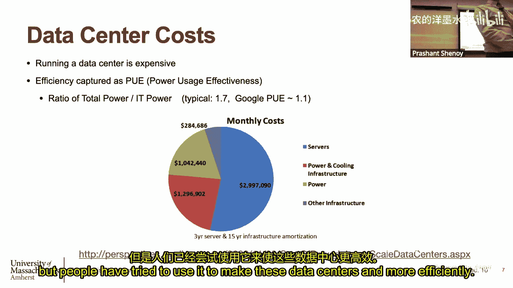

现在，让我给你一些关于如何思考数据中心成本、效率等方面的概念。我已经解释过，运行数据中心是昂贵的，因为首先，大量服务器需要花钱（如果有GPU，成本更高）。但一旦购买了服务器，运行服务器也很昂贵，因为它们消耗大量电力。然后我说过，你必须冷却服务器，这是额外的成本，因为你需要运行空调来冷却服务器，这也消耗电力。

有一种方法可以决定数据中心的效率。我将展示两种看待方式。一种是可以简单地看这个饼图，它告诉你一个假设数据中心的月度成本（只是一个例子）。你会看到绿色部分是电力成本，红色部分是电力/基础设施成本，蓝色部分本质上是服务器摊销成本（比如购买服务器并在三年内摊销）。你会看到会产生巨大的成本，数字达到数百万美元。这是一个小型数据中心，大型数据中心则是数亿或数十亿美元。但这只是一个例子，告诉你冷却、电力和电力成本是巨大的。

通常用于衡量数据中心效率的指标称为**PUE**。PUE是总功率与IT设备功率的比率。具体公式是：
`PUE = 总数据中心功率 / IT设备功率`
IT设备功率主要指服务器和网络交换机的功率。

这个比率告诉你数据中心的效率如何。典型的PUE值在1.7到2.0之间。这意味着，对于服务器消耗的每单位电力，需要额外的0.7单位电力用于冷却服务器和其他数据中心需求。显然，越接近1，数据中心效率越高，因为每单位电力中，用于数据中心其他需求（如冷却）的额外电力很少，所有电力实际上都用于做工作的服务器。

像谷歌、微软这样的公司试图通过构建更高效的数据中心来优化这一点，它们的数字更接近1.1或1.05，这意味着只有10%或5%的额外开销。它们非常高效。实现方式包括优化冷却基础设施，例如，不使用空调，而是使用自由空气冷却，将数据中心建在寒冷气候中，直接引入外部冷空气冷却数据中心，这比使用空调便宜得多。一年中许多月份都可以这样做。还有其他各种有趣的优化方法可以使数据中心更高效，但你现在真正需要知道的是效率指标称为PUE，它是总功率与IT设备功率的比率，该比率越接近1，效率越高（1是理想值，但无法达到，因为那意味着不需要冷却等额外开销）。典型数据中心在1.7到2.0范围内，因为它们在这方面不是超级高效，需要消耗额外电力来运行空调等。但如今最高效的数据中心运行值更接近1。

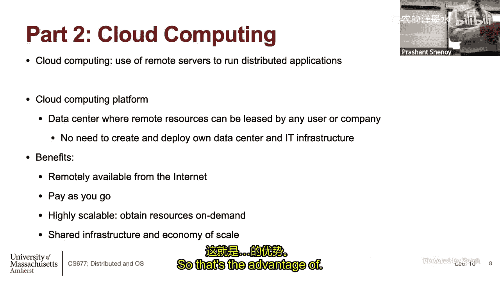

有许多优化数据中心PUE的有趣方法，我不会在本课程中讨论，但你可以查阅相关论文了解如何使这种基础设施更高效。例如，微软曾建造了一个浸入海洋的数据中心，利用海水冷却数据中心。人们尝试了各种你可能觉得不可思议的方法来使数据中心更高效。

## 云计算简介

有了这个背景，我现在要转换话题，讨论云计算。我们将讨论云计算的不同类型、它们的用途等。

首先，什么是云计算？我有一个非常基本的定义：使用远程服务器运行分布式应用程序。这是基本概念，但仅此还不够。云计算本质上意味着你想要运行的应用程序运行在远程服务器上。当然，你的应用程序可以运行在远程服务器上，但这并不意味着你就在使用云计算。云计算的另一个特点是，它有一个相关的计费模型，即你不拥有机器，而是租用机器或资源。你采用按使用付费的模式，根据你使用了多少资源来收费。

基本上，云计算模型将你使用服务器的方式从购买转变为租赁。我们将看到，本质上，云计算平台的核心只是一个数据中心，但这个数据中心由云提供商拥有，他们向任何用户或公司出售资源。任何公司都可以去说我想租10台、5台或1台服务器，租用一天或一年，可以指定你的需求。云提供商会创建一个或多个虚拟机来满足你的需求，并分配存储等。在这种情况下，你无需创建或部署自己的数据中心，因为你可以轻松地去租用。这对于小型和大型公司来说都便宜得多，可以按需购买所需资源，而不是购买服务器然后部署在自己的数据中心（我们已经说过建设数据中心很昂贵）。

好处包括：你可以从互联网的任何地方访问这些服务器；使用按使用付费的计费模型；高度可扩展，可以按需获取资源（如果你的需求变化，可以说我需要另一台或另外一百台服务器，它们会在几分钟内准备好，这非常有用）；如果不需要了，可以说我完成了，归还它们，就不再为它们付费了。你可以随时获取和释放服务器、存储资源，只为你使用的部分付费，而不是购买大量服务器闲置在那里。

从某种意义上说，它是共享的，因为云提供商向许多不同的客户出售服务器容量。有许多客户（可能是公司或单个开发者）租用了容量，他们都在使用数据中心中的服务器。因此，他们共享数据中心中存在的资源。但从云提供商的角度来看，他们建设了巨大的数据中心，具有规模经济，因此能够以比你自建低得多的价格出租这些资源。这就是这样做的好处。

## 云计算的类型

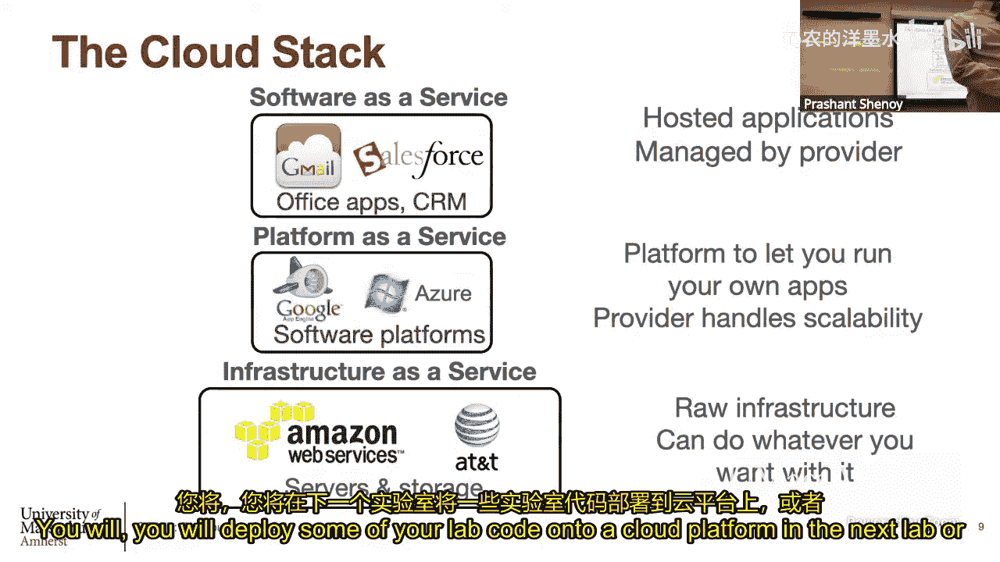

现在让我们深入了解云计算的工作原理。正如我所说，在云模型中，你本质上是从云提供商那里租用资源。有许多云提供商：亚马逊运营着一个非常大的云平台，谷歌运营着谷歌计算云平台，微软Azure是微软的云平台，还有甲骨文、阿里巴巴等许多公司运营这些云平台。但问题是，你实际上从这个云平台得到什么？你作为用户或客户想从云中获取资源。

云资源有不同的类型，本幻灯片讨论了三种非常重要的方式，你可以根据从云提供商那里获取资源的内容来租用容量或资源。你可以拥有**基础设施即服务**、**平台即服务**或**软件即服务**。这些本质上是云平台的三种类型。

它们之间的区别在于你从云提供商那里实际获得的核心资源块是什么。

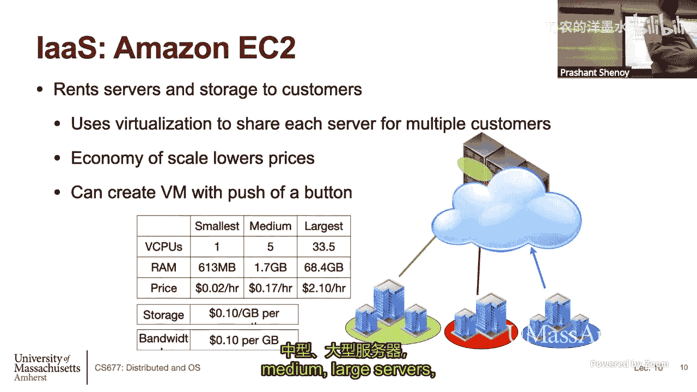

在**基础设施即服务**云中，你去找云提供商并要求服务器。你会得到一个虚拟机，然后你作为该虚拟机的用户（而非所有者）可以部署任何你想要的东西，可以部署任何你想要的虚拟机操作系统、任何应用程序。本质上，这是最基础的，你只是去说给我一些服务器，然后云提供商给你，你可以在这些服务器内运行任何应用程序和操作系统，然后你必须像管理其他东西一样管理这些服务器。这本质上是原始基础设施，因此被称为基础设施即服务云。

更高一级的是**平台即服务**云。在这种情况下，你不去要求单独的服务器，而是说：我有一个应用程序（比如我构建了这个新的Java应用程序或Python应用程序），你为我部署这个应用程序。然后，云提供商会获取你的代码，并在他们的平台上部署它（他们可能有一个Java构建平台，会获取Java代码并部署）。你不是在请求服务器，只是告诉他们：这是我的代码，在你的平台上部署它，它会运行Java代码或Python代码（支持许多不同语言）。现在，在这种情况下，你将根据访问你应用程序的用户数量来计费。他们会监控说你上个月收到了10万个请求，我将按每个请求一美分或几分之一美分向你收费。你的账单将是这样。云提供商会负责弄清楚为你的应用程序分配多少服务器。你作为开发者不再需要去考虑我应该从云上购买小型服务器还是大型服务器，你不需要处理这些，你只是说：这是一些代码，部署它。云平台会根据工作负载来决定如何运行它（应该运行在大型服务器还是小型服务器上）。你只是按使用量付费，而不是按服务器大小付费。

在前一种情况下，你作为云客户实际上必须请求特定大小的服务器。云平台可能有10种不同的配置，你可以说我想要一个具有四个核心和这么多内存的服务器，或者我想要一个带有GPU的服务器。你必须指定你想要什么，他们会给你那种类型的服务器，你按分钟或小时支付该服务器的费用。如果服务器太大，你的应用程序工作负载不足，你仍然要支付该服务器的费用，它会有未使用的容量。如果服务器太小，因为你有很多工作负载，那么你必须去获取更大的服务器并移动你的应用程序。在平台即服务云中，你根本不用担心这些，他们会为你处理可扩展性。云提供商会为你处理可扩展性，你在一个平台上部署应用程序，这就是他们给你的平台，你部署应用程序，云提供商管理一切。

然后是**软件即服务**云。在这里，你本质上有一个包含预打包应用程序的云，然后你作为客户，基本上说我想为我的组织中的这么多用户获取这个应用程序，或者作为单个用户。这方面的例子包括像Gmail（谷歌邮件）这样的东西，它是一个用于邮件应用程序的软件即服务。作为一个像麻省大学这样的组织，我们会去找谷歌说麻省大学有2万名学生，我们需要为2万用户提供Gmail服务，然后谷歌会说好的，每个用户你将支付这么多，这就是你的月费。他们负责应用程序代码，负责弄清楚运行什么类型的服务器。这是更高一级，你甚至不需要开发应用程序，应用程序是预打包的，你只是由云提供商托管。我们使用的Canvas也是一个云应用程序，不是运行在麻省大学的服务器上，而是运行在某个人的云服务器上。实际上，开发Canvas的公司提供云服务，你只是去说我们需要为大学里这么多学生提供这个学习管理系统，然后他们根据使用情况收费。

所以，这是堆栈的不同层级。在这里，你本质上是租用硬件（实际上是租用运行在硬件上的虚拟机，但几乎就像租用硬件一样）。在这里，你租用硬件加上由云提供商配置的允许你运行应用程序的打包软件。在这里，你租用整个应用程序。

就本课程而言，你需要记住这些层级。实际上，你将使用基础设施云，你将在接下来的实验中将一些实验代码部署到云平台上，从而了解实际获取云服务器来部署代码是什么感觉。

这里有一个基础设施即服务云的例子。这是亚马逊EC2云的一个例子。亚马逊提供服务器的云称为EC2，它向客户出租服务器和存储，并使用虚拟化来共享这些服务器。他们拥有大型服务器，将其分割成许多不同大小的虚拟机，并出租这些虚拟机。这里展示的只是一个玩具示例，因为亚马逊EC2云有数百种配置，这里只展示了三种。它说你可以获得三种大小的服务器：小型、中型和大型。小型服务器有1个核心，中型服务器有1.5个核心，大型服务器有3.5个核心（不知道为什么有半个核心，但他们曾经这样做过）。然后这是相关的内存量，他们给你一个价格：这个每小时租金2美分，这个每小时租金17美分，那个每小时租金2.10美分。它附带一定量的存储，如果你需要更多，你需要按千兆字节付费，还有一定量的带宽。你可以获取一台服务器，如果只运行一小时然后说完成了，你将支付2美分，因为这是他们的计费方式。他们实际上以非常细的粒度向你收费。如果你使用一个月，基本上将为那个月支付几美元。

这就是他们如何根据你的请求计费。然后你可以直接去请求这些服务器，说我想要一台、十台或一百台，他们将在几分钟内快速配置好，你所有的服务器都将准备就绪，然后你可以登录并做任何你需要做的事情，他们将相应地向你收费。

这是你如何使用基础设施即服务云来部署应用程序的一个例子。虚拟服务器上你可以部署任何你想要的操作系统，可以说这些运行Linux，或者最初运行Windows，他们甚至将macOS作为其中一个提供选项。

## 云服务器的不同类型

实际上，服务器有许多不同的类型。我刚刚提到你可以获得小型、中型、大型服务器，但根据你想要做出的承诺类型，你也可以以不同的方式获得相同的服务器配置。

默认的一种称为**按需实例**。作为云客户，你可以在任何时间请求服务器，它们将按需或即时创建。你可以保留它们任意短或长的时间，随时终止服务器。这是基本模型：你按分钟付费，即时配置，保留直到终止，然后有一个计费模型（我之前展示的是按需计费）。

但假设你需要服务器很长一段时间，比如三年，而不是一分钟或五分钟。在这种情况下，你可以以折扣价获得相同的服务器，这些称为**预留实例**。预留实例要求你做出更长期的承诺，最低承诺期为一年。你可以说我想要一台服务器一年或三年。在这种情况下，你将获得相同的服务器，但由于你承诺了更长的期限，你会以更低的价格获得。按需实例没有承诺，没有合同，你可以保留任意短或长的时间。但如果你有能力做出更长期的承诺，你会以折扣价获得，因为这样云提供商知道你可以作为客户更长时间。如果你需要服务器更长时间，预留实例是你要采用的方式。

还有一种称为**竞价实例**。竞价实例是云提供商以高折扣价出售其云数据中心中闲置未用容量的方式。他们这样做是：假设云数据中心在某个时间点利用率为50%，那么50%的容量或服务器闲置在那里，他们没有赚到任何钱，因为没有人使用那些服务器。所以他们做的是，将这些过剩容量以按需价格十分之一的价格提供，给你90%或70%的折扣。你可以去说我要一个竞价服务器，因为它比按需服务器便宜得多。然后，如果服务器可用，你将获得该服务器，价格远低于按需服务器。但有一个注意事项：当你拥有竞价实例时，如果需求回升，云提供商可以收回该服务器。他们可以说我需要收回服务器，因为我实际上有一个常规客户。本质上，你是在租用闲置容量，只要容量闲置，你就可以使用。当需求回升时，他们有能力收回。这与按需和预留实例不同，一旦你获得服务器，作为云客户，你可以根据需要保留它，然后归还，云提供商不会来收回。

但在竞价实例中，他们会以便宜得多的价格给你，但他们有能力收回。这并不意味着他们总是会收回。也许你的工作完成了，你有一个六小时的机器学习训练工作，你获得竞价服务器，运行六小时，然后你完成了，你以便宜得多的价格完成了相同的工作。但如果在这期间有按需服务器的需求（一些常规客户），云提供商会向你发送警告说服务器将被收回，然后收回服务器。在这种情况下，应用程序必须确保能够保存其状态并在其他时间恢复计算，否则你将丢失所有工作。显然，你不会在竞价服务器上运行Web服务，因为服务器消失，网站就宕机了。这对于运行批处理作业很有用，比如机器学习训练、模拟等，你可以暂停并在以后重启。对于某些类型的工作负载很有用，然后你可以以便宜得多的价格完成工作。

所以，你有这三种类型的服务器可以获取。正如你所见，有所有这些排列组合需要考虑。

## 平台即服务与无服务器计算

接下来是平台即服务云。正如我已经说过的，在这种情况下，云资源是作为一个高度可扩展的运行时平台提供的。作为云应用程序的开发者，你现在不像之前那样请求服务器，你只是带来你的应用程序，开发你的代码，然后去将这个代码部署在平台上。云平台会弄清楚要配置多少资源。在后端，他们会说应该运行在小型服务器还是中型服务器上，你看不到任何这些，你只是看到你部署了你的代码，也许它是一个Web服务，正在接收请求，然后他们会弄清楚。此外，它可以自动扩展应用程序：工作负载上升，云提供商负责将该应用程序移动到更大的服务器上，因为他们按请求向你收费。如果应用程序过载，请求得不到服务，他们就在赔钱，因为他们本可以有服务器处理请求并向你收费。因此，确保应用程序获得所需资源以服务工作负载符合云提供商的利益，然后他们可以为此向你收费。他们实际上按请求向你收费：你的应用程序服务的每个请求都会花费一小笔钱，他们会累加所有服务的请求，然后你必须据此支付，而不是说我租用了五小时的服务器。在这种情况下，你说我的代码服务了1万个请求，这就是他们向你收费的方式。支持所有类型的语言，所以你可以带来Python应用程序、Java应用程序、Node.js应用程序，只需部署它，不用担心获取服务器之类的事情。

作为开发者，这更简单。与你获取自己的服务器并部署相比，你不需要管理自己的服务器，计费基于工作负载。我们将讨论一种称为**无服务器计算**的模型，它看起来很像平台即服务云，但基本上就是这样。

这是一种在平台即服务云中部署应用程序的新模型，称为无服务器计算。它与平台即服务云非常相似。在这种情况下，开发者将代码部署在平台上，消除了配置服务器的需要。云平台本质上作为一个平台，每个应用程序可以根据看到的工作负载进行扩展或收缩。如果没有工作负载，你甚至可以将其收缩到零。当请求到来时，你再扩展。从这个意义上说，到目前为止，无服务器计算和平台即服务云之间没有区别。但主要区别在于你如何编写应用程序。在平台即服务云中，你可以带来任何Java应用程序或任何Python应用程序，他们会给你一种部署方式。在无服务器计算环境中，你必须使用一种模型来部署你的应用程序，或者使用一种称为**函数即服务**的模型编写你的应用程序代码。换句话说，你使你的应用程序高度模块化，你实际上是在编写单独的方法或函数，然后部署一组函数。

当请求到来时，无服务器平台将调用一个函数并将请求交给它，该函数服务该请求并生成响应。因为你的应用程序可能有多个函数，而不仅仅是一个，你可以将这些函数链接在一起。所以你可以将你的应用程序编写为一组三个函数，比如请求到来，你调用第一个函数，该函数然后可以调用另一个函数，然后那个函数可以调用更多函数，然后生成响应等。你将代码编写为一组非常模块化的函数。函数可以很小，一个函数可能就足够；如果是更大的应用程序，你编写一堆这些函数并将它们链接在一起，然后你本质上将调用这些函数，然后函数可以调用其他函数。

函数通常是无状态的，这意味着如果你有状态，你必须将其放入数据库等，因为代码可能不会运行（你不想假设可以将代码保存在内存变量中），因为如果没有工作负载，他们可以完全删除应用程序。通常，你不会在函数代码中保存任何状态，你通常将所有状态保存在磁盘或数据库中。你必须以无状态形式编写函数，然后部署。如果你以这种方式编写代码，你就是在使用无服务器计算模式。这是为平台即服务云编写代码的最现代方式，使用无服务器框架。

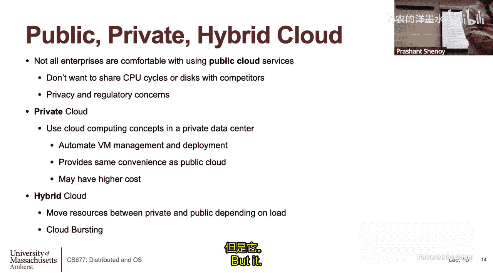

本质上，你将其放入这种格式。你必须将其模块化，思考如何拥有这些函数，它们如何相互调用等。在非常高的层面上，如果你思考一下，这些函数有点像远程过程调用。还记得我们讨论过RPC和RMI吗？你应该把这看作是在云中部署类似RPC代码的灵活方式，只是每个RPC现在是单独的块，你不是有一个包含10个RPC的大型应用程序，而是将它们写成单独的东西，然后链接在一起。每个RPC在另一个进程中调用另一个RPC调用，就是这种类型的模型，但现在以云格式。亚马逊有称为AWS Lambda的东西，本质上允许你部署这个。当我们讨论Web应用程序时，我们也会讨论微服务。微服务也是构建Web应用程序的一种方式，你需要微小的服务，开始类似于函数，但函数甚至比微服务更细粒度，它们是更小的代码片段。

这实际上是一种编写云应用程序的非常现代的方式，如果你想使用平台即服务云的话。我会指给你一篇更详细描述这个的论文，你可以更好地理解它。我们不会在任何实验中使用无服务器计算，所以这是你唯一一次看到它。

## 公有云、私有云与混合云

关于云计算的最后一点是，有三种类型的云平台：一种是**公有云**，一种是**私有云**，一种是**混合云**。到目前为止我一直在讨论的是所谓的公有云。

公有云本质上意味着云提供商（在这种情况下是像亚马逊、微软、谷歌这样的大公司）运行这些云服务，并向公众开放。任何用户、任何公司都可以去那个云平台上创建账户并开始请求服务器。然后你只需要有一种方式让他们向你收费和支付。作为个人用户，你可以去亚马逊的EC2云，然后请求服务器。实际上，作为实验的一部分，你将会这样做。

但并非所有企业公司都愿意说让我们去亚马逊获取一些服务器，把我们所有的数据放在亚马逊服务器上等，因为数据可能是机密的、私有的，你不想把它们放在第三方云服务器上。在这种情况下，他们做的是建立自己的云，称为私有云。

私有云本质上具有我讨论过的所有特性和功能，但它是为单个企业部署的云。只有该企业的用户才能从该云请求资源。想想看，假设麻省大学想建立自己的云，它可以建立一个数据中心，拥有服务器，并允许你作为研究学生或研究人员租用资源，但这个云不向其他任何人开放，它是封闭的，仅对该企业内的个人用户或组可用。

这就是所谓的私有云。私有云的优势在于，公司现在有更多的控制权，他们知道数据现在更在他们的控制之下，因为当你拥有银行数据时，你必须遵守各种法律规定，你不会把客户的信用卡数据放在别人的服务器上，因为如果发生泄露，你要对此负责。你必须以许多不同的方式保护数据。在这种情况下，这是你实际使用云功能或云好处的方式，但不必去完全开放的云。你可以创建所谓的私有云，在企业的私有数据中心中使用云计算概念，但它自动化了虚拟机管理、部署等所有事情，你可以去请求虚拟机等。成本可能稍高，因为你没有规模经济，你的数据中心不会像亚马逊的数据中心那么大，因为他们有1万家企业使用，而你只有一家企业，所以你的数据中心会更小，但它会给你所有其他好处，除了规模经济的好处。

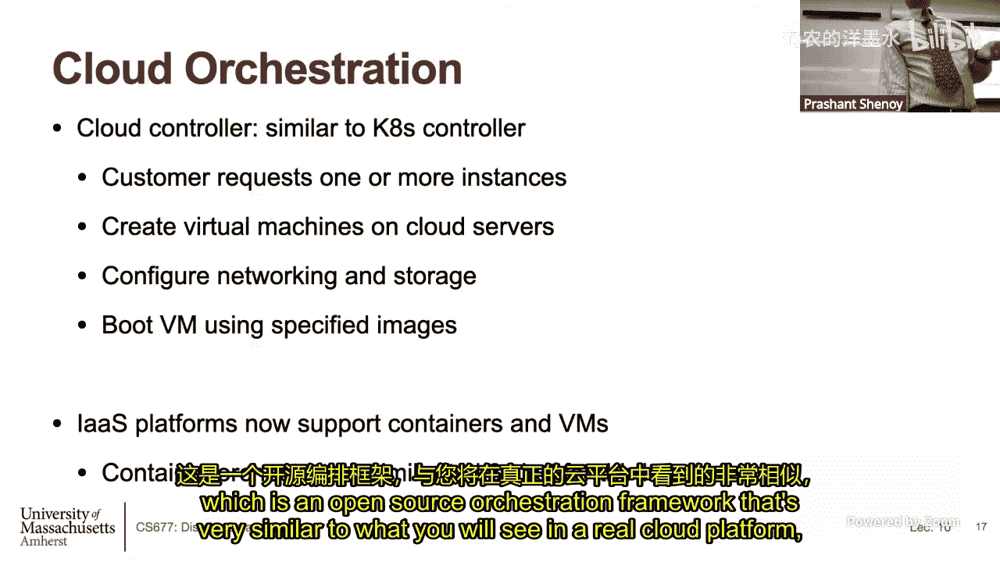

这称为私有云。大公司有自己的内部云，即私有云。但许多公司也使用公有云资源。混合云，顾名思义，本质上是将私有云和公有云的资源结合起来。如果你的一些应用程序运行在私有云上，一些应用程序运行在公有云上，这些跨两者的资源集合被称为混合云。它是公有云和私有云以某种方式组合。企业实际上在某些情况下需要建立混合云的原因是：你部署了一个私有云，有自己的数据中心，也许你购买了1万台服务器放在那里。在某个时候，你可能会说我容量不足了。如果你只使用私有云，你必须去购买服务器，这将需要几周时间才能到达和部署。但如果你可以去公有云，只是在一段时间内说我需要100台服务器，因为我缺少100台服务器，你可以获取它们并为某个应用程序部署它们，也许是那些不那么关键的任务，你不必在公有云平台上存放大量敏感数据，但不太敏感的东西你仍然可以在那些服务器上运行。在这种情况下，你结合公有云和私有云的资源来满足企业的需求。当额外需求消失时，你可以释放那些服务器，回到只使用你的私有云。许多大公司实际上这样做，他们会有私有云，但该云或数据中心的大小是为某些工作负载设计的，如果工作负载容量上升，你可能不得不暂时溢出到公有云并在那里获取资源。如果你这样做，就称为混合云，有软件可以在之间来回移动数据，你可以部署，这称为混合云软件等。

## 云工作负载与存储

我们讨论了各种云类型：基础设施即服务、平台即服务、软件即服务。如今，各种工作负载都在它们上面运行。实际上使云流行起来的最常见的是在其上运行Web应用程序、Web服务，我们部署网站和Web应用程序。它们运行在这些云服务上，你可以租用服务器然后运行它们。然后它们变得流行用于批处理应用程序，比如数据处理。机器学习训练现在很多发生在云中，原因是GPU很难购买，总是缺货，但这些云提供商已经有数万个GPU可供租用，所以你可以去租用这些GPU机器，上传你的数据，运行你的PyTorch或TensorFlow训练，获得模型，然后归还机器，你只支付那段时间的费用，而不是购买非常昂贵的GPU服务器。这是批处理和数据处理，我已经提到了机器学习训练。这些需要获取带有GPU的特定云服务器。还有其他各种科学应用，在物理、天文学、化学和医学等领域，它们有大型数据集，用它们来运行模拟或进行其他数据处理。所有这些都往往是云服务的好用例。因此，这现在已成为运行大规模计算的非常流行的模型：不要购买，而是租用。如果你的工作负载不会运行多年，租用总是更便宜。这是一般概念。

实际上，在进入编排之前，还有一张关于存储的幻灯片。我没有过多讨论它，但云平台也提供存储。这是你们所有人实际上都在使用并熟悉的东西。在这种情况下，云平台为你提供可以使用的存储空间。谷歌云端硬盘是云存储的一个例子，OneDrive是云存储的一个例子，iCloud是云存储的一个例子。在这种情况下，你从云租用磁盘容量，你不是租用服务器，不是租用平台来运行代码，而是租用存储空间，按月收费。如果是大学的谷歌云端硬盘，大学在支付你的费用，但如果你有iCloud，你可以支付一定量的存储空间，每月有费用。你支付月费，获得一定量的磁盘空间，可以用它来存放照片或文档等，然后你可以从任何机器访问它。

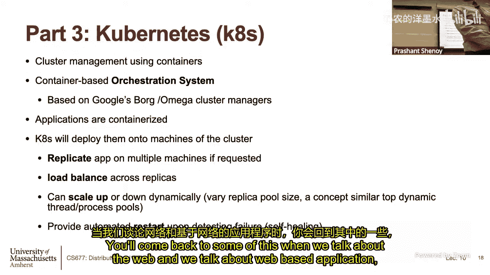

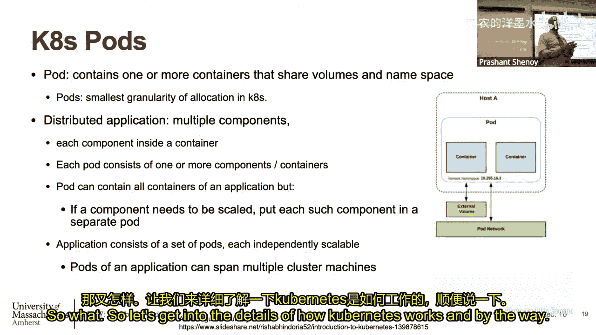

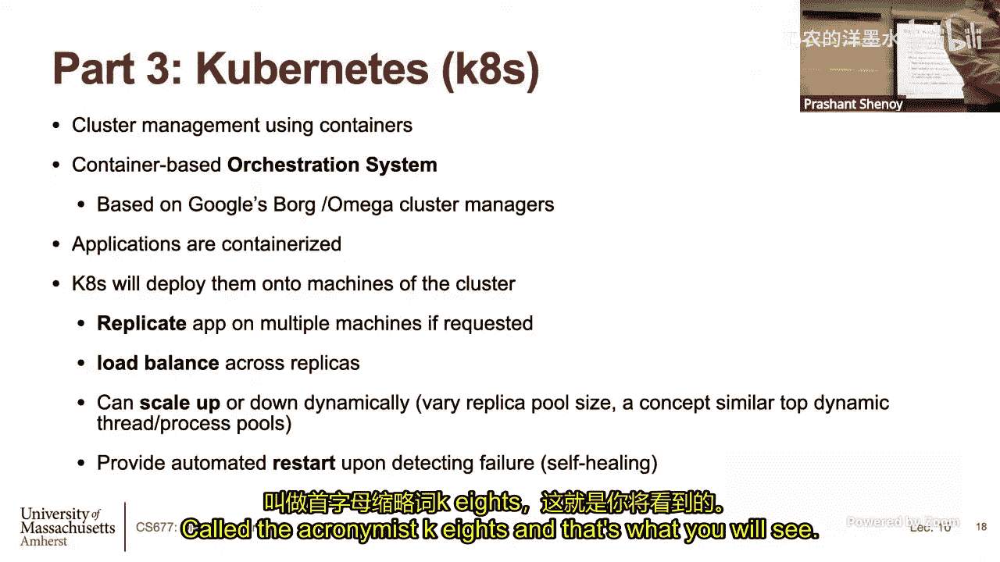

它有用的原因是，一旦你将东西放在云中，你就可以用你的凭据登录并从其他机器访问它。因此，它比将所有数据保存在本地机器上灵活得多，如果你去某个地方没有带机器，你的数据就无法访问。这使得它可以从多个服务器、多个客户端等访问。这是云存储的优势。Dropbox、谷歌云端硬盘、OneDrive、Box，所有这些都为你提供云存储服务，还有许多其他服务。

但也有很多方式可以获得这种存储。典型的一种是文件存储，这是Dropbox和谷歌云端硬盘提供的。本质上，你可以创建文件，可以使用谷歌云端硬盘或OneDrive等创建演示文稿，所以它为你提供文件存储容量。但也有其他类型的云存储，提供块存储或对象存储，你可以获得更大容量的存储，然后你本质上不在上面创建文件，而是创建数据块（只是任意的数据块），并使用称为get和put的方法来获取或放置块。这种对象存储技术的工作方式是，你可以请求比如1TB的对象存储，你将获得1TB的空间。你不会在其中创建文件和目录，但可以放入大量数据并检索它们。你放入的每个数据块都会获得一个句柄（标识符），所以没有文件名。在文件系统中，文件名是你的句柄；在这种情况下，你将获得一个数字标识符，作为该块的句柄，然后你想检索它，你必须出示句柄，他们会给你数据块。你可以用它来为大量数据创建存储，用它来创建存档等。这是一种与你非常熟悉的标准磁盘和文件模型非常不同的使用云存储的方式。在这种情况下，你不以那种格式使用云存储，而是用它来存储所谓的对象，而不是文件。

但除此之外，概念是相同的：我们将租用一些存储空间，但不是放文件，而是放对象，你可以对这些对象进行gets和puts来检索或存储它们。

## 云编排与Kubernetes简介

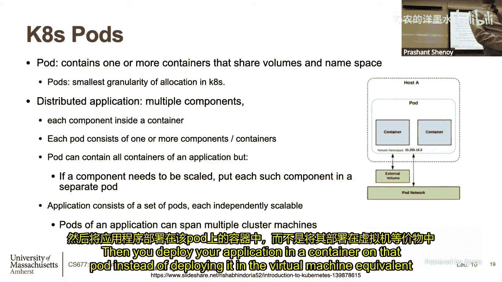

关于云计算，我就讲这么多。如果有问题，现在可以提问，然后我将进入下一部分：云编排和Kubernetes。

首先让我解释一下编排是什么意思，然后我们将讨论使用Kubernetes的一种方式。正如你可能已经意识到的，所有这些云平台都有某种控制节点。当用户去说给我一个小型服务器（小型虚拟机）时，云中运行的某个软件必须弄清楚哪台物理服务器有足够的容量，以便可以创建一个虚拟机并将其分配给那个刚刚请求新虚拟机的客户。这个控制软件跟踪他们的云平台中有哪些服务器，哪些服务器正在使用，分配了多少容量，有多少容量空闲，在哪里放置新虚拟机，如何调整它们大小等。所有这些管理功能称为编排。这本质上是云软件，它将决定如何向最终用户分配资源，或者如果资源过载，如何移动这些虚拟机等。

这称为云控制器，我们还没有真正遇到过，但这就是实际完成所有工作以使事情变得简单的组件。所有基础设施即服务、平台即服务以及其他平台，IaaS和PaaS都有一个云编排器或控制器在做所有工作。

现在我们将看到一个特定的编排器，称为**Kubernetes**。它是一个开源的编排框架，与你在真实云中看到的非常相似。实际上，Kubernetes是谷歌开发的东西，基于他们的Borg和Omega云控制器或集群管理器。我们在讨论分布式调度时已经遇到过Borg，我说过这是谷歌用来调度其数据中心所有工作负载的调度器，它实际上是一个云编排器（我当时没有使用那个术语，但它正在做编排）。他们开源了Borg的部分内容，并将其制作为Kubernetes。本质上，你可以使用Kubernetes创建你自己的云，然后你可以去Kubernetes集群管理器或控制器说给我一些资源。在这里，它将使用容器，而不是虚拟机。Kubernetes是基于容器的管理器，所以它将创建一个特定大小的容器并交给你。我们讨论的所有事情，你本质上都可以用Kubernetes来做这种编排。但你需要记住的是，它直接源自谷歌在其数据中心中实际使用的调度器，他们将其开源，你可以下载并在任何机器上运行。这将是一个关于Kubernetes的实验，所以你可以实际使用它，弄清楚如何使用它。

它会做的事情包括：你可以将应用程序部署到一组机器上，它会弄清楚哪些机器有足够的资源，并将你的容器化应用程序部署在那里（在这种情况下，它们不是基于虚拟机，而是基于容器）。如果需要，它会自动复制它们，提供服务，这样如果某台机器宕机，你还有第二个副本在运行，它会做到这一点。如果你创建了副本，它会在机器之间进行负载均衡。它可以根据工作负载扩展或收缩这些容器。如果发生故障，它可以提供自动重启（自愈）等。它内置了许多服务。

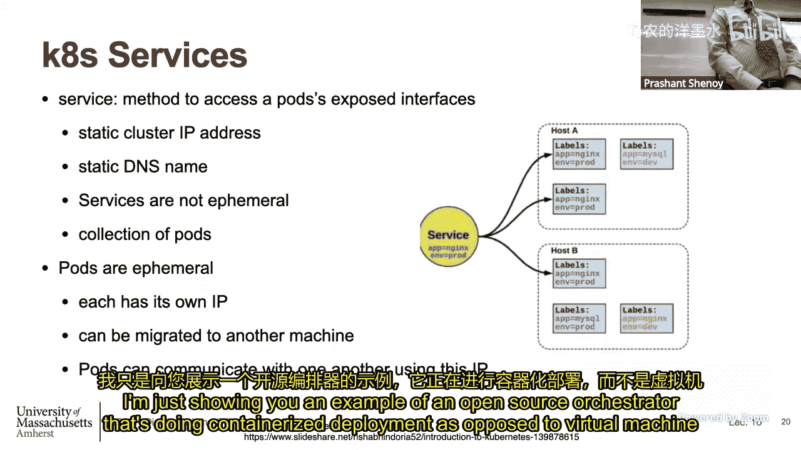

作为开发者，你可能不需要担心许多这些事情，比如机器故障怎么办。Kubernetes集群管理器（在这种情况下是编排器）将跟踪它，并在另一个节点上重启你的应用程序，然后重定向请求；或者如果应用程序过载，它会动态调整大小；如果你有多个副本，它会负载均衡它们。许多有用的服务。当我们讨论Web和基于Web的应用程序时，我们会回到其中一些内容。但现在，你只需要在高层面上理解实际发生了什么。

让我们深入了解Kubernetes的工作原理。顺便说一下，它的缩写是K8s，你会看到这个。Kubernetes不想拼写整个单词，所以缩写称为K8s。

## Kubernetes核心概念：Pod与Service

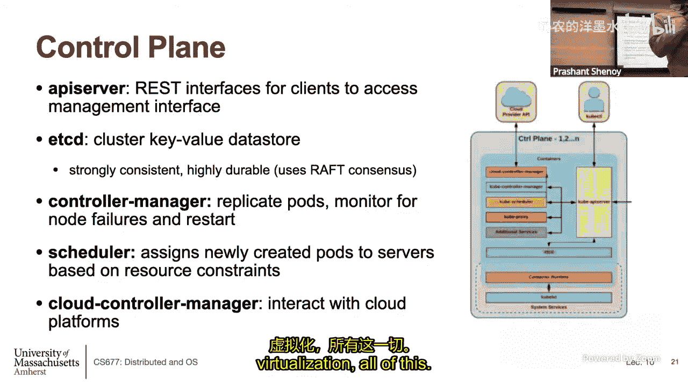

它的工作方式是，Kubernetes中资源分配的粒度称为**Pod**。Pod有点像虚拟机，它是服务器的一个切片。这里有一台机器（主机），这是一台物理机器。这台机器本质上在此时有一个Pod（图中的灰色框），这是分配给该应用程序的服务器切片。在这种情况下，该应用程序选择在这个Pod内运行两个容器。你可以运行一个，可以