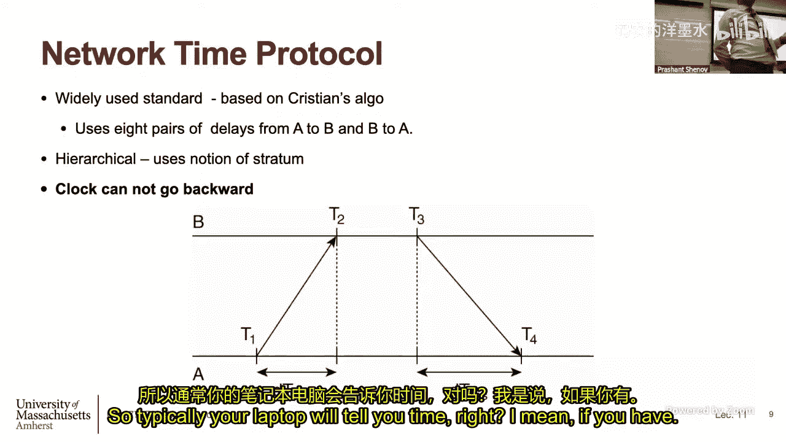
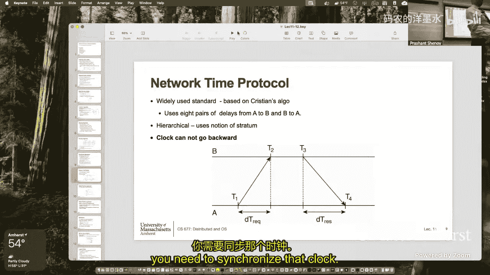
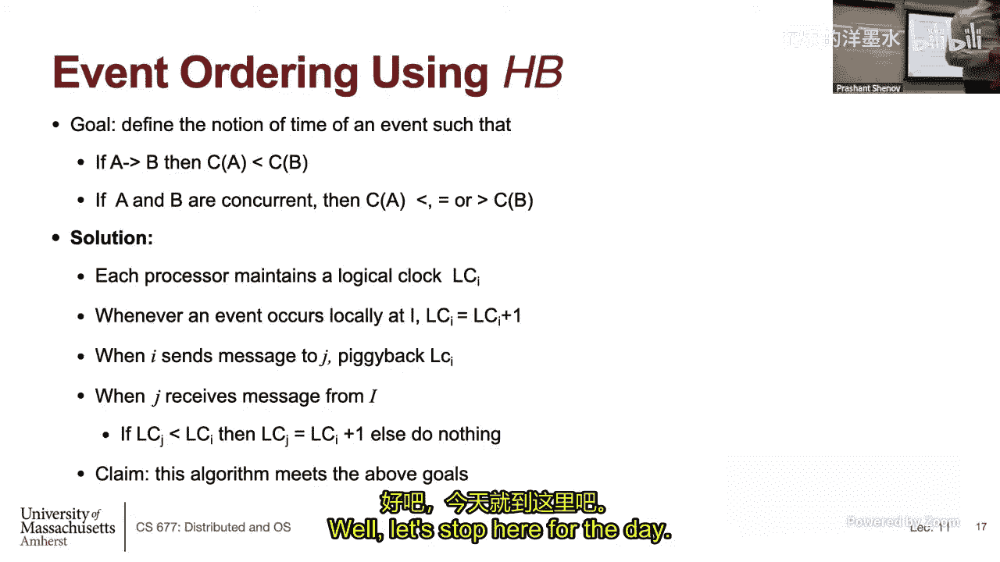

# 011：时钟同步与逻辑时钟

## 概述
在本节课中，我们将学习分布式系统中的两个核心概念：**时钟同步**与**逻辑时钟**。我们将首先探讨为什么在分布式系统中保持物理时钟同步至关重要，并介绍几种经典的时钟同步算法。随后，我们将转向逻辑时钟的概念，这是一种不依赖物理时间，而仅用于确定事件发生顺序的强大工具。

---

## 时钟同步的必要性

在分布式系统中，每台计算机都有自己的物理时钟。这些时钟可能由于硬件差异或环境因素而彼此不同步。这种不同步会导致严重问题。

例如，考虑一个软件开发场景：开发人员在机器A上修改源代码文件，然后在机器B上使用`make`工具进行编译。`make`工具通过比较源文件的修改时间戳和已编译二进制文件的时间戳，来决定是否需要重新编译。如果机器A和机器B的时钟不同步，机器B可能会错误地认为源文件比二进制文件更旧，从而跳过必要的编译步骤，导致程序无法反映最新的更改。

这个例子表明，当我们需要跨机器比较时间戳以确定事件（如文件修改）的顺序时，时钟同步是必不可少的。

---

## 物理时钟基础

在深入算法之前，我们先了解物理时钟的工作原理。现代计算机使用石英晶体振荡器作为时钟源，其精度大约为百万分之一。然而，最精确的时钟是原子钟，其误差极小，常被用作时间基准。各国通过卫星、无线电或蜂窝网络广播其原子钟时间，其他设备可以接收这些信号来同步自己的时钟。

所有非原子钟都会随时间产生误差，这种现象称为**时钟漂移**。制造商通常会指定一个最大漂移率 **ρ**，表示时钟相对于真实时间可能偏离的最大速率。

---

## 时钟同步算法

上一节我们了解了时钟漂移的问题，本节中我们来看看如何通过算法来同步时钟。核心思想是定期将本地时钟与一个更精确的时间源进行校准。

### 克里斯蒂安算法

克里斯蒂安算法假设系统中存在一个时间服务器，该服务器已与原子钟同步。需要同步的客户端机器会定期（例如，每 **Δ/(2ρ)** 秒）向该服务器请求当前时间。

然而，网络通信存在延迟。客户端在 `T0` 时刻发送请求，服务器在 `T` 时刻处理并回复“当前时间为 `T`”，客户端在 `T1` 时刻收到回复。简单的将客户端时钟设置为 `T` 是错误的，因为消息在传输中花费了时间，真实时间已经是 `T + 网络延迟`。

**关键问题**：如何估计网络延迟？
一个简单的估计方法是测量往返时间（RTT）。客户端记录发送请求的时间 `T0` 和收到回复的时间 `T1`，则 RTT = `T1 - T0`。假设网络路径对称（请求和回复的延迟相等），则单向延迟估计为 **RTT / 2**。因此，客户端应将本地时钟设置为 **T + (RTT / 2)**。

**公式**：
`客户端调整后时间 = T_server + ( (T_receive - T_send) / 2 )`

其中 `T_server` 是服务器回复中的时间戳。

### 伯克利算法

伯克利算法用于在没有中央时间服务器的情况下，让一组机器相互同步它们的时钟（相对同步，不一定与真实时间同步）。





算法步骤如下：
1.  一个被选为协调者的节点向所有其他工作节点询问它们的当前时间。
2.  每个工作节点回复其时间。
3.  协调者收集所有时间，计算一个平均值（在计算前需根据网络延迟进行校正）。
4.  协调者计算每个节点的时钟需要调整的偏移量（平均值 - 节点报告时间），并通知各个节点。
5.  各节点根据指令调整自己的时钟（通常是逐渐调整速率，而非直接拨动指针）。

以下是该过程的简化描述：
```
协调者 -> 所有节点： “请报告你的时间”
节点1 回复： “我的时间是 3:00”
节点2 回复： “我的时间是 3:10”
节点3 回复： “我的时间是 2:50”
协调者计算平均值: (3:00 + 3:10 + 2:50) / 3 ≈ 3:00
协调者 -> 节点1: “无需调整”
协调者 -> 节点2: “请将时钟调慢10分钟”
协调者 -> 节点3: “请将时钟调快10分钟”
```

### 网络时间协议

网络时间协议是实际应用中最广泛的时钟同步协议，它是克里斯蒂安算法的增强版。NTP采用层级结构的时间服务器，使用更复杂的统计方法（如多次测量取最小值）来更精确地估计网络延迟，并能处理时钟不可回拨的限制（通过逐渐调整时钟频率而非直接设置时间）。

---

## 全球定位系统与时钟同步

GPS不仅用于定位，其原理本身也解决了一个时钟同步问题。GPS接收器通过接收多个卫星（已知位置且时间已同步）广播的信号，测量信号传播时间来计算距离。

**核心挑战**：接收器的本地时钟与卫星的原子钟并不同步，这个未知的时钟偏差 **δ** 是定位计算中的关键误差源。

解决方法是将时钟偏差 **δ** 作为一个额外的未知数，与接收器的三维坐标 **(x, y, z)** 一起求解。每个卫星提供一个方程：
`测量到的伪距 = 光速 × (接收器本地接收时间 - 卫星发送时间 + δ)`
`几何距离 = sqrt( (x_sat - x)^2 + (y_sat - y)^2 + (z_sat - z)^2 )`

由于 `测量到的伪距` 包含了时钟误差，它等于 `几何距离`。因此，每个卫星给出一个包含 **x, y, z, δ** 四个未知数的非线性方程。通过接收至少四颗卫星的信号，建立四个方程，即可解出接收器的位置和其时钟相对于GPS系统时间的偏差 **δ**，从而在完成定位的同时也完成了时钟同步。

---

## 逻辑时钟

前面讨论的物理时钟同步总存在误差容忍度 **ε**。如果两个事件的发生时间间隔小于 **ε**，我们就无法可靠地判断其先后顺序。此外，许多应用（如之前的`make`例子）只关心事件的相对顺序，而非绝对时间。逻辑时钟正是为此而生。

逻辑时钟（又称兰伯特时钟）不是测量时间，而是为系统中发生的事件分配一个单调递增的整数编号，以此来捕获事件的“先后发生”关系。

### 先后发生关系

我们定义“先发生于”关系（→）：
1.  **本地顺序**：如果事件 A 和 B 在同一进程内，且 A 在 B 之前执行，则 A → B。
2.  **消息发送顺序**：如果事件 A 是发送一条消息，事件 B 是接收同一条消息，则 A → B。
3.  **传递性**：如果 A → B 且 B → C，则 A → C。

逻辑时钟算法（C_i 表示进程 i 的逻辑时钟值）：
1.  每个进程维护一个本地逻辑计数器，初始为0。
2.  进程每次发生一个本地事件，就将计数器加1，并为该事件分配此值作为时间戳。
3.  当进程发送消息时，它会在消息中附带自己当前的逻辑时钟值。
4.  当进程接收消息时，它会将自身的逻辑时钟值更新为：**max(本地当前值，消息中的时间戳) + 1**，并将此值分配给接收事件。

**代码描述**：
```python
# 进程本地逻辑时钟
logical_clock = 0

def on_local_event():
    logical_clock += 1
    assign_timestamp(logical_clock)

def on_send_message(msg):
    logical_clock += 1          # 发送是一个事件
    msg_with_ts = (msg, logical_clock)
    send(msg_with_ts)

def on_receive_message(msg, received_ts):
    logical_clock = max(logical_clock, received_ts) + 1
    assign_timestamp(logical_clock) # 接收是一个事件
```

### 逻辑时钟的性质

该算法保证：如果事件 A → B（根据先发生于关系），那么 A 的逻辑时间戳一定小于 B 的逻辑时间戳。

**然而，逆命题不成立**：仅凭时间戳 `C(A) < C(B)`，我们不能断定 A → B。因为两个并发的事件（即没有因果关系的事件）可能被分配了任意的数值大小关系。因此，逻辑时钟提供的是一个**偏序**关系，它能够捕获因果依赖，但无法为所有事件定义一个全序。

---

## 总结

本节课中我们一起学习了分布式系统中处理时间问题的两种范式：
1.  **物理时钟同步**：旨在使各节点的物理时钟值尽可能接近真实时间或彼此一致。我们介绍了**克里斯蒂安算法**（基于客户端-服务器请求）、**伯克利算法**（基于组内协调）以及实际中广泛使用的**NTP协议**。此外，我们还看到**GPS系统**如何巧妙地将定位与时钟偏差估计融为一体。
2.  **逻辑时钟**：它完全摒弃了对物理时间的依赖，通过简单的整数递增和消息传递规则，为事件分配时间戳，从而可靠地捕获事件间的因果先后关系（“先发生于”关系）。兰伯特时钟是理解分布式系统中事件排序的基础。



下一讲，我们将探讨逻辑时钟的增强版本——向量时钟，它能提供更强的性质，让我们不仅能从事件顺序推导出时间戳关系，还能通过比较时间戳来推断事件顺序。