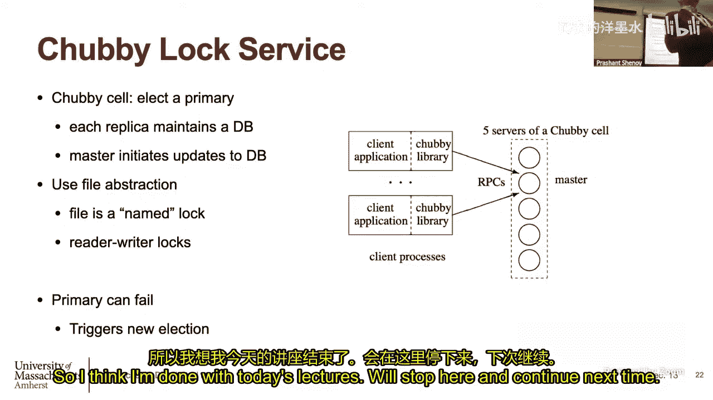

# 013：领导者选举与分布式锁 🧑‍💻

在本节课中，我们将学习分布式系统中的两个核心概念：领导者选举算法和分布式锁的实现。我们将探讨如何动态地选择协调者，以及如何在多个进程间实现互斥访问。

---

## 概述

本节课将涵盖三个主要部分。首先，我们将完成对分布式快照的讨论，介绍终止检测的概念。接着，我们将深入探讨几种领导者选举算法，包括“霸道算法”和“环算法”。最后，我们将学习如何实现分布式锁，分析集中式、分散式以及基于令牌环的多种方案，并了解其各自的优缺点。

---

## 终止检测

上一节我们介绍了分布式快照算法，用于捕获系统的全局状态。本节中，我们来看看如何在此基础上判断一个分布式计算是否已经完成，即终止检测问题。

假设一个由n个进程组成的分布式系统正在执行某项计算（例如模拟）。这些进程需要共同判断整个计算是否已经结束，以便可以安全退出。问题是，单个进程如何知道整个计算是否已完成？

一种简单的方法是在进行分布式快照的同时进行终止检测。具体做法是在发送快照标记消息时，附带发送额外的“完成”或“继续”标记。

*   **完成标记**：表示该进程已完成所有工作，并且没有待处理的消息。
*   **继续标记**：表示该进程或其后续节点仍有计算未完成。

这些标记消息会沿着网络反向传播回发起快照的进程。如果该进程从所有邻居处都收到了“完成”标记，则意味着整个计算已结束，可以终止。如果收到任何一个“继续”标记，则计算仍需继续。

这种方法扩展了分布式快照算法，使其不仅能捕获状态，还能查询计算进度。

---

## 领导者选举算法

现在，我们转向一个新的主题：领导者选举。在许多分布式算法中，我们需要一个协调者（或领导者）来执行特定任务，例如时钟同步中的主节点。与其静态指定一个协调者，不如动态选举一个，这样当协调者故障时，系统可以自动选出新的领导者。

### 霸道算法

霸道算法是一种递归算法，其目标是选举出当前存活的进程中ID最高的那个作为领导者。算法假设每个进程都知道其他所有进程的ID和网络地址。

任何进程在怀疑当前领导者失效时都可以发起选举。发起选举的进程会向所有ID比它高的进程发送“选举”消息。

以下是算法的步骤：
1.  进程P向所有ID高于它的进程发送“选举”消息。
2.  如果一个更高ID的进程收到“选举”消息，它会回复一个“OK”消息，并自行向比它ID更高的进程发起新的选举。
3.  发起选举的进程P如果收到任何“OK”消息，就知道有更高ID的进程存活，于是退出选举。
4.  这个过程递归进行，直到某个进程发现没有更高ID的进程存活（或响应），它就宣布自己为领导者，并向所有进程广播“协调者”消息。

**复杂度分析**：在最坏情况下（如ID最低的进程发起选举），消息复杂度为 **O(n²)**。

### 环算法

环算法将进程逻辑上组织成一个环。每个进程只需要知道其左右邻居，目标同样是选举ID最高的存活进程为领导者。

任何进程都可以发起选举。它将一个包含自己ID的“选举”消息发送给它的邻居。每个收到消息的进程将自己的ID添加到消息中，并传递给下一个邻居。

当消息绕环一周回到发起者时，消息中包含了所有存活进程的ID列表。发起者从中选出ID最高的进程作为领导者，并广播结果。

**复杂度分析**：消息需要绕环一周，因此消息复杂度为 **O(n)**。但选举完成所需的时间可能比霸道算法长，因为消息是顺序传递的。

---

## 分布式锁（互斥）

在单机系统中，我们使用锁来实现对共享资源的互斥访问。在分布式系统中，多个进程需要协调对共享资源（如文件、数据库记录）的访问，这就需要分布式锁。

### 集中式互斥

最简单的实现方式是选举一个锁协调者。当进程需要获取锁时，向协调者发送请求。

以下是锁协调者的工作流程：
1.  如果锁空闲且请求队列为空，立即授予锁。
2.  如果锁已被占用，则将请求加入队列。
3.  当锁被释放时，从队列中取出下一个请求并授予锁。

**优点**：实现简单、公平（按请求顺序授予）。
**缺点**：协调者是单点故障。如果持有锁的客户端崩溃，锁可能永远无法释放，导致死锁。

### 分散式互斥（多数投票）

为了消除单点故障，可以使用多个协调者。进程需要获取锁时，向所有协调者发送请求。每个协调者独立决定是否授予锁，并进行投票。

只有获得**多数票**的请求才能获得锁。这提高了系统的容错性，即使部分协调者故障，只要多数存活，锁服务仍可运行。

**注意**：这种方法解决了协调者故障问题，但未解决客户端持有锁时崩溃的问题。

### Ricart & Agrawala 算法

该算法完全去中心化，不使用协调者，而是利用我们之前学过的**逻辑时钟（Lamport时钟）**。

算法步骤如下：
1.  进程想进入临界区时，递增其逻辑时钟，并向**所有其他进程**发送带有此时戳的“请求”消息。
2.  进程必须收到**所有其他进程**的“回复”消息后，才能进入临界区。
3.  当进程j收到进程i的请求时：
    *   如果j不想进入临界区，立即回复。
    *   如果j正在临界区内，则暂不回复，等退出后再回复。
    *   如果j也想进入临界区，则比较请求中的时间戳。时间戳更早（更小）的请求优先。如果i的请求更早，j就回复；否则，j暂不回复。

**优点**：完全分布式。
**缺点**：任何**一个**进程崩溃都会导致整个锁机制停滞，因为无法收到其回复。这实际上从单点故障变成了N点故障。

### 令牌环算法

该算法基于逻辑环拓扑。一个特殊的**令牌**消息在环中持续传递。

*   **获取锁**：进程只需等待令牌传递到自己手中。持有令牌即持有锁。
*   **释放锁**：进程完成临界区操作后，将令牌传递给环中的下一个邻居。

**优点**：概念简单，无请求/释放消息开销。
**挑战**：
1.  **令牌丢失**：如果持有令牌的进程崩溃，令牌就丢失了。需要机制来检测和重新生成令牌，但要避免生成多个令牌。
2.  **环维护**：需要处理节点加入、离开和故障，以保持逻辑环的完整性。

**历史背景**：此算法源于早期的“令牌环”局域网技术，该技术与以太网竞争，最终以太网胜出。

---

## 案例研究：Chubby 锁服务

谷歌开发的Chubby锁服务是分布式锁在大型系统中的实际应用。它旨在提供**粗粒度**的锁（持有时间可达数小时或数天），常用于领导者选举和配置管理。

**设计要点**：
*   **容错性**：使用一个包含5个副本的“单元”，其中一个副本放置在不同数据中心，以防止整个数据中心故障。
*   **持久化**：锁状态作为文件持久化在磁盘上，即使内存丢失也能恢复。
*   **接口**：提供类似文件系统的API来操作锁。
*   **底层通信**：使用gRPC进行通信。

Chubby展示了如何将学术中的算法思想（如领导者选举、状态复制）工程化，以构建健壮、可用的分布式服务。

---

## 总结

本节课中我们一起学习了分布式系统中的关键协调机制。我们首先了解了如何通过扩展分布式快照来进行终止检测。然后，我们探讨了两种领导者选举算法：“霸道算法”具有较快的收敛速度但消息开销大；“环算法”消息开销小但延迟较高。最后，我们深入研究了分布式锁的多种实现方案，包括集中式、分散式投票、基于逻辑时钟的Ricart & Agrawala算法以及令牌环算法。每种方案都在简单性、性能、容错性之间有不同的权衡，没有一种方案是完美的，实际系统（如谷歌的Chubby）需要结合多种技术来构建健壮的服务。理解这些基础算法是设计和分析复杂分布式系统的基石。