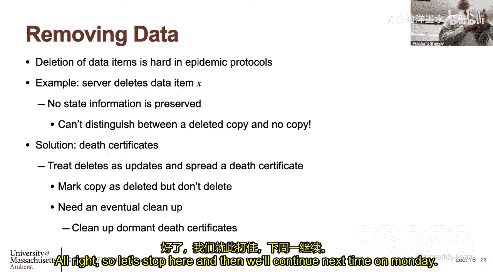

# 016：一致性模型与复制 📚

在本节课中，我们将要学习分布式系统中的核心概念：**一致性**与**复制**。我们将探讨为什么需要复制数据，以及复制带来的挑战——即如何保持多个数据副本之间的一致性。我们将从最严格的一致性模型开始，逐步放宽要求，最终学习在实际系统中广泛应用的最终一致性模型及其实现方法。

---

## 概述与CAP定理 🧩

上一节我们讨论了分布式事务。本节中，我们来看看数据复制及其带来的一致性挑战。

复制在分布式系统中主要有两种形式：**数据复制**和**计算复制**。我们主要关注数据复制。复制数据的主要原因有两个：
1.  **可靠性**：当一台机器故障时，其他副本可以确保数据依然可用。
2.  **性能**：多个副本可以分担请求负载，提高系统吞吐量，或通过地理分布减少访问延迟。

然而，复制带来了一个核心问题：**一致性**。当一个副本被修改后，必须确保其他副本也能同步更新，否则用户可能访问到过时的数据。

在深入讨论一致性模型前，需要理解一个分布式系统的基本定理：**CAP定理**（也称为布鲁尔定理）。该定理指出，一个分布式系统无法同时满足以下三个属性：
*   **C（一致性）**：所有客户端看到的数据都是最新的。
*   **A（可用性）**：系统在部分节点故障时仍能响应请求。
*   **P（分区容错性）**：系统在网络分区（部分节点无法通信）时仍能继续工作。

CAP定理表明，在设计系统时，必须根据应用需求在C、A、P三者中**选择两个**，放弃第三个。例如：
*   传统关系型数据库通常选择**C和A**，牺牲了P（难以应对网络分区）。
*   分布式锁服务可能选择**C和P**，牺牲了A（主节点故障可能导致服务不可用）。
*   许多Web缓存系统选择**A和P**，牺牲了C（允许数据暂时不一致）。

---

## 复制成本与收益分析 ⚖️

在决定是否复制以及如何复制之前，需要进行简单的成本收益分析。

假设一个数据项被复制了 **`n`** 次。该数据项被读取的频率为 **`r`**，被写入（修改）的频率为 **`w`**。
*   **收益**：复制允许将读请求分散到多个副本，从而提高读性能。收益与读频率 **`r`** 相关。
*   **成本**：每次写入都需要将更新传播到所有副本以保持一致性。成本与写频率 **`w`** 相关。

因此：
*   如果 **`r` >> `w`**（读远多于写），则复制的收益大于一致性维护的成本，复制是有益的。
*   如果 **`w` >> `r`**（写远多于读），则一致性维护的成本可能超过复制的收益，此时复制可能不划算。

一致性维护的具体成本取决于所提供的一致性保证的强度。

---

## 数据为中心的一致性模型 📊

现在，让我们探讨不同强度的一致性模型。想象一个场景：多个进程访问分布在多个副本上的共享数据。一致性语义定义了进程读取数据时能看到什么。

### 严格一致性

**严格一致性**是最强的保证：任何读操作都将返回**最近一次写入**的值，无论访问哪个副本。

**公式**：`read(x)` 返回 `write(x, value)` 中时间戳最大的 `value`。

然而，严格一致性在实践中几乎无法实现，因为它隐含了两个不现实的假设：
1.  存在一个完美同步的**全局时钟**来比较操作的先后。
2.  更新可以**瞬间传播**到所有副本，忽略了网络延迟。

由于网络延迟是客观存在的，严格一致性通常被视为一个理论参考模型。

### 顺序一致性

**顺序一致性**放宽了要求。它不要求操作按照真实时间排序，但要求所有进程看到的所有操作的**执行顺序是一致的**。

**规则**：
1.  每个进程内部的操作顺序必须与程序顺序一致。
2.  所有进程看到的全局操作顺序（即不同进程操作的交错方式）必须是**同一个合法的交错顺序**。

**示例**：
假设进程P1写入 `x=a`，进程P2写入 `x=b`。在顺序一致性下，所有进程可以一致地认为顺序是 `P1写a` -> `P2写b`，也可以一致地认为是 `P2写b` -> `P1写a`。但不允许有的进程看到 `a` 然后 `b`，而另一些进程看到 `b` 然后 `a`。

### 线性一致性

**线性一致性**比顺序一致性更强。它在顺序一致性的基础上增加了一个条件：如果操作A在**真实时间**上先于操作B完成，那么在全局顺序中，A也必须排在B之前。

**规则**：顺序一致性 + 如果 `timestamp(op_A) < timestamp(op_B)`，则全局顺序中 `op_A` 必须在 `op_B` 之前。

这意味着线性一致性尊重操作的**真实时间先后关系**。它通常通过物理时钟或逻辑时钟（如Lamport时钟）来判定操作的先后。

### 因果一致性

**因果一致性**进一步放宽。它只要求**有因果关系的操作**在所有进程中看到相同的顺序，而并发（无因果关系）的操作可以以任意顺序被观察到。

**规则**：如果写操作 `W1` **因果先于** 写操作 `W2`，那么所有进程都必须先看到 `W1`，然后看到 `W2`。

**因果关系的产生**：如果一个进程读取了值 `a`（该值由某个写操作产生），然后基于 `a` 进行了写操作 `b`，那么写 `a` 和写 `b` 就存在因果关系。

### 其他模型

还存在更弱的一致性模型，例如：
*   **FIFO一致性**：仅保证单个进程的写操作能被其他进程以相同顺序看到，不同进程的写操作顺序可以不同。
*   **以释放一致性/入口一致性**：这些模型与**临界区**（如锁或事务）结合。只有在释放锁或提交事务时，所做的修改才对其他进程可见。这简化了临界区内的操作同步。

从严格一致性到最终一致性，保证越来越弱，但实现的成本和难度也越来越低。

---

## 以客户端为中心的一致性模型 👨💻

上述模型是从系统（数据存储）的角度定义一致性。我们也可以从**客户端**的角度来定义，确保单个用户的体验不会出现违反直觉的倒退。

以下是几种以客户端为中心的一致性保证：

*   **单调读**：如果一个进程读取了数据项 `x` 的某个值，那么该进程后续对 `x` 的任何读操作都不会返回比之前所读值更旧的值。
*   **单调写**：一个进程对数据项 `x` 的写操作必须在该进程先前的写操作完成后才能进行。这确保了单个进程的写操作能按顺序传播。
*   **读己之所写**：一个进程对数据项 `x` 的写操作结果，总是能被该进程后续对 `x` 的读操作看到。
*   **写后读**：一个进程对数据项 `x` 的读操作，总是能看到该进程之前对 `x` 的写操作所更新的值。

这些保证在诸如移动设备同步、Web会话等场景中非常重要。例如，用户在手机上修改了文档，切换到电脑后却看不到刚才的修改，这就违反了“读己之所写”保证。

---

## 最终一致性与流行病协议 🦠

对于许多大规模分布式系统（如DNS、CDN、云存储），上述强一致性模型的代价过高。它们通常采用**最终一致性**模型。

**最终一致性**承诺：如果对某个数据项停止所有新的更新，那么经过一段不确定的时间后，所有副本最终都会收敛到相同的值。它不保证更新的传播速度。

### 流行病协议

最终一致性常通过**流行病协议**（或称为**八卦协议**）实现。其灵感来源于疾病或谣言的传播方式：通过节点间的随机配对通信来扩散更新。

以下是两种主要的流行病协议：

**1. 反熵**
*   每个节点定期随机选择另一个节点进行通信。
*   通信时，双方可以采取三种方式之一交换更新信息：
    *   **推**：将己方有而对方没有的更新发送过去。
    *   **拉**：询问并获取对方有而己方没有的更新。
    *   **推拉**：同时进行推和拉操作。
*   这个过程会无限持续下去，确保更新最终能到达所有节点，但可能会产生不必要的通信开销。

**2. 谣言传播**
*   当一个节点获得新更新时，它变为“感染”状态，并积极地将更新“传播”给随机选择的节点。
*   每次传播后，该节点会以概率 **`p`** 决定“停止传播”（进入“移除”状态）。
*   如果所有感染节点在某个未感染节点收到更新前都进入了移除状态，则该更新可能永远无法到达该节点。
*   通过调整概率 `p`，可以在传播速度和消息开销之间取得平衡。存在一个很小的概率（`e^(-c*n*p)`）导致更新无法传播到所有节点。

### 删除操作的处理

在最终一致性系统中，**删除**是一个特殊的挑战。如果简单地移除数据项，当该节点与其他仍存有该数据项的节点通信时，可能会通过“反熵”的“拉”操作将已删除的数据项重新拉回。

解决方案是使用**死亡证书**：
1.  删除一个数据项时，并不立即物理删除，而是用一个特殊的“死亡证书”标记它。
2.  这个死亡证书像普通更新一样通过流行病协议传播。
3.  其他节点收到死亡证书后，才会物理删除对应的数据项。
4.  死亡证书需要在系统中保留足够长的时间，以确保所有节点都收到它，之后才能安全清理。

---

## 总结 🎯

本节课中我们一起学习了分布式系统中一致性模型与复制的核心内容：

1.  **CAP定理**是分布式系统设计的基石，它指出一致性、可用性和分区容错性不可兼得，必须在设计时做出取舍。
2.  进行**复制决策**时，需要权衡读频率带来的性能收益与写频率带来的一致性维护成本。
3.  存在一系列**数据为中心的一致性模型**，从强到弱包括：严格一致性、线性一致性、顺序一致性、因果一致性等。越强的保证，实现代价越高。
4.  **以客户端为中心的一致性模型**（如单调读、读己之所写）从用户体验出发，提供了更实用的弱保证。
5.  **最终一致性**是许多大型分布式系统（如云存储）采用的实际模型，它牺牲了强保证以换取可用性和性能。
6.  最终一致性常通过**流行病协议**（反熵、谣言传播）实现，这些协议通过节点间随机通信来异步传播更新。
7.  在最终一致性系统中处理**删除操作**需要引入“死亡证书”机制，以防止数据被意外恢复。

理解这些一致性模型的权衡，是设计和选用分布式存储系统的关键。在实际应用中，需要根据业务对数据正确性、系统可用性和性能的具体要求，选择最合适的模型。