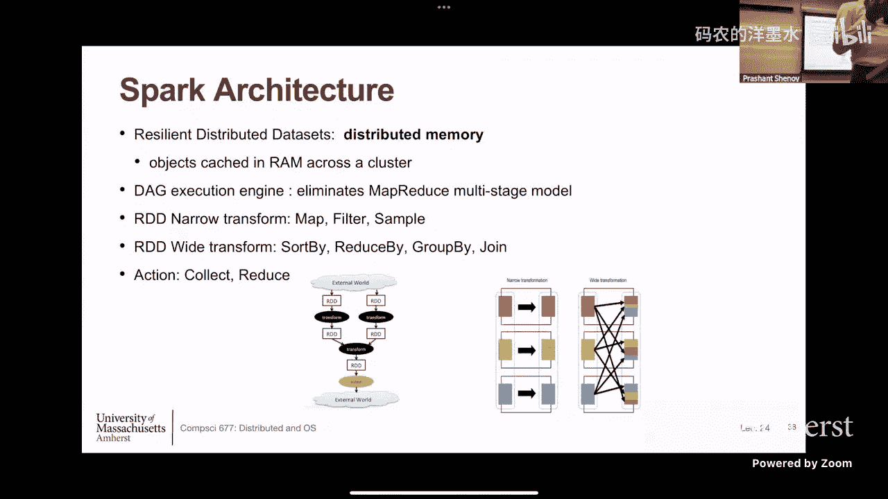

# 024：中间件 📚

在本节课中，我们将要学习分布式中间件。我们将快速浏览几种不同的中间件系统，包括企业级Java、CORBA、DCOM/.NET、黑板架构以及Hadoop和Spark等分布式数据处理系统。通过学习这些案例，您将对如何利用中间件构建高级分布式应用有一个宏观的了解。

---

## 分布式文件系统回顾 📂

上一节我们介绍了XFS和Coda等文件系统。本节中，我们来看看两种广泛使用的商业系统：HDFS和GFS。

### HDFS (Hadoop分布式文件系统)

HDFS的设计目标是实现应用程序数据的高吞吐量访问。它专门为处理大型数据集（如GB或TB级别）而优化，这与为小文件优化的通用文件系统不同。

HDFS的核心设计决策包括：
*   **高容错性**：通过数据复制实现。
*   **批处理优化**：为读取密集型、一次写入多次读取的工作负载设计。
*   **数据与元数据分离**：使用专门的元数据节点（NameNode）和数据节点（DataNode）。
*   **数据复制**：默认将每个数据块复制三份存储在不同的服务器上。

HDFS的架构可以概括为：一个中心化的元数据节点管理文件系统的命名空间和访问，而实际数据则分布存储在多个数据节点上，并通过复制保证可靠性。

### GFS (Google文件系统)

GFS与HDFS在设计上非常相似，也是为大型文件访问而设计。它同样采用主从架构，包含一个主服务器（Master）来管理元数据，以及多个块服务器（Chunk Server）来存储数据块。GFS也默认使用三副本复制策略，并运行在底层Linux文件系统之上。

### 对象存储系统

对象存储系统（如Amazon S3）提供了另一种存储范式。与文件系统不同，它使用对象句柄（通常是内容的哈希值）而非文件名来访问数据，操作接口是`PUT`和`GET`。对象存储通常用于海量归档数据，其设计也是数据与元数据分离，并且对象句柄是位置透明和位置独立的，这意味着系统可以在内部移动数据而无需改变访问方式。

---

## 中间件系统概览 🔌

现在，让我们进入今天的核心主题：分布式中间件。中间件位于操作系统和应用程序之间，为构建分布式应用提供通用服务。我们将以分布式对象模型为基础来理解这些系统，即客户端通过远程方法调用（RMI）访问位于服务器上的对象。

### 企业级Java Beans (EJB) ☕

在Java企业版中，EJB是一种用于编写业务应用程序的组件模型。EJB对象的关键特性在于其状态可以跨程序调用持久化。

EJB主要有四种类型：
1.  **无状态会话Bean**：不保持任何会话状态，类似于纯计算服务。
2.  **有状态会话Bean**：在会话期间保持状态，但状态不持久化。
3.  **实体Bean**：其状态会持久化到磁盘，即使应用重启也能恢复。
4.  **消息驱动Bean**：用于异步接收和处理消息。

此外，企业级Java还提供了如JDBC（数据库连接）、JMS（消息服务）等开箱即用的服务，方便开发者构建应用。

### 公共对象请求代理架构 (CORBA) 🌐

CORBA是一个旨在实现跨语言、跨平台互操作的中间件标准。它的核心是对象请求代理（ORB），负责处理所有通信。

CORBA的特点包括：
*   **丰富的内置服务**：提供了事务、并发、持久化、安全等数十种公共服务。
*   **动态调用接口**：允许在运行时发现对象接口并调用其方法。
*   **灵活的RMI调用**：支持同步、异步、单向和延迟同步等多种调用方式。
*   **事件服务**：实现了基于事件通道的发布/订阅模型。发布者产生事件，订阅者消费事件，两者通过事件通道解耦，支持推（Push）和拉（Pull）两种数据传递模式。

尽管功能强大，但由于其复杂性和“重量级”特性，CORBA在实际开发中并未得到广泛应用。

### 分布式组件对象模型 (DCOM) 与 .NET 🪟

DCOM是微软在Windows平台上推出的分布式对象模型，后来演进为.NET框架。其历史沿革从单机进程通信的COM，到支持对象链接与嵌入的OLE，再到支持Web的ActiveX，最终发展为跨网络的DCOM和语言无关的.NET。

DCOM/.NET本质上也是一个分布式对象模型，支持远程方法调用和持久化对象（通过所谓的“Moniker”）。它与EJB和CORBA在核心概念上相似，但深深植根于Windows生态系统。

---

## 分布式协调与黑板架构 🏁

前面介绍的中间件都基于紧密耦合的客户端-服务器直接通信模型。现在，我们来看一种不同的协调范式：黑板架构。

我们可以根据**时间**和**空间**两个维度上的耦合度对协调模型进行分类：
1.  **直接通信**：时间、空间均耦合（如RPC）。
2.  **邮箱模型**：时间解耦，空间耦合（如电子邮件）。
3.  **会合模型**：时间耦合，空间解耦（如发布/订阅）。
4.  **生成式通信/黑板模型**：时间、空间均解耦。

黑板架构就像一个公共布告栏。参与者（生产者）将消息（通知）张贴到布告栏上，这些消息不针对任何特定接收者。其他参与者（消费者）可以在之后任何时间浏览布告栏，寻找自己感兴趣的消息。这完美实现了时间和空间上的解耦。

**应用场景示例：零配置服务发现**
假设您带着笔记本电脑到朋友家，想使用他家的打印机。在理想的黑板架构实现中，打印机会将自己的服务信息（如IP、型号）作为一个“通知”发布到网络内的共享布告栏（Java空间）。您的电脑上线后，可以查询这个布告栏，发现可用的打印机服务，从而实现自动配置和打印，无需手动设置。

### JavaSpaces 实现

在Java世界中，黑板架构可以通过**JavaSpaces**来实现。JavaSpaces本质上是一个支持复制的元组空间（一种分布式共享内存）。生产者将数据作为**元组**写入空间，消费者可以读取或取出匹配的元组。

JavaSpaces的复制策略有两种：
*   **写广播，读本地**：写入操作同步到所有副本，读取只需访问本地副本。
*   **写本地，读广播**：写入只发生在本地，读取时需要查询所有副本。

这为实现可靠、高效的服务发现和分布式协调提供了基础。

---

## 分布式数据处理中间件 🚀

最后，我们来看专为大规模数据处理设计的中间件：Hadoop和Spark。

### MapReduce 与 Hadoop

MapReduce是一种编程模型，用于并行处理海量数据集。它将计算分为两个阶段：
1.  **Map阶段**：多个工作节点并行读取输入数据块，进行初步处理，并输出中间键值对。
2.  **Reduce阶段**：其他节点收集并处理这些中间结果，生成最终输出。
两个阶段之间有一个**Shuffle**过程，负责数据的重新分区和传输。

Hadoop是一个实现了MapReduce模型的开源生态系统，其核心组件包括用于存储的HDFS、用于资源管理的YARN，以及MapReduce计算框架本身。

### Spark

Spark是基于MapReduce理念构建的，但通过一个关键创新极大地提升了性能：**弹性分布式数据集（RDD）**。

在传统MapReduce中，Shuffle产生的中间数据会写入磁盘，后续阶段再从磁盘读取，I/O开销巨大。Spark则尝试将中间数据保存在**分布式内存缓存**中。

**RDD**是Spark的核心抽象。它是一个不可变的、可分区的数据集合，可以跨集群节点缓存。关键特性是**弹性**：RDD会记录其血统（Lineage），即它是从哪些数据通过哪些操作计算而来的。如果某个RDD分区丢失，Spark可以利用这个血统信息重新计算它，而不是依赖数据复制。

因此，Spark通过将数据尽可能保留在内存中，并利用RDD的血统机制提供容错，实现了比Hadoop MapReduce快得多的迭代计算和交互式查询。

---

## 总结 📝

本节课我们一起学习了多种分布式中间件系统。我们从企业级Java Beans和CORBA了解了传统的分布式对象模型。接着，我们探讨了DCOM/.NET在Windows世界中的演变。然后，我们深入分析了基于黑板架构的生成式通信模型，以及如何用JavaSpaces实现服务发现等解耦场景。最后，我们介绍了用于大数据处理的Hadoop MapReduce和Spark框架，了解了Spark如何通过内存计算和RDD提升性能。

这些中间件案例展示了解决分布式系统挑战（如通信、协调、数据处理）的不同设计哲学和实现路径。