# 【全集 2025 附课件】马萨诸塞大学 分布式系统 中英字幕 p01 Lecture 1 - 分布式系统导论 -BV19BSYBuE4Y_p1-

Okay， so we'll get started。

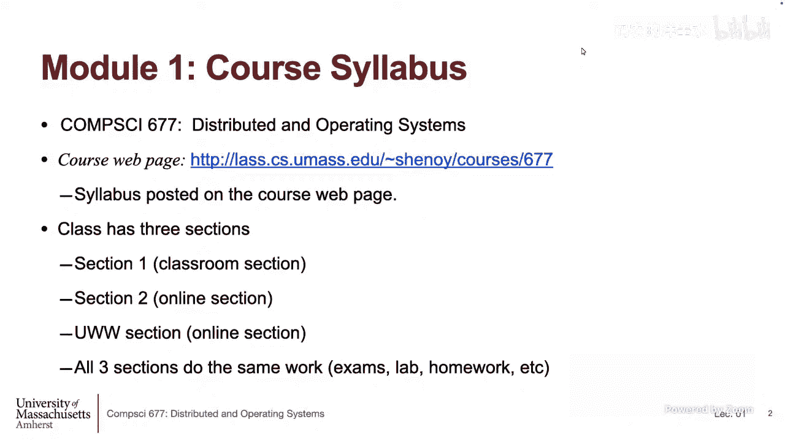

All right， so welcome to 677 distributed and operating systems。

 this is the spring 2025 edition of the course I think Ive taught this course for more than 20 years。

W hasn't changed a lot but of course we keep updating it so there'll be some new stuff this time as well as you will see okay so what I'd like to do today is go quickly over the syllabus so that you know what what the course expectations are what you can expect to get out of this course and then I'll spend the rest of the class and and talk about what our distributed systems give you a little introduction to the topic so that you know what what to expect for the rest of this course so。

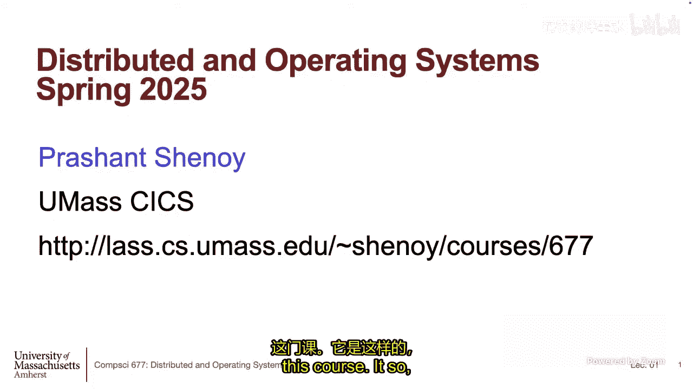

Before I do that， I wanted you to know that the course is being broadcast and recorded okay because there's an online section of the class as well so when you ask questions I'm going to repeat that just so that people who are online can actually understand what the question is because the microphone is on my T here so maybe you going to pick up your audio so just keep all of that in mind so without further ado let's start talking about what the syllabus says so first of all the most important resource you need to know is the course web page I sent an email yesterday I hope you all received it it had the link for the course webage except that there was a typo and that so I don't know if anybody even clicked on that link that is the correct link I will repost that correct link on Piazza so the course webpage is going to have the schedule for the class is going to have。

The syllabus as well as well as links to various materials that we will need to use for for the course the course has three sections right this is the classroom section there are two other sections that are following along they're all online students but all of the sections do the exact same work there's no difference it doesn't matter which section you are in you will do the same work you will take the same exams it is just that the other section students are not in the classroom they are following along using a live broadcast or through recorded lectures but other than that no real difference it is the same expectations for all of the three sections of the course。

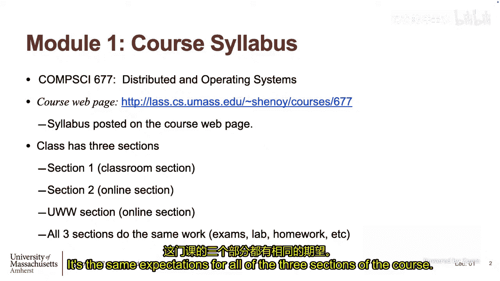

So the course has a number of Ts they are actually here their photos are here you will encounter many of them through office hours and so on okay Nathan who's the first person listed here is here hes going to help with the recording so you will see probably at least the classroom section will see more often than others but you will see all of them over the course of this semester and there are a number of other grading assistants who you may not encounter but they will be working behind the scenes grading all of your homeworks and assignments and so on so we will have regular office hours for this class mine are already listed here there on Wednesdays in the afternoon from four to five and I'm going to announce all the other office hours later this week on them in the Wednesday class but generally you should expect that we will have daily office hours so any day of the week if you have questions there will be somebody you can actually。

So we plan to have daily office hours with not very many courses offer that but we do because the course is going to have a significant lab component and so when you have questions you can go and ask somebody okay so thats the plan I will announce the other office hours on Wednesday。

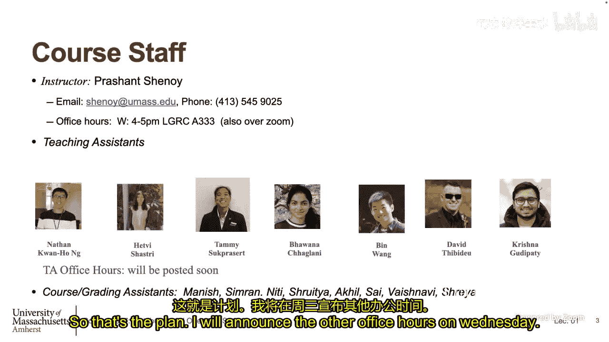

All right so moving along there is a textbook for the class which is a suggested book it is freely available you don't really need to buy it you can just download the PDFf version of the book legally from the from the。

😊，Author's website the information on how to do this is actually on the class webp page so you should go and there are two editions that are useful the fourth edition which is the most recent one that's the one we will use but the fourth edition did away with some topics which are still in the second edition of the the book which is also available legally or download from the authors's webpage okay well use both of those plus several other things because not all of the topics in the class are actually covered in the book only a subset or covers or the rest well use other types of course materials including readings and so on and course notes as well。

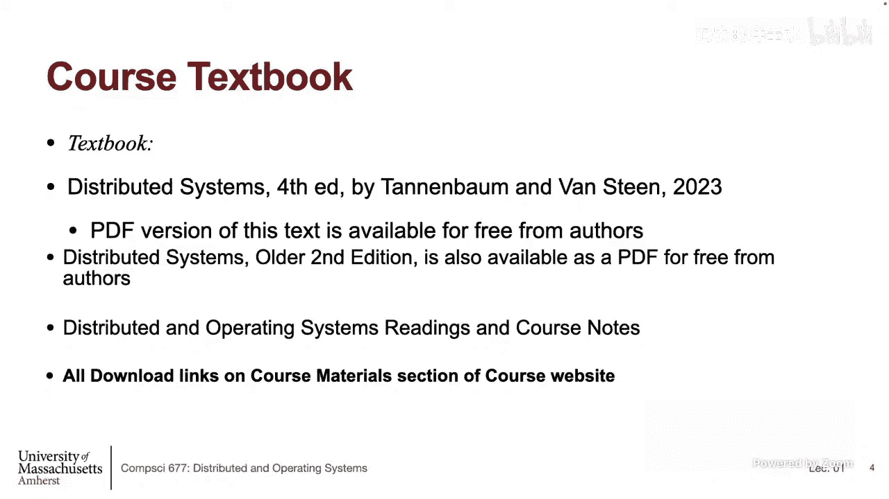

Allright so here is the list of topics we are going to cover over the next 14 or so weeks okay today we are going to do the introduction okay so we'll look at very at a very high level what are distributed systems okay why should we learn about distributed systems and so on and next time I'm going to talk about distributed systems architectures what are highle architectures we're designing these large scale systems that's going to be topic of Wednesday's lecture and then next week we'll start talking about interprocessed communication how are distributed systems design how do they communicate with one another that's going to be a few classes and then we'll talk about processes their scheduling and process management and distributed systems this is where we look at not only threads which you may have encountered you taken an undergrad OS class where we'll look at more advanced concepts in terms of scheduling clusters。

ization how this is used in the cloud and so on and then we may very briefly touch up on naming and location management we deemphasize that somewhat in the course this year but I might say a little bit about it and then we'll go into what are called canonical problems in distributed systems so so well send a good number of lectures talking about classical problems that arise in distributed systems how do you address them in the abstract and then you will see how to apply them to specific application context and so we look at mutual exclusion which is distributed locking we'll talk about leader exclusion sorry leader election excuse me clock synchronization distributed snapshot distributed transactions and so on and then we talk about resource sharing replication and consistency and tied to that is the topic of all tolerance and security it。

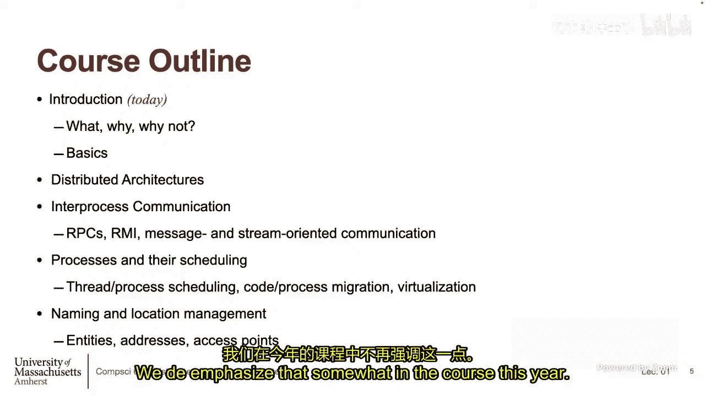

So so these are the core topics and then as we go along we will touch upon several different areas that will draw from these topics and these would include the web cloud computing。

 edge computing sustainable computing， big data multimedia internet of things and a few other topics so so that's the general plan。

Any questions on this？Okay so as far as the grading is concerned there's going to be two exams with pretty same as every for the past several years has not changed two exams a midterm and a final there are three labs which is where you are actually going to write code for all the concepts you are going to learn in class there are going to be smaller assignments which are homeworks and lablets lablets are just very scripted tutorials they are not real labs but we learn about some topic that you might have to use in the lab homeworks are just homeworks and then there's going to be some class participation so 44% for exams the labs are roughly the same as the exams 43% assignments 1% per assignments or roughly there are going to be depending on lablets and homework about 10 or so so there's 12% class participation is 1% class participation is going to come from a number of different means depending on whether in class student online student。

So on of course if you come to class ask questions just come to class it's also good enough but if you ask questions that's great you participate in Piazza discussions that get you something there are going to be weekly quizzes this is more for the online students to make sure they're keeping up but of course all of you in the classroom section or to take them too that's part of it we are going to shortly after class today ask for volunteers to help take notes for each lecture okay so those are going to be called scribes if you volunteer to be ascribe for a lecture you'll get some class participation points okay so when that email goes out please think about whether you want to contribute to the course and sign up okay so all of these together will be one% you don't have to do everything but if you do any good subset of this you should be good in terms of class participation points。

There are two prerequisites for the class which I'm not going to check but I need you to know okay the first is that this is a grad level course in distributed systems and operating systems it assumes that you know something about operating systems already right which means typically it means you should have taken an undergrad class in operating system。

now I don't know if every one of you has taken this class or not every year I get a few students who have not taken it okay I'm not going to ask you to drop the class if you are not completed the prerec but it's really your responsibility to go and look at undergrad book in OS and at least brush up on the concepts because we are going to assume you know all of that material okay as we go so it's important that you at least understand basic concepts in operating systems at least at undergrad level for you to take this grad level class okay and the second prere is of course you need to be able to program well okay because you almost half the grade depends on it。

So you need to know programming in a highle programming language many years ago we allowed you to program in whatever language you wanted now that the class is so big we can't actually give you that luxury anymore we are going to restrict you to either doing all the labs in Python or doing all of them in Java you can pick between one of these two but that's what you are going to have to stick you can't use any programming language because its just too complicated it for us to grade when you have such a large class we have nearly 200 students in the class beyond what you have in the classroom section any questions。

Yes， can you recommend a resource forgrad operating systems Okay question is is there a recommended textbook or resource for undergrad operating systems I will later today on Piazza post freely available textbook that we use here for undergrad OS you can just download the PDF and look at it also the lectures from an undergrad OS class and I taught it are also available on the same YouTube channel that this class is going be posted on so if you need to actually go and review some lectures those are also available I'll put both of those resources on Pazza so if you feel the need you can go review it okay。

Any other questions here？Okay。So moving along just some course tools you should know okay all of our online discussions are going to happen on piazza okay you should all be enrolled already okay we took the roster as it existed as of this morning and we uploaded it to Piazza of course during arop there will be changes but we are going to keep syncing it so you should already be enrolled on Piazza so please post all of your questions on a Piazza discussion forum。

In particular get try not to use email to ask questions specifically off me because we get 300 emails a day it's really hard to keep up we want to make sure all of your questions are actually answered so rather than having it get lost somewhere in my inbox or Ts inbox post them on piazza if it needs to be private post make it a private post we will monitor it seven days a week you will often have an answer in minutes but we will try to make sure you get a timely response no matter when you post so this thats are going be a preferred means of communication for the class the other tools you' are going to use our gradecope this is where you will turn in homeworks this is where we will grade your exams exams will take in class but we will actually send you the solutions to gradecope all the labs are going to be done on Github classroom you should be enrolled in GithHub classroom also but you need。

To actually link your Github ID to your enrolled your student account and I'll send instructions for that on Wednesday on how to do that。

So you should be enrolled on Pi's a gradecope and Github classroom of course you're already enrolled on Canva okay that's the course webage that's the YouTube channel where you can go and look at all the lectures and then there's a canvas of course which well use mostly as an online grid。

All right。

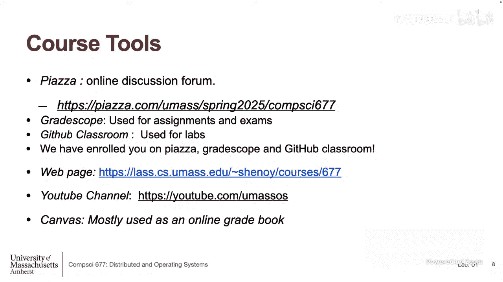

是。All right course policies so we need you to be participating in class which means asking questions if you come to class okay and as I said we will also need a scribe to take notes for each class。

 please sign up when that email or peer the post goes out they will give you a small number of participation points if you do that。

I already mentioned the communication policy please use Piazza not to use email unless it's an emergency of course you can use email but we prefer that most of the communication occurs over piazza and large large but not least the device policy for this class is important for you to know we are not going to allow you to use any devices in class so if you have laptops open please close it this is a good time to do that because and no cell phones are allowed if you need to take notes you can always bring paper but if you have any accommodations we need to make we are and look at it but we will by and large not allow any devices to be used because only distractions。

There's a person there who's not listening。There's no laptops allowed in class， I just announce that。

Yes。要不等下。Yes， you absolutely can get， I will post all the slides day of the class。

 you can bring them to class and take notes that should not be a problem。Did I get one my follow up。

嗯。I either。I really focused。Yes， we can make whatever accommodations you need。

 but what we don't want you to do is bring a laptop to class and then just distract yourself and six people behind you or then looking at your screen。

 not looking at。And that's what we are trying to avoid here， but if come talk to me after class。

 right okay。Any other questions about this policy？

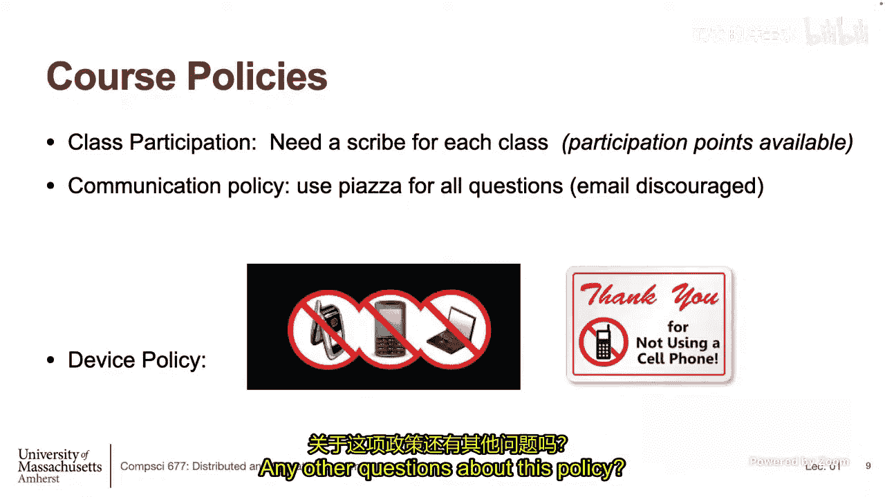

Allright okay so I'm going to take a pause here we'll talk now about that's the syllabus it's all spelled out in great detail on the course webage at maybe longer than it needs to be but everything that you need to know is there if you have any questions review it ask me a question alright before I start why distribute systems I'm going to just send this sign up sheet I just need to know how many of you who signed up actually came to class today okay so just mark your name off if you haven't yet signed up for class okay write your name at the back okay this is the roster as it stands of today but if your name is not on the roster please do I just need to know who all are actually coming to class who signed up because some people maybe dropping the class and so on。

O。So let me continue if there are no other questions。

 I'll talk about why this topic should be something you should learn about。

 why should we talk about distributed systems in general？

So first thing to keep in mind is almost every computing system that you use today is distributed in some shape or form this includes the worldwide web that can include Google search engines cloud computing ecommerce websites and' just written one of them Amazon but practically every ecommercecommerce websiteite peer to peer file sharing system vi and grid computing cluster computing mobile computing they are all distributed systems so so it stands。

So to reason that we should at least know how they work if you need to understand them， okay。

 we should try to understand the principles for designing them how they are implemented and so on。

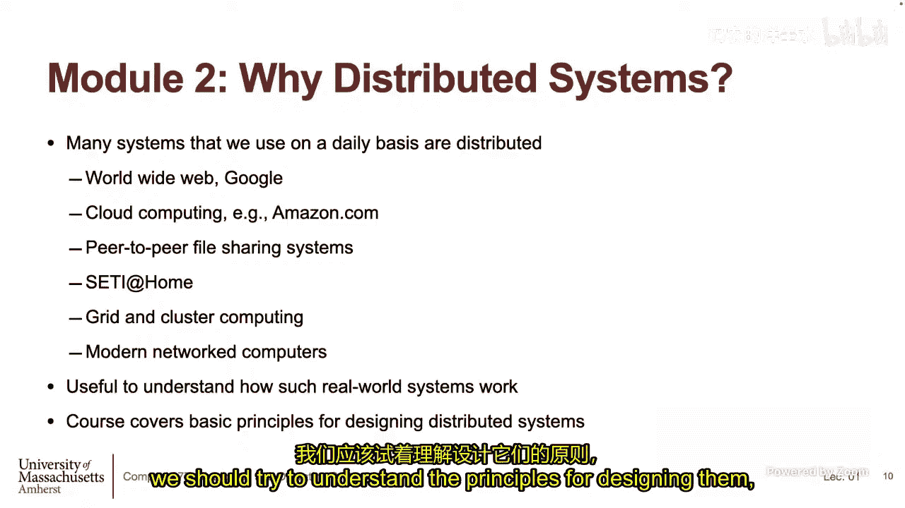

so now lets try to define what is a distributed system so that you have some understanding I just gave you a long laundry list of systems but what is it that is common across them that makes them distributed so there are many terms you need to understand okay one of which will be distributed system but let's start with network system。

network system simply means that it' is a computing device that essentially has some networking capability。

So if you have your laptop it has a w-fi connection okay that's a network computer if you have a phone that has a cellular connection that's a network system a network system by itself is not distributed because its just a computer that is connected to some other computers through a network but what is a distributed system is essentially its a network system of independent computers that appears to its user as some sort of a single coherent system so so in this case your multiple computers that are working together to provide some sort of a service or application to its end user so is an entire network of computers appears as a single coent system and that is what we will mean is a distributed system。

Okay so there are many examples of this I showed you several in the previous slides。

 but this is a very broad definition， so in this case parallel machines are also distributed systems because you can think of multiple machines think of a cluster a GPU cluster of some sort that allows you to parallelze your computation they are multiple machines that are working together maybe they are doing something in terms of computation they might be training a model or doing some scientific batch computation and so on so that's an example of a distributed system now often you will hear the term decentralized system and youll also hear that term distributed system so the question is are they the same thing are different what are the difference so they are very related terms but they are not exactly the same thing now this is a definition I actually took from the textbook but I'm going to explain some additional things that you need to。

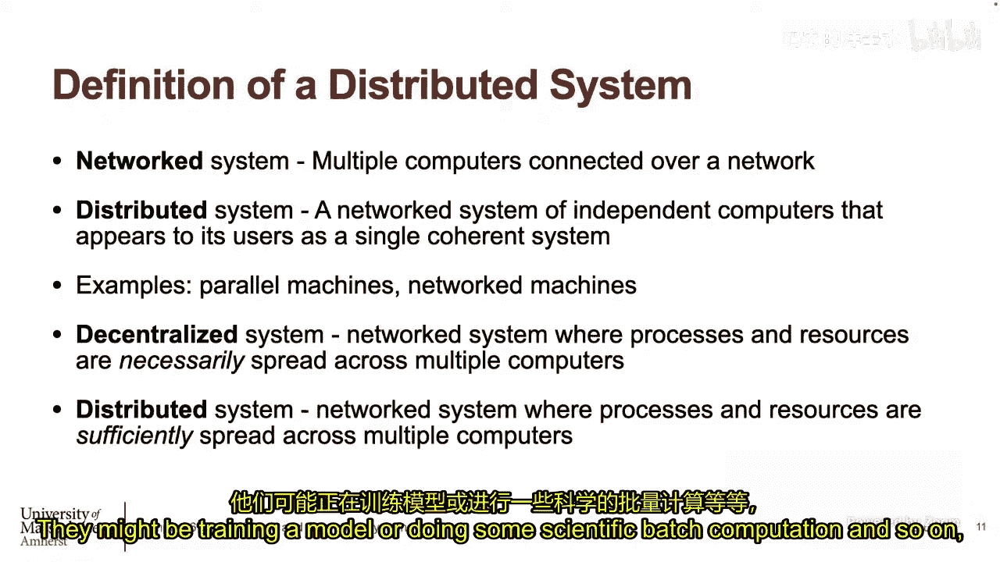

Keep in mind when we talk about decentralized systems and distributed system。

 So decentralized systems are essentially。You can think of them as a distributed systems that necessarily spread their functionality across multiple computers。

And in a distributed system okay you have this functionality thats sufficiently spread but not necessarily spread now what does it mean to say it necessarily spread and sufficiently spread so the way you want to think about it is you know a distributed system simple example of a distributed system could be a client server application you have a client which is let's say a laptop as connecting to a web server。

Okay the web server is essentially a server now in a distributed this two machine application is a distributed system but in a distributed system not all of the components have to be distributed just so you might have let's say code that's on your web server that may be using centralized data and things or that okay now in a decentralized system there is no single point of control you are essentially putting all of the functionality on all of your machines which essentially means that you are going to this is what it means to say sufficiently spread all of your functionality across multiple computer so you can think of a decentralization as a more extreme form of a distributed system where any component you have any algorithm data code is essentially decentralized there aren't any central points of control or any centralization of any of those component Okay that's what we will mean is a decentralized system so just keep that in mind we' come back to this。

Or over and over again as we go along with the various topics in the course。

 so first now let's talk about some advantages and disadvantages。

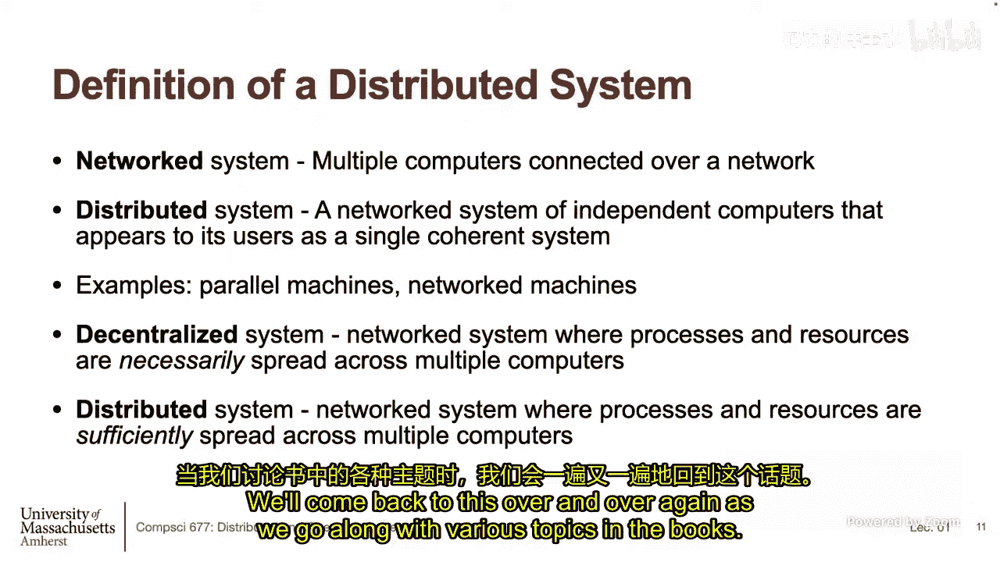

so why design systems in a distributed manner why not just make them centralize there are several advantages of distribution the first is that it makes resource sharing possible so if you have multiple machines that can communicate it is time for reason that you can now access resources on a different machine。

If you didn't have this you would be limited to the resources on your machine。

 so for example you can access storage on another machine。

 this is what a cloud based storage service will provide you can actually put graph files in the cloud right that is an example of resource sharing right。

It gives you better price performance ratios or better economics because you are designing your system using a large number of machines。

 its often cheaper on a price to performance。S point to actually do it that way rather than buying one large machine。

So that is basically the economics， it also increases the reliability of your system since you have more than one machine that are part of your system。

 if any one or some subset of the machines fail your application as a whole does not need to fail it can continue to function if the other machines take over the responsibility of the failed ones。

Okay so that gives you increased reliability of course you have to design your application to do that just because you take your application and put it on multiple machines doesnt automatically improve reliability。

 but if you add reliability to your system the fact that is distributed is an advantage fit a centralized system that machine fails the entire application is gone down。

And there's nothing else you can do at that point。There's potential for incremental growth which means that as your application continues to grow over time in terms of its workload and so on you can actually increase the size of your system incrementally you can add more machines to it and you can scale up your application that way that's something you are going to look at as we look at cloud computing and other topics down the line so those are all good advantages they all seem like good things that you should have in your computing system in this case are distributed computing systems but there are some disadvantages as well all of those advantages don't come for free or give up something so what is it that you are going to give up first thing is that your programming languages and operating systems have to be distribution aware which means that they are going to be more complex to build because they need to support is applications that are going to work over a network and so on so they need additional functionality there's additional complexity involved in。

Designing your programming languages operating system hand application itself is going to be more complicated writing a distributed application is going to be somewhat more challenging than writing a simple program that is centralized。

network connectivity is essential because our definition of a distributed system was that you have a collection of machines that are communicating over a network to achieve some coent task so if a network goes down your application is going to go down as well so the network can be a point of failure that can cause your application to stop functioning in some cases you can do something about it but the by and large network connectivity is essential and the third disadvantage is and it raises security and privacy concerns。

Because your application is now accessible over a network it is accessible to anyone who actually has the ability to communicate with those machines this includes。

😊，This includes bad guys like hackers who can now hack into these machines and maybe steal code or data so this a distributed system is going to raise security and privacy concern so that's an additional issue that you have to now think about when you build your application to run over a network。

So these are some advantages and disadvantages that you want to keep in mind。

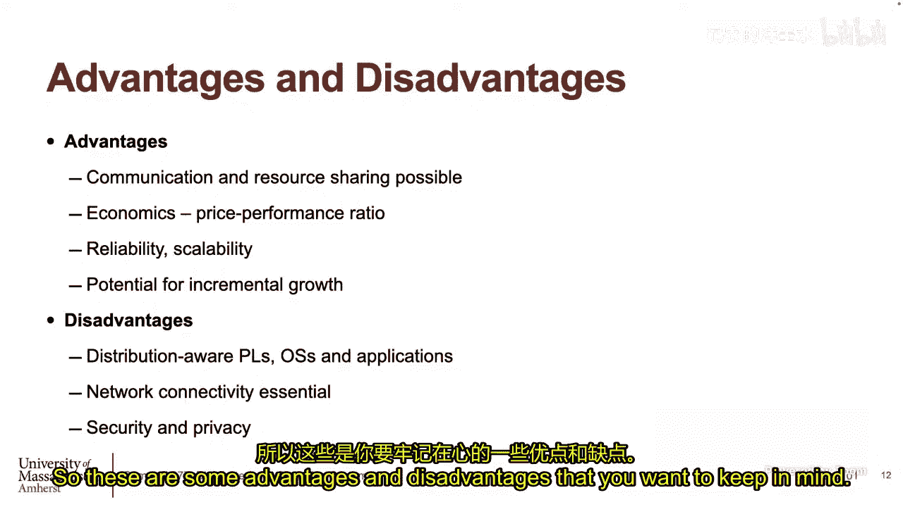

So with that， let me not talk about a set of other issues but let me also see if there are any questions on what I said so far。

Yes， question online asking about related submission fault。

Okay there's a question online about late submission policy。

 the late submission policy spelled out in the syllabus I didn't mention it here there is going to be some late days that you have I don't remember what it was I think is either three or four okay so you can use that and then beyond that there's going to be a penalty。

And I'll answer that on P just so that it is clear what it is。好的。Okay。

 question is can a decentralized system also operate as a single core and so decentralized systems are also distributed？

So the definition of distributed system still applies to decentralized。

 but they are a specific type of distributed system， so yes。

 they will act as a single core so a good example of our decentralized system is a peer to peer system。

Many peer to peer applications are fully decentralized。啊系。阿婆。

question are all decentralized system distributed systems yes。

 that's what I just said decentralized systems are a form of distributed systems。Any other questions？

Okay。So what I shown on this slide is what is referred to as transparency in distributed systems。

 so there are two columns in this table， the first column is essentially a set of properties and then what transparency means is that property hidden from applications or hidden from the end user or is it actually exposed to end user？

Making something transparent means hiding it。That might sound counterinitive because transparency might mean to you that you are actually making it visible but here transparency actually means that you are hiding that property so also so lets look at a couple of examples here so what is location transparency a location transparency basically means that you are hiding where a resource is located。

Okay very simple example， okay let's take a URL。OkayLet's1 URL www。umma。edu。

That's a resource that's basically a URL for the UMas website so the in this case just looking at that URL gives you no indication of the location of the server the server could be located anywhere okay so URLs are essentially location transparent because they don't actually reveal the location of where the resource in this case a web server is located。

So now let us look at replication transparency， what does replication transparency mean it hides that a resource is actually replicated。

The fact that you may have a resource which could be a service or an application。

 it might be replicated on multiple machines is actually hidden from a user。

Okay what are some examples or any example you can think of？So here' is a simple example。

 you go to the Google search bar。you all use Google search right so now that's your abstraction or that's the interface you are going to use to ask for queries of the search engine。

Okay， now the Google search engine runs on tens of thousands of servers。

It is replicated at a massive scale the fact that it massively replicated is completely hidden from you because the search bar is giving you no indication of what is actually behind the abstraction in terms of the search engine you are not required to specifically send your query to a specific server in the search engine you just send the query and then the search engine response to you it takes kind of figuring out which specific server in its entire distributed system is responsible for answering that query and so on。

That is an example of replication transparency the fact that the service in this case a search engine service is replicated is hidden from the end user。

😊，So and then there are many more， so you can have failure transparency。

 which means that you are hiding from the user the fact that some component in your system has failed。

It's a good way to design a distributed system because if you don't do that。

 if theres some any component fail， application might not function or the user might actually see a disruption。

So I'm not going to go through this entire list but you get the basic idea right so these are all properties okay whether its the service is concurrent it uses concurrency or it is replicated whether it miable where is it located whether it' is persistent or not so all of these are good properties and making something transparent means that those properties are hidden from the end user the application actually provides an abstraction where this is handled internally by the system but not exposed to the end user。

人。Is this Jayan any questions here？Okay。

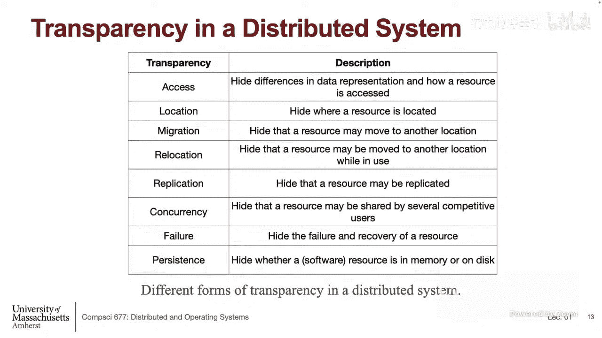

So that's transparency in distributed systems and then I'm going to talk a little bit about open distributed systems the word open should indicate to you that essentially the service is actually exposing certain things to the end user okay open could mean many things in this case you may have heard of open source。

Open source simply means that the code for the system is open。

But open distributed systems doesn't mean that it is necessarily open source the base line definition for open distributed systems is that its interfaces are open and well described。

The APIs that the system uses are actually well described so that other entities can can communicate and interact with that service。

😊，Open could mean more than open interfaces of course but by and large when you see that this is open that usually means is interfaces are very disturb of course you can go beyond that and you can make it open source which means that the code is also available you can actually use the code modify it and so on and you can go beyond that now if you think about the most current。

topic where you hear the word open that's essentially an AI model is a model open or close that basically means do I know about how it was trained do I know itss internals is a model available for download doesn't mean the code is available but it means lots of other things so the word open has many different connotation or our from our perspective in the context of distributed systems we will assume that the services that the distributed system offers are essentially through welldescribe open interfaces and protocols so that you can write other components that can interact with that's our baseline definition but of course you can go beyond that the benefits of being open or it allows you to be interoperable it allows you to be portable you can extend those interfaces add new functionality and so on so that's a good way to design distributed system at a minimum you should have well definedfined interfaces that you expose to other。

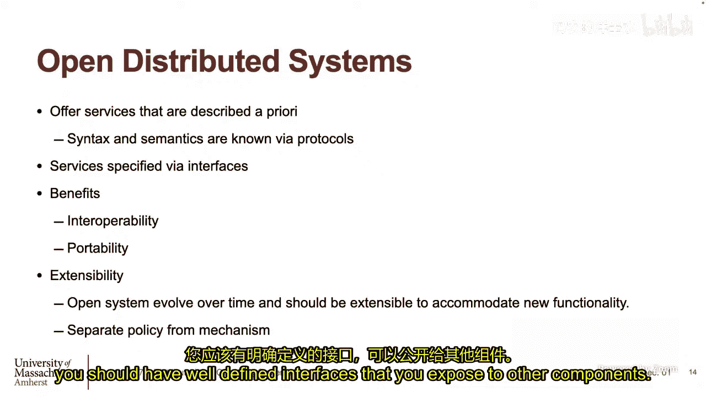

But。so I'll now talk about another issue we are going through several small topics we are going to come back to each of this in a lot more detail as we go along but this is just a quick introduction okay so it will cover a set of these issues before wrapping up for the day so the next issue that I want to talk is making distributed systems scale。

This is an advantage of distributed systems since you have many machines that are working together。

 they allow that system as a whole to serve a much larger number of end users than what a single machine could do。

so ideally， if you have very good scalability of end machines。

 you should be able to service a workload that n times the capacity of a single machine。

That is what scalability means。But designing your system to be scalable involves you to think carefully about various aspects of the system。

😊，So there are three particular things you want to keep in mind which is whether the service that you have constructed is it centralized or distributed。

 whether the data that is being used by the service or the database that is being used by the service is that centralized or not and whether the algorithms that are being used are also distributed or centralized so these are three independent axis they don't all mean the same thing lets take them one at a time。

Yeah， so you can have a distributed system which has a centralized service。

What does that mean you can think of， let' us say file server。

your file server essentially is a single computer it stores data okay there are lots of clients that can now access the files on that file server okay this is a centralized file even though the system is distributed okay there are many machines that are accessing the servers is a client server system so a distributed system the service that the distributed system offers is centralized it resides on one machine which is the server。

And the clients are accessing the service from that server， in this case it's a storage service。

So clearly you are going to have limits to how much you can scale if all of the applications。

 not all of the applications， all of the clients access that one machine。

Eventually that machine will saturate and you will essentially it a scalability bottle now you can make that service distributed you can have more than one file server can have a distributed file service that will scale better so you now get the idea of what it means to be a centralized service versus a distributed server whether is there service running on a single machine or is running on more than one machine there will be still be clients in the system but we are talking about the service that is being offered in this case。

Okay okay so thats one dimension of scalability the other dimension is the data that is being used to offer that service okay maybe you essentially have a service that accesses data that is stored in a database okay when requests are made of the server the server is going to query some database and come back to you with some answers。

Now， if all of that data is stored on a single machine in a single database。

 you are going to make all that centralized data。😊。

This is also going to have scalability bottle that because a centralized database and a single machine can only scale so much it can only serve so many concurrent users after a while it will saturate。

😊，And then you will not be able to scale any further。

Now again you can make the data or database these distributed you can put it on multiple machines。

 you can replicate it or you can partition it so now you have a collection of machines where the data is distributed so and requests come in that are sent to one of these many machines that allows you to scale better。

OkaySo this is an example where you have a distributed system where you went from centralized data to distributed or even decentralized data stores。

That allows you to scale even more。and the last aspect here is the code that is running on the server okay which we just refer to here in the abstract as algorithm the algorithm or the code runs on a single machine as opposed to the data being stored on one machine is the same problem okay because you have one machine where the algorithm is running is essentially going to saturate after a certain amount of workload which will prevent it from scaling further you can also make the algorithm decentralized。

This allows you to scale better so so if you want to design a scalable system a scalable distributed system okay its more than let's just put everything on a server and then you have a client server architecture is going to scale that's not quite the case you have to think about the design okay is the entire server going to run on one machine or more than one machine is your data going to be distributed or centralized is the algorithm going to be centralized or distributed？

Now it is not the case that you need to make everything distributed in a system you really need to think about what is the system being designed for maybe you make the service distributed but the data is centralized if you can manage that or you can make the data science is distributed but the code is centralized it depends you don't have to make all of these distributed but you to at least know that there are these three dimensions you have to think of when you design these distributed system。

That live。Any questions here？真为这手于。Okay， what is the difference between the service and the algorithm。

 is that your question okay？What's the difference between the service and the machine because the machine is a piece of hardware。

Right the service is the code that runs on it like server。Means it's basically a piece of hardware。

 it's a computer right service is the software that' is going to run on the server that provides a service that clients can access。

So that's is so you should think of a survey as a software that runs on the server。啊。

Okay question is what are some examples of decentralized algorithms we will look at many or in the course of this next several weeks okay simple example is let's say you have set of servers that are replicated maybe it's a website it is often it's a common thing when your large website you essentially create end servers each of them runs a copy of the website when a request comes in okay the web the service is going to decide which of these replicas to send the request to。

え。So youre basically so you have essentially what's called a dispatcher or a load balancer that takes incoming requests and it sends them to one of the copies of the website and then you get a response so then the question is in this case is the load balancing algorithm will be centralized or distributed so what does that mean so if you all the requests come to one entity that's the load balancer and it has to choose which service which replica to send that request to it might say I use the least loaded machine and are send it there。

So what that means is the load balancer in this case has to track the load of each of the replicas and continuously update it so when there are incoming requests。

 you are to send them to the right machine which is in this case is least loadeded machine that's an example of a centralized load balancer but all requests are now flowing through this centralized load balancer which can become a bottleneck so you can have distributed versions of these load balancers where maybe request directly go to a service or go to a replica if that replica is able to service it。

 then you are done there's nothing more to do but if it's overloaded for any reason it can then send it or forward it to another server so this example of decentralized or distributed in this case is actually decentralized but a distributed version of a load balance so so you'll think of many examples where you might do something with a centralized component or you might say I'm going to make it fully distributed。

Yes， there's a question online and no answer be considered a service instead of an algorithm。

Can the load balancer be considered as a service as opposed to algorithm that would depend answer is there are you could think of it as a service but typically you deploy load balancer as part of a larger service in this case it's a web service so it's a component typically you don't offer load balancing as a service arbitrary right so it's really a component so in this case it's actually an algorithm。

Any other questions？Okay。So。So let' us talk a little bit about scaling behavior or scaling techniques I talked about various dimensions of scaling but what are some principles you should use to design either decentralized algorithms or distributed algorithms okay some of these may not make sense today I'm going to tell you anyway but we willll come back to them and youll understand what some of these things mean。

So there are a few different things to keep in mind the first thing is that you should not have a single machine that has complete state of the system what that means is you do not want to put all of the knowledge of what to do at one machine which effectively centralizes the algorithm so that's essentially saying that I distribute my state or the knowledge of what' is going on in the system across multiple machines you should as far as possible make decisions based on local rather than global information if you need to have global information essentially says I know everything about what is going on in my system the load balance or example I gave was essentially think of it at a global information it had the load load information or every replica that's my global state in this case load on the machines is my state if all of that state is available on a single machine that means have global information so the more global information。

You need the less you are going to scale the load balance in case every time I send some request to a server okay the load on that machine has changed if I don't update it instantaneously my load information is already out of is still so I'm making decisions now based on sta information so global information is hard to keep track of it doesn't scale easily but if you make decisions based on local information where I don't need to know but what else is going on on other machines that scale is better in the abstract at least you understand what I'm trying to say itll come back to this the third principle which this one is easy to understand is a single failure should not cause the entire system to fail failure of a single machine out of your end machines in the network should not cause the entire application you should design your system so that the failed node responsibilities are taken over by other machines in this case the application。

Can continue to run in in most cases， the user may not even realize that there was a failure and you recovered from it behind the scenes。

And then the last thing here is。Probably something that not very easy to explain at this point in time it says that a good way to scale is you should not assume a global clock but by global clock what we really mean in this case is you should not have to assume that all machines are perfectly time synchronized because as we will see when you get to clock synchronization there is no such thing as perfect clock synchronization any clock synchronization will always have some errors so if your algorithm is based on let's say timestamping events and trying to figure out something based on that timestamp and you are assuming that there's perfect synchrony that's not a thing because there are always going to be some errors and there will be some issues you will fit so the extent possible if you don't depend on tight synchronization of clocks on the machines in your distributed system the better it is to design your system and thats something will come back to when we talk about canonical problems and distributed。

So those are all good principles to design and scale distributed system there are some other techniques which are often used as well okay one is called asynchronous communication where you make nonblocking calls blocking calls can slow you down so that to the extent you use asynchronous or non-blocking calls your system is going to scale better the more distribution you have the less centralization the better and then if you use caching and replication that's a very common technique to scale your system you add caches so that you can speed up IO you don't have to use slow IO devices you use faster caches that improves the IO throughput in your system it improves the overall performance and replication of course allows you to scale because you now have more than one machine that can offer the same service so you can can send your request to any of the so these are all techniques we are going to come back to in some cases each of that bullet is an entire chapter or a lecture that we are going to get to。

一这。this is just very high level introduction， any questions here？

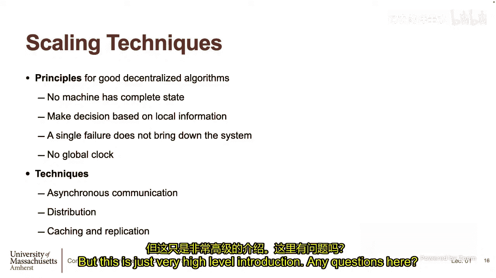

Okay。So you now switch gears， we are in more sort of the third。

Part of the lecture where I'm going to take you through a very quick history of distributed systems how theyve evolved distributed systems have more than a four or five decade history now so they evolved in the late 70s early 80s now we are in the 2025 so it's been quite a bit of evolution of where they started and where we have ended so we'll do that and then we'll talk about operating systems briefly because the course is not just distributed systems it distributed and operating systems so we'll also talk briefly about what kinds of operating systems support do you need to build this distributed systems but let's start with a quick history so back in the 196070s well before any of us were born even I was born there was this minicomp model of distributed systems what that meant to us there was a single machine and you had what were called terminals that were connected to that machine。

And you could essentially have multiple users work on that machine and do some tasks often there was a very slow network you'd use a slow telephone network to communicate with other machines and so on。

So the very early days of distributed systems each user had access to a local machine it was not their machine it was shared across multiple users you could do some local processing but you could fetch remote data and email was basically a thing where you could actually send messages to users on other machines and that's how email was bought that basically was essentially the early distributed application that you could run with this machine so as technology evolved hardware got cheaper the main theme you'll see hardware is getting cheaper that allows the distributed systems to evolve。

Okay so so now as hardware got cheaper， it became possible to rather than share one machine across multiple users to give each user their own machine。

This was these machines were called workstation， this was the pre PC era okay workstations were more powerful computers okay so this allowed you to now put computer on everyone's desk they were all network together this allowed you to do interesting things which will see when you get to process management that you could essentially start a process or an application on one machine it would run there for a while and then it could move another machine and continue execution somewhere else because now you are using resources in this case compute resources on multiple machines to execute tasks so you you had something called process migration which allowed process these to run on multiple machines over their lifetime that's an innovation that you saw with the workstation mode。

Now as computers got even cheaper you are now in the PC era you could put lower end machines that are not as powerful as workstation put them on every means desk they could do local processing using some applications that they could run locally but also they could access resources on more powerful machines which are called servers this brought you to the client server era which is still there today of course and the client server model where user as a local machine you can do lots of computations locally but then for more compute intensive task you go to a server and you basically ask the server to provide you some service of some sort it could be a fine service computer service could be a web service so that basically brought us to the client server model that continue to evolve so in this case what happened to servers kept getting more powerful as hardware cost。

kept dropping okay and then there were servers that had many many processors okay this was called the processor pool model okay where your server was not one machine but think of it as a pool of processing elements okay you could essentially submit a task and it would run on one of those processing pools。

This model is there even today with clusters and GPU clusters and so on。

 but this was the very early version of this maybe 30， 40 years ago。

 it was called processor pool model where your server is now more powerful and you can essentially have more than one set of processing elements on those servers。

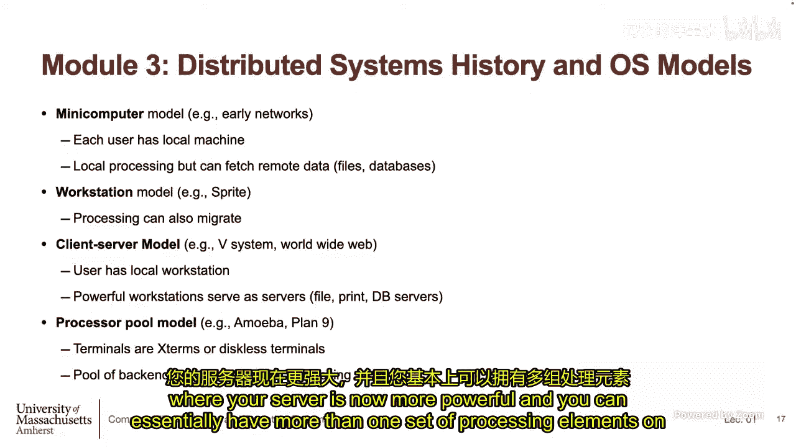

And that's continued to all the processor pool model has evolved to a cluster computing model where you have large server clusters that are networked together okay you can submit jobs to a cluster and it will run that job so if you have used any compute cluster anywhere including here like unity or some of the other ones you know what a cluster is it's essentially a set of servers you can submit a task or a job to the server the server will then run the job on any of the available machines or it can parallel as the job and run it on multiple machine the most modern evolution of these clusters a GPU clusters but prefer that there are lots of CPU clusters which still exist today but now you can do whatever I said is essentially not run on GPs rather than CPUs so that's your cluster computing model large clusters actually run in facilities that are called data centers so you have what's called data center computer if you're really large cluster that。

clusterster runs in one large facility， it's called data centers we'll talk about that as well。

And then you can take these clusters that are at different institutions and you can connect them together over the internet。

That that essentially gets you to what are called federated clusters gets you to what is what are called grid computing system essentially grid computing system means your clusters that are connected over a wide area network where the cluster themselves coordinate okay one cluster is overloaded it can send some of the work to another cluster。

Okay so you have core clusters that are coordinating with one another those are called grid computing systems also theres evolved to what are called wide area network based clusters or distributed data centers okay so lots of companies like Google and Amazon run these very large data centers that essentially work together and then that essentially brings us to the world of cloud computing cloud so cloud computing which well get to somewhere down the line。

Essentially are resources that are remote that are available for rent okay so you can essentially pay for use these resources and pay for them on a pay as you go basis。

So you can use large clusters， you can use GPU machines。

 you can run your workload on different machines at different locations。

 so all of that is available because the cloud essentially gives you this abstraction of clusters or data centers that are present in different parts of the world so you can run your job wherever you want so long as you're willing to pay for it and as part of cloud computing there are several technologies that made that possible one is virtualization which will get to and of course virtualization and data centers that form the backbone of what cloud computing uses。

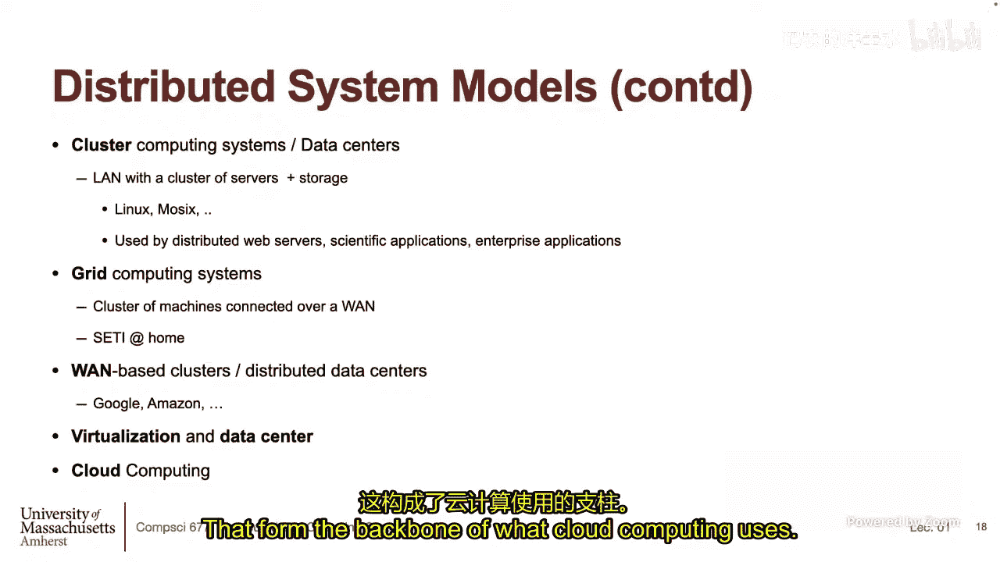

But we have not stopped there the distributed systems have continued to evolve and so now we are most we are basically in the era of what we call pervasive systems。

 but basically now any system that you can buy essentially has computing embedded in it I shouldn't use a system any product that you can buy as computing embedded in it whether it's a television or it's a car or it's your phone or your watch。

 everything is a computer it all has network capabilities all of these computing devices essentially can communicate other services and so distributed in some shape or form。

So this is an era of distributed system where the nodes are very small。

Because they're embedded into physical things whether it's your watch or it's in your car or it's in your television or it's in your speaker okay all of these things essentially are now various forms of distributed systems so you have all kinds of new areas that have actually evolved that use distributed computing okay whether it's healthcare because you are now monitoring someone 247 using a variable device okay or it's。

😊，Some other other area like sustainability or transportation。

 so all of these essentially use distributed computing in some shape or fur。

So that's where we have ended up and this is continuing to evolve of course you see in GPU computing you see now all kinds of smart glasses where computing is embedded in your glasses and so on so this field is continuing to evolve but that's basically where we will stop our history lesson before switch gears to operating so so any questions on this。

So was really a 10 minute history lesson of how the systems have evolved from the 70s to today over a 40 year span。

 but you get the general ID hardware has gotten cheaper okay and now essentially this allows you to put computing everywhere as you see it today。

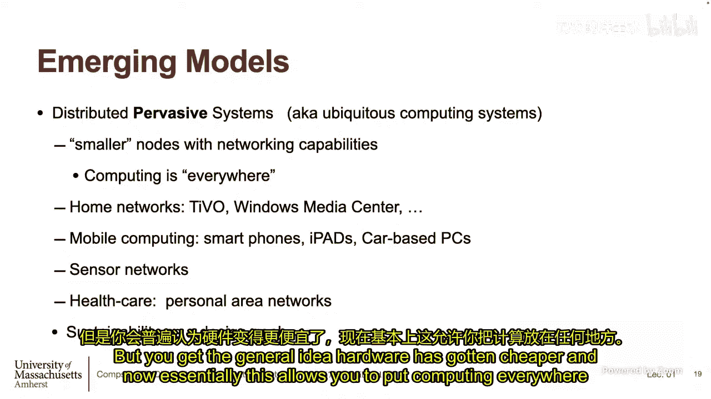

So let's switch gears a little bit and talk about operating systems in the next 15 or so minutes that are left here so i'll start with Uniipro operating systems this is something if youve taken an undergraduate course in operating system you should be familiar with but let me just do a very quick recap so we are all on the same page so these are operating systems that essentially run on desktops or laptops or any of these devices so what is an operating system first operating system is essentially a piece of software okay that is access。

A resource manager for the underlying hardware。It gives you an abstraction of an easier to use machine to the end user so the user does not have to deal with some of the intricacies of the hardware so the operating system provides what is called a virtual interface or a logical interface that' is easier to use than the underlying hardware simple example that you can think of as the disk or the storage space on on your laptop or any of the devices that you use when you create some content or it a photo or a file you as a user don't need to worry about where on that disk should that content be stored。

that is the job of the operating system to figure out where to actually store it and how to retrieve it when you want it later。

So that's being hidden from the user so you don't have to worry about it。

Or let's say you start a new process or an application， you double click on。

 let's say Chrome and you start the browser。As a user。

 you don't need to figure out how much memory to allocate to this application。

Or where to in your Ram should that application be loaded when you double click on that is the job of the operating system you just get the abstraction of an application that is now started up and is ready to run you don't need to worry about any of these underlying details the OS is going to deal with that for you。

And the list goes on and on all of the hardware that is actually in your system is managed by the OS and you are now given easier to use abstraction whether it is files or processes see these are easier to use abstractions where you don't need to worry about these details of how the hardware is used you just use it to get your work done and you leave those details to the OS so this piece of software is actually very useful in allowing users to use computing devices without knowing much about computing at all。

so long as you know this abstraction of you put your data in a file or you start a process to execute it and so on and that's all you really need to know so that's what an OS is in early operating systems they are designed to run on a machine with a single processor okay that is why theyre called uni processor machine okay all machines early early on machines had only one CPU or one processor okay not anymore but in those days so those。

Those operating systems were designed as one large piece of software。

 which is why they were called monolithic operating system when you started your machine this entire piece of software started executing the OS would run and then it would allow you to use that machine。

So this is called a monolithic OS and that piece of software that runs when you boot it up is called a kernel the sense of an OS is essentially called a kernel that is going to run and in a monolithic system there is a single kernel that deals with everything。

Now， from a software engineering standpoint， you can imagine that building any piece of software。

 not just aO as a single large monolithic piece of piece is not going to be a good way to design your software。

When you design any only piece of software you modularize it。

 maybe if it's an object oriented system， your classes and your objects or if you have some other programming language you write functions and you create modules and things of that sort so as a good software engineering practice you never build any system any large system that is in a monolithic fashion but thats how early operating systems were designed。

 but then they've got very hard to maintain。Like any others because it is a piece of software in the end the larger it is the harder it is to maintain so there are many attempts to modularize operating systems one approach was to make it a layer design where you build your OS as a piece of layers but let leave that aside for a second we'll come back to this next time there is an interesting architecture that evolved that tried to modularize it which was called a micro kernelnal operating system。

😊。

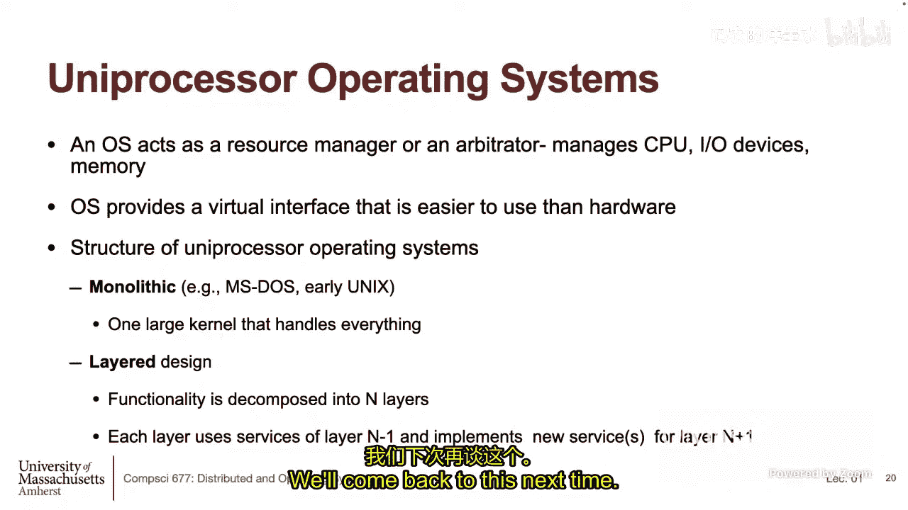

We were just shown in this picture。So what does a micro kernelnel operating system do it basically the kernel that we have which is the OS is a very tiny piece of software which is called a micro kernel when you start a machine that's the thing that is going to start running and practically anything that you associate with an operating system as a functionality was pulled out of the kernel and ran as a user process。

The memory management， the piece of the OSs that decides how much memory to give to an application when it starts executing or how much or where to map it to the RA。

 all of that is now designed as a separate user process okay the file manager is a separate user process and the process management is a separate user process so you can think of a micro kernelnel architecture as having a base tiny kernel and all the pieces which are inside the monolithic kernel having pulled out and run as independent user process。

Okay that is a micro kernelnal architecture so so let' us ask what is it that we would gain over a monolithic architecture when you go to micro kernelnal architecture。

Any thoughts on what this gives us？Mnifiix。Yes。The guidance to less。啊好。对。So。

what is being said is it' is less complicated to design an OSs this way because you have now modularized it and put each component in its separate process。

So if I need to change the file system， I just need to worry about how what is inside the file system module and not how to worry about anything else so long as they all have well defined interfaces。

 I can only worry about that module and so now I don't need to worry。Right， yes。

Okay so question is could it be parallelism could all of them be running all at once The answer to that question actually depends on what is the hardware the micro kernelnel is running on if this was a uniprocesor system which is one core one single CPU there' is no parallelism by definition but having said that if your micro kernelnel is running on multiprocessor system of course you will have parallelism so you're right in that you can get parallelism but that requires that this micro kernelnel run on the right type of hardware in the early days when it was a single processoror machine of course you are not getting parallel but you run this on any machine today you will get parallelism。

Okay， yes， you can get that benefit as well， anything else。Sorry， what？我解的。

No direct interaction with hardware so that OSs how to interact with hardware by definition because you are managing the hardware for the users。

他当时。users don't take care of hardware too that's true but that's true in any operating system that's not specific to micro kernel you're right but I don't think it's a micro kernel feature you write something。

Dynamic outlook look， can you elaborate what do you mean by dynamic outlook？啊。Okay。

 so are you talking about RAM memory and storage or are you talking about something else？Yes。

So you can dynamically allocate resources that's true， you can allocate how much memory you want。

 you can decide how many processes you need， you can allocate storage space and so on。

 but again that's not a micro kernelnal specific features because you still have to do this even in a normal operating system or unique unique processor operating system yes which is。

up嘅。Okay， so that is an interesting one， so reducing impact of failure or reliability so in this case。

 if the memory manager process fails。嗯。Of course you can't do memory management until you restart that process but the OS as a whole is not going to stop functioning because the micro kernel is still running in a monolithic kernel all of these your code that is running inside the kernel so if there's a bug that actually causes that component to fail the entire process which is the kernel is crashed so your entire system will stop functioning so one of the advantages that micro kernel designers claim to even today is that it has better reliability and they also claim better security but that's up for debate but better reliability because even OS components can fail but the system as a whole doesn't need to fail if all of these are now modularized and run as independent of course the micro kernel phase then all bets are off so that the system is gone but if any of these user process is fail you can detect it and restart it but the OS does not have to be rebooted as opposed if it's a mono monolithic kernel the OS fail。

You order to restart the mission。 so that' is an advantage， and important one。

disadvantageadvants you can think of。Talked a lot about advantages。Yes。Okay that's a good one。

 so lets say the user you can see these arrows right should that should give you an indication if the user application wants to make a system called maybe its asking for some special memory allocation。

Okay so that has to go through the memory manager how is that interaction will take place because a user application has to first sign the request to the micro kernel okay a micro kernel has to then forward that request to a memory manager and then it has to take action and the response is to come back so that's at least two calls as opposed to monolithic kernel where you just make a system call and then this code inside the kernel that dealt with it and you got a response。

哎。Is that clear？Okay question is there something called direct memory access so here we are not going to worry about this is a general concept not just memory specific any user application interactions with the kernel have to first go through the micro kernel and then be sent to one of the user processes because all of the functional outside you are not going to have user application directly talk to these processes for security reasons you have to go through the micro kernel。

Okay so what that means is inter processcess communication over adss are higher any any OS functionality that you are offering to users is going to take longer to complete because theres more communication in one this by and large is the biggest drawback of micro kernelnal operating systems is that they slow things down because you have lots of these processes running they are not only talking to user applications but are also talking to one another。

Right a process manager also start a new process it has to talk to the memory manager to allocate memory for that process so even internal OS operations involve these processes communicating with one another okay what was a simple function call inside a monolithic kernel has essentially become message passing in a micro kernelnal architecture message passing is slower than invo local functions as you can imagine。

So that is a performance drawback of this architecture it does give you better modularity。

 it does give you reliability all of those advantages。

 but one of the key disadvantages is that it basically slows things down。

so there were many operating systems that actually went down that route practically everyone that you can think of today windows at one point went down the micro kernelnel architecture okay Mac OS also went down the micro kernelnel architecture。

 but they all saw that now users saw that the machines slowed down tremendously。

and now you don't want to buy a new machine and then the machine is running very slowly as if it' is a five year old10 year old machine。

 so what is the OS designer it will do？ so they did what any OS designer would do saying， okay。

 users want speed， let's put some of this back into the voice。

which is you pulled it out saying we want to make it more modular when you have to put it back but you don't go back to the monolithic architecture when you put it back you still have this notion of a module that essentially says that all the functionality of the file system is a file system module which can be built independently and then loaded at runtime to make it part of the OS so you had some modularity some software engineering benefit but you lost the reliability benefit because now everything is back in the kernel but you got performance。

so it is always a trade off okay there is no free lunch you want reliability you might have to sacrifice performance you want performance you have to sacrifice some reliability so so that's how systems have continued to evolve and they still do。

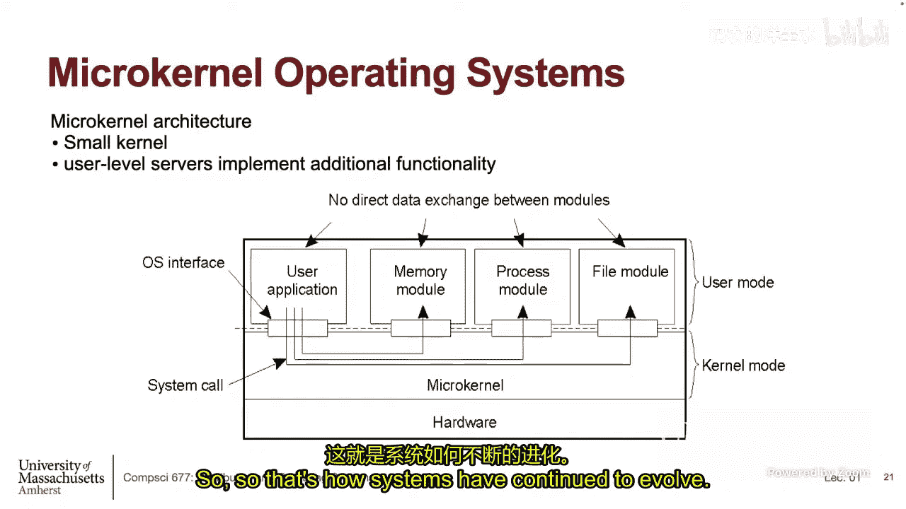

Okay， so now lets switch gears and I talk about what is a distributed operating system。

 everything that I said so far still running on a single machine。

right uni processor operating system micro kernelal still of single machine concept we are talking about distributed systems we care about more than one machine okay so what is a distributed OS so distributed OS think of it as an operating system that can manage resources across multiple machines but to the user it looks like a centralized OS。

It looks like a single machine， the fact that there are multiple machines is somehow hidden from the user and it gives you all of these properties location transparency。

 migration transparency and so on and Im going to show you an picture that will make this clear。

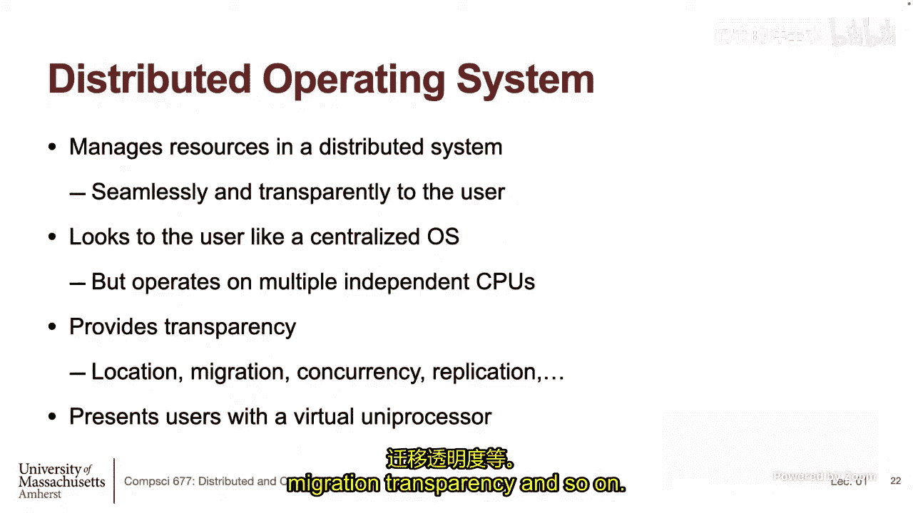

then we will come back to picture is missing let me come back to that so so here you can think of I have let's say four servers rather than running an one OS copy of an OS on each of the four servers I run a single OS that manages all of these four machines and what the user see is a single large logical machine that has the processing capacity of four underlying machines okay you don't see the presence of these machine separately that's called a distributed operating system。

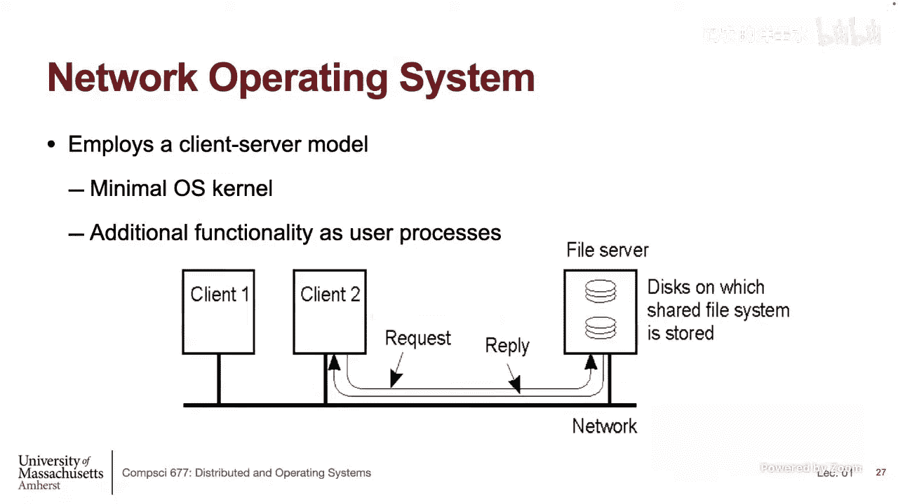

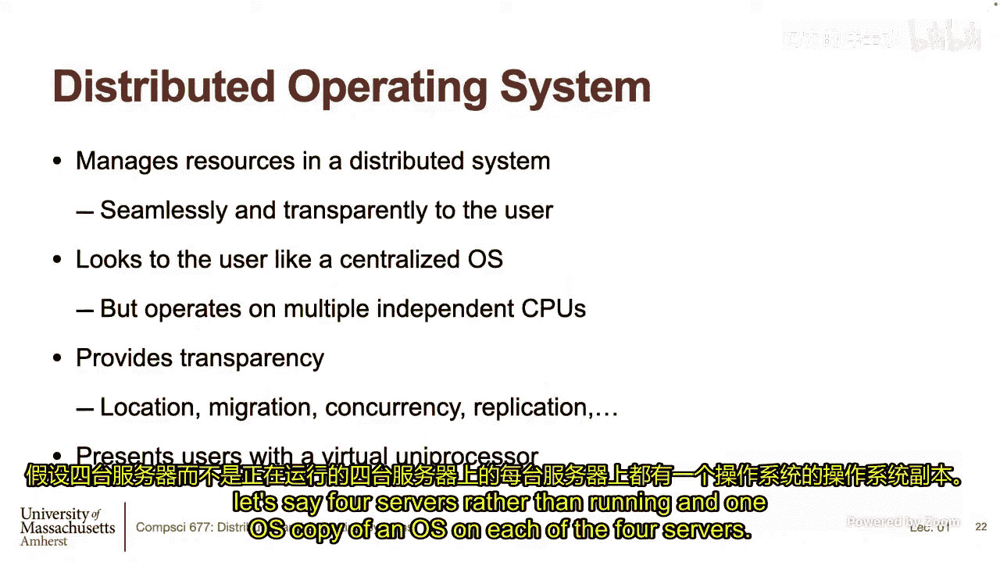

Now distributed operating systems there's been an evolution and I'm going to go through the evolution between what I'll call a distributed operating system。

 a network operating system and a middleware operating system and that is why I had those pictures and skip the multiprocessor one for just a second so this is actually the distributed operating system built losing single using independent operating system kernels so this one is called mosics so Mossics is essentially attempt to take the Linux operating system which runs on independent machine and make it look like a distributed OS it's not truly a distributed OSs but it tries to get you that property so what they did is they took the these kernels are just Linux kernel they added this software layer which is a distributed OS on top anything that runs on top of this does not actually see the presence of multiple machines you just start a process and then this distributed OS。

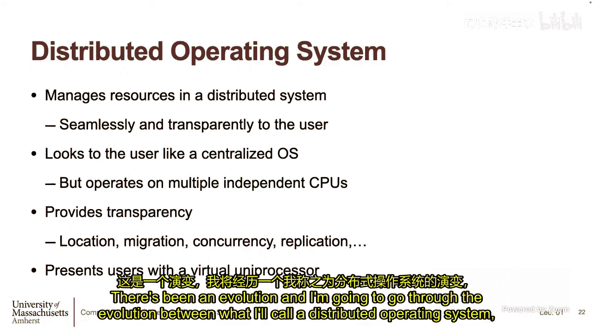

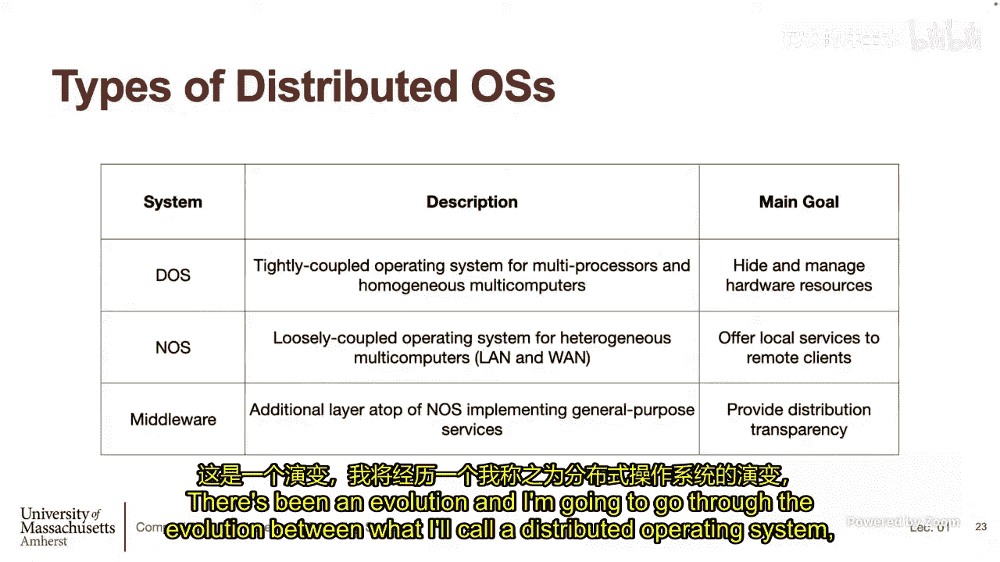

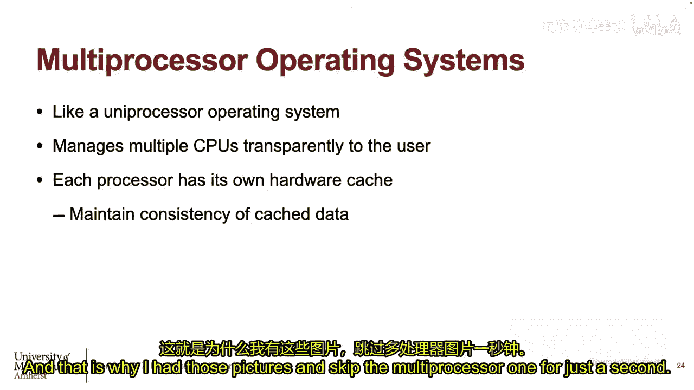

Iide I'm going to run it on this machine or that machine or that machine you can see all of the processes on all of the machine just looks like one bigger logical machine now this is not a true distributed OSs but if you built one then you basically the kernel would also be part of it this is just trying to layer a distributed OS abstraction on top of a in the standard Linux operating system。

but it kind of gives you the idea of how you can build a distributed to okay here's a network operating system okay all the OSss that you encounter today are by definition network operating system network operating system simply an OS that has network capability that just allows you to communicate so Windows Mac Linux Chrome Android all of these are just network operating systems because they just allow you to communicate they allow you to run applications that talk to other services and so so essentially you have your OS kernel and now you basically a network OS services that allow inter processed not just interprocess communication but cross machine communication so you can have client machine running here like client application like a browser the server can run there。

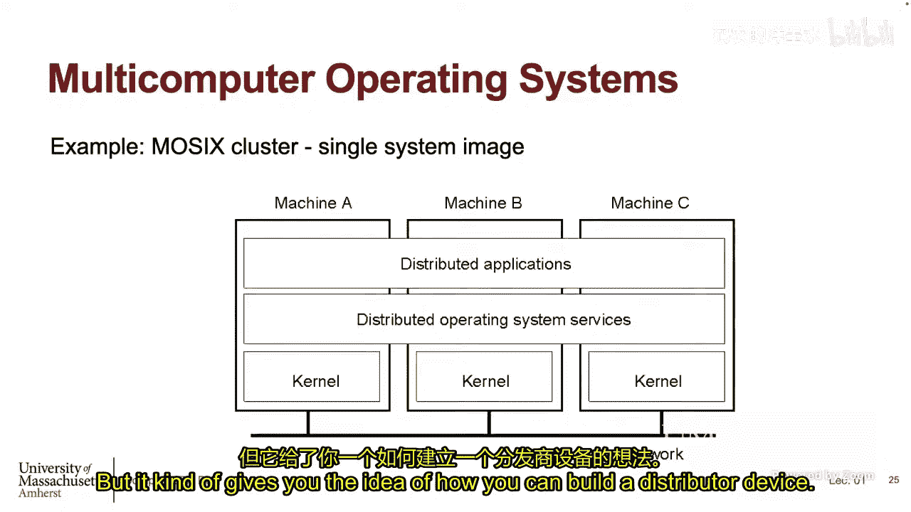

Or you can build distributed applications on top of this okay so these do not hide the presence of multiple machines a client has to actually know that there is a server machine and communicate to it explicitly okay a web browser when you。

typey in a URL you are actually you know that there' is a web service somewhere and you are communicating to it explicitly a distributed OS you do not actually see the presence of multiple machines but in a standard network operating system you do so you are not essentially so the fact that there are multiple machines is not hidden from the user so it's not replication transparent and so on。

But that is basically standard OSs today are all network operating system and then there is something called a middleware operating system that takes a network OS lets say it takes Windows or Mac and it adds whats a software layer called a middleware that tries to emulate a distributed operating system it is somewhat similar to what I was showing you in Moics where you take。

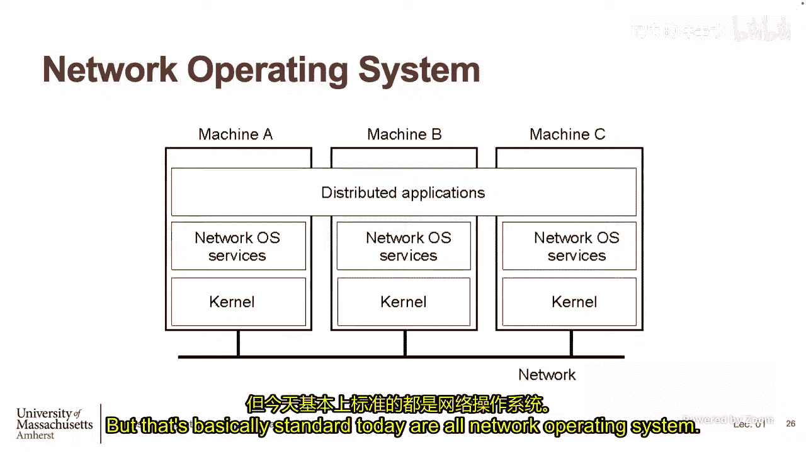

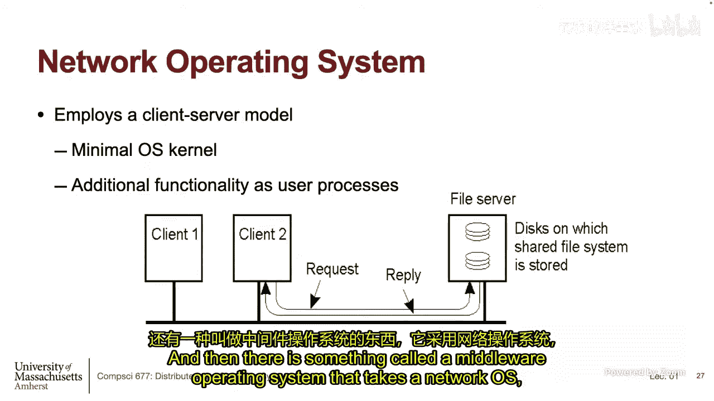

A network OS and you add a middleware so all the applications that run on top of this actually can take advantage of middleware services。

 but you can still run application directly on the network OS which would not see that benefit。

So middleware OS is trying to bring you back to what a distributed OS would do without having to redo the OSs。

 which is adding a software layer to provide that type of abstraction or illusion to the application。

Is that clear？Okay so I think we have run out of time so I'm going to stop you stop here but leave you with all with this table which I will not go into you can look at this table and try to understand it there are questions I can come back next time and answer them okay so again we'll stop here next time we'll talk about distributed systems architecture。

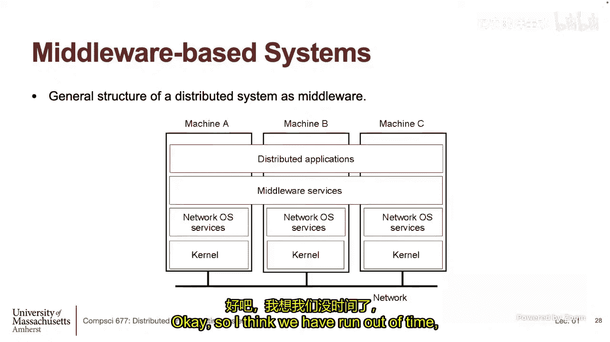

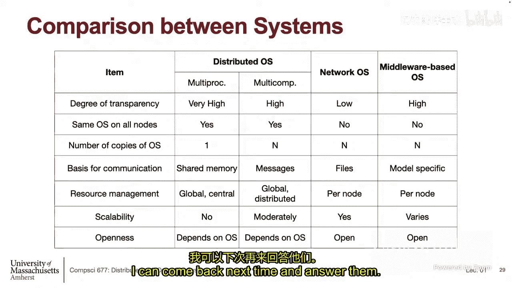