# 分布式与操作系统：第1讲：分布式系统导论 🚀

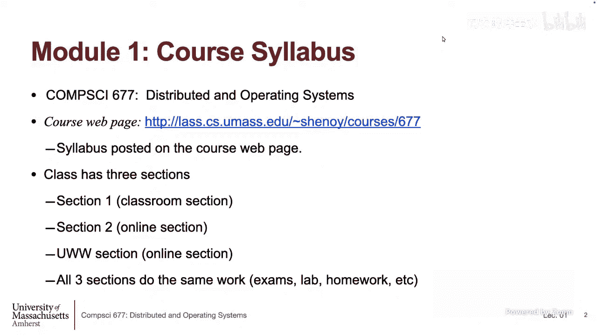

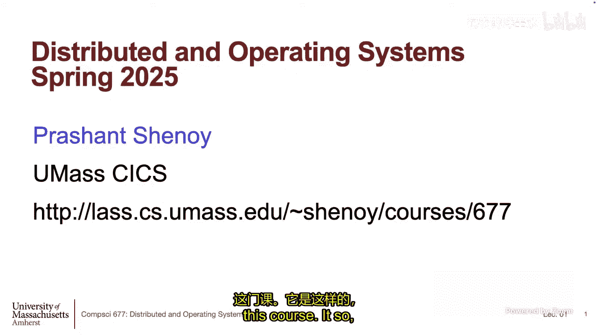

在本节课中，我们将学习分布式系统的基本概念、其历史演变以及操作系统如何支持分布式计算。课程将从课程大纲概述开始，然后深入探讨分布式系统的定义、优势与挑战，并简要回顾操作系统的发展历程。

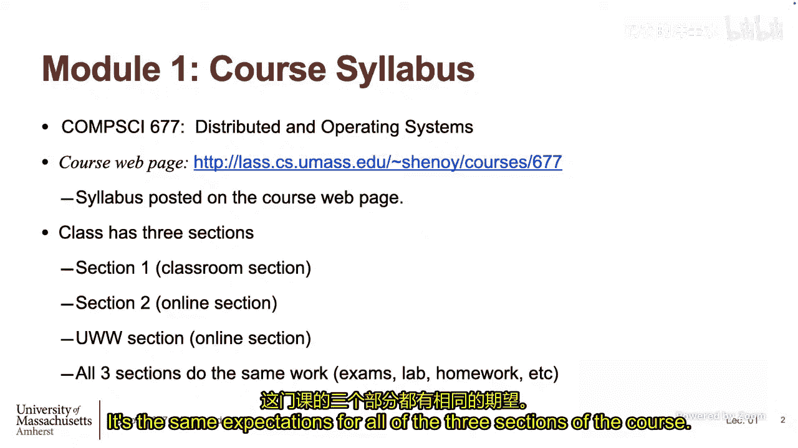

---

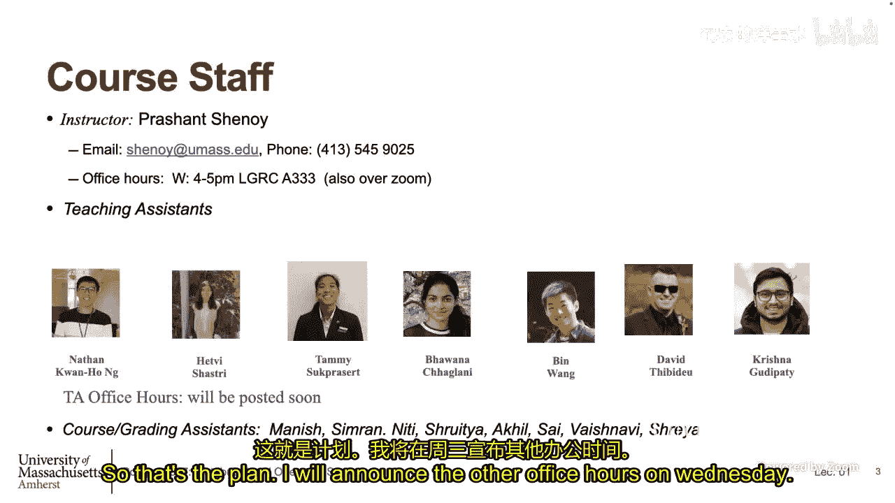

## 课程概述与大纲 📋

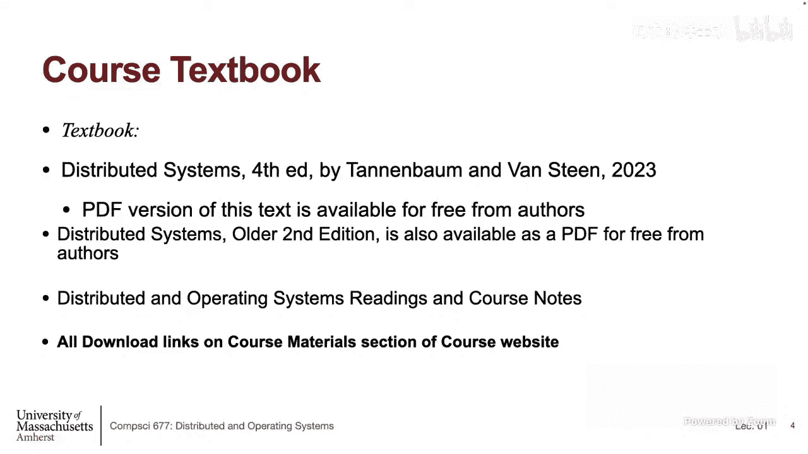

课程欢迎来到677分布式与操作系统课程。这是2025年春季的课程版本。课程已教授超过20年，内容持续更新，本次将包含新内容。

今天的目标是快速浏览课程大纲，了解课程期望和你能学到什么。剩余时间将用于介绍分布式系统，为后续课程内容奠定基础。

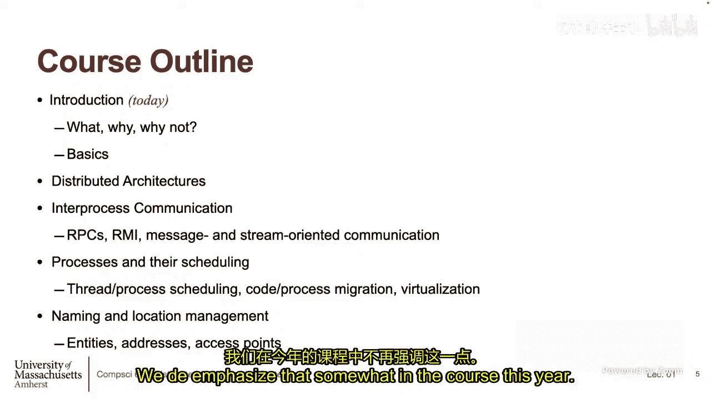

课程正在直播和录制，以服务在线学生。提问时，我会重复问题，以便在线学生能听清。

### 课程资源与结构

最重要的资源是课程网页。昨天已发送包含链接的邮件，但链接有误。正确的链接将发布在Piazza上。课程网页包含课程安排、大纲以及各种学习材料的链接。

课程有三个部分：一个课堂授课部分和两个在线部分。所有部分完成相同的工作、参加相同的考试，期望完全一致。

课程有多名助教。他们将通过办公时间等方式提供帮助。此外，还有评分助理负责批改作业和任务。

我们将为课程安排定期的办公时间。我的办公时间已列出，其他助教的办公时间将在本周三的课程中宣布。计划是每天都有办公时间，这在有重要实验环节的课程中非常有益。

### 教材与主题

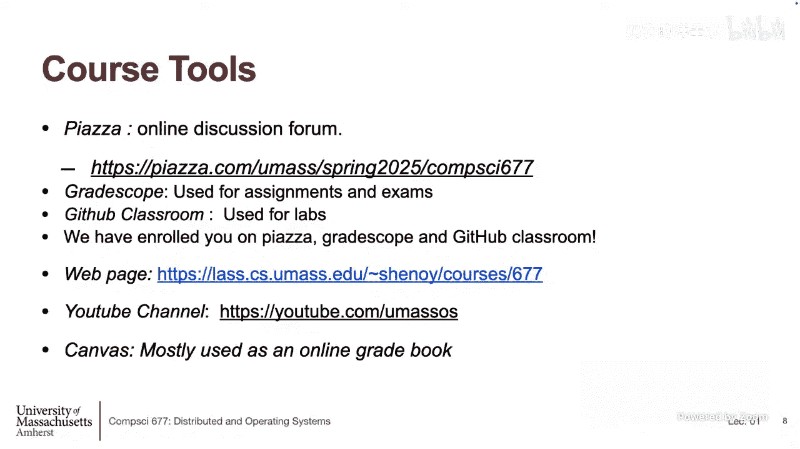

课程有一本推荐的教科书，可以免费获取PDF版本。我们将使用最新的第四版，但某些主题在第二版中也有涵盖。课程还将使用其他材料，包括阅读资料和课程笔记。

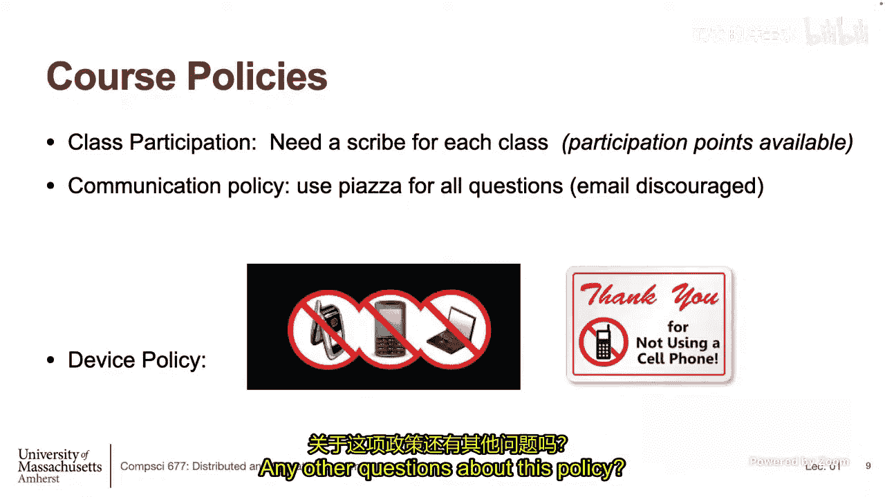

以下是未来约14周将涵盖的主题列表：
*   今天：**分布式系统导论**。
*   下次课：**分布式系统架构**。
*   下周开始：**进程间通信**、**进程管理与调度**。
*   后续主题：**命名与位置管理**、**分布式系统中的经典问题**（如互斥、领导者选举、时钟同步、分布式快照、分布式事务）、**资源共享、复制与一致性**、**容错与安全**。
*   课程还将涉及**Web、云计算、边缘计算、可持续计算、大数据、多媒体、物联网**等领域。

### 评分与要求

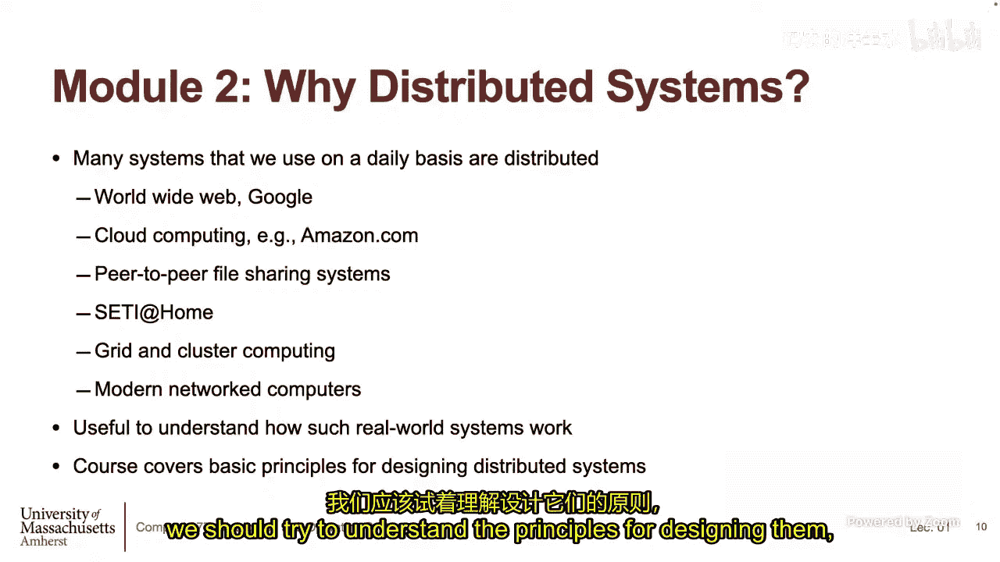

评分构成如下：
*   **考试**：两次（期中与期末），占44%。
*   **实验**：三次，占43%。
*   **作业与小实验**：约10次，占12%。
*   **课堂参与**：占1%。参与方式包括课堂提问、Piazza讨论、每周测验，以及自愿担任课程笔记记录员（“抄写员”）。

课程有两个先决条件（虽不强制检查，但至关重要）：
1.  **本科操作系统知识**：这是一门研究生级别的课程，假设你已具备本科操作系统课程的基础知识。你需要自行复习相关概念。
2.  **良好的编程能力**：近一半的分数依赖于编程。实验将限制使用**Python**或**Java**，你需选择其中一种并贯穿所有实验。

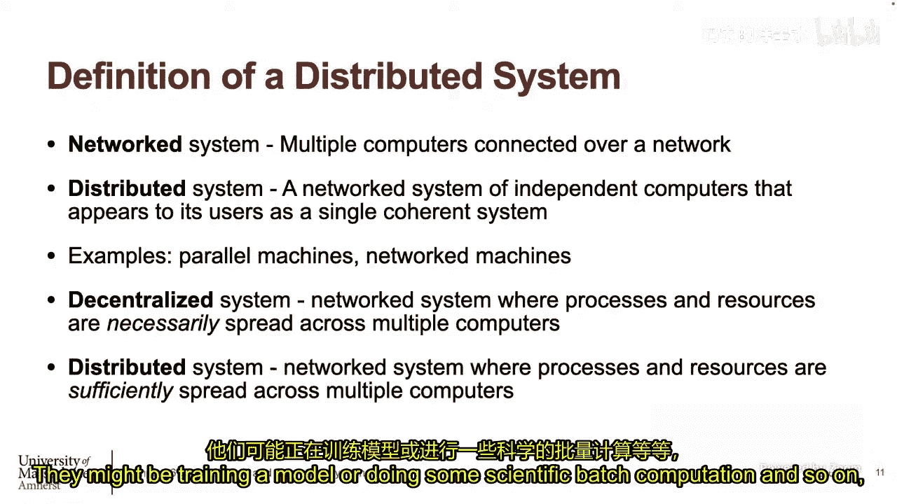

### 课程工具与政策

主要沟通工具是**Piazza**。所有问题应发布在Piazza上，以确保及时回复。避免使用电子邮件提问。

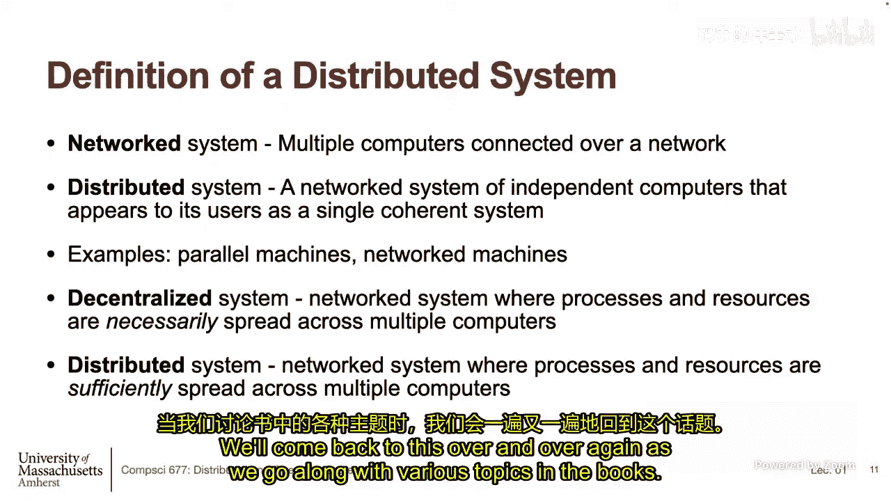

其他工具包括：
*   **Gradescope**：用于提交作业和考试。
*   **GitHub Classroom**：用于完成实验。
*   **课程网页、YouTube频道、Canvas**：用于获取资料和成绩。

课程政策：
*   **课堂参与**：鼓励提问。
*   **设备政策**：课堂上不允许使用笔记本电脑和手机，以防干扰。如有特殊需求，可课后沟通。
*   **沟通政策**：优先使用Piazza。

---

## 什么是分布式系统？ 🤔

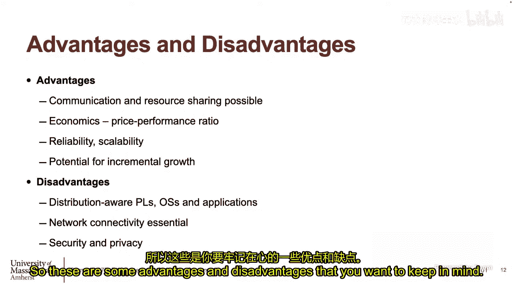

上一节我们介绍了课程的整体安排，本节中我们来看看分布式系统的核心定义。

如今，几乎每个计算系统都以某种形式是分布式的，包括万维网、谷歌搜索引擎、云计算、电子商务网站、P2P文件共享系统、集群计算和移动计算等。因此，理解其工作原理、设计原则和实现方式至关重要。

### 核心定义

首先区分几个概念：
*   **网络系统**：指具有网络连接能力的计算设备（如连接Wi-Fi的笔记本电脑）。它本身不是分布式的。
*   **分布式系统**：是一个由独立计算机组成的网络系统，但对用户呈现为**单个连贯的系统**。即多台计算机协同工作，为用户提供某种服务或应用。
*   **去中心化系统**：是分布式系统的一种更极端的形态。在去中心化系统中，**所有功能（代码、数据、算法）都充分分布在多台计算机上，没有单一控制点**。而去中心化系统必然是分布式系统，但分布式系统不一定完全去中心化（例如，客户端-服务器架构中，服务是集中式的）。

### 优势与劣势

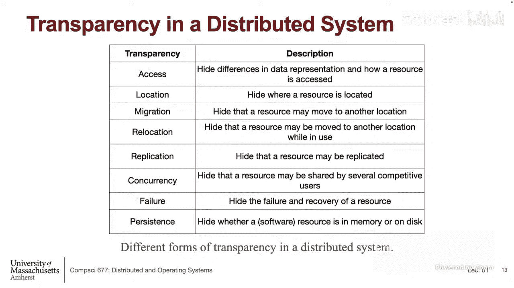

设计分布式系统主要有以下优势：
1.  **资源共享**：可以访问其他机器上的资源（如云存储）。
2.  **更好的性价比**：使用大量普通机器通常比购买一台大型机器更经济。
3.  **提高可靠性**：单台或部分机器故障时，系统整体仍可继续运行（需专门设计）。
4.  **支持渐进式增长**：可以随着工作负载增加而逐步添加更多机器。

然而，这些优势并非没有代价，也存在以下劣势：
1.  **复杂性增加**：编程语言、操作系统和应用程序本身都需要支持分布式，变得更加复杂。
2.  **网络依赖**：网络连接至关重要，网络故障可能导致应用失效。
3.  **安全与隐私问题**：系统暴露在网络中，面临黑客攻击和数据窃取的风险。

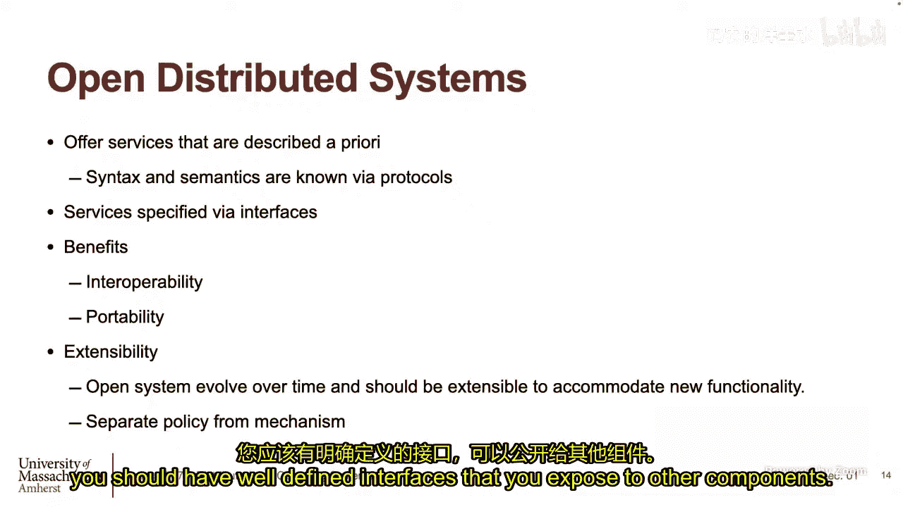

---

## 分布式系统的关键概念 🔑

了解了分布式系统的定义和利弊后，本节我们来探讨两个关键的设计概念：透明性与开放性。

### 透明性

在分布式系统中，“透明性”意味着**对用户隐藏系统的某些属性**。以下是一些重要的透明性类型：
*   **位置透明性**：隐藏资源的位置。例如，URL `www.umass.edu` 不揭示服务器的物理位置。
*   **复制透明性**：隐藏资源的复制事实。例如，使用谷歌搜索时，用户不知道背后有成千上万的服务器在处理查询。
*   **故障透明性**：隐藏组件故障，使用户不感知服务中断。

设计透明的系统可以提供更简洁、易用的抽象，但实现起来更复杂。

### 开放性

“开放”的分布式系统通常指其**接口是开放且明确定义的**。这使得其他实体可以基于公开的协议与系统交互。开放性有助于实现：
*   **互操作性**：不同系统可以协同工作。
*   **可移植性**：应用可以更容易地迁移。
*   **可扩展性**：可以添加新功能。

开放性可以更进一步，例如开源（代码可用），但在本课程中，我们主要关注接口和协议的开放性。

---

## 可扩展性设计原则 📈

我们已经讨论了分布式系统的透明性和开放性，这些都是重要的设计目标。本节我们将聚焦于另一个核心目标：**可扩展性**。分布式系统允许通过增加机器来服务更多用户，但实现良好的可扩展性需要仔细设计。

理想情况下，一个由 `n` 台机器组成的系统应能处理 `n` 倍于单机的工作负载。设计时需从三个维度考虑：
1.  **服务**：是集中在一台机器上，还是分布在多台机器上？
2.  **数据**：是存储在集中式的数据库中，还是分布在多台机器上（通过复制或分区）？
3.  **算法/代码**：是运行在单个中央节点上，还是以去中心化的方式运行在多台机器上？

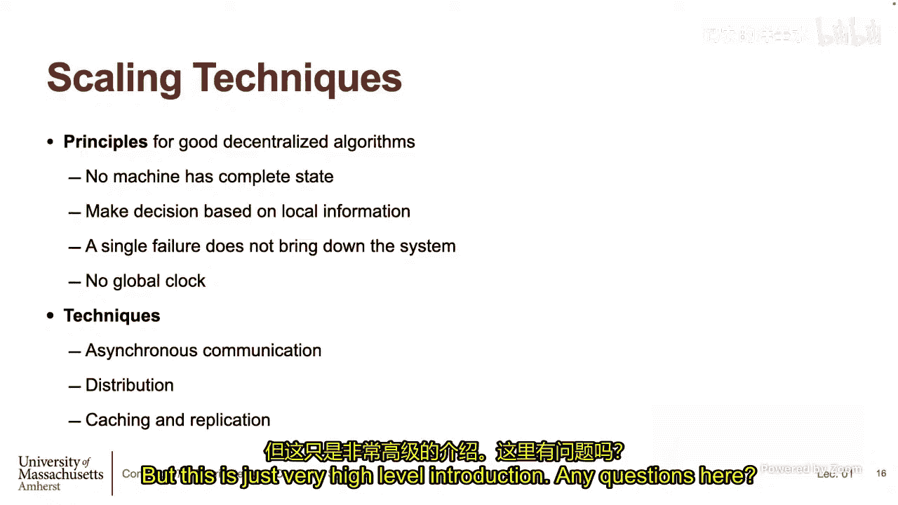

并非所有维度都必须分布式，但需要根据系统目标进行权衡。例如，一个集中式的服务可能成为瓶颈。

### 可扩展性设计原则

以下是设计可扩展分布式系统的一些指导原则：
*   **避免单一机器掌握全局状态**：将状态信息分散到多台机器。
*   **基于本地信息做决策**：减少对难以维护的全局信息的依赖。
*   **单点故障不应导致系统整体失效**：设计容错机制。
*   **避免依赖全局时钟**：机器间时钟同步总存在误差，算法应尽量减少对精确同步的依赖。

### 常用扩展技术

此外，还有一些常用的技术可以提升可扩展性：
*   **异步通信**：使用非阻塞调用，避免等待。
*   **减少集中化**：尽可能采用分布式或去中心化设计。
*   **缓存与复制**：使用缓存加速I/O，通过复制服务来分摊负载。

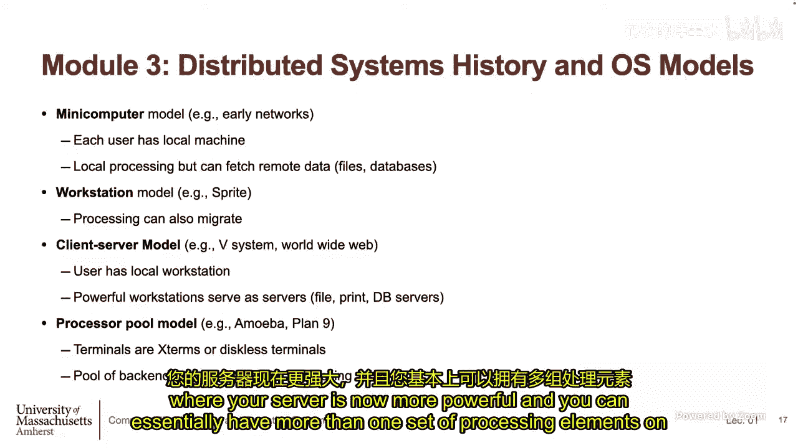

---

## 分布式系统简史 🕰️

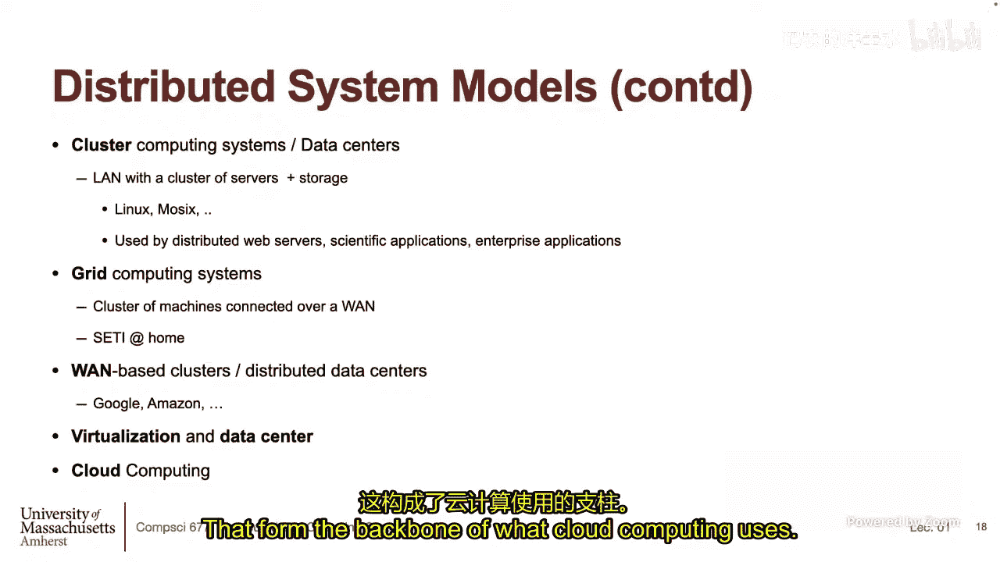

在深入技术细节之前，了解分布式系统的发展脉络很有帮助。其演进主要驱动力是硬件成本的持续下降。

1.  **大型机时代（1970年代）**：用户通过终端连接到一台大型主机，共享计算资源。早期电子邮件是典型的分布式应用。
2.  **工作站时代（1980年代）**：每个用户拥有自己的工作站，通过网络连接。出现了**进程迁移**等概念，允许进程在机器间移动执行。
3.  **客户端-服务器时代（1990年代）**：个人电脑（PC）普及。用户在本机处理任务，复杂任务则交给更强大的服务器。此模型至今仍是主流。
4.  **处理器池/集群计算时代**：服务器变得极其强大，包含多个处理器，形成计算池或集群。用户可以向集群提交作业。
5.  **网格计算与数据中心**：将地理上分散的集群通过广域网连接起来，协调工作，形成网格。大型数据中心成为云计算的基础。
6.  **云计算时代（2000年代至今）**：计算资源作为服务通过互联网提供，按需付费。虚拟化技术是关键支撑。
7.  **普适计算时代（现在）**：计算嵌入到各种设备中（电视、汽车、手机、手表），万物互联，形成了物联网等新领域。

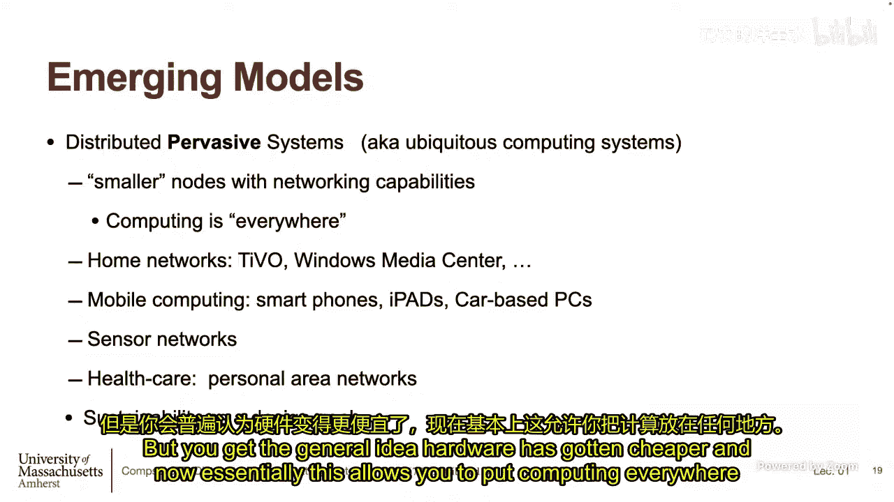

---

## 操作系统支持 💻

我们一直在讨论分布式系统，但分布式应用需要运行在操作系统之上。本节我们回顾操作系统的发展，特别是它们如何支持分布式计算。

### 单处理器操作系统

操作系统是管理底层硬件的资源管理器，为用户提供更易用的虚拟接口。早期操作系统设计用于单CPU机器，整个系统作为一个大型软件运行，称为**单体式内核**。这种设计难以维护。

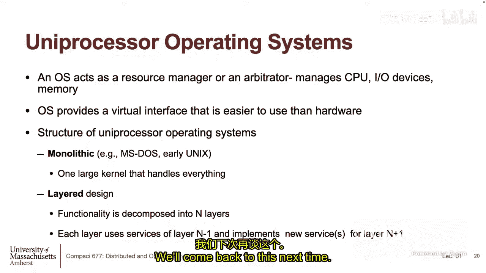

### 微内核架构

为了改进，出现了**微内核架构**。它将操作系统的绝大多数功能（如内存管理、文件系统、进程管理）从内核中移出，作为独立的用户进程运行。内核本身变得非常小（微内核）。

**优势**：
*   **模块化与易维护**：各组件独立，易于修改和测试。
*   **提高可靠性**：一个组件进程崩溃不会导致整个系统崩溃，可以重启该进程。
*   **潜在的安全性提升**。

**劣势**：
*   **性能开销**：原本内核内的函数调用变成了进程间的消息传递，速度更慢。

由于性能问题，现代操作系统（如Windows、macOS）采用了折中方案：保留模块化设计思想，但将许多关键服务放回内核中以提升性能，形成了所谓的“混合内核”。

### 分布式操作系统

以上讨论的都是单机操作系统。**分布式操作系统**旨在管理多台机器的资源，但对用户呈现为**单个统一的逻辑机器**，完全隐藏了多机的存在，实现了高度的透明性。

然而，真正的分布式操作系统并不常见。更常见的是：
*   **网络操作系统**：如Windows、Linux、macOS。它们具有网络功能，允许机器间通信，但**不隐藏多机的存在**（例如，客户端需要明确知道服务器地址）。
*   **中间件操作系统**：在网络操作系统之上添加一个软件层（中间件），为上层应用提供类似分布式操作系统的抽象和服务，但下层仍可直接使用网络操作系统的功能。

---

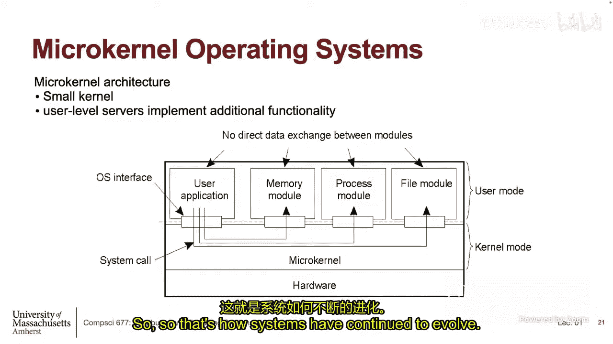

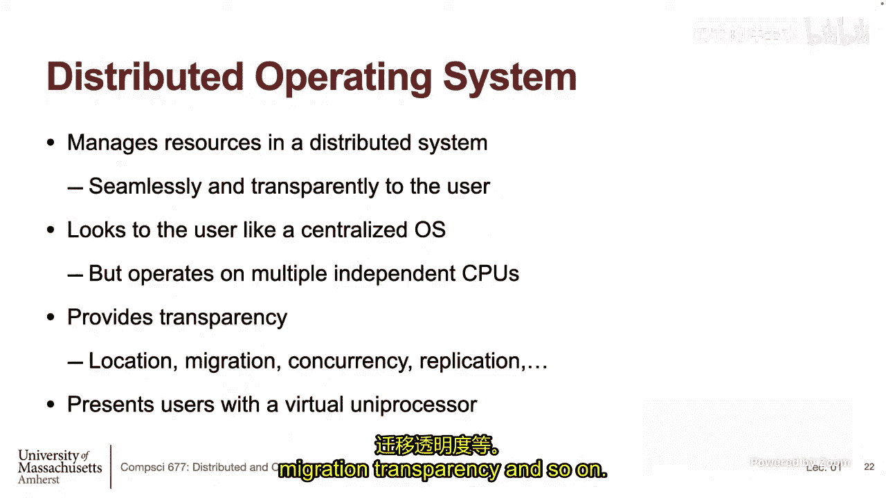

## 总结 🎯

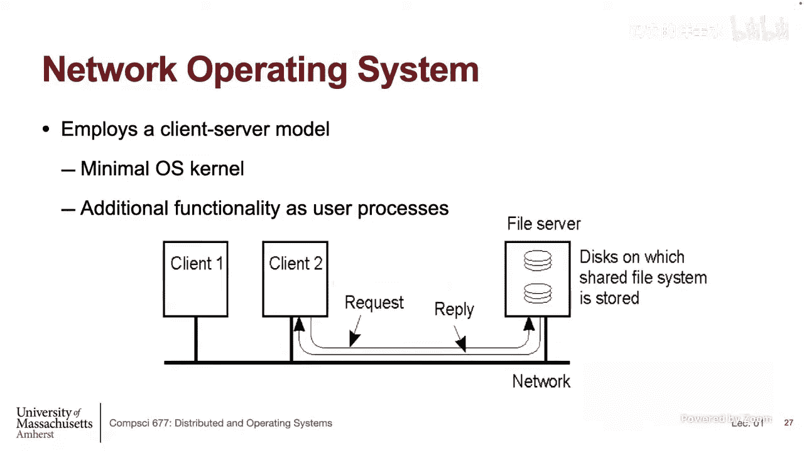

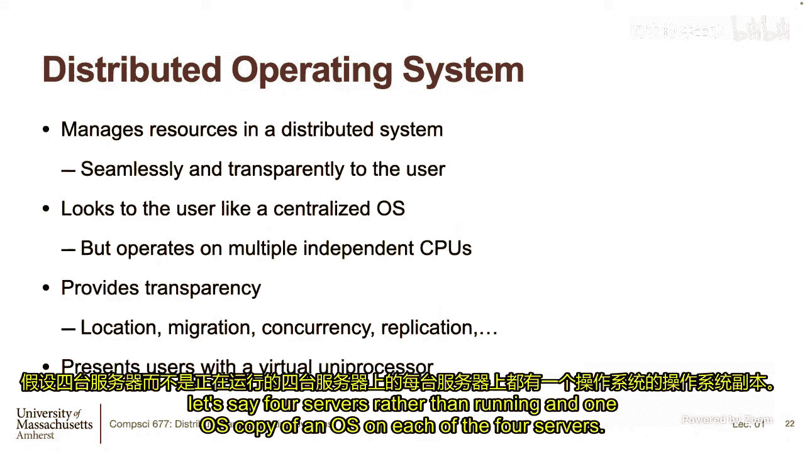

本节课中我们一起学习了分布式系统课程的概览和基础知识。

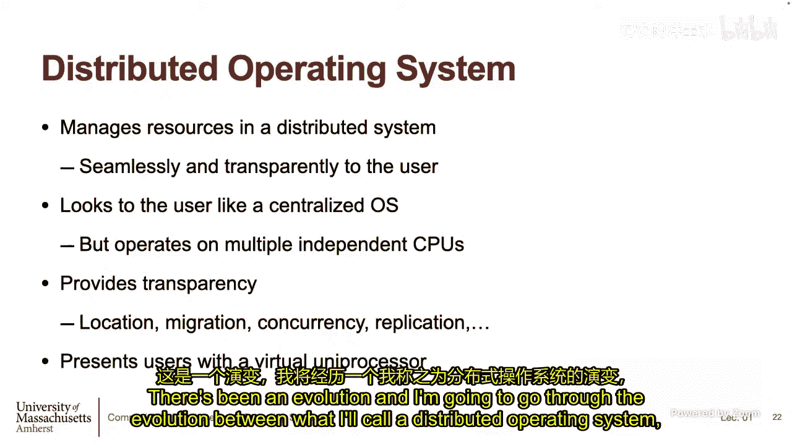

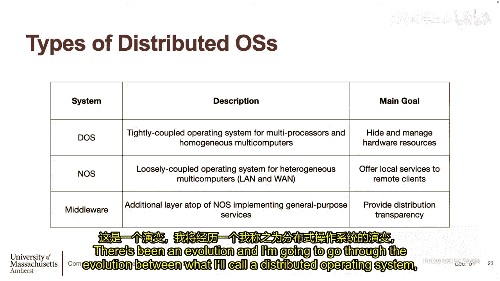

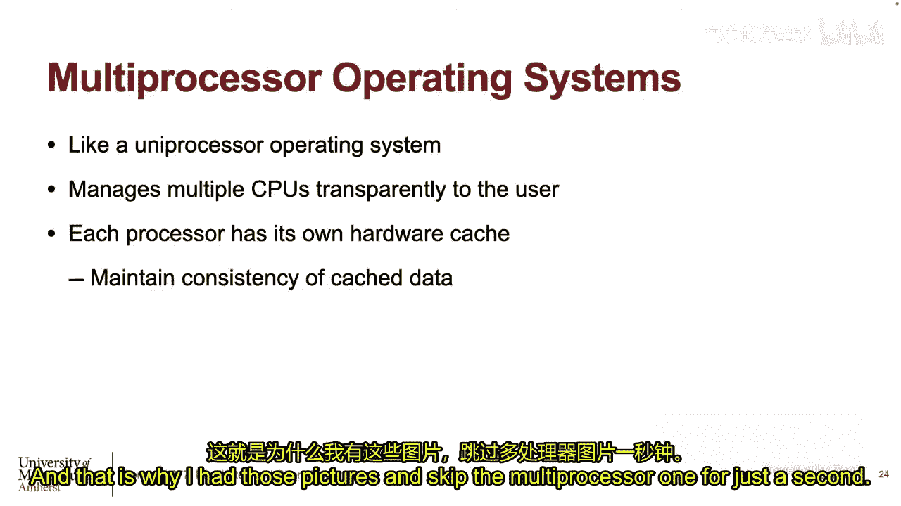

我们首先回顾了课程大纲、评分标准和工具。然后，我们深入探讨了**分布式系统的核心定义**，区分了网络系统、分布式系统和去中心化系统，并分析了其优势与挑战。

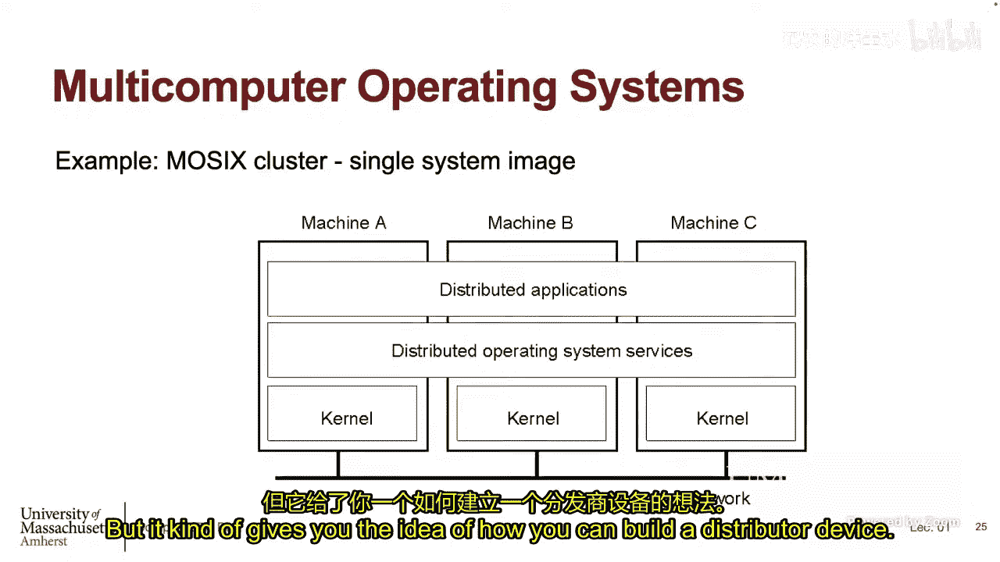

接着，我们介绍了两个关键设计理念：**透明性**（对用户隐藏系统细节）和**开放性**（通过明确定义的接口实现互操作）。我们还讨论了实现**可扩展性**的设计原则和技术，包括服务、数据和算法三个维度的分布考虑。

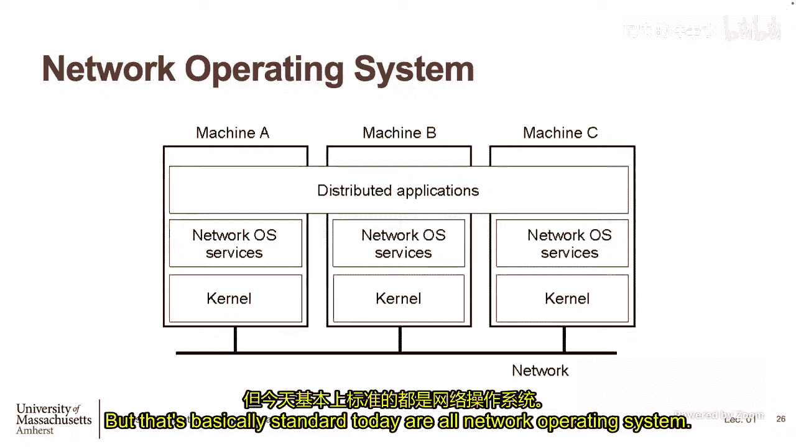

随后，我们快速回顾了**分布式系统从大型机到普适计算的历史演变**。最后，我们探讨了**操作系统对分布式的支持**，从单处理器系统、微内核架构，到网络操作系统和分布式操作系统的概念。

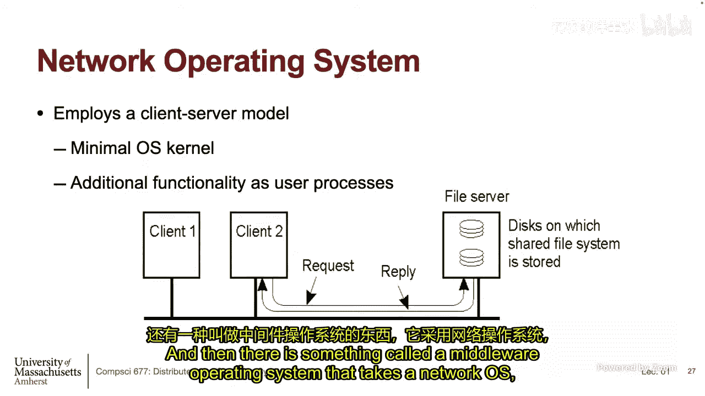

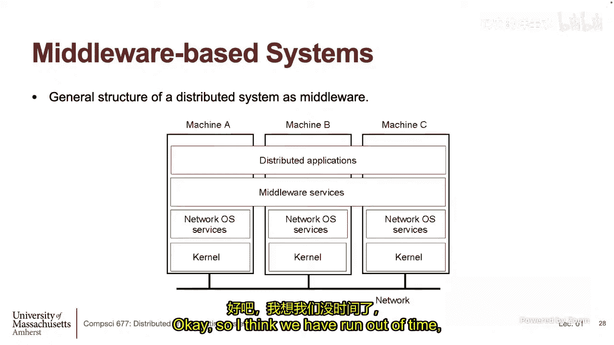

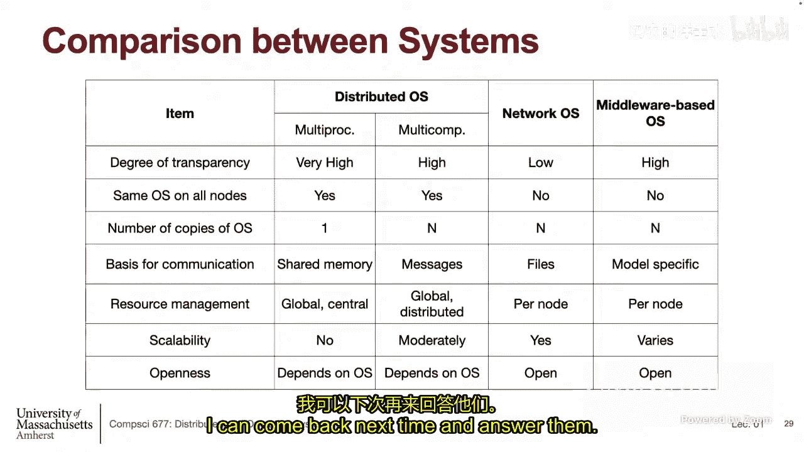

下节课，我们将深入探讨**分布式系统的架构**。