# 【全集 2025 附课件】马萨诸塞大学 分布式系统 中英字幕 p02 Lecture 2 - 分布式系统架构 -BV19BSYBuE4Y_p2-

Okay， so let's get started。So， let me start with the。Okay， let me start with some announcements。

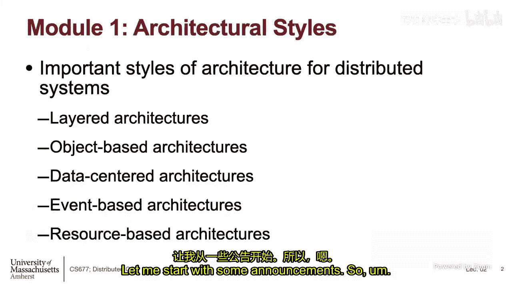

So today we are going to start with the distributed system architecture。

 it's a new topic we'll go through several different architectural styles。

 but in addition to that I wanted to mention that we are going to be handing out lab zero today La zero is not a real lab is not going to be graded is just a setup here to do on your computer to do the actual lab。

We are going to use a Docker container to do all of the coding so lab zero just steps you through how to set up a Docker container on your machine so that you can actually perform all the things or do all the coding that you need to do when we hand out the actual lab in a couple of weeks okay but we want to get this out of the way so well hand that out today all right so are there any questions from last time about the syllabus or anything I mentioned before we start。

All right so let's get started I'm also going to since we're still an addd drop and iss quite a bit of churn we're going to pass around this sign up sheet so mark your name if its were already registered if not put your name on the back so you know who's coming who's not coming because I get a lot of requests to switch sections and so okay。

Alright， so let's get started with distributed systems architectures。

 first part of the lecture is going to focus on architectural styles and we are going to look at four or five different architectural styles willll start with。

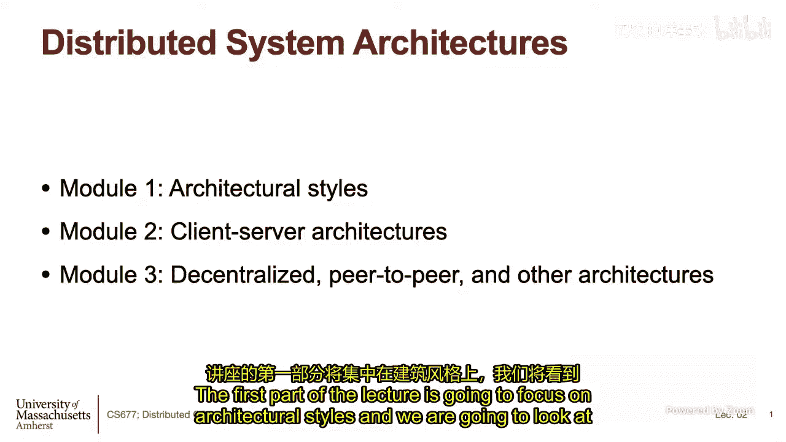

Layer architecture look at object oriented data centered event based and resource base so let's start with them one at a time so first of all what is an architecture of a distributed system so think of the architecture as the component level view of your distributed system or distributed applications so what are the components of your system how do they interact with one another okay that's what in this case we are going to mean by an architecture so here is what we will call a layered architecture you can see this in the picture so the component of your system will be now designed as a set of layers each layer as you will say in this picture can communicate directly with the layer above it and the layer below it so layer I you can communicate with layer I plus1 and layer I minus1 but layer I cannot directly communicate to layer with layer I plus2 for example it has to go。

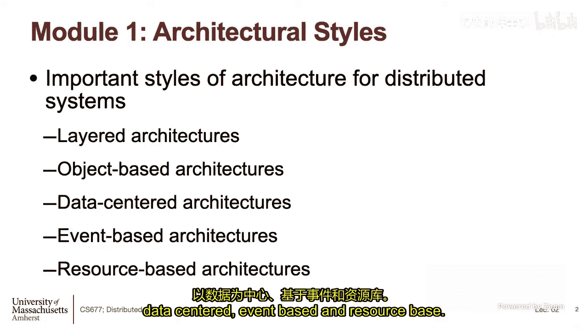

Through its neighboring layers to talk to other layers， this is called the layered architecture。

Now you probably have if you have taken an undergraduate OS class okay you probably encountered this layered concept before because it also arises in the context of network protocol stacks the TCPIP stack for example is does use a layered design of course a tCPI stack is not a distributed system it' just a piece of the operating system kernel that deals with networking but you can also design these systems in this manner and this components in a distributed system can run on different machine they don't have to all run on the same machine now the most common example of a layered system is multi tiered applications we will be encountering multiter applications several times during this class the multiter distributed application the application is partition into set of layers they are actually called tiers and。

Ters can only talk to the Teaers immediately preceding tearsers okay that is how a multi tiered application is designed we will talk a little bit more about that later in this class as well so that is our layered architecture。

The next one is called object oriented architecture okay so some of this architecture is also derived from the notion of objects in object oriented programming languages so you can design your distributed application in the same manner where your components are essentially objects。

Now unlike let's say a Java program where all the objects are in the same process of the same application。

 in this case these objects could be independent processes that reside on one or more machines so these objects are themselves distributed across a set of machines and objects communicate with each other by invoking the public methods on other objects。

That's how this object oriented architecture design now the main difference between this one and the previous one is in this case any object or any component can invoke a method on any other component the layered architecture you can only talk to your neighboring layers and of course here you are using object oriented notions to design your application the layered system does not require it to do that so so theres more flexibility in how application components are going to interact with one another and this as you will see is a popular technique in designing client server systems will talk about remote procedure calls in a class or you will see that thats where it's also popular。

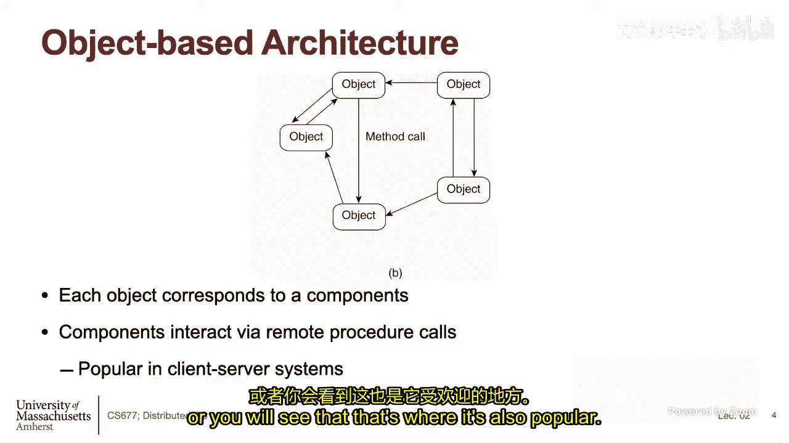

Okay all right， so the next one is event based architecture and there is a picture there that kind shows you what this is so in this case。

The components of your applications which are shown here they can be one of two types you can have a component that is called a producer or a publisher that produces data or events of the application as old and the other type of components you can have in the system are called consumers。

Consumers are going to consume data。😊，So you will have some set of producers okay components。

 some set of consumer components producers are going to produce data or request。

 consumers are going to consume that data or process those requests the main thing that you have in the event based architecture is what is this thing in the middle which is labeled the event bus。

So the event bus is the component in your application that is responsible for ensuring that any data or events or requests that are generated by publishers are delivered to the right consumers。

Because it's not like any producer producer data it' is going to go to any arbitrary consumers so you have to make sure that the right types of events and data are delivered to the right types of consumers and that is the responsibility of the event bus that consumers in this case are going to subscribe to certain types of events。

And though that subscription is going to be known to the event bus。

 so when a certain type of event or data is published by a publisher component。

 it will check which subset of the consumers to deliver it to and only deliver it to those consumers。

So that's called a producer consumer paradigm or publish subscribe pubspro consumer they mean the same thing okay that's one way of designing distributed applications this one we are going to come back to at the very end of the class maybe in the last couple lectures so this is a specific type of architecture that we are not going to look at for much of the class but we will come back to at there but it's something to keep in mind as well as a architecture for designing distributed applications。

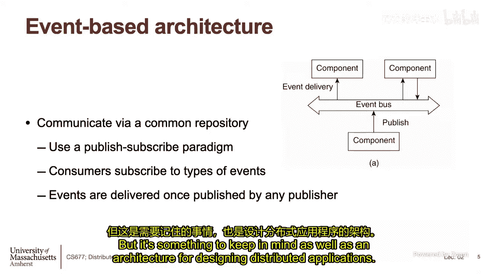

So， the next one here is called the shared data space architecture it is also called the bulletin board architecture so the reason is called bulletin board is the way to understand this that is the picture there okay but the way to understand this is the way you will actually use a bulletin board to disseminate information。

A real physical I mean a physical bulletin so what do you do with a physical bulletin you can go and put notices on a bulletin board right and then someone else can come and look for anything that is of interest to them。

😊，So the same kind of idea here there are two types of components here they are also called publishers and subscribers publisher publish notes onto this bulletin board they are not addressed to anyone in particular when you put something on a bulletin board you dont address that notice to any specific individual it just something that you think is of interest to multiple members of the community who might go and look at this bulletin so。

Consumers can then go and query for any matching notices on this bulletin board and then the bulletin board system will deliver whatever matches their interest so for example you can say you' are trying to sell off your furniture because youre moving you put a node there maybe someone else is looking for furniture and then they can go and look for that type of node but not other types of notices so a similar example in a distributed system context because this is why its called bulletin board architecture because the realization of the bulletin board is through a shared database think of it as a database for now when we come back to it later we'll look into it。

 but you can think of the database holds all of the events or notices that the publishers are published and subscribers can can go and look for whatever is matching their interest。

Okay， so it's different from sending messages you are actually going to a shared medium to communicate。

 which is your bulletin board in this case or the shared data space。Is clear。Yes。

 what are the examples of event based and shared data space architecture？

What are some examples of event-based and shared data space architectures I think we will come back to both of these topics in more detail this is just overview so I can give some examples but I don't know that is going to make any sense to people who don't know some of this but in event-based there are many open source systems theres something called zero MQ there's rabbit MQ there's Apache Kafka these are all systems that use the eventbased architecture and we will come back to some of this later shared data spaces also there are examples in the Java world there is a system called genie that most of you may not ever heard of but thats the one that made some of this ideas popular。

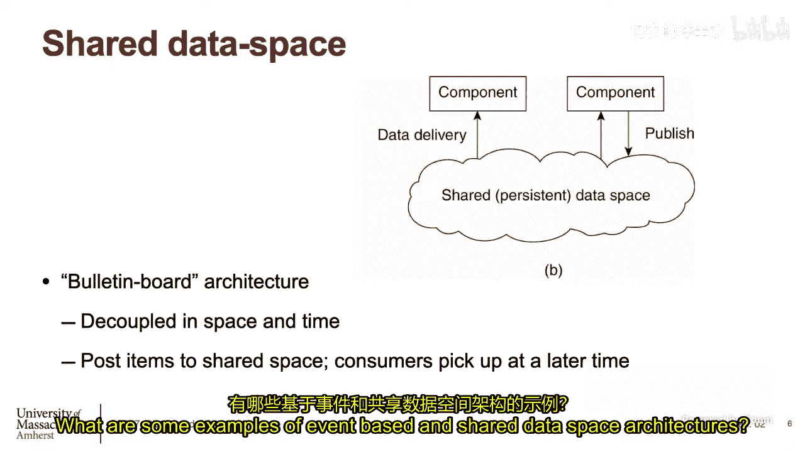

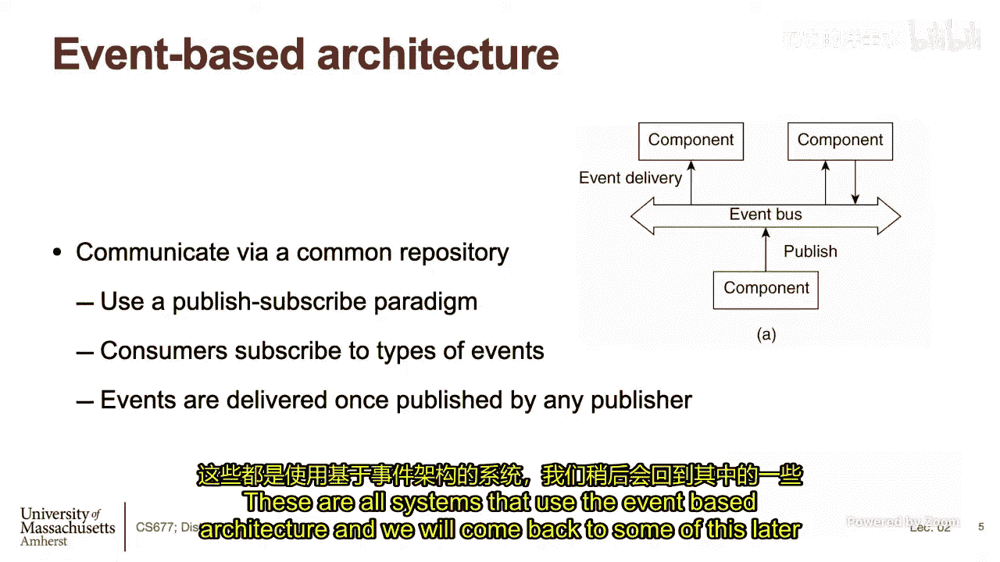

So that don't worry about it now you just need to understand the concepts。

 we will come back to specific examples and how they work later yes we question。对。

Okay so question can you give an example of where you would use an event based versus a shared data space so I think I've already gone through four or five different architectures not one and there are two more coming two or three more coming so the goal here today is not to say we know everything about this architecture to decide which one to pick for a particular application so you just need to know what these are and then as we go through the course you will get to understand them in a lot more depth at which point you will develop a better appreciation of when they should be used but having said that。

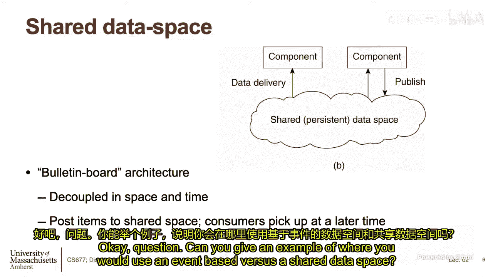

I think the one example of an eventbased system is message passing If you have an application that relies a lot on message passing often you use an event-based architectures where you publish the event as messages and then they get routed to the event based to the right components of the application as a message passing flavor an event-based architecture could be used that's one example shared data space is somewhat different okay this is used in many kinds of scenarios where you might not know ahead of time what are the other components in the system you' are interacting with if you are in the scenario where all the components of your applications are not known to you ahead of time a shared data space is a good way to use it because you can use this data space as the medium for communication you don't need to directly address messages to specific components you can use the data space to communicate that's the example I would give but will get into more details。

Any other questions here？More questions First is， can anyone be a publisher in share to display space。

Second question is shared database more efficient？That events based market。

Okay so I would not say anything about efficiency right now because' we don't know anything about these systems to discuss that in detail it'll get to efficiency later。

 but as far as who can be a publisher and who can be a subscriber that's up to the application designer。

 you got to design your application and figure out which components will publish and which components will be consumers of your application okay。

Allright so next one is resource oriented architecture but this one is actually important because you are going to in your lab design applications that use resource oriented architecture so resource oriented architecture are also called rest based services rest is an acronym times or representational state transfer so a lot of web services that you encounter today are essentially rest based services so what does this mean so what rest based services do is they essentially use STtP messages to communicate between components rather than using many other types of techniques to communicate rest based services are essentially web based so they use STtP so what happens in a rest based application is any resource or any procedure or any function you can call or any type of data passing all of that is going to happen through an STTP message。

And in particular， all the resources essentially have a unique name thats a URL。

any operations on that resource are invoked by calling that URL with some function that you can then invoke using that URL。

So this is called a rest-based architecture， so if you have a web service that essentially uses not just uses HtTP。

 there are many web services that might use STTP that does not make them restful to be restful you also need to expose all your resources as unique URLs and all the interactions are by invoking those URLs for those resources and performing operations on the operations that you can perform will be implemented to standard HTP messages so these are called get messages。

 put messages delete and post willll again come back to HTP and look at this in a lot more detail later。

 but for now all you need to know is you can call an URL and the kinds of operations you can perform and that resources are essentially get which means that you are asking to send you some data put which means just sending some data delete you typically don't use it means you delete the resource and post is very similar to put and what comes back as an HTP response。

I is a JN object so basically an object that is a set of key value pairs that tells you what is the response to the operation you perform okay if you design your application this way it is going to be called a restful application and you will see how to design it we will actually design several as part of the labs that you are going to implement。

😊。

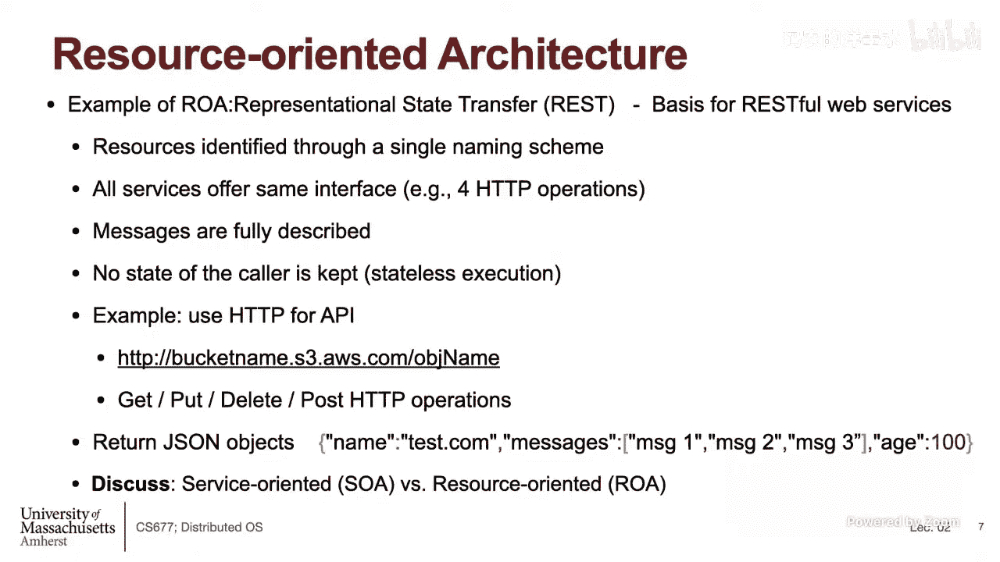

so that is service oriented and now there is another one called sorry that is called resource oriented there is another one called service oriented architecture that I did not actually go into but it is something that you will hear about。

service oriented architecture， the components of your application are partitioned into set of services okay each component provides a very specific service and the services communicate with one another so if you design your application as a set of services that interact with one another that is called a service oriented architecture if you design it where you essentially use STTP and you use URLs as resource names and you use STTP URLs sorry STTP messages to communicate thats called resource oriented。

And if you use your application components or a set of objects and you are essentially using methods on objects to communicate。

 you are in the object oriented market。Now， these are not very distinct because there may be overlaps。

😊，So， for example， you can have a service oriented architecture where the services are exposing HtTP interfaces。

In which case that service oriented architecture is also restful architecture and vice versa you might have a restful architecture where you have all the services as single piece of an application in which case it is not service oriented it iss restful but not service oriented but if that restful architecture has multiple components each of which you can think of as a service a restful architecture is also service oriented so there is going to be some overlap or distinction are not strict but youve got to understand what what each of these mean at a high level。

Is this clear？O。All right， so this is very high level stuff right we are going to go into all of the details later on。

 but we just need to know these terms and what they mean that I learn。

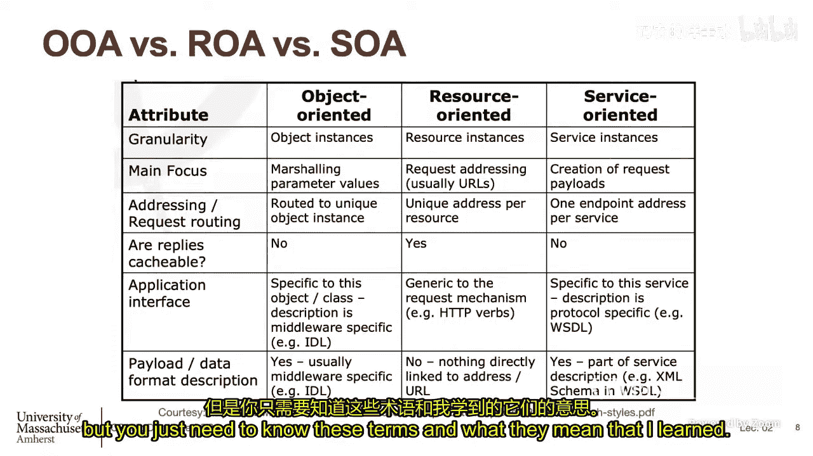

Allright so you have finished part one of the lecture just a reminder as always to not use any devices in class we are no laptop no phone policy so just make sure you respect that and if there are no other questions I'm going to switch to the second part of the lecture okay part two of three which is client server architecture so you probably heard the word client server in other context it's a very popular way of designing your distributed applications or distributed systems where some components are essentially going to provide services they are called servers the other components that involve these services are going to call clients the simplest one is where you have one server they provide some service multiple clients accessing that server。

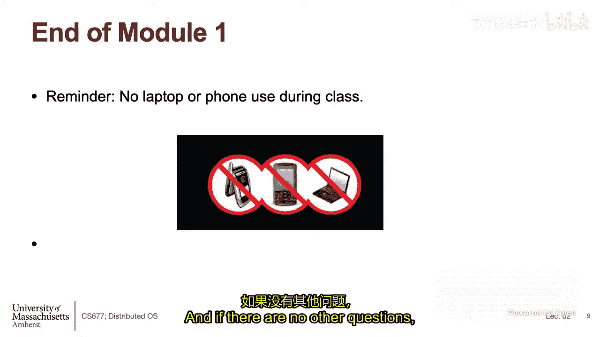

That's a client server system and the way you can see the interactions in this client server system is through what is called a timing diagram that shows what is happening in the system is is a very trivial timing diagram here where there are two components there's a server component X axis this time there's a server component and there's a client component anything that is dotted means that component is waiting for something to happen if it' is dark that means that component is executing so the way you will understand this so this is just a client making one request of the server and getting a response but the way you' are going to understand this is initially the server is just waiting for the client to make a request which is why you see that the server is dotted the client is executing on some other machine it will then send a request to the server that request will go over a network it will arrive at the server once it arrives and the server the server will actually start executing。

That are processing that request which is why you see that is now dark line and the response goes back while the server is processing the request the client is just waiting for the response so you will see that this is dotted and then the client continues execution right thats just an example of how you will understand this types of timing diagram will get into many more complicated ones later on。

Okay so let us look at the client server architecture in some detail I'm going to start with some examples the first one is a toy search engine okay it is not how a real search engine would be built which is massively distributed but is a conceptual view of a simple search engine。

So there are three layers here the top one is called the user interface level a middle one is the processing level and the bottom one is the data level and well try to understand okay so first is what is the user interface this is exposing to end users you can think of it as a search box in a browser。

Thats our user interface so now that's clearly something that that will be at the client because the client will have this interface。

 they will use it to send request to the server。Now when a request comes in it will essentially come this this is the middle level this is the server side of the search engine。

 it has multiple components one of them is a query generator where you take a set of keywords that the user actually sent to the search engine to that browser bar or to the search bar and you construct a query out of it。

So that is your query generator， the query generator will then send the query to a database which has previously archived an index some web pages。

😊，That process is not shown here that' is done through something called a crawler but that doesn't matter from our perspective all the web pages are indexed and they stored in the database query comes in you look for matches and then you generate a list of matches then it goes to a rank algorithm the ranking algorithm the page rank algorithm thats go to say here are all the matches let me order it by some relevances so it will reorder the matches based on what might be the most relevant response all of this still happening on the server side and then you will take that。

Set of responses and construct an HTML output from it that is your HTML generator and that page is then sent back to the user interface and then the user will see the responses to there。

So simple idea of how a search engine was of course a lot more complexities which is glossed over but you get the basic idea right so there are three things here there is the user interface which is what users or clients are using to interact with the server theres the processing concept of component and then there is a data layer which is where the data is stored for the search。

Okay many distributed applications are going to follow these three layers and we have these three types of components。

Okay。All right so so that basically brings us to this notion of multi tier architecture so you will have to think about these layers as essentially implemented as a set of tiers each tier is now talking to the next tier that tier tops to the next tier so this is following the layer design that I just showed you a few slides ago。

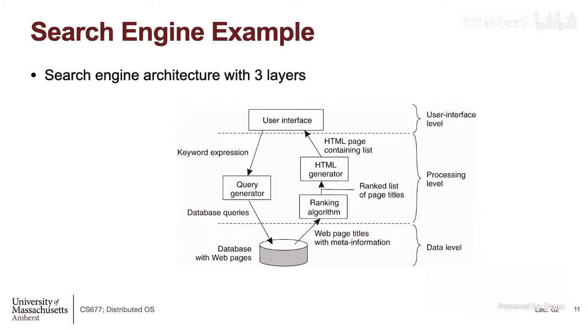

OkaySo so keep that in mind but now Im going to give you essentially a much broader example that shows you how you can take whatever I showed you in the search engine example and generalize it so our application has three types of components theres a user interface that you expose to the end user there is the processing tier which we call the application tier and then there is a data tier on the database。

Now there are many ways you can design your application and this is showing you a spectrum of choices so you will see that all of these there are several figures here they are all cut into two and there is a dotted line that is separating the two okay the way you want to understand this is everything above the dotted line sits on the client machine。

Everything below the dotted line sits on the server。

And each of this is going to give you a different design point of what components you are going to put on the client。

 what components you are going to put on the serve and you will get different choices of how to build your application。

Okay so so we can take a look at some of these right so you can think of option B which is the user interface is that the client and the application and the databases and the server that's the same example we just saw that was our search engine example okay so we put the interface here in the application and the database okay but you will see there are other choices so for example the user interface is split part of the user interface is at the client part of it is at the server okay you have more sophisticated interfaces that do this for example if your jascript or if you have things like Gmail or you're looking at a web mail you might have part of the user interface is actually in a server。

You only see part of it on the client and so that itself is split because the rest of the application in that case is always at the serve right or you can have。

😊，Essentially an example here where the user interface is completely at the client the application ti is split between the client and the server part of it is at the client part of it is at the server the data is at the server。

😊，Can you think of an example that maps to that scenario？Yes。

Sphone apps are a good example of this okay specifically smartphone apps that actually talk to server not standal alone smartphone application right so think of any application that's on your phone that actually connects to something else you can be let's say a shopping app。

As an example so UI is completely on the server on the phone there's clearly an app running on the phone So part of the applications here but whenever you make some interactions its going to connect to the server and the server might be searching for some item in a product catalog so you are to send that request to the server or the server has to execute further code and the server and maybe query a database and send back so your application is going to be split in this case so this example maps nicely to things like phone appss or you can have something as you proceed。

 you will have the user interface here then entire application is on the client and but you are just talking to a remote database you can think about Apple desktop applications where there's a lot more heavy duty app running there but you don't put the database on your machine the database may be large so you might just connect to a remote database on a server somewhere that's an example of this or you can have even。

Part of the database here maybe you are using caching to cache some data from the database to speed up I so your data tier is itself split okay but the rest of it is all in the client so you can design your application in many different ways and these are all distributed so some theres a client component and the server component in many cases the server component is not a single server its more than one server here we do not actually look at that aspect but we will see that so。

Any questions on this？Okay so what is is saying is there are many ways to design whatever we talked about in the context of multiter what you put on the client side。

 what you put on the server side and moreover how the server side is split is also an interesting case we have not looked at that yet。

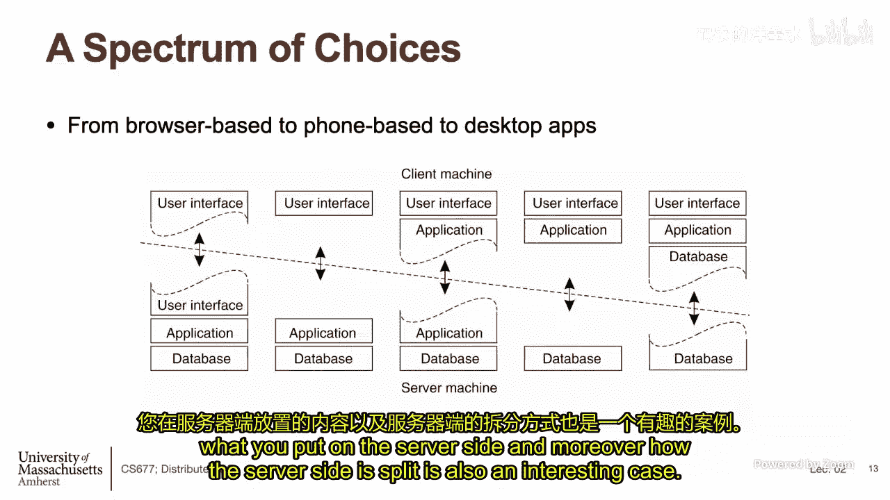

Yeah so that brings us now back to this three tier application okay this is now a new timing diagram just so you understand interactions in this three tier application so you can think of the user interface tier the application server and the database server and again X X is is time the dotted things means you're waiting anything dark means you're executing so you have initially the client is executing a sensor request to the application tier the application tier processes that request then it basically sends a query to the database the database processes it while you're doing this the others are waiting。

Response comes back， you process the query result， send back a result to the client and then you continue execution just shows you an example of how you can think of the interactions in a three tier application。

Is that clear。

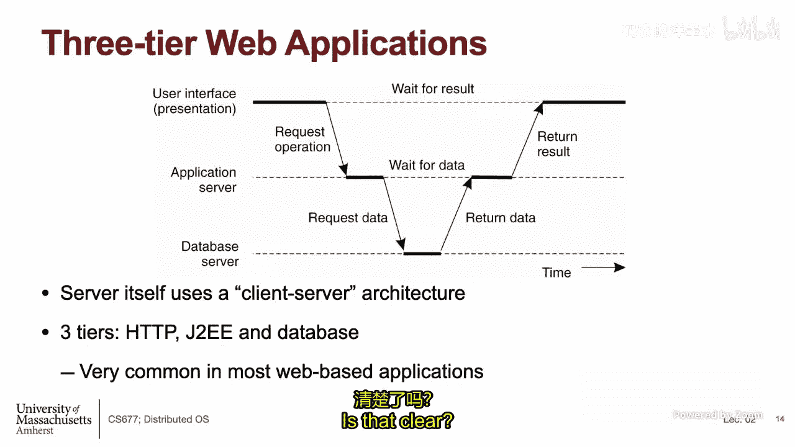

Okay。All right， so now we will look at several different architectures that will allow us to generalize this notion of client server computing。

 the one that I think is interesting to consider is what is called client proxy server okay so in client server your client and your have server okay in the client proxy server system there is another component we have introduced which is called the proxy that is going to sit between the client and the server。

The word proxy is going to suggest to you that this proxy component can actually perform some functionality of the server。

So this proxy is called a proxy server in many cases and then there is an actual server which is called origin server that figure is from the book it looks a little more complicated than it needs to be but by and large what you see here is clients are at the top these are the client boxes ignore the network for just a moment these gray box things here are the proxies that you are deployed in the network and then there is the original server somewhere else so the way interactions work in a client proxy server system also referred proxies are also called edge servers in many cases because proxies are often deployed at the edge of the network close to the client but from our perspective ed server proxy server might mean the same thing at least for now。

So， the way interactions will occur in this case is when a client needs to make a request。

 it will send the request to the proxy not to the server。

The proxy will check if it can serve that request locally if so is going to generate a response and send it back to the client and so you are done okay but if it cannot service as that request locally and that proxy is going to go to the original server or forward the request to the original server which will then process the request and send back a response。

So you will see that there are two things happening first thing is that the proxies are now absorbing some fraction of the request that the server would have serviced if there are no proxies in the system so the load on the server has reduced because some requests or some fraction of the requests are getting served directly by the proxies in the server never has to deal with them this allows the server to scale up because now your lots of in this case there are three proxies as one server so you are can use the capacity of the proxies to serve many of your users without overloading the server。

That's one thing the second thing is the the fact that the proxies are close to the clients。

 you will see that the clients are somewhat close in those two cases to。To the proxies。

 if you can use the proxies to serve those requests。

 the request will have lower latency than if they went to a server。

Because the proxies are at the edge of the network。

 you can also serve the request with lower latency。

 which means the user can actually get faster responses。

The simplest example will look at many different a servers。

 but the simplest example is one where you use the proxies to cache web contact or cache streaming contact。

😊，So you can think of these proxies as just being caches of content。

 so if you are now looking for a web page or you want to go and let' us say stream a video from one of your favorite streaming services。

 if the proxy already has that content it can just deliver it to you and youll get it faster。

other than having to go to the server okay so this is how these proxy servers actually evolve they started off as web caches when they became content caches now they do more sophisticated processing as well。

Okay， so that's。Thats server system， so this has now evolved into what is called edge computing and well get to that after we talk about cloud computing。

Okay， but this is essentially the origin of all of this new field。

 but it started off as client proxy server systems。All right。

 so that's end of your question okay thats end of part two are there any questions yes。那个。Okay。

 your question is is a proxy only cache content or does it do something more？

Is that your question okay so the role of the proxy depends on the application in some applications proxies are just caches。

And their role is limited to caching and delivering content but in the more general edge computing model proxies are fullfl servers they can run the same code that's running on the original server in which case they can do a lot more sophisticated computation that you could have done on the server so thats a different application so the answer to the question is the role of the proxy depends on what the application is using the proxy is it just to store or cache some data or is it to do some sophisticated process the proxy is a regular server so it's capable of doing whatever the application needs it to do so there's no limitation on what it can do。

放到。How is it different from the original server the main difference lies in the server is supposed to be remote in this case the proxies are deployed at the edge of the network they are closer to the user so they can provide lower latency services or other types of functionality like that。

嗯。It is not different in terms of hardware capabilities。

 it can be different based on where it is located and what it can do for the user。

Yes there's questionCan proxy servers become a bottle in this argument？

Qu can proxy servers become a bottleneck in this architecture typically you will have a system where there are lots of proxies you can have a system with only one but you will see here there are three or there are four proxies actually and there's one server so proxies allow the server to scale so the proxies actually are not themselves a bottleneck but they often remove the bottleneck from an original server because in this case all of the requests would have just been sent to the server and the server could have a heavier load but now the proxies can absorb some of them and if the proxy becomes overloaded you can deploy more of them here that's a general idea。

好，今年。到你家我哋点样。The question if the proxy has a need of can do whatever the original server do whats the reason to have the original server okay the answer depends on what the actual applications it is not the case that the proxy might have all of the functionality it might have some subset of the functionality if it has all of the functionality and typically you will not actually need the server except for just being the master copy if they are because the proxies are not authoritative they are just replicating content and replicating code but the actual master copies sitting on the server。

Yes question。研中你。question is there any load balancer or do requests directly go to the that's your exact question So in this case this is not a scenario where there's a load balancer that at least you in this specific example where the load balancer is trying to load balance across proxy so there are multiple ways you can design the proxy in the there is something called an explicit proxy the explicit proxy the client knows about the presence or the proxy the client directly send a request to that proxy there's no load balancing in this case so these three clients will send all the request of this proxy rather than that server there is another case where the proxies are not explicitly visible to the end user but the system knows about it So when when you send a request there is something that will intercept your request and it will act somewhat like a load balancer and try to find the closest proxy and send your request because the client doesn't even know the presence of the proxy so something has to figure out。

Some component in the system has to figure out where is the closest proxy of the least loaded proxy or something like that in that case。

 there will be additional component not shown here that is going to redirect your request automatically toward the best proxy best could be least loaded closest some criteria that you want to use。

But。要，不是。Question is if the proxy fails will the application or bottleneck typically in this types of system not so because you can always send those requests to other proxies in the network because the proxies are all somewhat equal and they are doing the same work so long as there are several of them you can easily redirect your request to other nodes in the system in fact even if it doesn't fail but if it's overloaded you would automatically do that if you are using some component to rebalance the load across proxies。

So I'll get to this as well because this is still architectural discussion of systems。

 distributed systems。

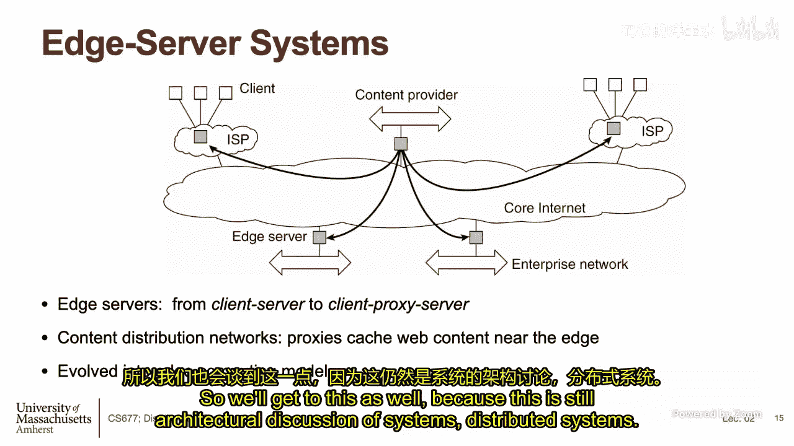

But let' us now move on to a different type of architecture altogether which is called decentralized so as the word decentralized we talked about this last time so we are now going to go from a client server model even the client proxy server model had a server in it right to a model where this application distributed application has no servers whatsoever there are essentially components in the system that are going to be called peers。

So so all peers are roughly equal to one another in particular there is no server a peer can act as a client if it is accessing services from other peer or it can act as a server if it is providing a server or service to other peers okay so peers can take dynamically take on the role of a client a server or be both depending on what tasks theyre performing but there is no longer a server in the system there are just a set of peers that are interacting with one another and these peers collectively implement some application。

What that application is is orthogonal for now but they will implement some applicant okay that is what we will call as a decentralized system peer to peer systems are a very good example of a decentralized system and that is what we are going to talk about so it removes the distinction between a client and the server peers will be distributed across a network and they will create what is called an overlay network an overlay network is a logical network。

That runs on top of a physical network here is an example of an over network that has a topology of a ring you will see that it is just a ring now this ring doesnt mean that the physical network is a ring it just means that you essentially have a set of peers that are communicating with neighbors and they are just formed a ring。

😊，The underlying network is still what it is we don't actually show the underlying networking but now this one is an interesting one because it it's also referred to as the card peer to peer system is a structured peer to peer system so let me explain what that means so the thing you want to keep in mind is all of these structured peer to peer systems implement this concept of a distributed hash table I presume all of you know what a hash table is you probably used one in your code in a distributed hash table think of it as the hash table is now split across or partitioned across multiple machines each machine has some is responsible for some of the key key value pairs of that hash table hash table is just a mapping function that you give it a key it produces a value。

that is what has table does so if all the data of has table is on one machine that is just a standard has table in a distributed as table is partition across multiple mission so this peer to peer system are essentially implementing a distributed has table to do distributed lookups。

Now， here is an example of one way to implement that distributed has table using a ring like structure for your peer to peer bit。

So， the way you want to understand is as you will assume that there are n items in our system that are going to be part of the hash table so the hash table is n increase in it。

To appear。so those are numbers0 through n in this case they go from 0 to 15 so there are 16 entries in our as each peer is going to randomly choose an ID from 0 through n for itself。

So all dark circles are peer so that's pi chose an ID one for it this one chose four that chose 7 that chose 12 and so on so there are some number of peers when the pi becomes part of the network it has to pick a random ID that's not used by any other peer and it will join the network at that location in this ring topology once it does that what that pi has to do is it has now responsible for all has stable entries after the pi before it okay so in this case let's take pi number 12 the previous peer is 7 so the entries 8 through 12 are now responsibility of pi 2 so all hash lookups for items 98 through 12 I have to go to 12 and then it will tell you what the values are。

and so on so essentially your hash space is getting partition into smaller chunks each chunk is assigned to appear and this is a simple rule of how do you do that partitioning you just say pick a random ID and then all entries from the previous。

Peer to this idea you pick the responsibility of that peer。

 that is a way to random randomize the partitioning of this hasspace across the pis。

So if a new peer joins okay so maybe these systems are dynamic so peers are resume to come and leave at any time so for a new peer joins it has to pick an ID let's say one joins and picks 10 so then your repartition the has space so in particular 12 will take some of the entries which is specifically8 through 10 and hand it off to 10 signal now this is your responsibility okay or if a peer leaves your take or the responsibility of their peer so the partitioning of the has space can be dynamic in a peer to peer system。

Okay， that year。So so this is now what is called a structured peer to peer system this is how the hash table is partition now what I have not told you is when a request comes in how does it get to the right peer so that you can do the lookup。

 so that is called in peer to peer system that is called query routing。

So effectively what is going to happen is if the user says look up item number  nine。

It might be an that user might actually inject that query to Pi 4 so the Pi 4 somehow has to forward the request until it gets to 12 because the item that you are looking for is at Pi 12 and then you have to do a lookup and send that the response now the process of forwarding that request along this ring to to peer number 12 is called query routing。

The simplest query routing is you just pass it sequentially until it gets to the pi。

 but that' is effectively linear search。we are basically going through each peer until you find a query which is going to be slow so a lot of these peer to peer systems use much more efficient ways of query routing so that you can look up items in log performance or something like that rather than order end performance which is just sequentially searching the ring until you find okay we are not going to talk about query routing here but you should know that once your partition the has space the process of looking up this has table has to be also fast it can't be stored and that differs the whole purpose of calling it a has table so the query routing part I'm going to ignore here but there are efficient algorithm that allow you to forward the request in a way that allows you to get very efficient lookup times。

But let's leave that aside for now whether these distributed hash tables also called DHTs because thats the acronym that are used in a variety of contexts there are distributed key value stores that you will find in distributed system that's something called meC D that is a memory in memory cache that allows you to look up items there' is a system called Apache cassandra that uses distributed keyvalue stores so this idea is now used in many different contexts but it originated with something called this card peer to peer system。

え。Any question yet？And by the way， it is also called consistent hashing that term is effectively means the same thing as having a distributed hash table yes portion。

If you have more peers then。what if you are more peer than actual data view that will almost never happen because you will have a lot more entries。

 but in this specific case if all the peers join the network and there is no entry left。

 you cannot add any more peers because you have maxed out the number of peers in the system。😊。

but that's not a pra because the number of keys will be much larger than the number of machines are in the system。

 we have millions of records in a database， we want millions of machines that are part of a peer to peer system。

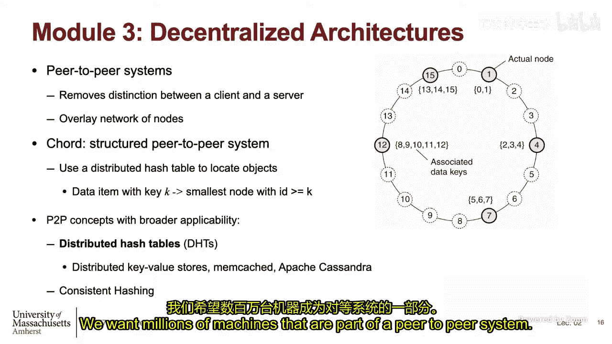

Okay， so that's。Cd here is another peer structured tier to peer system this is called a content addressable network or can it is also a distributed hash table but you should think of it as rather in a distributed hash table is a key value look up that's what a DHT is your single key you have you send it to the hash table you get a value out of it in a content addressable network you have multiple dimensions to the key so think of there are now two keys for every value so you essentially have two inputs key1 and key to and you get you basically provide two inputs and you get an output。

So， that is a two dimensional distributed has table that is what is shown here you can have any number of dimension you have n dimensional keys and you get a single value so your look up has to specify n attributes to get one value out of it。

So this example is just showing us two dimensions。Now theres let's look at that example is the same scenario as before now you have not one but two dimensions so rather than viewing the network as a ring you essentially view it as a two dimensional space now each of these dots here are peers so rather than picking a random integer as your ID you pick a random vertex in this two dimensional space as your ID so you will essentially have a pi it's IDs 0。

2 and。3 because we normalized our keys go from 0 to 1 now you can have them be integers in which case they will be they look different but you normalize the key assume that the key space goes from 0 to1 you are essentially a 0。

2。3 07。2 and so on so what this does is now rather than having all the entries from the pi before to you as your responsibility here you get a bounding box which is a rectangle。

All values in the hash table that fall in this rectangle are the responsibility of that pi all values in this one or the responsibility of that pi and so on so in a pi new pi is going to join the network it will pick a random vertex lets see if let's assume it picks a vertex in this rectangle so then that rectangle will get split into two and then the pis will redistribute the keys the same kind of idea as before but now we are generalize it to two dimensions。

and so on， so you will see now in particular in the second figure there was a pi that joined the rectangle but the pi 0。

2。3 and that curve split into two。And so on and similarly if there is a leave you will have to rebalance the rectangles because you always have a rectangular space you are responsible for query routing is going to be similar you essentially out there route the query the queries can be injected or lookups can be injected at any pi they have to send it to the right pi in the right rectangle for a to get the value that is called query routing is going to happen in two dimensions in this rather than one dimension。

Now， the thing we want to keep in mind is from an expressive power standpoint。

 whether the DHT has one dimensional keys or n dimensional keys。

 they are equivalent just because your two dimension here doesn't mean that this has somehow more power than one dimensional key lookup。

Let understand why just take a simple example。Let's say in the previous case。

 your keys are file names。lets say your set of PDF files that your indexed okay so your keys will be okay find me the file food。

pd so you will go and look is there a file with that name and if so you will say here it is on this location。

Now， in this case， the two attributes will be file name and the file type， so you are the extension。

 so key1 could be 4 and key2 will be PDF。RightSo essentially you split the key into two in the pre so what you can do is in the n dimensional case if your k keys you can just concatenate them together and then you have the key for one dimensional distributed aspect so in effects the fact that your multiple dimension not giving you anything more in terms of expressive power you can do the same thing with less dimension if you want it is just a question of what makes sense for your application what is the right type of query you all do。

Is this clear？Okay。All right so this notion of content addressable network has actually a lot of work that has evolved from it in the context of networking and now you will see if you know anything about networking research there' is something called information centric networking there's something called name data networking where they took this example and they generalize it to other types of network object other than just thinking of them as keyvalue to they said let everything in the network be essentially a lookup so you will have names associated with it and the way you route rather than routing packets through a network you can route packets to using query routing and so on so so there have been attempts to rethink how networks themselves work using these types of example there's something to keep in mind we're not go into networking details in this class but it just something I wanted you to know that there's actually a lot of work since the original CA。

Paper came out that has actually gone into network all right so thats。

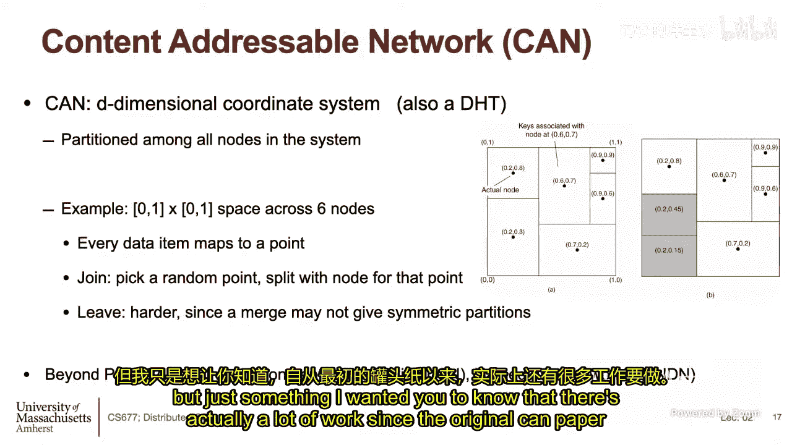

Those are what are called structured peer to peer system I'll say something very briefly about unstructured peer to peer system will not spend too much time into this in an unstructured peer to peer system you have a set of peers they are performing essentially providing by and large lookup service for it so you are to say or the way you want to think about this is you want to query an object you ask a peer saying does any peer in the network have this object it could be a file you can say I want file food or PDF you ask that peer now because these systems are unstructured there is no easy way to figure out how to send that request to the right peer in the previous case you essentially had a structure in the network you're the ring topology or two dimensional space and so on in an unstructured network there is no such thing peers are randomly connected to other peers in the network so there is no way to figure。

or which peer might even have the object so what unstructured peer to peer system do is they forward queries to all other peers that that are connected to them and they forward that query to all other peers that are connected to them and this is a process called flooding because you flood the network you ask everyone you have this object you have this object by sending it to all your neighbors okay so eventually you might have some peer that says yes I have it and then the response comes by。

So queries in this case are going to generate lots of messages because every query you effectively flood the network by asking all your neighbors and their neighboring peers as their neighbors and so on and flood the network with these query messages so it is less efficient than structured systems which are actually very efficient and looking up where a particular object is in the network but original peerto peer systems where unstructured they basically had a random topology where peers where arbitrarily connected to other peers is a connected network so any query lookup key value lookup is done through flooding because there is no way to know what who is responsible for what objects and so on in the network。

哎。So so that's something you want to keep in mind but I won't go into the details there but something you want to keep in mind but what I will talk about is if you have this type of unstructured peer to peer networks you essentially have a lot of wasted messages because every query is broadcast or flooding the network and trying to ask every peer so even though peer may not have very many objects it has to answer all the queries because all the queries any  query in the network is going to come to the peer you will see a lot of traffic a lot of messages going back and forth which increases the load on every peer for every messages to be processed you to check do you have an answer to the query or not and so so what was done to reduce the load on the peers is to come up with a superpe architecture for unstructured network that's the one that's shown here。

In the super peer architecture， you take the set of peers you have in the network and you partition them into groups。

Those groups are shown as o here。Within each group one of the peers within that group is designated as the super peer okay so the super peers so you will see the black nodes there are super peers okay the white nodes are regular peers and the role of the super peer is to answer queries for all the on behalf of all the peers in its group。

So flooding is only going to happen at the super peer tier。

so when you ask for a query you only send it to a super peer now the assumption here is every super peer knows all the objects that are stored at all of the peers so it can answer queries on behalf of those peers without having the query actually go to those peers。

That clear what I'm saying so you have now elevatedeviated the load on all of these peers because the super peer takes on the responsibility of answering queries this was an architectural design that allowed you to reduce load on your peers in the network so you basically say query answering queries is now responsibility of the super peer you can choose a machine that is more powerful within your group to be the super peer so it can handle more load it can handle answer more queries and so either it is more powerful or it has a good network connection it has somehow more resources than other peers so it can do more work and then reduce the load on the。

This idea was original。😊，Originally implemented in the Skype network nobody uses Skype number it is what started a lot of the audio and video conferencing that you see today So original Skype network was a peer to peer system you could make calls over the internet to your friends and the way you could do that is essentially it is a P2P network and whenever a user logged in using this Skype application their Skype application became a peer in the network so what is the lookup here if you're trying to make a call to a friend you need to figure out where your friend's computer is are they logged into the network so that was the lookup you did saying I need to make a call to this friend of mine are they logged into the network what is their IP address and so that information was stored at all the peers so you could query the simplest thing is flood saying are you my friend are you my friend and then you'll send it to all the peers very wasteful clearly because that's not。

Be efficientff so Skype adopted the super peer architecture and said here are some smaller number of machines that will keep track of who is logged into the network what are their IP addresses so the lookups are only going to be handled by the super peers and that allows you to do more efficient processing of queries。

Okay， yes question。This is the heroes。Okay question is in the Skype case when you joined the network would you become a super peer or super peer dedicatedcate so in the original Skype is super peers were elected so if you actually had a powerful machine and you are logged into Skype you would suddenly start seeing a lot of traffic coming to your machine because your machine became a super peer and it had to now answer queries for machines in your cluster that's how they designed it and eventually Skype as you know got bought by Microsoft now Microsoft application so once they did that they put all their super peers into their data center right so those were now dedicated and machines that acted as super peer so you didn't have to flood everyone it just became more like a centralized service that kept track of everything so it just asked the server saying where is this user and you would get an answer and then you could connect so it changed over the years。

Any other questions here？Okay， so so that is our Skype and super peer system。

 there is another system that I wanted to talk about that is still very popular today。

 which is called Bi tot。

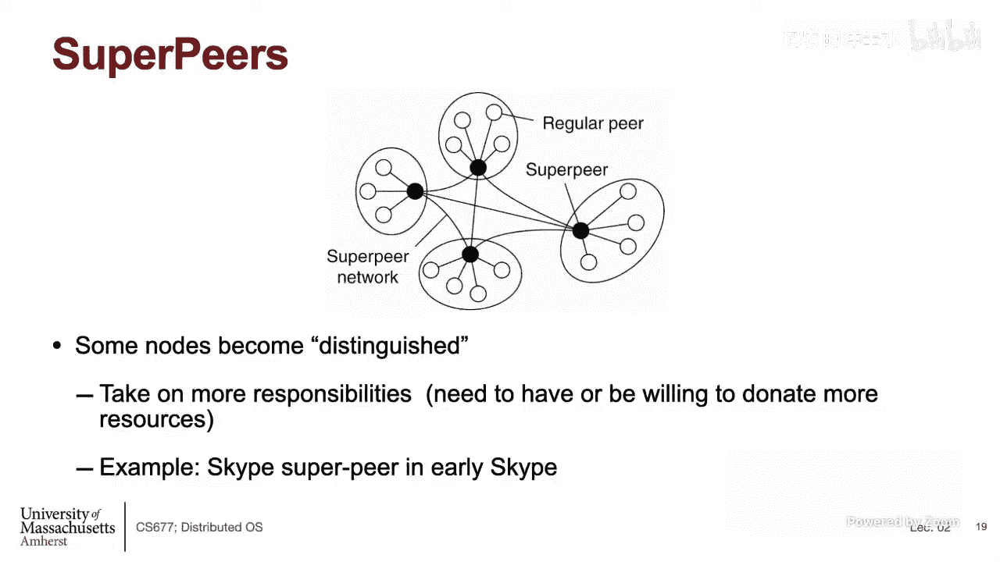

I presume you all heard about a bit torrent， so it is a system that allows you to do collaborative peer to peer downloads of large data sets of any sort。

哎。Now， the way this saw picture there shows you the architecture of a bittorant system。

 So the way the bittorent had several interesting。Innovations in it so because it is designed to download very large data sets。

You couldnt assume that this each peer restoring this large data set all by itself so you took so what deter and data it takes any large comp file or a data set and it chops it up into smaller chunks。

And then it distributes these chunks across many piers and it also replicates these chunks across many peers。

So， each pi has only a small piece of some larger content。

 so let's just assume it is a large lets say it iss a large machine learning training data set。

 large repository of images。so if you think of it as a large archive。

 can take that archive and chop it up into smaller pieces and then you distribute them and cross piers and each chunk is also applic。

So so the goal is now if you want to download this entire archive。

 you have to get different parts of that large file or large archive from different peers。

that' is number one the second thing you can do is rather than downloading the sequentially which might take a very long time because this is a lot data sets if you say let me get piece1 and I'll get piece2 and piece3 or this is going to take you a long time you do parallel downloads okay you download k pieces at once so you will take go。

Get the first k chunks and then once the first k chunks come in you get the next k chunks so you establish K parallel connections to k different peers and start downloading k different pieces at once and if your machine has enough network bandwidth you can download multiple chunks at once if you are in a slow connection this does not give you any benefit because it is going to still take you a long time because you are limited by the speed of your connection not the speed of other peers at that but if you have a good network connection parallel downloads allows you to better use your fast network speed to get more content all at once so parallel downloads。

Was another innovation that you saw in Bitor so it basically partitioned the chunks it distributed it amongst multiple peers and then you download it then and you reassemble the files after all the chunks outcome come so thats that's one set of ideas and the way all of this work is you essentially had to have some global directory of。

Essentially where this file is kept and so that web so think of it is you could have a website the website kept a file called a torrent a dot torrent file for every piece of content so for each let's say repository you have one torrent file the torrent file is going to tell you about who has the content and so on Okay so first year to go and get the torrent file from some server the torrent file will have information about two things one is called a tracker and then the node so the tracker essentially keeps track of which。

Peers in the network have what chunks tracker is an actual peer in the system so here is a tracker the tracker is going to keep a list saying there are n chunks chunk number one as it is present at these three peers and chunk number two is at those two peers the number of peers will keep fluctuating so to keep track of which peer is currently connected to the network which peer as what chunk and so so that is done by the tracker file so your torrent your bit torrent client will first get the torrent file it will go to the tracker that's pointed to by the torrent file and then it has to the tracker will give it the list of active peers in the network because that's tracking it and then you go to each peer and start downloading a piece of content in parallel。

So that's the process that bittorarent will use so it's using parallel downloads its chunking the content it dont keep the whole file at a single peer and so and the last thing that was interesting in bittorarant was this notion of forcing altruism which is you want to make sure that peers are actually contributing to the network similar to the resources they are consuming from the network because what would happen is lots of users would say I want to download this piece of content they would join the bittorin network as a peer they would download the content and then don't disconnect from the network because their job is done they got the content。

Now had they kept that Vi and client connected to the network that content could now be served to other peers。

 but if you disconnect from the network then you are not contributing any resources to the network and only consuming from the network so what Vi and did is it essentially enforce the rule which said that if a peer is downloading more content than is uploading is downloading more data than it is actually delivering then slow it down。

Then when it tries to download more， send it at a slower speed。

so then it takes you more time to download the content， even if you have a fast network， you are not。

Deemem to be an altruistic peer deemed to be a selfish peer which is only using resources not contributing so you get downloads at a slower speed this was meant as an incentive for peers to actually contribute resources back to the network so if you allow other peers to download from you you will essentially be deemed to be an altruistic peerer so when you try to download next you are not slow down you can download at whatever resources network speed you have so this is a way you can provide incentives and distribute assistance for users to provide resources for users to contribute the resources to the network not just consumer resources。

Is that here？Yesス、こし。But I guess there was implication in case someone not online there。Yes。

 so every chunk is going to be duplicated at more than one pier right so if a peer goes offline for any reason you want there to be other peers who actually have that chunk so a chunk so a file is partition into chunks each chunk is replicated and stored at multiple pis。

So that's how so a file is not only stored across multiple peers。

 each piece on the file is stored on multiple。so that will ensure that availability is high even though peers might come and go。

Any other questions here？

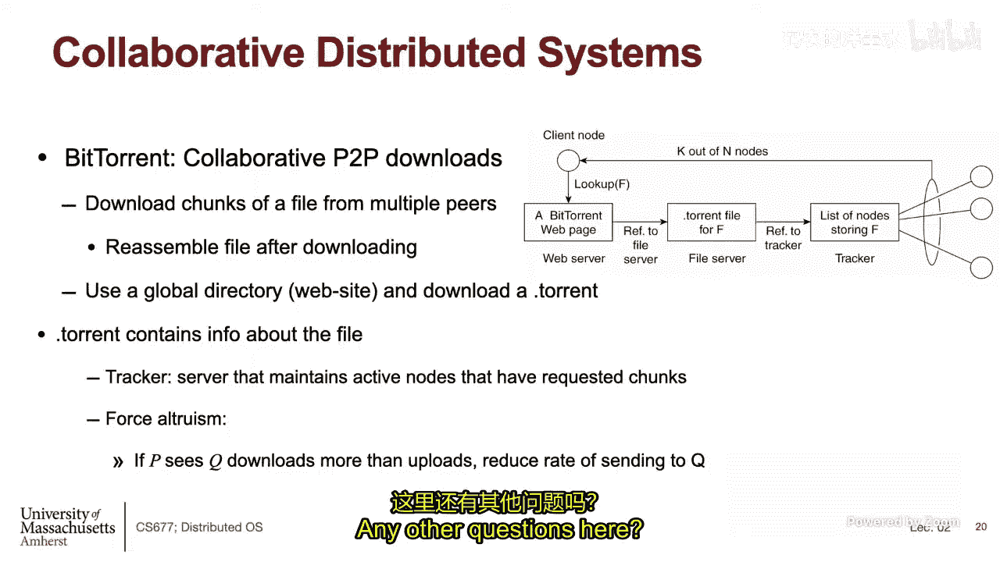

Okay。All right so I'm going to talk about one more thing and then we'll be done for the day and that's the notion of autonomic distributed systems or these are basically distributed systems that have built in intelligence they are also called adaptive or self-managing system as the word selfman indicates the system actually has intelligence embedded in it so it can monitor itself and take corrective action whenever it needs to the simplest example of a selfmanaging system is what is called a selfhealing system a selffealing system monitors the system for component level failures and if it detects that some component has fail it will heal itself by。

Making some other component take over its job。That's an example of a selffeel system but self-man system could be of many types you could have selffe you could have adaptive and so on and by and large the way the way we will encounter it is not only to deal with failures but also many kinds of workload changes in the system so here's an example of a self-man or an autonomic website so it will have this algorithm that is actually trying to do this automatic management as three components first it is monitoring the workload that's coming to that website。

哎。And then it is going to compute the future demand on the server。

 future load on the server as a result of the web of the workload it will make some prediction saying if these are the workload trends what is the workload likely to look like in the near future and then based on that workload what is the load on the server and then if you see that the workload is increasing or likely to spike you might say okay the load is going to rise and the server might get overloaded。

So in this case you want that this is where you take the action if the server was simply overloaded and the system had no ability to do anything about it then users will just go to the website website will not respond or be very slow。

 users will not be happy。Because they're getting very bad performance from that website but this type of system can predict that and they can say let's increase the capacity of the web server let's add more servers to the cluster that's servicing this web or let's move the website to a bigger server with more course or more memory so if you take this proactive action then you already did what a human would have to do after they notice that the web server was loaded which is this server this machine iss not at the capacity we are to put either extra machines or move that website to a bigger server now the system is in this case doing that for you so in that is why it's called a self-managing system so it's automatically provisioning capacity when you need it or vice versa maybe there was a spike and then you provision lots of servers to handle that spike and the spike went it now lots of id servers just sitting therere doing nothing。

you can then reduce the size of the server pool to say we don't need 00 servers for this website maybe five or enough but this workload spike has dissipated so you can change the allocations of websites on the fly as one example of a selfman system now this example is actually typical in a cloud based website if you deploy a website in the cloud you can actually turn on these features where the cloud will monitor your workload and provision capacity automatically for。

So this is where some of these ideas have made it to actual systems that are using in practice today。

So， that is the concept of an autonomic distributed system where it has the ability to monitor itself。

 understand what is happening and take corrective actions。

To deal with either failures or workload changes and so on。Any questions here？Okay。

 so I think we are done。I'm not going to go talk about feedback control today we are done for the day I'm going to stop here there is a sign up sheet that went around if you came late just check a box because I need to know who's coming for purposes of add drop and so on okay that's one and if for those of you who came late I made an announcement at the beginning saying we are going to hand out lab zero today it's not a real lab okay just set up that you are to do on your machine to prepare yourself for the real lab so watch out for that and make sure you do all of the work to prepare yourself for the actual work that's coming down the road so let's stop here。

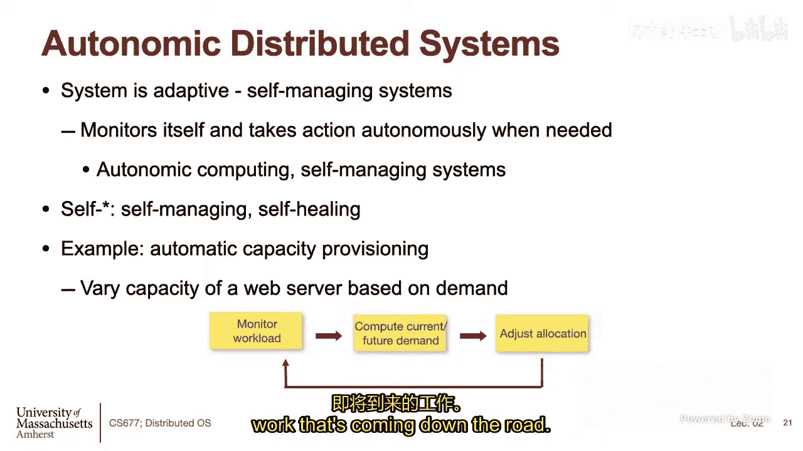