# 【全集 2025 附课件】马萨诸塞大学 分布式系统 中英字幕 p06 Lecture 6 - 分布式与集群调度 -BV19BSYBuE4Y_p6-

Okay， so let's get started。SoToday we' continue our discussion from last time we started talking about concurrency and scheduling the last class was largely concurrency today we switch gears talk more about scheduling and then we continue that next time as well so today's class is going to be on distributed and cluster scheduling and by the way because we have now covered the server concurrency models all the multithreaded models we talked about last time we have a lablet for it which I'm going to hand out today I think the skeleton code and that lablet will be quite useful for the lab that we have already handed up because the lab requires you to use RPpCs or socket communication we covered that and that also was part of lablet one but it also requires you to write a simple server application and that was something we。

last time so so take a look at the skeleton code and both of those lablets feel free to use it any way you want for doing your lab work and just keep in mind the lablets are really tutorials so we are not really grading you for correctness so long as you just did it you get full points for it so so there a lightly graded lab is where you should be spending your effort on or that's the thing that actually count towards the grade because lablets really we are giving you the code and just saying try that's not does not really want to require you to do a lot of work okay so keep all of that in mind and as usual if you have questions come ask us were happy to help we have address several of the issues that have been brought up on piazza with regards to the Docker container there are some minor things left we will address those shortly and hopefully everyone can then use the container as the the Docker container as your development in one。

Right， yes。Camera does not show all right。啊，那就。Okay， looks like the video is not going to the thing。

Okay so in any case let's start with the part one which is multiprocessor scheduling so we are switching here from thread scheduling and thinking about how threads are scheduled and so on to now because this is a distributed systems class we are going to think about our processes scheduled when your machines with lots of processors or our processor scheduled when you have systems with lots of machines right so we are now going to go beyond a single machine first we are to talk about multiple processors and still a single machine but then we are going to look across machines and how you do scheduling so part one is multiprocessor scheduling so here is the picture that you want to keep in mind of what is a multiprocess so so what you want to think about as a machine that has many processors or course we use the term processor or core interchangeably here although they are not exactly the same thing for the purposes。

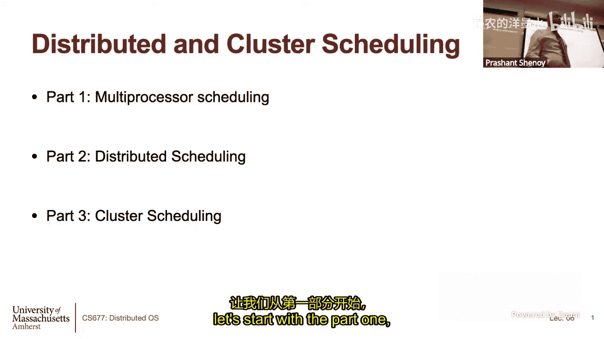

Of this class doesn't matter so these things that are in purple circles are processors。

And then or the purple circles are processors the yellow boxes are memory of different types okay so there is the level1 cache that's attached to a processor that's a small yellow box that's literally shown inside a circle so those are actually dedicated to a processor then you have a level2 cache that may be dedicated that's still dedicated and then you have memory that's shared across processors so any processor can access data from any memory but it has to only look at its caches to low when its trying to access data you'll see why some of these things matter but this is a hardware picture so if you have an undergrad course in computer architecture you would have learned something about processors and level one caches and level two caches which is the kind of background you need for OS or hardware sorry systems classes but even if you don't have that background doesn't really matter all you need to realize。

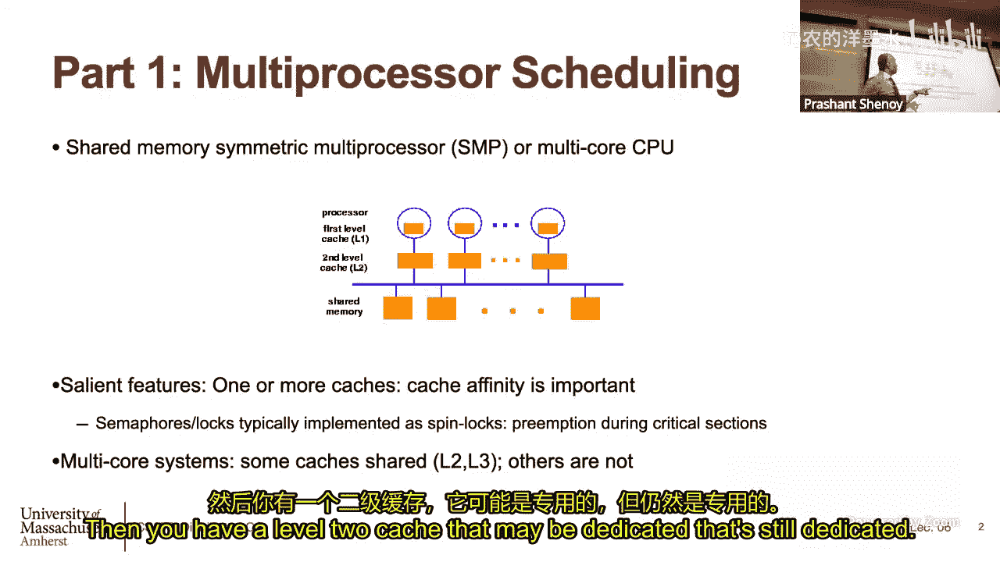

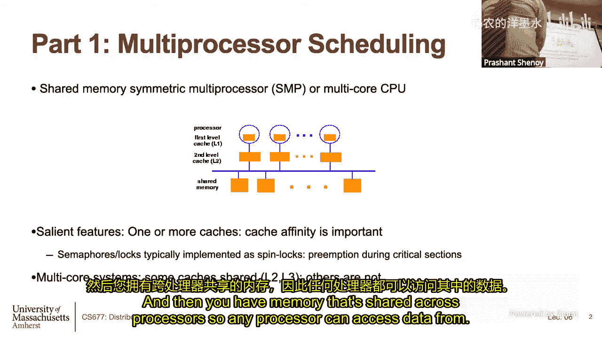

Here is we have a set of processors on the machine okay they are fast memory which are called caches they are arranged in hierarchy so level1 cache is smaller and faster than a level 2 cache and both of those caches are smaller and faster than memory itself which is actually shared across all of those processor okay we will see what and some caches may also be shared here we have not showed any caches that are shared they are all dedicated。

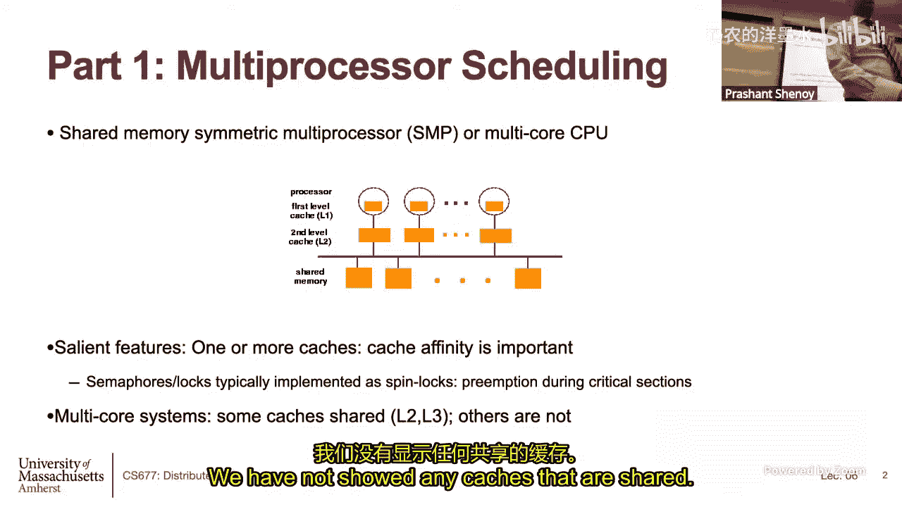

Now with that picture in mind let's start thinking about scheduling processes or threads onto these processors so here are two ways you can build your scheduler okay the first approach all processes or threads applications they are waiting in a queue a single queue and then the processors themselves whenever they become idle whenever the time quantum on that processor expires the OS code on that processor OS kernel and that processor is going to look into the queue extract a processor or a thread execute so every time a quantum on a processor expires because remember I said last time all CPU scheduling uses time slizing or quantum you allocate one quantum which is a unit of time of。

The resource to each thread at a time so whenever let's say quantum is 10 millisecond every 10 milliseconds you basically the quantum expires a scheduler tries to pick another task to run another plus and you might do round robin I think so that so this uses a single queue across processors another approach is you can have more than one queue in the limit each processor has its own queue and there are tasks or threads in that queue So when that processor times size expires it only looks at this local queue here's a picture where we have something in between where each queue shared by two processors and then that one all processor share a single queue so you can design your scheduler where you can either have one shared queue or more than one queue which might be dedicated so then the question is what are some pros and cons of using these approaches for performing or scheduling。

So if you have a centralized cube so remember that queue is essentially a shared data structure okay it just a list of threads that are waiting to be scheduled so this queue is a shared data structure if you have a centralized cube is is going to quickly be a bottleneck。

Is it clear why it will become a bottleneck？嗯。There will be lots of processes queued there。

 that is true， but that is not going and make it a bottleneck by itself。

 the length of the queue is not the problem。Yes， there's a certain amount of time。大时还有。That。Thanks。

Everything parallel。Okay。All right， so the last thing you said is the most important thing okay the queue is a shared data structure。

 it is a shared queue okay if there are multiple processors。Trying to access it。

 you have to protect it with a lock。Just as because I shared data so you can't have two processor go and try to take things off at the same time that' is going to lead to corruption so so if youre protected it to the lock okay let's say one processor core is trying to extract something from the queue another processor becomes idle it cannot do anything until the first processor is done until that time that processor will be idle。

it cannot even get a task of their queue to run so so this is basically a synchronization problem as the number of processors grow you will essentially start contending for the queue and you may be blocked waiting for a lock on the queue and then the processor is just setting there idling waiting to just take a turn to get something of the。

😊，So that' is the problem okay of course the number of threads can grow but that by itself is not going to be the main issue here okay so that's a disadvantage but the good part is that since it's one queuee any processor can pull tasks or their queuee so even if there are lots of tasks queued up okay you can essentially assign them to any idle processor and make use of all of the processor okay theres a questions somewhere here。

Yes， very question。You did not understand the lock but okay so assume that each of these first of all you need to know what a lock is and why you need to use it okay in any system where you have concurrency whether you're multiple processes or multiple threads trying to access the data structure you need to use a lock to protect that data structure you cannot have data structure be written to by more than one element at once so basic principle of synchronization and threads and concurrency here you will have a kernel thread running on each of these processor trying to schedule the next task they are all essentially trying to access the data structure so all of those kernel threads must use a lock to pull things off there so that is why you need a lock。

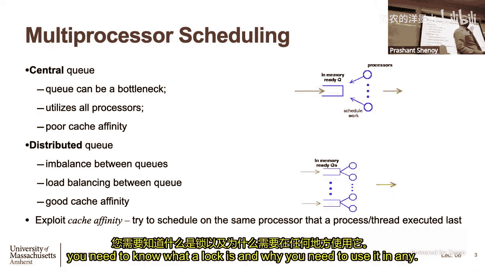

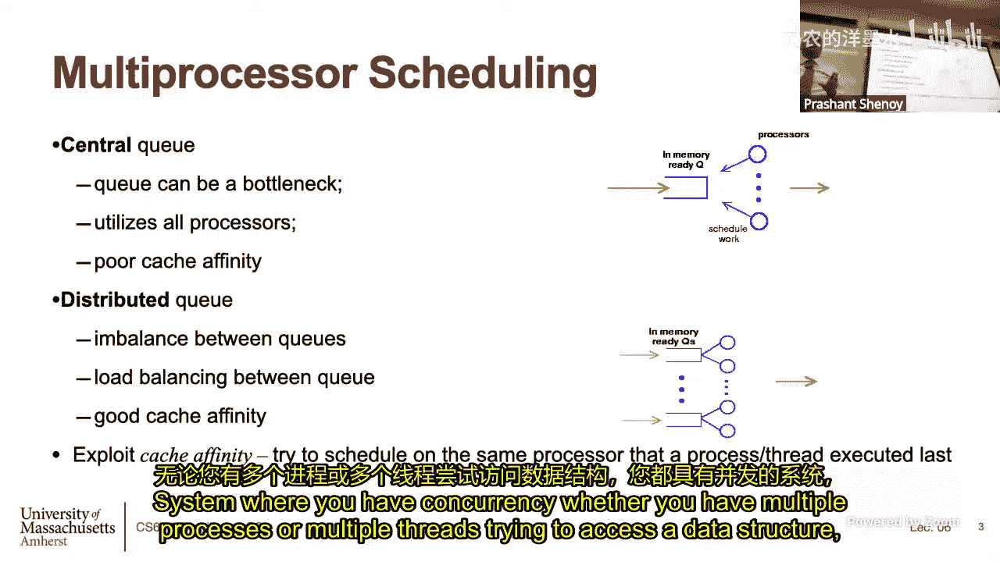

Allright， so queue can be a bottleneck， but it basically ensures that all processors are going to be utilized if there are many tasks queued up there okay we'll come back to why the cache affinity can be a problem but let's talk about distributed cues what might be some advantages and disadvantage so rather than this picture assume that there's one queue per ch this shows one queue for every two course there's one queue dedicated to a core so in this case there is not no contention because there's no other processor is going to try to pull threads of that queue because there's one processor that's assigned to each one queue assigned to each processor so there's no contention very little contention in this case so that bottleneck problem is gone as soon as the time slice expires you can go to the queue take the lock extract the next task run it okay so this problem is eliminated but now you have a different problem which is you have may more than one queue if。

Number of tasks in those queuees is not。The same okay the cues are going to be imbalanced some cues might have more threads。

 some cues might have less threats， so some processors are more loaded than other processor so the load on processors will be uneven if the number of tasks assigned to those cues keeps changing。

So so this is going to cause an imbalance in the system where some threads make faster progress because they are in shorter queue so they can run more often if you are doing round robin you you will get more quantum and some will get less so this will require you to then periodically go and rebalance the queue if there becomes imbalanced。

so the queue can get imbalanced okay， but you can then you then you have to do extra steps of rebalancing the queue。

 which means more tasks from one queue to the other so that the Qs are of the same size。

Now the important part， the why I showed you the picture of what a processor looks like and what the caches look like is。

In any any processor system so the processor makes heavy use of its cache for efficiency reason because going to ramp to fetch data or code is always slow。

But once that data is cached in your L1 and L2 cache。

 you can access it maybe an order of magnitude faster or more。

So this speeds up the execution of the task now when you have。One cube per processor， the same task。

We execute on that processor over and over again across time quantum so let's say the task executes it time quantum expires it goes back to the queue after a while it will execute again and it will execute on the same processor that is important because whatever data it had brought into the cache previously will still likely be in the cache and it can make use of it again。

That's called cache affinity now in that other scenario you will see what happens if let's say task a runs on processor one its time slice expires it goes back to the end of the queue next time it might go get assigned to some other processor now processor do not share the caches that's what I showed you so if it ran here the data is in this cache next time if that same task runs on some other processor that cache has none of its data or code so it will start with the cold cache itll get a set of cache misses its performance will slow down quite dramatically as it turns out so you will start seeing cache misses and that basically causes the performance to suffer so you have poor cache affinity this is actually the single biggest disadvantage of that shared Q bottleneck is not the big problem even if you solve that problem the performance hit that the processor take because they keep changing processor is actually a bigger problem。

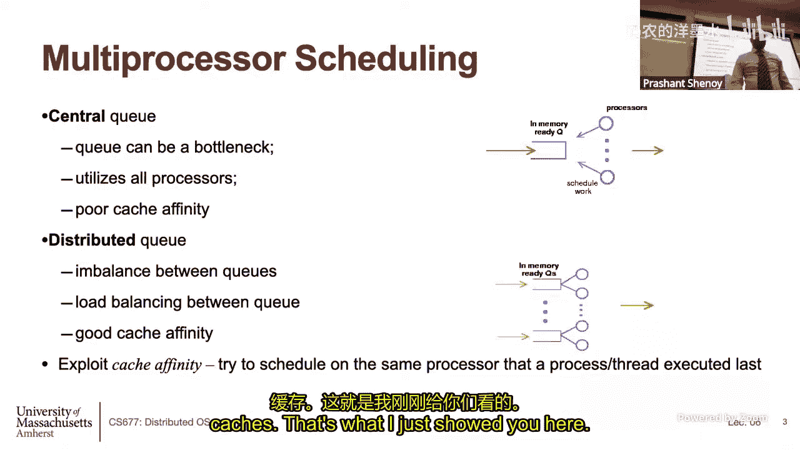

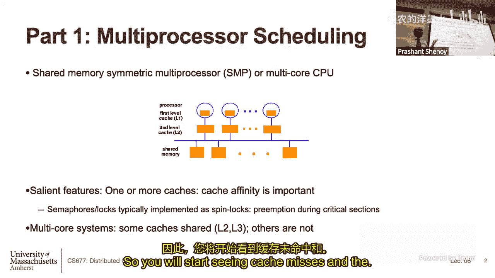

And thats something you have to take care of and that some and the distributed key of course gives you that because you are going to have cash affinity you are going to run on the same process over and over。

Any questions on this？Okay， so that is very quick。

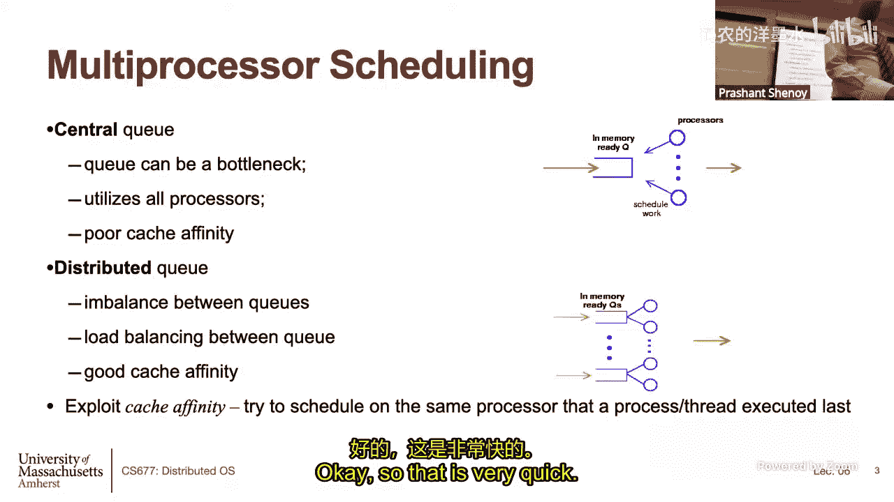

Overview of multiproces scheduling but there are many Friday not talk about the policy I was just talking about some hardware details and whether the policy that you use is going to be using as implemented using a single queue multiple queue and so on it doesn't tell you how actually tasks are schedule onto processor I'm going to talk about one specific policy which is called gang scheduling gang scheduling algorithms are used for parallel application this is application with many threads or many processes that are running on the same machine we haven't yet gone across machines we are not started talking about distributed scheduling you are talking about more than one processor or core on the same machine so you have parallel application has many threads or many processes what is the best way to schedule this application the way you do this is essentially you schedule them as a group you can take all the let's say there are end course you can take n threads of that application you schedule。

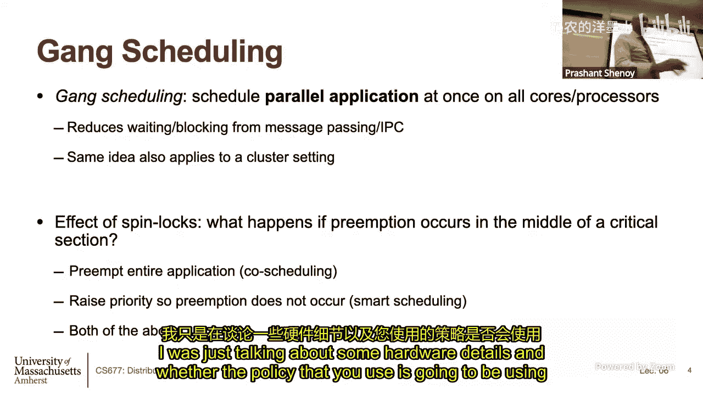

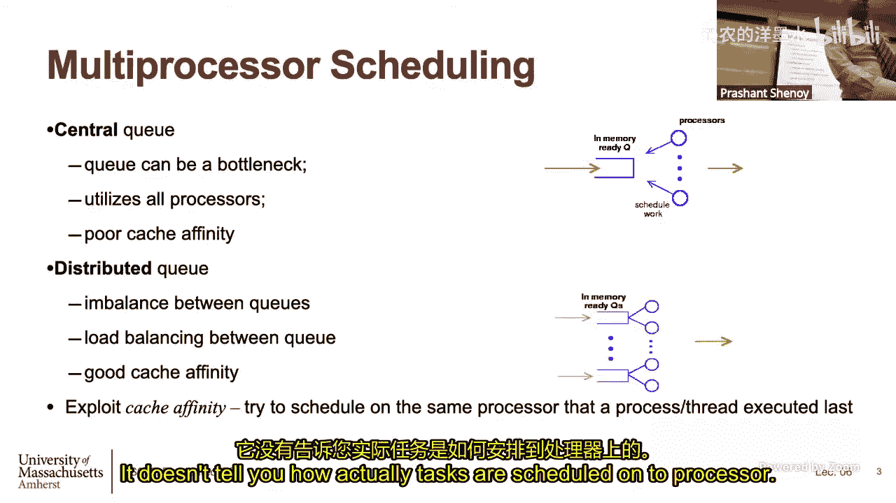

Im all at once on end course。Okay， so this kind of you are coordinating what is running on all the core that actually gives you better performance than if each core independently decides what runs on that core。

😊，The reason coordination and trying to run them as a group or a gang which is why it's called a gang scheduler is because it actually reduces blocking over it because when these threads communicate let's say thread one sends a message to thread two if thread2 is not executing then that you have to wait for that thread to actually run before that message can even be processed but if they are all actually executing at the same time when you send these messages back and forth they can be processed immediately because the thread is already executing or the process already executing so it reduces blocking over it when you have message passing or IPC but it's a very common approach used for parallel application。

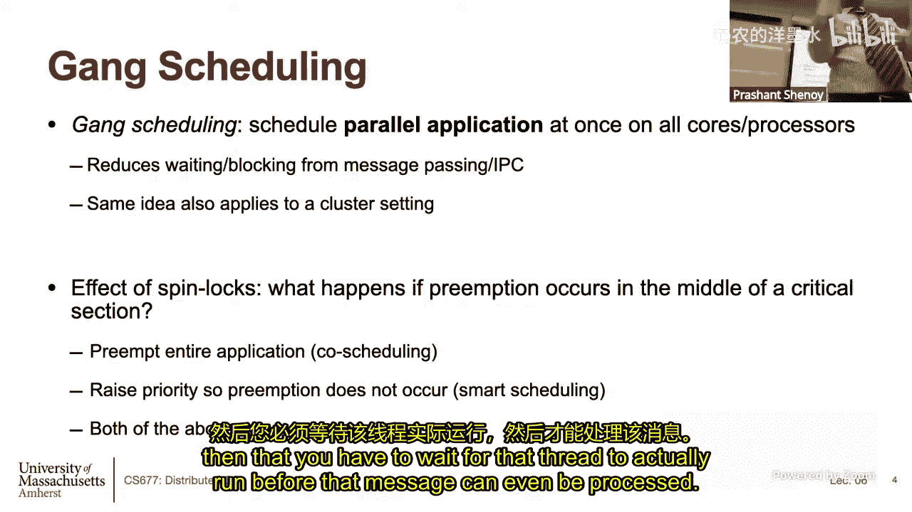

So， that is something you want to keep in mind， but there are some lots of issues you have to deal with when you try to implement gang scheduling algorithms。

 one of them is what happens if one of the thread of that gang blocks or any of them running one of them does IO。

As soon as you do IU， that thread is going to bh， but the others are still executing。😊。

Or should what should be done in this case they will let continue execution or should you say one thread blocks。

 lets just assume that the quantum has ended and just you know have all of the threads go back to their queuees and schedule some other game。

So either of those two approaches work so you can either preemp the entire application that's called Co scheduling if any thread blocks because it's trying to get a lock or is trying to do IO you will essentially deschedule all the other n minus one threads that are running on other processes so that there's preemption the other thing as you said know maybe you don't do that you essentially ensure that the others can continue to run until the quantum expires in this case if there's any messages sent to threads that are blocked that will still cause performance issues so there are both flavors of gang schedulers that are out there but just something you want to keep in mind as one example of multiproces scheduling where you are taking advantage of multiple course and trying to schedule different components of an application there could be threads or processes in a coordinated fashion all n at once onto to end course。

Is this clear？

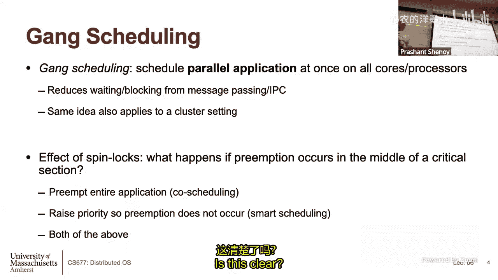

Okay， so。So that's all， yes。

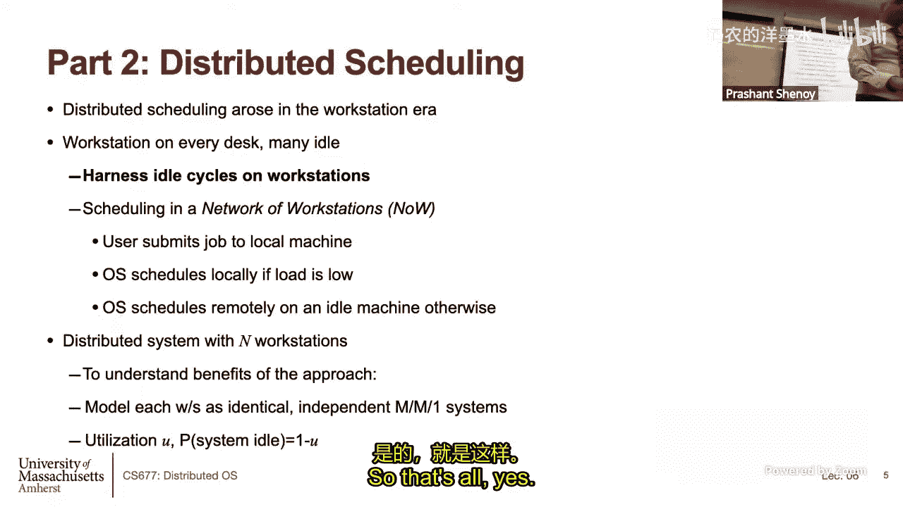

Yeah。What the question is what is the commonality between the in threads it's a parallel application so typically in a parallel application the threads are trying to perform the same task but is parallelist right so that's the general assumption。

好。That， that's。Yeah， the question is if I said you preempmed an entire application schedule another gang。

 is it a different application， in this case it will be a different application。

So that's the assumption。

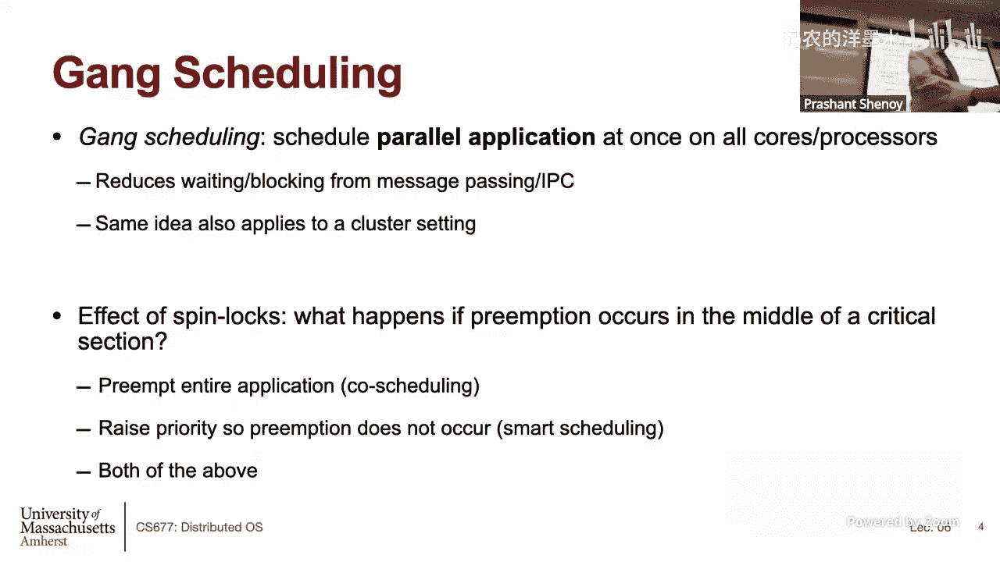

O。So we will move on， we will now switch gears and actually get to the real topic we wanted to discuss which is distributed schedule this is a distributed systems class or thread scheduling multiprocess scheduling is still scheduling for one machine。

But our goal is really to think across machines so now we finally got there well let's start thinking about distributed scheduling distributed scheduling comes in many different flavors so I'm going to first give you an really early version of distributed scheduling which was scheduling tasks on a set of workstations and then we will get to cluster scheduling which is distributed scheduling as it exists today okay but lets first start with how it  arose maybe in 30 40 years ago。

Yeah so to understand this flavor of distributed scheduling you need to have some background in mind so distributed scheduling actually arose when PCs and workstations became common so you will assume that every user has a machine on their desk。

Yeah this is the environment you want to keep in so we are let's say you are in an organization it's either a company or maybe it's an academic department like the one we have here users okay have this is pre laptop right so we'll assume you actually are a desktop that is sitting on your desk now。

😊，We will also assume that users are not using their machine at all times maybe you have gone to class your machine is idle in your office or maybe you went to lunch and you your machine is sitting idle on your desk so so you will have some machines that are being used other machines that are not。

 so the question is。Can you hide so sorry， can you harness idle cycles on machines that are not in use and make better use of all the machines in the network？

Right。In particular。Let's say some machines in the network become heavily loaded because that the users of those machines just start running many applications on so the load on those machines goes up but there are some other machines in the network some other users machine just sitting there idL not doing anything then the question is can you take some work that is being done on the overloaded machine and move those tasks to an idL machine and spread the load around？

That is what well call distributed scheduling so the idea is that we will decide what tasks run on what machines in the network so that we can take advantage of all the machines in the network and specifically take advantage of idL machines that are not doing anything then they are not doing anything might as well use them to perform some computation that's the basic idea so the picture and I'll show you the approach the picture you want to keep in mind is the user submits a job or starts an application a local machine that's their machine the OS has to then decide one of two things the user starts a new job or an application should that run locally that's a normal case you start browser or whatever it runs on your machine so that by default it will run it on the local machine itself but if the machine is overload it and there are some idle machines in the network the OS can actually remotely run this job it can say why run it on this machine。

Let's start it on this other machine that's idle and run it there and provide the results to the user。

So， that is the decision and always us to make， should you schedule a job locally or should you schedule it remotely？

Is that clear now we will try to analyze this idea in a lot more detail to see how this is done when it is beneficial and so on。

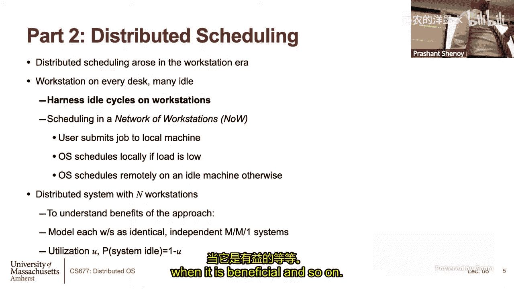

So the first thing we will ask is when does this type of approach where an OS decides to schedule a job somewhere else when is it beneficial at all and we will do a very simple analysis here there is no math here but you at least have to understand what probability means a probability distribution so to understand distributed scheduling we have to analyze this question the question is what is the probability that there is at least one system or one machine idle and there is one job that is waiting which means that it needs some machine to run。

What is the probability that both of those things are two at the same time？

That there is an idle machine in the network and there is a waiting job in the network。😊。

Is the question clear， whatever are we trying to ask？O。

So now let's try to analyze this question so we are not going to do a math analysis as we could but I am going to give you a more intuitive analysis of that problem lets assume that the system is heavily utilized system means all the machines the network are heavily utilized。

Okay， so we are now considering a scenario where the networks the machines in the network are heavily utilized and the question the first question will ask is if the system is heavily utilized what is the probability that does an idle machine in the network？

No。All machines are by default utilized so the prompt chances of finding an idle machine is low。

And we will also ask in that scenario， whats the probability that there is a job waiting to run？

because it' is heavily utilized， okay there is a good chance that the user starts another job and it needs some machine to run because that machine is overloaded。

OkayEx here。 So then they will say what's the combination of both of thoseex and operation。

 So because there。There is no machine that is idle okay the probability that both of those things are true is actually low so you will not get much benefit of distributed scheduling okay because if the OS scheduler says okay here is a job that needs to be uploaded to some other machine because the local machine is idle okay it will try to go find an idle machine。

It will not find any。Typically because the probability of finding a machine is low。

 so a distributed scheduler is not going to give you any benefit in this case。😊。

Because there are lots of jobs that are willing to run on some other machines because their local machines are right。

😊，But there are no idle machines to be found， so even if you implement distributed scheduling the OS when say I cannot find an idle machine。

 so I will continue to run the job locally。Was there nowhere else to run it。

That clear so in heavily utilized scenario there is little benefit to using distributed scheduling because the populator that both of those things are two at the same time actually will ended it becomes low。

😊，Will take the other case。We assume now a lightly loaded system。Okay。The question is。

 what is the probability of having an idle machine in the network？Then the Lord is low in the system。

It' is high because machines are lightly loaded or not used so there are many idle machines in the network。

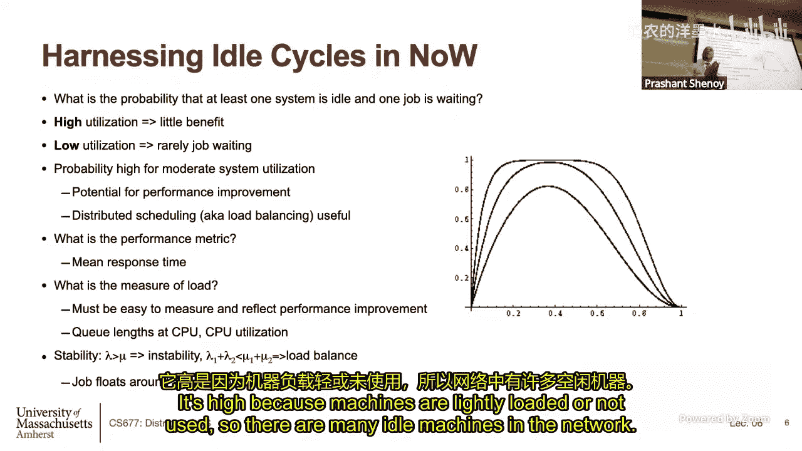

Okay， you so what is the probability that does a waiting job in the network？😊。

It's low because there is not much happening so as soon as you start a job， it can run locally。

 doesn't it have to wait。Then you say what's now the benefit of distributed scheduling？

so in this case the OS has no need to find another machine to run。

 there are many machines that are idle but there is no job that you will find that needs to run on them because it can run locally which is always the best choice right because your line load is low so you just run it locally theres no need to go find another machine。

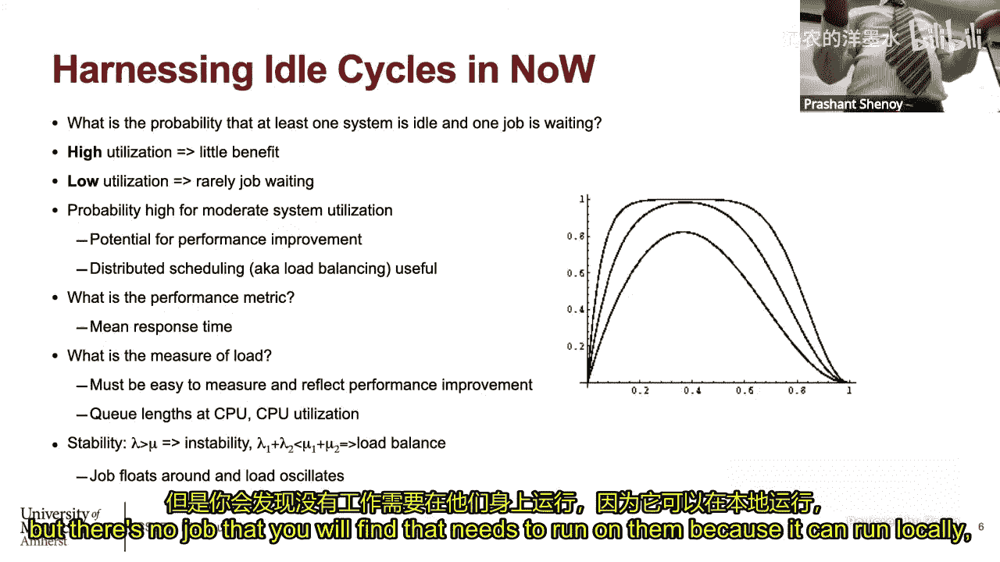

So in this case， there is no benefit to distributed scheduling either。😊。

Because now you have the opposite case where there are plenty of resources， idle resources。

 but no jobs to run them。In the previous case there are lots of jobs but no ideal resources to that were to be found so in both are those these two cases distributed scheduling of the flavor I just explained to you as little benefit。

Okay。Does that mean this is not useful？Maybe parts。

there is something between low and high can have something moderately utilized system so the only time actually this approach gives you benefit is when your system is moderately utilized neither lightly utilized nor heavily utilized and probability distribution that thing is actually shown here this is under different scenarios you will see that the probability both of those events are true at the same time is low and the load is utilization is the X axis is probability y axis so here it's low social thing no benefit here is low saying there's no benefit but in the middle it says that you will actually have benefit that you will have an idle system and there is a job runs or distributed schedulecheduling actually make sense so you first this basically tells you there are limitations even though this might all sound good let's try to use resources on all of the machines there are many scenarios that you will not find much use and you implement these types of approaches but there are some other scenario。

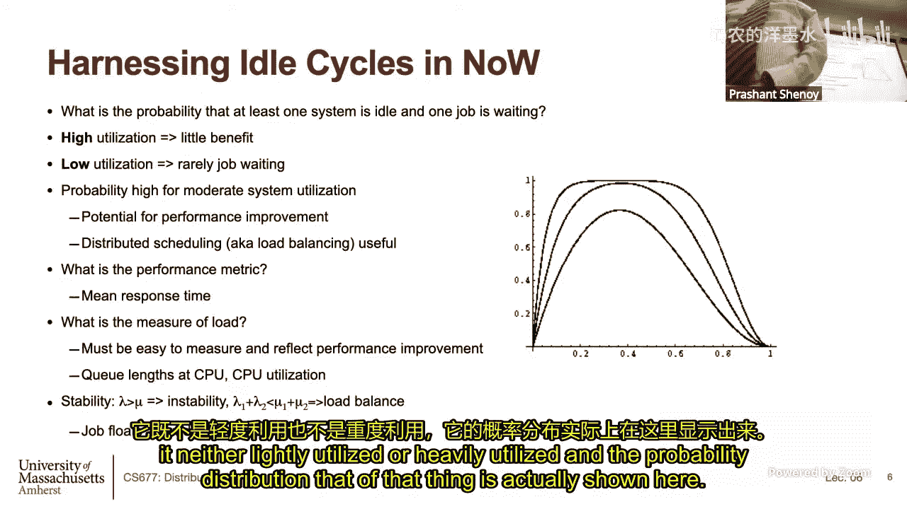

Where you will find some benefits and those are the ones where system is moderately utilized that is basically if you do this actual math analysis it will tell you the same thing。

 but I gave you an intuitive explanation of when these types of approaches are useful。Is that clear。

Now there are many details which I lost over but we really don't need to go into this which is what does performance mean is the mean response time how do you measure load and I say it's idL you can say okay it could de CPUpP utilization it could be the Q length there are many metrics it doesn't really matter how you define them the abstract definition of load and。

Whether there is a job waiting， regardless of what you pick。

 you will get the same answer at the end of the day。So we'll just go with that understanding。

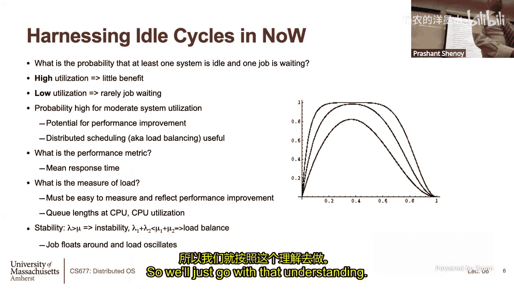

And now talk about actual distributed schedulers how do you build one any of these distributed schedulers for this network of workstation approach as four components there is something called a transfer policy it says when should you transfer a process to another machine。

That's called a transfer policy When should you when should the OSs decide this job should not run locally it should actually you should try to find another machine to run it transfer policy selection policy says which process to transfer the machine is overloaded here to send some process to some other machine。

 which one should you transfer of all the ones that are running on the local machine that's called the selection policy。

 location policy says where to transfer this job， which machine if there's an idle one。

 which idle machine or how to find that idle machine that's called the location policy information policy says what information should the OSs keep to make all of those decisions saying when to transfer the law job。

 which job to transfer where to transfer the job so theres three questions so there's when which you will。

So we'll see some example policies that tell us what to do for each of those cases。

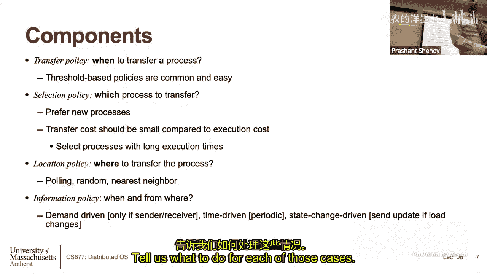

The first one is called sender initiated policy so sender initiatedator as the name suggests in the sender initiated policy the machine that's making all this decision is the sender it is the machine that's overloaded that's trying to offload work so all of the work of where to send it is all done by the machine that's the one thats sending the job to some other machine so the transfer policy is very simple you have some threshold of load or any definition of load load could be utilization of the CPU it could be the length of jobs in my queue that are waiting to run pick any metric point a threshold so threshold let's say 80% utilization that's my threshold the load is above that threshold then you decide to offload if the load is below you say run jobs locally。

Okay thats our transfer policy we just define some threshold of load measure on the local machine and decide to offload when you are above that threshold。

The selection policy says you always prefer to offload a newly arrived job to another machine or one that' is already begun execution and has partially executed something。

So if if you have a choice you would always take a new job and you would start running it somewhere else then take an existing one and move it plus taking an existing one and moving it is actually complicated it requires as OS to support something called process migration which we haven't looked at yet but I'll mention it in a couple slides okay that's more complicated to move a running process is much harder and if I just type the python command on my terminal I just take that command and execute it somewhere else much simpler than actually taking a process and moving it okay so selection policies as whenever the load goes about threshold pick a newly arrived process and move it location policies now has to pick a machine to actually run this job that you just chose so there are many examples here one simplest one is random a random just says pick a machine at random send the job。

If you pick well then maybe the job you will find a machine that actually can receive jobs its load is less than t so it will run it but if you send it to a machine that' is also overloaded it cannot run it and it will actually send it somewhere else so a job might have to hop a couple of times because you are randomly choosing based on no knowledge of what is the load on that machine。

A better approach is to say let's trust first figure out the load on the machine and then decide which machine to pick to send the job so you could pull machine sequentially until you find one that has a load under T or you can probe them in parallels and send the load information you get all of the replies back。

 you pick the least loaded machine that has load less than t。

 you can perform either of these two approaches but in either case you find a machine that has a load less than t and the job is going to be sent。

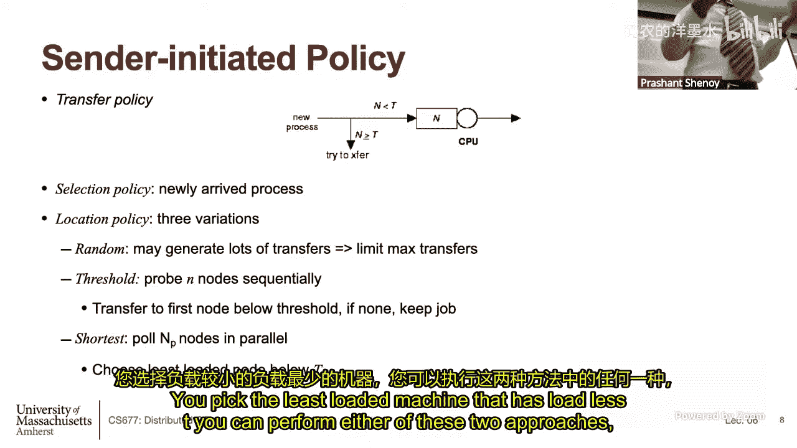

Okay， all right， so that's our sender initiated policy， any questions here。

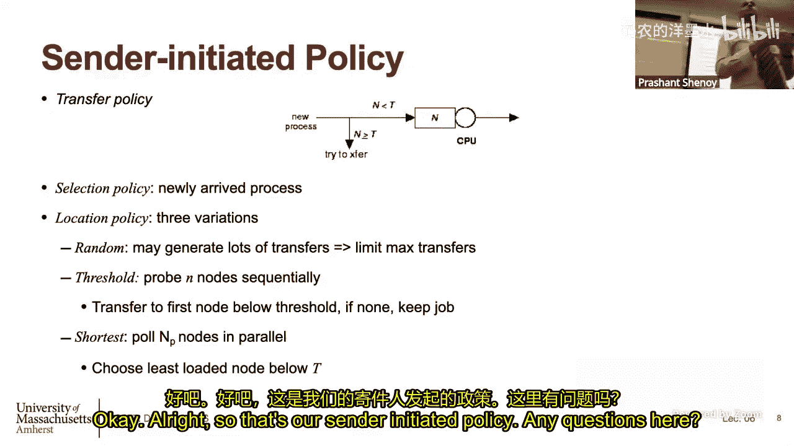

Okay so we will flip and say now we do receiver initiated so in receiver initiated when a machine either becomes idle or it has a lower load it goes around looking for work it goes to other machine saying do you have a job you want to offload in the sender initiated the overloaded machine right to offload jobs to other machines in the receiver initiated a lightly loaded machine goes around looking for jobs to take on。

So all of what we said。P is going to be flipped in this case so you will say whats the transfer policy a transfer policy is also a load threshold but its a low load threshold if your load goes below a low threshold T that means you have become lightly loaded you go looking for work okay you become a receiver in the definition of this part so your receiver means you are willing to accept jobs to so you become a receiver node。

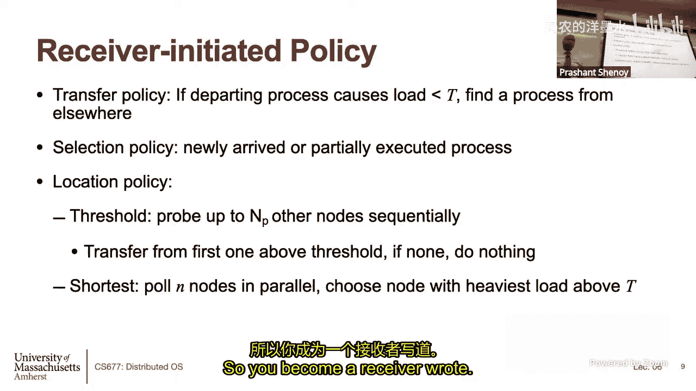

Wch just election policy okay you still prefer to execute newly arrived jobs okay but you can decide to take partially executed job if the OS supports something called process migration which again Ill get to but we still prefer newly arrived jobs just as the previous what's your location policy in this case the receiver has to go find an overloaded node and ask it to offload some work。

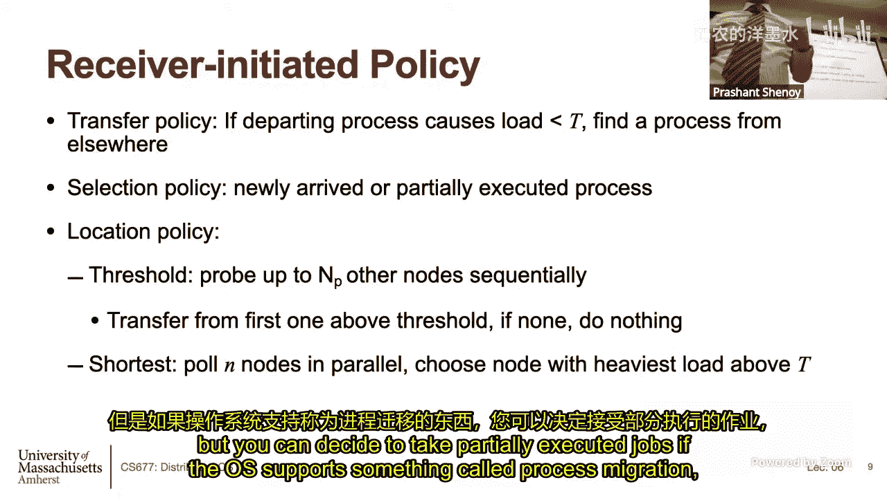

How do you find an overloaded node okay you could randomly contact node and say do you have some work to send okay thats a random policy okay you could again probe you could say ask some subset of nodes or all the nodes in the network depending on how large your network is saying send load information you get the load information pick the most heavily loaded node and then say send one job。

And you take that job over and you execute。So those are all approaches you can perform and you can probe sequentially。

 you can probe at random， you can probe in parallel and pick the least loaded sorry most heavily loaded and then take a job。

So， this is a receiver initiated policy or receive nodes become receivers when they become idle or lightly loaded and then they go take take on work。

😊，That clear。

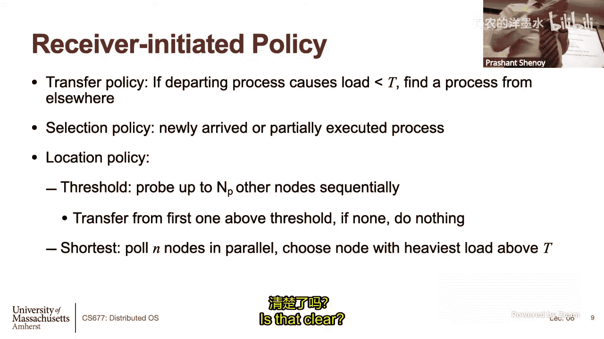

Okay， so building on from there you will now look at a symmetric policy in a symmetric policy you say why have one or the other。

 lets have both。Okay so so now there are two thresholds there's a low threshold and a high threshold if a node has a machine has a load that's above the high threshold it's a sender it's trying to actively find nodes offload work if a node has load below a low threshold it's a receiver it's also going to go around actively looking for work so you both of those policies actually operating at the same time the senders can actively offload work or a receiver can go and pick some work from some other node so two of these threshold you can be a sender a receiver or neither if you're somewhere in between the low and high threshold youre neither looking to offload work nor looking to take on work because we're neither a sender nor a receiver if you're in between but if you're above or below the lower or high threshold either going to become a sender or a receiver a sender or a receiver you do exactly what we said in the previous two slide okay senders are going to try to send work theyre going。

Go looking for a lightly loaded machine trying to offload work。

 receivers are going to go hunt for work。They're going to go around looking for a machine to off work and so can both senders and receiver can pull figure out the load another machine。

 ask them to send work or accept work。Depending on whether they're send or receiver。

Okay so now we merge those two approaches into a symmetric policy where you have a distributed scheduler the OS。

 depending on the load on that node can either become a sender trying to send some jobs to some other machine or a receiver accepting jobs of other machine。

That clear， okay。Okay question that's a good question question how are we going to decide the threshold typically the threshold can be configured by the system administrator yes that depends on how many machines you have and how aggressively you want to send or receive work so its not a there's no magic number how do you decide it you can choose it based on some notion of how heavily loaded a machine must be before you want to send the work code。

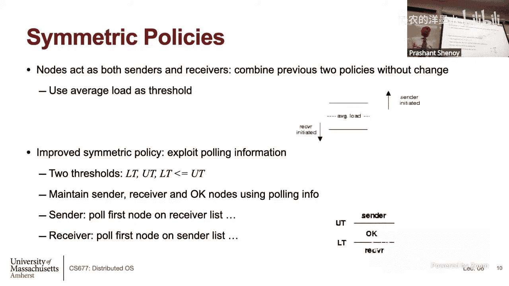

No one answered to that question。Okay so those were abstract policies I didn't give you much details and so on。

 but now we look at two systems that actually designed some of these in the early days this is where some of these policies came from and they will see how they specifically implemented some of these approaches because we look at to and then we will generalized from there and look at several others that have adapted them in different ways the first one is the V system which was designed in Stanford this is all 1980s were 40 years ago this is when some of these approaches were first designed so if you read the papers there from the 1980s or early 90s said this so the V system was one of the early ones that's name of an operating system whether an early one that designed a distributed scheduler for a network of workstation so it had what was called a state chain driven information policy which means that whenever there was any significant change。

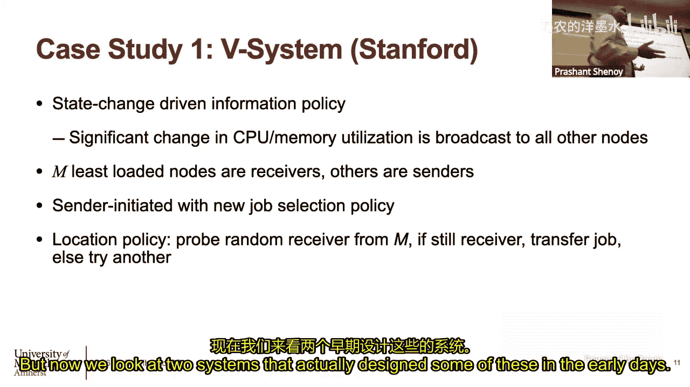

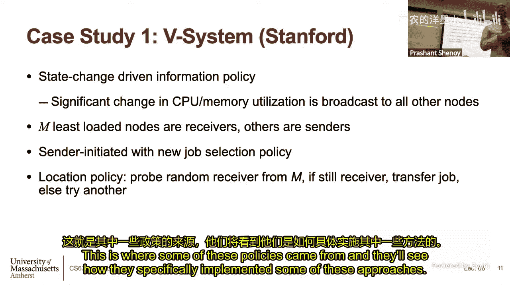

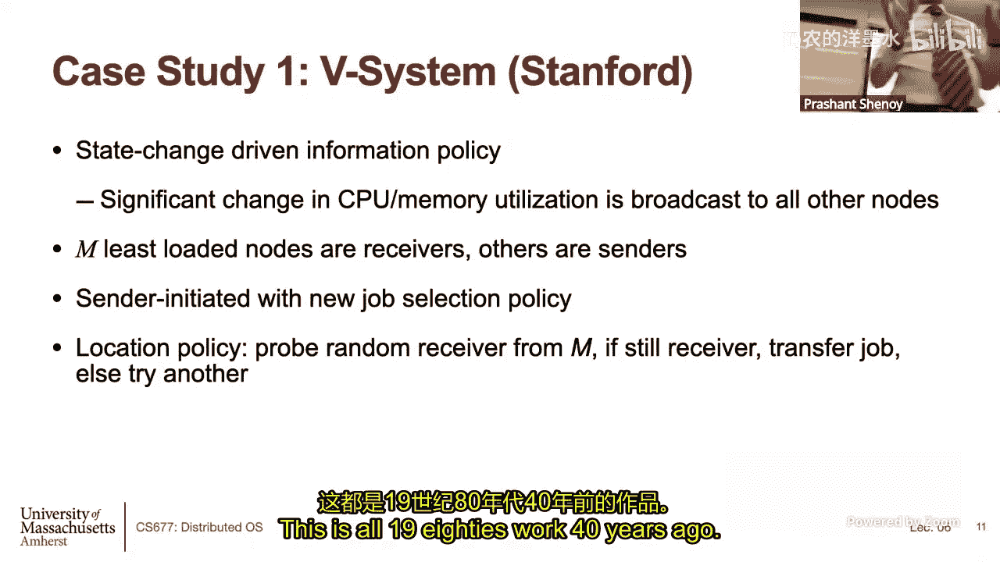

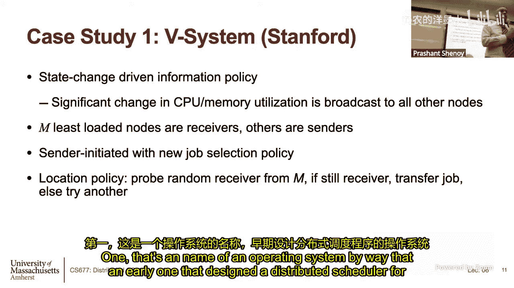

In load on the machine that machine would then broadcast is load information to all other nodes。

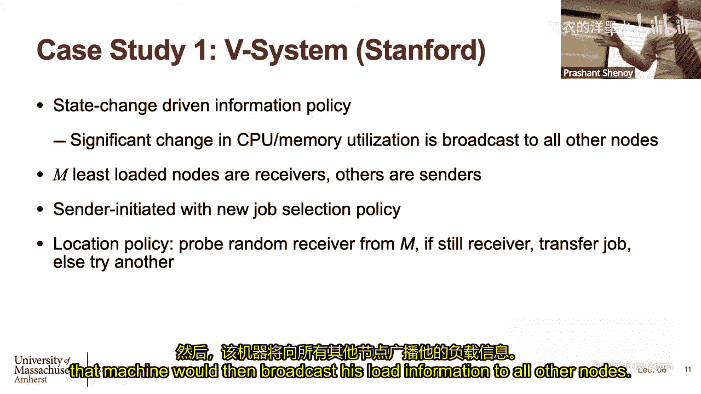

So basically you would be receiving broadcasts of any important changes to load on other machines。

 what that also means is each machine already had a table that told you what the load on other machines was。

Okay， so in this case， if you are a sender or a receiver。

 you don't have to go ask other machines because nodes are already sending their load information to you whenever there is change。

😊，So， that is a decision they make made and then we say the m least loaded nodes are receivers okay others are going to be senders and then it you implemented a sender initiated policy which basically use that load information to find the least loaded nodes which are the m so least loaded and then you pick from1 so essentially think of you have a table that started by load you pick lets say m is5 you pick the5 least loaded nodes in the system。

If you become a sender， you are going to pick the top five entries and from that top five entries you are going to pick one at random and then that is the machine you are going to just send your job to。

Is that clear？question why do you send to M machines you're not sending to M machines。

 you are picking one from the least loaded M machines to send to。

So M least load so you have a table with load information it sorted pick the top m which are the least loaded machine from those M you pick one at random and you send it to them。

So you can say why did you pick one at random， why did you not pick the lease loaded？

Wouldn't that have been better？Why what should we do。

Something little more complicated than why picked the least load at send the yes question answer。

 sorry。You want answer to the question。Have a slight delay。都。然后。

And then everyone tries to that one know。Yeah so I think if you send if you just pick the least loaded and try to send jobs。

 there are multiple senders in the network they might all suddenly off their jobs to that one node and it becomes heavily loaded but if you pick at random the assumption is that different senders will pick different sub nodes from that list of M and then that automatically distributes the load without doing any extra work。

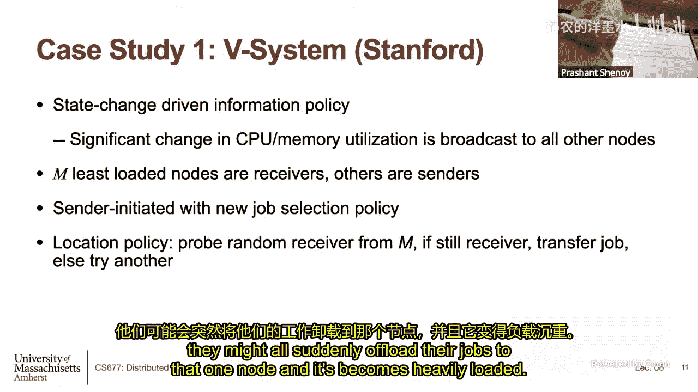

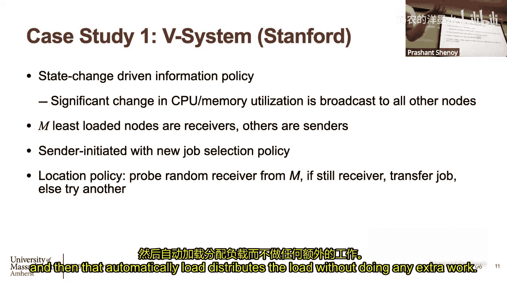

So this approach， because your M is still a small number。

 is distributing the load that the senders might send。

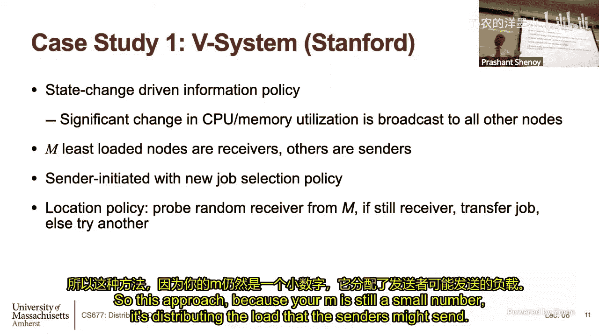

To the receiving notes。So that's the reason they pick the randomized policy because this is actually a good thing。

 it should not do least loadeded because if many senders send you the machine no jobs to run。

 then you do not have the benefit of being the least loaded again。

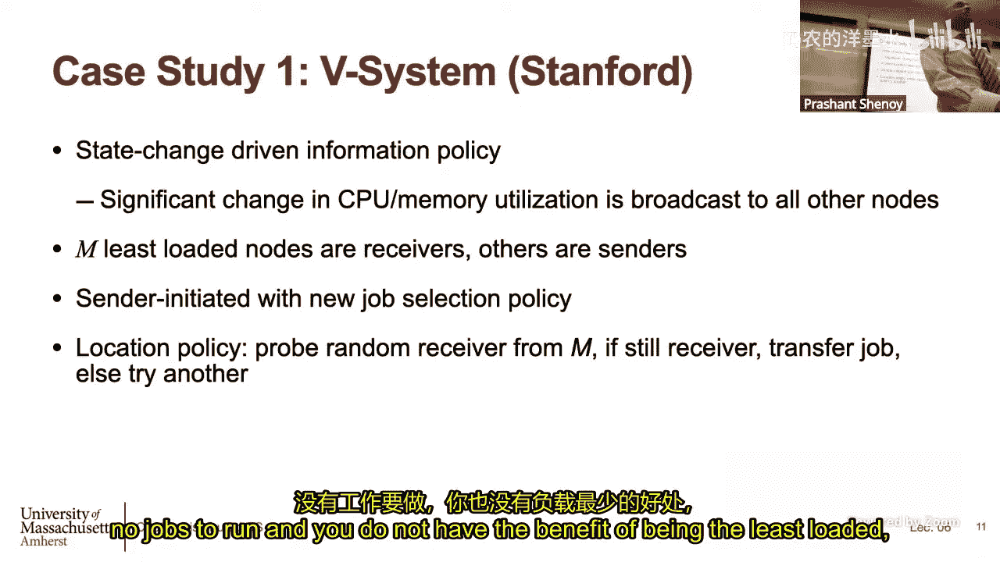

Okay so that's the V system we'll talk about another one it was the sprite operating system this was actually designed more or less at the same time。

 but this was a project at Berkeley also in the 80s and the 90s。

So this was very specifically designed for workstations so some of what I was talking about earlier actually came from design a sprite operating systems so it assumed users that workstations workstations are just powerful PCs at that time and the assumption was each workstation had a owner。

That owner has in not that you bought the machine， but you are the primary user of the machine。

So and the idea was you should respect the owners of machines so what does that mean so it means that so you go to lunch right your machine is ideal it becomes a receiver okay and then then some nodes offload work it now becomes heavily loaded you come back from lunchtime a machine is heavily loaded and you cannot do any work because its so much load that you cannot get your work okay that's not a desirable situation for a user because you are letting other users use your machine while you are not using it but then you come back and you can't use your machine because too many other users send jobs to a machine then you will not be happy and you say I do not want my machine to be used by others。

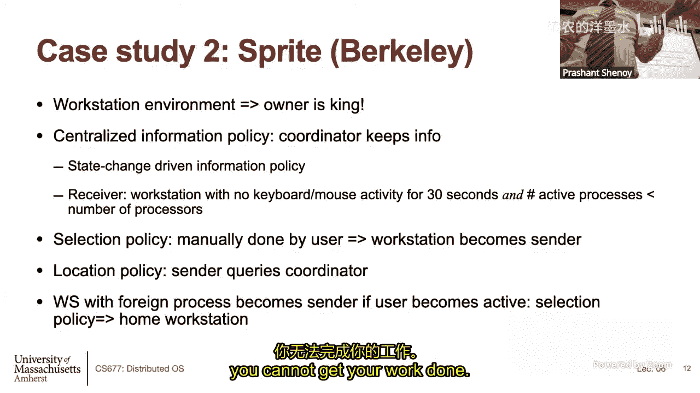

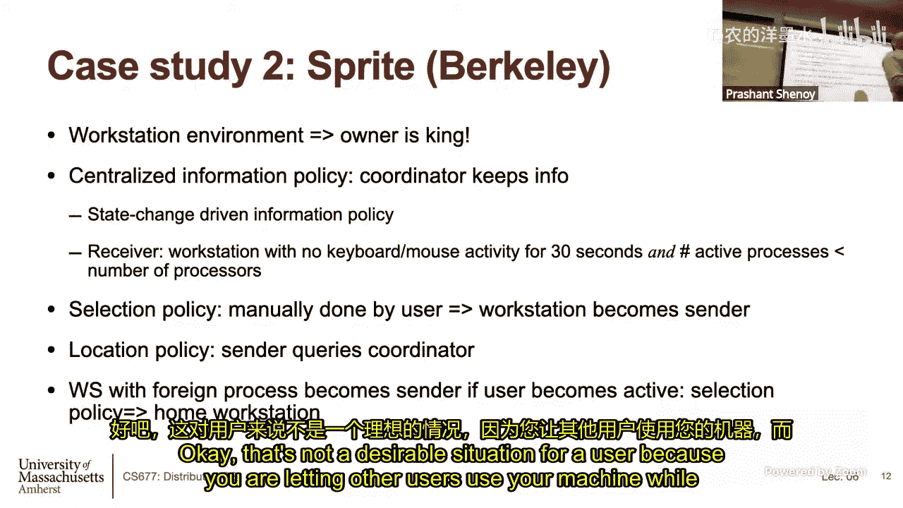

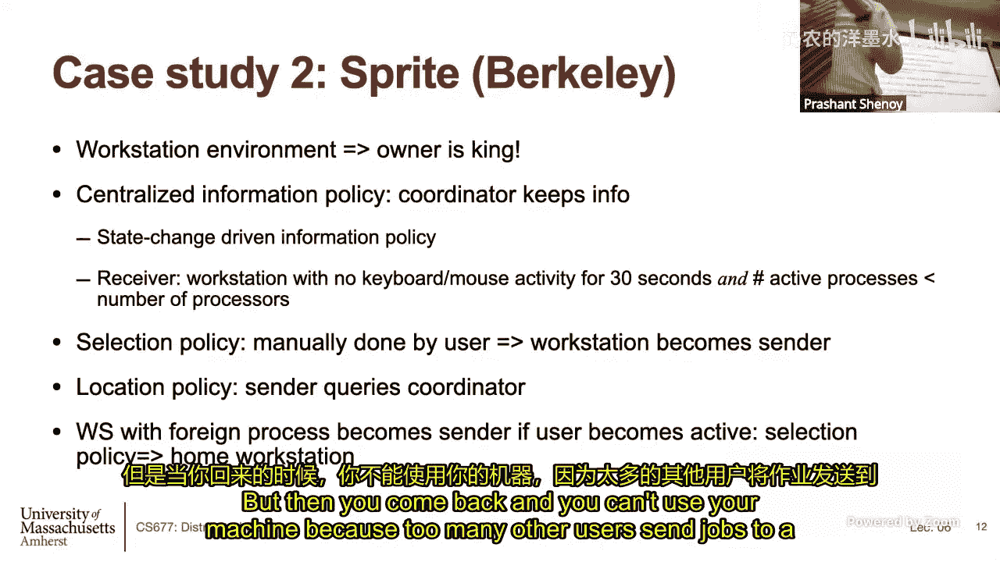

So you want to actually respect the owner so that' is why it means owner is king or queen depending on however you want to think about it。

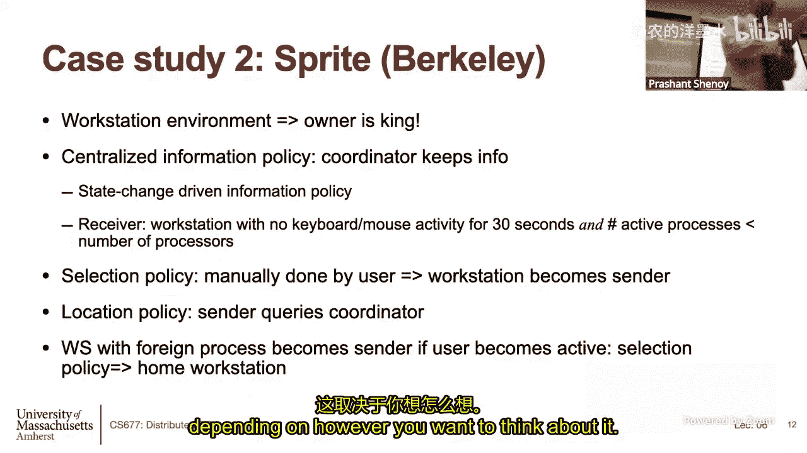

RightSo we want to ensure that users are not inconvenienceient even though they are donating some time on their machines to other users by accepting their jobs so you'll see how that is done first thing is let's try to go through our approach and look at how things work so in this case so rather than in the V case remember Stanford V case load was broadcast to all of the machines so each machine had a table which said this is the load on the machine in the sprite case there was a coordinator so single machine that was a coordinator all the load information or sent to that central coordinator。

So the coordinator and only the coordinator actually had knowledge about the load on all the machines。

😊，诶。So so that is what was the information policy and it was still state change driven what that meant was whenever the machine had no activity for 30 seconds。

 no keyboard， no mouse activity for 30 seconds and the number of active processes is less than the number of processors。

 which means as at least one core that is idle， you became a receiver。

Okay so you say is the user using the machine how do you check that you say is there any mouse activity is there any keyboard activities there's no mouse activity no keyboard activity for some amount in this case that shows 30 seconds but you can pick any number and the number of processes on the machine is less than the number of core that's a lowered criteria you became a receiver。

and then you essentially decide to take on a job and then that job actually runs on that mission。

 however， because we want to respect the user， okay when the user came back if you are already a receiver and you're running some foreign job and if the keyboard or mouse activity resumes on that machine。

 you immediately suspended all remote jobs。And gave the machine back to the user。

So jobs are only running on the machine while it is idle and the user is not using their machine okay as soon as the user starts using the machine again。

You restore the machine back to the user the way you do this。

 you will suspend all jobs that were sent and you will actually move those jobs to other machines。

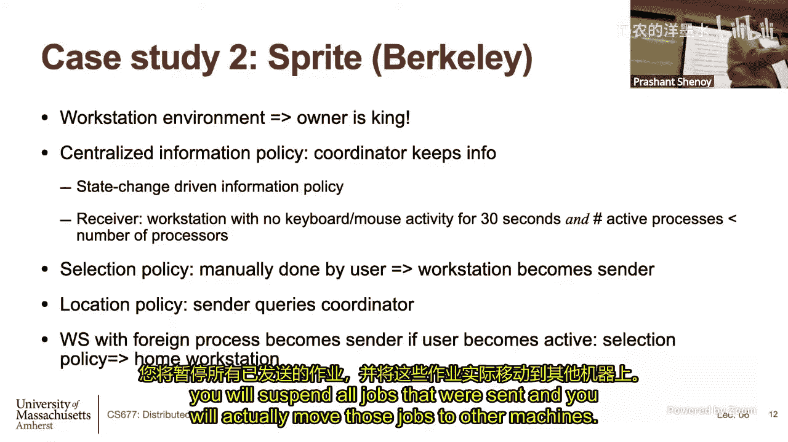

now you become a sender and you say here are jobs that are partially executed。

 they need to run on some other machines for to complete so youll find some other receivers and send them there okay but to do this。

You actually have to now take partially executed processes and then send them to some other mission that is not trivial that requires something called migrating a process which well talk about。

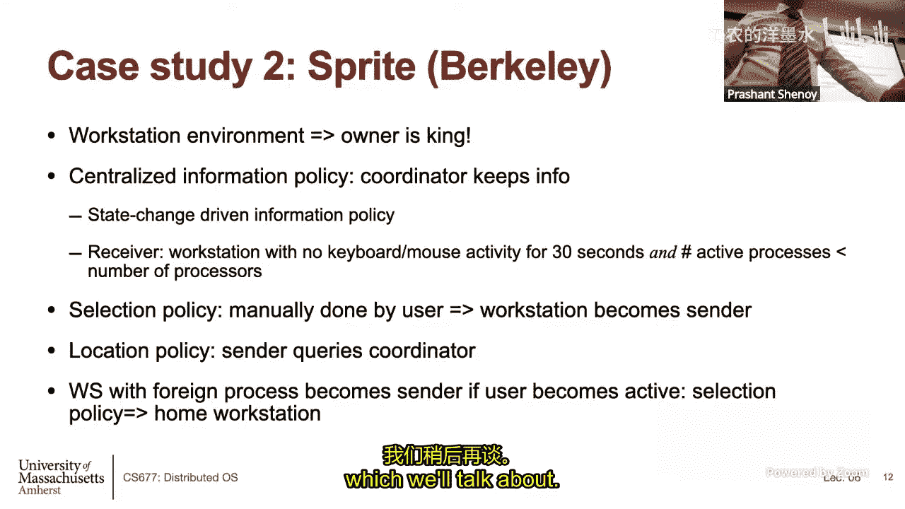

So process migration was first actually invented in the context of the sprOSs and this is why they actually came up with it because they wanted to restore the machine back to the user but now there a job that is run for an hour maybe it just 10 more minutes of computation to go so if you kill the job and restart it somewhere else you are to redo all of that one hour of。

So what you are going to do is you are going to suspend the job。

 you are going to move that job to some other machine that has light load and you are going to resume that job there。

 but that is easier said than done because it is an actual executing process。

It not something that you can do trivially so what you actually have to do to do process migration is first you suspend the job and you take the memory counter the address space of the job。

 you transfer all of that memory to a new machine。you transfer the registers of that job to another machine。

 you transfer all of the state of that job to another machine。

 okay you instantiate a new process on that machine that incorporates all of the state and then you resume the job which was suspended。

 you will resume it exactly where it started and it starts again。

It is a much more complicated process because it involves taking an active process and moving it somewhere else even today you will not find typical operating systems supporting this functionality we will see how to do it in some other context next time。

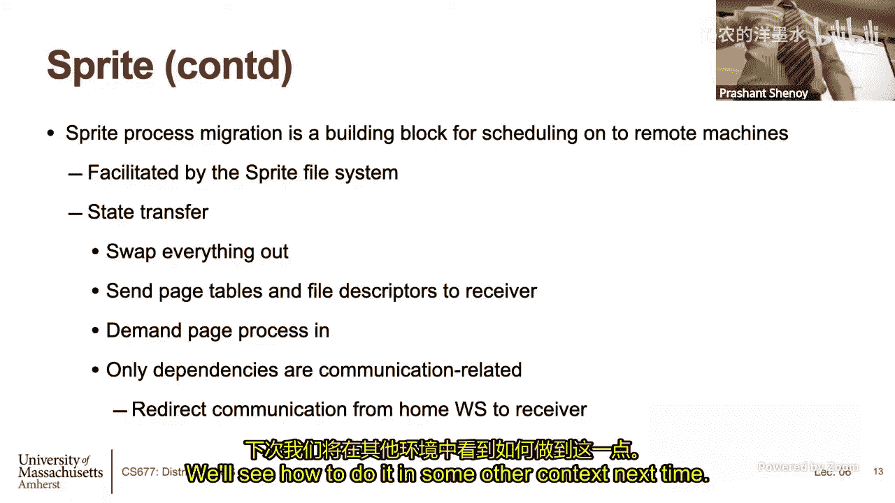

Like virtual machine， but process migration， not a straightforward process。

 but the way you do it is youll suspend。which means that the process will not stop executing now it is frozen and you will take all of its memory state。

 register state， everything you will move it somewhere else and then it appears exactly as it was on machine A appears on machine B you create a new process for that migrated state and you resume it。

But there are many problems with this approach because you can say what if the process was doing IO it was actually reading or writing a file on that machine have you moved it to some other machine the file is still on the previous machine right so if start doing IO here that IO is going to fail。

Now even more complicated is what if that has an active network communication theres an active socket communication just communicating with yet another process now we moved that process here the other process that was communicating to the process doesn't know the my process migrated it will still start communicating with the process on the previous machine and find that the process disappeared so all network connections will break all file IO will break this is why it's complicated any IO network IO or network communication file IO doesn't work very well with process migrate but if you didn't have open files you didn't have active network sockets which just doing some compute in memory you can move that process and start executing it somewhere else and it works fine but that's not a general solution because typically if you don't know that the process might or may not do file IO and things like that so it is much more complicated to actually implement this seamlessly。

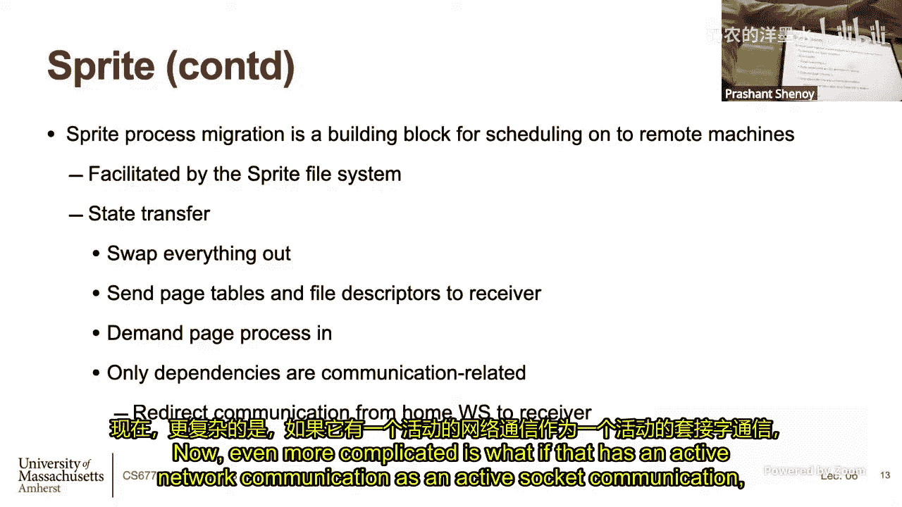

But they did implement some version of it， it worked fine okay and this is how they said your users get back their machines as soon as they come back。

 which is migrate the process。嗯。Okay the question is do they migrate processes that don't have IO so if you limited to that then you cannot migrate many processes so the assumptions you can make some assumptions for you can assume that if you have a migable process it should only do IO to a network store where the file is not local to machine is on some server so that server is accessible from some other machine so it can continue to access the file if you make assumptions of this start you can still make it work but if you are doing local file I of course it the process will just crash when you move right。

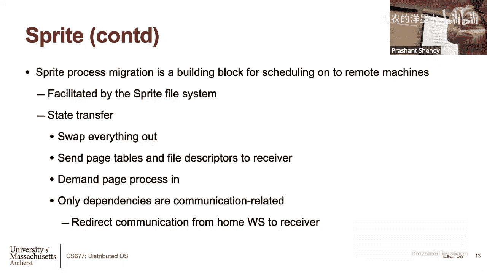

Okay question is is a coordinator doing only these jobs and not other jobs so the coordinator what it does is it keeps track of the load if you need to find a machine to run things on it knows the load so it will say run this job there and so on so it's kind of coordinating where jobs get to run or if there is a suspended job because the user came back it will figure out which machine to migrate it to and so on。

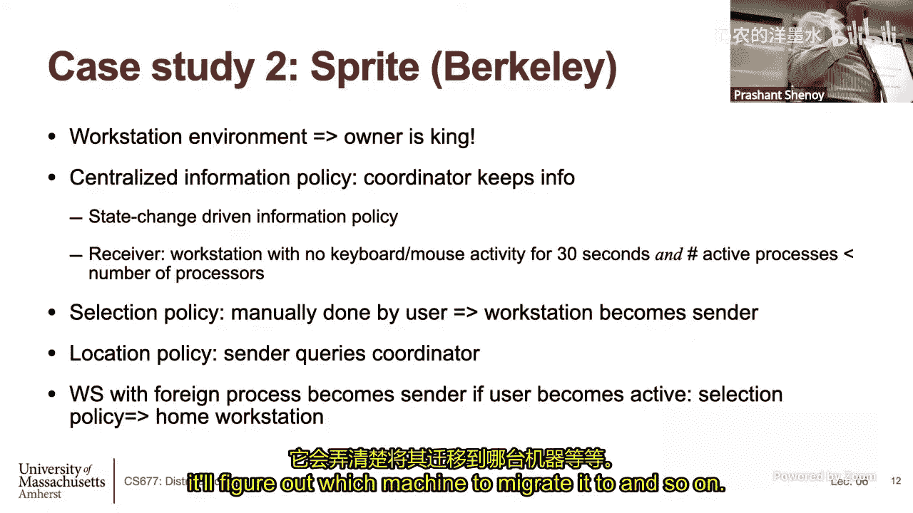

明。Yeah， if you have IO， this doesn't work， it will just not work because the network connections will break and so on。

 but we'll see how to solve that problem next time。Yeah。

That the early versions did not address some of these issues。

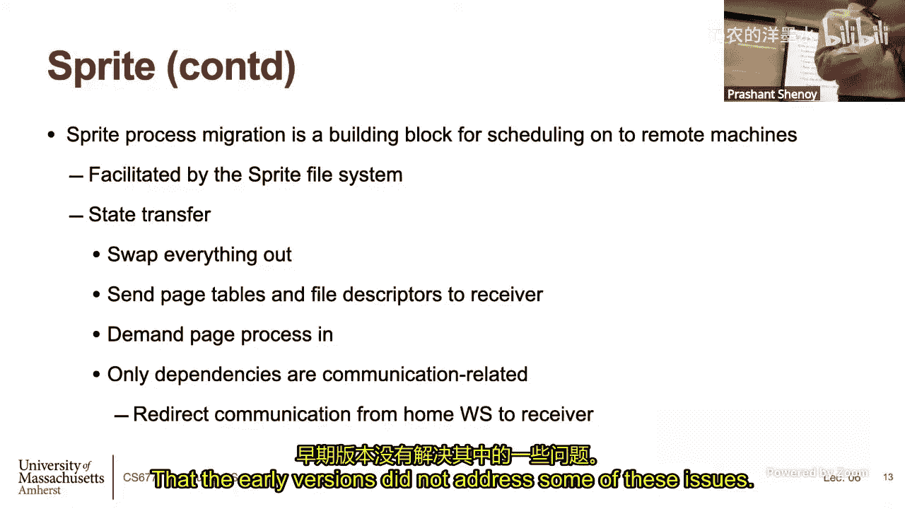

All right so moving on we took at four or five different approaches there's another system called Conr which actually is still in existence today so Conor was a system that was designed at the University of Wisconsin it also initially started off as let's try to find idle cycles on a set of machines and today you can actually run Conr also you can if you have you and your friends have set of machines you can get Conr day and run it and when you submit jobs it can actually move things around back and forth so you can take a set of your machines and your friend machine and turn it into a small cluster。

And idea was very similar but it was designed largely for bad jobs not interactive jobs so if you large bad jobs you submit it to Con Conr will actually go and figure out is there an idle machine to run it on if so run it there it actually later versions of it substar supporting process migration the early ones actually did not do it because it also took the ideas from and say the user returns to their workstation。

 suspend a job and migrate so this migrate part only works if the OS can help you do process migration otherwise what you do is you suspend a job terminate it and restart it which means you throw away all the work it did you restart it on an idle machine and hope that it will run there before the user comes back。

So this is a system the reason I'm mentioning this system is it is it was developed a little bit later after sprite came about but it is something that is an active project sprite and the system we are long gone they were designed 40 years ago and the projects ended long ago but this system is actually is still in use。

When your environments use it to implement scheduling on not on servers。

 but user machines yeah you just harvest user machines idle cycles and use that to run all kinds of jobs。

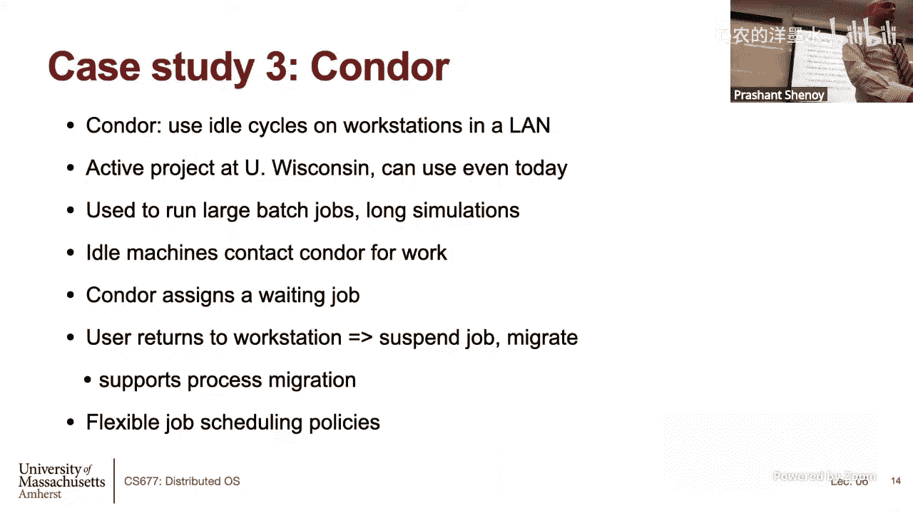

Okay， so I'm not going to say much about Conor because most of its ideas were derived from previous systems that I already discussed。

 but instead I'm going to talk about other interesting use case here。

 which is called volunteer computing。So the idea of volunteer computing is can we try to use idL cycles on PCs at the scale of the internet so you are lots of users on the internet internet is a very big network hundreds of millions of users or machines connected or maybe even billions at every time so question is can we actually look for idle cycles on all of these machines and somehow make use of them in other words can we run really large jobs on tens of thousands of machines on the internet all at once because there are if you have millions of machines there are maybe be thousands and thousands of them that are id at any time can we make use of those resources that was the idea behind this approach as the name volunteer computing suggests you can't just go and run your job on some strangers machines somewhere on the network that's not a thing right so you want what you want instead is users to opt in they want to volunteer。

There are a machine saying， okay， I can let。My machine cycles be used for something that is using that to do some computation okay and then you can essentially get jobs whenever your machine becomes idle and then run those the way it works is if you decide you want to volunteer your machine you to first download a piece of software from that volunteer computing site which is usually a special screen saver。

 so when a machine becomes idle， the screen saver will activate。😊。

You know what a screen saver is right so this this is not our usual screen save that was just going to show you some pictures this screen savever is a special piece of software that is going to connect to a server somewhere and say machine has become id send me a small job。

😊，And the idea is it has to be a small job so the machine will send it some small job it will do some computation send there isn't okay the screen savever is still running it'll send now send me an next piece of the small job and you will continue to do this and then when the user comes back the screen save automatically deactive that's how screen save works and then you just stop running that job because it's a tiny job you just throw whatever it is not finished you don't care about migrating it or anything because these are small jobs so you just throw it away and then the user gets their machine back。

That clear。Now youll say why would you ever do something like this why why my user trying to donate mys now it turns out that there are lots of big scientific projects that need cycles to run this original project started with the project that run the astronomers it was called setti at home set is an acronym for search for extraterrestrial intelligence so what they are doing is they had lots of data from radio telescopes that are just listening to signal from the sky and theyre looking is there any sign of aliens in that is there any actual signal or is all noise so your data is you will just take a small piece or the signal and say do you find any interesting patterns or it just looks like random noise so you are just scanning lots and lots of data to see is there a pattern there is this something interesting in the data or is noise and almost always the answer is there's nothing interesting there so。

Really wasting a lot of cycle trying to find a needle in a haystack type situation where you don't find anything right now because the work is so wasteful because not finding anything。

 finding real big GP clusters or CPU cluster to run this job is not feasible because youre just burning cycles and getting no useful result at all。

 almost always answer no there's nothing useful in the data that nobody's found agency。

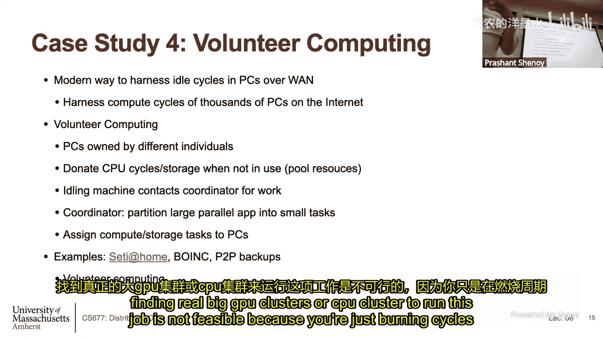

so so so what did those astronomers who said lets us users to donate their cycles on their PCs rather than running this on clusters and you have to pay for it。

 you will do it for free。Users will donate their cycles you'll just then a small piece of data look for something in there and get back an answer and that's how that project started and since then lots of other projects started like trying to do let's say doing some research trying to find let's say a new drug disc you're doing cancer researchre just searching through lots of data sets trying to find some pattern same kind of problem it's really hard to find anything useful so often the data does not reveal an interesting pattern but it's a worthy cause you might say okay I want to contribute some cycles of my PC for helping cancer research seems like a good thing to do so I'm going to go to that site and download the screen saver and whenever I'm not working itll do some work in the background that's fine so this has become very useful for lots of scientists because they get lots of users on the internet justnoting devote not deving donating that PC time。

Or doing something or the other that they find caused with。That' is called volunteer computing。

 but if you think about it， it is basically doing distributed scheduling at very large scales。😊。

Tens or hundreds of thousands of machines at a time and the idea here is the machine is basically activating a screen saver is becoming a receiver going to some central location there's lots of data thats been chopped up into small pieces it gets some small piece it does some computation on the piece signs back there is okay if it still as the screen save will get the next piece and so so you need jobs that are embarrassingly parallel that can be parallelized and spread across tens of thousands of machines because you can partition them into small pieces over and then spread them。

But this one evolution of the ideas we talked about， which is。😊。

In the previous case you could think of you as a user were donating your machine time to other users separate put your friends in your organization here you are doing this at internet S。

Okay， so that is volunteer computing and that' is going to bring us to the third part of the lecture。

 which is distributed scheduling as it exists today。

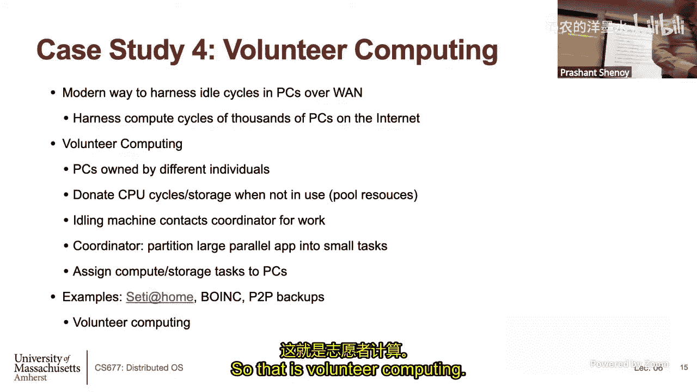

whichch is we are now going to move from a world of PCs and work creations to world of servers。

And we are going to see how are you going to schedule jobs across large sets of servers in a distributed manner okay so that brings us to cluster scheduling so essentially today's world machines are cheap so not just PC are cheap but machines are cheap so rather than looking for idle PC well just buy a bunch of servers and then you'll call them a cluster and users will submit their jobs to the cluster and the cluster schedule will say I'm going to run that job on this server or some other server so that's the job or the scheduler is still trying to find a least loadeded server or an idL server to run a job but this is a dedicated cluster that're just running jobs for a set of user now we'll see two types of。

Applications and the types of approaches might be slightly different so one is you are doing this cluster scheduling for interactive applications which are basically web services those are large web applications requests are coming in you' are distributing them across a set of machines okay here a job is a single STTP request it not a real job like a big simulation it's a single request and you want to serve that request very quickly that's one type of cluster scheduling。

The other type of scheduling is a bad job it's the kind of job we are talking about so far longrunning job takes minutes hours days to run you just want to find some server to run it on and you run it to optimize for throughput in one case you're optimizing for response times web services means you want to respond quickly to users okay batch application means you want to optimize for throughput you want to run the maximum number of jobs on the machines and turn and improve their through。

So let's look at each of those。

Now， regardless of whether your job is a single HTTP request or a long running computation。

 this is the picture well keep in mind for our cluster scheduler。😊，So jobs are going to come in。

 theyll come into a machine called a dispatcher。Okay so the dispatcher will have a queue machine the jobs will come in and they'll enter the queue the job of the dispatcher is to basically send each queued request or job to one of the worker nodes okay in this case the worker nodes are actual machines so the dispatcher will run an algorithm that'll say where should I run the next job and you'll pick one of the workers nodes or servers here he'll pick one of the servers he'll send the job there job will execute they'll send back a。

noticeice that the terminology of dispatcher and the worker nodes is the same as what I was talking about last time you talking about multithreaded servers there was a dispatcher thread and worker threads here we are not talking about threads anymore these are actual servers kept the same terminology because dispatchers rating for requests and it dispatches the requests or other worker node so using the same basic idea but now you are doing it across servers rather than doing it for a pool of threads。

Is that clear okay so now with that picture in mind let's talk about some details here so well first talk about web servers okay I will come back to web servers I think in maybe a month and a half or so when we get to the web services topic but this is just about scheduling at this point we are not really worried about web application and so on the requests are coming in so we have a cluster thats serving this request typically use this cluster for very large websites large websites don't run on a single machine their volume of requests that is coming in is so high that you cannot serve all those requests using a single machine that' is just not going to work so you have to have a cluster of machines that are collectively serving your request。

Okay， is that clear？So here you have end nodes， one of them is a dispatcher。

And so the dispatcher is getting web requests and is sending it to one of the web servers that are worker node which serve the request and back a respond。

So you essentially are requests are going to arrive at the load balancing queue you are to now decide like always which of the nodes to send that request to you can use least loaded roundrobin and so on and so there are many approaches and you can pick one of them and then there are other approaches that are interesting here which is you can use what is called session level load balancing or request level load balancing so what do these things mean so if you think about how your web application typically or let's say you logged into your favorite shopping site。

You create what's called a user session。You can go， you can shop around。

 you can put something in the shopping cart， all of those operations are part of a single user session right until you either find something you buy it and you close the site or you do something else。

So if you do session level load balancing， what that means is a user session is mapped to a server and all requests from that user session or I'll go into that server if you do request level load balancing you say that each STTP request even from the same user session might go to different servers。

So that is a difference between the two and typically you want to do session level load balancing because sessions have state what you put in the shopping cart is the state of your session that has to be preserved at the server okay you put the something into the shopping cart and that is shopping cart is saved on one machine next request goes to some other machine that machine does not know what's in your shopping cart because that was state of the session which is stored in the memory of the previous machine so to keep state。

Information you want to keep sending requests from that session to the same machine this question is。

Okay the good question question is aren't the machines all replicas of one another and will the if I put something on the shopping car will not not be replicated that's your question yeah so machines are replicas but replicas just means you replicated the code。

It's the same code that's running but the memory is not replicated right so if I do something on this machine doesn't mean that all other machines will certainly get whatever it is in memory that's not a thing so your memory is going to be local to each replica so this is a state is not replicated the only way you will replicate that state is you have a database you don't keep things in memory but you put the shopping cart into a database if you put it in a database the other machine can go and take it from there recreate the state but if you keep it in RA you are not going to get access to。

哎。All right， so in any case session level load balancing is one approach。

 request level load balancing is another approach we'll come back and look at some of this in more detail this question。

Okay question is are the number of users limited by the number of machine right so you will have each machine is serving lots of users at the same time right so if in session level road balancing sessions from some subset of the total users are mapped to that machine some other user sessions are map another it not saying that each machine is only serving one user that's not what we are saying it is machines are going to be significantly powerful so they can serve hundreds or thousands of users at a time but all requests made by that user to the dispatcher always go to that machine so in this case a dispatcher needs to know that it mapped user I to that node so any subsequent request from that IP address have to automatically go there so all of that information has to maintain the dispatch。

我以说。

The user is that is why you' are using load balancing so you can look at the load and decide other sessions can be sent to some other machine right so that。

不水。Okay， we will read it。Yeah， the question is do you don't know how heavy user requests。

 these are all web requests。Right， so you can。T determineterine all the types of requests a web server will receive because you build the application so you can decide based on that what an average request load might be right and use those types of。

Profiling techniques to figure that out there are approaches。

 I mean what you're saying is a valid point， but there are approaches to deal with that。あ都没。

关。系多个个一。好。Yes。

对。Okay， the question is in the multi processorces case。

 we said that the Q as centralizedqs at this bottlene， will that not be a problem here？

So the main difference in the two approaches is in the multi processorcessor case。

 the OSs kernel ran on the processor and the OS kernel tried to pull requests from the queue。

In this case， the scheduler actually runs on the dispatcher node and it's the one sending jobs。

So there is no contention because of that it's not that the worker is telling send me a job。

 the dispatcher is the one that's sending the job so you don't have that problem in this case。

So question is can you do things in parallel that depends on the scheduler。

 but it doesn't really matter you can do things in parallel too in this case because there is no contention to deal with right you can have multiple threads that are dispatching requests etc。

Okay， so that is interactive we'll talk about。Bad jobs。

sameme problem now our jobs are no longer HtTP requests they're long runningning computations okay theyre noninactive jobs so examples are you have machine learning training job I have a big data processing job a scientific simulation they might take minutes hour some of them might take days and you want to then take this jobs and send them to a machine same idea as before right so you will essentially have the queue the queue is going to be at a dispatcher the dispatcher decides where to run the jobs and so on and there are many flavors of systems that are in use that have been built over the years there's a common one called slur that's basically an open source Linuxux based distributed scheduler it's actually an acronym stands for simple Linux utility for resource management。

so essentially it's a bad scheduler most of the supercomputing node actually use sLm as their distributed scheduler there are other commercial ones also like IBM has LsF and then there's something called load leveler and so on those do similar things but by and large what they do is they allow you to submit jobs to cluster the scheduler decides with jobs run it but there are lots of interesting nuances here instead of a single queue in that dispatcher that I showed you that dispatcher in bad jobs you can have multiple cues you can say this is a large cluster its used by multiple research group let's give each group its own queue。

Let's give each group a quota so that one group doesn't go and hog all the resources on the entire cluster right so so you can have group specific cues。

 you can have resource allocations for those queuees you can specify time limits you can have a long job queue and a short job queue if your job is short you submit it to the short job queue it runs faster okay long job queuees maybe because you want to give priority to short jobs long job queuees run take longer to run so you're longer job you put it in a different queuees so there are。

More sophisticated schedulers here more than one queue you can submit jobs to specific cues and then the scheduler has to make sure all of the queuees are serviced based on some policy so the policies here get a lot more complicated than lets just send to the least loaded or something like that。

Because you are going to order decide how to enforce the quota。

 how do you prioritize one type of job or the other short jobs or long jobs or if some group essentially gets a bigger quota。

 how do you make sure those jobs are actually given more servers in the cluster than the ones that are less quota。

 all of this has to be enforced by the schedule in this case。

and we'll come back to some of this again at a later。Any questions on this？All right。

 so we will actually end it here， we will talk about Meos and Borg next time okay and we'll also switch to a new topic。

