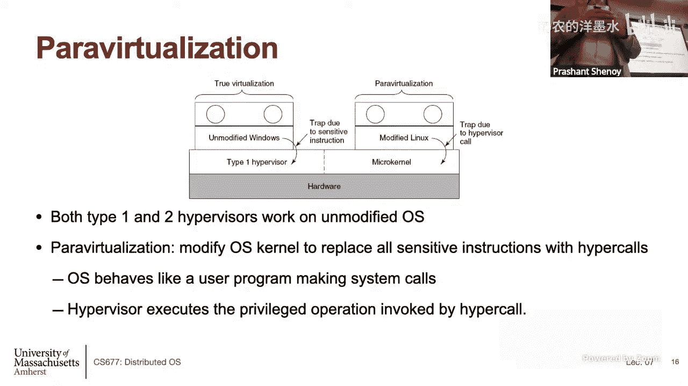
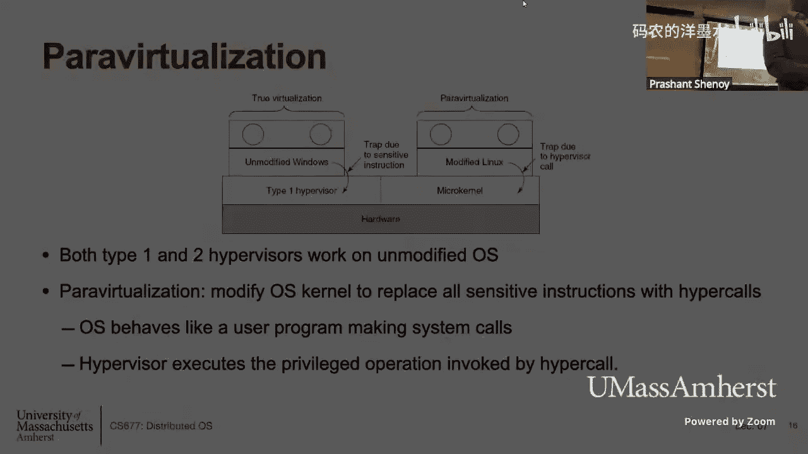

# 【全集 2025 附课件】马萨诸塞大学 分布式系统 中英字幕 p07 Lecture 7 - 虚拟化 -BV19BSYBuE4Y_p7-

So。Let's get started。So today we are going to start a new topic which is virtualization。

And I will have。Some initial introductory material to explain what are the basics will talk about the core concept of virtualization through this hypervisor technique at end we're talking about how do you use that idea to virtualize different types of resources but before we do that there are few slides I couldn't finish from last time on cluster scheduling so I'm going to do the last two case studies first and then we will switch to virtualization so so remember last time we we're talking about distributed scheduling I talked about scheduling in a network of workstations how to use the scheduling techniques to run jobs on idle machines and then towards the end I was talking about how do you use a set of servers or a cluster of servers and how do you schedule jobs on that cluster he said we have a dispatcher and one servers the dispatcher the other servers are workers。

request come to the dispatcher There is some scheduling algorithm that the dispatcher runs that decide which of these incoming jobs will run on with server okay that's the model you want to keep in mind and then we looked at several examples of case studies and so on sprite system we we look at volunteer computing and many others so we have two more to go。

 These are the sort of the more most recent and modern cluster computing scheduling framework First one is called misos it's an open source Apache project is a paper I'll make available that describe what misos does so it's a cluster manager but the way it works is it's a scheduler for multiple frameworks that might run on the compute cluster So for example if you take a large cluster it will run many different types of workloads you might run some bad jobs you might run Sp which is a data processing framework you might run some machine learning。

InTing jobs there are all different kinds of workloads that are being run on the cluster and each of these types of workload some has its own framework right for example if you do machine learning training you might use Pyar or you might use tensorflow if you have to process a very large data set you might use Sp or you might then if you do scientific computation you might use a bad scheduler each is its own framework that is taking jobs and then running them on the servers of the cluster now normally when you have this different types of workloads the conventional approach is you take the servers in the cluster。

You statically partition them into groups and each group of server is given to one framework for example you might say one third of the machines are allocated for machine learning claim okay 20% of the servers are then allocated to running spa job the remaining are allocated for bad jobs so you will take your server and you statically partition it and then each group is managed by one framework to run one type of work as the conventional approach but as you can imagine trying to think of the static partitions beforehand is not easy because you need to know what type of workload each of these framework is going to see where there will be more machine learning jobs or will there be more bad job you don't know this a prior so coming up with optimal partition sizes or the clusters is not an easy task so that's the problem that Nios was designed to handle so misos。

Essentially says let us not go with the static partition approach。

 let us figure out dynamically on the fly at runtime how many resources in terms of number of servers to allocate to each partition。

😊，And and not each partition each framework so the partition size in some sense is varying on the fly based on the workload that' is coming in to each of these different types of frameworks that are using that using the server so essentially with the way you want to think about it as a twole approach the misso scheduler is going to allocate some number of servers to a framework a framework could be Pyth art or it could be spark or it could be the slur bad scheduler these are what well call frameworks so each of them scheduler runs a certain type of job and the cluster so misos is going to first allocate resources to frameworks and then frameworks are going to take those resources or servers and run some tasks on them like a bad job or an actualtrain job or a spark query and so on so it's a twole scheduler that you are going to use to assume or not assume to ensure that you can have more fine grain sharing because you are dynamically deciding。

How many resources to allocate to frameworks at runtime and those resources change over time you no longer have a static partition like you had in the conventional approach that is the basic idea you want to keep in mind。

The second important thing you want to keep in mind about miso scheduler is the concept of a resource offer。

So Meos had an interesting approach in terms of how it allocated those resources to a framework the way this is done is the misso scheduler constructs what is called a resource offer and the resource offer is simply an offer for some number of resources to the framework so you can ask let's say Pytht saying do you want two more servers thats the offer you may the Pyart scheduler can say yes or no it can accept the offer or it can decline the offer if it accepts the offer those additional resources are now given to the framework if you decline the offer then the misso scheduler will essentially allocate to some other framework that's the basic approach that misso stakes in terms of resource offer so the way you want to think about this is the frameworks don't go and ask meos for more machines the framework will not the Pytorarch will not say I got 10 more MLl training jobs so the now allocate more servers。

to Pyth that' is not how things work instead the meso schedulers will a scheduler will allocate these offers to different frameworks over time and then frameworks can say yes or not depending on whether they actually have a need or more machines or not no need for those machines and frameworks when they don't need servers can free up machines and give them back to misos which then can make a new resource offer and reallocate those machines okay that' is the basic idea and here is the some pictures that show how some of these things work。

So what you want to think look at I mean the picture looks complicated but it really has two or three components as a coordinator okay that's the node that's going to decide resource offers also called the master it's all here and then essentially there are frameworks in this case there are two shown as MP framework and there's a Hadoop framework but it could be any number of framework and these things here the blue nodes of their actual servers that the worker node so the master node or the the coordinator node will construct these offers offered them to the frameworks frameworks will accept or decline them okay there's a simple example shown here which is also shown in that picture it's easier to understand here let's say a worker node becomes idL that worker server that server a six course and6 gigyte of Ram the coordinator then decides to make a resource offer using that worker node and it allocates it to framework one。

That offer the framework can say does it need it or not in this case the framework actually takes a fraction of that offer you don't have to take it all or in decline it you can say I'm going to take two courses of those six cores and two gigaby of Ram and say that's needed for one task that you need to run that framework let's say it's a bad job and then there's another tasks that needs two cores and three gigabytes of RA so those are cute tasks so you look at what are the cute tasks in the queue and say you need four cores and5 gigabytes of memory so from that offer you will basically partially accept those resources and then say I don't need the rest and hand them back。

So here you accepted a part of the offer and then new resources which are the remaining two courses and one GBb out of that is returned back to mis source which can then allocate it to some other frame。

Now， if you didn't have any tasks queued up， you could have declined that offer entire。Yes。

 we have a question there。Yeah。Or does so frequently。All right。

The question is is it the responsibility of the framework to return resources or does meos reclaim them and resources are not being used so in this case the way things work is resource offers are made frameworks accept them or decline them and then they use whatever theyve accepted once they are done with those resources you send them back to the so the resource scheduler will never reclaim resources directly okay it's up to the framework to tell the misso scheduler that you don't need those resources anymore。

So so the interesting thing that the paper showed okay so this is just a different way of doing things the interesting thing that the paper showed is even though misos does not actually know the load at each of the framework how many jobs are coming in just having this offers and using a randomized approach or some way to fairly allocate offers across frameworks allows meos to still meet the needs of all of those framework without knowing exactly how much the framework needs or without the framework actually asking for those resources so this is basically just sending offers without knowing whether the offer will even be accepted does the framework even need it so they showed that this approach can still get you similar behavior as if the frameworks for themselves asking for resources。

嗯。All right so that's misos okay the last case study before we switch to virtualization is the Borg scheduler so this is the scheduler that runs on all Google's clusters so Google has many data centers that are used to run search engine in YouTube all of the services that they provide they run on Google machines they also have a cloud service that they provide okay the scheduler that runs on and allocates resources is the Borg scheduler now its actually they have a new version called omega so they change the name but this is how they started so so this is a scheduler thats designed to schedule at very large scale by very large scale which means run hundreds of thousands of jobs and tens of thousands of server so you are not talking about clusters that have tens of thousands of machines so you might have hundreds of thousands million jobs to schedule how do you do scheduling at that scale across。

A data center so that was the main design goal for Borg and as you will see maybe in a lecture or two Borg was also the basis for designing Kubernetes Kubernetes is an open source frameworks which some of you may have heard of if not you will hear next week or the week after and then you will use it in one of the lablets okay so Kubernetes is a container manager it allows you to manage containers on a cluster of machines originally came out of Google but essentially its think of it as the open source version of what Borg did because it took some of the ideas from Borg they built a framework and the open source it that became Kubernetes so some of these ideas will actually be very similar to what Kubernetes actually does today so the design goals where so you are doing resource management at very large scale you want to ensure that it's reliable if machines fail。

Or if the the core scheduler fails， you don't want the entire cluster to stop working because you are scheduling at scales of tens of thousands of jobs and millions of jobs so you don't want the cluster to have any issues if some there are some partial failures you want to operate with very high reliability because this is the scheduler that runs Gmail and the web search and YouTube and so on you want it to scale to very large clusters and by and large you want to ensure that it runs two types of jobs。

Inter jobs okay this could be Google search or this could be YouTube so users are actively interacting with the Google system and bad jobs which are background jobs they might be running to process data or or train new models and things of that sort is designed to run both of these classes of jobs in the poor world interactive jobs are given priority bad jobs which are background jobs are given lower priority the reason is very straightforward interactive jobs are what users see of Google services so you want to give them priority so users are not impacted so if there is any issues the bad jobs are the ones that are going to actually be even less resources for example so the percentage of batch and interactive jobs will vary over time this depends on the load on Google systems and whenever the workload on interactive jobs goes up you reclaim resources from bad jobs and you give them to the interactive job which is why I said they are。

Given higher priority the priority is reflected in terms of how you are dividing up the servers between these two types of workloads。

So let me show you a picture here so that's the Borg scheduler in a really large data center so there are some terms you need to know so scheduling is done using this granularity called a cell so cell is essentially the group of machines in a cluster typically is about 10000 machines so you have 10000 machines and you try to schedule jobs on those 10000 machines so the goal of Borg is to match jobs to cells so you will take the a large data center you will partition it into 10000 machine cells and then you are going to assign jobs to cells in the Kuberes world you have this concept of a part there are some similarities to house cells so essentially when a job comes in it specifies the resources it needs Borg will find a cell that has enough idL resources and then some machines in that cell that are running idL and then say this job goes to sell 10 and it going to run on these four machines on。

That's how its going to allocate resources and you will immediately notice that this is exact opposite of what NiO did here jobs are actually asking for resources and they are being allocated resources in Meos you never asked for resources offers came to frameworks and you could accept or decline so this is actually the more conventional way of allocating resources you can essentially have resource allocations redefined for different jobs but the more important concept here that we didn't see in Mesos but its present in board is the notion of preemption preemption says that a higher priority job can take away servers from a lower priority job if that higher priority job needs more resources。

Yeah this is why you have priorities higher priority jobs are more important if they need more resources and there are no idL servers in the system of course if there are idL servers in the cell you will just allocate those idL server but let's say the cell is fully utilized and higher priority jobs need more resources or servers then you are going to reclaim them from lower priority jobs if necessary by terminating or suspending them。

So example is like if Google search the workload on the search engine goes up and there are some background。

 let's say mailtrain or something like that running。

 you are going to essentially take servers away from training or positive training give it to the search engine and then when the load goes down you might reclaim those and give it so so you will essentially use this notion of priority in this case interact jobs get higher priority as I showed you on the previous slide so that's what you're going to do and the last thing I want to mention here is that because you need high degree of reliability you will essentially have the same coordinator and workload model the workloads you will see that there is a coordinator node which is shown in yellow in fact we see that there are more than one of them and there is so that's the bo scheduler and this bolets are essentially servers the actual servers in the cell that are going to run jobs so these great things are jobs so the scheduler here is allocating jobs the bolet once。

You have allocated it to the cell。The bor coordinator is a critical piece because that is doing the scheduling so you cannot have that component go down so then you will not be able to schedule jobs on the cluster so what board does is it actually replicates this coordinator node five times。

We running on five machines some of those machines are actually on different location not even local to that data center because the entire data center can fade if the power goes out all the machines might go down so you don't want the state of the scheduler to ever be lost so some of these replicas will be running and some other location so that you can actually handle large scale disasters as well and that so that replication is also using something called Paxos which will use a consensus protocol to figure out what is the state of all the machines so it has to keep track of what machines are in use what jobs are allocated to them what machines are id what jobs are queued up this is essentially the state of the scheduler so all of that is stored in a persistent store that is replicated using Paxos and then you use basically replicated fighter so four of those machines can go down and your system will still continue to run that right。

F fall tolerate which is replicated aggressively to ensure that you have a very high degree of re。

So these are some of the design decisions they made to ensure that you can essentially tolerate failures and things so that。

😊，Okay。Any other questions before we move on to virtualization？

All right so I will make a paper available on this as well if you' are interested in the detailed look at the paper not very hard to read so now let's switch gears well talk about virtualization so finish the cluster scheduling distributed scheduling topic we are moving on to the next one which is virtualization and youll talk about this for the next three classes okay so today we'll just introduce what is virtualization and give you some high levelve idea about how it works so here is a definition of virtualization as we will use it in this class so the basic definition says virtualization is a technology that' is going to extend or replace an existing interface to mimic the behavior of another interface or system so essentially it's some piece of software that is going to mimic the behavior of some other system。

That's basically the definition we are going to use and I'll show you an example of what this means in one case we'll see several examples so here is a system this is a machine it basically runs some hardware architecture a what A is doesn't matter think of it as X86 or R or whatever you want to think of okay and it has some OS running on it and as an interface you expose to the program that which is an application and interface could be the system call interface on the OS or it could be the instruction sets that the CPU processor supports depends on what type of virtualization you are talking about but its some interface at this point doesn't matter what interface your hardware and software system may it has interface a and it exposes that to the program。

So， here is there is no virtualization here it is just a system as it exists now here is a second machine which essentially has a different hardware or a software system B okay。

😊，So it will expose a different interface so think about one machine is running Linuxux a machine is running Windows or Mac two different interfaces right so so that's interface B then we have a layer on top of that B which is our virtualization layer so this layer this is software layer that are simply using interface B to mimic interface a that was present on the previous system so now a program that is running on top here sees this entire system as if it looks like it looks like system A because its seeing the same interface as a。

So even that is running on a different hardware and a different software system you emulated a you pretended like the software is running on a so now a that program can actually run on that machine B even though the machine B is a different hardware and a software system that there is the program from our original system so this layer is essentially virtualization layer and as as I mentioned you can see that it is using one interface in this case using interface B and is using that to mimic interface。

Is that clear so thats the basics of virtualization I will try to understand what this means and why this came about and so on virtualization is actually a very old technology developed in the 1970s and for a while it was only used for very specific cases until around 1990s to early 200s then it became very popular for a variety of different use cases including today like you're using Docker that's the type of virtualization will encounter soon but but what was the historical reason this came about so this was essentially designed to allow customers at those days to run legacy software on newer mainframe computers so IBM actually designed virtualization technology and in those days there were no personal computer this pre PC era only type of computer you could buy where this really expensive mainframe computers that caused millions of。

So let's say you are a customer of IBM you bought a million dollar computer you wrote some applications on it it ran for several years and then you say okay now the hardware is getting old maybe it's time to replace it by a new machine a new mainframe so you will go IBM and say I need to buy a new mainframe and then think about let's say that salesperson saying yes we have a much better mainframe than what you bought its now running a much better piece of hardware called B runs a much better OS on that B and everything runs faster everything runs better than a so you will get a much better machine than what you bought five years ago still going to cost your million dollars or a lot of money but it will be much faster but then you say but all the applications you ran on a they will not run anymore because B is completely different。

So if you're a customer I say okay now I have wrote all of these applications nothing is going to run on this new machine to literally rewrite or put the applications onto B that's a lot of work that doesn't make it easier to then buy B and deployed because you do a lot of extra work to rewrite all of your application to run on the new machine not a very good way to sell hardware but then if they say but not only is the machine faster and better we will give you a piece of software that will make all of your old applications run unmodified with chain nothing theyll just run as is even though the machine is completely different。

😊，So if you provided this extra software， now your customer using it that's good because I can run everything faster。

 none of my applications have to change because all the hardware is different but I don't really see it my application don't see it。

 I can continue to run old code and for new code I will use interface B and write newer application。

😊，That's a much better way to then sell hardware to your customers and that's exactly why they developed this virtualization technology because hardware was changing quickly right and that there were customers that had old software software that written you cannot tell them you cannot run that anymore they are giving you money or to make sure that they are happy as your customers so they developed virtualization as a way to get around hardware changes and software changes and allow legacy code to run as so all mainframe systems they sold came with a virtualization layer that allowed you to run software that developed on any of their past mainframe technology any of the old hardware software that you had previously could basically take that application and use virtualization to run because you had that kind of evaluation。

😊，Is that clear？Yes。这不己。The question should new code be run on interface a that depends interface A is actually emulated so it's not going to be as fast as the native machine so if new code is written directly on your original machine it will be better you will take advantage of the new features because though interface a is not going to expose any new features it is going to make it look like five year old machine so if you want to take advantage of it you should use newer interfaces but that nothing to prevent you from using old interface as well。

Yes， so virtualization here doesn't mean you cannot have other applications running on B right you can still run other applications on interface B。

 the old applications are running on top of virtualization。Any questions here？Okay。

 so now let's get with that very quick introduction and history of how virtualization came about let's go into the details so I said on the previous slide that you are essentially。

Replacing or extending an interface an existing interface to mimic the behavior of a new one so we showed us what is that interface we are talking about it turns out that you can have different types of interfaces that you can mimic and depending on which layer of interface you are mimicking you will have different types of virtualization it is not virtualization comes in many different flavors。

Here is an example so lets say you are at the hardware layer so the interface at the hardware layer are the CPU instruction there are assembly instructions of the processor that is the interface that hardware actually exposes to the application。

So if your virtualization layer uses one CPU to emulate some other CPU family that' is called hardware virtualization so you can take let's say an Intel processor and you can emulate let's say an arm processor on top of that or a risk processor so now you are essentially emulating a CPU in software using an underlying CPU so that is called hardware virtualization you can write virtualization at the OS level but the OS interface is the system call interface so if you use the system calls that are exposed by one OS and you write this layer to mimic the system calls of another operating system that is called OS virtualization。

Because you are emulating this interface at the OS level。😊。

You can also do have this emulation happen at application level， so for example。

 if you take the interface exposed by libraries of one application and use it to mimic something else。

 you have application level virtualization。Now application level virtualization is something you may have used okay because JVM Java uses application level virtualization it exposes a JVM that is an abstract machine the JVM has its own code but it is using C libraries because typically the JVM is written in C or C++ but you are using C functions which are application level library functions to essentially emulate another interface。

😊，Okay， so JVM is an example of an application level virtualization technology and well see others as well。

😊，So the thing to keep in mind is you are going to depending on what。

Interface you are emulating and what level of the hardware software stack it resides in you will have virtualization come in different flavors。

for the rest of today's class we are only going to talk about hardware virtualization okay next time we will talk a little bit about OS and library level virtualization and Im going to give you some quick examples for next so so you know what are these flavors but we will get into details next time so here are some examples of virtualization。

So these are all hardware virtualization technologies， the basic one is called emulation。😊。

In an emulation so in this case a software layer that you use for virtualization creates whats called a virtual machine a virtual machine essentially is going to simulate an entire hardware that' is on a real machine so the virtual machine is a software simulate of an entire physical machine so the processor is simulated in software the memory is simulated the disk are simulated the network is simulated all components that you see let's say inside your PC is simulated by the virtualization layer so what the virtualization layer in this case exposes is basically a software emulation of an entire computer。

Maybe of a different family of a different hardware architecture and so on but you get a full emulation so anything that runs on it essentially it looks like different type of a machine but you will see the process of that software LC see processor or memory everything looks exactly like you're running on real hardware but it' is completely written in software it's a software simulation of actual hardware。

Well that is called emulation so you can have let' us say X86 p running on your intel not Intel sorry arm base Mac so if you have a emulation layer you can have an X86 p emulated on Apple silicon that is an example of hardware emulation。

So there are many different software that do this there's one called box which we probably will use at some point there's virtual PC for Mac pre an older version of Mac it used to essentially be arm based processors and they had exc6 emulations record on Windows on Mac as an example and that was this software the Qu which is an open So Linuxux software we'll see as well so here you have essentially one type of instructions and processor and hardware family being used to emulate another one that's emulation。

The next one we talk about and this is where we will spend more time today is called full or native virtualization the thing we want to keep in mind in full or native virtualization is that you are essentially mimicking。

The same hardware interface in software and exposing it to the higher level application in other words。

if you take this picture。The interface a that you are emulating is the same as interface B。

we have assumed until now that A and B are two different interfaces the virtualization layer exposes the same interface that is on the native machine that is called full or native virtualization。

😊，So you can， let's say， run on x86 p。The virtualization layer exposes Vms that are also X86 species。

So Ab are the same interface。In this case。よ有。so。So that is what we'll call pull or native virtualization so this one is actually going to be much faster than the previous one because in the emulation case every assembly instruction has to be translated because the emulated CPU might let's say is an arm processor the underlying PC let's say X86 processor so when you are running an an arm assembly instruction you are to translated into E and X86 instruction and run them that's how virtualization will work so it's slow because every you are doing instruction level translation and then execution in this case because In A and B are the same the assembly instruction for the processor are not going to be different they are the same instruction so you can actually run your code much faster in this case because any assembly instruction inside the virtual machine can be executed natively on the physical processor because it' is the same assembly instructor there's nothing to。

Translate。Is that clear？Now the question you should be asking is why would we actually want to write a software layer that is exposing the same interface that as the underlying system？

Why would I not run the program directly on my native interface if it's the same interface in the virtualization system？

This is clear what I'm asking。So do you have any thoughts on why this actually makes s yes question answered？

What the high。Can you explain what that means better hardware resources？有。

More RAM or mini course you're talking about on a， you will not have more resources than what you have on the physical machine。

The physical machine has some number of course you will have the same number of courses essentially in your not same。

 but some subset of them。So you can't use virtualization to make the virtual machine bigger than the physical machine virtual machine is always same size or smaller than the physical machine。

 but we'll come back to your hardware resource question in a different way in just a second。有没小。Yes。

 get an isolated。Okay this answer online it says you can get an isolated environment with a virtual machine okay that is actually what this is so you don't act in this case the use case is not I'm running legacy code or I'm running code that are developed on some other machine but I want an isolated environment to run some code right let's say I'm an application developer I developed some code I want to test it I can make a VM I can run the same software inside the VM but if it crashes it only crash as the VM it doesn't actually impact my native environment so I can do things like testing inside the VM and so or maybe it's a X8 6 PC your native OS is Windows。

😊，Yeah， you want to run Linuxux。Okay， Linuxux also runs on x86 right so you will construct a virtual machine and you will run Linuxux inside that virtual machine。

So now you can have indoors booted and then your  Linuxux running inside the wheel。

Is this clear okay so now you can essentially test code on Linuxux so it is used for application development testing and things of that sort and you will see that it is also used in data centers to run more than one application at the same time。

So you can have more than one virtual machine running as well。

Okay so we talked about full data virtualization there are many examples IBM VM family VMware workstations。

 parallels virtual box and so on， most of you hopefully did lablight one with multipass。Right。

Okay multipass is an example of native virtualization as well。

 that's similar to all of these other systems。Good。

Al right so let me give you some more examples then well talk about hardware virtualization in some more detail so the next type of virtualization is para virtualization in para virtualization the virtualization layer is not going to simulate hardware but instead it is going to use a very special OS kernel that developed specifically to support virtualization。

Okay so here you are going to use a special version of the OS that is designed to support virtualization and we will see why you need that in a few slides and that virtualization layer will essentially allow you to is the type of full or native virtualization but rather than using a virtualization layer you essentially build that virtualization technology inside the OS。

😊，So OS itself is going to support virtualization in this case and we will talk about hypercols and so on。

 but some examples of this are the Zen hypervissor VMware has this ESX server that is their standard hypervissor they all use some form of para virtualization。

 so emulation， full native virtualization and para virtualization are the three hardware level virtualization technologies。

So they are all at the lowest layer of the stack next level up is OS virtualization as I said OS virtualization allows you to take the OS interface and expose a new OS interface on top example of this OS virtualization are things like Docker or Linuxux containers there are many others the solar risk containers thats a different OS BSDJs v servers Linuxux containers and Docker which actually uses Linux containers they are all examples of OS level virtualization technologies and this will talk about in more detail next time。

😊，The last thing I want to mention before we move on are some examples of application level virtualization here the application essentially uses one interface one library interface using another library interface I talked about JVM already but there are many others there are something called Rosetta there is wine wine essentially allows you to run Windows applications on Linux wine implements the win 32 and win64 APIs runs on Linux so you can take native EXc files and just run them on Linux using Y because exposing a Windows interface on top of Linux Rotta is an interesting technology there actually been two generations of it if you have a Mac which is Apple Sil M1 M2 M3 type Mac it has something called rosetta 2 so this is a layer that allows you to run Mac applications that were developed on X86 because remember before Apple silicon came along。

All Macs used Intel processors。Now， if you have an application that you created on Intel。

 you are the same problem as what I was telling you about in the main framework。

It will not run on arm based processors which I an onwards are arm based processor so you are to recompile that application for it to run because a processor has changed but Apple gives you something called Rotta in fact it called Rota too that basically makes it invisible to you it is doing this translation I was telling you about so you can take a Intel based application。

Mac application。 you can just run it on Apple silicon。

 You will not know that it's actually running all the different hardware because internally that application run on top of Rosetta。

 which is doing that translation every X 86 instruction that's in that application and it executes is automatically being translated to arm instruction and those are the ones that are getting executed under is's all happening at runtime and Apple has made it so seamless that you don't even know that that application is not a native Apple silicon or arm based。

That's an example of application level virtualization as well。

 although you are doing machine translation here， everything is running it applicationally。

 which is why still an application related technology。😊。

Okay so we will come back to that next time but what we will talk about today is more details of full or native virtualization that is the main technology we will talk about and we will talk about different flavor there are flavors of even full and native virtualization as you will see here are two pictures just to make what I said clear about full or native virtualization remember here the interface that you have underneath and the one that you are emulating are one and the same。

The hardware you are emulating is same as the underlying hardware so you not don't have to do any translation but that is what you do okay so there are two types of these virtual virtualization flavors and then so they are called type 1 and type2 not very descriptive names but that is what the names are and they are shown here。

And the virtualization software that is going to run in this case is called the hypervissor in some cases also called the virtual machine monitor or VMM here we are going to use the hypervisor term but VMM and hypervisors mean the same thing so I type 1 hypervisor which is shown here the hypervissor or the virtualization layer is what is running on bare metal so the virtualization layer is what you boot you do not boot an OS in this case and the machine starts up you boot up the virtualization layer。

And use that virtualization layer to create one or more virtual machines。😊，In this case。

 you are shown two virtual machines， each of those virtual machines looks like a full fleshed physical machine。

😊，嗯。So， what that means is inside each of the virtual machine you can boot an entire operating system you will see that inside this virtual machine you are actually running windows inside that other virtual machine you are running Linuxux。

😊，And then on top of that， you can actually run other applications。

NowThe thing keep in mind is Windows and Linux are actually running side by side at the same time。😊。

The hypervisor has allocated resources to them and is actually scheduling Windows and Linuxux using its scheduler。

OkaySo so this is called type1 hypervissor， type 1 hypervissor basically means that the virtual machine software which is the hypervisor is the thing you are going to boot up but it it is running on what is called bare metal and then you create one or more VMs and then inside those VMs you run full realized operating systems and application。

That is your type1 you have a different picture that is your type 2 hypervisor okay this is probably what you are more used to if you use multipas and so on so in this case your machine runs a standard operating system which is called the host operating system this could be if you have a Windows machine your host OSs is Windows if your Mac your host OSs is Mac which is standard OSs。

so hypervisor is now a piece of software that runs on top of your OS it just looks like another application。

 but it is hypervissor， it is a virtualization software and it also allows you to create one or more VMs。

😊，it is the same thing you are emulating the underlying hardware inside those virtual machines。😊。

Because each virtual machine is a full fledged Mus looks like a full fledged machine。

 you can actually run another OSs in there。😊，This OS we call a guest operating system as opposed to the host operating system so you will see that you can run a guest here and that so that could be win so if this is let's say Mac you can run windows here or it could run another magnet matter and then you can run applications on top of that。

And you can have more than just as year you have two Vs。

 you can have more than 1 Vm as well and you'll see the other thing is the host OS is running regular processes as well。

 so you could be running your browser or mail client they are just running directly on the OS。

 you run a piece of software that's your type 2 hypervisor。

 you run an OS in there and then you an application okay。

So your multipass example was exactly that right if you did multipass you add some of。

 you ran multipas that was your type hypervisor you booted Linux in there and then you ran application。

so that's an example， but there are many others you can do virtual box。

 you can do VMware workstations， you can do parallels。

 they are all piece software that do type to yes your question。海关的。Okay。

 question is Taiwan virtualization similar to dual booting， dual booting is not virtualization。

So dual booting simply means I have one machine I took the disk okay I split the disk into two parts and I installed two operating systems okay and I need to when I boot I have to pick one of those two okay and they are just going they are not running on hypervissor they are just I basically just run I pick one of those two it boots up and I have either lets say Windows running or Linux running there is no virtualization in dual boot at all。

Here it type1 hypervissor when you boot up instead of booting an OSs you are booting hypervissor it looks like an OS but it's a special OS that' is only doing virtualization okay so this is your kernel that's your hypervissor it constructs Vms and these are actually Windows and Linuxux both running on the machine at the same time and duall boot you will not run two oss at the same time at boot time you have to pick one or those two here you actually have two or maybe you 10 more here they are all running on the same machine at the same so it' is very different from anything you are encountered with duall boot that your question。

对不起。Qu in what scenarios is a type1 hypervisor used so this is a technology that will run in data centers and cloud if you go to let's say a cloud provider and say give me a machine they are actually giving a virtual machine they don't give you a full physical machine they may be running multiple VMs so there are multiple customers all have Vs allocated to so this is the technology that runs on all servers type2 is typically what runs on desktops and laptop that's what you use because you have your host and then you run a hypervisor on top of it okay so type1 hypervisors server technology runs on servers it runs in data centers it runs in cloud and so on。

Yes，我 should。O可。Okay。Okay question is since type 2 runs on top of an OS isn't it an OS virtualization technology that is a good question but as you will see type 2 hypervisor is still doing native virtualization。

 yes it runs on top of the host but it is not emulating the system call interface it is still emulating a full fl machine。

so it is taking the underlying hardware which is not shown here and it is emulating that and exposing another hardware。

On top of that it is not taking the let us say the Linux interface and exposing another interface is not emulating the cyst call interface still emulating instruction sets。

哎。All right so lets get into some details of how virtualization works okay so here is a example of some hardware concepts that you need to know so typically when you have a processor any processor any CPU that you take okay it uses one of two modes during execution okay every CPU at least has a user mode and a and a kernel mode。

So what do these two modes mean so this is basic architecture concept so in user mode a user application is running on this processor is executed in the processor and only a subset of the instructions can be used by that application in kernel mode its assume that the OS kernel is actually executed on the processor and all instructions can be used because we trust the OS all the instructions that the processor supports can be used in kernel mode in user mode some instructions are disallowed specifically the instructions that are disallowed are essentially called sensitive instruction so these are instructions you only trust the OS kernel to run so these could be things like Io you changing memory mappings or let's say the halt instructions that just shuts down the processor you don't want to allow an application to run hard it will just immediately shut down the machine but you only allow the OS to run these types of instructions so there are instructions called sense。

instructions that can only run in kernel mode in the entire world the kernel mode is called ring 0 and the user mode there are many rings rings are levels of production but ring 3 is essential user mode where there is the most restrictive execution there are many instructions that are disallowed。

😊，So why is this important for virtualization but let me also explain one more thing and then I'll talk about like one virtualization so in addition to sensitive instructions which are the instructions that are only allowed in kernel mode the CPU also support some instruction which are called privilege instruction a privilege instructions are the ones that are going to cause a trap when they execute a trap is like an interrupt。

So， some instructions are essentially going to causet trap or an interrupt。

 lets say you put a sleep in your code。When the sleep timer expires。

 there is an interrupt that is generated that basically wakes up your application。😊。

So there are examples like that where are instructions that are going to cause traps or interrupt those instructions are called privilege instructions。

😊，嗯。And then the a key result for virtualization technology is that you can build a type 1 hypervisor on any processor where the sensitive instructions are a subset of the privilege instruction which means that the sensitive instructions are also the ones that cause traps if your processor where every sensitive instructions is also causing an interrupt only then can you implement type 1 virtualization。

That' is a very old and famous result but and there is a theorem that goes with it which will not get into but Ill explain to you why this is an why this actually matters and what this act means to begin with so let's give some examples for you to understand what I'm talking so you can take Intel processor the first one long time ago was a 386 processor but it doesnt matter which one you pick Intel processors essentially don't satisfy that properly。

On In processors， the sensitive instructions are also ignored in user mode。

Which means that if you are a user program and the CPU is running in user mode。

 a user program calls halt。😊，The CPU will simply ignore it。

Because it' is not allowed right so any disallowed instructions are silently ignored in the entire world。

In user mode in kernel mode， all of those instructions are enabled。

 but the ones that are disabled in user mode are simply ignored when the application calls it。😊。

And the claim is because you are essentially a sensitive instructions are ignored and they are not causing traps okay intel processors cannot support type 1 virtualization。

Let's try to understand why。For that， you are to now go back to the picture I showed you。

Which is this picture。 so when the machine boots up。

The hypertype 1 hypervisor is running as far as this machine is concerned。

 the type 1 hypervisor is the kernel。That's the thing you trust。

So the only thing that will run in kernel mode the type 1 hypervissor。

on top of that type 1 hypervisor is a virtual machine that is running。😊，Windows and Linuxux。So。

 in this world Windows and Linux will be run at lower privileges； they will be run in user mode。

Because the thing that is running in kernel mode is the type 1 hypervisor so this just this just looks like an application to this this hypervisor just as you have an OS and everything on top just looks like an application okay so in this case although you have Windows and Linux running they are actually full fledged operating system they are running in user mode。

Yeah， but the OSsis kernels don't know that they are running in user mode because they are designed to run in kernel mode。

So， they will still have all these sensitive instructions embedded in them that you will normally execute if you are running on bare metal。

those are the ones you run in kernel mode， so lets say Windows tries to execute one of these instructions。

And you are running on an X86 processor， okay on X86 processor， if you are running a user mode。

 any kernel instructions which are sensitive instructions are simply ignored so Windows tries to do something privileged。

 it wants to change allocate memory to an application， it has to do something privileged。

 it will try to execute some instruction and be ignored by the processor。

Because that is what X8 exists it just ignores it so Windows Linux will not be able to do what they are designed to do because now they are running in user mode and they cannot actually execute their sensitive instruction。

Is that clear？What I just said so what do we do in this case now like let's take that property I was talking about lets say the sensitive instructions which are the instructions in kernel mode actually are privileged which means they cause a trap or interrupt when they execute。

Because in exc six simply ignore time it didn't cause a trap it just says ignore it it is a user mode which can't be executed but let us assume now this property is actually true。

😊，So what one step too far so here you have again an OS that is kernel that is running in user mode as if it was a normal application but it is not a normal application it is actually an operating system but it executes a sensitive instruction。

Now we are assuming that it is going to cause a trap or an interrupt。

Right because we said your sensitive instructions are also privilege what happens when you have a trap or an inter？

So its not ignored for sure but what happens， that is why it' is called an interrupt so normal in a normal OS when you have an interrupt that an application raises what will happen。

😊，But那。You will trap to the kernel， that's what typically happens that's the definition of an interrupt or a trap is that the application will immediately invoke the kernel and say handle this trap or an interrupt。

same thing is going to happen here Windows tries to execute a sensitive instruction it causes a trap so it will whatever is running in kernel mode will be invo to handle the trap that is the hypervisor。

😊，So a hypervisor will start running it will look at what Windows try to do right which was it basically tried to execute a sensitive instruction and then it will execute that instruction for the or in this case for the Windows exam。

Yeah so the eventually the instruction is executed but not by Windows because Windows does not have privileges to run in kernel mode。

 but every time it tries to do something sensitive it causes a trap hypervissor takes over the hypervissor checks it runs as instruction it goes back to Windows so as to as Windows is concerned instruction actually executed。

Even though theres not running in privilege mode at all。

 because the hypervisor is doing the work for it。So now you can see that because we made every sensitive instructions privileged and it causes interrupts。

 you can actually implement typey1 hypervisor because these OSs are running in user mode。

 they can continue to run even though they don't have kernel more privileges because they will make the hypervisor do the work for them whenever they need to do anything sensitive。

Is that clear？Okay， so yes your question。干他的。Yes， the virtualization in this case is hardware virtualization so emulating the hardware interface which includes the processor。

诶。Yes， if you are no virtualization in this case this host operating system could implement their sensitive instruction。

 it is running in kernel mode so it is not prevented from doing and it will just run as is normal as in。

发先。Okay question is why couldn't we have allowed Windows and Linuxux to run in kernel mode Why is the only hypervisor running in kernel That's your question right so the main thing is because there could be multiple of these kernels running when you're in kernel mode you have access to everything there's no restriction so Windows can then basically go and get access to Linux memory it can do whatever it wants so you can have one kernel running here it can go and essentially trample or some other virtual machine because you get access to entire Ram and so on which so in other words if inside a virtual machine you ran a malicious OS and it ran in kernel mode。

 it could look at everything else that's happening on the machine and it can take over data or it can corrupt other memory and so on so the idea is there should be only one thing that is trusted on a machine theres a thing that boots up in this case it's hypervisor that booted up in a normal machine is the OS that boots up that's what we。

And then whatever you run on top you basically allow it to run on user mode so if it does some bad stuff you an application program tries to access some other applications program memory you get a segmentation fault and application crashes that same thing needs to happen here right so you cannot you cannot assume it's Windows running I'm just showing you an example as Windows running once you have a VM you can run whatever you want inside right you give it full privileges it can also now you're given it privileges to do malicious things which you don't want。

So you will only trust the hypervissor in this case。

Not the voice that's running inside a virtual mission。Okay， so that's。

Why you want your sensitive instructions to be also a subset of the privilege instruction or put another way sensitive instructions have to cause a trap only then you can implement typey 1 virtualization。

I also said that Intel did not support it which is true neither did AMD but then eventually they added some additional features that allowed you to implement Ty1 virtualization early version of Intel processor you could not implement type type2 you could implement but not type 1 and what they have done now is theyve added additional features in Intel it's called VT virtualization technologies and MDD processor it's called SVM dont remember what S means but I think virtual machines is what VM means so you have to go into the bio settings and turn these features on what that processor to support virtualization otherwise if those features are off even now you cannot actually turn non virtualization but once you turn that feature on that this is what it does。

Essential， it allows you to specify now using a bitmap which instruction should cause a trap。

That' is what ReT basically does it basically a bit map so you can number instruction let' us say 1200 just say 100 instruction if your bit is turned on that means when that instruction executes in user mode you can no longer ignore it like you used to before it has to cause a trap。

😊，But if the bit is off， then you ignore it。So when you turn on VT。

 it basically adds a feature saying that now sensitive instruction actually have to cause a trap。😊。

And that allows you now to do whatever we said you can support typey 1 virtualization on Intel and AMD processor so long as in the settings processor settings youre turned on virtualization technology support the virtualization support is off it be like old style Intel processors that just ignore these instructions。

That clear。Okay。All right so here' is the example of what I was showing you here another picture that shows exactly this thats hardware which is shown in gray what is booted here is the type1 hypervisor is a guest operating system running here which is Windows or Linux okay this guest operating system is essentially running in user mode or in this case we call it virtual kernel mode still user mode but it things it is running in kernel mode but it not and wherever and then our user processes that are normal application。

N more normal applications run as is the host the guest operating system whenever it runs any sensitive instruction it will cause a trap it comes to the hypervisor the hypervisor will then is the real kernel it will execute that not execute it handle the trap execute the privilege instruction or emulate it if necessary and then you return back to the guest。

There is a little bit of a slowdown because those instructions are to be handled as perhaps in the hypervisor。

 but beyond that it just runs at native speed。Is that clear？Okay。

So now let's talk about some examples and I'll show you type2 hypervissor。

 so there are many examples of this there the VMware world there something called ESX server。

As I said when you run your machine you essentially boot the ESX server kernel。

 you own't boot Linuxux or Windows that's your kernel that you'll boot up and then you can create using its interfaces one or more VMs inside each VM you to install an OS or boot an OS and then run applications when you can run more than one but this is what you use on many server hardware in in many data centers its a commercial software and the same thing in the Windows world is called hyperV hyperV is technically type1 hypervissor but it actually runs on top of Windows so it looks like a type to hypervisor but it essentially uses because it has driver support technically is type1 so here's the picture that you have。

Yes so you have the hardware okay there is the hypervissor here's the Windows kernel okay and then you have applications running here this is another VM running here so if you use the WSL for those of you have Windows okay that is essentially running not necessarily on the hyperV but it is running on top of Windows as if it was a fullfled virtual machine。

hyperyperV is essentially the Windows world version of a type 1 hypervissor。Okay， so that clear。

And then there is more examples in the Linux world， this is called KVM or kernel virtual machine。😊。

Technically it is essentially built as a driver inside the VM it is not in the Vinux world you don' not actually boot a type on hypervisor。

And then run Linux on top， you boot Linux okay the type one hypervisor is embedded inside the Linux kernel so in some sense you have an OS running and you are type on hypervisor code inside Linux running at the same time。

Is that clear what I just said so essentially booted Linux and then here is the KVM module thats sitting inside that this KVM module anything that uses it it looks like a type1 hypervis but because it's Linux you can also run other applications when you don't use KVM so it's basically a host operating system with an embedded type1 hypervisor in it right so if you don't run anything else you can use it just as a standard type on hypervisor or you can use mixed mode where you have VM running you have processes running。

So a little bit different from this clean separation that I showed you where this only the hypervisor runs in the Linux world they didnt make a separate hypervissor。

 they built it into Linux and that is what you bought up。

there are some other examples that chromrome has one as well which I will ignore for now instead I will spend the remaining time to talk to you about type 2 hyperviss okay so the picture you want to keep in mind essentially is we go back several slides is this one。

😊，So what is the machine running， running a standard of us？If we will call the host。

There is a host operating system。Your hypervisor is essential an application。That you start up。

And that hypervissor is basically a software layer that is going to emulate a full flushed physical machine。

😊，In software， so we will call that a virtual machine okay so you can create one or more Vms and inside there you are going to run。

😊，A guest operating system and then you are going to run some applications on top of this now the question is we saw some hardware details of how you build this you can imagine that is going to be more complicated to build because what is running in kernel mode is the host to us。

The type  to hypervis is not running in kernel modes is standard application inside that standard application you run another OS which thinks it is running in kernel mode but its not it iss also running as an application。

So this is going to be a little more complicated to handle than this one。

 so we will see how to deal with this。😊，Is the picture clear？O。

So what does type 2 hypervisor do so type 2 hypervisor you cannot play the same trick we used in I1 where somehow your windows will create a trap and it will go to the OS you don not do that instead we will use some other techniques。

So， the technique here is essentially going to be binary translation。😊，So。

 what your type 2 hypervisor is going to do is as Windows that says the example of the guest operating system。

 not the original one， the one that is running inside the OS that says Windows as Windows is executing a type 2 hypervisor will keep scanning the instructions that is about to execute。

So lets say executing instruction and it scan the next several instruction if it finds a sensitive instruction in there。

 you know that that instruction will not work。😊，Because you are running in user mode。

So and we are not relying on any special support from the hardware so we dont assume it is going to cause a trap or anything like that so we will assume there is no trap because you are assuming that you will not have that so what it will do is it will take that sensitive instruction on the fly it will translate that to a function call。

so it will take that instruction insert a call to a function instead of that instruction so when Windows executes that sensitive instruction is gone instead Windows makes a function call okay that function call is going to come to the type to hypervisor itvo a call to the hypervisor the hypervisor will know what that function call is it will actually make a real system call to the underlying OS and have the OS then execute whatever the OS OS wanted to do。

Is that clear what I said？So you are essentially changing sensitive instructions by function calls on the fly because you are not going to do this one at a time as the code is executing you are scanning the code you are in the type 2 hypervisor every time you see sense if it' is a normal instruction let it execute it a sensitive instruction you start inserting this function calls those function calls and the OS host OS or the guest OS executes it comes to essentially the virtual machine the virtual machine will then make an actual system called the OS saying go execute this privileged operation and then you get back the results。

So different trick you can play here now of course。

 if you had the same support you had for type 1 hypervisor。😊。

RightYou could use that as well right you don't have to necessarily use this technique because you could say windows can actually have a sensitive instruction if it causes a trap it directly go to the host OS in that case you can handle it just as you did in the typey1 hyperwarts but we are not going to assume any special hardware support in which case you actually have to use rely on binary translation as your default mechanism if you have additional support you can perform this additional optimization。

So type to hypervisors， they work without VT support because sensitive instructions are replaced by procedures on the fly。

Okay so virtual box which is a open source hypervisor you get on Windows and Li older Linux。

 VMware workstation， VMware fusion， parallels， desktops these are all commercial things that you can get they are all type to hypervisors。

 this is basically how they work。This is clear。Any questions here？Thank。Okay， question is。

 is the host operating system handling the traps in two type 2 hypervissor in type 2 hypervissor。

 there are two steps， right？You have sensitive instruction that God replaced a function call a function call goes to is go back to。

So here you have sensitive instruction that got replaced on the fly with a function call a function call comes to the type 2 hypervissor type 2 hypervissor makes a system call if you know anything about system calls from an undergrad OS scores you know that every system call causes a trap so you are going to go to the host OSs and then you will execute whatever you need to execute and then get back theism so you are two steps to get to the OS because in this case the OS is the one that can execute privileged stuff or sensitives of extreme not privilege you will have to use two steps to get there。

哎。They are clear。都没这个。Yeah so question is is this going to make it even more slower it will make everything slower because your OS guest tos is running on twole layers of software willll have a host OSs over it and your hypervisor over it and then your guest toys and there are two levels of red direction even this is going to be slower than running on bare metal because you have to have traps to deal with a sensitive instruction so there's going to be some slowdown the slowdown is much less here than what you will see in a type to hypervisor so if you are actually running multipass as an example right if you install multipass you will see that whatever you install the Linuxux you install is going to be somewhat slower than if you had run it directly if you are done a dual boot and had run that line will run much faster。

Okay， so that is our type2 hypervisor and then we'll talk about para virtualization in couple minutes and then we will end it here。

 So what does para virtualization Think of it as。You want to run a type1 hypervisor without requiring that special hardware support if you wanted to run a type1 hypervisor on a machine where the sensitive instruction did not cause a trap which is all this old processor。

 what could you do？So， what they did in para virtualization is they basically modified the OS itself。

😊，so they actually took an OS kernel， they looked for code that actually was sensitive instructions and they replaced that each of those code with a function call。

And you recompile the kernel。Now the kernel， all sensitive instructions are gone because the kernel developer went and looked at the entire OS code every time they found a sensitive instruction。

They replaced it as a special function call， which we will call a hypercol。

And you recompile the kernel now the kernel has no sensitive instructions left。😊。

But it has still has to perform those sensitive instruction so then when you run this kernel every time you have those sensitive instruction now you replace that in code with a function call okay that function call is called hyper call it directly makes a call to the hypervisor and ask the hypervisor to perform that operation for it。

😊，In the previous case that sensitive instruction caused that trap right and the trap went to the hypervisor here you remove the sensitive instruction you did something more like what we did in that type 2 hypervisor you replace sensitive instruction with a function code the main difference in type 2 this is done at runtime you are actually scanning code as it is executing and doing that at runtime in this case you did it once you went to actually looked at the source code and you removed it all and you compiled you don't have to scan anything at runtime because you did that replacement at design time and you recomple the kernel。

Okay， so if you do this， then you are。OS is going to run on a type 1 hypervisor because you don't need that property anymore。

Because you essentially did what you do in type 2 hypervisor where you also don't need a property but you did it inside the code and recomple the so the disadvantage of course is you cant run any OS on the type 1 hypervisor you ought to run modified operating systems where the sensitive instructions have been replaced by hypercols。

so you can only use modified kernels you cannot use unmodified OS you know everythings what we have seen so far you can just take standard Windows standard Linux standard Mac OSsex and run it without changing anything at all either on a type1 or a type to hypervise in this case you actually have to modify it for it to work if you don't have hardware support you got to modify the software to deal with it。

So this is called para virtualization， this is a way to implement typey 1 virtualization on older hardware or on processors where there is no support for virtualization and yet you want to make it work using type 1 so you will modify the OS and deal with it that way。

 so we'll end it here and will continue next time。

