# 【全集 2025 附课件】马萨诸塞大学 分布式系统 中英字幕 p08 Lecture 8 - 操作系统虚拟化 -BV19BSYBuE4Y_p8-

Okay， so let's get started。Today we will continue our discussion on virtualization that we started last time and the focus of today's lecture is going to be on voice。

Spen is off。You have the remote for the screen？啊。This book。

Okay so while the screen is turning on what I was saying is we will continue our discussion on virtualization from last class and today's class is going to focus on OS virtualization which is the next layer up in the hardware software stack so you use the OS interface and emulate it to sort of mimic some other interface so we'll talk about OS virtualization I'll talk a little bit about the internals where you can use pair share schedulers to allocate resources either across virtual machines or across containers that are running on the same machine you'll see how fair sharere allocation works and then we will end with Docker and Linux containers which you already started using for the class but before we do that there are a couple slides that we couldn't cover last time and we are talking about para virtualization so I'm were to first cover them and then。

We will switch to OS virtualization so if you remember last time we were talking about type 1 hypervisors and I said one way you can implement a type 1 hypervisor on a hardware that has no support for virtualization is to use para virtualization and in this case because the hardware does not provide any support to implement a type1 hypervisor you are you have to run a modified operating system kernel where the OS has been modified such that all the sensitive instructions inside the kernel have been replaced with hypercas so when the OS needs to do anything sensitive rather than executing an assembly instruction to perform that task it is going to make a hypercol which will then go to the hypervisor and the hypervisor will make that。

II will perform that task for the operating system so that's the picture we had in mind。

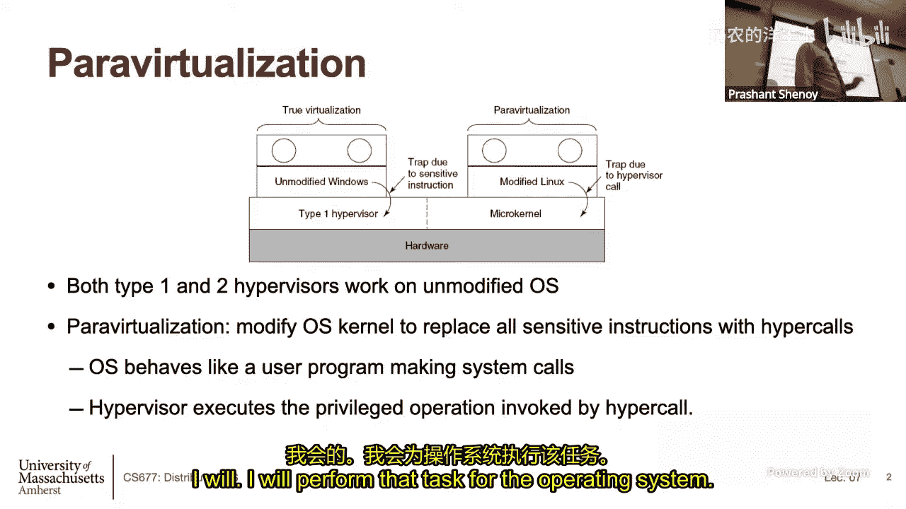

So the example of type one para virtualized hypervisor is the Zen hypervisor the popular open source Linuxux hypervisor it runs on top of any X86 processor no need for any specialized hardware support and what you will see it actually does is it has a。

Essentially it runs a modified version of Linuxux which is essentially shown here as the guest OS and then it has this notion of partitions or domains each VM actually runs inside its own domain and there is a special domain called domain zero which runs the control plane software so all of the OS operations from the other domains or other VMs actually come to the come to towards it called Dom zero or domain zero and then that domain is actually talking to the Z hypervisor is a modified version of Linux here which then actually runs on top of those so it's an interesting way you can get around some of these hardware limitations that I was talking about so that's all I'm going to say Ill actually put that paper up if you' are interested you should go read it it's a very nicely written paper on how to implement virtualization and specifically try virtualization。

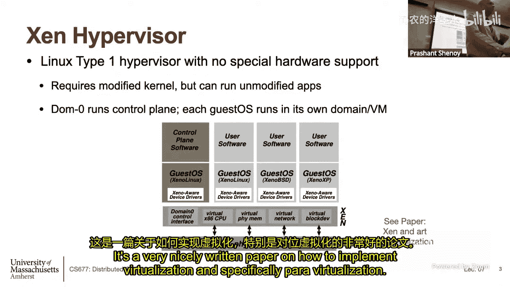

So before we move on to OS level virtualization， I want to talk a little bit about how you can virtualize other resources。

Everything we talked about last time was virtualizing the processor or the CPU and we had all these examples of sensitive instructions and privilege instructions and how you deal with them and so on but if you think about a virtual machine it is supposed to present abstraction of a full machine all the hardware resources that are present on a physical machine have we virtualized and exposed to the OS that includes disk it includes memory it includes a network interface card all of those resources so theres what spending a few minutes talking about how other resources are handled because we talked about just one so far which is the processor okay it's the main one but you are to talk about think about other resources as well so how do you do memory virtualization so。

The ideas are not very different from what we talked about previously okay so remember that the picture I showed you was one where the hypervissor is running in kernel mode only the hypervissor is the ability to perform privileged operation but the OS itself can try to allocate memory to applications and on on even though the OS does not have those privileges so in this case the OS will continue to manage page tables because it thinks is running on a real machine okay it might create new page tables for a new process for example but thats a sensitive operation because it cannot actually perform that operation so it will trap to the hypervissor because it's trying to execute a sensitive instruction okay the hypervissor then actually internally manage maintains a second page table which is called a shadow page table so that page table actually performs a mapping and is mapped to the page table thats visible inside the OS so the OS it perform。

so it' is basically a shadow or a mirror of the page table inside the OS is maintained in the hypervisor whenever the hypervisor makes the chain on behalf of the OS that data structure actually becomes available to the OS and it thinks that it allocated a new page table or it allocated more memory and so on and so forth so。

😊，Essential any changes to the page tables are also sensitive operations so those are also not something that the OS can perform so the hypervisor has to make those changes on behalf of the OS the way you do this is you actually make the past the OS page table read only in the memory pages are marked as read only so when the OS tries to update it it is going to cause a trap because that will be a page for then that is going to get to the hypervisor the hypervisor will then make that change very similar to what we talked about last time where any time the OS tries to perform an operation it's running in user mode it causes a trap and then the hypervisor deals with same concept but for memory management very quickly iio virtualization or disk virtualization this one is a little bit simpler because what you have to do is create a virtual disk for the virtual machine。

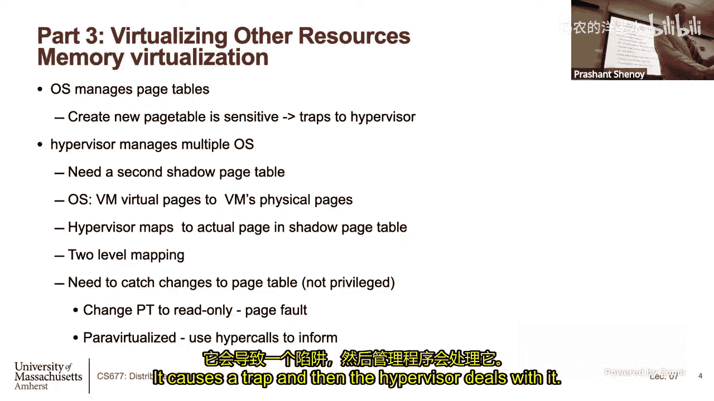

The way you create a virtual disk is on the native machine you just make a very large file just a standard file but it's very large in size and this file basically is then exposed to the virtual machine and and the virtual machine actually exposes a disk abstraction using this file whenever the OS tries to read and write to the disk what you do is you actually read or write to the file so the file has the same size as the disk that is exposed inside the virtual machine and to the OS it just looks like is reading or writing to normal disk but what the OS or not the the hypervisor does is it is actually using a file to create a disk abstraction so it's really not a real disk its a virtual disk or a logical disk but the storage space is allocated using file not using an actual disk in this case so that's the basic idea and if you you created your VMs in。

😊，Lablate 1， you will see that the VMs are actually files that are stored on your machine。

 they are very large in size in that there may be several gigabytes in size because that is basically the size of the disk that is available to the OS that is running inside the VM。

So you are going to use files to create virtual disks in this case now in case of VMware there those files are labeled VMDK files so if you see any extension VMDK those are actually VMware generated virtual disk files。

 every hypervisor has its own format of how it is going to use those large files and expose them as disks to the OS。

so that is I virtualization very quickly I just want to give you some examples of where virtual machines were used some of these came up in questions during the class last time so so there are different use cases for virtual machines an early use case was to create what was called a virtual appliance a virtual appliance is simply a VM that has an preinstalled OS preinstalled software。

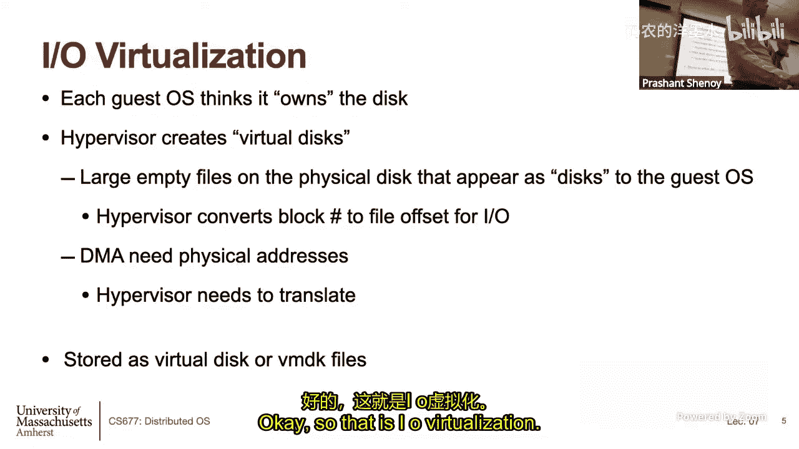

And then if you rather than actually getting some software and installing it on your machine。

 you just download a VM which has already been preconfigured with the OS and software and it just execute the VM and then the software just starts running on your machine inside a VM not natively so this eliminates the need to configure complicated software on your machine because it's preconfigured inside the VM this is called a virtual appliance so it was one way by which software started getting distributed because then you didn't need to download software install it。

 configure it and so on which in case of larger pieces of software can be complicated so you could use VMs and OSs in them to simplify that does now virtual appliances are not as popular anymore because what I just said is also can be done using containers and Docker Docker is now become the more preferred。

way to distribute software so rather than creating an entire VM you create a container。

 you install the software in it， you package it and then you just hand it to someone they can just deploy it and you have some for software running on the machine no configuration is needed so so this was a use case but it has been it has been replaced with Docker containers which are a lot more lightweight and more efficient to distribute。

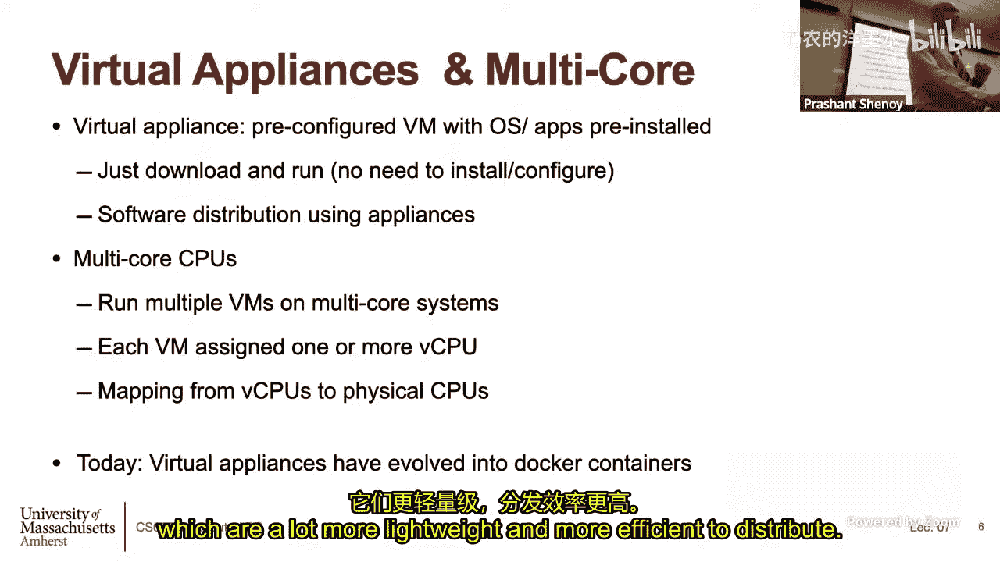

So where do you use it if not in virtual appliances today this is technology that's heavily used in all data centers right so I mentioned that cloud computing platforms essentially run on virtualization when a customer of the cloud goes and request virtual server you are not getting a physical server we're actually getting a virtual machine that's running on a physical server the physical server may be much bigger a cloud platform can construct multiple VMs and each can be allocated to a different user each can run its own OS and have its own software running and then the hardware is going hypervisor rather is going to multiple this VMs onto the physical server so cloud computing is a big use case in the desktop computing world this is used for software development right so if you want to do testing and so on you can create an isolated environment inside VM test your code and if something goes wrong。

Not going to actually cause any issues on your native machine It's isolated to that virtual machine so they stop computing for software development for testing。

 cloud computing to actually allocate resources to end users in data centers it's used for essentially running applications in isolated environments Also it' used for this use case which is called server consolidation which basically means that you can take workloads that are running on multiple machines。

 put them inside multiple physical machines， put them inside virtual machines and then pack the virtual machines onto smaller set of servers making more efficient use of your hardware resource so that is called server consolidation some of this we will come back to but these are just some use cases I wanted to mention before we move on and talk about OS virtualization。

Any questions from last time or anything I said today。

 we are going to switch gears and move from virtual machines to the world of OS virtualization and containers。

 which is a different virtualization technology。

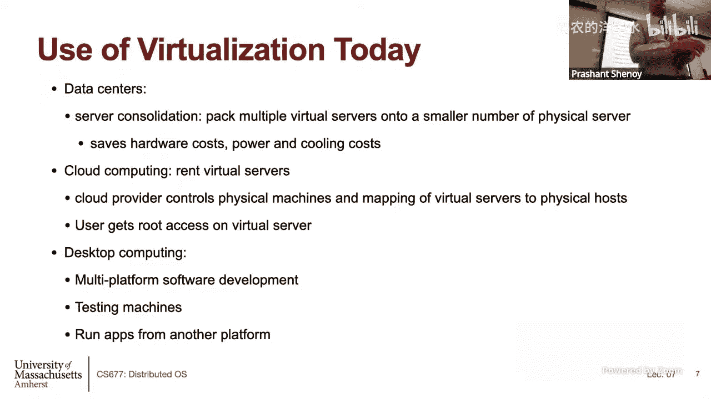

Okay， so let us talk now about OS virtualization， so if you recall the definition I gave for virtualization in general last time I said you use it a piece of software that uses the native interface to emulate another one。

Yeah， that was the definition of virtualization in the OSs virtualization the native interface is the OS interface is the system called interface。

😊，OS when we say OS interface we typically mean system call interface every operating system exposes a set of calls which are called system calls that applications can use to invoke OS services so our native interface is a system called interface and we are going to emulate a different what it could be a system call interface of a different OS it could be a system call interface of a different version of that sameOS which interface are emulating is not important but you are using one to emulate another so。

There are so this is basically what OS virtualization means now the interesting thing that you will see is basically it allows us if you use OS virtualization it allows us to isolate what are called user space instances or isolate application processes that are running on the same machine so allows you to take a set of processes put them inside and OS virtualization environment which we call containers and then those processes can operate as a group they isolate it from other processes that are running on the machine so the outside processes that are outside can see all the resources but you can restrict what processes inside container can actually see so here's a picture to make that a little more clear so so this is your hardware okay the pictures are actually showing the same thing。

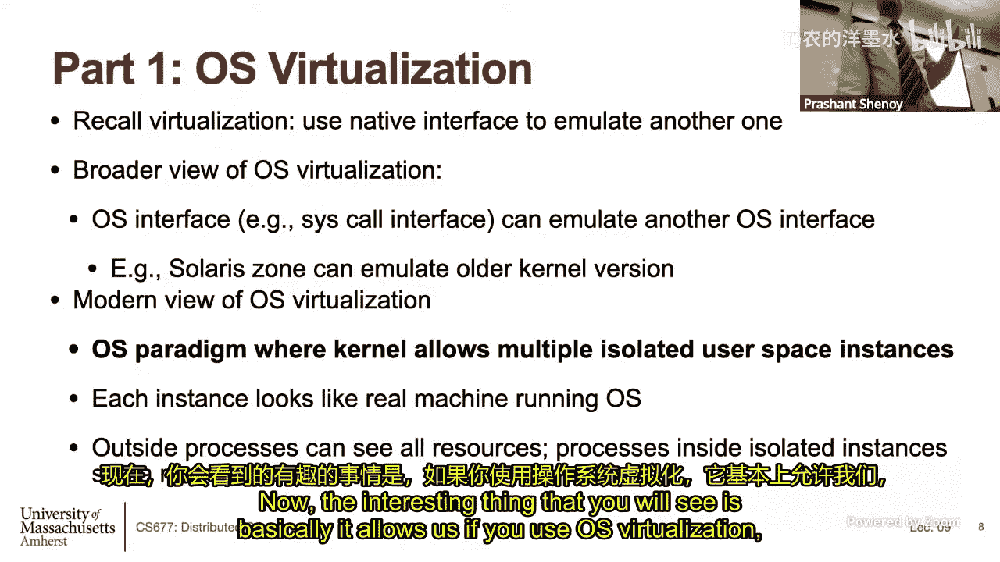

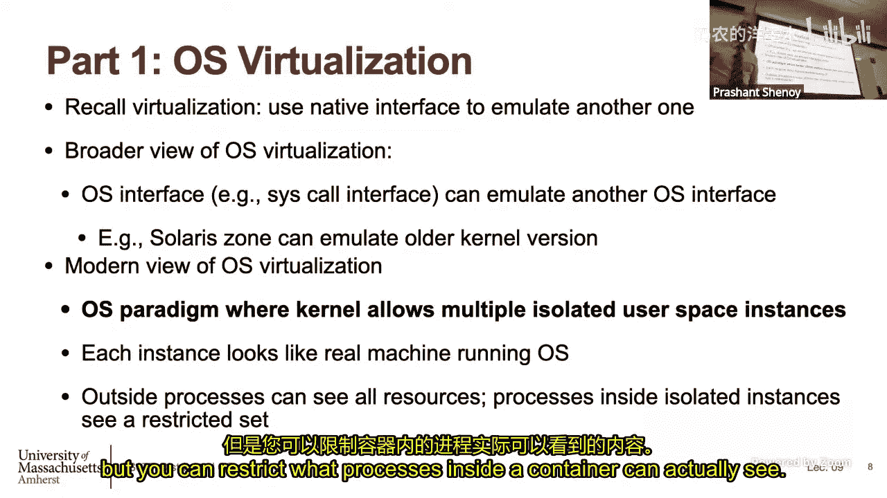

But two different operating systems， so this is hardware， this your machine。

 you just run a normal OSs on top of this。That OS supports OS level virtualization。

 which is called containers， so these blue things are containers。😊。

So they will see that each of them is running some applications and when an application runs inside a container。

 it sees a normal machine。😊，like because its virtualized but it cannot see outside the container it cannot see the other processes that are running it is limited to seeing processes that are inside the container so in that sense you isolated it you are basically limiting what it can see can also limit what type of disk resources it sees and so on but you the main thing you limit is what other processes are running so that thats a picture you want to keep in mind okay now the thing that you will see that is different from what I showed you last time is that there is no hypervisor in this case。

😊，In hardware virtualization， I said you have to run a layer called the hypervissor and then the OS is going to run on top of it。

😊，Here we did away with the hypervisor areas running standard operating system that have support for post level virtualization。

😊，that's the first thing and these containers are lightweight virtual machines why the lightweight because if you look at the picture I showed you last time inside each virtual machine you run another operating system you run a fullfled OS inside each VM here you don't do that you are just running up normal processes the OS that's running the host OS provides all OS level services to applications inside the container in case of VM there's a OS running on that VM that provides OS services in this case you did away with it so you will see there are theres more efficiency here because there's no hypervisor there's no second operating system because there's much fewer software layers that you have to deal with it just looks like a standard OS where applications running on it except that applications are put inside containers。

Is this clear what I said any questions on this okay this is same picture different OS that's a OS no longer in existence called solarlars that came up with this idea very early on you will see there hardware here the green thing is the OS so you will see some applications are running like normal they run on the OS some are actually inside zones zones are the terminology for containers in this case and then these applications that are running inside container restricted in terms of what they can see what they can do and so on。

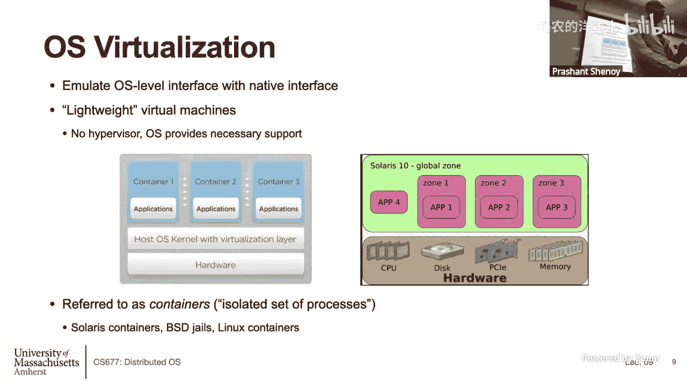

Okay， so here is a picture to compare type 1 hypervissor， type2 hypervisor。

 both of which we covered last class and。Linux containers okay this is Linux but pretty much all OS virtualization technologies very similar so so in this type on hypervisor you have hardware you boot hypervisor。

So that's the thing that' is actually booting and then you create virtual machines more than one if you need inside each virtual machine you run another OS this is called a guest operating system and then in that on that OS that OS and that the VM just looks like a normal machine but it is actually not an real machine it's a virtual machine not a physical machine。

And then you run apps and processes on their doors and you can run different ones bo all of them are running at the same time。

 you can run windows here， you can run the next year you can run something else because is not the same as dual Bo which was a question that somebody had asked last time。

This type 2 hypervissor。hi we also covered last time you have hardware on that hardware you just first boot a standard OSs which we will call a host operating system it just looks like whatever you have on your laptop or desktop。

And then on。On that OS， you are going to run a special application。

 which in this case is a hypervisor。And that hypervisor provides virtual machine functionality so then you can create one or more virtual machines and inside those virtual machine like previously you can run another OSs。

Do you have。Gust operating system running inside the VM。

 you know the host operating system that iss running on the hardware and there's hypervissor as well that's a type to hypervissor。

and this is essentially OS virtualization you will see that again you boot a standard OS like the type 2 hypervisor but there is no hypervisor in this case the OS is all that you have and then you construct these lightweight virtual machines and then you run applications in them like the previous case and the important thing is these lightweight virtual machines which you are calling containers don't have another OS running in。

Like the previous case， it just basically is using the OSs that's already running on the machine for OS level services。

That clear the difference between the three things weve talked about so far so as you can imagine because there is less software layers in the case of OS virtualization。

 it is much more efficient you can create and stop these containers very quickly and like booting a VM you are to start the Vm than you have to boot an Os then the process start running here you don there's no O to boot up you can want guess so hostOS is running containers can be started very quickly very efficient they give you bare metal like performance because little overhead here unlike like the previous case where you have a second OSs that you have to deal with and it's lightweight so this has become a popular virtualization technology because it is much more lightweight is more efficient it still gives you isolation guarantees like you had in the VM case where these apps that are running in one container are restricted they cannot look see the apps that are running。

だ感点。So these are all advantages of OS virtualization。

Can anyone think of disadvantages over type 1 and type 2 hypervisor？Yes。

Only the nativeverse can be used cannot use any other verse that is correct。

That is indeed a limitation here you can run other operating systems。Anything else？原家就真过方面。

Great question you're asking if system calls a container impact the OS So inside this container you can emulate although you don't actually run a full s OSs you can emulate the interface of another OSs right so simple thing you can think of is you can let's say run Ubu2 as your host operating system let's say Ubu to 24 but you want to run some software that only runs on a previous version of Ubu2 U to 22 you can create a container as Ubu to 22 So you are using the 24 interface to emulate Ubu to 22 that's an example。

So if you look at this picture you will see that there is another disadvantage which is all containers rely on the same underlying OSs。

😊，so what that means is if a container causes the OS to somehow crash of a bug。

 all other containers on that machine will go down。

Because you are sharing a common operating system that's not the case in other hypervisor technologies because each virtual machine is running its own OS so if some this application causes this OS to crash other VM are not impacted only that VM is imed because that is a OS that is running inside the VM。

So in terms of this is same kind of problem we had when we were talking about。

Micro kernels and so on right so you have common OSs or this all containers share it so it's lightweight and it's a good thing in most cases but from a pure isolation perspective it's not as isolated because any problems in the OS below will impact all containers。

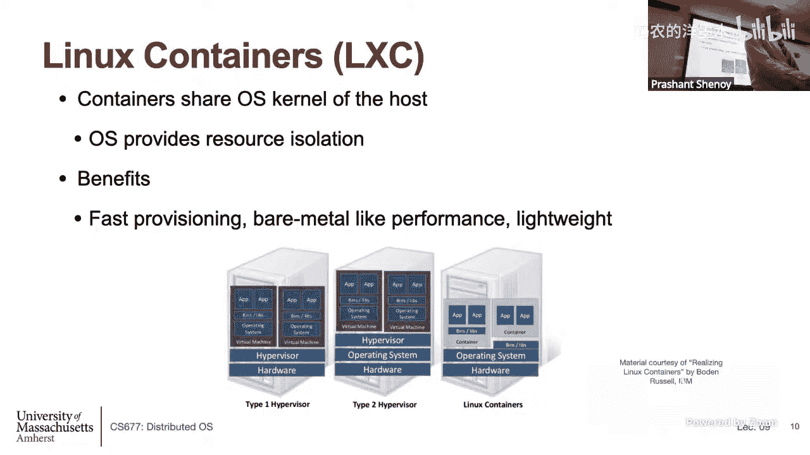

All right， so now let's talk about a little bit of a little more of the details of how you implement OS virtualization technologies。

 so essentially what you need is。2 and this is specific to Linux containers at the moment。

 which is called Lc by the way， that just stands for Linux containers。Yeah。

 so you need two types of functionality from the OS to implement containers。

 which as resource isolation and resource management。

so what do these things mean so let me introduce two terms here so in the Linux world containers are implemented using two types of functionality。

 one is called namespaces， another is called C groups or container groups。

So what are namespaces and what are container groups so namespaces provide a technique for process level process based rather the resource isolation so you can isolate subset sub processes at a time and I'll talk more about that on the next slide and C groups allows you to remit how much resources processes can use okay so one is doing resource isolation and one is doing resource management so let me explain some of these details to you let's start with namespaces so what is a namespace the simplest way to understand name I said its process level isolation the simplest way to understand this is namespace restrict what a container can see on the machine。

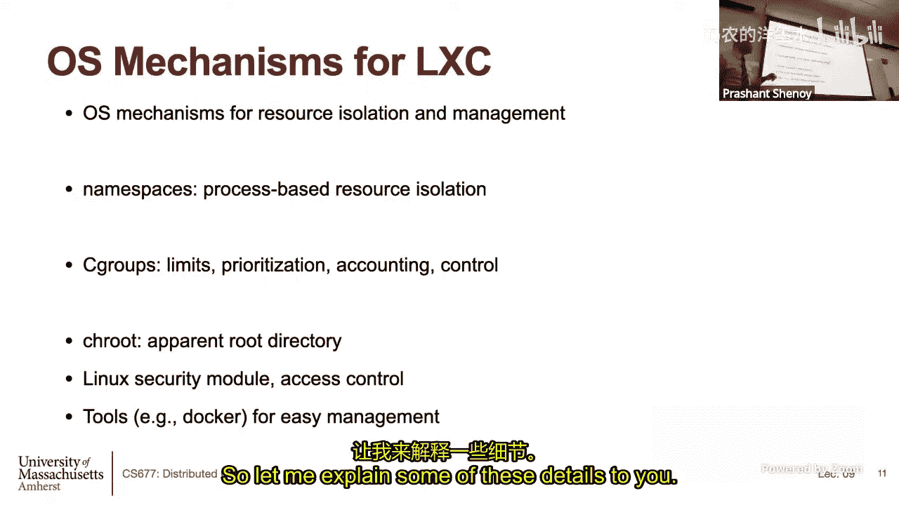

let's say you start a standard forget containers for just a second。

 you start a standard application on your machine， let's say you start a browser or you start a mail client by default that process can see every other process on the machine it can see what other processes are running it can actually also look at all the files on the machine any files that have the right permissions of course are visible to the process。

So by definition we are not limiting what a standard process can see on a noise once you put that process inside a container you can control what it can actually see by default once you put a process inside the container all other processes on the machine become invisible。

To that process， you can no longer see the presence of other processes， even though they are there。

So you essentially now you put that process in the container so you cannot actually look outside the container and see what else is running on the machine so you are limited you can also add restrictionsion to see what folders or directories are visible you can say this container cannot examine any of the files on the machine or you can say only these volumes are actually visible inside the container。

😊，And then that's the only thing that processes inside can see they cannot see anything else。

This is done using this technique called namespaces you can also so you can control what is called mounts or5wa files are visible。

 you can control PIs process ID is what processes are visible you can actually see what network interfaces are visible you can also control inside what users are visible so which user accounts are visible from the outside by default inside a container you can create new accounts or you can say none of the accounts from the outside are visible and so so you can essentially control what is visible inside the container。

Is that clear。

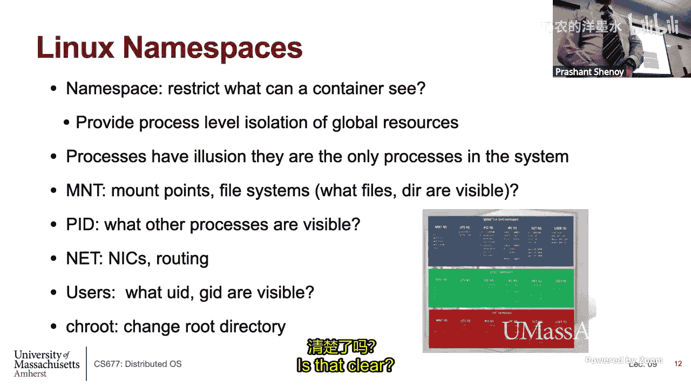

Okay so that is name spaces so then you can say what does this C group do or container groups do container groups are name space is already restricted what you can see okay。

Container grows the way you want to understand this is how much resources the process can use not what you can see but how much are you allowed to use how much CPU are you allowed to use how much memory allocated to the process and so on so you can for instance start a container and say let's say your fourcore laptop。

You start a container and say it can only run on one core out of the four course so inside the container no matter how many processes you start or how much resources you want you can only get one core worth of CPU cycles inside the container so so the other three cores are not no longer available or even usable by processes inside the container but other processes that are running on the machine they can use all the resources because you didn't limit anything so now you are limiting what the process can use so you can set quotas on CPU usage you can essentially allocate memory you can say when this container starts it should have one gig of RA so if you start if the process inside tries to use more than it will be denied even though you might have more RA and it may be unused outside processes don't have that restriction they can use all of the memory because OS is not limited any。

I think they can。So， this is essentially what you can do with C groups so using namespaces and C groups you can now restrict what processes inside containers can see。

 how much resources they can use and provide this notion of isolation。😊。

That's basically the fundamental technology that containers。Prorovide。

And when you have used your the Docker container that we gave you is basically doing the same thing。

😊，OkaySo next time you go and start your class Docker container。

You can actually do type PS on the command from PS just list all processes you will see that there are only two or three processes that will be shown even though on the machine there may be more processes because those other processes are no longer visible same thing with files the way we set up your class docker is only files from the outside that are visible inside is your Github repository thats mounted as your lab directory or a lab led director all other files are internal to the container that are just in the image they are not the same as what are outside。

So you could only expose some files inside the container。

 but then nothing else is visible inside the container and so on and so so I think theres something you can go try for yourself and you can get a little more understanding of how this system done。

嗯。So we will so there are many this C groups which is called container groups there are many examples okay so you can limit CPU and you can use something called proportional shares。

 you can do hard limits which say this container gets only one core or you can do something called proportional share limits and I'll talk a little bit more about that which allow multiple containers to share the resources you can do CPU sets which is limited to core you can also try to limit how much IO the container processes can do how much disk they can use you can limit memory and so on so I'll give you some examples of how this is done but by and large I think I'll skip this figure I don't think it's even readable I think it's too small but but what this is trying to show is that the way you implement Linux containers is at its core these two techniques C groups and namespaces and then you also implement a security model which is an access control which is what users。

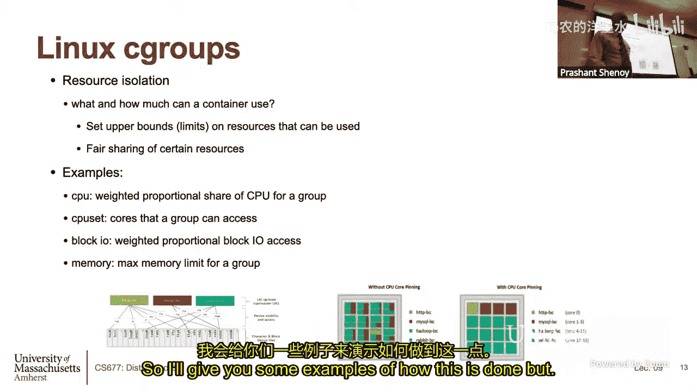

Ids are available inside and other security policies that say what network interfaces are visible and so so once you do this you essentially have Linux containers on other operating systems okay there are also container technologies okay they by and large do the same thing but there might be some differences I give you basically what Linux containers do they the most popular container technology out there。

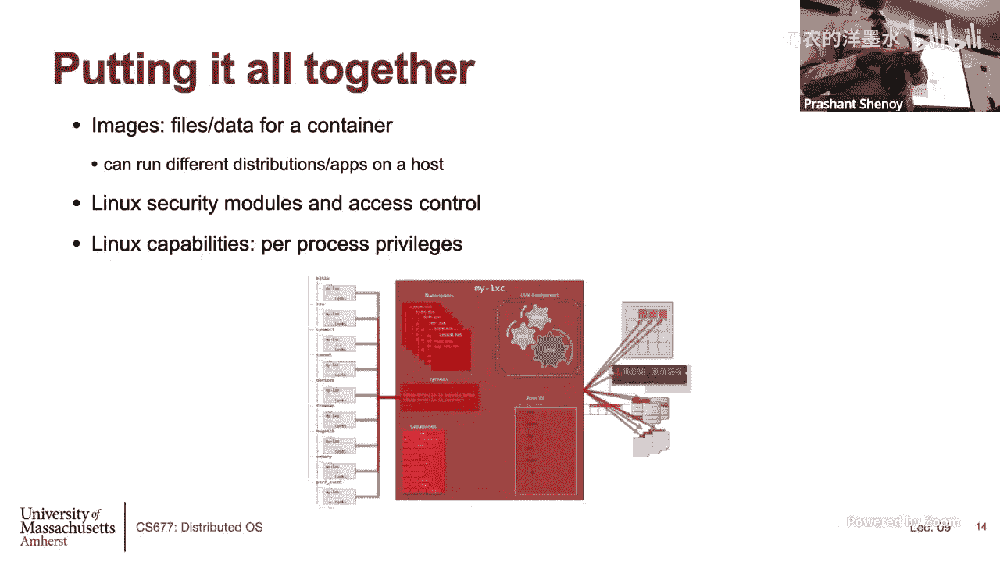

Any questions yet？好现在。好事。Okay because question is container partitioning the resources。

 that's one way you want to think about it right so C groups。

A a way to partition resources so it not only are you partitioning resources you have namespaces which also say that what resources can you see and what resources can you not see partitioning is just one part of the story just say I limit you to using so much memory and so much if you namespaces say you cannot even some things just because are no longer accessible to some processes are not visible some files are not visible and so on that's not partitioning that is just very restricting what you can actually access without part but yes it is a way to partition resources。

那个。

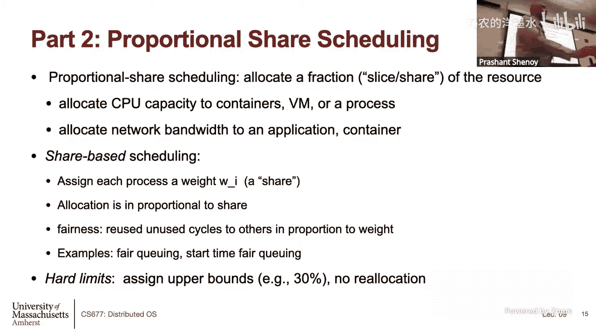

Question is can you run on native OSs or virtualization if you see this picture here right a container is essentially going to have name spaces and C groups。

 all containers are running on top of native operating system。

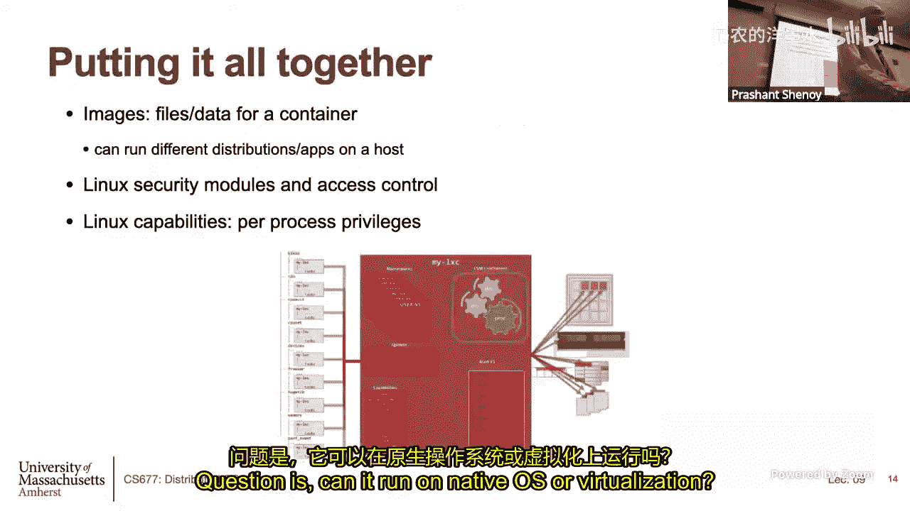

Right the container virtualization technology is the partitioning technology there is nothing else。

Yes， question。

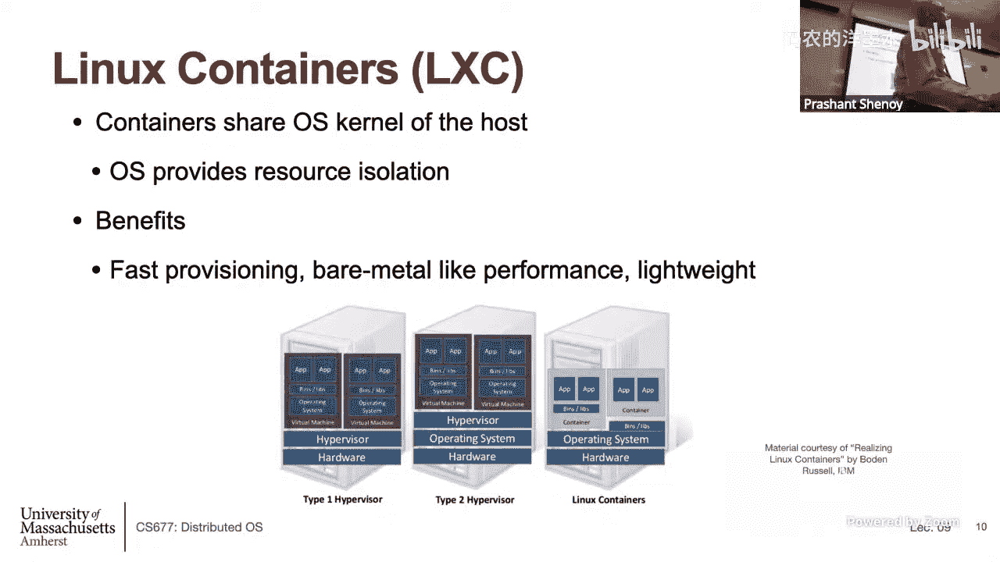

Okay question is are C groups rules that allow you to say well first thing is namespaces tell you what is accessible or not not C groups C groups are more resource allocation how much resources you can see there you think of them as policies or one way to think of them are rules but yes that you basically say this is here's a set of policies that limit what a container can see and that's what the OS will enforce。

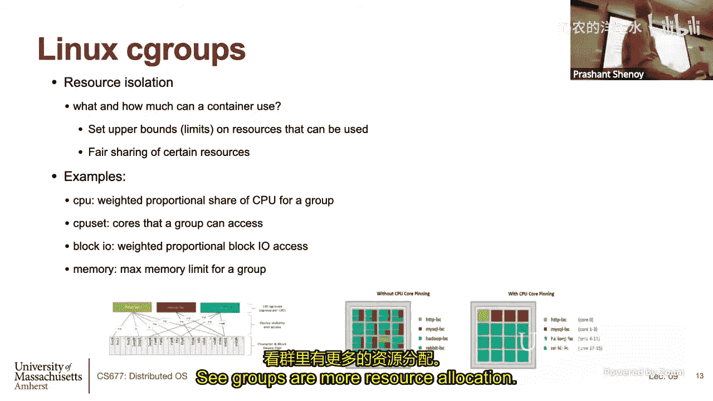

呃，被下是。好对。Good。Okay， so question is if you mount some files from the native machine and make them accessible to a container is that using C groups or is that using namespaces so in this case it' is using namespaces because you are essentially trying to limit which files are visible and which are not so by mounting it you are saying only those files are visible okay if you want to then。

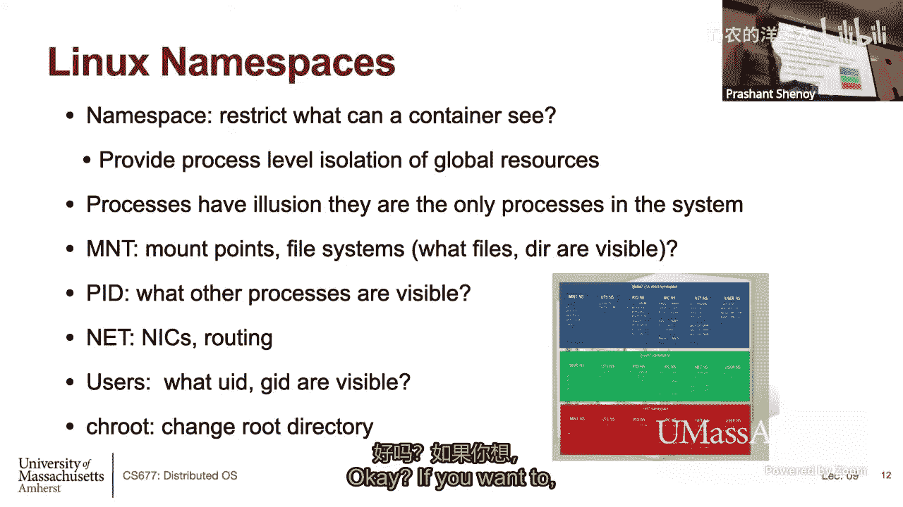

You see groups you can say you will limit how much IO you perform。

 which means I can limit the amount of write you can perform reads you can perform on the files that are visible so name spacing what files are visible where it doesn't tell you what restrictions are quote on how much IO you can perform that you can do using C groups。

Yes。

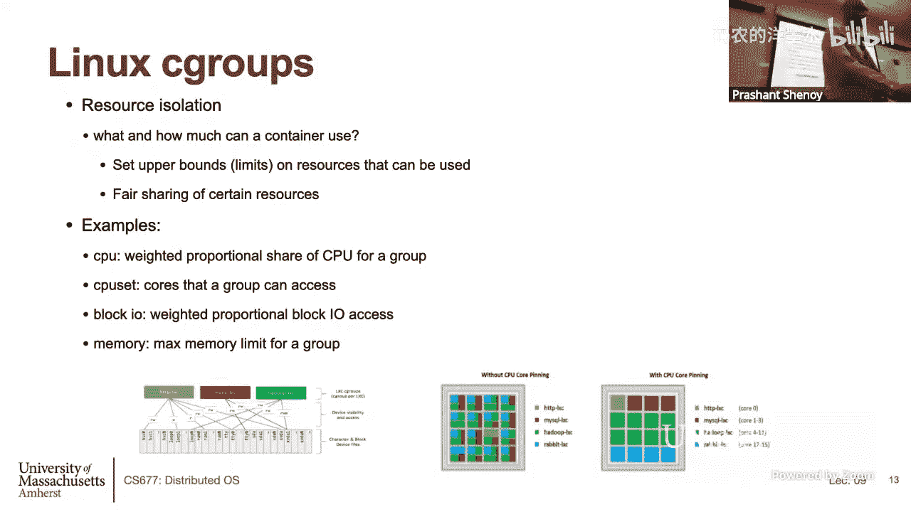

点的点的资标来说你点。What this things。Question is is name space and container the same thing is that what you are asking so name spaces and C groups are techniques that are used to implement containers so when I said container provides isolation these are the techniques the OS is going to use to implement containers。

Name spaces and C groups are how you implement containers is the way you think about， right。

IWhat is still。This space is actually declining because already a container is isolated。

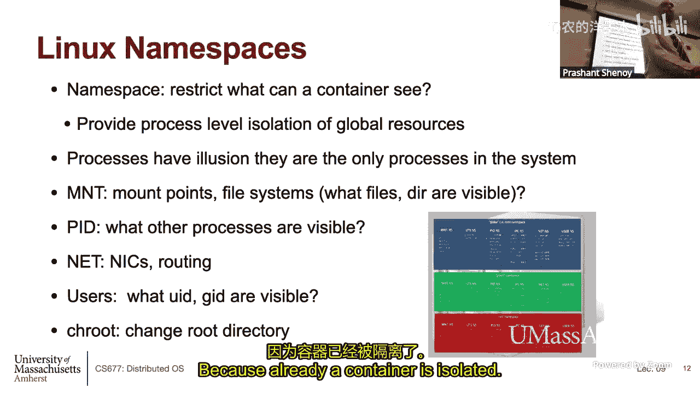

那个核心。Question is what what is it that a namespace does because the container is already doing isolate So the isolation is namespaces。

The way a container is performing isolation is using namespaces to implement isolation。

So it's not like there is something on top of it。The way when I said containers performs isolation。

 the way you do it is using these two techniques。Okay。

 so the way you want to think about it say if you say go implement a container technology。

 you will actually implement namespaces and see groups and use them and that is contained that is what containers mean。

哎。Any other questions yes？

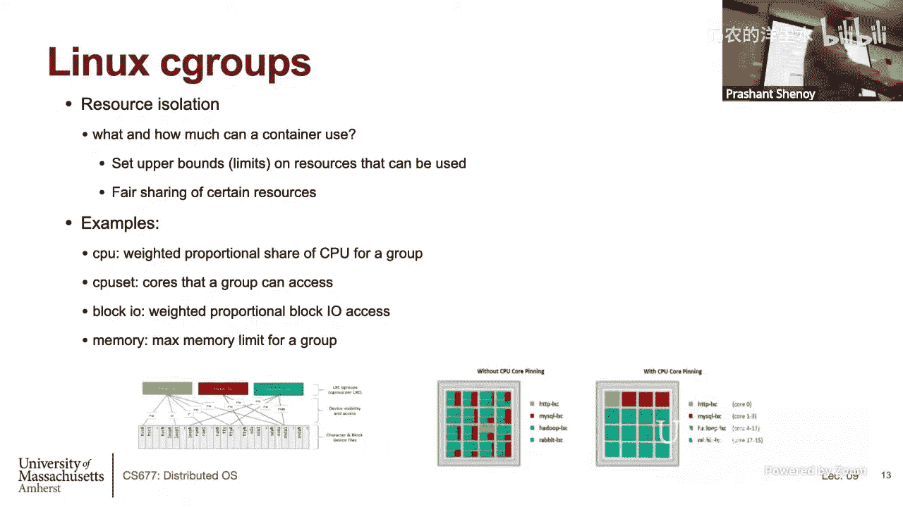

大。Okay， can you repeat your question that you are asking between the difference between the type to hypervisor and containers。

 but what's the question？Best。Okay is the question is the difference between the two only the presence of the hypervis that' thats your question Okay the first thing is you are to understand virtual machines is a much more heavyweight virtualization technology virtual machines emulate a physical machine a hardware of a physical machine so it just looks like a PC but it all emulated in software and then you have to boot an entire OS on top of the PC which is the OS thats running inside the virtual machine and then an application so it looks like whatever you do on your laptop which you have an OS you boot it up you're an application the same thing is happening inside a virtual machine so in both type 2 hypervisor and container there is a post operating system。

Okay。And in case of type 2 hypervisor， the host operating system runs an actual hypervisor that provides a virtual machine abstraction and in that virtual machine abstraction you were to run another OS so you will see in this case a same machine is running three operating system the host operating system that you booted and then two guest operating system each of which is running inside the virtual machine instead the two V I mean container is a much more lightweight model there's only one OS that's running theres not no more OS running inside the container processes inside the container see the same OS thats already running in the machine processes inside a virtual machine do not see the host they actually see the OS that's running inside the V。

Okay。It is important to understand these differences， but yes。

 in both cases in type 2 and containers there is a host OSs that you start off with。

But the virtualization technology is different。Provide different abstractions。Yes。Okay。

 question I'm not fully understanding your question we are asking in type 2 hypervisor and container who' is providing the hardware。

Okay， so so we are asking how is hardware hardware， how our hardware resources are located。

 so typically it doesn't matter whether this this answer applies to both type 1 and type 2 hypervisor。

Hypervisors whether that type 1 or type 2 takes some portion of the physical hardware on the machine and they allocate it to virtual machines when you create a VM you have to say I need to create a VM with two course and I need it to be given two gig of Ram and so on and and then is the hypervisor responsibility at run time to ensure that that VM gets that much resources so the hardware resources。

 the actual hardware resources are split across virtual machines running on that on that hardware physical machine this is true for both type 1 and type 2。

now in Linuxux containers is the OS job to allocate memory and CPU to a container。

 but that is not different from what it does for ordinary processes also even for a normal process its OSS job to say you are going to get this much memory and then when you schedule it you decide how much CPU you get is the same thing except that containers allow you to limit it。

So you could enforce limits as opposed to other processes that operate without such limits。

That clear。好。对个。Okay question is how is the container meeting a definition of virtualization where you present a different layer right so that is not actually seen in this picture what you have to realize is inside a container application see some OS typically if you don't do anything they will see the same OS interface as the outside operating system so the inside interface emulated interface and the native interfaces can be the same but they don't have to inside the container you can have libraries that actually expose a different OS interface then what is inside here that was the example I gave maybe you are running OS that is U to 24。

The processes by default will see the U to 24 interface but inside the container you can say I want U to 22 because I am running some old application they don' not run on 24 they are not to import it so this。

😊，Libraries that are in there will actually present a open to 22 interface and then you will translate them to U to 24。

That' is an example where you accumulateulated one OS interface with another OS interface。不能改成地址。

いっぱい終わか。Yes， each container has to have its own set of libraries that decide what interface you want to present to those。

Or the other container might have some other interface you don't have to say every container is getting u to 22 in the example I gave you this one as now might just see the native interface and so on。

Here there's some question there this。哎说太出。好好通。啊，你这是好的。非什么好。我时有在饭店呢个手做。Okay。

 we have a question about。What happens when there are blocking calls if you have a process that is making a blocking call what happens to other container that's your question right so the thing to keep in mind about containers is the way you deal with blocking calls are not different from how you deal with them or processes without any virtualization at all what does that mean let's say you take container one this process running in there process makes a blocking call or a system call or something like that system call is going to go directly to the OS and the OS is going to start executing that system call that process will block because it waiting but a scheduler is free to run other processes so other containers can continue to execute that's the same thing that will happen without any containers at all if process A does a blocking system call it will wait OS will execute it and then but process B can continue to run until that is so that's not going to change。

Very question。对。Question is， is there anything that is analogous to name spaces and。

C groups and type 1 and type 2， is that your question there so the。

The way you implement type1 and type 2 virtual machines is that you allocate resources directly to virtual machines right just as C groups allow you to say this container gets so much CPU Ram and so on when you create the virtual machine you specify how much resources the hypervisor has to give it and thats what will actually happen at runtime right and there is no question about namespaces because。

The OS here cannot see anything on other VMs because it is isolated so you don't have to do anything more the isolation is already preventing one OS or one VM from seeing what is happening inside another VM。

Okay， yes。Okayect。Looks like it's I。Operate the host operating system。

Does that mean the hypervis is just？Okay， well there's a question about in type one hypervisor there is no O you boot the hypervisor and the question is。

 does that mean the hypervisor directly deals with the hardware right that's your question here So as I had said in。

T one hypervissor， you the you boot the hypervissor， but the hypervissor is basically your OS。哎。

Not a real OS in the general purpose was what the way you want to think about it the hypervisor is a special kernel which only provides virtualization functionality as opposed to a general purpose OS kernel that provides standard functionality so yes to answer your question hypervisor has to deal directly with the hardware just as a OS word but it's only doing it for the purpose of dealing with virtual mission you can't do anything else。

Like you would run standard processes on other operating systems， you can't do that yet。

 the only thing you can run our virtual machine。Yes。

 so you will only boot the hypervisor that when you power on the machine。

 the hypervisor will boot up， it will just look like an OS， the OS kernel rather。

 but it is a specific one that only provides virtualization functionality。

Allright so let's move on and talk a little bit about proportional share scheduling and then I'll say a little bit about Docker but given that we now have a course Docker some of the Docker stuff you probably know a little bit about already but the proportional share is something that's worth thinking about a little more in a little more detail so what is proportional share scheduling okay so think about a scenario where you have either multiple VMs running on a machine or multiple containers running on a machine okay I already said you can allocate specific amount of resources to either containers or VM。

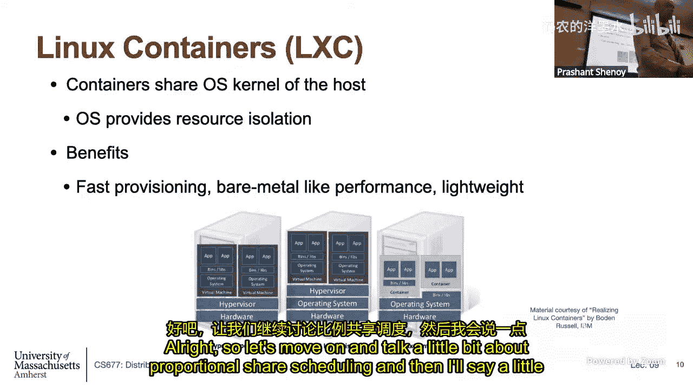

Right you can allocate certain amount of memory， certain amount of CPU share and so on Okay how is that done the way this is done is you actually are to implement some specific type of scheduling mechanisms either inside the hypervissor so that it can say this machine this virtual machine gets two core that one gets one core you are to enforce that using some scheduler inside hypervisor here okay just as your CPU scheduler your schedulers or hypervisor or in case of containers you have to actually do that inside a standard OS as well you can say how much resources are allocated using C groups that have to be enforce so you have to have special types of schedulers to implement those types of。

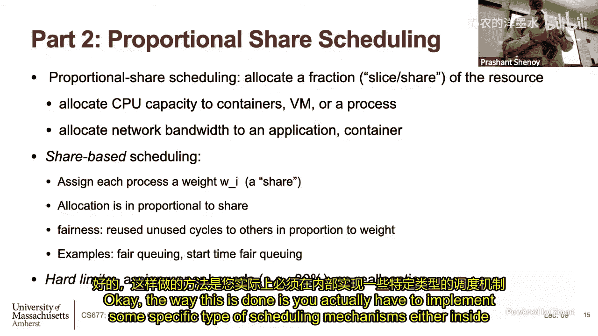

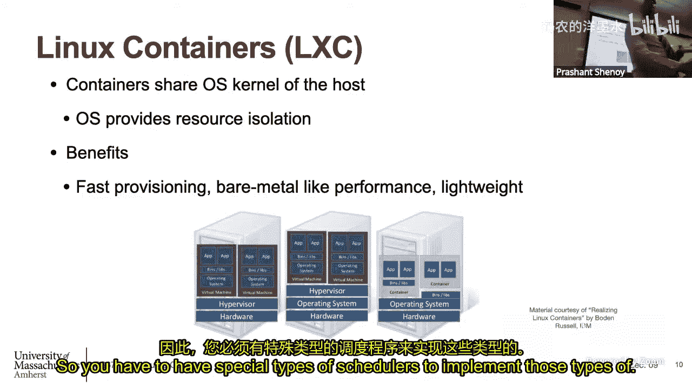

A locationation so there are two ways you actually can do this One is you enforce hard limits hard limits says that you say that this container gets 30% of the CPU or 20% of RA and then it's actually that's make like a quota you are just allocated it no one else no other container no other process can use it even if it's sitting idL is dedicated so you basically created a partition and you said this container gets this much resources so that's hard allocation you can certainly do that but there is a better way to do this which is called fair share allocation in a fair share allocation you can still control how much is allocated to a container or a virtual machine same technique works in either case but if you if a container or VM is not using its allocation you can reassign that to some other container in hard limit you don't if say I gave this Vm 30%。

Of the CPU even if you are not using the 30% it cannot be reassigned its a hard allocation it static think of this as a more dynamic way to share resources okay you specify limits but if those allocations are unused someone else can use them if they need it so that is the way you want to think about it the question is how do you perform this type of allocation or scheduling okay this is called proportional share scheduling also called fair share scheduling so that is the the term you want to keep in mind the idea is very simple。

So the way you decide how to perform the allocation is you give a weight to you allocate or assign a weight to each container let's just forget VMs the same thing you just lets just take containers for a second each container when it starts up is allocated away the weight is an integer。

The weight actually determines how much resources are allocated to the container lets take container example okay there are two containers A and B you give each of the weight of one。

嗯。So basically， then the resources are allocated in the proportion one is to1。

That means half the resources go to one container， the other half of the resources go to the other container。

if I have three containers and I give wait each of them weights one is to one is1。

 each of them will get a third。😊，嗯。So bes and or if you did one is to two if there are only two containers to do one is to two first one will get one third the second one get two third that is basically the ratio one is to2 so weights basically determine the ratio of the the relative share of the resource that is allocated to container。

So by controlling the weight you can control what percentage of that resource you can allocate and you can have a CPU weight。

 you can have a memory weight， they don't have to be the same you can say you get one your weight for CPU is one but memory two and then you will get more RA and so that' is the one thing。

The other thing which is more important here is the way it does not it allow you to have a hard limit。

😊，Unlike the previous case wait think of it as a soft limit。

 if the container is busy it has processes that are running you get the share that was allocated so if you did one is to1 and both containers have processes that are performing computation each of them they will get 50% of the CPU that one is to1。

RightBut let's say one container does not have much computation to perform even though you give it 50% of the share it is only using 10% so 40% is id at this point in proportionperal share scheduling you can take that unused allocation and you can reassign it to other containers that might need it。

So， in this case， containers can get more than their share if they are unused and sitting id。😊。

But if every container is busy， you get exactly your。😊。

Exactly so this is a better way of sharing resources because you are now not letting resources go to waste in hard limits if your resource that your allocated is not used is going to be wasted。

you cant reassign in this case resources are not wasted because if there is any process or a container is willing to use it。

 you can reassign it and have that container make progress。😊，So。

 this is basically the concept of proportional share scheduling so the thing two things you want to keep in mind is the way you control how much resources are allocated is through this notion of a weight okay a weight basically it determines the fraction of the resource you are going to get。

And then second thing is all allocations are essentially based on the weight。

 but if you do not use the fair share allocation that is allocated to a container， it can be reassed。

😊。

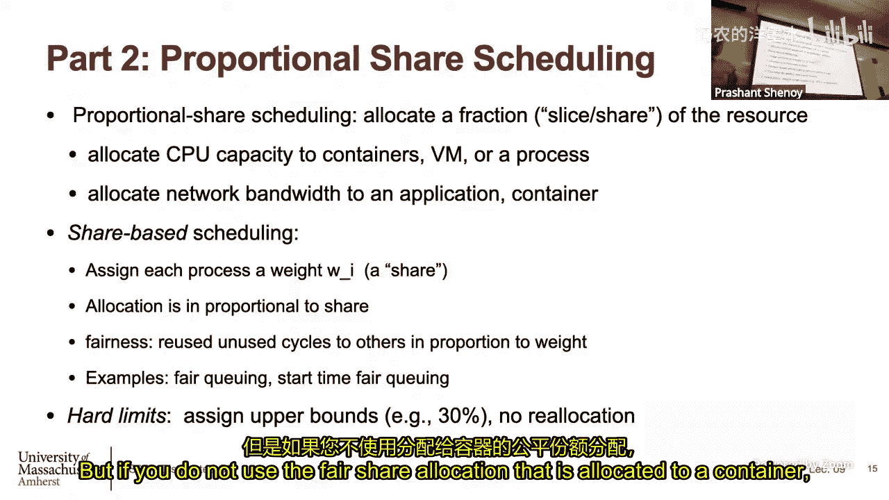

Those are two concerns， but now I'll show you an algorithm to do this yes your question。

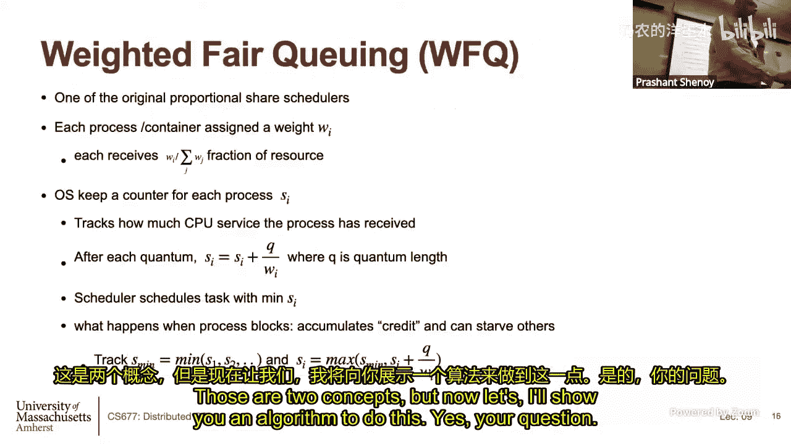

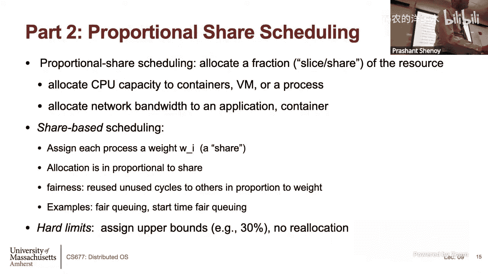

Okay question is who is assigning the weight the whoever actually configured the container and started it as essentially as to specify okay how much resources is to be given if it's a hard limit you say this container gets a core and is dedicated core whether use it or not it cannot be given to anyone or you can say this container gets a weight of one that container gets a weight of two but whenever you start containers there is basically a specification of how much resources to allocate。

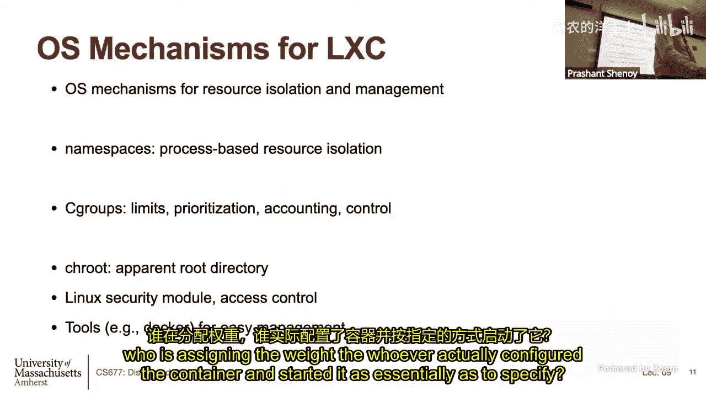

So， the owner of the machine who is starting these containers can control how much resources are allocated to containers。

Okay。

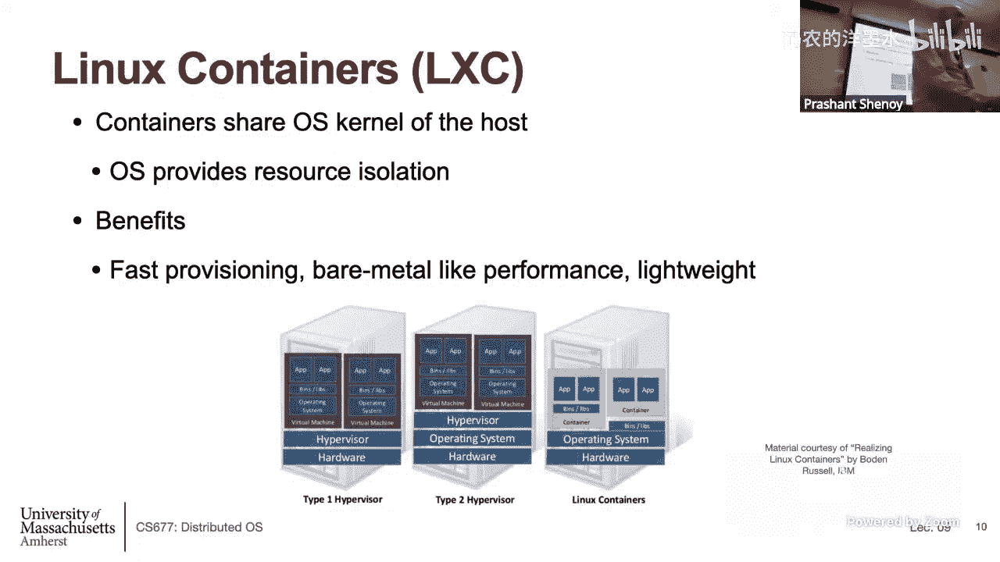

Yes question is is it not automatic， is it manual not manual in the sense of every time you are to specify you have to have a configuration file that is just going to be read and used when you start the containers？

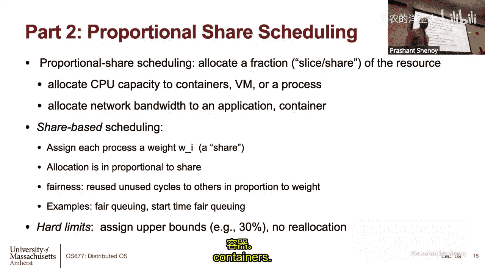

They clear okay so let me show you a simple algorithm to do this algorithm is called weighted fair queuing WFq it' is a widely used algorithm although I am explaining it in the context of allocateocating resources to containers or virtual machines is is used in many different context it is used in networking is is used in routers in the networking world to allocate bandwidth to different applications you can allocate weights and then the application gets network bandwidth in proportion to its way。

So here is basically how it works lets say there are n applications each of them is given a weight which is in this case an integer okay application I is given a weight of WI。

😊，So one gets w1 and they are just integers because I'm just giving a notation so once you have n of these applications each applications gets wi over the sum of all ws okay so essentially you take all the way to add them up okay that's your denominator and the numerator is your way okay so if you have one is to1 okay。

So youll be basically you get half right if you have one is to two you get one third because the denominator is sum all the weights the numerator is your weight so that's your ratio of what you're going to get that's your fair share but here is how the algorithm actually works at runtime because you may not be using your fair share so what the algorithm has to do is it has to track how much CPU in this case you are just doing CPU allocation so you have to track how much CPU service our container has received so far。

And based on that， you are to essentially schedule。Containers based on their weight for example。

 if you have one container with weight of one another container with weight of two you have to basically give one time slice to the first container and then give two times slices to the second container so you get one is to two ratio。

You cannot just do round robin and give equal time slices then you are not enforcing one is to do so the scheduler has to decide how many time slices to allocate each process based on its weight。

And this is how it is done it essentially has keeps track of a counter okay counter is how many time slices have been allocated to this process every time you allocate a new time slice you are going to increment the counter by the length of the quantum divided by the weight。

😊， so essentially is counter is simply tracking how much CPU service you have received so far in and it has to be proportion to your weight so you can actually。

😊，Do the very simple example to do the math， I'm not going to do the whole thing but I'll just give you two steps of this algorithm。

 let's say two processes start， they get weights one is to2。

and both have started with counter of0 it means no timesno has been allocated so far so initially both of them have counters value0 the idea is at each time step you pick the container with the lowest counter and scheduleing that is the container that has received the least relative CPU share and you want all of them to get the fair share so initially both of them are0 so you can pick either one let's say pick the one with weight of one and let's say quantum length is also one so what is this counter going to get incremented。

You start with0 okay so it says S is S plus Q or W so that is 0  Q is 1 w is 1 so the countervalue becomes1 after it got one times slot。

so now your two applications， the first one countervalue is  one， second one is still 0。😊。

So you always pick the least one。😊，So we will pick the second one。

Right and then you execute it this one has a weight of two as we said the weight is one is to2 so now after it runs for one time slot。

 what is the counter value。Q is 1 W is 2。Off。系。So the code for the second application after it ran for one time slice。

 the counter value gets incremented from 0 to。5。哎。So the first application is value one second is half you always pick the least one so you again pick the second one okay you will run it again and now the counter value will take to one okay and now both are equal again and the same thing will repeat so you gave the first application one times slot second application got two times slots that is proportion of one is to do that is what you want and then you will repeat this and so long as they are running it will all be fine。

so essentially after each quantum you update the counter value to Sq or Wy and then。

You essentially take the min of this and then that is the one you pick and then the counter values also have to be when you increment them you also have to compare it with the min countervalue of any process in the system and S+ QI and update it that way the reason you have to do that is if some process goes to sleep。

It cant get scheduled so its counter will not change other processes will start making progress。

 their countervalues will get incremented and then when this process wakes up it will have the least countervalue in the system and then it can just hog the resource for a long period of time just because it going to sleep so you don't want to penalize other processes because some processes are blocked so whenever you wake up from getting blocked your countervalue has to jump to whatever is the main countervalue of all active processes in the system okay this prevents you from hoging resources so that's why there is a max there okay that's a detail that you are to only worry about the processes go to sleep and so otherwise this is the main thing you are going to use that equation there to decide how much share you get of the CPU。

This is called weighted faire queuing or proportional share scheduling where you essentially assign weight to processes and this very simple technique ensures that the amount of CPU time you get is in proportion to the weight。

Is this clear？Okay。你最。啊。Okay usual question is S the resource share S is not the resource share。

 SI is a counter that you keep for each process that decides how much time have you CPU time has been allocated the process so far from the beginning。

 it starts at zero and keeps incrementing。So it's not the resource share。

 the resource share is the way WI。 the way it determines your resource share emphasize the amount of service you have gotten so。

 the weight is the share that you should be getting。Right？

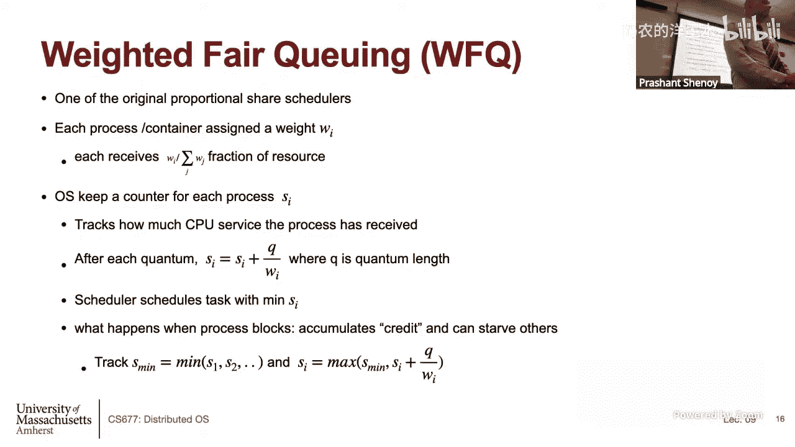

Okay so this I'm not going to go into the details here。

 this is just showing you that this scheduler W ofQ implemented in many operating systems including the Linux operating system actually uses this。

 so if you use this scheduler you can allocate weights and ensure that containers get share in proportion to their weights and so on。

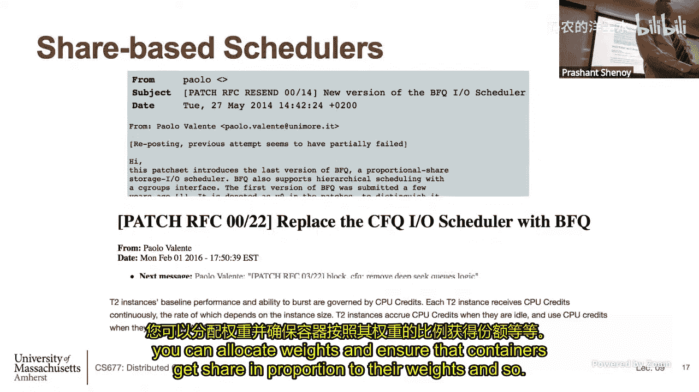

So the last thing I want to talk about today is Docker so we talked about what is OS virtualization I gave you the basics I showed you one scheduling algorithm that shows how can you allocate resources to containers and make sure that they get there is resource shares or enforce and so on that done using schedulers that are running inside an OS or inside hypervisor that enforce those limits using weights or there could be hard limits as the third thing we'll talk about is what is Docker and how is it related to everything we've been talking about OS virtualization and so on so the way you want to think about Docker is it is an Linux OS virtualization technology that gives you additional software tools to make containers easy to use。

I did score。😊，Docker is essentially Linux containers so it will have namespaces。

 it will have C groups， all of that is hidden from an actual user but that is what is there underneath but it also gives you additional tools that allow you to packet software inside of container distribute that software and so on so it is essentially Docker is essentially Linux containers。

😊。

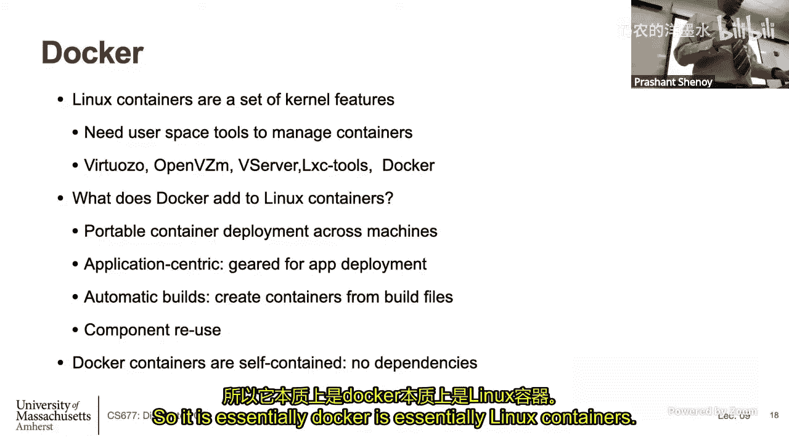

Plus some additional software engineering tools that makes containers easy to use okay that is shown in this picture okay this is the same picture I had shown you previously for Linux the Linux container pictures actually here thats the already picture I showed you is green thing is what Docker has added actually so Kleen containers and added additional tools that allow you to make it easy to create containers remove container distribute containers and so on so in a sense it is just Linux containers is additional tools that make it very easy to use that is the way you want to keep。

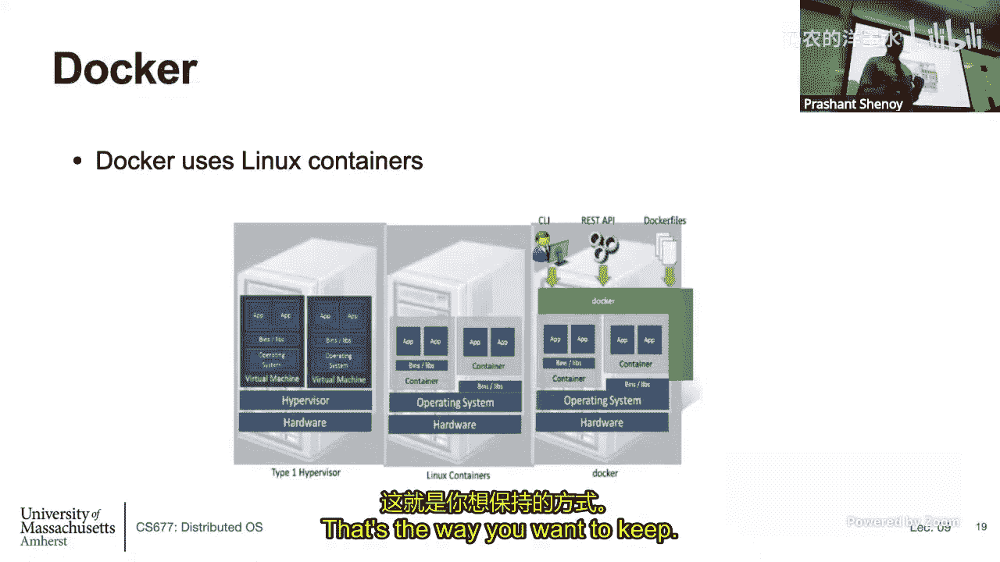

This notion of Docker in mind so you have other and by the way Docker is not the only Linuxux containerization technology there are many of them okay there's one called Vituoszo there's one called v servers theres another one called LxD that builds on top of Lxc and their Docker Docker is the most popular one okay but all of these other ones they are all open source if you have a Linuxux machine you can actually install them and use them just as you can use Docker。

So Docker adds portable container deployment across machines That's the tool right so you can create a container image you can distribute that image someone else can download the image and run it and then you essentially can create a container on that machine so it allows you to distribute your software to other users so it's portable in that you can construct it on one machine and send it to another machine so it's application centric。

 which means that you are expected to essentially create Docker containers with applications in them and distribute them for use that's what we did for the class we created a class container that is all the applications you need to write code so it's a development container them environment you can have it also provides tools to build this containers easily and you use this already you have a build script and automatically build a container。

it install automated， it install all the software and the image created and it also allows reuse right so if you update that build script you will see that it can actually reuse what's already been up。

😊，So all of these tools make Docker a very easy containerization technology。

 it's widely used and you can use it for all kinds of use cases。

 software distribution doing development environments， creating development environments。

 using them to deploy services as well， so far you only use Docker to actually。

Rightr code but you will see as we go along in the course we also use Docker to deploy code so also use that run type you can actually deploy applications on cloud using Docker and so on so the applications will run inside containers on cloud servers in that case so it's not only used for development but also for deployment。

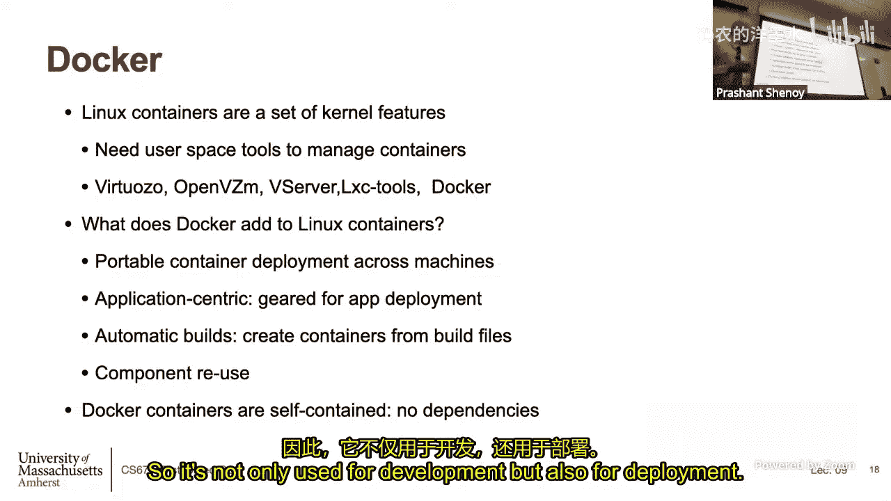

对。All right， so here is a picture I wanted to show you but here has a question to ask Docker is basically a Linux container technology。

But all of you。Who have maybe a Windows or a Mac are also using Docker。The question is。

 how is Docker running on a Mac or Windows if it is actually a Linux containerization technology？

The question clear what I'm asking？嗯。Yeah， so one answer is it can use OS virtualization。

 you are saying it will use Mac or Windows interface to create Linuxux you could do that but Docker is actually not using that because actually runs on the way it is built is runs on Linux because it is Lxi technology。

If you did that you have a two OS virtualization where you built a container。

 a Linuxux container using Windows or Mac。But that's not actually what is happening on your machine。

Any other thoughts on why is it that you can run？Linux containers on other machines yes。Okay。

 question is， can you have Docker be a virtual machine inside a type to hypervisor？So in fact。

If you do not use Linux to run Docker， you run any other platform whether Windows or Mac。

Your Docker containers are not actually running on directly on Windows or Mac what Docker desktop does is it creates us hidden virtual machine a type 2 is actually runs a type 2 hypervissor under the hoods it actually has a small Linux kernel as a Vm inside on that type 2 hypervissor and then Docker is actually running on that Linux that it starts so when you start Docker on Windows or Mac it is actually creating a type 2 virtual machine on your machine and is running Docker on Linux on inside that VM。

All of that because they built it well is all hidden from you but there is actually a Linux Linux running on your machine when you start Docker if you are running on Windows or Docker is not directly running on native windows or native Mac and using real OS virtualization that's one way you could have done it but that's not what they do have a tiny Linux kernel that starts up and then you have OS virtualization on top of that Linux it's always running on Linux of course if you have a native Linux laptop Docker will run natively like you show here there's no extra thing running so in fact what will actually happen if you have a Mac is going back a few slides。

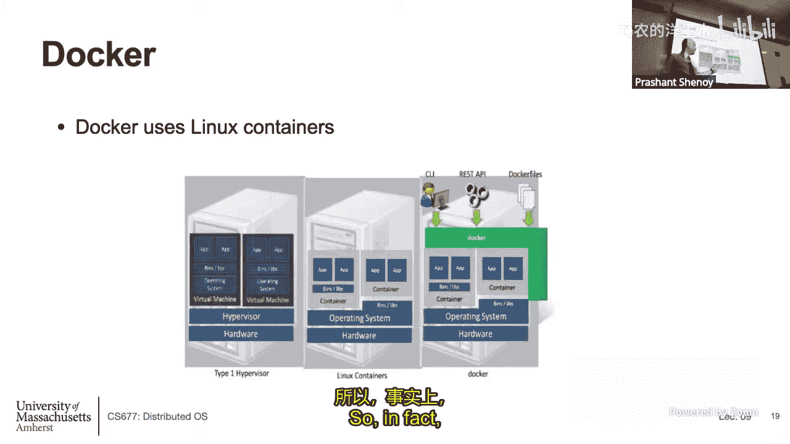

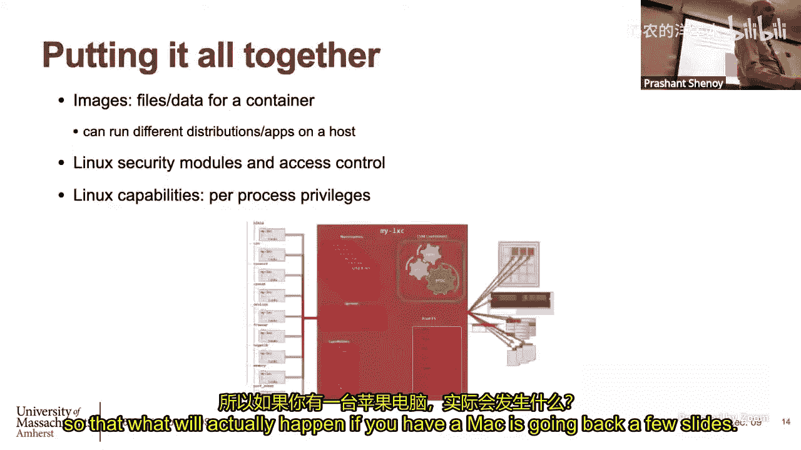

So， this is the picture you will have so you run windows you start Docker behind the scene you will start hypervissor it will put Linux inside hypervissor then will be Docker running there and what you are seeing is that docker and your windows and my all of the middle stuff is hidden from。

对。边个分姐呢定系收。The question is in Docker is their hypervisor。

 by default there is no hypervisor I'm just explaining how Docker will run on Mac or Windows。

Not not natively on Linux because it is always going to have to run on Linux。不。

Yes the question is is there hypervisor code yes， there is hypervisor code in fact on Windows we probably installed WSL。

 it gives you a hypervisor built into it。But same thing is2。Yes question。

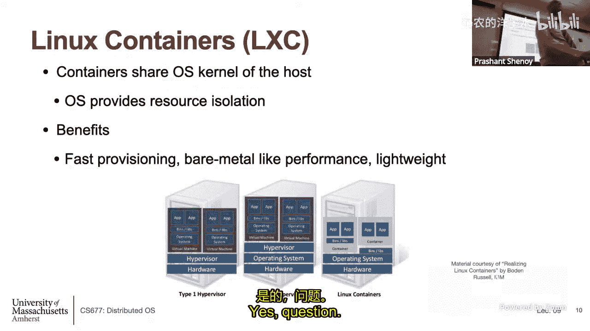

我觉。Take the topic。

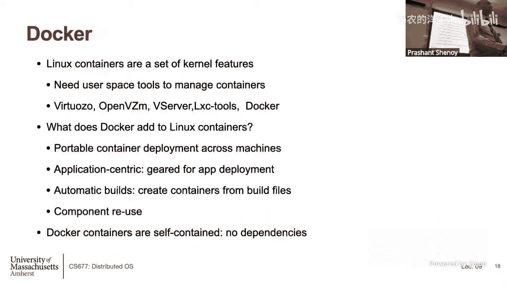

そういたはいて。Okay question is the code in the Docker desktop or do you need another hyper so when you install Docker desktop on a non Linux platform。

 it ships with a built in hypervissor and built in Linux kernel。Any other questions here？Yeah。

 question is if you see Linux containers is the host oil Linux yes。

 Linux containers only runs on other operating systems have their own containers。

 but not to say other operating systems don't， we only cover Linux containers because the world of Docker that's the most popular containerization technique。

So when you are running Docker， youre always running on Linux regardless of what you have on your machine。

 if you have a non Linux machine， there is actually hypervissor and Linux running behind the scenes。

A doctorcker can only run on limits。佢。😊。

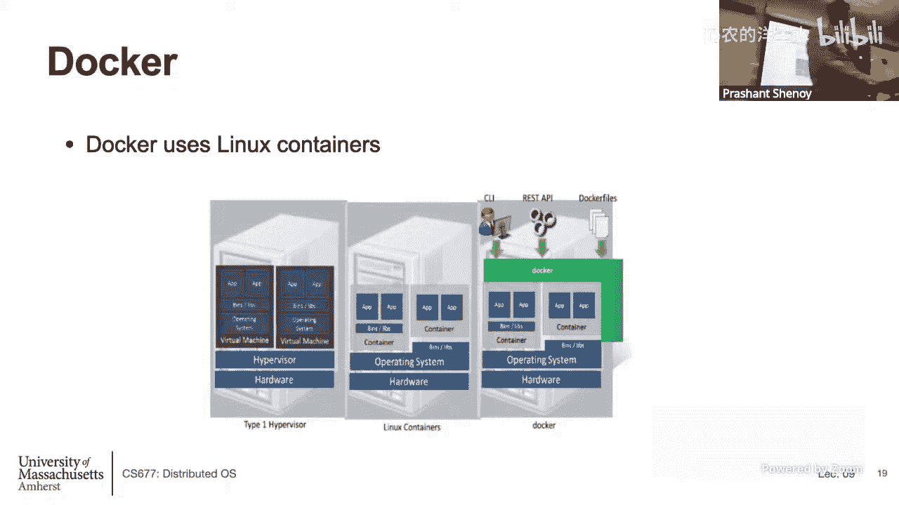

Any other questions here before we wrap up Okay so this is Alexia already mentioned this very quickly Docker images and use cases so you already constructed a Docker image for the class you built one right so you probably know what images so images basically the set of files that make make the container when you execute the image you construct a container so the image is basically the data or the files and so that's something that you have and then you have to execute it it starts a container and then the processes execute using the files that are inside the image a Docker uses some interesting file system techniques that allow you to not install files multiple times they use something called union affairs that only install the additional files that are not already present on the underlying OS it has all kinds of optimizations like copy on write which I will not talk about now will come back to this later。

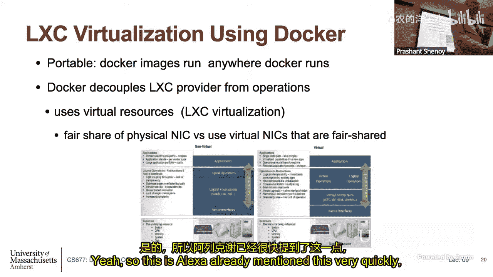

That makes it very efficient to construct an image to start an image and so on and their basic idea is you essentially you once you build the image you should be able to deploy it anyway so technically the image you built on your machine you should be able to copy it and give it to someone else and they should be able to run that image。

And thats why it's portable or alternatively we could have constructed a 677 image and just given it to you then you would not have run the build we just gave it to you so you can build it yourself but that is not necessary we can construct it and we can just distribute it as part of the Docker Docker hub you can download it from there and run it normally you do not build your Docker containers images you deploy they are already distributed on the Docker hub you download them and run them。

But in this case， because you' are learning about these technologies。

 we had you build your own images as so， so you can actually push and pull from the repository and just run it you don't really have to build these things。

Yep。So one last thing and then we'll end here， this is the very final case study in virtualization then we'll move on to other other topics。

 this is a case study called Planet Lab Planet Lab is essentially a test bed for students to do research experiments。

Essentially you should think of it as a distributed cluster across universities where each university has a small set of machines and then they say let's use this to do research experiments and then you take all these machines across all these university and make a distributed cluster where the machines are all spread out so as a student you can go and say I need maybe three machines to do some experiment maybe I'm deploying some web service and I want to do some testing and then you can get some resources on machines on university A some other machines on university B a third set of machines on university C and then you can essentially log into those machines and run experiment that is the idea behind Planet lab so the build is lot testbed where each university contribute some machines but then you could as a researchers or students use machines at other universities so why am I saying all this what I wanted to actually say is the way to built all of this is using containerization。

And technology。They didn't use Docker but they used a very similar technology called v serverver that's another Linuxux containerization technology that did effectively the same thing so if you wanted to create run some code on some machine at another university they would actually construct a container for you and create a user inside the container and then you can log in a container and on your code。

So that was called a slice okay so you get a slice of each server that slices effectively a container they are constructed and they UC groups to limit how much resources you can use。

So the interesting use case of using containers to build a distributed cluster and this is a one that is built specifically by students and faculty members to do networking and distributed systems recently the name has changed is the old testbed the testbed cell lives under a different name but this is how they made use of this containerization。

But that's a use case to keep in mind that's all I want to say about virtualization today。

 we will continue next time at some other topics。

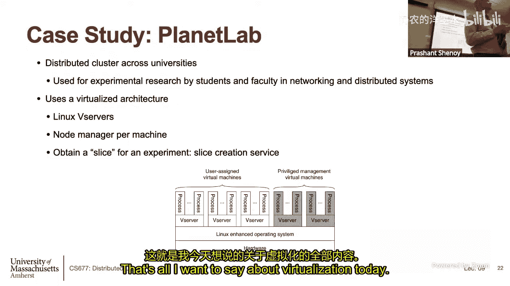