# 【全集 2025 附课件】马萨诸塞大学 分布式系统 中英字幕 p10 Lecture 10 - 云计算 -BV19BSYBuE4Y_p10-

Okay， so let's get started。Today we are going to start a new topic which is going to be cloud computing we will make the connection to all the discussion we had on virtualization so far and see how it is applied in both data centers and cloud computing and then in the part three of the class I'll talk about Kubernetes and orchestration and how that relates to both data centers cloud computing and also our container virtualization so so that's the agenda for the day what I wanted to also announce was roughly where we are in the class right so so lab one is done it was due earlier in the week we will hand out another lab sometime this week it's going to be you in early April right it's after the spring break so just keep that in mind of three weeks so even if you're not here for spring break you have some time to work on it but the other thing you want to keep in mind is。

The week after spring break is our midterm exam right so so there'll be a midterm and maybe a few days after the midterm will be the lab so just use your time well we have given it out several weeks in advance so you can get started early and not have time pressure at that so one of things that always happens no matter how early we give the assignment as people start late and then you run out of time you always wish you had more time and so on so I just wanted to tell all of you that we will give you labs fairly early but it's up to you to use your time well and not put everything after the last week then you have to deal with an exam and midterm exam and a lab you more or less at similar times so keep that in mind but well continue our discussion on。

On these issues so today is cloud computing and then I think we are going to switch gears and start talking about other topics so this is kind of the last of the topics that relate to virtualization will start with data center Im want to explain to you what they are we'll talk about cloud and Kbernet Okay so what is a data center think of a data center as a facility that is used to house and run very large number of servers okay so there are applications that we need lots and lots of servers the facility。

That you actually house them because they are referred to as data centers。

 theyre also called server farms or storage farms depending on the size of the data centers they come in many different sizes you may have thousands of servers or hundreds of thousands of servers depending on the size of and the storage that you can see in these data centers can run in Pete so what are they used for so they are very common in companies of all sorts the data centers are the one place where they have their servers that's the servers of what are used for running all kinds of server applications that you need for an enterprise so for example even the university and enterprise and the university data centers will house applications like you have spIre for doing registrations and you have canvas for learning management so these kinds of applications typically run in data centers。

就。So that's the enterprise use case Internet companies use them at very large scale this is companies like Google and Facebook and Microsoft they have all kinds of services they offer Google Ma and Google Docs and YouTube and social media applications those also run on lots of servers in data centers and we'll talk about cloud computing today there's a third use case cloud computing platforms run on data centers and offer these resources to end users and customer so and the types of thing workloads that run on data centers range from data processing workloads online services that are web based all kinds of business applications so let me show you a picture。

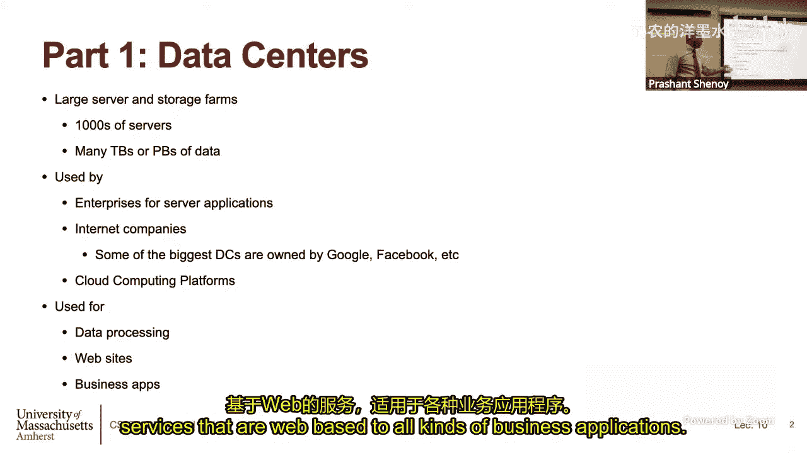

So so here is a picture of one aisle of a data center which so the way the picture mental model of what you should have in mind is you've been to a supermarket right so the way a supermarket is laid out it has aisles and there are shelves and shelves have grocery items or food item you should think of a large supermarket like facility。

 but usually even larger that have aisles and aisles in this case are actually going to host servers right so here's an example of an aisle in this large facility and you will see that there are racks of servers right so and there are many such aisles each of them will have its own set of servers and so on and then there are many。

 many aisles so these are very large facility it's a giant warehouse or a facility that's filled with racks of servers。

 storage arrays and so on and to build a data center you not only need to have power infrastructure。

To power all the servers， the servers are going to consume a lot of electricity okay in the aggregate。

 especially if those servers are GPs on them GPUs are very energy intensive so the servers consume a lot of electricity。

 but in addition to doing that the servers also generate heat。So any machine。

 if you have a laptop if you touch youre doing computation and you touch its underside you will see that it's running more because you're generating heat as it computes servers are not going to be any different so they generate a lot of heat which means that they need a cooling infrastructure a very large cooling infrastructure to cool all of the servers so that they don't overheat so in addition to the compute and storage infrastructure that you will see in a data center you will also have a cooling infrastructure you will have a power infrastructure to power these servers and you might have backup generators if the power theres a power outage from the grid you might want to use backup power to keep all the servers up and running so so I needless to say it's very expensive to build these data centers later on we will have some more lectures where we will get into what is the energy consumption how do you make。

them energy efficient and so on， but that is something we will defer to a lecture where we talk about energy aspects of distributed systems and data centers so today I'm not going to get into this material but I just want you to know that the electricity bills that this data center generates can be in millions of dollars right unlike your home electricity bill might be 1 hundred0 or something but these consume so much power that it costs a lot of money to just power these data centers so they are expensive to build they expensive to run as well。

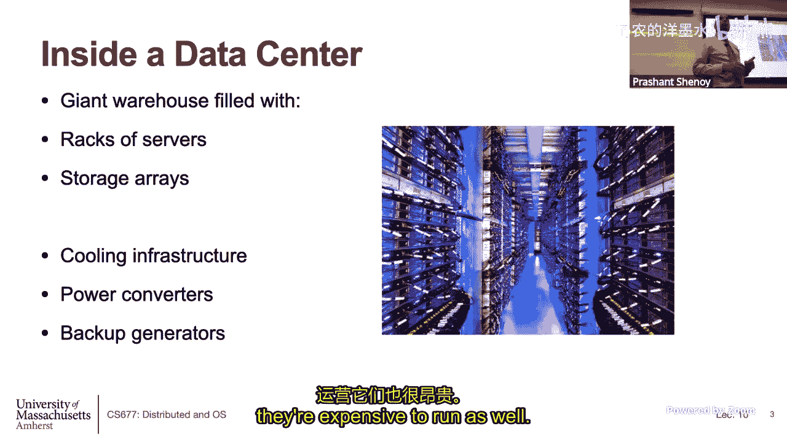

Now data centers have been around for a long time because you know there have been servers that have been running business applications and other applications for many decades but they have changed in how they have been designed over the years the more traditional model for data centers was what is called a static model where they are physical servers you basically deploy applications on the servers and the system administrators manually manage which application is running on with servers how much storage to allocate to them is all handled by a group of human system administrators that are monitoring needs and as needs change they can change the allocations and so on so that is how data centers were designed and built for many decades until virtualization technology came along and that made things much easier and I'll show you some pictures in the next few slides so now rather than running applications on physical servers。

These physical servers will run a hypervisor， typically a type 1 hypervisor。

 which I already talked to and you then have virtual machines that are built on these servers and applications run inside virtual machine this makes it much more flexible to map applications to servers because if let's say server gets overloaded you can migrate or live migrate that Vm to some other server that's not using all of its resources。

 So so now the mapping of applications to server no longer needs to be static you can resize the virtual machine you can move it if the server gets overloaded and so on which allows for a lot more flexibility all this is a way to say modern data centers use virtualization technology quite extensive。

 In fact， virtualization is at the heart of all of these data centers and here are some pictures to show you all of these things。

 So there are two use cases I'm going to talk about So here is a rack of servers I should showed your data center I said。

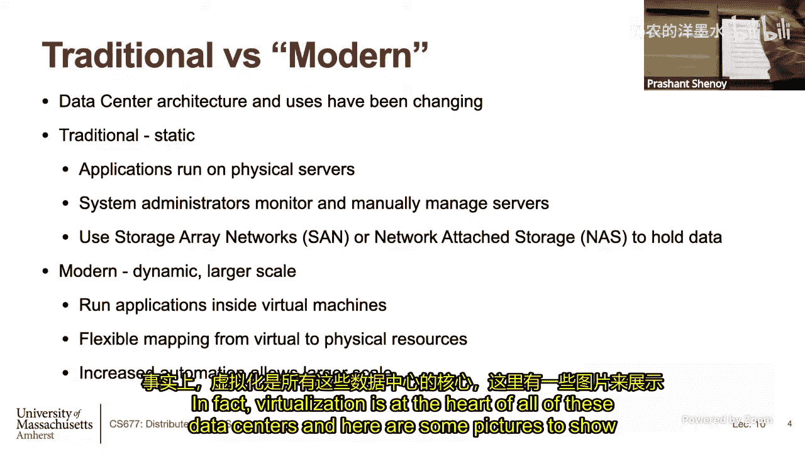

Many aisles aisles are racks here's a rack rack is basically a stack of servers that's one of them that blue thing that's on top of that server is essentially hypervisor the server is running hypervisor and you will see that there are six six virtual machines that are running on this server each virtual machine as its own OS and then it runs some application so this is essentially each of this virtual machine is a virtual server okay from outside it just looks like a server you can log into it you can restart it and so on except that it is running as a virtual machine on a physical server so this allows us to do various things this is what is shown here is essentially consolidating a set of applications onto one server or rather than running this application on separate servers you made a slice of a server which is now a virtual server that liess。

😊，A virtual machine that virtual machine has some fraction of the resources on that physical server allocated to it some number of course。

 some amount of disks， some amount of memory and then you ran an OS in there you run an application so now you could pack six of these servers onto one physical server rather than six different servers you can have one bigger server and build six smaller virtual servers and then run your applications so it just makes things more efficient it is faster to deploy because you are using virtual machines to deploy its easier to maintain because you can move them around and so on which I show you as well that's one use case of virtual servers。

But then there's the other use case which we also talked about which are virtual desktops so so you what happens in virtual desktops is I already showed you type 2 hypervissors right these are hypervissors that you will run on your laptop multipass is an example and last time I showed you parallels and so on and you can run an OS in them and applications in now imagine that rather than running this on your laptop you actually have a server that is running virtual machines and then the server runs a desktop operating system it doesn't run a server operating system and it runs essentially somebody's applications in it and so rather than having your PC。

Data and computations on your machine you are actually going to have your machine connect to a server somewhere okay then the server is running a full fledged PC like environment okay which is really a virtual machine and application in them so you connect to it and you do all your compute。

So what this means is now your data， your applications are not on your local machine they are actually in a server there。

 the local machine is simply connecting to that server and doing all of the compute remotely and you can have a graphical environment you don't have SS in it because you can but this is just you have a full fledged graphical environment you can connect to it and so on so in this example you see that there's a user at work you see here that theres no PC that is shown there's a monitor and a keyboard because you're literally connecting to a PC in a remote server and doing all the computations there you can go home and you can use another machine in this case that says's home laptop but rather than running the applications actually on the laptop you' are connecting to a data center server and then doing your computer so these are called virtual desktop there are many scenarios where this is actually preferred than letting users run application locally so for examples you might go to a supermarket checkout counter right that。

😊，Check out counter when you are scanning your items there is a computer that's scanning often that computer is actually not a PC running locally but it could be a VM running somewhere else and that computer that isre doing a scanning is simply connected somewhere else and all the building is that is showing you is the app that is running somewhere in a cloud data center so these are some examples of what you can do with a data center so you can have server applications you have virtual desktop and application also。

Is this clear any questions here？

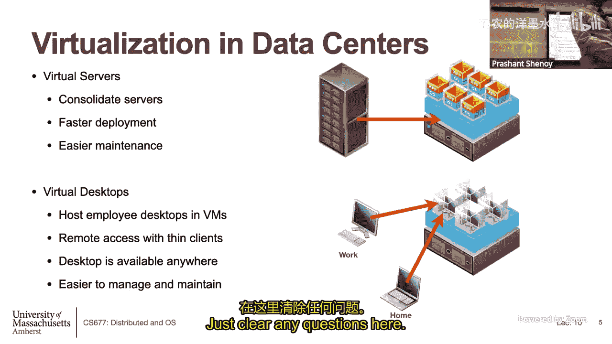

Okay so now I'm going to show you what we talked about last time but more in a data center context as to how you can use things like live migration and things of this sort so already said a server can be sliced into multiple virtual machines so let's for example now take two physical servers not virtual life right so this is a Windows machine that's a Linux machine so that's an orange application that's running on Windows blue application is running on VM now this is normal server。

 no virtualization now let's assume that there is a server there that's on top that's running a type1 hypervisor and you wanted to run these application using virtualization what is going to happen is you will not run them on a physical server you will construct not two virtual machines one virtual machine will run Windows that's VM1 and you run the orange application in there the second virtual machines running Linux you run another application in it so now you are running that those application。

On a single server， in this case， using virtualization。

that should be clear as to how this works but now what does this give us why would we have not done the what we had previously so here is something you can think about right so so lets say the load on the Windows machine has grown。

😊，If you had run this on a physical server that I had shown you previously。

 that server go gets overloaded。😊，Right and then you cannot actually run that application anymore because the load on the machine is too high now in this case。

 also the VM is become overloaded because you have。

Essentially grown the load inside one of the virtual fish but because this is a virtual environment you could do things that you could not do with physical machine in particular if there is another server in the data center okay I could live migrate that VM to this data center sorry to that server right so that Vm that was running here as mode here。

And I could just migrate it now Ive freed up resources on the first server。Okay。

 so now I can run that virtual machine because it has now more resources to use。

That it did not have previously Now this can be done fairly simply because I just explained in the previous class how you can live migrate a virtual machine with no downtime But if youre at physical servers and you wanted to do this you would have to go buy an extra server then you would have to move physically copy all of their data。

 move it recreate it and so on so human administrators is to perform this task。

 which takes much longer here you can rapidly do this in matter of minutes but with physical servers it might take hours or if you do not have a server first you got to go buy it and so on but let's assume if we even had a server it would take someone hours or days to do this here you can do it in minutes So virtualization has allowed us to adjust the allocations of virtual machines as they change I can give that Vm more resources or less resources I can move Vms around using migration and so so this is a level of flexibility that allows administrator。

To do things in a much more simpler fashion so it is advantageous in fact。

 there is there is a third layer that is called an orchestration layer which well talk about that can even automate this process so human administrator doesn't even have to do this does that monitoring software will figure out one of the VMs is overload it it will automatically migrate the one of the VMs to another machine to free of resources so you can even automate this entire process so that its done without any human intervention at all。

So these are all advantages you do not get if you did not have a virtualization layer running on top of the server。

 so this is why all of the data center servers are virtualized and you can use this additional flexibility as a result of all of this。

Any questions here？This is clear what I said。Okay， so there are many of these technology I already showed you last time in typeype 2。

 you have things like parallels and virtual box and Z VMware actually builds both typey 1 and typey 2 hypervissor。

 Linux as KVM which is Sky of a type 1 hypervissor。

 so you can do this in Linux without buying any software at all if you want it。

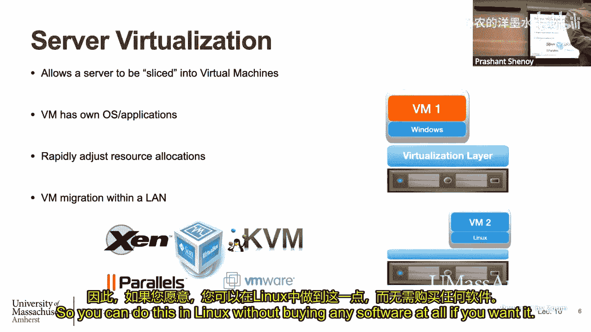

Okay so let me now give you some idea of how you can think about data centers and costs and efficiency and so on I already explained to you that running a data center is expensive because your lots of servers first of all those servers cost money right if there are GPUs in them they also cost money but once you bought the server running the servers also is expensive because they consume a lot of electricity。

Right and then I said you have to then cool the servers which is additional cost because you are to run ACs to actually cool the server that also consumes electricity right so there is a way to decide how efficient your data center is right so I going to show you two ways you look at it one is you can simply look at this is a pie chart that telling you for a hypothetical data center what is a monthly cost is just an example and you will see that the。

Now the green part is the electricity cost， the red part is the power width or infrastructure cost and then the blue is essentially server。

Amortize server cost of buying if field let's say buy the server and amortize it over a three year period thats the cost so you will see that there is significant cost that you will incur all numbers that are in the millions of dollars this is a small data center larger data center this just hundreds of millions of billions of dollars but it is just example tells you that cooling and electricity and power cost are substantial so the metric that is often used to measure how efficient a data center is is called PUE power usage effectiveness that metric is simply a issue。

It is the ratio of the total power consumed by the data center over the server power or what is called I power。

 but it is really server plus switch power。😊，So so if you think about it what is the total power consumption of a data center it will be power used in cooling all the ACSN and maybe all these external lighting and things of that sort and then the power used to actually power the server itself electricity used to power the server so the deummerator is everything think of it as the total bill that the data center pays every month there is all of the electricity in this case okay the denominator is the electricity consumed by the servers plus network switch as we ignore the network switch as just the servers。

So， that is the ratio that ratio tells you how efficient your data center is typical ratios for Pe run as somewhere between 1。

7 to 2 so what that means is for every unit of electricity that the server consumes this 07 units of electricity used to cool the servers for everything else the data center needs to 70 percent extra has to be put in just to run that server。

Now clearly the closer you get to one youll see that it more efficient the data center is because for every unit of electricity。

 the extra power you use for everything else that you need to do in the data center is small at data center is more efficient all of the power is actually going into the servers which are the ones doing the work so so there are companies like Google and Me and Microsoft that have tried to optimize this by building more and more efficient data centers and there are numbers are getting closer to 1。

11。05 and so on which means there's 10% over it or 5% over it so they are very very efficient the way they do this is that they optimized the cooling infrastructure for example rather than running ACs they use something like free air cooling you can put the data center in a cold climate and then just pull outside cold air to cool the data center rather than cooling it using air conditioner。

So that's much cheaper than actually having an AC doing the work， for example。

 right you can do that for many months of the year。

 you are essentially getting less expensive ways to cool your servers and reducing your electricity cost and running things more efficient so all kinds of interesting optimizations to make this more efficient but the only thing you really need to know is the efficiency metric is called Pe is total power over the I power or the server power and the closer that ratio is to one one is idea no one can do one because that says that there is no cooling needed no extra thing needed。

 but the closer a to one the more efficient you are typical data centers are in the 1。

7 to2 rate because they are not super efficient in that regard they do have extra power they consume to run the air conditioners and so on but the most efficient ones are running closer to one these days。

ok。Any questionsです？There are lots of interesting ways by which you can optimize the PE of a data center which I will not talk about in this class but there is papers that you can go and look at that tell you how to make this infrastructure more efficient。

 lots of interesting things like Microsoftt for example built a data center that they submers in the ocean and they are using ocean water to cool the data center all kinds of stuff that you might think is not crazy but people have try to use it to make this data centers done more efficient。

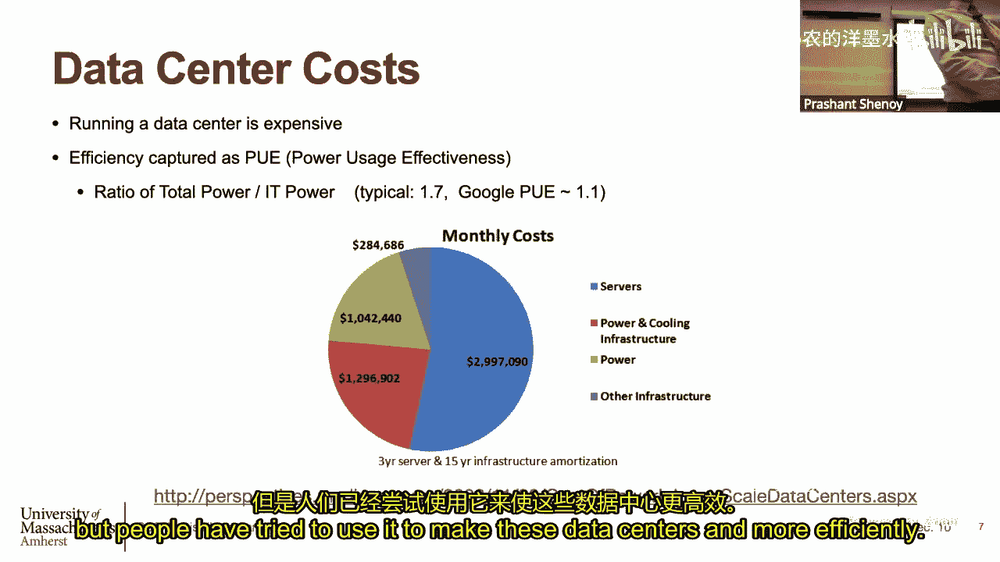

Okay so will that background I'm going to now switch gears and talk about cloud computing we'll talk about different flavors of cloud computing what they are used for and so on so first of all what is it what do we mean by cloud computing so I have very basic definition it says it's the use of remote servers to run distributed application thats the basic concept that is not enough by itselfel so so cloud computing essentially means that your applications you want to run you run them on remote server now of course you can run application your application can run on anedla server that doesn't mean you're using cloud computing the other thing that goes with cloud computing is that there a charging model associated with cloud computing where you don't own the machines you are renting the machines or the resources so you are used there will be pay as you go model it says how much resources did you use and you get charge。

Based on so mainly the cloud computing model switches the way you actually user server or some having to buy them to having to lease them or rent them。

And that's what we are going to see so essentially a cloud computing platform at its heart is just a data center。

 but this data center is owned by the cloud provider that is selling resources to any user or a company。

 any company can go and say I want to rent 10 server or five servers or just one server around to rent them for a day or one year can specify your requirements a cloud provider will create one or more virtual machines to meet your needs and allocate them or storage to meet your needs or allocate them so there is no need to create or deploy your own data centers in this case because you can go and rent them very easily。

So it's much less expensive。😊，We are small as well as large companies to go and buy resources they need on the fly rather than buying servers and then deploying them in their own data centers they're already told you it's expensive to build them so the benefits and we' see some details of all of these in the next few slides so the benefits of this is you can access these servers from anywhere on the internet it's a billing model that uses pay as you go you pay for the amount of resources you need it's highly scalable you can obtain resources on demand if your needs change。

 you can say I need another server or another100 servers and they're ready within minutes or which is very useful and if you don't need them you can say I'm done hand them back and you will not be billed for them anymore so you can acquire and release servers storage resources on the go I only pay for what you are using rather than hand to buy a lot of servers and they're setting there idL because you don't have applications to run on。

So， it shared in the sense that the cloud provider in this case is selling。😊。

Server capacity to lots of different customer right so so the are many customers which would be companies are single single user developers that have leased capacity and they are all using servers in a data center so they're sharing the resources that are present in a data center but from the cloud provider standpoint they build a gigantic data centers they have economies of scale so they can afford to lease these resources for a much lower price than if you are to build your own so that's the advantage of。

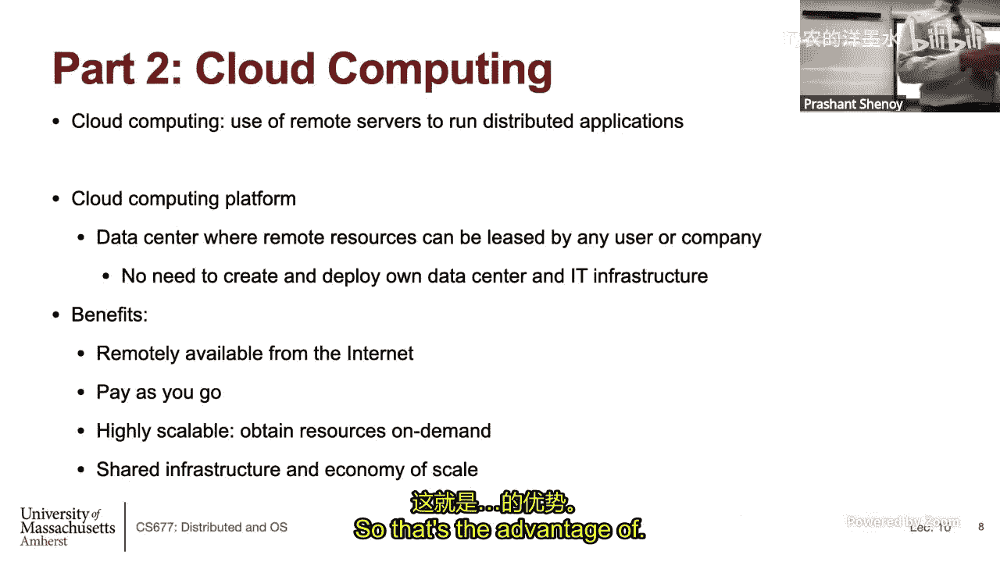

Doing it this way but now let us get into some of the details of how cloud computing works so so as I said you are essentially in the cloud model trying to rank resources。

😊，From a cloud provider there are many cloud provider Amazon runs a very large cloud platform。

 Google runs a Google compute cloud platform if you heard Microsoft Azure。

 Azure is Microsoft cloud platform and there are several more Oracle and Alibaba and so many companies run these cloud platforms but then question is what is it that you actually get from this cloud platform and you as a user or a customer want to get resources from the cloud so cloud resources come in different flavors and this slide talks about three very important ways you can lease capacity or resources from the cloud depending on what you are getting when you ask the cloud provider for resources you can have what is called an infrastructure as a service or IAAS is acronym IAA cloud and get a platform as a service or what's called PA or pass cloud or you can get software as a service or what's called。

SAAS cloud， these are essentially three flavors of cloud platforms。😊，So how are they different？

What is different across them is what is the core block of resource that you actually get from the cloud provider at the infrastructure as a service cloud you go to the cloud provider and ask for servers in this space。

So you will get a virtual machine， you will get this and then you as the owner of not owner but the user of that virtual machine can deploy whatever you want and you can deploy whatever VM OS you want whatever application you want so essentially this is the bare bones you just go and say give me some number of servers and then the cloud providers a here there you can then run whatever application and OS you want inside those server and then you have to manage those servers like you manage anything else so this is essentially raw infrastructure so its called that is why it's called infrastructure as a service club。

One level up is called a platform as a service cloud so in this case you do not go and ask for individual servers what you do is you say I have an application I build this new Java application or build this new Python application and you say deploy this application for me and then essentially the cloud provider will take that code and they will develop it they will deploy it on their platform。

 they might have a Java platform the build they will take a Java code and deploy you are not asking for servers you are just telling them here's my code deploy it on your platform it will run Java code or Python code or lots of different languages or support now in this case you are going to be build by the number of users that are accessing your application so they will monitor saying you got  hundred000 requests last month I will charge you a penny or some fraction of a penny per request so your bill is going to be this。

the cloud provider will take care of figuring out how much servers to allocate to your application you as a developer no longer are to figure out should I buy a small server from the cloud a big server on the cloud you don't deal with that you just say here's some code deploy it and the cloud platform will figure out based on the workload wait to run it should it be run on a big server small server they figure it out you are just paying by usage not by how big the server is。

The previous case， you as the cloud customer are actually how to ask for a server of a certain size。

 The cloud platform might have 10 different configurations。

 You can say I want a server that has four core and so much ra or I want a server with a GPU in it you are to specify what you want and they'll give you exactly that type of server and you pay for that server often by the minute or by the hour depending on how many minutes you use or hours you use if the server is too big your application doesn't get enough workload you are still paying for that server it will have unused capacity if it's too small because you got a lot of workload then you have to go and get a bigger server and move your application thats that's what you will have to do the platform has a server cloud you just don't worry about it。

 they will handle scalability as the cloud provider will hand scalability for you you are deploying applications on a platform Thats what they give you a platform you deploy application the cloud provider manages everything。

And then you have software as a service cloud so here you have essentially a cloud that has prepackd applications and then you as a customer you basically say I want to get a this application for so many users in my organization or as a single user so example of this is things like Gmate。

That Google Mail is a software as a service for mail application right so as an organization like UMass well go to Google and say there are 20。

000 students at UMass， we need Gmail service for 20000 users and then Google will say okay each user you will pay so much and then so this is your monthly bill they take care of the application code。

 they take care of figuring out how this what types of server to run so its one level above where you don't even develop the application the application is prepackd and you are just hosted by a cloud provider in this case so our canvas which access also a cloud application not running on UMas server running on somebody's cloud server in fact the company that develop Can offers a cloud service or you just go and say we need this learning management system for these many students at at the university and then they're paying based on。

So different layers of the stack okay here you are essentially renting hardware really renting virtual machines that run on hardware but its almost like renting hardware here you are renting hardware plus packs a software that is allows you to run applications if that' is configured by a cloud provider here you are renting entire app。

😊，So these are the layers you are to really keep in mind as far as this class is concerned you'll actually be using infrastructure cloud you will deploy some of your lab code onto cloud platforms in the next lab or two so you will get some flavor of what it means to actually get a cloud server now to deploy code and so here has an example now of infrastructure as a service cloud this is an example for Amazon's EIA cloud it is called El compute cloud or EC2。

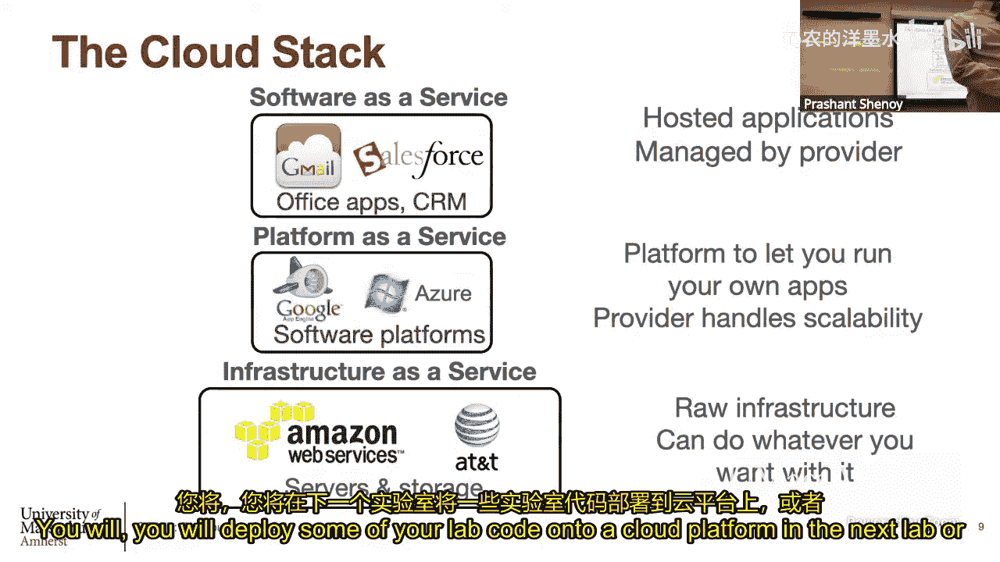

The Amazon's cloud that offers you the servers is called EC2 it rents servers and storage to customers and has uses virtualization to share these servers so they have large servers they carve it up into virtual machines of many different sizes and rent out these virtual machine so here is a。

An example is really a toy example at this point because Amazon's E to clouds has hundreds of configurations its showing three right so here it says you can get servers in three sizes a small medium server a large server a small server as one core a medium server as5 core a large server as 33 and a half core I don't know why theres a half but that's what they did at one point and then this is the amount of Ram associated with it and they give you a price you say this one cost 2 cents an hour to rent。

😊，This one costs 17 cents an hour and that costs 2。

10 cents an hour and it comes with some amount of storage and then if you need more you are to pay by the gigabyte and it is also some amount of bandwidth so you can get a server and if you run it for just one hour and say I'm done you will pay 2 cents because thats their charging so they actually charge you at a very fine grain level or if you use it for a month you will basically pay a few dollars for that month。

So that is how they are going to bill based on what you ask and then you can simply go and request these servers saying I want one or 10 of them or 100 of them and they will provision them very quickly in matter of minutes all your servers will be ready and then you can log in to them and do whatever you need to do and then they will charge you accordingly。

That's an example of how you actually use infrastructure as a service cloud to deploy application and the virtual servers you can deploy any OS you want and you can say these to run Linuxux or initially to run Windows。

 they even have Mac OS as one of the offerings for example。Yeah。Okay， so now。

There are actually many different flavors of servers you can get I just mentioned that you can get small medium large servers but depending on what kind of charging or what kind of commitment you want to make you can also basically get the server the same server configurations in different flavors the default one is called onde on demand says as a cloud customer you can request the servers at any time they will be created for you on demand or on the fly you can keep them for as little or as long as you want you terminate the server whenever you're done that's the basic model you pay by the minute you provision on the fly you pay by the minute you keep them until terminate and there is a building model I already showed you that was for the onded bill but suppose you want a servers for a long period of time so I want it for three years not one minute or five minutes。

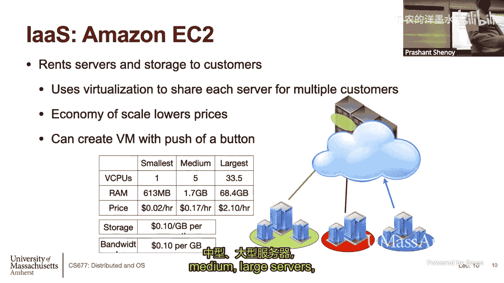

So in that case， you can get some these same servers at a discounted rate these are called reserve instances Re instances require you to make longer term commitment the minimum commitment is one year so you can say I want a server for one year I want the server for three years in this case you are going to get the same server but because you're committed for a longer period you will get the same server at a lower price on demand as there's no commitment is no contract or anything you can keep them for as little or as long as you want but if you have the ability to make a longer term commitment you get it for lower price a discounted price because that way this cloud provider knows that they can have you as a customer for a longer period so if you need server for longer。

😊，Reservd instances are the way you are going to actually go and then there is something called spot instances S instances are a way for the cloud provider to sell excess capacity that is unused sitting idle in their cloud data centers at highly discounted prices。

Yeah so what they do is let's say the cloud data center is 50% utilized at some point so 50% of the capacity or servers are sitting there id so they are not making any money because nobody has used those server so what they do is they take this excess capacity and then they say here is a highly discounted price I'll give it to you as one tenthth the price of a one demand so you got 90% discount or 70% discount so you can go and say I will take a spot server because it is more cheaper than than all demand。

And then you will get that server if the server is available you are going to get it at a much lower price than an ondemand server but there's one caveat when you have a spot instance which is that the server can be reoked taken back by the cloud provider if the demand comes back they can say that I need the server back because I actually a regular customer so it essentially you' are renting idle capacity for as long as the capacity is idL when the demand comes back they have the ability to take it back this is not the case for onde and reserve once you get the server it's up to you as a cloud customer to keep it for as long as you need and then return it。

The cloud provider doesn't come and。 I'm going to take it back。

 but in S instances they are going to give it to you at a much cheaper price。

 but they have the ability to pull it。 doesn't mean they will always take it back maybe your job is done you have a six hour machine learning training job you get sports servers。

 you run for six hours and then you're done and you' got the same work done at a much cheaper price but if somewhere in the middle that there's demand for onded server some regular customers they will the cloud provider will send you a warning saying okay the server is going to and then pull the server So in this case the application has to make sure it can save its state and resume computation at some other time。

 otherwise you lost all your work so you don't run web services on sports server obviously should be clear because the server disappears a website was done So this is good for running bad jobs things like MLl training simulations where you can actually pause and restart later and things of that。

So it is useful for certain types of workloads and you can then get the work done for a much much cheaper price。

Yeahep。All so so those are spot instances， so you have these three flavors of servers you can get so as you can see there are all these perutations that you got to think about。

So next up is platform as a service cloud because so as Ive already said， in this case。

 cloud resources are offered as a highly scalable runtime platform as a cloud developer of cloud applications you are not now asking for servers like you did previously you just bring your application you develop your code and then you go and deploy this code on the platform the cloud platform will figure out how much resources to provision so in the back end they'll say should you run on a small server medium server you don't see any of that you just see that you deploy your code and maybe it's a web service it's getting requests and then youll figure it out and moreover it can do autoscaled application the workload goes up cloud provider is responsible for moving that application to bigger server because they are charging you by the request the application gets overloaded and request don't get server。

 they are losing money because they could have servers that request and charge you for it。

SoIt is in the cloud provider's interest to make sure the application gets whatever resources it needs so that it can service the workload and then they can build you for it they are charging you literally by the request every request that your application services will cost a small amount of money they will add up all the requests that were serviced and then you have to pay according to that as opposed to saying I rented five hours of the server in this case you say my request the code service application service 10000 so that's how they're billing you so all kinds of languages are supported so you can bring Python application Java application node Js applications do dead applications just deploy it not have to worry about getting servers or anything like that。

So as a developer， it's simpler。😊，So as opposed to getting your own servers and deploying it and you don't need to probe manage your own servers building is based on workloads and talk about a model called serverless computing which really looks like a platform as a service cloud but this is basically what it is。

Any questions on thisす？Okay， so。That is a new model for deploying。

Applications in a platform as a service cloud which is called serverless computing it's very similar to platform as a service cloud So what happens in this case is developer deploys code on a platform eliminates the need to provision servers the cloud platform essentially as a platform or each server can each application or can be scaled up or down based on the workload that seen and if there's no workload you can even scale it down to zero whenever request come you scale it so in in this sense there is no difference between serverless computing and platform as a service cloud so far but the main difference comes in how you write the application the platform as a service cloud you can bring any Java application or any Python application and they will give you a way to deploy it in a serverless computing environment you have to actually deploy your application using a model or your。

Write your application code using a model that' is called function as a service in other words you make your application highly modular and you are literally writing individual methods or functions and then deploying a set of function。

😊，As a request comes in， the applicable serverless platform will invoke a function and hand the request the function services that request and generates a response。

😊，Now because your application might have multiple function not just one you can chain these functions together so you can write your application as a set of three functions which say okay request come you invoke the first function for the function that function can then invoke another function and then that can invoke some more function and then responses are generated and so on so you write your code as a very modular set of functions functions could be individual it's a small application because one function is enough if the bigger application you write a bunch of these functions and you chain them together and then youre essentially going to invoke these functions and then the functions can invoke other functions。

😊，The functions are typically stateless which means that if you have state you are to put it into databases and so on because the code may not run you dont actually want to assume that I can keep code in memory variables and so on because they can simply delete the application completely if there' is no workload so typically you do not say put any state in the code of the function you typically keep all the state on disk or in a database so you are to write the function in a stateless form and then deploy your if you write your code this way you are using the serverless computing mode this is the most modern way you write code for a platform as a service cloud using a serverless framework。

So we will essentially put it in this format right so you have to modularize it。

 think of how do you have this function they call each other and so okay at a very high level if you think about it those functions are kind of like similar to remote procedure course remember we talked about RCs and RMs you should think about this as a flexible way to deploy rpC like code in the cloud except that each rpC is now separate block。

 you don't have one big application with 10 Rp you write them in separate things and then chain them together each rC makes another rC call in another process and so so its that type of model but now in the cloud format Amazon has something called Aws lambda that essentially allows you to deploy this this is also as you will see when we talk about web application we talk about microservices microservices are also a way to build web applications you need tiny services。

Start resembling functions， but functions are even more fine grain than Microsoft there are even smaller snippets of code。

That you can来。So so this is actually a very modern way of writing cloud applications if you want to use platform as a service club so I will Ill point you to a paper that describes this in a little more detail where you can understand this better。

We are not going to use server risk computing in any of the labs。

 so this is the only time you'll actually see it。So the last thing I want to say here as far as cloud is concerned is three types of cloud platforms。

 one is called public cloud， one is called private cloud， one is called hybrid cloud。

 whatever I have been talking about so far is what is referred to as a public cloud。

Public cloud essentially means that the cloud provider in this case these are large companies like Amazon。

 Microsoft， Google that run this cloud services and they are open to the public any user any company can go create an account on that cloud platform and start requesting servers。

And then you just have to have a way for them to bill you and pay for it so as an individual user you can go to Amazon's CC to cloud and then ask for server and in fact as part of the lab you will actually do that。

😊，So now not all enterprises companies are comfortable with saying let's just go to Amazon get some servers。

 put all of our data on Amazon servers and so on because the data might be confidential it may be private so you just don't want to go and put it on third party cloud server okay so in this case okay what they do is they build their own cloud which they call a private cloud。

The private cloud is essentially has all of the features functionality I talked about but it is a cloud that deployed for a single enterprise so the users of that enterprise are the only ones who can request resources from that cloud so think about let's say UMass wants to build its own cloud it could build a data center and have servers and allow you to lease resources as research students or research star but this cloud is not open to anyone else it's closed and is only available to individual users or groups within that enterprise。

So that's called a private club the advantage of a private cloud is the company now has more control or the servers they know that the data is now more in their control because there are all kinds of legal regulations you have to follow when you have data for a bank you just won't go foot somebody your customers credit card data on some servers because if there is a breach then you are liable for it so you have to protect data in many different ways so in this case it is this is the way you are actually going to use cloud functionality or benefits of cloud but not have to go to completely open cloud can you are create what is called a private cloud so you use cloud computing concepts in a private data center that the enterprise is going on but it does all of that automates of VM management deployment you can go and request VMs and so on cost maybe a little higher because you don't get the economies of scale your data center is not going to be as big as Amazon。

Data center because they have 10000 enterprises using them your one enterprise。

 so your data center will be smaller， but it will give you all of the other benefit except for the economy of scale benefit。

That's called a private cloud okay large companies have their own internal cloud which are private clouds but many companies also use public cloud resources and the hybrid cloud as the name suggests essentially combines resources from a private cloud and a public cloud if you are have some of your applications running on a private cloud some applications running on a public cloud those collection of those resources across both is referred to as a hybrid cloud it is a public cloud and a private cloud combined in some manner and the way the reason enterprises actually need to make a hybrid cloud in some cases is you deploy a private cloud you have your own data center maybe you bought 10000 servers to put them there at some point you might say I'm running out of capacity。

So if you are in just using private cloud， you have to go buy servers and it will take few weeks to arrive and deploy。

 but if you could just go to public cloud and just for a period of times I need1 hundred servers because I am0 server short。

 you can just get them and deploy them for some application。

 maybe the less mission critical ones where you don't have to put lots of sensitive data on a public cloud platform but the less sensitive things you can still run on those server in this case you combine resources from a public cloud and a private cloud to meet an enterprises needs。

And when the extra demand goes away you can relinquish those server and go back to using only your private so many large companies actually do this they will have their private cloud but it is a sized or the size of that cloud or data center is designed for some workload in mind and if the workload capacity goes up then you might have to temporarily overflow into a public cloud and then get resources there so this if you do this is called hybrid cloud and there software to move data back and forth that you can deploy that's called hybrid cloud software and so on yes question there。

Okay， your question is。Is a combination of servers on a public cloud servers on a private cloud and storage in a public cloud considered a hybrid cloud is that your question so that's a form of hybrid cloud typically you will do the opposite just to be clear you want to keep your data in your private cloud because data is has to be more secure and the compute might be elsewhere that might be remotely accessing the data that whether data never leaves your enterprise premises and it can be secured once you put data somewhere else you got to secure it for it doesn't mean is not secure but you have to take extra steps to secure it so that but yes what you said is also a hybrid cloud。

不上人。Where does the unity fall question is where does the unity computing cluster fall So the unity cluster for those of you who know unity is Umass is GP and CPU cluster so youre doing research that requires you to do things like MLl training or any of these large workloads you go get an account on unity and you deploy it so as it turns out unity is not a cloud at all it's a cluster it is essentially a it uses a distributed scheduler which you talked about three or four clusters remember it talked about slur and so on so in unitity you get an account you basically submit jobs and the scheduler is going to then take your job and put it on some servers and send it back so it's only going to run batch applications youre not renting servers neither do you have any controller which job runs on which server the scheduler decides it in this case you actually go and rent servers there your。

Sers until you rent them you can log in into whatever you want with them so unity is not a cloud unity is a compute cluster that allows provides computing services to end users it is not really a cloud in that in that regard。

对。Allright so with that we just wanted to talk a little bit about cloud workloads and we'll talk about Kubernetes Okay so we talked about all kinds of cloud flavors。

 infrastructure as a service platform as a service software as a service so all kinds of workloads are run on them these days the most common one that actually made clouds popular where to run web application web services on them we deployed websites and web applications okay so they ran on these cloud services you could rent servers and then run them then they became popular for doing batch processing applications things like data processing MLl training is now lot of machine learning training happens in the cloud The reason is GPs are very hard to buy okay there's no capacity there's always out of stock but these cloud providers already a tens of thousands of GPUs available for rent so you can just go rent these GPU machines。

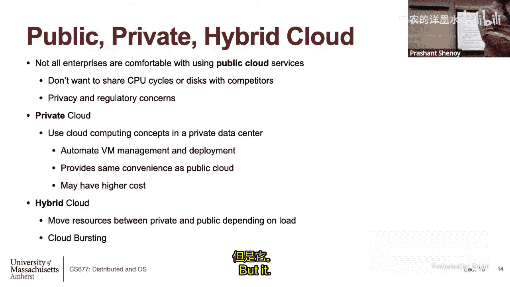

Upload your data， run your whatever Py or Tensorflow training and get the model and then you give back the machine and you only pay for that time rather than buying very expensive GPU servers right so that's batch processing and data processing and I already mentioned mail training so these required to get cloud server specifically with GPU there are all other other kinds of scientific applications in domains like physics and astronomy and chemistry and medicine they have large data sets they use them to run simulations or do other data processing all of these tend to be good use cases for cloud services so this is now become very popular model or running large scale compute don't buy instant rent and if your workload is not going to run for years at a time it's always cheaper to rent that's the general idea。

Any questions here？I'll say okay there is actually one more slide here before we go to orchestration which is storage I didn't actually talk much about it but so cloud platforms also offer storage this is something all of you are actually using and are familiar with right so in this case the cloud platform provides you storage space that you can use Google drive the example of cloud storage Onedrive an example of cloud storage's iCloud an example of cloud storage so in this case you're renting disk capacity from the cloud you're not renting servers you're not renting platforms you run code but you're renting storage space and as a monthly charge in case of university Google Drive university is paying your charge but if you actually had like if you have icloloud you can pay or some amount of storage there's a charge per month that you to pay so you pay a monthly fee you get some amount or disk space you can use it to put your photos or documents and whatnot and then you can access it from any machine。

The reason it's useful is once you put things in the cloud。

 you can then log in with your credential and access it from other machines。

 So it's much more flexible than if you kept all your data on your local machine then you go somewhere without a machine。

 your data is not accessible。 So this makes it accessible from multiple servers。

 multiple clients and so on。 So that's an advantage of cloud storage。So Dbox。

 Google Drive OneDrive box， all of these are services that provide you cloud store and there are many others as well。

 but there are many ways you can also get this storage the typical one is file storage this is what Dbox and Google Drive provides essentially you can create files you can create presentations using Google drive or OneDve and so on so it gives you file storage capacity but there are also other types of cloud storage that give you block storage or object storage where you get larger amounts of storage can and then you can essentially you don't create files on them you create blobs of data which are just arbitrary chunks of data and you use methods called get and pulled to essentially get blocks or put block so in this the way this object storage techniques work is that you can ask for let's say one terabyte of object storage and youll get one terabyte of space you are not going。

to create files and directories in them but you can put large amounts of data and retrieve them Each chunk of data you put in gets your handle the handle is the identifier so there's no file name now in file system the file name is your handle in this case you will get a numeric identifier there's a handle for that chain and then you want to retrieve it you to present the handle and give you bad so you can use this to create storage for large amounts or data you use it to create archives and so on it's a very different way of using this of using cloud storage from your standard disk and file model that you are very familiar so you don't use in this case the cloud storage in that format you use it to store what are called objects here rather than files。

But beyond that the concept is the same we are going to rent some storage space but instead of putting files you are putting objects and you can do getss and puts on those objects to retrieve them or store them back。

Okay so。Very case that's all I have for cloud computing if there's questions。

 this is the time to ask before I move on to the next part。

 which is cloud orchestration and Kubernetes。All right so let me explain what does orchestration mean first and then we'll talk about one way to do it using Kubernetes so as you have as you might have realized all of these cloud platforms have some sort of a control node when a user goes and says give me a small server small virtual machine some piece of software that's running in the cloud as to figure out which of the physical servers has enough capacity so you can create a virtual machine and allocate it to that customer that just ask for a new virtual machine so so that some control software that。

Keeps track of what are the servers in their cloud platform which servers are in use。

 how much capacity has been allocated， how much capacity has been free。

When where to put new virtual machines how to resize them so all of this management functionality is called orchestration so this is essentially the cloud software that is going to decide how to allocate resources to end users or how to move these virtual machines around if resources get overloaded and so on so。

So this is called a cloud controller which we have not really really encountered。

 but thats the thing that' is actually doing all of the work to make it simple for it so all infrastructure as a service platform as well as other platforms。

 a P pass and IA have a cloud orchestrator or a control controller that is doing all of the work。😊。

So now what we will see is one specific one called Kubernetes。

 which is an open source orchestration framework that is very similar to what you will see in a real cloud in fact。

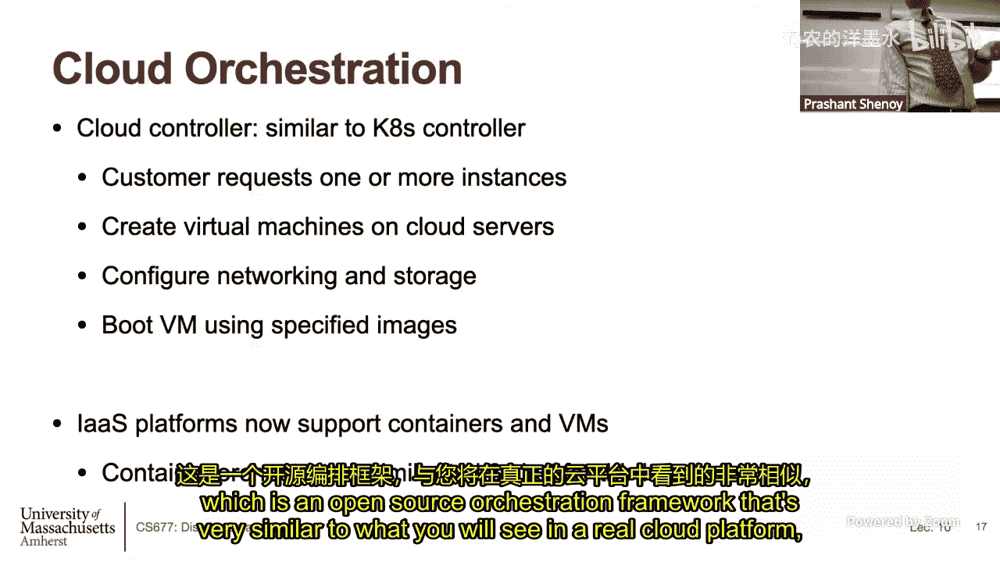

Kubernetes is actually something that Google developed It was based on their Borg and omega cloud controller or cluster manager we already encountered Borg when we are talking about distributed scheduling remember I said this is the scheduler that Google uses to schedule all workloads in the data which really it was a cloud orchestrator I didn't use that term there but its doing orchestration they open source parts of Borg and they made it Kubernetes so essentially you can use Kubernetes to create your own。

Cloud and then you can go to the Kubernetes cloud cluster manager or in this controller and say give me some resources here it's going to use containers。

 It's not going to use Vms。 Kubernetes container based manager so it will create a container of a certain size and hand it to you and so so everything we are talking about you can essentially do that orchestration in this case well use Kubernetes to do this。

 but the thing you want to keep in mind is you derived directly from Google's actual schedulers in their data centers。

 they made it open source you can download it and run it on any machine that's going to be a lablet on Kubernetes so you can actually play with it so you can figure out how to use it So so what are the things it will do you can basically deploy an application onto a cluster of machines it will figure out which machines enough resources and it will deploy your containerized application in this case they are not Vm based their container based on this application。

It will automatically replicate them if you want to。

 it provides the service so that if some machine goes down you have a second replica running。

 it will do that it will load balance if you create replicas it will send your request across machines。

 it can scale these containers up or down the workload goes up it can scale it up or down it can provide automated restart if theres failure selffeeling and so so provide lots of services that are built in。

So as a developer you might not need to worry about lots of these things saying you've got to worry about what happens in the machine field。

 Kubernetes cluster manager or the orchestrator in this case will track it and restart your application on another node and then redirect request it or if the application gets overloaded it will resize it on the fly your multiple replicas you replicatelicd it load balances them。

😊，Lots of useful services you'll come back to some of this when we talk about the web and we talk about Web based application but as of now you just need to understand at a high level what is actually happening so what let's get into the details of how Kubernetes works and by the way it is called the acrony is K8 that's what you will see so Kub you see K they essentially mean Kubernetes because you dont want to spell the whole thing right so there is acronym is called K8。

😊。

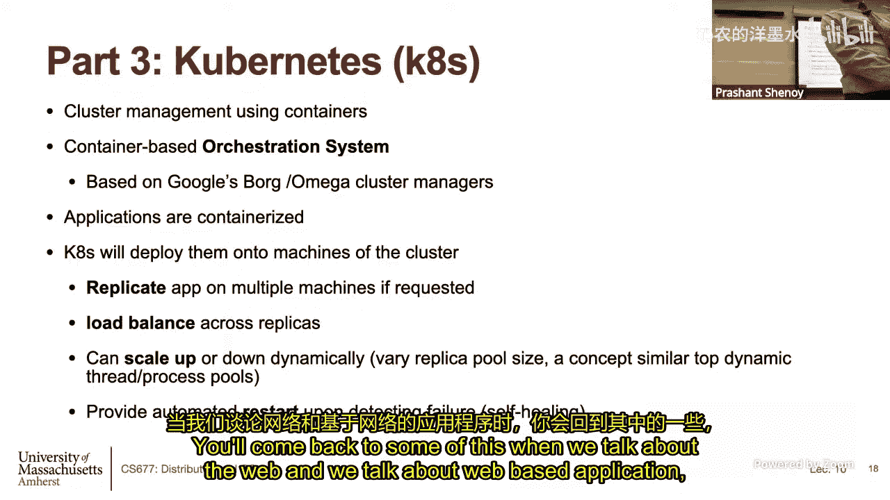

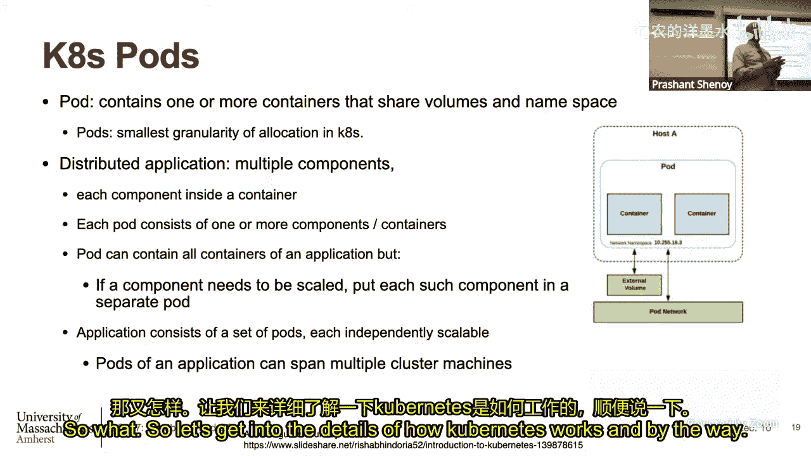

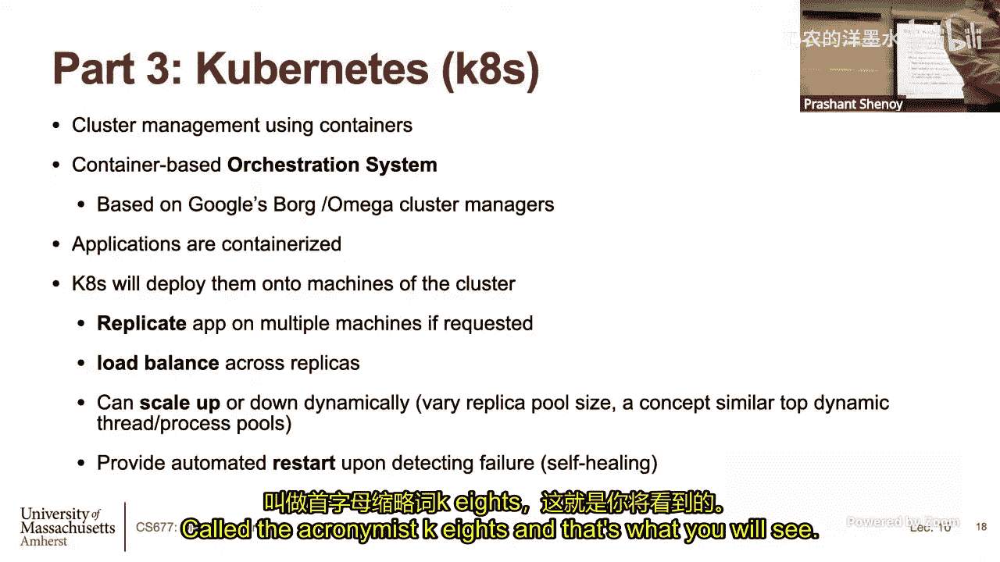

So， the way this works is the kub and the granularity of resource allocation in Kubernetes is called a pod a pod is like think of it it not unlike a virtual machine it is a slice of a server。

😊，So here is a machine okay hostay that's a physical machine this machine essentially has a single po at this point that is this gray box in there thats the thats the thats a slice of that server that are allocated to that application that application in this case as chosen to run two containers inside this po you can run one you can run 10 that's up to the application so application goes and request some amount of resources those are allocated as pods。

😊，You can have more than one part each part runs on the machine。

 but the simplest thing is you ask for something， you get one po on one machine。

Your application are distributed， you might get more than one point。

And then it's up to the end user to say okay， each part is going to run my code inside a container。

 let us say a Docker container it will basically run that in the code in this case we shown two containers but you can just run one that is the simplest case。

 one part， one container。But in this case you have two po and you can have more more than this on other machine so so distributed applications are multiple components in the Kubernetes world you have to take each component and put it inside a container。

The three components youll create three containers component one container two and three and then you go as a user and go and request one or more parts from Kubernetes and then you say deploy my containers inside that but the simplest thing is in this case you ask for one part and you take all three containers and put them so these are the three components and then they work together but you could ask for three parts and each container goes in one part then your application automatically learning on three different machines if the po are on three different machines so you can distribute them that so the po essentially can contain all the containers of an application but you want to scale it up and down it is better to put each component in a separate part and then Kubernetes will scale it up or down for you it can essentially make the container bigger or it can deploy a second application a second container to scale it and so on because it a auto scaling built into it so a lot of。

です。Our very advanced functionality is some of which we are encountering for the first time。

 but we will talk about auto scaling as well， but all all you need to know at this point is this is a way you can deploy containerized application using a cloud like framework So it looks exactly like a cloud where you to go to the Kubernetes。

Pick manager and say give me a pod instead of asking for a virtual server you ask for a pod then you deploy your application in a container on that part instead of deploying it in the virtual mission equivalent things in the container rule Okay so a very popular way to deploy applications in the cloud so so there are two terms I want to mention here one is called a service I already mentioned the pod。

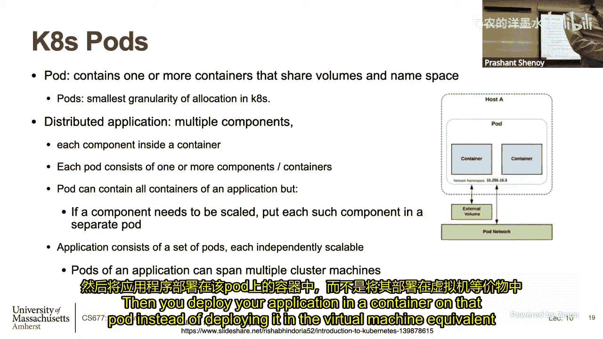

Pod is essentially a slice of a server so here your pod on machine A your pod on machine B each of them is running some these these blue things are containers that are running there you will see that there are three here and three here the six containers for this applicant now when requests come in you are to decide how to request get to those containers to do this you are going to have another component called a service。

The service is like the load balancer the requests actually come to the service the service will then forward them to container that's an internal decision okay that you make so the service is the method you are going to essentially access parts expose interfaces so the service has a static IP address you can make that visible so if you have a web service。

Your web application rather you will make a Kubernet service and you whatever IP address this service gets is what you expose so your web browser will connect to this component。

 send its request here and this component will forward it to one of these containers to actually service the。

That is the way it's going to so the containers themselves are not directly exposed outside。😊。

In this word okay this is like a load balancer or its a more permanent component that' is called expose the reason this is good is if this entire machine fails Kubernetes will track that it will know that there are three containers running it will allocate port automatically in another machine it will restart those containers there it will tell the service that is all the containers are moved when new host and then the service will start sending requests there it is all transparent to the end user。

because it has all this built in failure management capabilities in there。

So parts are fMML which means that temporary that's why you don't expose them they're only seen by the service services are actually more permanent and that's what you so this is the Kubernetes way of deploying application they are decoupled the machines that are running the code from what is actually exposed to the end user what is exposed to the end user is this concept of a service which is just another piece of code but it has IP address that you are exposing to end user and then that service is the one that forwards request to to containers in parts。

This here the is a Kubernetes model so so this is how you will actually build you want to deploy let us say build a Docker application and you want to deploy it in the in the Kubernetes world。

 your Docker container is actually going with that。

But you have an additional component called a service that you are to also build that you expose it and that service is the one that will actually send request to your doctor。

Is that clear？Okay， can a component run in multiple containers as I said Kubernetes allows replication so in fact you will see that there are this broad service is actually running in three containers here。

😊，this MysQL there are actually two containers here so this is already replicated so yes they can run in multiple containers and the service knows about them and it can load balance across them。

The question is does it have to be done by users or Kubernetes does it automatically the user has to specify if the if a container should be replicated or not and how much it should be replicated so you can say this this container should have between three to 10 replicas and then it will figure out it should be three7 or 1 or you can say only one in which case it will start only once you specify that its。

The Kubernetes job to figure out where to run them and so on。

 it will allocate these parts it will deploy them and so on right so it is automating the case。好的。

Yes the question is the power running in data centers and Kubernetes a way to orchestrate that yes that is indeed the case so you can run them in a data center you can actually because it's open source you can run it on two laptops and you can create a Kubernetes cluster and itll give you the same functionality as if you went to a cloud and did the same thing but yes technically you will run not run this on laptops you will run them on servers in a data center is doing orchestration right the cloud has similar orchestration for virtual machine I'm just showing an example of an open source orchestrator that is doing containerized deployment as opposed to virtual machine deployment。

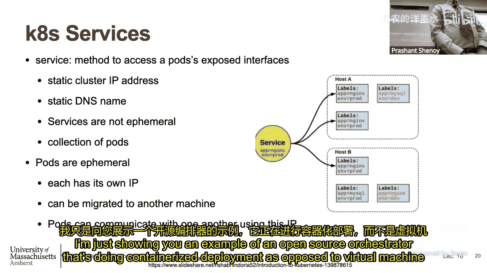

YeahThe last thing is the internals of Kubernetes you will see that there are some similarities between this and the Borg model because this what derived from the Borg mode right so essentially there is a API server which allows clients to come and say give me a part I need so many containers so this is the API that Kubernetes exposes to users of the cluster so you can go and request resources very similar how to go you go to cloud and request resources atD is the key value stores so this is the database that is going to keep track of what are the physical servers how many parts are allocated on them how many resources are free so this is tracking all of the resources allocated on the cloud and and just as in Borg this has to be is replicated on multiple machines and it uses consensuss to keep them all in sync and if one of them goes down there is still。

Some other machine that has this because once you lose this state you cannot do any allocation so this has to be you to make sure it doesn't go down and then you have several other components like controller manager that's going to do replication or for failure the scheduler says I'm going to allocate newly allocated parts to users and servers and there is a cloud control manager that can actually take this and work with other cloud platforms and so well lots of components but at a very high level this is similar this orchestrator is really similar to work because it derived this thing from law because there's an interface exposed to end user there's a database that keeps track of what the cluster looks like at any given point in time and then a set of components that do resource allocation。

So these are by and large what is shown here。And then at the very bottom。

 just as you are the bore gl， you have something called a kublet and these are essentially machines that are running parts and so on。

Any questions on this a very high level thing but you will get to play with this a little bit in your lab lets you get some flavor of it you may not know the internal details but thats not completely needed it's better to know how to use it to deploy applications and so on just a high level understanding of the internal。

Any questions here before we wrap up for the day？Okay。

So we will stop it here and next time we will start a new topic so we are done with cloud virtualization all of this。

 we are going to switch gears and start a completely new topic next time okay。

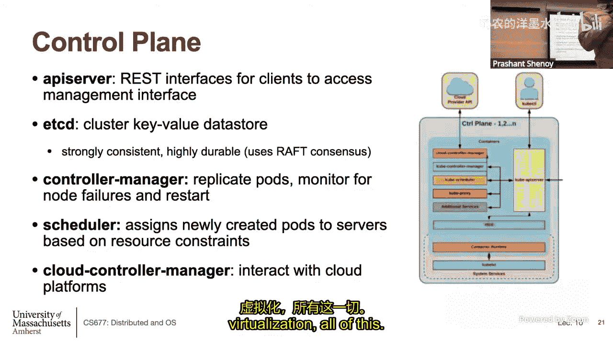