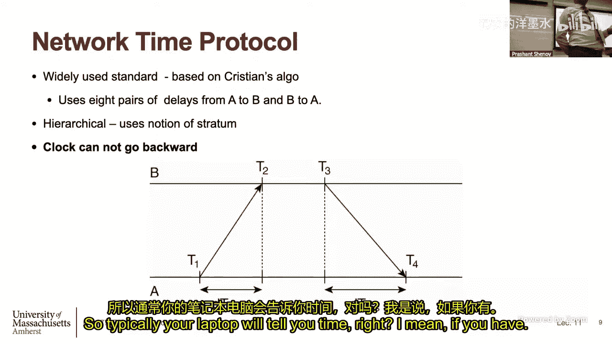
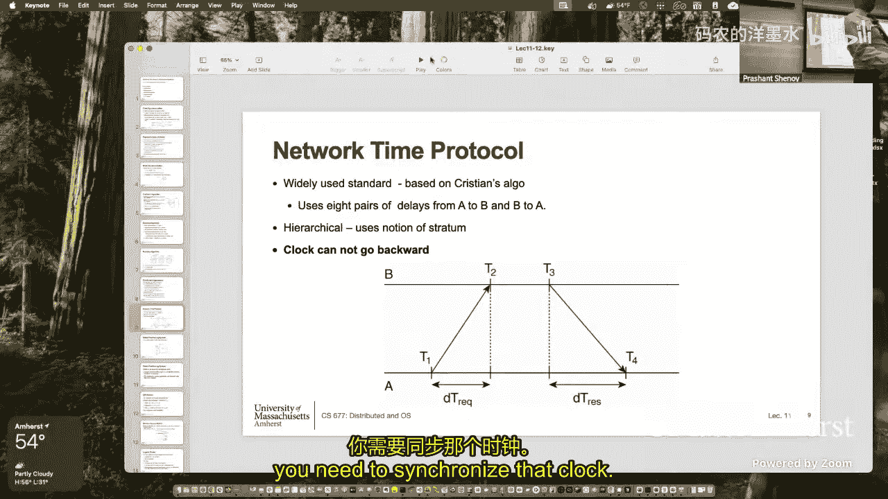
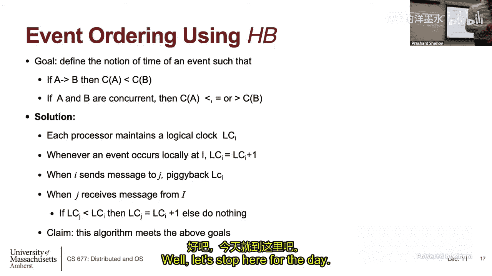

# 【全集 2025 附课件】马萨诸塞大学 分布式系统 中英字幕 p11 Lecture 11 - 时钟同步与逻辑时钟 -BV19BSYBuE4Y_p11-

Okay， let's get started。So we are going to start a new topic today but let me just make a few announcements before we start this week is the week before spring break right usually in this class we have a midterm midterm is alwaysm not sure say always but for the large part we hold it after the week after spring break so that's the same thing this time it's going to be the Thursday after spring break it was already announced on the very first day of class the exam both the midterm and the final exam dates and times have been on the court schedule page that the thing has changed just announcing here that we still plan to have the midterm on the Thursday after it's going to be an evening exam and it' going to be in a different room not in this room the room I will post on the schedule page and also send via email it is going to be closed book closed notes so it's not an open book exam and I will。

I cannot remember。What our lectures are on the midterm but I think it's at least through this week。

 which means today's class and one on Wednesday will be probably what is on the midter so for the Monday after spring break well have a class but that will not be on the mid so everything we do through this week is what I believe is going to be on the midterm I will also hand out some a sample exam from from the previous year you can see what it looks like Ill also make some sample problems I haven't given out a homework really which we had planned。

 but somehow there's been a lot of assignments with giving out and I have not given a homework but I will give out a set of sample problems for more a practice for the exam so that you have enough to study and prepare。

Okay， all right。It。So let's get started so today we are going to start a new topic which is which I broadly referred to as classical problems in distributed systems because we will look at these problems on the next several classes and the way you want to think about it is when you design these large scale systems of any sort that are distributed in nature there are a common set of problems that arise over and over again across a large set of problems so we abstracted those problems out and we are going to study each problem and try to see how can you come up with approaches to address that problem and then you can take those ideas and apply them to real problems so we are going to talk about these more in the abstract not in the case of not by looking at specific systems but just trying to see okay if you wanted to do synchronization or we'll see the list of topics here or leader election mutual exclusion which is really distributed locks transactions we will talk about consent。

There is a lot more beyond these that we are going to look at okay so we look at all of these in the next several classes and then in the last third of the course real look at real systems more case studies we also see how some of these ideas apply there as well as look at other design aspects of those systems so that's really the context for what we are going to be talking about so today I'm going to talk about。

Our time ordering clocks， clock synchronization and something called logical clocks。

 okay and we will continue that next time and then switch to later election。

Okay so lets start with clock synchronization I first will explain what is the problem that we are trying to solve。

 why is it relevant in in distributed or even any computing system and then try to figure out how we address it so。

First thing is to realize that clocks and time is actually used in all kinds of computing systems when you did your lab1 evaluation you are supposed to measure latency the way you measured latency was using timest so you looked at how long a request took can you measure the time so this implicitly assumes that the computing system that you are using as a clock it keeps time and then you can use read the values from that clock and those timests can be used for various kinds of analysis in your case you used it to figure out latency but there are all kinds of users of for actually。

Using this time so so essentially we assume that any computing system and as the thus far you're only talking about a single system。

 not a distributed system has a clock in it technically what happens is there's a chip on your computing system that is basically a realtime clock chip it keeps time just as you have can you have other things that tell you time your phone or or your watch tells you time the same thing is true of your computer it does a chip that keeps time and then that time actually you can read and using programs typically that system clock is called a crystal based clock that chip is essentially crystal based clock or quaordtz clocks and they are pretty accurate so they're essentially accurate to one part in a million which means that every million ticks of that clock it might lose one sort of tick in there so I mean there are reasonably accurate but we will see what happens when is inaccuracies so here's an example of what might have。

If you have now not one but two computing systems and you are looking at time across two systems so youll assume that there is computer one that has its own clock and this computer two that has its own block these clocks might not be exactly synchronized with one another and they are not synchronized problems can occur and here is an example of what might happen and this basically is essentially talking about using make or using doing simple builds of programs so there the and first you need to understand how builds work so typically programs such as make does what is called incremental builds it only when you type make it will only compile files that are changed since the previous invocation。

The way it' is going to do this is its going to take the timestamp on the binary that was created last time and it will compare that to all the source files and if any of the source files are changed since the binary was built you will say some files are changed and those files are recomped you don't recompile everything you only compile files that now changed now it might so happen。

That if you have two machines that are being used for two different purposes。

 you have let's say a machine on which you write code that's your development machine and there's another machine where you build code that's your build machines a typical environment in any software engineering companies that's how you do it you write code on typically your desktop and things like that but you build on some other server so you don't necessarily do local bills but now these two machines are two different clocks if the clocks are not synchronized you might have a problem where let's say you make a file I to a file and you save it now the file has changed it gets a time step now if youre。

Let's say when you then try to build this file by invo the build program or make on another machine if that clock is off it might actually believe that the file has not changed since the previous invo in particular if the clock on the the development machine is running way behind your binary was let's say was built 10 minutes ago your clock is 15 minutes behind real time and even though you change the file hey it's getting a timest 15 minutes in the past not current time so the build machine will believe the file has not changed because the binary looks newer than the modified file and it will not build that file and you will not see that binary actually reflecting your changes this is very simple example that's what is actually shown here so your two machines the clocks are off and it basically threw off a build program but there are many such examples you can construct what this is showing you is now the reason this problem errorss。

Now， the times timess are being compared across two machines。

There is a timestamp on the build machine that is assigned to the binary file and is a timestamp on the development machine that is assigned to the source file。

 you are comparing them to see in the make program whether to redo the compilation but since the clocks on the two machines are not synchronized with one another this cause problems。

So these very simple example should tell you when we have a distributed system and you are using times timess on many different machines the clocks on these systems have to be synchronized otherwise you cannot compare this timet because if the clocks are off then you can't actually say what order some events occurred because in this case you are using times times to figure out when certain events occurred whether the file changed after the binary was built or not not so that's a very high level motivation or synchronization will get back to that in just one second but let me start with a primer on how we tell time because we'll get back to some of these issues in today's class so typically in the old days you use the stars and the sun to tell time noon basically meant that you basically the sun was right above there's no shadow that's basically the definition of solar noon now these days of course you don't。

😊，The sun to tell time you have more accurate clocks your crystal based clocks which are the kinds of clocks we have on your wristwa the squs clocks there are at similar clocks on your machines but the most accurate clocks are essentially what are called atomic clocks so these are these are accurate to one part in ten to the power 13 which means that they will lose a second every I think tens of thousands of years or something like that from very long time so theyre very very accurate and that's what is the reference clock that is used to tell time so what happens is many countries actually maintain their own atomic clock and then they broadcast the time from these atomic clock and if you want to synchronize any clock with the atomic clock in that country you are to somehow tap into that broadcast and synchronize。

Essential you can use satellites to broadcast that time actually all cell networks also broadcast the time so if your phone is connected to a cell tower it's automatically synchronizing because the cell towers are broadcasting time that theyre fetched from an atomic clock so there are many and there are shortwa radios they broadcast and so there are many ways this the time that is actually being computed by your atomic clock in any country are broadcast out and then you can listen to them and synchronized。

So so that's basically how a lot of this works now so your clocks are not going to be as accurate as an atomic clock so every so often is going to be off and you will have to resynchronize by changing the time okay you don't do that on the phone because there's a program that is doing it for you but it is actually synchronizing often but if at a mechanical clock of some sort you would have to do this every time it loses some time so okay so what so this problem where the clock an actual clock drifts from real time is called clock drift。

😊，That is what the clock is drifting away from real time and then we want to reynchronize this clock so that essentially that drift is brought back to something close to  zero。

😊，That way， that clock will now again tell you time that's more accurate than what it was telling you before。

So that is basically a primer on clocks now we will see how to do clocks synchronization so there are dozens and dozens of clocks synchronization algorithms that are out there by and large they will all follow one or two very simple ideas。

😊，So this slide here tells you the simplest idea behind clock synchronization which is how frequently we should use synchronizer an clock within some sort of a master or an atomic clock and the way you will decide this is we'll assume that any real clock which is not an atomic clock as some maximum drift rate row thats the maximum amount by which it is drifting from real time the row property is going to be determined by the type of clock it is so if you have a quardtz clock it may lose a second every few months if its the real atomic not an atomic mechanical clock it might lose a few minutes every week so that drift parameter row comes from the type of clock it is and so different types depending on how the clock was designed there will be some drift parameter that the manufacturer of that clock will specify saying this clock is accurate plus minus1。

Minute every one month or they might specify some number like that and that is going to be a drift ring so that is given to you saying when you buy a clock or any sort it comes with some taller accuracy value and so you know that drift rate。

😊，So what that means is。😊，Essentially if you look at this graph here right so your x axis is real time this is a time atomic clock or actual time y axis is the clock time if you at a perfect clock every time real time advances by one second clock time will also advance by one second so in other words you will essentially be a following this line here which is a slope of one it basically means that your clock is essentially if it follows this courage actually giving you perfect time because every time time advances by any time any amount the clock time will advance by the exact same amount but as I said actual clocks are not be perfect they will have a drift parameter row so they will be either faster and faster than real time or slower than real time if you are faster than real time that essentially means that you are essentially advancing along this dotted line thats labeled fast clock so here your slope is one plus row。

So you are essentially every time time advances by one second。

 the clock is tick by  one plus row seconds。And if you are slower than real time。

 you are going to have a slope less than one and the slope is going to be somewhere I mean in the worst case is one minus robot will be somewhere in between。

So what that means is this clock that you bought it will basically be within that window between the fast clock and the slow clock depending on whether it is faster or slower。

 those are the max bounds by which they can be off。😊。

That clear so now we know how much how the clock is behaving so now we basically want to see how to synchronize it so what this also tells us is。

😊，If you are given any two clocks that are built with the same technology the maximum value by which they can be off is2 row times delta t every delta t second because the worst case is one clock is essentially advancing at the slow rate another clock is advancing at the fast rate or drifting apart from each other so every。

Delta t seconds these two clocks will essentially drift by2 rh or delta because that is this gap if one is row below one is row above above so the gap is2 row I am delta t。

Is that clear？So now if you want to limit the max drift by to some valued delta which is the small delta let's say you say I want to limit the amount by which they are off to one second in this case delta is one second what that means is you have to reynchronize the clock every delta or two0 seconds because every two row seconds you will essentially drift by that much amount so you will essentially want to run the reynchronization algorithm every so often every so often which delta or two0 secondsd you want to make sure the two clocks are now reynchronize or that again they are telling the same time and then they will drift and every after another delta or two row you reynchronize them then they are synchronized again and so on。

So， every clock synchronization algorithm involves figuring out for that clock what is the drift rate okay someone some user has to specify this delta saying that you want to make sure that the clock is not going to be off by more than delta you can mention any value 。

1 second1 millisecond whatever it is right and then that will tell you how frequently you need to run the synchronization right the synchronization will essentially attempt to then reynchronize that clock。

Is this near？嗯。Allright so this is just very basic stuff but now well talk about an actual clock synchronization algorithm that is going to use that idea that I just mentioned so in this case this is called Christian's algorithm is named after the person who came up with this we essentially assume that there is a time server so now we are talking about computers reynchronizing not you taking your watch and trying to see synchronize something right so there is a laptop or a desktop that needs to reynchronize itself cellular so often so the way it' is going to work is there is going to be a time server machine in the system so this time server is the one that is keeping track of real time in some sense the time server is drawing its time from an atomic clock。

And you can do this by attaching a satellite receiver to the machine where is listening to satellite broadcast and synchronizing time soll assume the time server actually is correct okay because its synchronize with an atomic log and there are hardware ways to do this but we will not go into how the time server itself is synchronized but what we will now do is given a time server a machine that is acting as a time server how can other machines in that network synchronized with it。

Okay。So the idea is very simple each machine has this delta parameter that says what is at all and so the machine every delta or2 row seconds is simply going to send a message to the time server versus saying what time is it？

😊，the time server will send back the time and you will use that time to synchronize your clock。😊，え。

So essentially every de or two secondsds you are going to ask the time server for time and then you are going to get back a respond and synchronize but as you can imagine from this picture it's not as simple as what I said so in this case the y axis is going downward this time is one line here to the right is your time server the other line is the machine P or the process P so at the top you send a request saying what time is it because requests are not going to instantaneously reach the time server it takes some small amount of time for the request to reach that time server and then its going to be processed by the time server the time server process is that time T and is going to return T back to the。

The machine。That return response is also going to take a little bit of time to reach the machine which is shown as T reply is the time if the forward propagation request took time T request。

 the reply took T reply or the network to come back。Now the machine simply took tea。😊。

And then change this clock value to t you are already off by t reply。

Okay because it took some time for that message to come time is still tick so tea is no longer actually the correct time at this point when the reply message was received the correct time is t plus T reply。

😊，But the machine does not know how long network messages have taken。

Okay so somehow the clock synchronization algorithm simply cannot take P that came from the time server and change that local time to T and you already know there is an error。

 you have to estimate how long it took for the reply to propagate or the network what is the network delay or the response to come from the server to this machine estimate that and you have to actually set the time to P plus T reply。

So the real question is， how are we going to estimate the reply？😊。

Once you estimate that then clock synchronization is straightforward every de or T row you ask the time server where it sends the time。

 you find the network propagation delay， you add it to the time that was sent back to you。

 you set your clock to that value and you are done。😊，Is is clear okay， so question。

 how are we going to estimate this？Okay， so so suggestion is lets set a timer on the machine and get wait for the response to come by so what you can do is when you send the request you start a timer。

The request went there and then the response came back and that you know have a response at time or end。

 so now what you have found is T request plus T reply that is the total round trip time。

That you found with the timer。对。That is not exactly T reply。

 but you found around reply so one simplifying assumption you can make is that it takes the same amount of time for the message to go from the machine to the server that it takes to come back。

😊，If you do this you are going to take T request plus T reply okay you then halve it and you say that is my estimate of T reply because if it is same time then you know the total time round trip time you say the one way propagation latency is half of the round trip time and then you got a estimate of T reply。

So， this is a simple example where you can take take time t。

 you can take this estimate of T request plus t reply over2， you take this。

 you add it to p and then that is what you set here。

That is Christian's algorithm but as you can already see in this picture this was just an approximation there is no requirement that the forward latntens and the river latency be accurate in fact you see that here the T request is a little bit longer than t reply they just saying that the forward path may be more congested than the reverse path。

😊，というこです。You have what your request is by the time of set request。I'm set back up server。こ。

Originally， I was second。哎。还不差00多。还这。Okay， question is， can you take the request？

And then subtract the time that was sent back to that's your question right to do if you want to do something like that you assume that the process machine P is already synchronized with the time set because now you are comparing time across two machine。

 you already assume that you are off by some amount， which could be as much as delta。

You don't know what the actual amount by which you off that's a maximum amount so you are if you take this time and you then compare it with some time here that' is going to be off but well assume that T requestless T reply the same timest right so this is fine the clock is not going to be even if your clock is off you are just taking a difference between two times time that is still okay。

So that that's fine， but if you did what the suggestion you made was to take the request and then add it to somehow tea and find some estimate。

 that might be less accurate because the clock is not synchroned with the time server。Yes， question。

そ我啲几。你我的是。感觉的大。Okay question is if the request to not request the frequency to make the request to the time server based on the drift rate can mean and the drift rate is not can we not use the drift rate to correct for the time that is your question so what what is the problem with this？

Yes， somebody is yes。I was like this is about。Yeah。YeahSo first of all。

 the drift rate is just the max value is saying that if you buy。

 let's say Rolex watch is going to drift one second a year because that's what the company guarantees you that doesn't mean every Rolex watch will exactly drift by one second that's a maximum amount they're telling right it might be drifting half a second or third of a second or。

9 second you don't actually know it's just a maximum tolerance further。

 the drift rate is also not constant because first of all。

 even if it was constant is not delta it's not row it's somewhere between one plus row and one minus row you don't know what it is but secondly it's not even constant because for most mechanical clock the drift rate changes based on things like temperature a quardtz clockgs they are using a quardtz oscillator the property or quardtz crystals is actually somewhat temperature dependent So if you go to very hot climate or cold climate the drift itll still be within row but it may be off from where you started so it will not be constant。

Neither is it no so you cant actually use that to correct all you know is this is the maximum amount by which you will drift so if you reynchronize every this every so often you will be fine you will be within that。

😊，我先希方。放开喺。But yes。就他。はい。So your question is， how do you know whether it is positive or negative or why is that positive？

I don't understand the what do you mean by why is it？Yes。is for。Yeah。

So the drift rate is basically saying you could drift in either direction by rh thats a definition of drift rate it is like plus or minus so they they tell you that the clock can be faster slow they just say it will go off it may be faster than real time or slower so that is what the definition。

It means that it's not that it's raw， it can be row in either direction is what it means。

 which is why you are here。Okay so so this Christian algorithm you can use one value of T request plus t reply or two and use that as the estimate of t reply newer algorithms will make a sequence of is request find a sequence of these estimates because the network conditions might change and use some sort of a mean value or multiple measurements or you can improve the network estimate of latency one way latency by making multiple measurements and so but by and large all clock algorithms are going to be doing exactly this they are going to send a request to the time server or get back a reply but they have to correct for a network latency so you estimate the network latency somehow and add it to T and then you synchronize your clock and this is delta or2 row is going to tell you okay that's a configurable parameter Dl tell you how frequently to run this program。

Okay。All right。Thats Christian's algorithm we will talk about another one which is called the Berkeley algorithm and then we will talk about several others but these two by and large give you basics of how most of them work so Berkeley algorithm is an algorithm that does not use a time server it is a relative clock synchronization algorithm a group of machines none of which are actually synchronized with real time just one they are relative clocks to be synchronized with one okay nothing is actually synchronized with real time the question is how can end machines just synchronize their clock with one another。

And they might go off with respect to real time because none of these clocks are actually synchronized if they're are running five minutes fast。

 they will all drift at that rate， but they'll all be synchronized with one another at least their clock values you can compare by synchronizing so we will not have a time server but we' will still have a coordinator does not have any real not synchronized with the atomic clock but that's the one that runs the algorithm so the coordinator that's a worker very simply the coordinator is going to send request to the workers for the time theyll return the time it will compute the mean time in the system and it will send it back I'm going to tell you how that works so there ist picture that explains this the are three machines here A B and C the top one is the time master and the other to adjust just participants worker nodes you will see that when you start this this one has clock of 3 pm this one is 10 minutes behind is25。

325。So， it is going to every delta or2 row run this algorithm in this case it is basically is saying what time is it right？

😊，The picture actually says it sends a request saying my time is three tell me the drift from my time but its you could just ask all the machine send me your time it's the same thing so so in this case you get back minus 10 which says my time is 250 this one says plus 25 and my time is 325 and then this machine is just going to take the mean of the three clocks。

And then send back the value of saying the meantime in the system is 305 so it will send a request to this machine to advance its clock by 15 minutes and this machine will actually bring its clock behind by 20 minutes so now they are all synchronized and at 305 now everything I said in the previous algorithm were compensating for network delay still the same that picture doesn't show it but you still have to look at the network round trip time and then correct the clock values that are reported and when you send it back you have to do the same thing。

So that problem has not gone away but we said we know how to do deal with that so we are just looking at the rest of it。

So this one is just tracking the average time in the system and then making sure all the clocks are synchronized。

I this clear so so that is called Berkeley algorithm the thing you want to keep in mind is none of these clocks are actually synchronized with an atomic clock so they may all start drifting over time but they are all synchronized relative to one another which in some systems is all you want if you want to compare times times across machines you just need the clocks to be synchronized even though there may not be accurate in terms of real time。

😊，And so there's a relative clock synchronization。All right， so there are many other approaches。

That you can think about so there are decentralized algorithms that try to do this similar to the Berkeley algorithm there is actually most machines at least Mux machine Linuxux and Mac they have an R command that essentially does what Berkeley algorithm do you can use R and give a machine name it just talk the machine and two clocks are basically going to get synchronized with one another but the most common technique that is used for clock synchronization in computing systems is called network time protocol or NP there is a protocol that is built into all of these operatings like Mac Windows Linuxux as well as all these。

Pone based operating systems， they all use NP you need an NTP server just as you have a time server in Christians algorithm it's basically a very fancy version of Christians algorithm so you need a time server that time server has to be configured if you actually go into your windows or Mac settings and you look under time and if you have a box that says set the time automatically they'll get np server in there the default one on Mac for example is time do apple do co that's the apple provides an np server but you can change that Umass runs one np do Uma or you can change it then your machine start using the UMa N server or by and large there's NP server somewhere that's your time server you're synchronizing you have to deal with the same problems of estimating network latency and so on So it's basically based on Christians algorithm it uses eight pairs of measurements to get accurate estimates of。

work latency Christians algorithm I showed you one it uses eight pairs and it has things that uses but hierarchies where you might have other time servers that are designed based or not designed but device using a NTP server and so on so you can do hierarchical clock synchronization you can have your laptop in your home synchronized with NTp server and your laptop can provide NTp service to other machines on your home network so they don't have to go to Np server so it can be hierarchical and it guarantees that even when there is hierarchical synchronization a maximum drift rate is limited NTP keeps it under I think 50 millisecond So accuracyacies that are guaranteed by NTp is1 to 50 it can be within one to 50 milliseconds if you use NTP protocol it's another way of saying the network latency estimation can be off by as much as 50 millisecond the clock value is correct because it's synchronized with atomic clock but network latency estimates can go up。

Typically its on the lower end of that， not as high as 150 milliseconds。

 but thats what the protocol specifyifies。but there is one other thing that it does so this is the same technique I was showing you earlier you send a request to NTP server so that is the forward path to get back a reply you really want to take the estimate of just this part but you are going to take the whole thing and assume that both parts are symmetric and so and you do that eight times to get good measure。

哎。Yes。我。The center time is the work we want to do。The can just the话 you the。Okay。

 question is why do we need to synchronize time with other vision， that's your question right？Yeah。

 so typically your laptop will tell you time， right， I mean if you have。

Yeah right so so you have a time there right so if you are looking at the time that time better be accurate right it's not that your only programs are using time every computer is telling you time because it is a clock and you want that clock to be accurate right so that for to do that you need to synchronize that clock it's not that you just have a program that needs the time it's just the time a phone has a clock on it right you you as a user use it of course programs use it too if that clock is off it won't tell you the correct time so all of these computing systems are using NPA to actually set the clock。

So it's not just for program， it just we want that clock to be accurate for any number of reasons。

Any other questions？Okay， yes。Good。你我好会信。でしょでけど反対が現す。出身嘅な。人 that。

Okay the question is in the Berkeley algorithm if each clock has its own drift rate how frequently should we use that that's a design choice you can as there are many as I'm if you have homogenous machines the chips will be identical theyll all have the same drift rate but that's not going to be too in general you might have Windows laptops the next laptop of different manufacturers so they will have different chips different drift rate so what you can do is take the mean drift rate across not mean the max drift rate across all of the chips and then use that to synchronize it because if the worstcase clock is accurate than all other clocks so if you have different drift rates you should just take the max of the clocks and use that to synchronize in the Berkeley case。

Yeahep。All right， so that's a good question， but the other thing I did want to mention for NTP is there one additional difference that I didnt talk about for Christians and Berkeley algorithm is that your clock in NTP cannot go backwards。

So if your actual clock is running fast and then the Christian's algorithm can say。

 pull went back by five minutes。Berkeley algorithm。

 you saw an example where we actually moved this clock back 20 minutes。Right NTP。

 the assumption is that。Clocks can move forward， but you are not never going to move a clock backwards。

The first question is why would we not want to move a clock backward？Yes。

 because things might depend on which kind。Something things might different on correct times than somebody else or something yes。

Some programs might not like have all of a suddenology。

Some things now look like they're in the future。Okay。有。

So think about what might happen if clock is actually moved backwards the first thing is you have。

 let's say you have a timestamp on a file you modified a file so it does a timestamp and you move the clock back now that time is actually in the future it doesn't even occur So that's not a thing And second of all you might have two things with the same timest but that they actually occurred at different times。

 but you move the clock clock back right so you have noon times time something you moved the clock back by 10 minutes there's another moonon。

 you timest you will assume that both of those things actually were modified in the same time but they were actually modified。

 maybe minutes apart so when you move a clock backwards。

 all bad things happen there are timest in the future there are maybe multiple times timess that are identical but they're in fact not identical So you don't want to do that moving a clock forward there is no problem because youre just jump in time you will never have a case where you two times times that are identical but they are actually two different times because you are just skipping。

This can now when you move back you are repeating some times that have already been that have already occurred on that clock right so you don't want to do that so then the question is if clock cannot go backwards how will you synchronize in this case。

because you still want to synchronize the clock you just you are just not allowed to move it back the way you will do it is you will slow it down instead of moving the clock back you will slow down how frequently you tick the clock and have real time catch up with the clock and then you continue。

😊，so that is what NTP will do it will actually slow down the rate at which the clock tick or will say every time the clock takes by two I am going to assume real time only advance not real time my clock advanced by one so I slow down by half and I will wait for real time to catch up and Ill just continue。

That's how you are going to make sure that you will not have the clock go back。

That's a restriction in NTP that's important to keep in mind。Yes， question。谢啥。系い。Okay。

Question is what does slowing down mean are you adding a delay so you not quite adding a delay but is basically you have to think about how clocks work right so let's say its a quardtz crystal okay so the quardtz crystal says every time the crystal vibrates n times you advance you say it one second you tick by one。

Right so you might say I rather than it every time it vibrates 100 times I tick by one you might say every time it vibrates 200 times I tick by one so I'm actually slowed it down because I am not advancing my software clock based on what the actual clock is telling but so that's how you can slow it down you are not adding a delay you are just slowing the rate at which your clock is advancing on your machine and then you wait for clock the actual clock to。

The are time。Yes， yes so I mean you will not Yes so you want to say I want to change the the clock has to go back by one minute this's just take an example so I can essentially slow it down such that in 30 seconds I catch up I you calculate it for how long you slow it down and then you reset right so you will do all of that。

so as you can see， this has more sophisticated features in terms of network measurement。

 the fact that you can have hierarchies but most importantly not moving clocks back with the other two techniques that we talked about did not do。

😊，Yeah。That you。Okay。All right so next thing we are going to talk about is global positioning systems or GPS okay I'm assuming you're all familiar with GPS if you use a map to give you directions you are using GPS chip on your your phone or whatever your GPS devices is telling you how to do directions but what we will see is what does the GPS do and what what does that have to do with clocks synchronization because the goal here is not to learn about GPS to learn about clocks synchronization but we will see how to solve the clocks synchronization problem using GPS。

so first thing is to show some basic techniques about how GPS works and then well see why we cannot not why but how we can solve clock synchronization algorithm so so what does GPS do GPS basically is a technology where there are a set of satellites that is already been launched those satellites are have a known position in space where they are essentially geostationary satellites so theyre at a known location so the location of these satellites in the sky is known and they are precisely positioned at that location furthermore in GPS these satellites have clocks that are synchronized with an atomic clock right each of these satellite is just broadcasting time。

So there are satellites in space there are known locations and they are essentially broadcasting type so a GPS receiver is simply a chip on any computing system or a phone that is just listening to satellite broadcast。

And it for each broadcast that it receives it also knows which satellite send that broadcast so it knows precisely what the location of that satellite is and the problem in GPS is the GPS receiver which would be a chip on your phone has to figure out its own location in some 3D space it needs to find its own coordinates so it knows where in the 3D space it is located just based on satellites that it is listening to that is the GPS location problem。

We will see how to solve this problem but at least the problem is clear so let's just Im gonna draw a picture here because that picture is actually not very clear let me show you an example so let's say just take the picture there let's say the satellite is in space it called well just start with 2 d space for a moment forget 3D because it is just 2 d so we will assume that there's a satellite at is no location let's call it X y rather than this and it's just sending。

😊，Good timest so it will basically says this is the time it is just sending this network packet and there's a receiver here that essentially gets this broadcast。

😊，Okay，So let's say this receiver sense。clock value T it is now received not the receiver other the satellite and the clock value t it is received by the receiver。

 the receiver's location x prime y prime is not known at the moment。

 but but x and y are known because the satellite is at a known location in space。ね。

So now the question is how can this receiver find out its coordinate with respect to the coordinates or the satellite that' is its location so what do we know about this this problem first thing we will know is these broadcasts are going as a wireless broadcast so they are going to basically propagate at speed of light all wireless communication occurs at speed of light。

So so let's just for one second assume that the receiver sent this thing at T and it was was received here at time t plus t plus d so D is the distance here that we don't know okay and this distance basically so this is going to propagate that speed of light speed of light is known so let's say just for a second let's say it was sent packet was sent at t and it was received here at t prime so essentially this distance D is t t minus t prime minus t so that's the time it took for the packet to go thats so if you do speed is distance or distance over time you say the speed of light is known this is the time so D is essentially speed of lifetime time that dealing。

Good。Is clear。对， so。So that is something we will use but as far as if you say I am at a distance D from the satellite which is this。

 what does it tell you about your coordinates？What is the point that's at a distance D from the satellite？

Its a radius right so it basically there is the circle is so basically all you know at this point is this receiver is on a circle which is at a distance D from the saddle that's all we know because we know it took d for the bracket to propagate and so now all we know is that we are that the receiver is somewhere on a circle we don't know where it is because all points on the circle are equiistant from the satellite。

😊，So we are now localized this this see or to a circle but we don't know where exactly it is so now we can repeat this let lets say there is a second satellite。

😊，which is now at some other location， you will call it x1。

 y1 and you repeat this process with that satellite。

It is going to send broadcast you will find when the broadcast were received。

 you will take the difference in the timestamp when it was sent the time it was received here and then you know the speed of light so you know the distance to that satellite D prime and you will now localize it to a second circle。

 because then you are now on a second circle with that second side line as the center of that circle now the receiver is at a single location that has to be present on both of those circles。

Right so that's how you' are going to localize so that's what's shown here so these two black dots are two satellites first satellite first time you localize it to radius that's on the first circle youre going to be anywhere on this then use a second satellite and you now localize this the receiver has to be essentially on both of the circles at the same time because its at a given location so it' is going to be on the intersection or these two circles so now you narrowed it down two circles can intersect at atmost two points which are shown here they can intersect exactly one point if they were actually tangential to one another but now you localized it to one or two locations。

嗯。So now basically from not knowing its coordinate as we are down to two。

 you just take the intersection， you could do a third one and then you will find it。

Right so that is basically how GPS is going to work it is basically you have a receiver on the ground it is listening to satellite broadcast okay you now do this problem in 3D not 2 d so the first time around you will find a location on a sphere。

Because sphere is with all the points that are at a distance D from a satellite then you take a second satellite and then you another sphere when two spheres intersect what do we get。

you get a circle think about two spheres if you actually intersect them you will get a circle right so youll get a circle so once youre two spheres youre down to a circle you put a third sphere you will basically get two circles that intersect and then you will do that and you'll get your answer。

😊，嗯。But。That's how GPS works okay so far we not talked about any clocks synchronization。

So we now will say why do we need clock synchronization at all in this problem what you will realize is I implicitly assume that the clock on this receiver is synchronized with the satellite otherwise you cant do t prime minus t accurately if this clock is off this latency difference is going to be completely off。

😊，This will only work if these two clocks are synchronized。Yeah。

 they have to synchronize very well if you want to actually localize that too lets say if you are using GPS and you are driving you are to be within 10 feet of where you。

😊，Thing says or maybe 50 feet。 Otherwise you are you will the GPS will show you on some other road or something like that。

 right So you have to be pretty accurate。 So these two clocks have to be synchronized。

We assume they were that is why you could do the speed of light minus the difference between the time at which a packet was sent and when it was received。

 but the clock on that receiver is not synchronized。😊，That's an assumption we made。Right。

So now what do we do。在我们。分就。Okay， so we are saying we will use some clocks synchronization algorithm but all messages are only going one way。

You are not GPS receivers do not send a request to the satellite if you did that you could use Christian algorithm GPS receivers are one way。

So you don't have the luxury of doing what we did so far where you send a request what time is it to the satellite it sends a reply then it would be fine but that is not what we are doing you are only listening you cannot communicate the satellite listen to satellite。

We will use simple geometry to solve it because what we will assume is the clock on this is gone off by some amount data which we don't know so t prime。

Is actually some t plus delta some things or let's say it R by delta and we have to correct for that drift。

As part of GPS so we will build in the clock synchronization into GPS so this problem doesn' not even arise in the first will will drop the assumption that the receiver's clock is synchronized to begin with we will assume that it is all by some unknown amount delta。

😊，Okay， so now we have not。So earlier there were three unknowns。

 which is x prime y prime z prime which is the coordinates of the receiver now there are four unknowns。

 the three coordinates of the receiver and the clock grid delta。嗯。SoWithout question。

 how are we going to find this？Yes you can add more satellites。

 you can do that but that still doesn't tell you what de does you will have more satellite。

 but we need one more fact to actually solve this problem so we'll use a second wellknow factor I mean one thing was we said speed of light is known so you will have distance D is essentially speed of light minus this difference but well use another fact that we know which is Euclidean geometry what is the distance between two points as you probably know that's the formula there which I want right here distance between any two points is essentially d is going to be x minus whatever we said here x prime square plus y minus y prime square plus z minus z prime square。

😊，诶。X， y and z are known x prime y prime z prime unknowns so that is one equation for D。

 but we have a second equation for d， which is this is D is now。C times t prime plus delta minus t。

That in this case deellta is unknown previously we assumed it was known but now we we don't know this data okay these two equations are the same give you the same d so we are essentially going to now say this。

that's an equation， so nonlinear equation， which is still an equation with four unknowns。😊，哎。

X prime y prime z prime and delta are not known you are now going to repeat this with multiple satellites。

Okay if there is a linear equation four satellites will do it four unknowns four linear equation but this is not a linear equation it a nonlinear equation so you might need six or seven satellites and essentially you use those equations to solve four four unknowns typically you will need minimum of four which is why it says four means you at least need four without four you can't do it but this is not linear so four will not actually give you accurate results so so you have to find at least more than four maybe six or seven you will get seven of these equations and then you solve for four unknowns using them nonlinear technique to solve these equation。

And then if you do that， you not only got x prime y prime z prime。

 but you also got the data by which the clock was off so you can synchronize the clock as well as part of this。

😊，And even if you don't synchronize the clock， at least you know your location accurate。😊。

That clear so weve done clock synchronization and we found with positioning which is you found unknown coordinates of a receiver using GPS your questionnaire is。

Okay question is there no drift time from the satellite we will assume of course satellite will have drift time but we will assume the satellite has already been synchronized with an atomic clock。

 but we will assume the satellite time is correct。😊，对。Yes， if the satellite time is off。

 we have another problem， but we'll assume all the satellites are actually have either a built in or are somehow synchronized with an atomic。

Yes。我觉你叫什么。诶落电嗰时咧即系要先。Okay question is could we synchronize the clock on the device before we do this request that depends on the type of your GPS receiver if the GPS receiver is in a phone a phone can run an auxiliary clock synchronize an algorithm to synchronize itself then you may not need to do this but GPS doesn't assume that the GPS chip is embedded in a computing device its just a chip that just listening to satellites and iss just doing onboard calculation for those equations and telling you what so GPS by itself does not require you to rely on a second clock synchronization algorithm it can solve it as part of the problem because there are already dozens of satellites that are doing this why not listen to two more and you solve the problem I don't need a second clock synchronization algorithm in the process right。

Observation。Yeah question is Dlta not be constrain and every time you do an observation ri changes that is indeed correct so this you will have to solve this every time your GPS will run in a loop right because let's say you are in a car just because I found a location a second later youre driving on the freeway at 60 miles an hour or whatever the speed is is going to change frequently so you have to run this algorithm very frequently and as a result you keep computing delta every time you do it because it will keep changing right as you pointed out so you don't assume it's constant you do it every time。

Yeah， is that clear？All right， so that is clocks synchronization with GPS。Right。

 so we talked about Christian's algorithm。So was the basic one and we said Berkeley one that's a relative and we said NTP more sophisticated version of Christian's algorithm and ended a GPS that says。

 okay， we can now solve synchronization as part of locationing or positioning that we can find locations of a receiver and figure out the time by which its clock is off in one shop。

😊，OkaySo so that is GPS the many， many other techniques which I will not talk about all kinds of things you do in wireless systems and sensor networks where you synchronize with our time server I won't go into them because by and large there are either going to be a derivative of Christians algorithm they are going to be derivative a B algorithm one other two if they are sophisticated they don't have to do either they can actually download the NTP package and use NTP but if you don't have the luxury of having an NTP server you have to use one of these two techniques to do it but what I will talk about in the next 1520 minutes is a different approach for thinking about clocks where we will not use physical clocks to do reasoning about times times well use what are called logical clocks and the reason one of the reasons we will talk about logical clocks is actually twofold in many cases you just want to compare times timess。

To figure out which event occurred before which other event。

Right so you might want to in the make example the build example all we wanted to know was has the source file changed after the previous build you didn't care about did it change five minutes later 10 minutes later that part is irrelevant we just want to know is the source file new or older relative not the absolute value that did not matter with so long has change you will have to recompile so in many cases like this you are comparing times time to figure out order of event not the actual time difference between events if you want to find actual time difference between events you have to use real clocks in your lab one example you needed to find latency of your request that requires physical clock because you want to figure out how long it took if you don't want to figure out how long it took you just want to say which of these occurred earlier that's all you care about then you don't need physical clock you can get away with what are called logical clocks。

Yeah the other reasons logical clocks are interesting and useful is clock synchronization is not going to be always accurate every clock synchronization algorithm has a built in error that was the error of that network latency calculation that you made and so on so is always going to be off if let's say NTP is off by  one millisecond that's its lowest。

😊，As amount of error tolerance， if your two events now that are 05 milliseconds apart。

And you are using NTP you actually cannot say which one occurred before the other because Np is can we give you1 millisecond error so if you are two times two times time that are inside the error tolerance you cannot actually say you can just say because this timet is lower I am assuming this event occurred before but that is not a guarantee。

so no matter how accurate to make the clock synchronization there will always be an error toleranceleance epsilon if two times times are actually within epsilon of each other you actually cannot say which one occurred before the other because of the inaccuracy of clock synchronization so logical clocks are going to get rid of that problem they don't actually rely on physical clock so they don't actually suffer from the problem at all clock synchronization algorithms actually how to deal with now as I said when you use this concept of logical clock you are only trying to figure out order of events not the time at which they occurred or that latency between them and so on you just want to know which one occurred before which one but you don't care that five minutes apart one second apart or anything like that you will use this concept of a logical clock。

😊，So let's now try to ask what is this logical clock and how do we work with it before to do that I'm going to introduce this concept of event ordering so essentially and then we construct algorithm。

 very simple algorithm that allows us to get event ordering so what is an event order so let's say you have a distributed system machines that are participating in a distributed system we will assume that we don't actually worry about the clocks on we are not going to synchronize them instead we just want we will essentially say these are events we care about it could be I sent a message or essentially I received some message or something else happen on the machine there are some events that are important to this application and you want to construct an ordering of these events across machines that allows us to figure out which event occurred before which other event which is a total order given a set of events we just want to。

St the total order and these events are occurring across machine they a little bit abstract because we dont really care in the algorithm what the events you can define any event that you care about for your application and logical clocks will construct an order for you。

😊，So so that' is what the problem is so the assumptions will make are the following on a single machine we will assume that we know the order of events because we will assume that processes are executing instruction sequential okay because of sequential execution of instruction let's say your program if some some events here or essentially we will assume their instruction so so if there is an instruction a that executed before instruction B we will assume that instruction that whatever event is associated with instruction A happened before B because that' is the order of execution。

😊，Order of execution gives you an order of gives you an order that you can use to compare so for example you might say like simple example right you put a print statement and then in your program theres a second print statement is not threading us anything sequential execution you will the first print statement will always execute before the second so you will say if you say whats the order in which these print statements executed you will say that one is executed for the second because thats execution order so execution order on a machine gives us a natural ordering of events that are related to that process on that machine。

thats one thing well talk about not talk what we' will assume the second assumption is of course you no global clock no global clock essentially means there is no perfect clock synchronized global clock essentially means perfect clock that every every machine is completely synchronized with no inaccuracy we will assume such a thing doesnt exist because it doesnt we will assume local clocks maybe arbitrarily off it be off by hours minutes we don't really care in this case and we will assume that now we somehow to figure out how to order events across machines。

So that is the problem and then we will see how to construct this total ordering of even the idea at the end of the day actually is very simple and it was。

😊，The logical clocks are also called Laport's clock because they were first proposed by a very seminal paper that Leslie Lamport actually wrote and then that gave gave rise to this idea Leslie Lamport is incidentally also the person who invented latex latex actually means Laport tech was a previous software he came up with latex so will is the first time we were encountered Laport where we'll see many algorithms that he developed that are used in all kinds of distributed systems not to mention latex that we all use for writing documents and paper but but here's the basic idea we are going to essentially used the process of message exchange to impose ordering。

And what does that mean if process on machine one sends a message let's say socket message RPC message doesn't mess what message it is to another process on another machine right so there are two events here theres a send event。

On machine A， that' is the sending of the message is a receive event on another machine。

What can we say about these two events？Okay， so think about I am sending a message okay there is a send event and there is a receiver can you order them？

😊，Send as to before received and messages cannot be received before that sent laws of physics right so we know send and receive can be ordered this is all we are going to assume we will assume that there is execution on a single process can be ordered send and receive must be ordered we'll take these two ideas and construct a total order and we' see how to do that in just one slide before we do that I'm going to define this relationship called happened before relationship so this is just a relationship that will use for reasoning about events so if we say A and B are two events in the same process and a executed before B。

In that process you am telling you that whatever a is related to executed first and be executed next we know that a has happened before B because execution order is also going to be in time order that sequential execution one thing one instruction executed before the other event associated with that event must have happened before the others you know A represents the sending of a message B represents the receipt of the message A is the sent b is the receipt we know a has happened before B message has to be sent first receipt always happened afterward and there's always finite latency it's never going to be the same time so then we also say this relationship is transitative if I give you any two event and I tell you A happened before B I tell you that B happened before C you apply transit to property and say now I know a has happened before C。

This is all we actually need to construct this total ordering and I'm going to show you an example。😊。

Is this clear though what I just said if we are using execution order using send and receive across processes。

 now we can start ordering events。😊，就。So， essentially this is our algorithm and then I am going to show you a picture that shows you how the algorithm works what are logical clocks there are going to be integers maintained by processes or machines。

😊，A logical clock is simply an inteent。😊，Unlike a real clock that is going to tick with real time logical clocks are only going to be incremented when any event you care about in your process has occurred every so lets say process has a logical clock it will start with zero first time an event occurs you will increment it by one and give it logical clock value 1 another event occurs in that process you will increment that clock and give it logical clock value2 and so on so every time within a process any event occurs you are going to increment the clock。

just an integer you are going to maintain this integer okay so in your process so so every machine maintains a logical clock we call it LC1 but simply an integer whenever an event occurs locally within a process we are going to increment it and give it that timest which is a logical timest at this point。

😊，Now when process I sends a message to process J a process simply sending a message。

 socket message RPC， whatever the message may be you are going to always include the logical clock of the sender with the message youre going to send this extra bit of information okay you send a message you will send the send will be an event you will increment that it will get a timestamp you will include that in the message。

When the receiver receives the message。😊，It is going to take the clock value that arrived in the message。

 it will take the local logical clock it will compare the two and take the max of the two and the receiver will essentially get the max of the two plus 1。

😊，so the receipt is not going to ever just be local increment because theres a message has just been received with a clock on the send。

 you will take the two clocks， you will take the max and you will essentially send the receipt to be max plus1。

Is this clear what I said I'm going to give you an exam。

 So so now if you just do this you can get an order but before I show this picture I'm going to actually show you。

An example， you draw it on the board， it be a little confusing we'll get to that。Okay， so I'll draw。

Let's say three processes， A， B C。Each of them has starts with a counter zero。

 that's your logical clock every time there is an event you will essentially increment it。

let's say this is now up to。So you basically， when this is a send， this is a message。

 you send five with the actual message。That's the clock here。

 So here we are going to essentially this would have been max of。

Right because the clock isn't just gone to four here。

 we will take max of4 and the clock that came plus one so this is going to get value 6。

And this will continue。😊，If this process sends a message here same thing will happen this is going to seven。

 you go here to seven， maybe this are only increment at to four。

 youll basically do max or this and youll basically set it to。8。

Thats your algorithm that's all you are doing just by doing this you can use the happen before relationship to get an order in particular if I ask if I give you this event timestamp 2 on this pro machine a and I give you an event timestamp8 on machine B。

😊，the event that are circle I say what can you say about these two events。

 which one has happened before which other event？You will say the first one the two has happened before but the reason is transit because these events are executing on the same machine so youll say two happened before three。

3 happened before four four happened before five this send has happened before receive because the send can never happen before the receipt you have to send it first send happened before receive then this is an event here and six happened before7。

7 happened before eight so now you have a transit relationship between all of the messages before the send on the sending process and all the messages after the receive automatically got ordered just because you said send cannot happen before the receive we just found an ordering without using any clock synchronous just using simple reasoning。

So a send of a message and a receipt of the message allow you to take all the events before the send and all the receive events after the receive and order them。

😊，嗯。So， so that is what this algorithm will allow you to do now you could take let us say the two here on machine A and 3 on machine B and so what can you say about these two events？

Okay so what you have to see is these are events across machines so you cant just look at the time time instead say three is greater than two so that gives me an ordering is not actually the case you have to say is there any message exchange between these two processes that allow us to。

Order these two in this case there isnt one right so these two messages cannot be ordered。

So it is going to this technique in other words is only giving us a partial ordering the partial ordering or precisely the events before the send on the sending machine and after the receipt we cannot say anything about what happened after the send here versus what happened after the received there those are not ordered or or these so not every event gets ordered but over time there' will be lots of messages going back and forth so lots of events will get ordered but not all of them so it is a partial order but we got this partial ordering simply using this algorithm。

😊，Yes，我 should。Okay question is if it's integer if we will hit an upper limit what will happen to this clock so there are two answers the abstract case is an integer that can go to infinity right so in the abstract algorithm is not impacted but an implementation of it of course if it's a 32 bit integer you can only order2 to the power 32 events after that the clock will actually recite back to0 than you cannot do it so either youre to assume that the size of the integer you pick for this clock is larger than the lifetime of the processes and the number of events you hope to process so you can pick for 64 bit integer you can take one to 8 whatever it is you got to pick the length of that integer to be greater than the number of events so that you do not actually ever wrap around。

But yeah in in implementation that' is an actual problem the abstract areas these are just intes they keep incrementing。

😊，Okay so in any case here is an example of what is shown these are processes these are logical clocks in the first case you will see that you are actually not making any adjustments yet in particular if you look at M3 you'll see the sender as times time 60 the receiver as times time 56 didn't do anything we are not respecting the property that the receipt has happened after the send because the times time there is lower you will see here that if you use that technique what I just said you will take the max of 60 and 56 plus 1 and you send this to 61 this means that that send and this receipt are now ordered so all of the events in the P3 before the send and all the events after the receipt on P2 get ordered based on this property。

same is true of this message m4 that went from 69 it goes here it was still 54 you sent it to 70 so that also gets the odd so you will always have to do the max of the two clocks plus one to ensure sure that the property have happened before is satisfied。

佢。Correct so so we have a nice idea which is we are simply using integer values。

 we are incrementing them when events occur and we are simply using basic basic ideas of sequential execution and send and receive property to order events so its nice idea。

But what it has actually given us is a property that only goes in one direction not in the other what that means is if you know that these two events are actually happened in a certain order you will see that the times time respect that ordering but the reverse is not true if I give you two arbitrary times timess and say can you tell me something about the ordering just by looking at the times timess you cannot reason about them。

For the same reason here that even 2 in a and 3 in 2 they have an ordering numerically but if you look at that picture there is no actual ordering based on the happened before relationship because there is no message exchange to tell us that。

😊，Right so even in this case if I just give you two integers here let's say I give you 14 p2 and 36 here you cant just compare these to timestamp and so that that event has occurred later that is not something you can do with La ports clock because the relationship only goes one way if two events have happened in a certain order the timetamping algorithm gives them timest that respects that order if a happened before B okay the timestamp of a is always going to be。

So on a happened before B， then the clock value of a or the times time is less than time that is what we have ensure。

😊，The reverse is not something we are done。What you really want is the implication to go both ways。

You want if a happened before B， whatever times timess you could actually respect that ordering the one that is a is to have a lower timest but I should also be able to compare these two timest and say this times time is lower so I should make sure that that event has actually happened before Laport's clock don't do that but in the next class we'll talk about a generalization of La port's clock that will give us properties that go both ways so then you can compare times timess and also respect happened before so that will talk about that on Wednesday let's stop here the day。

