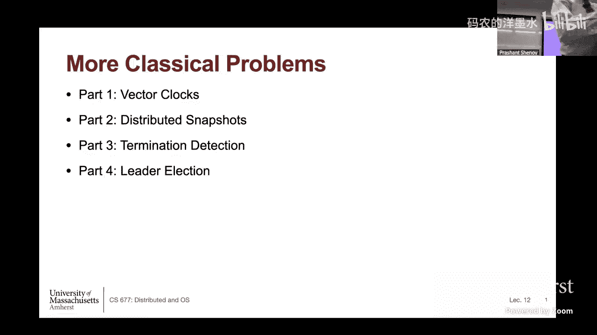
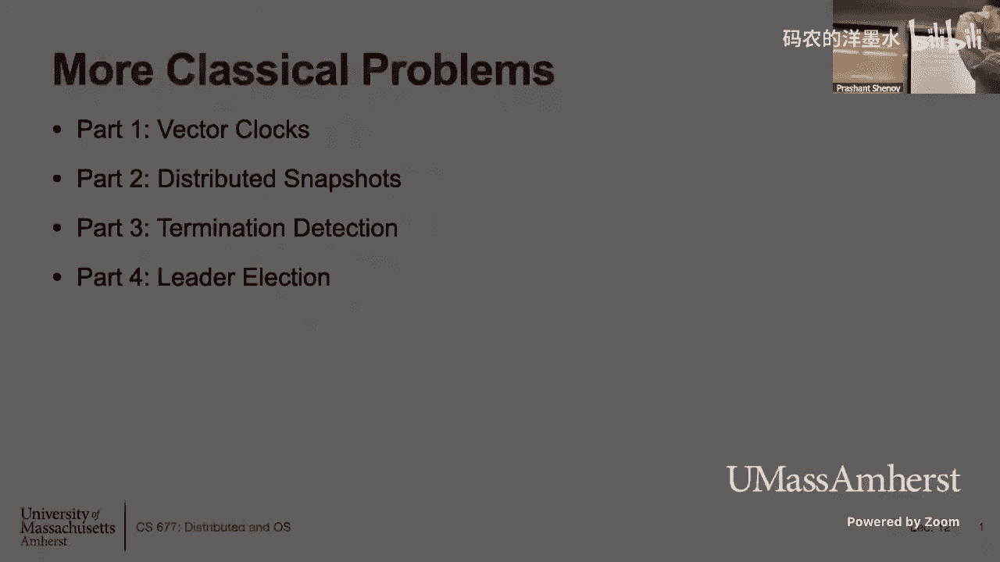
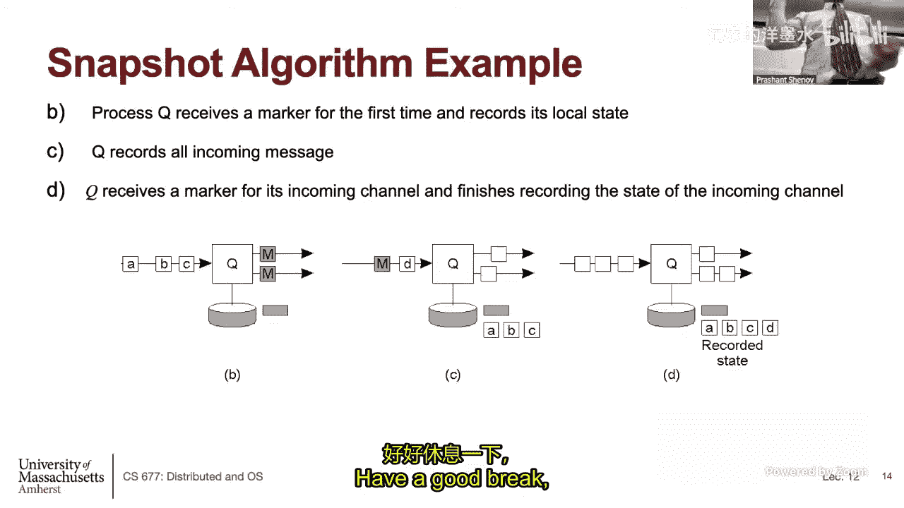

# 【全集 2025 附课件】马萨诸塞大学 分布式系统 中英字幕 p12 Lecture 12 - 矢量时钟 -BV19BSYBuE4Y_p12-

Okay， so。Let's get started。So today we are going to continue the discussion we started last time。

 so if you remember last class we started talking about oh， all right sorry。

我不 share不锁嘅。

嗯。Okay there we go so last time we were talking about clock synchronization I described multiple clock synchronization algorithms and towards the end of the class I introduced this notion of La port's clock or logical clocks which get away from the problem of having to synchronize the clocks on different machines but they allow you to create a timetamping mechanism which gives us certain properties the properties were defined by the happened before relationship where we said if we can order events either based on the execution order or based on message exchange between processes then we have a timestamping mechanism that allows us to add timests to these events that respect the order that we want and one of the issues there was that the happened before relationship allowed us one direction implication which means if two events happened in a certain order。

Laampport's clock algorithm assigns them clock values in that order because the one is greater than the other but the reverse was not true So now we are going to generalize that today talk about general version of this concept which we call vector clocks and we'll see how we can get implications that go in both direction but before we do that I just wanted to give you a very simple approach that can take the La port's clock algorithm which gives a partial ordering of events and construct that into total ordering and the way we can do this is essentially。

append the process ID to the La port's clock values so here is process number one process number two process number three the integer values are the La port's clock values and then you are just append as after the decimal the process ID and process IDs are assumed to be unique okay that automatically constructs an order thats arbitrary but we will assume that that's essentially the order of events so this is going to respect Laport's clock values but also by assigning these process Is to Laport's clock values you just construct that partial order into a total order so now you can say that 1。

1 even 1。1 and 1。2 although they are technically not ordered as per lamp port of their concurrent events you will see that there is no message exchange we will just for the purpose of total ordering assign an arbitrary order between them。

just designed by us。 there's not not a real ordering there but to construct a total ordering。

 this is what we will do。 we'll assign process Is that automatically break ties if there are two two events both got。

 let's say La port's clock value of one which is what happened to event A and event E here by attaching the process I this clock value as become 1。

1 not one anymore that we can 1。2 now there is an ordering which is arbitrarily designed of a tiebreaker that we assign you get a total ordering from the so so whenever you use Laport's clocks you only get partial ordering and then if you use this approach you can convert that partial ordering into some sort of a total ordering and that is something that then you can use to make some determination with respect to times timess and so not that for concurrent events this total ordering this gives you some arbitrary order between event that's not a real order if you are real times times of physical times time that。

Ordering may be different， but for Lapers clocks， this is good enough。Allright。

 the other thing I want to mention is where would you use these types of approaches I explain the Laports clock in an abstract setting I did not give any specific use cases here is one example the example is one where you have a bank database the database is replicated for reasons of security and the fact that this is important information that the bank cannot afford to lose their customer data so you see that the database is replicated this database is accepting queries from customers this could be account updates or other types of queries and you are two users here you will see that there are two users that theyre sending queries queries are actually sent to both replicas that's why you see that the request from this user here is actually the send to both replicas and the request from the other user which is shown that dotted arrows is also going to both replicas。

NowSome users might be closer to some replicas than the other So when they send these queries their queries might arrive in two different order and this database in particular you will see that the example is showing that the left user query arrives first and because the right user is much further away that query takes longer to propagate and arrives second so here you get them in one order but the order is reversed at the other database the other user query which arrives faster because the user is closer and then the first user query arrives later so queries that are sent arrive in arrive in two different orders at the two different databases if these queries were making update they can actually result in errors So here update one is performed before update two your update two is performed before update one so you don't really want this but the database to say consistent all operations have to be performed in the same order on these databases otherwise you might actually have。

consistencies between these two for example， one in one case you might be withdrawing money and the second operation which is shown as user opinion might be adding interest based on how much amount is remaining or something like that and if the interest process is actually operating on two different account balances because in one case happened before the withdrawal in one case after you will get inconsistent reason。

So what you want to do is avoid this type of problems you don't want databases to be processing requests in two different orders there you should do them in the same order to keep them consistent and synchronized so this is a good case for using La ports clocks and giving a total ordering so these messages can actually come with clock values you can use events in this case are queries that are coming into system you use La ports clock values and then you assign a total ordering based on what I said earlier。

And that ordering is respected by all databases so once you have this total ordering all messages will actually be processed in that total order so that means that even though the messages are being received in two different order they will be processed in the same order because the La ports clock value you will reorder them based on that assign timest but timess will always give you a numerical ordering and you just process them in that order that will ensure that regardless of how it is received so always processed in the same consistency manner this is one example where you might use things like La ports clock we get total ordering and ensure consistency across replicated database itll come back to some of this when we talk about consistency and so on later on so just a very simple example we explain to you why these kinds of techniques are important and useful。

All right。Let me now talk about vector clocks and the need for vector clocks last time as I said we talked about logical clocks or lamp port clocks they at the following property if you two events in a distributed system A and B and you knew that a happened before B either because they are executed to those are event that executed in that order or a is the send b is the receive send always happens before the receive there is some transitive relationship so but you know that a has happened before B then what lamp port's algorithm date it was it assigned clock values to these events and it always ensured that the clock value of a is strictly less than the clock value of B because a has happened before B a gets a lower times time than B that's what it say so this is what lamp ports clock uses if your two events and A has happened before B it guarantees you that the times time the algorithm assigned to a will always be less than B now。

The reverse is not true Laers clock does not tell you that if clock value of a is less than clock value of B then that actually implies that a has happened before B we actually want that reverse property because you want to be able to take timest and compare them and reason about them so one times time is less than the other times you should be able to say okay this has a lower times of this event has happened before this other event so what we actually want is the reverse property which Laport's clock did not give us it gave us one direction so in other words the implication has to be bidirectal but we don't yet have that so we need to now come up with a algorithm that improves on Laport's algorithm and gives us the property that goes both ways that is going to get us to vector clocks but to get there I want to define this term causality and causality in our case will mean if a has happened before B。

And event A is somehow causally related to B meaning that there is some causal relationship that involves sending and receiving messages and execution on local processes that allow us to re say that A and B are causally related okay if these two events are independent then we say there's no causal relationship between them they are concurrent events okay。

It will come back to causality in a little bit but when you have causality you can actually have systems that use this causal relationship in an event to give you other properties so for example causal delivery says if there are two messages M and N and the send of the first message happen before the send of the second message and the receipt or the delivery also has to be in that order meaning that if one was sent before the other you want should be delivered in that order so that means it's causal delivery you don't get reordering in the network because the sends are order so thats an example of a system that can actually give you that property doesn't mean every system gives us that property but you can use causality to impose certain ordering of relationship but it will come back to that for now our problem is to actually come up with a times stampamping mechanism that says that if timestamp of a is less than timestamp of B a should a causally preceded B A has happened。

Before we enhance causally press， so you want to be able to take two times stampamps compare them and that should guarantee you that if the times stampamps are ordered。

 the events are also ordered。OkayAll right， so how are we going to do this the algorithm is a fairly straightforward extension of La port's clock algorithm in Laport's clock the clock value was a single integer。

😊，at each event， you just incremented the interior。😊。

And then when you sent the message you included that integer with the message and at the other end you compared them to the max and you added one that's all you did with La port slot we are going to do something very similar but in this case our clock values is no longer an integer it is a vector its a vector of integer so there is one integer per process in the system that communicate if there are n processes okay this is an n vector with n elements in it or an array with n elements in it。

So for process I， the IF element of the vector is this local clock that is the same as the La port clock。

😊，But you also keep track each process now not only keeps track with of its own clock because you have a vector you are keeping track somehow of other vector other clocks as well that is what the vector is for but beyond that the algorithm is very straightforward is actually the same whenever a local event occurs at process I you are going to increment the I element of your vector。

😊，This is like incrementing your local clock so if there are three processes your three vector with three integers okay if there is an event on process two it will increment the second element of that vector and I'm going to show you an example of this and then when you send the message just like you did in Laport's clock you send your clock which is the entire vector previously you sent to an integer now you send a vector and when you receive the message you are going to do the same thing you are going to take the max of the vector that came with the message and your own vector clock and you are going to essentially take the max of the two max of the two essentially means you are going to compare element by element of the vector and take the max of each element。

哎。So on the receipt of a message you take the max of the two vectors and you also do the J if you process J you also increment your local clock value which is J element of the which was exactly what we did previously max of the two plus1 you take max of the two vector but the plus one is only for your local J entry and that's it that's all we are going to do so it looks very similar as before you are going to keep now a vector of integers for local events you increment your highest element in that vector and you send messages you include the vector and you receive a message you take the max of your vector and the one that came at the message and you add one to your J then that's all you do so let's now take an example and then we will try to understand why we got this property if now if you compare these vectors and timestamp of a is less than timest of B now you can claim just by looking at the timestamp as A has happened before。

We are a causally proceeds。So let' us took an example first is I hand drew this because I didn't want to draw it on the board or students were online so I put this here but here are three processes p1p2 p3 so our vector clock is our array of three integers。

Okay， all clocks start with 0，0，0。😊，So I'll start with zero okay P1 is process one this is process two process three whenever there are local elements you increment the local element of that vector so when p1 you will go from 100 when from 000 to 100 next you will go to 200 and so on at p2 you will increment the second element so whenever there is a local event you go from 000 to 010 and so here you will go from 00100 to so increment the third element。

Okay locally and you just take your local clock value within that vector now here is a message M1 that is gone from p1 to p2 it is going to include this vector as part of the message or 200 is going to go here。

😊，Okay now when the message is received here， you are going to take the max of the vector that came and max of your vector which is。

😊，020 okay so youll take the max so you take pairwise max so this will compare the first element and say the max of two and zero is 2 you compare the second one which is0 and two is 2 but then since your process to you also incremented by one so this became  three and then you take the max of the third one which is0 So now you got a clock value of 230。

Okay and then the next element here will just make it240 and 250 and so and you do the same thing here you'll see that is a message that went here2240 you take max of 240004 and then you actually or sorry250 and004 and then you add one to the third element so that gives you255 and so on。

Okay。😊，This is clear what I could just was just a numerical example so like in vector clocks or writing logical clock everything is said about happened before relationship is true for local events those those events are executing sequentially so an event that executed later has happened after the one that happened and send and receive are always ordered send off a message always happened before the receipt okay and this is transitative so all the events before the send and all the events after the receive get ordered based on transitative property exactly what I said before。

😊，last time I said the same thing now you can look at the clock values and you will see that there' is actually two of the clock values as well so if I take an event before the sense so here are some examples okay lets compare A and B event A is in process one event B is in process two the first question is are event A and B ordered。

😊，Can you say something about which event has happened before which event for A and B？

A has to be before B because a is before the send。😊。

S is before the receive receive is before B to by translate property a has happened before B look at the clock values10。

0240 you say which vector is bigger。😊，哎。You see you see that 240 is greater than 100。

 so you actually have a timestamp it is not approved。

 but you are seeing that because 240 is greater than 100 and it is actually respecting the fact that A and B are actually ordered that way。

😊，Now look at A and C， which is now a third。Even and the third process here which is 256 first thing is you will realize that there is no message that goes directly from process p1 to p3。

哎。Yet first the question I would ask is are A and C ordered or not。

 even though there's no direct message exchange。嗯。there is translator property because a is before this send that send is before this receive this receive is before that send which is before this receive and then that is before that okay so translator property still holds you don't need direct messages messages that go from one process to another also cause events across processes to get ordered even though those two processes are not even communicating directly okay so that is clear now a is has happened before c you will see that the clock values also tell you that this is 100 that is 256 the vector for c is greater than vector for a。

诶。All right， so so far that' is not much very interesting， but now let's look at A and D。

A is in process p1， D is in process2 p2 are disorder ordered。First of all。

 there' is no message exchange between P1 and P2 that sits between A and D。喂。

Because a is before the send b is before the receive you can't really say anything okay so these two events are called concurrent events you cannot order them because there is no message exchange that allows us to order them there is no transitd property here between these two processes that allows us to order them。

Okay。SoSo A and B are actually not ordered their concurrent events so now let us look at the times time and see what they tell us so times time of a 100 times time of D。

0，2，0。哎。How do you arrange these vectors one greater than the other？Yes， no。John is greater Who's。

D is good bigger。so first question is you should ask what do you mean by one vector is greater than the other and never define what greater than means for a vector you know what greater than means for intesia but what is greater than means for a vector I actually didnt define that so let me first define it and I will reas that question。

Vectctor for a is less than vector for B or let us say vector vector b is greater than vector a if every element of b is greater than or equal to an element of a and there one element that is strictly greater than。

😊，That clear what I just said， so lets just draw this you have two actors okay。Let's say a 1， A 2。

 a3 and B 1， B 2 B3 okay。We say that。B is greater than a if every element here is greater than or equal to it must be at least equal to if not strictly greater than all the elements here there is at least one element as strictly greater。

😊，Whi means that all the elements of B have to be greater than or equal to here with one element actually greater。

😊，That is what we mean by greater than property for or this is how you compare to vectors in our based on our definition okay now let us go back to this 100 and 020 what does this tell us。

Is one greater than the other。so you can't compare them because the first element here is greater than the first element there but the second element is less than so in one case some elements are greater some elements are less than so neither is a greater than B nor is B greater than a so these two vectors are not comparable and that is precisely what we want because if they were comparable then those two events should have been ordered that's what we said right when we just said A and B are not ordered and you will see that the vector times time now do not give us an ordering they actually conflict theres A and B cannot be ordered because the vectors cannot be compared so this is how you will see that vector clocks are now given as the reverse property when events are concurrent the vector values become incomparable you cannot order them but when events are ordered you can strictly ordered so these always allows you to now compare the times time just by looking at the times time if they are vectors can be ordered you can now say that one even。

Does happened before another event the vectors cannot be ordered you can just say these events are concurrent and you can I mean that is not approved but I'm just giving you examples you can see why that is the case though if we do have logical clocks these are integers you could not say this because these A and B would just be two integers they are always comparable by definition because those are integers right and so just because one is greater than the other or not you can't say in this in this case those vectors actually become not comparable。

😊，Is that clear what I'm saying here okay？All right so that's vector clocks for three processes and you can do the other examples you will see the same thing when you have the happen before relationship you will see that the vectors are comparable otherwise they are not。

so this is giving us the same partial ordering we had。

 but the vector clock values also represent that not just the picture。

 but they are also represented in the timestamps。😊，Any questions here？WhatM want。

So this is another way by which you can do timestamping and you can compare events based on the timestamps and you can reason about them just by looking at the timest so now we have the implication going both ways is A happened before B vector clock of a will be less than vector clock of B and the reverse is also true the vector clock of a is less than vector clock of B A has happened before B you know there is also another way of saying if the vector clocks are not comparable you cannot order the events that are concurrent。

哎。😊，All right。So here is a use for this kind of vector clock so you can actually enforce causal delivery that I was just telling you which is that if 2E plus two messages were sent in a certain order you can actually then deliver them in a certain order as well so here's an example you are now sending messages here from across these processes so p0 is sent in this case it multi custom message which means the message goes to both of the others right so you say message M is sent to both p1 and p2 and p1 is sending a message that goes to the other now you can ask are these two messages M and M star order。

and you will see that this is the send of the first message on P P1 there is a receipt of that first message and then the send of the second message happened after the receipt so these two sends have become ordered events。

The send of the first message has happened before the send of the second message。

Now if you want to impose a property called causal delivery， not every protocol will impose it。

 but let's say you want to have causal delivery that means if messages are sent in a certain order they should also be received in the same order the message that was sent first must be received first so essentially what that means is M has to be always be received before M star at all processes so now here is a case where this M here actually not M M star has a lower latency to the third process so that message actually arrived at P2 while the first message is still on its way so so you see that M arrived here and if you are just delivered it that would have violated our causal delivery because the second message arrived at the third process before the first one the first one is still taking its time so you will see here this process actually did not take delivery of this message it basically waited until the first。

Process first message received and then delivered the second mass so it held it in a buffer。

 delayed it and then delivered it after the first message was actually received this is called causal delivery。

😊，Yeah， the reason you can do this is because you can actually look at the vector timests and see that there are some messages in transit that have not yet been delivered okay how do you see this you can actually do this using me clocks you will see that this。

Vctor clock value here is 100 this one has 110 so this one the message110 actually arrives at process p2 P2 says that because the first element of the vector is one process P1 has sent a message that's not yet but I've not seen it yet because you can see that because that clock value what incremented here and then if then that's received here you know that there is at least one message that p0 as cent that you won't even received so you can delay that in your buffer wait for that message to show up and then delivery so so you can look at vector clock values and reason about what has happened in other processes based on what they're telling so they tell you how many events have occurred at other processes that's the clock value is telling you that。

But the high level thing you want to understand here is because these two signss are ordered the receipt had to be ordered and if they arrive out of order you can hold the messages in a buffer delay delivery and deliver them in the same order so you will see that the messages are always received in the same order at all processes that is the high level thing to take in and that' is what vector clocks now allow us to do。

Yes。对意见。Quion is are you not implementing the times time when there is a receive so this is a picture from the book so what it has a small variant of what I showed you what they are doing is they are just taking the max or the two algorithm I said also has to increment this by one right so if you implement this algorithm strictly in this case this would have actually become2120 because is a second even they didn't do that they just took the max it works in either case but yes if you take what I showed you this should have 120 here not110 but that doesn't matter it gives you the same result in the。

It's a good question。Any other questions here？Okay so that vector clocks I am going to switch gears and talk about a different problem in distributed systems which is called the global state capturing the global state of a distributed system I'll define what it is but then I'll also explain why this matters because our definition is somewhat abstract so you may not get an appreciation of why this is even important but let me define what is term thats a global state of a distributed system means this is a local state of each process and the local state just could be memory state so the global state of a distributed system would be local state which is a memory contents of each process and all the messages across the system that have been sent but not receive it means all the messages in transit。

So this are definition of global state global state of a distributed system。

 you can think of it as the memory state of all the processes and all the messages all the TCPI messages or RPC messages that are in transit which means they have been sent but not yet received somewhere on the network or sitting in some queue somewhere that is what we mean by global state。

😊，Now we will say why does this actually matter what we do with knowing what the global state is so global state of the system is important for reasons of failure recovery and here is the example Ill give you so let' us assume that you are running some long running job bad job it could be let its a distributed job not a single process job lets say is machine learning training or some parallel simulation these run on a cluster。

So now let's say your job runs for six hours okay let's say there are five processes in your job。

 there are five worker nodes or five processes， they are running on different machines。

 they ran for five hours and one of the processes crashed。诶。

Because there are five of them one crash the others are still running now your job is not going to produce an end result because one of the components of your MLl training or your simulation has failed。

what will you do in this case？Or the simplest thing you can do。Yes。

We start that part on another machine。We that part。Okay， you can restart that part。

 but if you restart that part arbitrarily some if they are communicating with one another while they are computing any messages that were sent after it crashed and before it restarted or all disappear。

Right。So just restarting it blindly doesn't work。Because you might start that process in an inconsistent right because these are not processes that are independent they do communicate right so so process crash and other processes sent it some request command they will all disappear and will restart it with some inconsistence so the simplest thing you can do actually is to terminate all the other four and restart everything from scratch scratch that is the simplest thing you will do right so you just say something crash let's restart from the beginning that will work but you waste at six hours of compute。

Right now what what was suggested here would have been nice where you can restart the failed process and the failed process alone but that's not going to give you consistent results because you know the failed other processes have done some computation there would add this computation you start it doesn't know where it failed it might start from the beginning you get some inconsistent results so what you want to do in these cases is periodically you want to somehow save intermediate results or intermediate state you want say every one hour you save whatever work you are done to disk and then you compute further and next hour you do the same thing you save your results now if processes crash you go back to the previous save results you load it up and you start from there。

That means that all the work you are done is somehow saved in the form of intermediate state or results because you kept it on this you don't have to go all the way back and restart so now if a process crashes you terminate all of them you don't restart from the beginning you go to the previous saved state you say this is what I saved one hour ago I am going to load that information and start from it。

😊，That' is much better because now you won't actually waste everything youve done periodically its called checkpointing as you are periodically checkpointing you are saving your work okay so you won't actually have to go back from the beginning。

😊，so that's basically why you need to think about global state。

 global state is just a way of saying how do I checkpoint everything I know about these processes so I can restart them from this point that this is a checkpoint。

Exactly what checkpointing means is is not very different from let's say you're editing a file in word or something like that you don't periodically save and if your process crashes。

 you might lose all your edits so when you edit in a browser or not browser in an editor you do save your state every once in a modern editors actually do auto sales so you don't even have to do this they are saving for you in the background but not all of them do something you do have to save whatever changes you made so you know it doesn't disappear it's the same thing but in a distributed system but then the question is what does it mean to actually save state you have to do this in a consistent fashion so this is where this clock synchronization comes in if all the clocks on these processes where perfectly synchronizing perfect synchronization you could instruct the processes exactly at the beginning of each hour pause computation everything is paused save。

😊，All your work to disk restart computation that will work because you are all synchronized so you are taking your savings state at exactly the same time。

😊，Right so then it is consistent but as you well know okay we said there is no such thing as a perfect clock synchronization all clocks synchronization as errors in it right other than we talked about NTP I said this so you cannot actually do this as say stop at the beginning of each hour and take a checkpoint because all these clocks are slightly off from one another。

😊，very small amount but they are still off they are not peripherally synchronized so they will not all save state at the same time they will save say slightly off from which may some hundred some milliseconds or 10 some milliseconds but they are still off that can still cause inconsistencies。

😊，Yeah so you cannot if you are a perfect world where all the clocks are synchronized this would be a trivial problem you would say stop at the same time T save state resume and you do this periodically all set all done but we don't have a clock synchronization algorithm thats perfect which as I said also as it fancy way of saying that is there is no global clock there is no perfect synchronization so now what are we going to do how are we going to save this state。

so。Im want to tell you an algorithm to do this that's actually nice but before I do that I want to show you why it is actually problematic where if you save state at slightly different points in time you might say what's wrong if they are off by 10 milliseconds right clocks are not perfectly synchronize they maybe off by 10 20 millisecond whats the problem why why is that bad even if they are slightly off they are just saving state at more or less at the same time can this cause problem so here's an example to show you why there is a problem so here are three processes that are doing some computation they send some messages back and forth at part of your。

Distributed application。 Now， if the clocks were perfectly synchronized， you would say。

Stop at this time， which is a vertical line through this That's time。

 So x axis is this time So the time will be completely aligned it' say stop at this time T and save state now because the clocks are slightly off time T is somewhat different on these three processes This is why it dotted line where it intersectes each of these processes on different machines is time T on that machine and because the clocks are slightly off time t which is the same time on machines is slightly different one is a little faster one is a little slower So each of these processes is now pausing at a different time in real time because the clocks are slightly off and saving their state that's what is going to happen is the clocks are not synchronized now in some cases that having this clocks off does not cause a problem This is an example where having this clocks being a little off and saying that state at slightly different time causes no problems and in some cases it does and here's an example where it does now。

The technical way of saying this is the first example is what we'll call a consistent cut which means that the state that you saved is consistent。

 the cut is consistent and the cut just essentially means where does this dotted line intersect this processes that is where they will save the state so process p3 will stop at this time T save state process p2 things that's time t save state here process three save state then theyre not exactly the same realtime T in real time because the clocks are but we'll say this one we will accept this is consistent this one we will not accept this is not consistent so what's the difference between these two examples that makes one of them consistent the other not even though in both cases the clocks are not synchronized。

Here is the main thing that you want to keep in mind Okay you have that dotted line that' is your cut that is the state that you saved on disk wherever the clock that dotted line intersect that is the time I which you save now we will say that the cut is consistent or that checkpoint is consistent if all the sends and receives of messages are either to the left。

or to the right of the cut and the only time a message actually crosses the dotted line。

 the send should be on the left and the receive should be on the right。嗯。

So that means that all the sends and receives have happened before you save state or all the sends and receive are going to happen after they resume computation which is M2 M1 is where the message was sent and received before you saved state is all done M2 is a message that will be sent after you resume computation it will be processed after receive computation only time you are allowed to cross is if the send was actually before and the receive is after which will see M3 is actually crossing that dotted line which means on p1's perspective its already sent M2 or M3 because its saying it state after that point which is already sent it will resume execution from this point on if you restart this process it will never but it will then M3 is something thats a message in transit in this case so3P2 has not actually process this message even though it has been sent but will say this is consistent because we also save the states of all messages in transit and we say。

M M3 in this case but let us look at what is the problem here then you will understand why this can be a problem clocks are not included so in this case M1 is to the left of the cut。

😊，Okay so M1 has been received sent and received before you even saved your state you don't worry about it m3 is after to the right of it okay that means that anything to do with m3 will be after these processes resume computation if you restart them we don't worry about that either the problem is with m2。

You will see that the receive of M2 is before the dotted line， but the send is after。

Okay that is just shown in the picture here right I'm just telling you that a sand is to the right the receiver is to the left。

😊，So then you say what is the problem with this so from p3's perspective it has already processed this message before it saved this state it saved this state at this point the message has already been received and processed。

Now， P2 saved its state at this point。Okay now if you restart that the entire computation。

You will start each of them where the dotted line intersect that is the state you save so what is p2 going to do it will start from this point it will again compute and resend them to。

哎。P2 is going p3 is going to start at this point it is already processed M2。

 but it will get that message again。You get a duplicate message。

If this are some database where the message is at $10 to this account right that message will come a second time you will essentially process it again after restart it and now you are inconsistent because you process the same message twice。

I clear what I just said so you cannot so if this problem never arises if you have perfect clock synchronization you never have this you are saving the state at the exact same time in real time but clocks are not synchronized you are slightly off and if you do it this way you have a problem but in this case you don't have a problem。

😊，so our job is now to come up with a simple algorithm that says clocks are not going to be synchronized we cannot solve the clock synchronization problem if you could solve it then then this problem is solved we don't need to do anything but since we cannot solve the problem how can we design an algorithm that is going to save a state but guarantee you that it is always consistent you will never actually do it this way you always do it this way？

Is that clear？Where I say said okay so so that's the algorithm we want to look at so we'll talk about that in the next slide。

 but this is what we mean by saving the global state。

 you are going to save the memory state of each the processes at this point and you will save all the messages in transit which means in this case you will actually save a copy of M3 somewhere when you restart you will say M3 is a message in transit not going to be resent so that you are to reproduce it and deliver it to P2 again so it can process it so you will save the memory state and you will save all the messages in transit in this case there's only one message in transit which is the one that crosses that cut that's been sent but not received So it's somewhere in transit so you got to save that too if you don't save it then you have a problem you have a message that never got processed。

So you neither want to have messages lost nor duplicate process messages， yes question。I。

 how is it possible that。Okay， question is about the consistent cut。

 why is it that the sending is happening after and the receive is happening before that the。

Okay question is it possible right so so let me explain what the cut here even means right because the clocks are not synchronized right lets say you tell all three processes at noon pause computation save your state okay clocks are not synchronized so noon for p1 is at this time noon for p2 is at this time and noon for p3 is at this time okay so very simply these three processes are going to pause at these three different times and simply save their state。

That' is all that we have done or we have not done anything more we just said at this time t which we defined in this example to be known pause save your state and I showed you an example where the clocks are a little bit off so p1 p2 p3 saved their status slightly different as a result of doing this you see what has actually happened right so in some sense p2 has actually sent that message at this point in time and was received at this point in time。

Now， it just so happened that P3 delayed taking its snapshot because its clock is running slow to a much later time and as a result its state has actually already processed。

We aim too。哎。And P2 is probably running much faster so it took its snapshot much before noon so it hasn't even processed from this piial perspective M2 because you are taking snapshot at slightly different points in time between these two snapshot you could have sent a message processed it but you actually have taken snapshots in an inconsistent so that's what it is its not that there is something magic going on here you just took snapshot at different times because your clocks are not synchronized and caused the problem。

诶。好。Good night。Okay I'm not following your question， you're saying take it after one hour。Yes。Yes。

Okay question is if you you are asking if you take the snapshot after every one hour is that consistent right it is only consistent if the clocks are synchronized。

what does one hour mean one hour is some point in time right so so you are going to say take it every five minutes okay so you will take it at 121205 1210 every process is doing the same thing on its machine but if the clocks are not off you compare when they are taking the snapshot with real time they are actually off。

Right， yes。你 still。Okay question is if each process saved its own state。

 where is the message in transit right so in this case Ill show you the algorithm on the next slide what you have to do is you have to not only save the memory state or you also have to save the TCPI state which is where the messages are queued somewhere either there in the TCPIP buffers on the center or they'll appear on the TCPI buffer at the receiver of some sort right but you have to essentially save your network state and your memory state that's the short answer to this question。

Okay， yes。不这。はい。对不对。对。Okay question is can you save m2 somewhere and then when you save it when you do it later compare that's your question right so you may have to if you do that you might have to save all the processes that have been received this could have gone way back and there could have been 10000 messages that were sent you don't know which one has actually crossed the cut。

A better algorithm is， can you just do this to begin with and not have to worry about？Where。

Okay so question is yeah are you asking a consistent cut there are many messages So in a consistent cut you only say messages that are going to cross the dotted line because that's what we mean by a message in transit a message that has been sent but not yet received as far as the other processes going somewhere in transit So sent before noon but is arriving afteron that's what you should think So somewhere in between you took a snapshot so it's in transit you have a question there。

都可。Their messages it's like。F her period。that like if you're like confident that they're somewhat synchronized。

 you avoid having like any messages sent。Yeah so question is can you instruct processes to save some of their network messages somewhere around the time of the car so you save some of them and then you can figure out if they are received on you could do that but then you have the additional work of saying for all the messages you save which ones you are processed which ones shouldn't be processed you you added some extra work right so it's not that you cannot do that but then you to make sure that every process must receive the message only onces and process it only onces every message that's said that's what you've got to guarantee you save extra ones youve got to make sure that when you look at this buffer which ones are the more relevant ones which are the ones that are not。

Okay， so let me show you an algorithm to do this。😊。

It is called distributed snapshot algorithm its this algorithm that actually allows you to save your memory state and all the messages in transit but let me give you intuitive example of what is actually happening so that you can get some sense of how this algorithm works so it is called distributed a snapshot but my analogy is going to be like taking a actual snapshot or picture so lets say you have the sky that you can look at the sky and you can see that maybe there are some birds in the sky or there is some cloud in the sky and you want to take capture the state of the sky。

so one way you can do this is you can take a photo of the sky and the photo is your snapshot thats captured the state of the sky。

😊，But assume that your camera does not capture the entire sky because it can only see a portion of the sky the field of view of your camera is such that you can only take a picture of a part of the sky at any time because the sky is actually much bigger than what your camera can capture。

😊，So， what are you going to do in this case you can say let me now take multiple pictures Ill take a picture of this part of the sky and I take a picture of this part and this part and I am going to stitch them like a panorama and that is my state of the sky。

😊，You can do that， but you want to do this in a consistent manner。So。

 what does consistency mean in this case so let us assume that the sky is not static there are some birds flying in this sky。

😊，so I take a picture here okay that say that there are some birds I captured and I take a picture this part of the sky I takes some other bird so so my my state that I capture eventually should ensure that every bird that was flying is appearing in some picture and no bird so that means I didn't miss any bird and no bird should appear in two pictures。

😊，So for example， if a bird is flying from left to right。

 I take a picture here it appeared here and then I point the camera here it's again appeared in the camera and you capture it twice then you're double counting the bird or the reverse is also to I take a picture here bird is going the other way than I come to the other end the bird has gone out of field of your no photo capture it right so birds are messages in our example so I don't want to lose any messages so that they never get processed I don't want to process them twice and yet the important part here is I took pictures of the sky at different times yet I want to capture a consistent state my consistent rate means I actually capture the state of the sky at slightly different times but I didn't miss anything important in this case the important things where birds that I captures birds here are messages so this is what we want to do with the processes so now we no longer have a clock。

😊，There is no clock so you don't actually say take snapshot at noon or anything like that clocks can be arbitrarily out of sync we will have processes take their snapshot at different times just as I took pictures of the sky different times but we will ensure that we have taken a consistent snapshot we did not lose any messages neither did we have a scenario where the message gets processed twice。

If you do that now we got a consistent cut that is what a distributed snapshot algorithm is going。😊。

so we will not do away with using clocks at all because we cannot solve clocks synchronization perfectly so we got to have an algorithm that doesn't depend on it to begin with。

😊，对。So here's a picture of what is going on I'll give you the algorithm and then you can look at that example on the next slide that explains what this is so here's the algorithm dont look at the slide because it doesn't describe all of that so any process there are end machines or end processes they are the same in this case there's end processes in your distributed application any process can decide is time to take a snapshot it's time to checkpoint state because it's been a way any process can start the algorithm the way it's going to start the algorithm is going to pause for momentarily don to take its memory and write it out the reason you pause is you don't want memory to change while you are writing it out so pause the memory contents are static wrote your memory contents now I save the memory state and then you send a message to all the processes with which your active TCP connection。

let's say this process has has active TCB connection to two of the five processes in the system and you will send a message saying start a snapshot。

This is a message we'll call a marker message， marker message simply means start a snapshot。😊。

and that's it and then what you will also do on what this process will do is for every incoming message on these these CPI channels you will start saving messages because those are your messages that you will say are in transit so。

You save your locals when you's time to take a snapshot， save your memory state。

 send out messages on your active TCPIP connection then start a snapshot okay so you are sent on the outgoing side of the TCPIP channel and then you start saying all the messages that are coming into you and you will do this until you get a marker message in the reverse direction so you send a marker in the forward direction you start saving messages until a marker comes when a marker comes to you you say that Sa whenna stop saving and you just do this recursively at every process and you get a consistent snapshot so the algorithm is very simple convincing yourself that it does a consistent cut is the harder part not implementing the algorithm so let me repeat the algorithm and I'll actually show you。

In this case， here's an example， here's a process。So you will see that there is some messages coming in there are active connections to processes that are the messages are going out okay so here's the process queue okay at any time it can say you start the snapshot the way you do this as you pass you take the memory contents here you write it to disk and then you send out marker messages on these two connection so youll send a marker message and then you start saving messages here until you get a marker message in the reverse direction those are the messages you will say are the messages in transit。

And so now since this process has send marker messages or start a snapshot to at least two other processes they will recurs simplyly do the same thing okay they will first get marker message on their incoming connection that came from queuees now think about one of these other processes looks like this you got a marker message a marker message start a snapshot okay so it will pause it will essentially write its memory contents to disk okay it will send marker messages on outgoing channels and if there are other incoming channel there's only one shown here but there are others it will start recording until you get a marker on。

so this is a recursive algorithm thats all you do each process saves its state it sends out start a snapshot on its to of an allTCPIP connection that are active。

 it basically starts recording messages on the same channels that are coming in until you get a re marker message in the other day。

😊，Is this clear？What I just said。The question is how is actually this going to give you any anything consistent okay so here are examples of what actually is happening so in Qs case you send these marker messages A B and C are actually coming here so you start you see that you not only say the memory content you saying all of this and when you stop recording when the marker comes on the incoming channel so then you are done your snapshot consists of memory content and messages A BC and D those are your messages in transit those were sent after you took the snapshot but before you sent because of the consistent nature of the cur you will have to save them as well so when you restart this process so not only start it from that memory state you will also insert this messages back into your socket buffer so they can be received and processed again because they are not being processed。

Is the eye level idea clear we can discuss a little bit why this even works but。Yes。对。Good这。对。

Different time。て。That up。Okay that's a good question， the question is for the saved messages。

 if you restart the process， does it matter what time the messages are redelivered？

That the answer to that question depends on what kind of computation this is if this is simply simulations or let's say it is something like machine learning training。

 the message， the timing of the message matters less than the contents of the message but if those messages are actually the time at which they are received is part of how the message gets processed and this algorithm does not give you that property because as you pointed out the time at which these message are processed matters the distance between the time difference between the message might matter because you didn't save any of that information is simply save the contents you cannot reconstructed if you restart the process so this is only going to work for what we should call batch application where it's not the timing of the messages as much as the order and the contents of and so if you have that property this will work but for a large number of that job simulations things like training that is true so it will work but for other things it may。

あと。Yes。Can you repeat that the process what？What is given。

Okay that's a good question the question is is the process paused until it receives all the markers so as far as the computation is concerned you really have to pause while you save the memory state and then you don't need to but you still need to continue the algorithm and start keep recording the network state。

A memory state can change after it you saved it， but the network state you've got to keep recording until marker message arrives so you don't have to pause it until all of these things have been saved。

 you can pause it at step B as or resume at step B and then keep saving messages。

Yeah questions could you send messages yes you will see that you are sending after this did the marker more messages have gone out so these processes resumed computation so it is sending messages right it is not stopped it is continuing the compute that is what the example is shown。

Is this clear what I just said？So I think you have to think a little bit to convince yourself why is this consistent the fact that you are going to actually eventually all processes will stop that they are not going to recursively keep sending let's start a snapshot to one another and this process they will stopped so so you got to think a little bit I'll give you an example of two processes and their snapshot so you can then generalized to more so let's say there are processes a。

And B。It is a very simple case where there is a active socket connection between the two right so process a can start the snapshot and it can say okay。

 I am going to tell my memory state。And then it is going to send a marker message which says start a snapshot to B and then while and then it started recording on its incoming channel all the messages that are coming A B C and all so on until a marker message is received is now recording on its incoming channel so this marker message is going to go and get to B at that point B is going to pause it going to take a snapshot。

Okay so it will take a snapshot and then it will send a marker on its outgoing connection that is our rule Okay the outgoing connection is the connection that goes back to a in this case to basically send a marker M on this channel。

So basically those messages so A B and C were sent before m so they will come here so this process will save all these messages and then when this marker message comes in it say stop recording because the first marker message that you send out says it's time to take a snapshot and you start recording and when the markers come on your incoming channels you say it's time to stop recording so when this marker comes in you stop recording now is that clear what I just said as far as B is concerned there's only one incoming channel and the first marker message that came it paid it start recording is the one thats already received so it doesn't actually have to save any extra messages on its incoming channel so that message M not only says start recording or also told you to stop recording because there are no more messages that are going to come there it is the only marker is going to send it so B does not actually have to save any messages at all because as soon。

As it gets the marker message saved state that is if that is the only TCP socket that is open then it doesn' not have to do anything it is done but if the other socketets through some other process lets say see then it would have to send a message marker message out and start save those until the marker has come back here。

😊，え？そう。Not in this simple case， just two processes。

 you can work this out and figure out how it works your questionnairearies。这边的。After three。Yeah。

A question is I showed an example here where a has started the snapshot algorithm it saved its memory state it send marker messages an outgoing and its recording its incoming and and the question is when does the snapshot occur so the snapshot is occurring over a period of time it starts for a it starts when it saved its memory state but it continues to record messages until marker is received so it ends when you received markers on all your incoming channel okay so it's not a onetime thing the memory contents are written out but the recording of channels continues until messages marker messages are received that is when it will end for a the same thing is true for every other process the first marker message starts the snapshot and then you start recording and until you received markers from all other processes that that process communicates with you keep recording and then that's when you end。

That's an option。Yes，我 should。而今啲。Yes。That's a question is what will happen if a communicates with B。

 B communicates with C， you can do the same thing recursively。喂。You can do do an example。

 So this is your example A B and C A starts the snapshot it writes says memory state it sends markers on outgoing channels。

 So now it has to send two marker messages12。B and1 to C okay and it has to record all incoming messages so it will start recording all the messages from C。

 all the messages from B these marker messages are going to go to B and C when this marker arrives at C it will do the same thing when this comes at B it' is going to do the same thing and then let's say B does the snapshot first it's going to send a marker on its outgoing channel when C takes a snapshot it is going to send a marker on its outgoing channel here so you just recursively do the same thing it is not going to matter each process is simply going to take a snapshot send markers out wait for markers to come in until then continue recording and that's all you need。

Yes。飞起。So that this our person。あかろ？A can continue to send messages after you send the marker。

 but those messages are not going to be stored right anything after the marker you don't need to care about those are not something you are to worry about。

Can a not send the message to rather than what you send after the marker is not important what is matters is all the messages on an incoming channel until a marker is received after you send a marker if you send another message let's say Z that is not saved you don't care youll get just processed as a normal message right。

而且第四条。It question is will it be lost ultimately so what you have to do is you are taking snapshots periodically it doesn't mean every message is logged so if you are taking the snapshots hourly between those two hours 10000 messages may be sent or received you don't care about that you only care about messages in transit at the time of the snapshot not messages that are sent afterwards okay because what will happen is the process crashes will roll back to this point restart okay and then all those messages hopefully will get res because you restart at the computation thats what will happen。

Yes。Okay。Okay， so that's a very good question。 So question is。

 let's say a sent a marker to B okay and then B also is going to send a marker to。C。

Right because they are a above， they are all communicating with one another okay so the rule here is the first time you receive a marker。

 it tells you to start the algorithm。😊，The second time you receive a marker on any of your channel that's when you have to stop recording because the first one already started the algorithm。

 so now this has just become a marker on your incoming channel as asking you to stop。

That here what I'm saying saying here because you will receive markers on all your incoming channel by definition the first one you process is one the one that starts it off and then you're recording on your incoming so the beast message in this case is the one that tells you to stop as opposed to restart the algorithm so you're not going to restart it because that will just be a subsequent marker you receive。

Yeah the question is when you receive a marker from A do you start saying message from every process yes。

 you have to start saying messages from every process every TCPIP connection that's Act because you are going to send markers on those and then you allowed to wait so all active connections you have to start saying us right so that's your those are all your messages in transit。

그래。Any other questions？Okay so we add quite a bit of explanation I think you can go and draw some simple examples I think once you draw it you understand the algorithm it's not very hard to understand I didn't give you a proof of why it was but you kind of have intuition hopefully so we are kind of out of time so maybe we just stop here and ended here today as we as I announced last time as far as the midter is concern which is going to be happening after spring break everything I covered until today is going to be on the midter what I do on Monday and Wednesday of the week after for the final not on the midter lectures one through 12 which is today's lecture you should make sure that you review for the midter I will very soon put out a sample exam so you can see what kind of questions to expect I will also add some more practice questions that go beyond the sample exam so you can do a little bit of。

Practice to get prepared。 But the more important thing is between now and next Thursday from two weeks from today。

use your time well to prepare for the exam we are available if you have questions about any of material that we are covered for all the 12 lectures ask us questions we are happy to tell you what whatever you need to know so we'll end it here have a good break and see you Monday after spring break。

