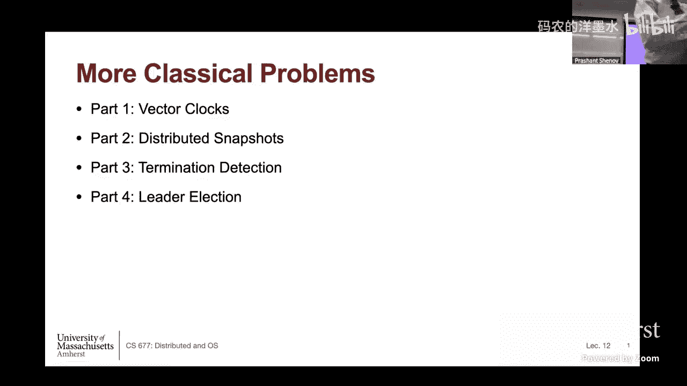
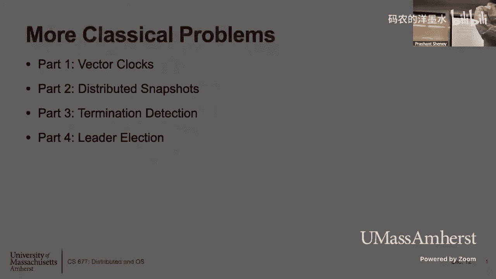
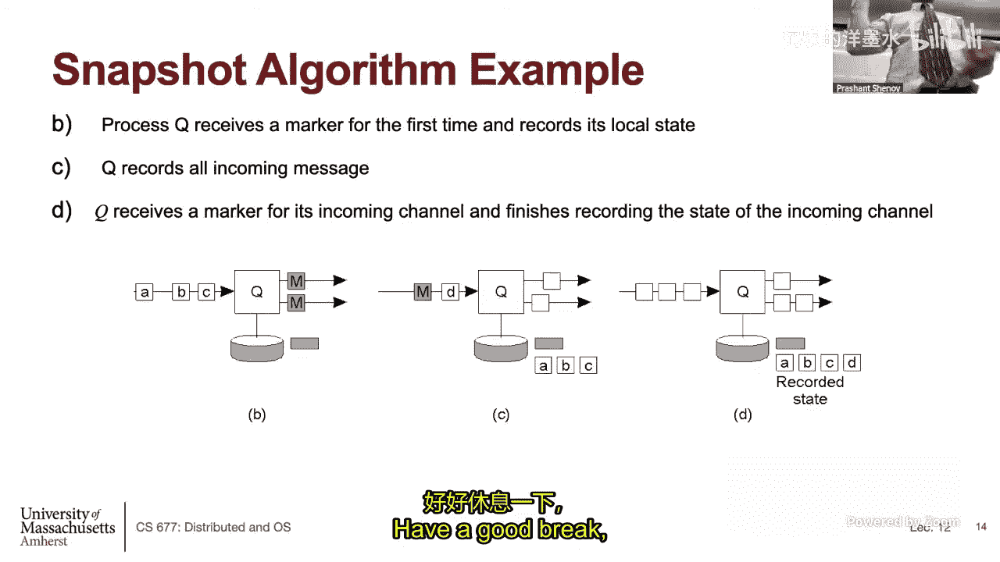

# 分布式系统：第12讲：矢量时钟与全局状态





在本节课中，我们将继续讨论分布式系统中的时间与排序问题。我们将从回顾逻辑时钟开始，然后深入探讨其更强大的扩展——矢量时钟。最后，我们将学习一个重要的概念：如何捕获分布式系统的全局状态，这对于故障恢复至关重要。

## 逻辑时钟回顾与全序化

上一节我们介绍了逻辑时钟（Lamport时钟），它通过“发生在前”关系为事件分配时间戳，从而建立事件的偏序关系。然而，逻辑时钟有一个局限：如果事件A的时间戳小于事件B的时间戳，我们**不能**反推出A一定发生在B之前。我们只能得到单向的蕴含关系。

为了在某些场景下获得全序关系，我们可以采用一个简单的方法：将进程ID附加到Lamport时钟值之后。

例如，假设有三个进程，它们的Lamport时钟值和进程ID如下：
*   进程1: 事件A (时钟值: 1, 进程ID: 1) -> 时间戳: 1.1
*   进程2: 事件B (时钟值: 1, 进程ID: 2) -> 时间戳: 1.2
*   进程3: 事件C (时钟值: 2, 进程ID: 3) -> 时间戳: 2.3

通过比较这些组合时间戳（例如，1.1 < 1.2 < 2.3），我们可以为所有事件建立一个全序。对于原本并发的事件（如A和B），这种方法通过进程ID人为地打破了平局，建立了一个任意的但一致的顺序。这在需要所有副本以相同顺序处理请求的场景中非常有用，例如确保分布式数据库的一致性。

## 因果性与矢量时钟的引入

逻辑时钟未能提供双向蕴含关系，这限制了其应用。我们真正需要的是：**如果事件A因果先于事件B，那么A的时间戳应小于B的时间戳；反之，如果A的时间戳小于B的时间戳，那么A一定因果先于B**。这里的“因果”关系指的是通过进程内执行顺序或消息传递（发送先于接收）建立的可传递关系。

为了达到这个目标，我们引入了**矢量时钟**。矢量时钟是逻辑时钟的推广，它将单个整数时间戳扩展为一个向量（数组），其中每个元素对应系统中的一个进程。

## 矢量时钟算法

矢量时钟算法与逻辑时钟算法非常相似，但维护的是一个向量而非单个值。

以下是算法的核心规则：
1.  **初始化**：每个进程维护一个长度为N（进程总数）的向量，所有元素初始化为0。进程i的向量记为 `VC_i`。
2.  **本地事件**：当进程i发生一个本地事件时，它递增自己向量的第i个分量。
    ```python
    VC_i[i] += 1
    ```
3.  **发送消息**：当进程i发送消息时，它将当前的向量 `VC_i` 作为时间戳附加到消息中一起发送。
4.  **接收消息**：当进程j从进程i收到一个带有时间戳向量 `VC_msg` 的消息时，它执行以下操作：
    *   首先，更新自己的向量：对向量中的每个分量k，取 `VC_j[k]` 和 `VC_msg[k]` 的较大值。
        ```python
        for k in range(N):
            VC_j[k] = max(VC_j[k], VC_msg[k])
        ```
    *   然后，递增自己的本地时钟分量（即第j个分量），表示处理了该接收事件。
        ```python
        VC_j[j] += 1
        ```

## 矢量时钟的比较与性质

矢量时钟的关键在于如何比较两个向量时间戳 `VC_a` 和 `VC_b`。

我们定义以下比较关系：
*   **VC_a < VC_b**：当且仅当对于所有分量k，`VC_a[k] <= VC_b[k]` 成立，并且至少存在一个分量j，使得 `VC_a[j] < VC_b[j]` 成立。
*   **VC_a 和 VC_b 并发**：如果 `VC_a` 既不小于 `VC_b`，`VC_b` 也不小于 `VC_a`。这意味着两个向量中的某些分量互有大小。

矢量时钟实现了我们期望的双向蕴含性质：
*   如果事件A因果先于事件B，那么 `VC_A < VC_B`。
*   如果 `VC_A < VC_B`，那么事件A因果先于事件B。
*   如果 `VC_A` 和 `VC_B` 不可比较（并发），那么事件A和事件B是并发的。

通过一个三进程的例子可以清晰地看到，对于有因果联系的事件，其向量时间戳是可比较的（一个小于另一个）；对于并发事件，其向量时间戳是不可比较的。

## 矢量时钟的应用：因果交付

矢量时钟的一个直接应用是实现**因果交付**。因果交付要求：如果消息M的发送因果先于消息N的发送，那么所有进程都必须先交付M，再交付N。

利用矢量时钟，接收进程可以检查消息附带的时间戳向量。如果发现一个“较晚”的消息先到达，而“较早”的消息还未到达（通过比较向量分量可知），接收进程可以将“较晚”的消息暂存在缓冲区中，直到“较早”的消息到达并交付后，再交付它。这样就保证了消息的交付顺序与因果发送顺序一致。

## 全局状态与一致割集

现在，我们转向分布式系统中的另一个核心问题：如何捕获一个**全局状态**。全局状态包括每个进程的本地内存状态，以及所有在传输中（已发送但未被接收）的消息。

捕获全局状态对于**故障恢复和检查点**至关重要。例如，一个运行数小时的分布式计算任务，如果某个进程崩溃，理想情况是从最近的检查点恢复，而不是从头开始。这就要求我们定期保存一致的全局状态。

主要挑战在于**缺乏全局同步的物理时钟**。如果各进程基于自己的本地时钟在近似的时间点保存状态，由于时钟漂移，可能产生不一致的“割集”。

一个**一致割集**需要满足的条件是：对于任何跨越割集（即发送在割集前，接收在割集后）的消息，其发送事件必须在割集左侧，接收事件必须在割集右侧。**不允许出现“接收在左，发送在右”的情况**，因为这会导致消息在恢复后被重复处理或丢失，造成状态不一致。

## 分布式快照算法（Chandy-Lamport算法）

为了解决时钟不同步下的全局状态捕获问题，Chandy和Lamport提出了一种不依赖物理时钟的**分布式快照算法**。该算法的核心思想类似于为一片有飞鸟的天空拍摄全景照片：虽然每张照片拍摄时间不同，但通过算法可以确保每只鸟只被拍到一次，且没有鸟被遗漏。

以下是算法步骤：
1.  **发起**：任何进程都可以发起快照。它：
    *   暂停本地计算（短暂暂停）。
    *   记录自己的本地状态（内存）到稳定存储。
    *   向所有出站信道发送一个特殊的**标记消息**。
    *   开始记录所有入站信道上传来的消息（存入缓冲区）。
2.  **传播与记录**：当进程第一次从某个入站信道收到标记消息时，它：
    *   记录自己的本地状态。
    *   向所有自己的出站信道发送标记消息（除了刚收到标记的那个信道，可选优化）。
    *   开始记录所有其他入站信道上传来的消息。
3.  **停止记录**：对于每个入站信道，进程持续记录该信道上传来的消息，直到从**该信道**收到标记消息。收到标记后，停止对该信道的记录。此时，该信道在快照期间记录下的消息集合，就是该信道上的“在途消息”。
4.  **终止**：当进程从所有入站信道都收到了标记消息，并完成了相应的状态和消息记录后，它关于本次快照的工作就结束了。

最终，所有进程记录的状态以及各信道记录的在途消息集合，共同构成了系统的一个**一致全局快照**。这个快照对应于算法开始后某个时刻的系统状态，尽管各进程记录状态的时间点并不相同。

## 总结

本节课我们一起学习了分布式系统中关于时间和状态的核心概念。
1.  我们首先回顾了逻辑时钟的局限性，并了解了如何将其扩展为全序。
2.  接着，我们深入探讨了**矢量时钟**，它通过维护一个向量时间戳，完美实现了事件因果关系的双向判断。
3.  然后，我们介绍了**因果交付**作为矢量时钟的一个应用实例。
4.  最后，我们探讨了捕获**全局状态**的重要性，并学习了不依赖全局时钟的**Chandy-Lamport分布式快照算法**。该算法通过标记消息的传播与消息记录，能够高效地获取系统的一致检查点，为可靠的故障恢复奠定了基础。



这些概念是构建强一致性分布式协议和系统的基石。