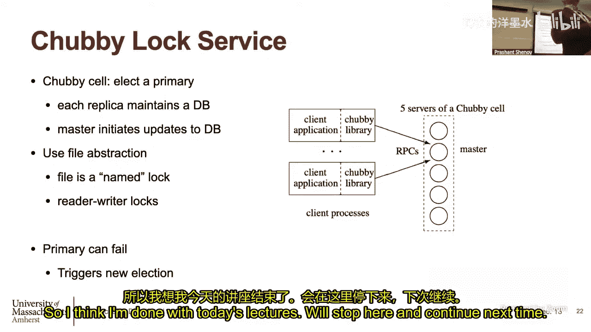

# 【全集 2025 附课件】马萨诸塞大学 分布式系统 中英字幕 p13 Lecture 13 - 领导者选举 -BV19BSYBuE4Y_p13-

Yeah。Okay。我不清里不的留声了。😔，Okay， all right， so let's get started。

Okay so welcome back I hope you all had a good break just as a reminder we have our exam this week it's going to be on Thursday 7 pm in Thomson Hall and I sent an email about the exam but looks like the email didn't read some of you I don't know what is going on with the mailing list but I have posted all the instructions on Piaz and then as an additional measure I sent it to Can all of you should have received that the material on the test is from lecture 1 to 12 what is being taught today is not on the midterm it will be on the final okay so so you don't have to worry about it for this week。

The other thing is I gave out a sample exam。That's last year's midterm actually and some practice problems that should give you some flavor of what types of problems to expect。

On the testal we have office hours this week so if youre reviewing material have questions。

 you can come see me， you can write questions on Piazza。

 we are happy to answer any questions that you have before the exam。I did set the test already。

I think my estimate is it's somewhat simpler than the sample exam。

But you can tell me after the exam that's correct。so youll see okay but as I said previously also the way you want to approach the test is look at the lecture slides first that's the material that we are actually covered and thats what you should know okay you can then use the lecture notes you can use the book to learn more about the material but you don't have to look at things that we have not covered on the lecture slide that's not going to be on the test so try to focus on what what actually is covered and use that as your basis to review all the material。

Any questions about the test before we start？Yes。对。Can you use two pages。

 you can write on either side Is that what you're asking。有。

Now just bring one it gets complicated because then we have to make sure nothing is written on the back or anything okay one sheet can boot anything you want on either side of it。

and handwriting don't type anything。Any other questions？All right。

Let's start today we are going to start a new topic which is leader election I will conclude the discussion of distributed snapshots from before the break there was something that we didn't cover which is termination detection then we will talk about leader election and then we will talk about distributed locking which is mutual exclusion。

Right， okay。All right。So termination detection so what is this problem of termination detection so assume that you have a distributed system of n processes and these processes are performing some computation like simulations and this processes need to figure out collectively whether the computation is finished so that the processes can quit so the question is how is this a process no whether the computation as a whole has finished or not so there are very simple approach to doing this which is an algorithm that is very similar to the distributed snapshot algorithm In fact you can piggyback it on top of distributed snapshot as you're taking a snapshot you can also ask the question saying take a snapshot and figure out if the computation as a whole has finished so that the processes can then terminate terminate them so the way you are going to do this is when you send out your messages as part of distribution。

snapapshot you are going to essentially send additional markers， a marker， these additional markers。

 these are not part of the distributed snapshot itself。

 The are additional markers that are used to indicate whether the computation has finished or not so there are two types of markers are done marker and a continue marker a done marker basically says that this process has finished all of its work and it has no pending messages a pending message means it has not finished work because there are new request that are coming in and they need to be processed。

 but if there are no requests to be processed all the computation has finished there is no more messages that are coming in that that process can send a done so essentially you wait for all of your neighbors to send you a marker all your neighbors send you done marker which means your successors of node queue send your done marker queue has not received any。

Sa since it checkpoint at its state， then it's going to essentially。

Send are done saying I am done my successors are done so it will tell its predecessors is done otherwise it will send a continue continue means that at least that process or something in its successor nodes have not finished some computation。

The。So these messages are going to flow back all the way to the process that initiated the snapshot and either that process is going to get done from all of its neighbor or at least one of them will say continue if any process continue that means the computation is not finished so processes cannot terminate them so they need to keep running but if everybody says done then as part of the distributor snapshot you can also say that the computation is finished and terminate the computation。

So this is an extension to the distributed snapshot algorithm that we had spoken about last time。

 it is simply adding a feature which says take a snapshot and also figure out if the computation is finished or does it still does it still need to perform additional work before all of the messages are processed and the work is done？

Any questions about this before we move on to the next topic which is going to be leader in action？

为什。Okay， the question is what is the benefit of termination detection or what is the benefit of distributed snapshot。

 which of the two are you asking about？Okay question what is the benefit of termination detection over distributed snapshot so this is just extending the distributed snapshot algorithm it's not an alternative right so youre still taking snapshots regularly but as part of taking the snapshots you are also querying all the processes in the network whether whether they are finished their work or are they still computing something that's all so it's basically as you can see this is just a query in through the network it's asking the computation is finished if everybody says they are finished then the processes can quit because the processes are independent processes right so they need to figure out whether they need to keep running or finished right so this allows them to figure that。

嗯。All right， so now we' will talk about election algorithms。

So for this different topic okay so here the goal of this election election algorithms that we are going to look at is to choose a coordinator so in processes you want to pick a leader this is why it's called a leader election algorithm and the leader can perform some task what that task is is not directly relevant to the election algorithm itself but you can think of all many things we have looked at so far so in clock synchronization we had a coordinator process right in many scheduling algorithm we have a coordinator process so rather than designating that coordinator statically you can pick it on the fly you can run a leader election algorithm so that that process that becomes a coordinator gets chosen on the fly and the advantage of leader election algorithm is if the coordinator dies the election algorithm will pick a new one so you don't need to figure out if you pick a static node to act as a coordinator。

What happens to the system if the coordinator dies so all of these election algorithms are going to dynamically choose a leader and also have built in properties that allow them to detect a failed process and then take or not take or rather elect a new leader and we have already seen taking a master in the club Berkeley algorithm and many other places where we need this coordinate so these are the types of algorithms we are going to look at today will allow us to pick a leader well see several algorithms starting with bully and then ring and several others。

So let's start with the bully algorithm so fairly straightforward algorithm so here we'll assume there are n processes and these processes have a numeric I each of them is numbered one through n or0 through n minus1 we'll assume that the processes know the IDs and the IP addresses of other processes so every process knows the IDs and the IP addresses of other processes in the network for very large system this is not a practical assumption but let's assume the system is small enough that we can make these assumption well assume connection is reliable which is let's say we use TCP and the goal of the algorithm in this case is that you are going to simply choose the process with the highest I as the current leader of all the processes that are still alive in the network you want to figure out what the process with the highest I thats currently still alive and we'll designate that as the lead。

There could be many different criteria for picking a leader This one is simply saying pick one with the highest I you could have said pick the load with the least load and make that the leader。

Or you could have said pick the node with the most amount of CPU to be the leader there could be any kinds of criteria here we are simply going to use the process ID as the criteria for using the leader。

So， the bully algorithm is a recursive algorithm the way it' is going to essentially work is as follows。

😊，Any process in the network can initiate the algorithm so for example lets say some process has not heard from the current coordinator okay it can decide that the coordinator seems to have stopped responding so start an election so it basically is going to initiate the election and then the election is going to recursively propagate through the network until there is a winner for the leader。

And so I'll show you how that works， but the point that you want to note here is that the election algorithm needs to provide a consistent result what does consistent result mean it basically means that even if multiple nodes start election algorithm simultaneously you always end up picking the node with the highest I shouldn't be that two nodes decide detect the failure of the leader more or less at the same time because we said any process can start an election both of those nodes might start an election to choose a new leader those election should give a consistent result which is the same node with the highest I they shouldn't give you two different result that is going to cause some problems so let's see how this is going to work。

Yeah， so。我。Here is an picture so Im going to first explain this with a picture and then we will see how these works so here lets say there are processes numbered from0 through seven that are part of your distributed system seven was the previous coordinator it failed。

It is now gone at some point four is going to detect that it's not heard from7 in a one and say let's start an election So the way it's going to start the election is it's going to send。

Election messages to all processes that have IDs higher than itself。

Because the goal is to pick the highest ID node that's still alive so it's going to basically send these election message so you'll see that four sends election message to56 also sends to7 but7 does not respond now when a higher I process receives an election message its going to send an okay message back to whoever send it the message so you will see five and6 receive that election message they send an okay message to four okay message essentially tells that node that there is at least one higher I process that's still alive so they will now figure out recursively who should be the leader and that node should drop out of the election so these two okay message go back to four the four knows that there are some higher ID processes in the network and it drops out of the election and five and6 are going to recursively do the same thing so five is going to send election message to six and7。

six will also run an election message by sending it to seven the goal is to keep probing to see which is the highest I process so what will happen is six is going to send an okay back to five so5 will drop out and then six does not hear from7 okay so six is going to declare itself the leader and it is going to send the coord I'm the new coordinator message to all the press so thats its declaring itself as the new leader。

Is that clear。So this algorithm is called the bully algorithm and you can see why essentially higher ID processes are essentially causing the lower ID processes to drop out it is like bullyings lower ID processes to drop out and then you are recursively performing election until there is only one node left that is the highest ID process and it becomes the leader。

对。Any questions on this， yes？我其实在还。不是。You are saying if no4 knowss which processes are alive。

 is that your question？Okay question is why is for probing all higher ID processes why is it not sending a message to6 and waiting right so the point is that you don't know which processes are alive or not。

Or might only have heard from the coordinator， you don't know the state of other processes。

So you always send message to all higher ID processes trying to figure out who is still actually active in the network in addition to seven other processes might have also crashed。

And you are。Most processes will only be hearing from the coordinator they don't directly communicate with other processes which is why you probe all of the processes what youre saying could be implemented as another election algorithm not saying it's wrong but this the goal of this algorithm is you probe recursively and then eventually end up with one process that wins the election。

You could have said seven is crash lets。Look for the next lower Id process if it's alive and try to do something that way that could have worked as well。

嗯。Any question here。Yes。还意。等对。Okay question is how are the IDs assigned in this case IDs are assigned random we are just assigning numbers0 through n okay but as you pointed out there could be many policies to assign higher ID node higher IDs that could be based on resources that's a good way to do it saying let's give higher IDs to processes which are more resources because coordinators do more work。

They need to have more resources to perform that extra work so that could be a policy as far as this algorithm is concerned it resumes the nodes have already been given IDs it's not asking how to give them IDs but there could be many ways to do it assume random is the simplest one but yes you could do it based on load on the net load on the nodes resource availability on the nodes all of these things can be harder。

As policies。All right， so what do you think is the message overhead of this algorithm There are N。

And nodes， how many messages are exchanged before a leader is actually elected。

So you shouldt really realize it's order n square because you could have a case where the lowest ID process0 starts in election that triggers n messages and n rather n minus1 come back and then each of them basically keep going and so you have order n square we will have two n minus1 plus2 n minus2 and so on and so forth is order n square is the so it is not linear but it is quadratic in complexity。

You'll see one now that's going to be linear in its message complexity。

 but this one is quadratic message complexity。That year。Okay。

Allright so next one is ring based so here we will also assume that processes have unique IDs and we will take those IDs and and order them in a logical ring so again if it is0 through n we will make it a logical ring it not a physical ring but we will just assume that it is a logical ring in this case each process only needs to know its neighbors。

InThe previous case you needed to know everyone's IP because you had to send potentially a message to all of the other nodes in this case each node because you are a rank topology each node normally needs to know a left neighbor and right neighbor you don't need to know the identities of all the nodes in the network。

So again， the goal is to pick the process with the highest ID as the leader we do the same thing as before any noded can start an election。

But in this case the election message is going to propagate through the ring and all all that you do when you get this election message is you add your ID to that election message and you send it to your neighbor okay and so this message is going to circulate through the ring each message that has sorry each node that has received the message would have added its ID to the ring so when the message comes back to the initiator it has a list of all the nodes that are alive in the ring and is going to pick the highest ID1 and declare it to be the leader。

Yeah， so here is a picture to show the same scenario as before right so0 through7 are the nodes in this case we just arrange them in a logical ring a7 has crashed。

Yeah， so you see that five has initiated at the election and you will see two also detected the node failure of the coordinator and started the election。

So5 is going to add its ID and send that message to6。

6 is going to piggybacks its ID and send it to0 it can send it to 7 and then so this is going to circulate and then when it comes back to five all of the processes would have added their process IDs and then five will have the list okay it just scans through the list picks the I ID process and then sends another message to the ring saying this is the new leader。

And the message from two is going to end up with the same result okay because you will essentially have this message going all the way and comes back to two it sees all the processes that are alive it is going to again pick six as the new leader and send that around。

好。有。Yes， it's a good question。 I was going to ask that question， but yes。

 so how does six know how to send them。😊，Again， because。It did some updating。对。Okay。

 so let me repeat what I was saying。So in a ring topology and we will see another example of a ring in a little bit typically you only need to know。

Who is your left neighbor and right neighbor but any network can have failures and then the ring needs to heal itself because if there no fails you will now see that the ring is no longer a ring。

You basically cut the ring let is basically just become a chain so to essentially restore the ring you are to have a ring restoration process where you have some protocol that allows the two nodes that are now separated because of the failed node to essentially attach themselves to one another。

You can do that in many ways you can send the message in the backward direction and figure out what was the neighbor of seven for example because6 was communicating with 7。

6 doesn't know who its neighbor is but if you send a message in the backward direction you can then figure out that zero was seven's neighbor and then get there and try to connect with so there has to be some healing protocol to restore the ring and once the healing protocol complete then six will know that it has to essentially communicate with0 but thats for any ring topology that is basically something you have to act or ensure that when there are nodes that fail you can still continue to operate as a ring otherwise your ring will break。

嗯。That's not part of。Excusly， that's not part of the elect algorithm that we have to worry about。

Here， we just assume that when a node fails， the ring has essentially healed itself。

 okay we are just running the election algorithm on top of that。😊，We don't need to worry about it。

 but thats an additional detail that you do need to worry about in an actual ring implementation independent on whether it's election algorithm or something else。

That clear。All right。Complexity to n minus1 because the message is going twice through the network so is linear in complexity as opposed to qua right in the previous case so essentially the worst case is that node with the lowest I would initiate always triggers to n minus two elections and best cases n minus。

So this is going to have lower overhead than the bully algorithm giving you similar results。

All right。当时你应该会。关阵直啲三。Yeah the question is will the ring algorithm take longer time because you are essentially passing messages sequentially it will take more time right because you are going to sequentially probe all the networks in the bully algorithm you are probing not strictly higher than your ID。

here all the nodes are probe because you are just sending it through the ring so it is going to take it has lower message complexity but it will take longer because you are going to have imagine you have 10。

000 nodes right in the ring you will have to go have the message go through all of them。

Whereas if you had a bully algorithm the worst case is when the lowest ID node starts the election that goes triggers lots of messages but the average case is when some node with some middle ID starts and only the higher ID nodes will get probe so it will take less high as a result okay the number of messages will be higher。

😊，But it might converge faster。不过己。对。Yes。It。不谢谢谢谢。Yes。

 in bully algorithm is recursive and you can send things in parallel here you are always going to do sequential right it has to circulate to the link it is linear。

Any other questions， yes？Holy over hallway like。当起。O比 center的。Election message， the highest node。

 and then it will send an election and it won't get a response so it will after two time steps。

So you are saying， will the bully algorithm get things done in two time step because you will send。

A message to all higher ID processes and then they will recursively start an election and then con that's your question right so in practice that's true but then the amount of messages that get sent because you recursively starting on the order of n minus one election depending on who triggered it in parallel right that will take high message over it but it might converge first and whether it's two time step depends on whether all of them start all at once or they randomly start at slightly different times is a different implementation detail but yes if they inously start election it will converge in two times steps。

Yes。再把那个。We one thing to after five six equal to0 is the next automatically means the six is the highest。

Yes， the question is is there any benefit to having this go through the whole network because after six when it goes to zero you know that6 is basically the leader you have chosen the leader for sure once you start encountering lower ID processes but because the ring topology it doesn't allow you to send messages out of order so it's not like zero can send back or it things you1 six you are to still have it go through the ring in that order it will still propagate through the ring。

Right。But that's what we said， you can only communicate with your right and left memories the7 and。

好回的。这。If seven and three are both down， how does the message go back to six， is that your question？

Okay， question is what happens if the there are multiple failures at the same time Okay so if there are multiple I mean this is all part of how to maintain a ring which is。

Not really part of the。Election algorithm， but if you have a ring topology the fundamental part of the ring topology is to maintain the ring when nodes fail right so there could be many approaches I mean I gave you one example another approach could be that each like another simple idea could be each node not only keeps its left and right neighbors but also its left neighbors neighbors also right so six would not only keep track of seven but it also keep track of0 and 4 so that if it left or right neighbor dies it knows who to connect and so on and so forth you can come up with many approaches you could say what if both six7 and0 die you can say okay you can keep three neighbors you are to assume how many failures can occur simultaneously and decide how much information to keep so you can always heal the ring in many different ways。

Any other questions here？1ほ。Is communication bidirectional can zero communicate with6 that depends on the ring yes rings can be bidirectional here we are assuming unidirectional ring which is why its circulating in one direction but yes。

 you can have messages go clockwise or anticlockwise or you can stop the message and send back if you don't need to go it go through but this one is assuming a simple unidirectional ring。

对。The ring is not able to heal and the protocol will because that' is basically no longer a ring at that。

Yeah so but you assume that the ring is part of the network layer。

 you don't worry about it at application layer so election algorithms are essentially running as an application you just assume that the network layer has figured out how to keep the ring as a ring right and then you just operate on top of it but yes if the ring fails and we will come back to that actually when we talk about locking I will talk more about that as well。

Yep。All right so that we talked about two techniques let's talk now about distributed synchronization which is lockingbased approaches so here we are going to now think about how do you implement a distributed lock if you all know what a lock is you typically use the lock in a single process right assume that there is a set of n processes that are coordinating with one another or we're interacting with another and they are some shared information maybe the shared file or shared database and they need to get grab a lock now you will have this n processes together constructing a lock rather than the log being part of one process you want all of them to basically implement what we call a distributed lock as the question is how will you implement neutral exclusion with multiple processes we know how to do this for a single process you probably use locks in your not probably you did。

lock in your lab where you use summer of for lock monitors that was a single process right here we have n processes and so we are going to do this in a distributed system。

I will show four different lock implementation， some will use a centralized coordinator we essentially elect a lock coordinator using a election algorithm and then that coordinator will help us implement a lock and then well have several distributed versions of these lock algorithms。

Well let's start with some one example of why you need lock here is a example to show you why this might cause problems。

 so assume that。You have two clients， theres an online store maybe the clients check if there is some item in stock and then they both send a buy request to buy it right so if there is no lock you might essentially get an error because the first one will succeed and the second request will come when the first request has already bought that maybe the last item of that stock and it will fade。

So， you want to ensure that the clients can essentially get a distributed lock so that only one of them can buy that item at any time is is one simple example of why you need locking there are many others that we can use as well but lets not look at an example of how do you do this。

So here is how we are going to implement a very simple centralized mutual exclusion because is somewhat of a misnomer because we are implementing a distributed lock using a centralized coordinator but leaving that aside for just a second we will assume that processes are numbered like before one processes is elected the coordinator a lock coordinator we know how to run election algorithm。

 we will just use your election algorithm elect a lock coordinator。

And the goal now is that when you want to grab the lock。

 you will send your lock request and release request to the lock coordinator。

So you'll basically to grab a lock you' will do lock acquire youll send lock acquire as a RPpC message or some socket message the lock coordinator the lock is free you will basically get success so then you get the lock the lock is in use your request will be queued there so you will be block waiting for the lock to be acquired except that now you are using network messages to do this rather than using a function code so so basically the goal is the coordinator is going to receive these messages whenever it receives a request message if the lock is available and the queue is empty which means there's no other request before it you grant the lock otherwise you will queue the request and the lock is released you take the next request from the queue and grant the lock here's the picture that shows you how this is going to work。

 this picture has four processes zero through three and we will elect。

The coordinator first three becomes the coordinator okay so initially the lock state is available the queue is empty there is no request on the lock so one one makes the request it immediately gets the lock because it is now available and then two makes a request okay at this point the lock is in use so this request is skewed okay it is not going to get any reply back from the coordinator so two is blocked。

Okay similar to how lock acquire will block until lock is free same thing so your RPpC message is not going to get your response so2 is going to be blocked and one once releases the lock2 is going to basically be given the lock through the OK message。

Okay， is that clear？All right so this looks very simple but the problem comes when there are failures in the network because the distributed locking although it seems very simple is actually quite problematic because all kinds of things can fail this is a distributed system so lets take several examples。

What things can fail。 So let's say that one has grabbed a lot。at this point。

 the first step was one requested a lock and it got the lock。And there a one crashes。

It is holding the lock and the miss process is gone the lock is never going to be released so now any other process that requests the lock will block forever and your system will deadlock。

This is not something you will see in a normal process because if something crashes the whole process will crash here parts of a system have crashed now you will basically not have the lock back。

Or the coordinator might crash。Okay now you might choose a new coordinator you can run leader election and choose a new coordinator but you need to restore the state of the lock you need to know what was the state was it granted to someone was there a queue with multiple requests you need to figure that out okay how do you do that of course you have to log that state to disk otherwise you will not know what it is and so on so coordinator crashes process crashes。

All of that can complicate this implementation this looks fairly straightforward in this example but implementing it is quite complicated because you are to handle failures carefully otherwise you will not get mutual exclusion or you will get a deadlock。

Okay。So this is basically where all of these things get more complicated。Okay。

 so essentially the properties of this algorithm is。😊。

Excuse meSo using a centralized locks to implement blocking calls its very simple is granting locks in the order in which they are received so it's fair it uses three messages to essentially grant release and request so it's fairly straightforward in this message overhead shortcomings are its a point of single point of failure which means if the coordinator crashes theres a problem when you process crashes or a deadlock so these are all things that you will need to deal with when you actually make a proper implementation。

In questions here not going to describe lots details of how do you deal with the failure cases you just need to know that you have to deal with them in some reasonable way。

All right。So that is our simplest approach now let us try to make that more complicated by saying let's remove the need for a centralized coordinator if the coordinator crashes then we have a problem so we will use a decentralized approach where rather than one coordinator we have many coordinators。

And we will use voting a between coordinators。And so we basically relax the assumption that there is a single coordinator or many coordinators in the network。

 they are all tracking the state of the lock。😊，And when you are ask for a lock。

 these coordinators are going to decide what to do and vote。

And majority vote wins which means that if some coordinators are down the other coordinators can still figure out what to do and so long as theyre in a majority you are confident that the lock state is correct if you are a minority you don't know whether the lock state is correct with a majority who have failed might have some other state or the law but so long as a majority of the coordinators that you are designated or still up they can track the state of the lock is it free or their request queued and so on so we are essentially going to use majority voting to figure out and then the coordinators can then return back the result or whatever the requests。

so this essentially is approach where you have many coordinators these coordinators like the centralized case are going to track the state of the lock。

Whenever a lock request comes in， they will figure out each coordinator figures out what the response is to that request similar to the centralized algorithm and they will vote。

And so long as there is a majority vote that majority vote is then going to determine what is the next step should the request block should the lock be granted and so on and so forth so this is essentially going to reduce the problem of what happens if the coordinator crashes because we will essentially not have that problem by having many coordinators。

increasingcreas the complexity of the algorithm， but it gives you more resilience to failures of coordinator。

😊，This does not handle client failures。Now， we basically dealt with coordinator failures。

 but the problem of a client crash is still there a client holding the lock may simply die and never release the lock your system will still dielock that problem we have not solved。

But at least we solve the coordinator problem。Yeah。So as you can see。

 these are quite complicated when you try to deal with all kinds of failures that can occur in the network okay so this is a decentralized approach。

I'll show you two more approaches。Here is another one which is called a Rick and Agawaala algorithm this one uses Laper clocks that we looked at to several classes ago。

So， the idea here is that every time a process is going to request a lock it is going to create attached a lamp port time clock value to that request。

哎。Then what happens is it's going to then send。But to enter a critical section you essentially construct the not construct increment your local lamp port clock value and you send the request message with that your lamp port clock to all other processes Okay so you are basically saying I'm request k my lamp ports clock values。

PSK okay and I need the lock so that's the request message it goes to all processes there's no coordinators here。

You send it to all processes and network and you have to wait for a reply from every other process which a reply simply says go ahead you can have the lock or to wait for a reply from every other process before you can enter the critical section until you are received an okay from every other process you cannot your blocked。

Now when a process receives a request message process。

J receives a request message from other process， it can do one of two things。

If it does not need the lock if there's no contention it' is going to send a reply reply is good I don't need the lock if you need the lock go ahead okay that's what a reply me now if it's already in the critical section its going to not send any reply at all it's going to say I am already holding the lock so I will wait until my lock is done before I send a reply message and。

The third one is it is also trying to enter the critical section which means that it has itself sent request messages in this case you are going to compare the Laport's clock values to see which of these has a lower La ports clock timestamp and the one where the lower timestamp will win because that's the one that made the request first。

So essentially if you want to enter your compare your timest with the one with k and you send a reply value if the one from K is lower。

 which means that it made the request first。Okay so three cases。

 one is theres no contention so you send reply if there is already if you are already holding the lock you wait until the lock is done then you send the reply and the third case is when this process that received that request from the other process is also trying to contend for the lock and then the one with the lower time stamp。

Exactly， they just used。Laampport clocks to figure out how to do locking。

No coordinators in this case。We are asking all other processes。So is good and bad。

 the good part is there is no coordinator， you don't have to deal with coordinator crashes but the bad is every process in the network has to participate in locking whether it wants the lock or not any random process needs the lock you are to essentially participate in the protocol。

 send reply messages and so on。And you are to get reply messages from all other processes to proceed。

 which means that。Again， if you have any other process that has crashed。

 you will not get a reply message from there。because the process is crashed and then you cannot grab the lock。

so essentially we went from one point of failure to endpoint of failure which means that any process that crashes in the network the entire locking algorithm fails in the other one at least if the coordinator fail the lock algorithm failure any process crashes no one can grab the lock so it is good and bad the good is fully distributed or decentralized bad is are endpoint of failure。

This is one of the few cases where you may go from a centralized algorithm to decentralized algorithm and the failure property actually gets worse。

😊，Normally when you remove things that are centralized you get better resilience。

 you get better failure resilience properties here you actually made things worse so this is just an example to show you not every decentralized algorithm is always better than a centralized algorithm。

generally they are， but here is an counter example where you this is not the case。😊，哎。

So so this one uses clock values and there is one more that I will talk about which is a token ring algorithm so this gets us back to a ring based topology and well see how this can be used to implement a locking algorithm so we will assume here that we have processes that are numbered and they are part of a network this is the physical network but because they are logical ring then the logical topology looks like that where zero can only talk to essentially one and7 and so on so you can only talk to your left neighbor and right neighbor but the locking protocol for other messages any process can directly communicate with any other process because not necessarily a physical ring so here is how we are going to make the lock protocol well construct a special message called a token。

and we will get the token to circulate through the network so to grab the lock you don't do anything。

 you just wait for the token to come to you。And once the token message comes to you。

 you hold the token message and when you are holding the token message you have the lock。

And then you can do whatever you need to do and then once you done with the lock you pass the token message to your next neighbor okay so the token is going to keep circulating in the ring。

And so you grab the lock， you just wait for the token to come to you。Yeah， and when the token comes。

 you know you have the lock and then you can essentially。😊。

Do whatever you need to do in your critical section and then pass the token into the next myth process。

Is that here very simple technique no require no release is no nothing you just construct a special message that is just going to keep hopping to the network okay so it will be at 717 is done else it to0 if0 doesn't need the lock it will immediately give it to his next neighbor if it need the lock it is waiting then it will do whatever it needs to do and when it is time to release the lock then it sends to the next neighbor and so on so this token message just keeps circulating okay and holding the token message there is only one token in the network so holding the token guarantees to you that you actually hold the lock。

Is that clear。So， this is essentially called a token ring algorithm。Right now。

 the interesting part about this algorithm is although this is a simple locking protocol is well also the basis for a local area network technology that no longer exists。

 but that was prevalent about 20， 30 years ago。In the 90s there are two land technologies。

 there was something called Ethernet which is now of course the the one that eventually won and became commonplace。

 but there was another one called tokenri。So in those days when you bought a computer you are to decide you want an ethernet card in your machine or a token ring card and that depend or depend on whatever technology your organization had chosen if you are a token ring organization you are to get a token ring based card otherwise you are to get an ethernet card and the idea in the token ring。

wa basically all the pieces in the network essentially were arranged in a logical ring and the reason you needed the lock was a computer could send a message to any other machine in the network only if it held the lock because if two machines tried to communicate at the same time those packets would collide and they would corrupt each other so the idea was you have to essentially have a lock on the network for you to transmit to some other node。

😊，And this token ring that this token packet essentially gave you lock over the network and if you had the lock you know no one else can transmit so when you transmit you know its safe to send and nobody else can send at the same time。

So that was the idea if you know anything about ethernet you will know that in ethernet you basically basically use a randomized algorithm you essentially transmit and if two machines transmit at the same time you have something called a collision there a package basically collide and you don't transmit successfully then you have a randomized back off where you wait for different amounts of time and retry so so there may be many attempts in ethernet before package is successfully transmitted because multiple nodes are trying to send at the same time and whenever there is a collision you have a problem。

😊，Token ring try to solve that by saying you have to actually have a lock you cannot just transmit whenever you want you have to grab the lock and only then transmit so always clean there is never going to be a。

A case where there's going to be collision in the network。ok好。Still transmitting from here。

Let me see if there's any problem， okay all right。So， that was the basis for token ring algorithm。

 but there are still problems in token ring so lets say that there is a node holding the token and that node crashes。

The tokener disappeared。So now what do we do right there is not going to be no more token that is circulating through the network there is a land technology then there is no token so you cannot transmit fundamentally all your communication will stop。

Or if you are using this for locking， you will wait forever， you will never grab the lock。😊。

So there has to be a way to detect token failures and regenerate the token。

Now I mean token ring the network protocol that is so straightforward but in the regular more general case of actually making this a locking protocol is not straightforward let me explain why this is the case。

😊，YeahIn the network based token ring protocol when you hold the token you had a limited amount of time for which you could hold it you couldn't hold it forever let's say you are given if you have the token you can hold it for100 millisecond max after 100 millisecond even if you have more data to transmit for fairness you have to send the token to the next node so that everybody gets a fair shot and you are not waiting for long periods of time because somebody decided to transmit a 1 gigabte file and then nobody else can transmit because you're holding the token so you could hold the token for a limited amount of time so let's say100 milliseconds。

Now if' 100 milliseconds and its eight nodes in the network it if you just do the math you will know every 800 milliseconds you should have the token max and you can get it faster if somebody doesnt use their entire slot so you can detect a token failure because you have to receive the token in the bounded amount of time and that time is known it dependent on the size of the ring and the max amount of time you actually hold the token so if you don't see the token after that amount of time you know the token is lost you also know probably that the ring has failed。

 then you have to do the ring healing that I talked about and regenerate the token。

And you have to do this in a proper way that you two ros dont regenerate the token。

 so you have to designate some node to regenerate the token and so on。

So in token ring protocol the network protocol it was straightforward。

 but let's just say you are using this in a distributed system。

 we don't impose any time limit on how much time you can hold a lock for it you can once you do lock acquire there is no such thing that you are to give it up in 100 millise you can hold it as a process for as long as you need to so there is no bound in the general case。

So in the general case the token might be lost and you will never detect that it is lost because you don't know if it is actually lost or is there some process that is holding the lock for an excessively long time in some very long critical section you cannot distinguish between these two cases。

so you cant simply say the token hasn't arrived it within five minutes lets just regenerate the token and if there is a process that actually held the lock for five minutes it will release the token now your two tokens in the network right that is also bad because two tokens don't work can only have one token in the network。

And so， sort handling。Token loss is non trivial in the general case。

 but it is more straightforward in the network case。

Okay so so that' is your token ring protocol for locking but it actually has its origins and networking technologies this back in the days where ethernet and token R used to compete with one another eventually ethernet one and token Rs went away。

any questions here？打 are you back。Sorry。All right，Very quickly there is four algorithms we looked at there are some properties here in terms of how many messages you need to deal with and so on we didn't analyze this and this is really not the important part about which one has more over it and so on the real problem is all of these algorithms are basically problematic from handling crashes none of them are perfect every one of them have some flaws in terms of if the coordinator crashes there is a problem if a process that holds the lock crashes theres a problem there could be a starvation in the recurren and agarla any process crashes can basically freeze the entire algorithm the token ring lost token can cause a problem so what this is trying to tell you is distributed locking although we studied a bunch of these protocols it not trivial to implement in practice because handling failures is where pretty much all of them have their weak spot they all have some problem or the other and you can。

Make some assumptions to resolve them， but it's not trivial in the general case in all of them so this is why its complicated to implement you don't see general purpose implementations of it。

 although there are systems and Ill show you one that actually implement locking type algorithms in the distributed case。

So it so let's do a very quick case study and then we will wrap up for the day so here is an example of a system that Google built it's called the chubby locking service where they implemented a distributed locking system so so the idea here was this is a locking protocol and any of the applications in the Googles network when the needed a lock you can go to chubbi and chubbi can be the coordinator of the lock we can instantiate a new lock you can acquire a lock release a lock and the locking service will implement locking protocol for you so it designed for course grain locking it is not a fine grain locking protocol it uses file systems abstractions for holding lock so essentially you have a chubby cell which is a set of file machines that support locking request from about 10000 servers so for every 10000 servers。

They made five servers at locking servers that implemented the chubby protocol and one of those servers was actually kept in different data centers so that even if the entire data center failed all the states of active locks don't go away right because they said coordinator crashes you don't know what the state of the lock so are five coordinators right one of them is actually kept outside so that even four of them go away entire data centers goes down you still have some other machines somewhere else that can figure out what was going to happen right so。

And they essentially used a file system interface so they kept the state of locks as files on the file system。

 they have were locking protocol but the state was also always preserved on disk so that even if the memory state goes away the disk state actually preserves a state of the lock and you can reconstruct it。

And so they implemented this ch locking service it's widely used in the Google system。

 they use it to essentially perform leader election。

 they use it to do course grain synchronization where you can hold locks for hours or days right so you can see that it really coar grain you are not getting locks for second or millisecond time scale you can grab a lock and do some computation for one hour or 1010 hours or several days at a time but it this course grain in that regard it' is not meant for the kinds of locks you implement in your core which are more fine grain locks。

 so here has a。Heres a picture of how this works so you will see that this is essentially the five servers of chubby cells where you essentially have the Chubby library that you can implement not implement but incorporate in any application and then you can essentially use the chubby service lock acquire and lock release those requests go to the master it can create new locks and grant locks and so on it uses RPRPCs and specifically GRPCs for communication between between the application and the locking service which are all the coordinator so this is an example of how some of these ideas are now used in large scale distributed system。

So of course you can have some of those chubby masters fail and then you can use leader election to add new masters so that you always have five of this node if some of them disappear and so on so those techniques are also part of the chubby locking service。

So it is just a very quick insight into how some of the ideas we talked about are implemented in larger systems。

Any questions here？Yes， so what are like modern databases。Qu。

 what do modern databases use to deal with these issues？

There are two ways to think about what you just asked。

Databases are still by and large single machine database you can have clear distributed databases cluster databases leave them aside because we will come to distributed transaction soon but you take a modern database even though it may be a large database a single machine single machine there is no problem all the locks can be implemented on that machine locks are extensively used in databases they are extensively used in transaction we will start looking at some of these techniques very soon but they don't do this distributed thing。

Because that's much more complicated so they basically are centralized all the locking is within the database as one database process so it's much more straightforward there's extensive use of locking its more straightforward it no different than you using locks in a Python or a Java program you just think of database as some a large program that is using locking internet now having said that there are of course distributed databases。

RightSo there the database spans multiple machines right so when you are distributed databases you do need to implement some notions of this but rather than implementing this at a locking level databases do this at a transaction level so they will implement these types of properties using this concept of a transaction and we will look at distributed transaction in a lecture or two probably it's the next lecture or maybe the lecture after that and you will see how distributed transaction can be implemented so it's basically in databases you use a higher level abstraction you don't deal with locks you deal with transactions and transactions will internally use locks。

any other questions here？Okay， so I think I'm done with today's lecture。

 so we'll stop here and continue next time。

