# 【全集 2025 附课件】马萨诸塞大学 分布式系统 中英字幕 p15 Lecture 15 - 分布式事务 -BV19BSYBuE4Y_p15-

Sorry for the technical difficulties so today we will start a new topic which is distributed transactions and the topic is quite related to databases but what we are interested in here is to see when you take databases and make them distributed how can you take the concept of transactions and also make them distributed and this is going to be an early precursor to several other topics we will study which would include things like distributed come consensus PAxos and so on Okay so all of those are related topics and well start with something relatively straightforward which is transactions probably have heard the word transactions in a database context even if not I will introduce what this means what traditional transactions do and then we look at how do you deal with that in the context of distributed transactions and then well end with discussion of concurrency control which is how can you take。

Vries in distributed transactions and execute them in parallel And how does locking work in that context。

 Okay， so let's start with what is our transaction so。

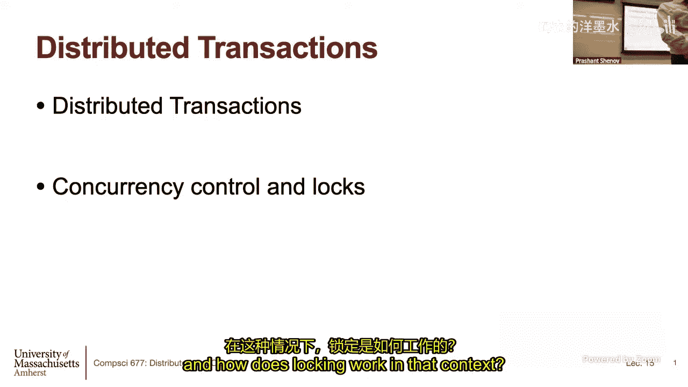

The transactions have their origin in databases so it is an abstraction that allows you this concept of atomomicity in distributed system what does atomicity mean atomicity essentially means all or nothing in terms of how a set of operations execute so suppose you have a set of instructions and you want to you want a property where either all of those instructions execute successfully or none of them execute successfully you don't want a case where maybe five of the seven instructions execute and to fail to execute if you do not want such a case where you want either all of them or none of them you basically use how to use this concept of a transactions because what you will do in that case is you will take any of these set of instructions you will add a big transaction and an end transaction around them and then the transaction system will guarantee atomomicity atomomicity means it will guarantee that every。

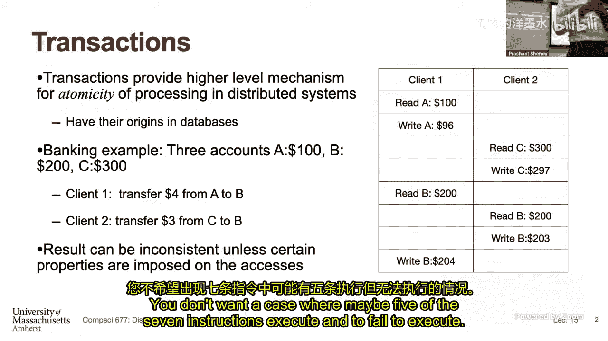

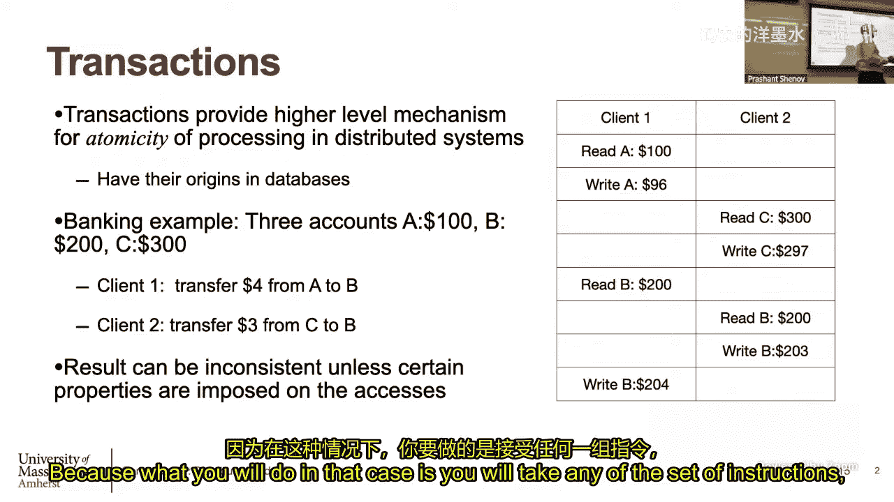

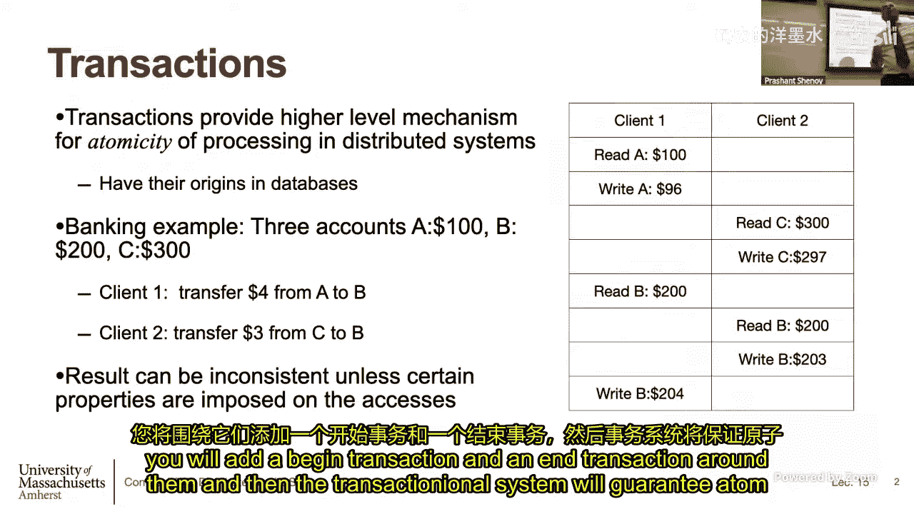

that's within the beginning and end transaction either all of those instructions execute or none of them execute and we'll see examples of why this is important in things like databases and so on。

 but we'll start with why you even need atomicity let alone all or nothing properly so well take an example which is a database example。

 but it makes the point where a banking database there are three accounts in this database account A has 100 balance account B has $200 and account C has $300 balance now let's assume that there are two clients that are performing some operations on this database client one wants to transfer $4 from account A to B。

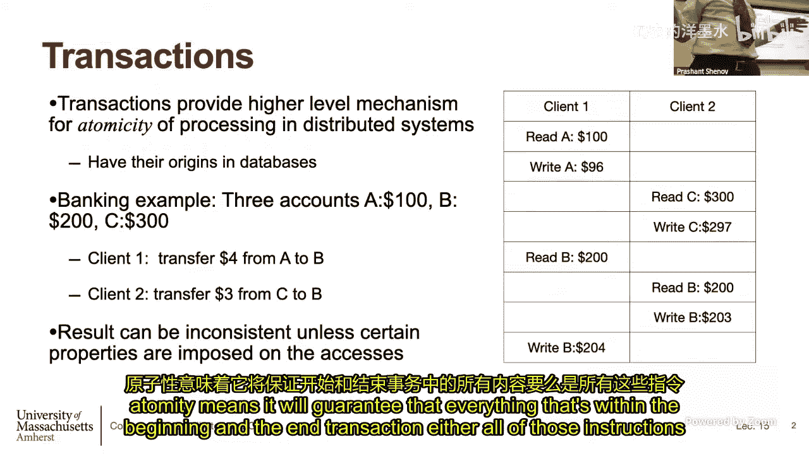

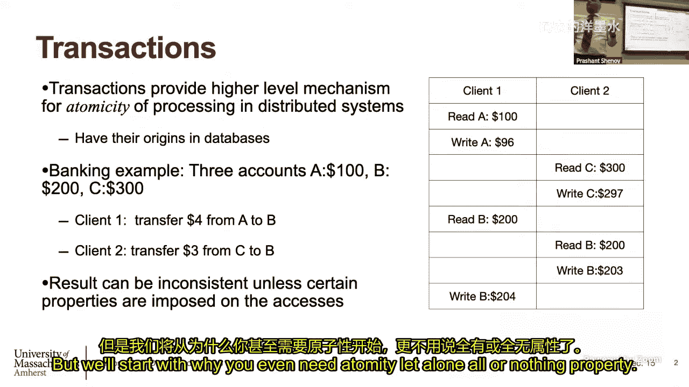

and client2 wants to transfer $3 from account C to B okay so it should be clear that B is getting $7 it' going $4 from a and $3 from C so logically that makes sense but now when clients one and two actually execute these operations here is what is going to happen so client one has to first read the account balance of a and it has to deduct 4 from it and then it has to read the account balance for B and it has to add 4 to it right because it's moving 4 from a to B that's how you actually do it read the balance you deduct or decrement the amount then you read the other balance increment the amount and you have to do the same thing first for C where client two is going to take $3 and then add it to these balance now because these are now independent read and write operations that are being performed on this database which has this three different。

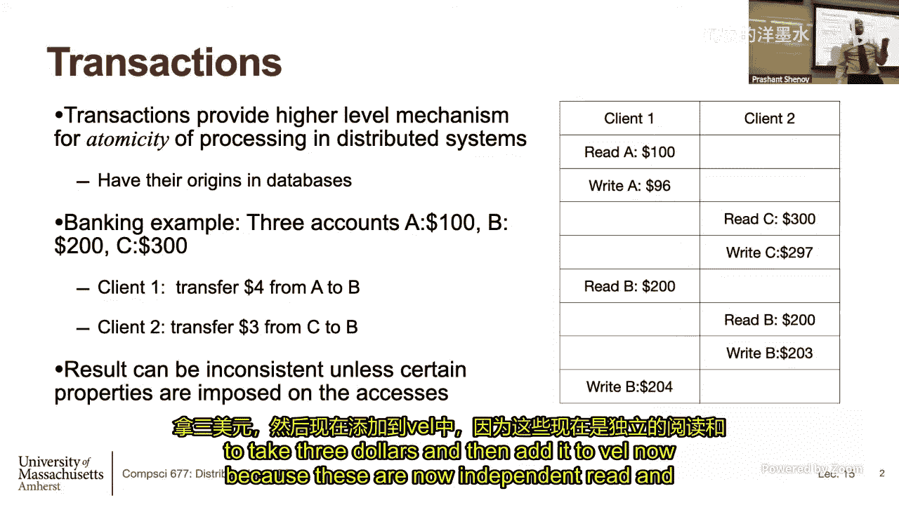

Accounts then let's assume that they are actually executing concurrently they are going to get interlead because client one and client are performing these operations at the same time and this interleaaving could be arbitrary if you don't have any higher level control or what is going to happen and here is essentially one possible interlea you will see that so the y axis is here is time So you will see that first client one's instruction executes and it red 00 from a then it decremented a so far everything looks good but now because of concurrency。

 let's say the CPU switches to the program executing client two query in this case it's red C's balance and it decrementate $3 so far everything looks good you're taken the money from the two accounts now youve got to deposit it into B's account so here is one possible thing that might happen So client one in order to deposited it reads a is balance it says 200。

😊。

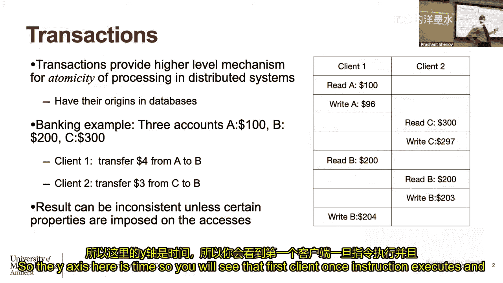

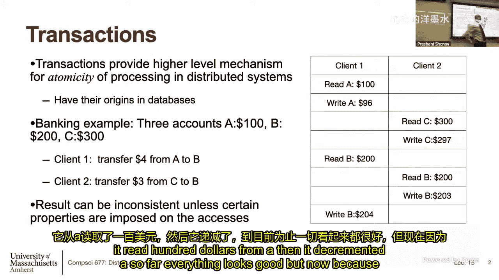

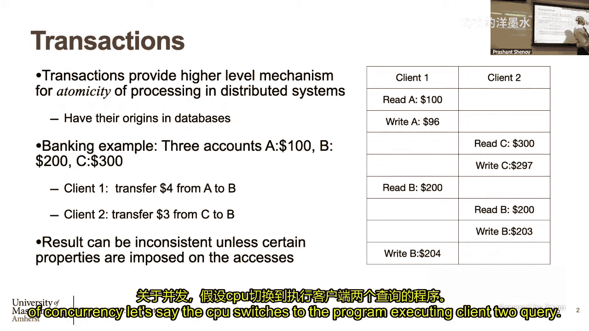

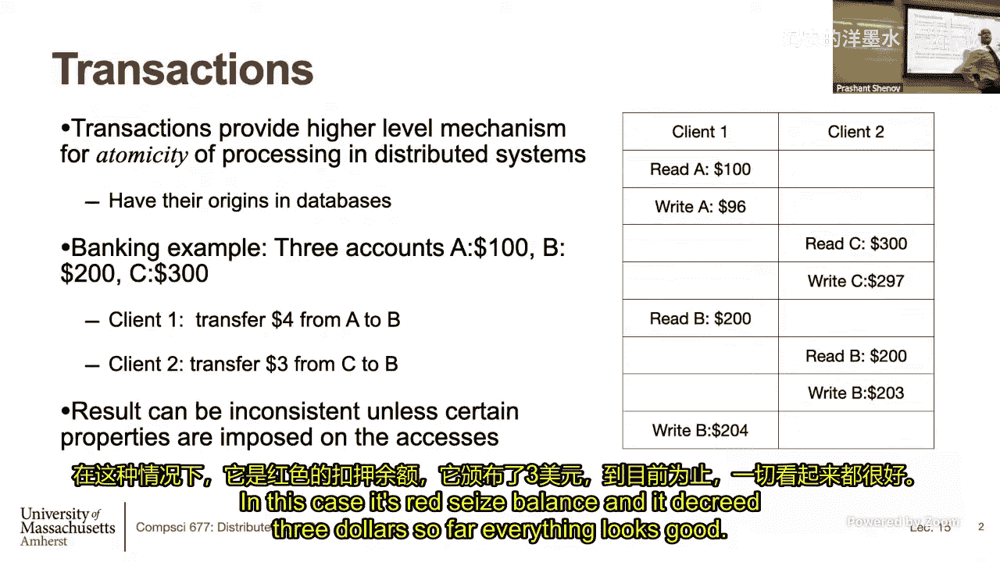

And then the scheduler somehow switches to this other program and you read B's balance still 200 then you are increment by3 so now this became 203 and you switch back to client1 client1 has already read the balance even though it's got incremented so it is simply going to add $4 to Bs account and what you ended up is basically B is ended up with a balance of 204 which clearly is wrong because we we were expecting that 7 would get transmitted essentially this operation has overwritten the previous right here because they are interleaveed right and so you a client1 didn't know that there was something else happening to B's record and it is overro。

😊，So if we just simply execute these two things in parallel， you have a race condition。😊。

Now clearly you know because youve done thread code and so on if client1 and client2 are threads you would have put some locks there you would not have just done this this is an example of a race condition but normally you would have to do locks right but in database world you don't do locks what you will actually do is you want to make sure that not only do you protect A and B with locks you want to in fact protect all of those for instructions because if any of these instructions fail for any reason you want to undo everything。

RightSo maybe you try to write to be balance but maybe the database gives you some sort of an error for any reason at that point you can't just say there's an error so you won't finish you actually are to go undo whatever you did there because you already took money from someone's account that you are not depositing in the other account right so that is why you need the all or nothing property where you want first you want consistent results which these interlinkveaving doesn't do but even if it were consistent you want to assume that all of those four instructions that client one and client were executing either all of them succeed or none of them succeed what that means is any one of them fail you got to undo whatever you are done so far and bring the system back to the original state which was consistent。

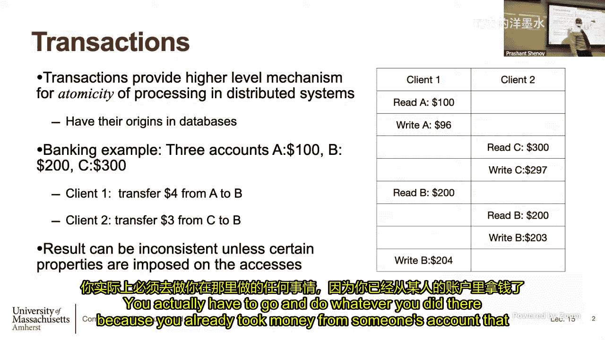

Is that clear what I am trying to say very simple example？

So it illustrates two things one is that of course you can erase conditions and then you get inconsistent results that shouldn't be a new thing you know。

 because you're done locking and other things for threads。

 this is why you actually implement locks because you want to ensure consistent results when you modify shared data which this is A and B and C are records in a database that are being shared in this case between client1 and2 but there's a more important and a more subtle point which is that if there is any failure of any of those instructions because we are actually transferring money you want to ensure that you undo everything that has been done so far that's all or nothing property。

 which is also called atomicity so that's something you have not done because when you write thread code you are not guaranteeing atomicity you are just protecting shared data structures with lock but sometimes you want higherle properties which say I want all of these things to succeed not just some of those instructions and then others given error right so but that brings us to this notion of。

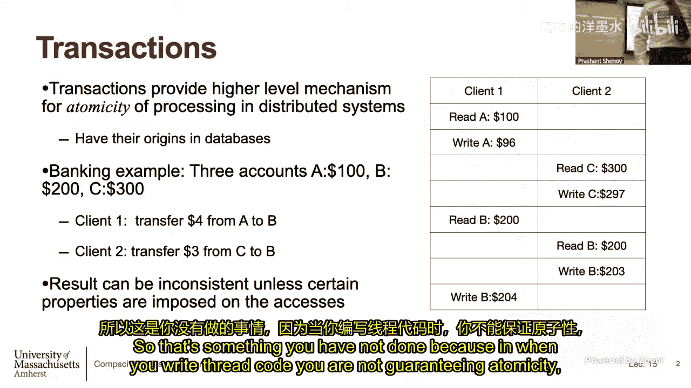

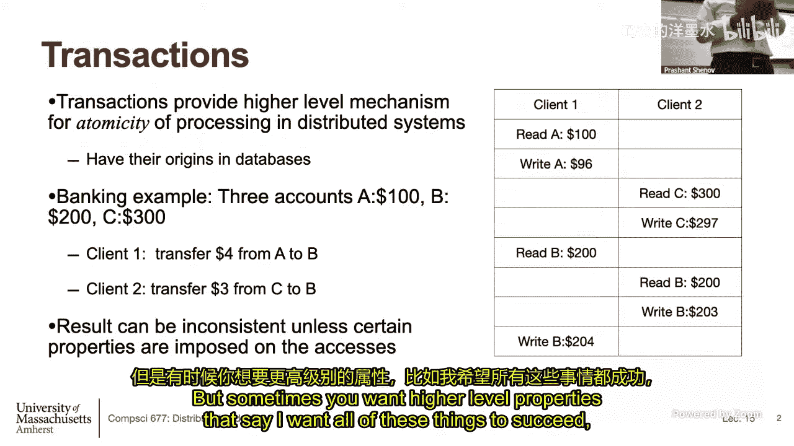

The are transactions and properties that transactions give and these properties are very well known using an acronym called asset properties so that's an acronym asset essentially a for atomomicity there's consistency is isolation and durability so transaction actually gave us asset properties and so let's go through each of them atomicity I already talked about it's the all or nothing properties whenever you have some instructions that are enclosed in a transactions okay the transactional system will guarantee that all of those execute has a single atomic block or none of them execute so if something goes wrong it under was an un whatever has been execute that's atomicity consistency says that if you have a distributed system or a database in a consistent state and you execute a transaction on it if the transaction succeeds then you take it to another consistent state。

That's another way of saying in the previous example here where we talked about the data that variant of that here we were making operations on three accounts initially everything was consistent at the end of this even though you might have arbitrarily interleaing you still want the account balance to be consistent with what you are trying to do I showed you an example where the race condition left it in an inconsistency this is not consistent because this is not what you had expected if you're running those two transactions so you wanted that balance to be 207 for example that would be a consistent so that is another property that you will get from。

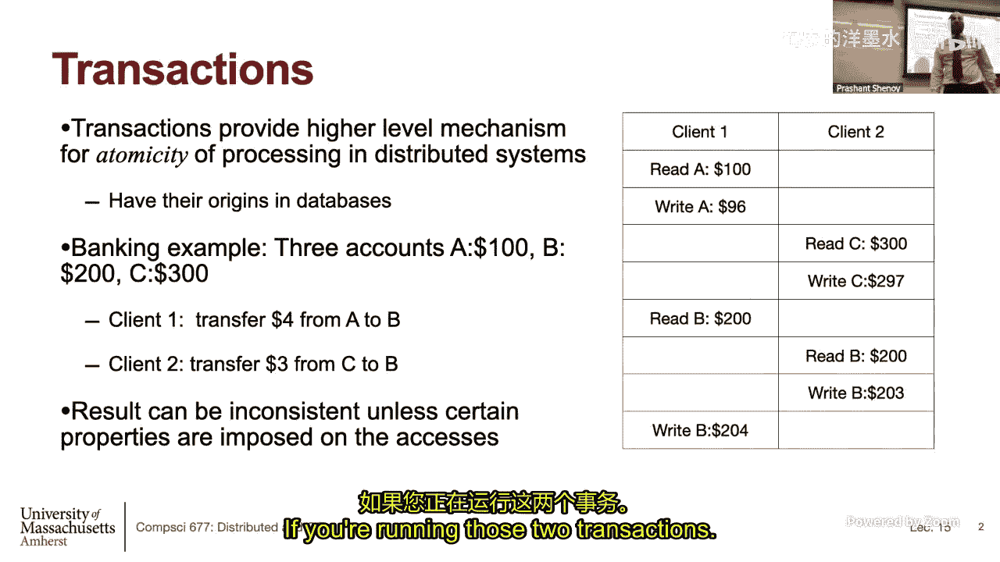

From transactions isolation essentially means something called serial or also called serializability okay so what this says is even though the transactions are actually executing in parallel or in concurrently we want their output to look like the executed sequential。

😊，哎。Because that is the way we will actually assume concurrent so so in other words if you look at this interleaving this basically is says client one goes first it does all of its four operations and then client to go next and it goes does four operation or you could have reverse them client two could have gone first and client one could have gone second those are the two sequential。

Executions of those two transactions and even though that's not how you will actually execute them they will be arbitrarily interleaving the output will look like either you execute a client one followed by client who sequentially or a client who followed by client one even though they are not actually executing in sequence that property is called serializability it says that you can serialize the transactions even though they're executing in parallel and if you serialize them that's equivalent or each client taking a global lock executing its thing then you take the next lock and so that's what if you actually put a global lock you will you will get even though we are not going to put global locks and we will execute them in concurrently you want the transaction to be serializable that's a problem it's also called isolation property which means that it looks like only one transaction is executing it any given type that's what it means so that's isolation and durability。

😊，Means once the transaction finish once you are written your records okay then you cannot undo anything once while you are executing these instructions you have the ability to undo which is called roll back but once you have committed that transaction once the transaction is successful then you cannot undo it because you said it's done you cannot go back and say let's undo what it。

So those are the four properties that transactions give you any transactional system yet particularly relational databases and others and many types of distributed systems。

 also that our transactional semantics will give you this property from our perspective really atity consistency is more important we will talk about serializability as well。

哎。This clear these are just definitions we haven't said how to do any of this but these are all good properties to have it allows you to implement higher level code in large concurrent systems and reason about it without worrying about race conditions and whatnot much more higher level than taking individual locks on on data structures or shared data and so on。

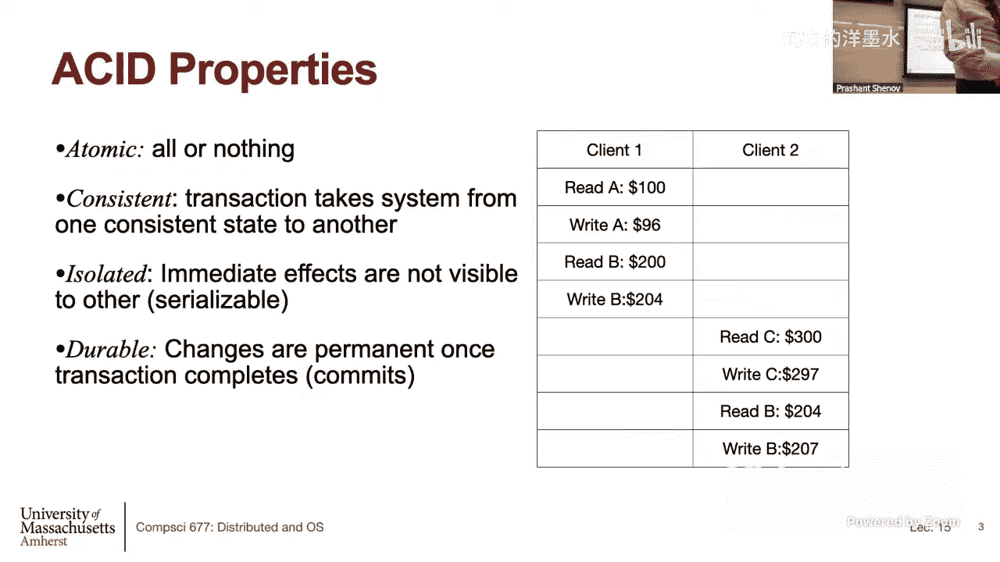

All right， so let me now give you some simple examples before we think about how are we going to implement at least few of those properties。

 not all of them so here is essentially how you write a transaction in a distributed system or in a database essentially you can write arbitrary code you can write code in Python or Java or maybe if it's a database you'll write it in some language like a query language like SQL that doesn't matter if you want to implement a transaction on top you really have to have these two statements begin transaction and end transaction and any code that you put inside it the transactional system will guarantee asset properties so you can just take any code and just write a begin and end transaction and of course if for any reason you want to kill the transaction in your code you have to call the about transaction which will then undo whatever has been done since the beginning you will go back and essentially undo the change that's how you are going to write your begin and end transaction。

read and write， you don't actually write code about。

 you just write higher levelve code internally the transaction reads and writes either from a database or a distributed data store and so on。

 Here is an example。 our transaction and now you will see why you need an all or nothing property this example is trying to book a flight the flight goes from New York to Delhi。

 but there are intermediate hops in the flight so the first leg of the flight says you go from New York to Paris the next one says go from Paris to Athens。

 the third one says goes from Athens to Delhi So there are three legs to this flight now for the booking to be successful。

 you need all of the three segments。 you cannot make the trip if only two of the three segments work and the third flight is full or something like that So this requires all or nothing So what you will do is youll write a begin and an end transaction and you'll say if go and reserve from New York to Paris if that is full for any reason then aboard because then you can't make the booking at least for this routing。

And then if that succeeds then go and do the next segment。

 but if that fails and again undo everything you've done so far。

 then go and reserve the third segment。And if all three succeed the transaction has succeeded。

 if any of them fail， you' will use their bar to kill the term。😊，Is that clear。

 very simple example from databases， but now you know why you need all of those three or none of them because theres not no point in having one segment and you cant make that right？

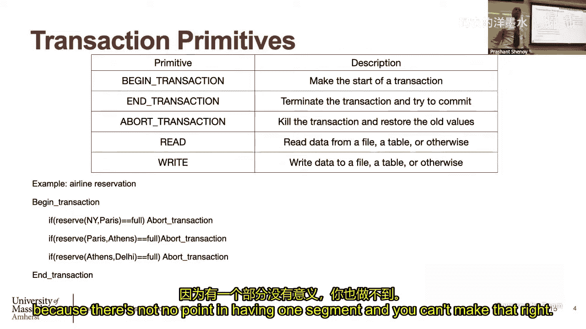

Okay， so now let's take that very basic knowledge and try to think about making things distributed in some shape or form okay there are two ways I will discuss how you can make things distributed one is called a nested transaction the other is called a distributed transaction a nest transaction is an example where your trip involves multiple databases and you want to make multiple transactions but then have a parent transaction that envelopes this transaction here's the example you want to make an airline booking and you want to make hotel booking the hotel database。

 let's say separate from the airline database so you will have one transaction to book your flight youll have another transaction to book your hotel but you want both of them to succeed if you have a hotel with no flight you can't travel if you have a and vice versa as well so you will take each of those transaction and then you will put a begin and end around it So this begin and end transaction have two smaller transaction inside them one for。

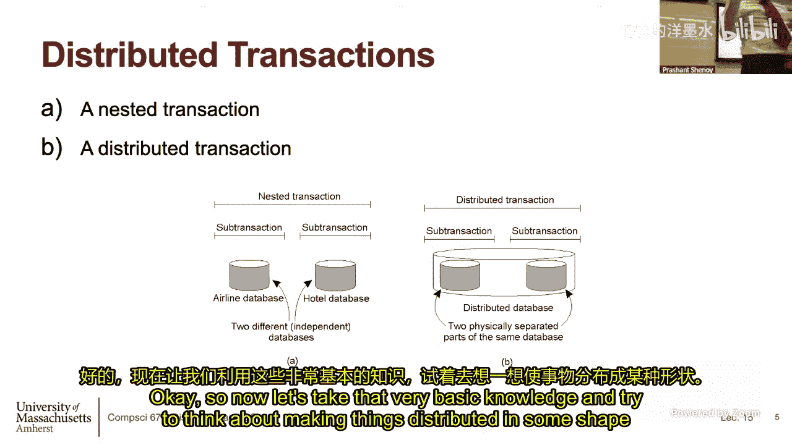

Airline booking and one for the hotel booking these are called nested transaction because one transaction is nested inside the other and you want both of the small transaction to succeed and you then a big transaction also succeeds Okay so this is called nested transaction。

😊，So that's one example where we made things distributed here youre just distributing it across multiple systems and then having a transaction around whatever you're doing within each system a second example is where you have one database but that database is large in size so it doesn't actually completely reside on one machine maybe you have lots and lots of data so your database is split and it is on multiple machines or multiple disks or multiple machines as is shown here those two great things that are actually disks that represent machines and then there is a logical disk that's around it which says that the database is a collection of these distributed data across machines now if you are making a transaction on this logical database and that transaction operates on some data in the first machine and some other data on another machine you still want your transactional properties you want your asset properties around all of the operations you perform。

These operations are now spanning multiple machines so each of them will be a subtransa which is the work you will do on these independent machines okay and you want all of those things to succeed so it is a little bit different from an estate transaction because this is still one transaction but it is operating on different machines because some data is on machine one and some other data on machine too and you want to take the whole thing and make it this is a distributed database and you are now giving transactional properties that span machines as opposed to normal databases that are actually single machine systems。

S that clear so far， any questions on this？Okay so now let us talk a little bit about how will you implement a transactional system I'll give you two simple approaches okay one is called a private workspace which is actually talked about here and then the other one is going to involve in place updates okay so lets start talking about one of them at a time。

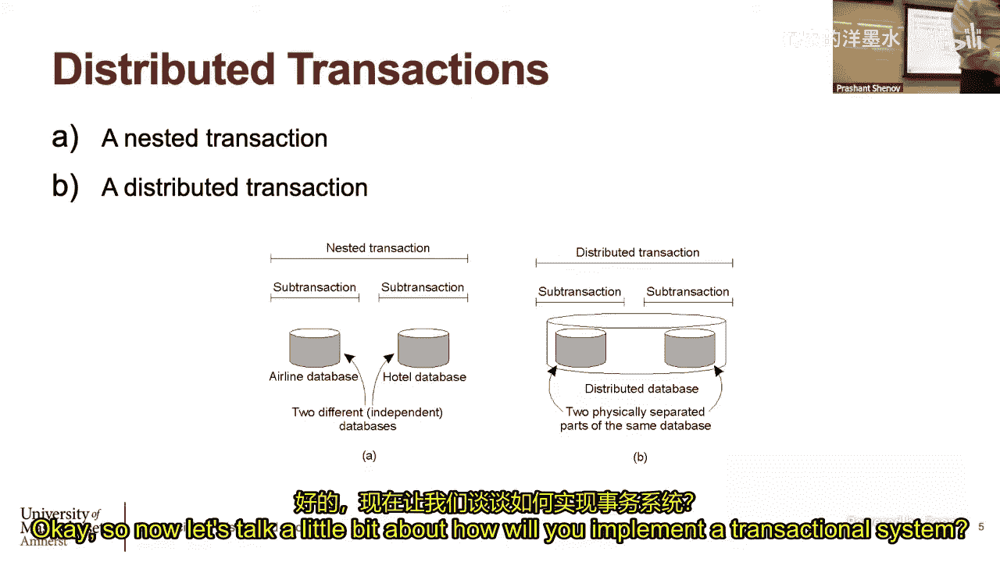

呃。So， remember the transaction needs to have the ability to undo whatever it is done that that is why you get atomicity so both of these are going to talk about atomicity in particular。

So the question is how are we going to make sure we have the ability to undo right because you are going to actually going to make active changes to the database and if the transaction fails for any reason you got to undo everything you are done so you know to restore the database with three so here's an example here' an example database which very simple database where there are three items data item zero data item1 and data item2 and then the database is going to have an index which allows you to point where the data is stored on your all database is keep an index row file system now suppose that you write some code that goes and modifies one of these data items let's say go and modify zero。

Normally， you will just go and overwride whatever was stored there。😡。

maybe that was grades in a grading database or some other information so if you want to update this record or its a bank balance you will just go and update that piece of information right now once you have done that whatever was there and that record previously is gone because you went and overro it。

 because you went and upgraded someone's bank balance now the old data is gone you now have a new balance there but if the transaction fails you got to go and undo it。

😊，so somehow you had to keep track of what was there before you made the update。

 otherwise there is no way to do and undo。Is that clear so even though you are changing so you think of it as you go open a file okay you go and modify some lines of code okay and then you save it but let's say it was a transaction and you say I want to kill the transaction somehow you got to go back and take all the changes that are made to the file and remove them but if you already wrote it all the whole changes are gone the file has changed on this so some you so the only way you are going to undo it to track what was there before。

Okay so to do this we are going to actually figure out a way to implement what is called a private workspace okay so what is a private workspace private workspace is you have a database okay whenever you start a new transaction okay make a copy of the database。

so you just have a database to when you have a begin transaction you make a full copy or the database。

 so now I have a second copy the transaction then operates on the copy。

All of the changes are made to the copy of the database。Now， if the transaction has to aort。

You just throw away the copy， you never change the original data， so it is there as this。

So there's nothing to undo because you never changed anything you are operating on a copy。

But on the other hand if you decide a transaction is successful you are going to take the changed copy and then you are going to essentially call that the new new database all right in other words you can think of you take took the copy and you reflected all the changes in the original database now all the changes have appeared in the database you are done。

😊，哎。So this is called a private workspace every database transaction that you will execute you will make a copy of the database the transaction will make changes only to that copy and if you want to throw it out then nothing has to be done to the original database the transaction succeeds you will reflect the changes yes question。

Okay， what happens to concurrent rights on the same database， we will get to that。

At the moment we are not worrying about it because the assumption is if you are private copies。

 you will make changes to your individual copies and somehow that has to be reconciled when you merge the change。

Okay but we will talk about that。Okay， is this gift， yes？Yes。

 that was going to be my question saying yes this good idea but looks a stupid idea because I said make a copy the 100 gigabyte database every time you would make a transaction you are not really going to make 100 gigabyte data copy so youve got to do this efficiently。

So what is the way we are going to do this efficiently we are going to use a pretty standard approach that is used in operating systems which is called copy on write it's also called lazy rights I think I had mentioned this some time ago I said we'll come back to it this is where we actually now see why it is very useful so what is copy on right copy on right says that when you make a copy you don't actually make the copy of copy all of the data well create a virtual copy this is what we are talked about when it snapshots and I'll show you an example of what a virtual copy is and we will only make changes well only make real copy when some data is modified because that's the only thing you have to track data is not read or written to you don't really need to make a copy at all because that the transaction is not touching the data let me make this more explicit with an example here is and its the second thing here in the figure shows you what is a private workspace so we say。

The original index is pointing to three data items thats your original database okay when you make a private workspace you dont actually make three more copies of this that is what a real copying would mean instead you just make a new index and those index point to the same three data items01 and2 okay so now you have three two indices that are pointing to the same data item okay one of them is the original data the other is the private workspace okay and the private workspace has access to the same data as the original until you start making changes。

Now when the transaction makes a change let's say it goes and updates data item0 this is where your private copy is divrged from the original database because now you made a change so what you will do is this is where you will actually do copy on right you will say zero has changed so now you actually make a copy of0 and you will make the change in that copy and you will update the private workspace so you will see that the private workspace now points to0 prime which is the new version of0 the original data is still pointing to01 and 2 so it is unchanged so you only took。

Whatever you change and made a copy and then you updated the pointer the private workspace now points to the new version the old one is still pointing to the old version and in fact it shows you that you added a fourth data item which is three prime and then you basically made a pointer to three prime here okay so now the private workspace has one and2 that's unchanged and you will see that both of the original and the new one just point to the same one and two they have pointers pointing because that's unchanged data there's no need to make a copy but anytime you add new data or you make a copy you are going to do this copy on right which essentially means what it says you make a copy when you write to it and you write to the new versions or the original is preserved。

え。That clear。All right so now let's say that is your private workspace okay one of two things will happen to this transaction either the transaction will succeed or youll say I want to throw it out I want to undo all the changes because it does all or nothing properly。

So now we have the same thing that I talked about when I said you make a full copy if you want to discard this data because you want to avoid the transaction you simply go and delete that index。

 delete all the new changes you made0 and 3 and then the original index is still pointing to012 so nothing is G in the database so you are ended it by just throwing away the copy。

here throwing away the copy essentially means only throw away the changes that were made because none of the rest of the data was touched。

😊，But is still simple its a virtual shall copy you through it but on the other hand if you want to commit the transaction you will merge the private workspace with the original database which means original database that zero pointer will be updatedd to the new zero and threeges inserted there so now the database has reflected those changes and now you have the new version of the database having all of your updates。

Moo the question that was asked if two transactions modify the same data we are to deal with that conflict that is not shown here well get to that which is just showing one transaction。

😊，Yes， question。Okay， this question does it require you to copy the entire index yes。

 virtual copy is required to copy the entire index， but not the original data。

And the assumption is the indices are much smaller and easier to copy than the data itself otherwise it would not give you any savings。

😊，Any other questions here is this clear private workspaces okay so essentially you make a copy you modify the copy and then either you throw it out of the transaction a or you merge the changes into the origin okay and the only thing is you got to be smart you are not going to make a real copy will make virtual copies using copy and write techniques okay most operating systems will have this because thats the way they are going to do efficient copying of large amounts of data。

Okay， so we leverage that to do this efficiently。All right， thats technique one。

 here's another technique。😊。

This technique is actually not going to make a copy of the database。

 it will let the transactions go and make changes directly to the database。哎。

Just as I had said originally you go and start modifying the database。

 but you still need a way to go and undo your changes so the way you are going to do that is you keep some extra information with the database。

Excuse me， which is called a right ahead log we will keep a log of changes。😡。

The log keeps track of what changes have been made to the database by each transaction okay so now if you are to undo the changes you go to the log and you track what changes are made and you are going to undo it。

But on the other hand if you want to commit the transaction there is nothing to do because the changes are already in place you went and modified the database live there are nothing that you need to do if you want to commit because the data has already been modified but if you want to undo you are going to go to the log and look at whatever has happened and then you are going to undo okay the log is going to at least keep this following information it will have a transaction ID because there will be multiple transactions it will track whenever you change a block or a record it will turn the block number it will keep the old value and it will keep the new value。

so you are going to keep a record so this log is going to keep all of this information for every transaction when it makes a modification it will say this transaction modified this record or this block this was the old value of the data is a new value of the data all of that is going to be stored in the log and Ill show you how you can use the log to undo the data theres nothing to be done if you are going to。

😊，Commit the transaction because the changes are already there。 but if you are to undo it。

 then you are going to look go through the log and actually do a what is called a log replay to roll back the transaction。

😊，I this clear what I just said？There is more straightforward approach where you dont need to make copies that are directly making changes and writing them to disk。

 but you keep extra information。😊，To undo， which is your love。We look at an example， yes。好这是。よく。

So commits need to be atomic well get back to this it comes back to consistency we are not talked about consistency because none of this is actually talking about locking as yet。

Because the only way you are going to make sure the changes are consistent is there are be locks on top of everything so you can figure out when there are are conflicting changes being made for now you will not worry about it but we look at that problem in next few slides here is very simple example。

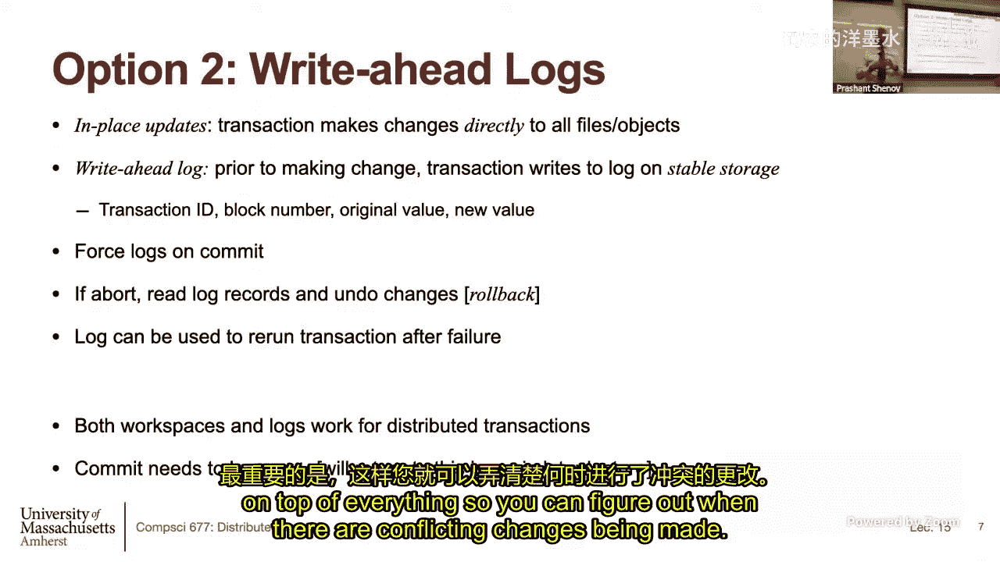

Its a question that is。

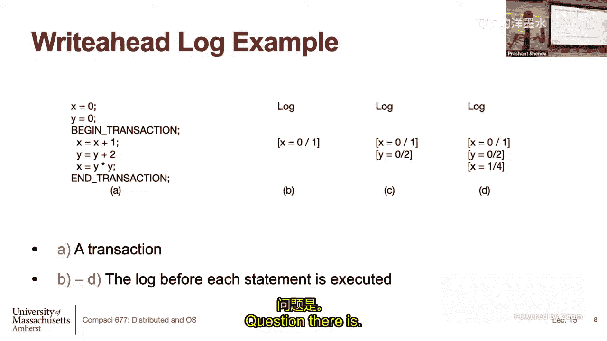

Can undo fail because the assumption is undo should not fail。

 otherwise you will not get asset properties。就。If yeah if the undo fail then your database is left in an inconsistent state because you are starting in anconsistent state you did a transaction you want to undo it and then it did not work typically transactionst don't fail because there is something wrong with the hardware they fail because higher level logic that one segment of your flight is not available so undo it all that type of stuff it's not like the file is can't be returned to because a disc filled up or something that's not the reason things fail。

Ho as a result， undo should not fail。If it does， then we have other problems， yes questions。是螺师明边的那种。

Yeah， the question is， how long are you going to keep logs？

But typically the log is just a file that you keep writing to once the transaction is finished you can actually throw away the changes from the log but databases will typically not do that because it' is extra work so you just keep writing to the log once let's say the log grows to a certain size you will just start a new file and start writing to it and eventually throw an old file。

That is better than going and trying to remove things because thats even more things you have to write to disk and disk rights are slow but the idea is you don't want to do unnecessary things is just useless information in the log eventually you will just throw out the entire log because you started a new one。

maybe every night you start a new log and then old days changes are thrown away that's the way real databases will work。

道はい。导 my。Yes， so I'll show you yes so because there are multiple transactions executing you write each transaction Ill just write one line okay so there will be interleaving of different transaction updates but when you want to undo it you look at the transaction id you will only undo those changes not those by other transaction。

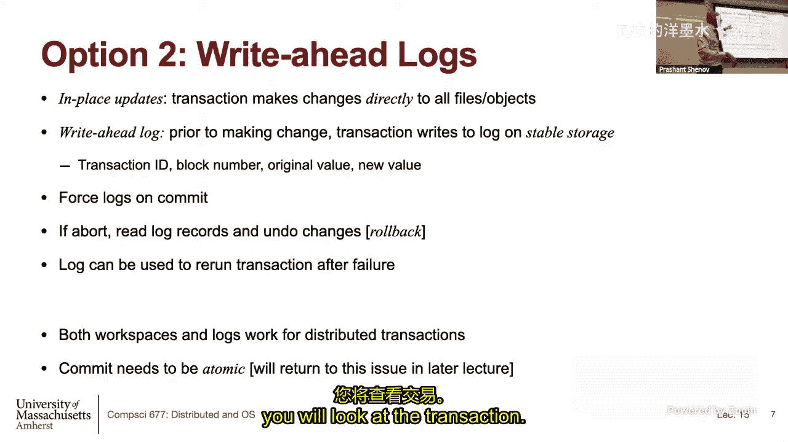

So here is an example。🤧K。Very simple one， the database has only two values x and y。

For simplicity I'm just showing you this as code but think about this x and y as being two values stored on a disk in some database this is our transaction that's going to operate on x and y okay we just say x is x plus1 y is y plus two x is y times y and then there's a beginning and n so all of those three things how to work or none of them that's the rule so here is basically as this transaction execute this is what it's getting written to the log the first transaction goes and increments x by one so you would put a transaction ID which is not shown here and you say x was changed old value is0 new value is one you write this to the log and then you actually change the value of x to one because youre making in place updates and the second instruction execute it increments y from0 to2 so you'll write that second line to the log and the third one is going to run and you' are going to write x went from one to4。

now let us assume if the transaction commits， then we are done theres nothing to be undone here because you already made the changes to x and y。

 but lets say after the third instruction for some reason you decide to ab this transaction。え？

X and y are no longer at 00 they are in fact 2 and 4。

how will you undo it okay this is what is called rollback so you have to now read the log backwards and replay all of the instructions that are written in the log so you will undo it。

This is how it works so the log has three lines there will be other lines from other transactions we ignore those this is the one that is being undone so you will say okay x is4 reseted back to1。

😊， so you'll go and write1 back to x。And you will go to the previous line and say x is y is2。

 reset it back to0。y is gone back to 0， then you will go back to the first line as x is 1， make it 0。

Now， you replay this log backwards， you unid all the changes x and y are back to00。

So now youve undone the transaction。so all youve got to do is not have to do much at all。

 whatever you wrote in the log， you just replay it backwards and you undone all the changes。

Is that clear。Any questions on this this is called right head locks is the other way to implement your transactional systems neither of these two approaches so far have anything to do with locking and so on we get to that but it is just showing you two ways by which you can give all or nothing guarantees。

Right， so you can。Implement a transaction， commit all the changes or undo them all。Questions here。

This is going to work regardless of whether you have a centralized database transactional system or a distributed one。

 a private workspace and logs are going to work in either case allowed to keep those two pieces of information。

 not pieces of information， use one of those two techniques。

 either keep logs or keep private workspaces。Yes。This is a database that is not inhabited any record。

That because he isn't a。You're asking about writer logs。对。

Okay how will it work in a database so in a database you are the database file which actually has data there will be a second file stored on disk which we will call the log file whenever you have to make a change to the database the rule is you have to actually write to the log file as to what changes you are making so if you are going to go and update x to 1 thats a change you want to make to the database you will first go to the log file and write this lineup saying that I am changing the value of x to 1 and then you go back the change。

Okay so your log file will be returned to when you as concurrently when you write to the database so you keep making changes to the database you keep also writing to the file whenever it is time to aort a transaction you will go and look at all the entries in that log for that transaction and undo it the transaction commits there is nothing to be done。

So youll just keep writing other transactional information。

The question is is a text file you can think of it as a text file but if the data in the database is binary then those values are to be binary blockss but if there are numeric data and that depends on the database of course right your database of images or something and you update an image you have to keep the old and the new version right but if its just numeric values it will be textual information but whatever it is the thing is you have to keep track of what data you change the old value of the data the new value whether there is numeric whether its image you don't really can you just have to have both of those values written in the log。

It。Okay so question what are x and y now x and y are the two values in my database in this case。

 this is not an index which is a database of two entries one is called x the other is called y。

So you could thought of them as bank balance of x and y or some whatever you want to interpretation so that's not an index。

 those are actual values in the database。在的。很到。对。我们的。到。对。Okay。

 so of course can you explain you you're saying that there are many transactions and all of them get aborted。

 is that your question no？你这。不在考虑。that's a good point question is how do you know that you roll back all of the instructions of the transaction that's a very good point you do have to write when a new transaction begins saying transaction X y z started when it ends you to say transaction ended and committed you will write that extra information otherwise you will keep reading the file all the way to the beginning needlessly if you read hit the beginning of the transaction then you can yes you will have to write that extra information。

Okay， any other questions？

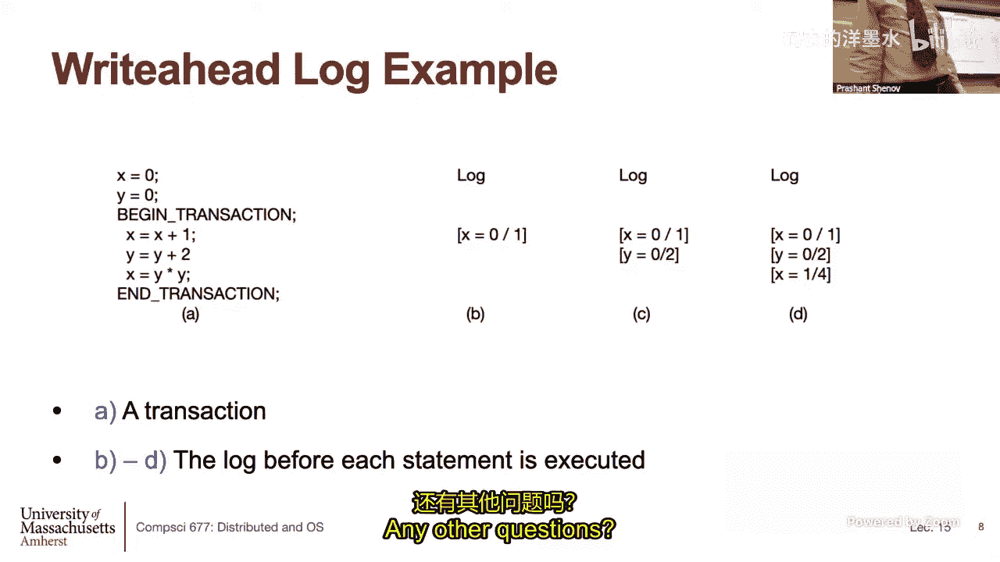

All right。Now well talk about how will you let multiple transactions actually work on the database。

 how are you going to ensure good performance and so on。

So database should be clear is a big shared data structure all of the entries in the database whenever you query they are all essentially going to be potentially read or written no different from your lab to where you have an order database and you are keeping track of stock information and so on you are just keeping them in flat files but think of those as some type of a database now what is a good way for you to protect this data when you try to access it you put a lock around it。

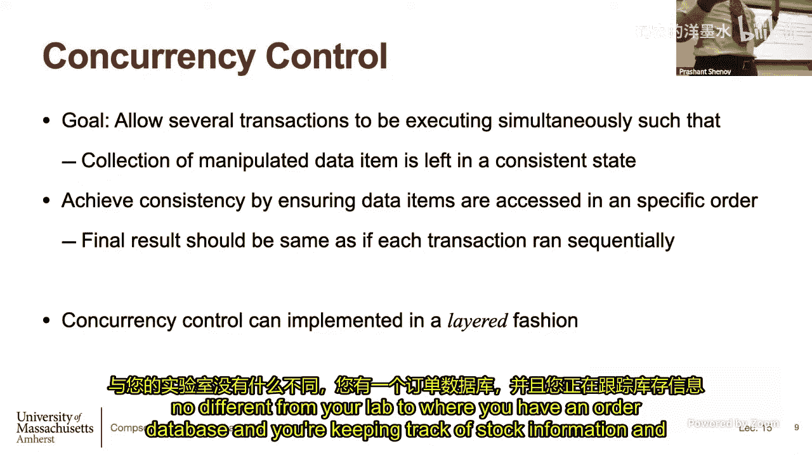

So this is going to ensure that when you are one one in the in your lab example。

 maybe one one customer is trying to buy some stock okay some other customer doesn not come and make some conflicting operation so you will put a lock。

Right now if you implemented that approach for large databases your performance is going to suffer because you will say take a lock on the database then go and make your airline booking release the law that is what you will write but imagine now there are thousands of users trying to book tickets they all have to become sequential transactions the person who says by will have to wait for a while because maybe there are 150 other users ahead of them and each of them have to be process sequential so sequential processing of transactions is going to be very bad from a performance standpoint。

 so you don' not want that， but if you put a global lock that is what you are going to get。😊。

you put a big lock or the entire database in lock by one transaction so nothing else can execute by definition everything else is sequential so you don't really want that what you instead want is for this transactions to execute in parallel。

😊，Yet you want correctness guarantees what are our correctness guarantees this is where we get to serializability so you want to look make it look like this transactions is executed one at a time as if they had a global law because you know that is going to always be correct。

😊，but you don't really want to take a global lock， you want to let them run in parallel so that many users can make their booking at the same time。

And you will not get very bad performance on your database。

 so this is where you are supporting concurrency。😊。

so correctness requires that you only have one transaction executed at a time。

 but that doesn' not work for performance， so you want somehow to have concurrent execution but you want the results to look like as if they executed one。

😊。

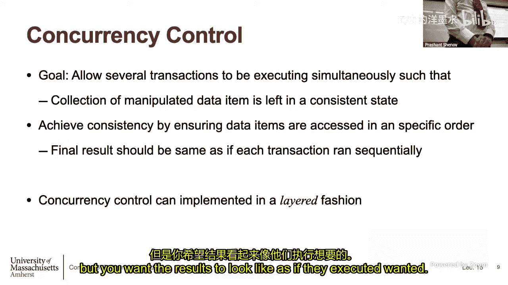

So that is going to get us to serializability but let me show you some highle aspects of concurrency control and then we look at some simple ways to actually do this okay so here is how transactional managers actually work right so you have this begin transaction and end transaction on your database instructions or queries and then the transaction manager as its executing it actually tracks what data item is being modified okay and it takes locks specifically on some small number of data item not the entire database that' is going to make the whole thing sequential but what you can do is you can say I want to just take a lock on。

Let's say the balance of user A， bank balance of user A。

 or I want to take a lock on the user so you are locking individual lines of the database。

 individual records of the database， not the entire database。

So that's how transactional systems will give you concurrency so if two transactions are working on two separate parts of the database they can both grab locks on different items they will not conflict so these transactions will operate in parallel the only issue will come up and two transactions work on the same。

Data， in which case， only one transaction should really succeed because otherwise you might have problem。

But lots of times maybe some user is making a light booking to go from lets say New York to San Francisco and someone else wants to let's say go from Boston to Miami these are different flights there is no conflict so these transactions can take locks on individual records。

 there is no problem youve got concurrency。So this is how we are going to achieve concurrency by doing more fine grain locking based operations。

😊，How to do that we'll talk about but that's the basic idea so you will have a transaction manager internally takes locks and releases locks and then you are actually going to make changes to the database which is your data manager at the bottom so it's a threelel structure where the user is only writing this part okay this in all of these other things are happening internal user code never takes locks you just write begin and end transaction let the transactional system deal with this yes your question。

Okay how do you deal with it when the database is replicated or distributed so here is an example of what you are asking so let's say this is a three machine database it' is either distributed or replicated to your transaction manager is going to sit at the top and then it has to grab locks on data on multiple machines so in your example where you said what if the data is replicated if there are three copies of record a on three machines you are to get three locks in this case that' is the only way you are going to protect all of them。

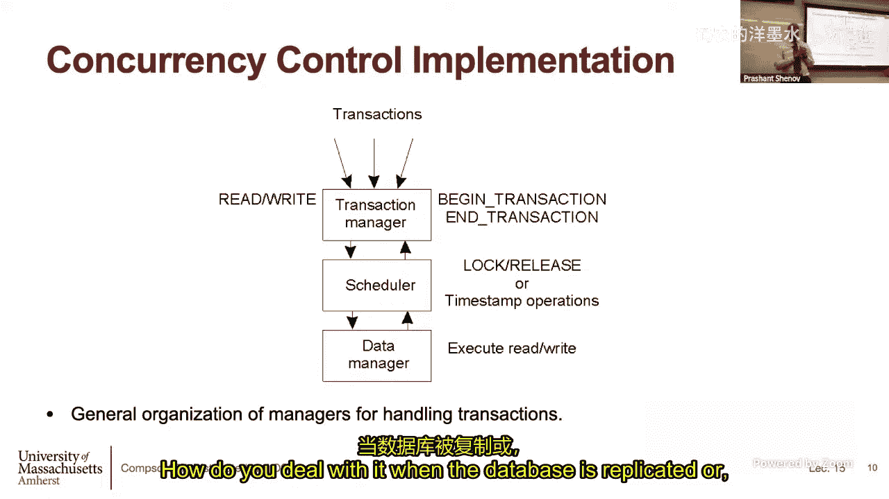

So essentially， but that's up to the transactional system to know what is the data where is it stored what locks to get and users don't need to worry about it that is the good part I mean its all done internally by the system。

好的。在支付宝对不对。这这就是。Okay question is in case the data is replicated if you make a change you copy to the others is that your question right so whenever you have replication and we'll get to replication in a lot more detail in maybe two or three lectures but whenever your replication an important aspect of replication is consistent consistency means that all copies of have to be kept consistent with one another you can't have one copy where you updated the bank balance that bank balance is replicated on two machines you didn't update them then you're out of sync youre inconsistent so whenever you make changes to replicated versions of data you have to make sure the change propagates to all of them before the transaction finishes so that all three copies in this example are consistent with one another。

So those are all things you will have to deal with both at a transactional level。

 but also there is going to be some replication logic that will be in there。Yeah。

But before we get there， we should understand how you are going to get these locks and how will we implement concurrency and so on。

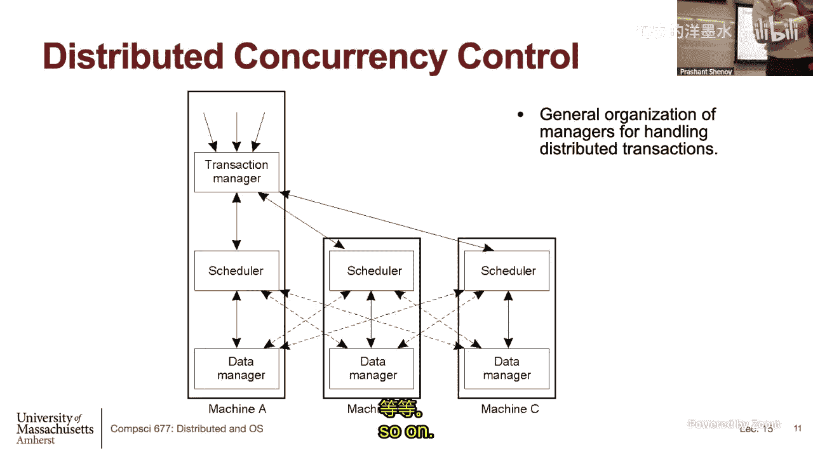

And then we'll get to replication and other things。

Alright so we will start with serializability concept so you at least understand what it means and then we will see how do you do concurrency control how are we going to grab these locks and here let all these transactions execute in parallel so here are。

3 transactions so very simple database with one data item x。

thats all there is in the data a single data item all three transactions are modifying x you can see that the first transaction sets x to0 and increments it by1 the second one also research it to zero increments it by two third one sets it to zero increments it by3 now we will assume that these three transactions are called to execute in parallel。

So the first question we should ask is if they are executing in parallel。

 what values of x are we willing to accept as being consistent after all three transactions have finished？

😊，Is a question clear？嗯。So you have one data item in the database x okay all three data transactions are modifying x they are all running in parallel and then at the end lets say I show you some value of x and I ask you is this a consistent execution of these three transactions so the question is what values of x will you accept as being consistent？

so， this is where you have to assume not assume think about serializability what does serializability say serializability says that forget that are actually executing in parallel pick some sequential execution。

😊，And any sequential execution is acceptable。😊，Because you could say transaction A ran first then B ran and C ran in this case you will just actually execute them sequentially and you will say I will take x equal to 3 as my value because that is what x is at the end of the third transaction or you can assume the opposite saying C ran first in a sequential order then B ran and then a random in this case x will end up being1 and you will say that is acceptable because thats a sequential execution of this three transaction so you can pick any sequential execution any so you can do ABC A B B A pick any sequential execution and whatever you end up with is acceptable。

So that's what serializability means whenever end transactions are executing in parallel。

 if you are given some end state after those end transaction finished。

 if you can find one sequential execution any interleaing that gives you that output you will say that's acceptable which means that there is at least one sequential execution that would have produce that result which one will actually result we don't know because theyre actually executing concurrently but we'll say pick so you look at the output and you can then analyze any order and say that order gives me that output if they executed sequential say that's fine but if you find that there is no sequential interleaing that gives you that output you say that's inconsistent because no matter which sequential order I I never get that end result so then this is not acceptable because we want the transaction to be serializable that's our asset property even though they're executing in parallel we want the output to be sequential。

As if they are sequential， not really sequential。Is that clear okay so now with that background here are three interleavings。

And the question is which all this interleaing is actually allowed as per serializability and which one is not then you will understand what I just said which one will be accept and which one not so you will say here is the first interleaings because it basically is executing a B and C if you look at it and you end up with x is equal to0 and x ends up a 3 so this interleaing outputs x is equal to 3。

😊，Hell say that' is fine okay we know an execution order which is ABc that gives me x is equal to 3 so that is the interleaing wheel except even though the transaction may have executed in parallel。

That clear。Let's look at the second example。Here what has happened is the two x is equal to 0 execute first then you go x is equal to x plus 1 x is equal to x plus2 so these two turns go next and then the third one executes and you are still left with x is equal to 3 okay so what happened in the middle we don't care you start with a consistent state you ended up with x is equal to3 you say that is an interleaing I can look at ABc gives me that x is equal to 3 so you will take it。

对。All right， last one。you have you will see that here you do x is equal to0 twice and you increment x then you do x is equal to 0 and then the last you have x is equal to x plus 2 and x is equal to x plus 3 so you end up with x is equal to 5。

In this case now you can pick any interleaving you want any sequential interleaving you will find that no sequential interleaving will actually output x is equal to phi because in each case a transaction resets x is equal to0 and then either adds12 or three so whichever is the last transaction will either get output either one2 or3 no interleaing that will output phi so if you are trans interleaving actually ends up with x is equal to phi you will say that is not a serializable order so we will not accept it this is not actually as guaranteeing me asset properties so you are to actually reject that chain and not take it。

Or the transactional system has to reject so first of all it probably shouldn't even end there。

 but if it did then you were to reject there saying something went wrong。

 but this is not serializable。Is this clear what I just said so the basic idea of serializability is that because we want transactions to execute in parallel we will let them execute in parallel you will see that their arbitrary ordering of these instructions happen and then you look at the end result after they are all finished and you say let me look at this output if that output matches some sequential execution you will take it if I cant find any sequential execution you say is not serializable and you reject it。

Your questionにでる。对对。Yeah so the second case is the question is interesting to look at the second case you will see that the the inter living is not actually sequential because you have x is x plus 1 and x is x plus 2 so you are actually gone off become a little inconsistent but that should not matter because what matters what comes at the end you are not worried about what happens in the middle。

In this particular example。不好意思。Yes so basically you start with a consistent state you run some set of transaction you end with some state and you say can I have gotten that state with some sequential execution the answer is yes you don't care about what has happened in the middle because you went from one consistent state to another thats what asset property strain right so you don't worry about the middle you only worry about the end。

Okay。That clear。So， this should give you some notion of what serializability does okay the point is now we are beginning to execute transactions in parallel without taking any global lock and yet we know which output we like and which output we reject as per serializability。

now of course there are other problems because we did not use lock。

 you might read right conflicts you might write right conflict we'll see some of those in this case okay we didn't see any particular conflicts we just saw some legal orders and illegal orders from a serializability perspective。

😊，So now the higher level question is what should we do in the transactional system that lets us do this kind of parallel concurrent execution to get higher performance and yet end up with valid stick。

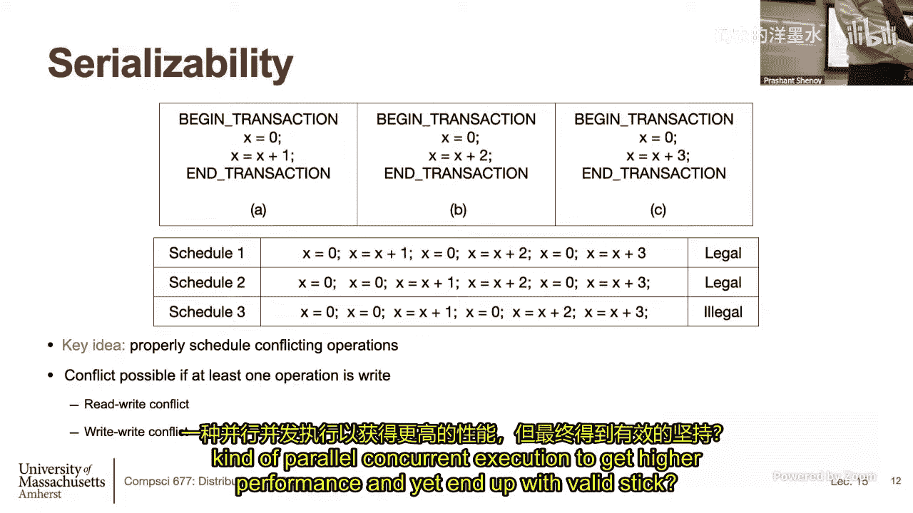

Yeah。走。Here is one approach。We to talk about two or three approaches first approach is called optimistic andcurrency control so optimistic andcurrency control says lets not worry about locks。

There is no locking in the system。Tactions will execute in parallel they will do whatever they want we will validate at the end of each transaction okay whether the transaction actually has left the database in some consistent state or youre in some inconsistent state in particular you will check if any data that is modified by that transaction was modified by some other transaction in this case there is a right right conflict because if you are taken a lock only one of those transaction would have modified the data because you said I no logs two transactions went and modified the same data and potentially overwrooughte each other so if you detect a case where when a transaction is about to finish any of the data it has touched was also touched in read or written by some other transaction user that's a conflict okay because if there was a lock this would not have happened this transaction would have locked those data items and prevented the other one from even touching it in the big in the first place okay so in this case you will just throw the transaction about。

It's saying this transaction caused a conflict， so you bought it。But on the other hand。

 if the transaction did not have any of these issues where any data it has touched was also touched by the transaction then you are done you go and commit that transaction because you know no other transaction touched that data so there cannot be any consistent issue by definition。

Here。So this idea works really well with private workspaces okay you give each transaction its workspace this goes back to that question that you had asked earlier so here you will not have logs you will have workspaces okay when the transaction finishes you see all the changes that have been made and you see as any other transaction touch that data so you throw it up。

If not， you commit the transaction and you are done。That clear。

So what I showed you is a way to now implement concurrency control with no locks。

Because we are making extra checks at the end of the transaction saying is there a conflict okay if there was lock that conflict would have been avoided in the first place because the locks would have prevented it but we said we don't need any locks we will just avoid locks and instead we will just let the transactions execute concurrently and we will check at the end and if there is a conflict we will abort the transaction if not we are done。

都。Why does this work so the reason it works well is that conflicts are typically rare if you have very large databases you have lots of transactions they might be touching different parts of the database if they're touching different parts of the database they are actually not conflicting with one another because transaction one maybe as I said in the flight example making a flight booking from New York to San Francisco transaction to is doing something else they don't conflict so theres no need to get locks or take global locks or anything like that this transaction can execute and they are no conflicts to begin with in this case so then you are done okay so if this observation is true it's not always true but if the observation is true which is conflicts are rare databases are large different transaction touch different parts of the databases hence conflicts are not going to be very common then this is a good approach。

It a good approach because you got rid of all locking overhead by definition there is this approach at deadlock free。

😊，is it clear why deadlock free？There are no locks so there cannot be a deadlock right so because there is no dev need to worry about deadlocks it gives you maximum parallelism because no transaction will block waiting for a lock if that is only way you will reduce your parallelism here there are no locks it gives you high throughput maximum parallelism okay。

So those are your advantages these advantages are you have to rerun the transaction if it as if there is a conflict you will kill the transaction and restart it。

so that is wasted work because you have to abt a transaction due to conflicts that you detected and then you have to do extra work to restart it and the second thing is that probability of conflict will rise as the load on the system goes up。

😊，Because when the load goes up， there are lots of transactions in the system so the probability that any two transactions that are executing at the same time conflict with one another goes up。

😊，When there are few transactions in the system， chances of conflict are low and there are more transactions in the system。

 the probability of any two transaction touching the same data item goes up。So。

this basically approach is going to give you higher rates of transactions failing when the load rises at low moderate loads。

 this is a great approach because you will get high parallelism without any overhead of locking or anything。

This is clear very simple approach gives you good concurrency called optimistic concurrency control because it does not use any locks。

😊，Not widely used in practice the reason is that banking on the system lower being low and the conflict rate being low is not a good design decision because if you on your system at high load you will see that lots of transactions start failing and the system load remains high because it keeps rerunning the transactions over and over again they key failing but the system as a whole does not make progress what is called the goodput of the system which is useful throughput is going to drop because you are just doing all these wasted work on execute the transaction about it reexecuted about it and so on so so as a result to avoid this type of problem commercial databaser do not take this approach this is a good approach in certain cases but they are not widely used in the database work question。

这么意思。一还不。Or is it about it？So you have your private workspaces。

 you can just throw one of the transaction changes right or you can throw both of them if they conflict with one another。

You can also use work aid log sorry not work right head logs and then undo this we already saw how to undo the transaction but this one you can assume is just using private workspaces。

え。よし。我是。That's like。对点。

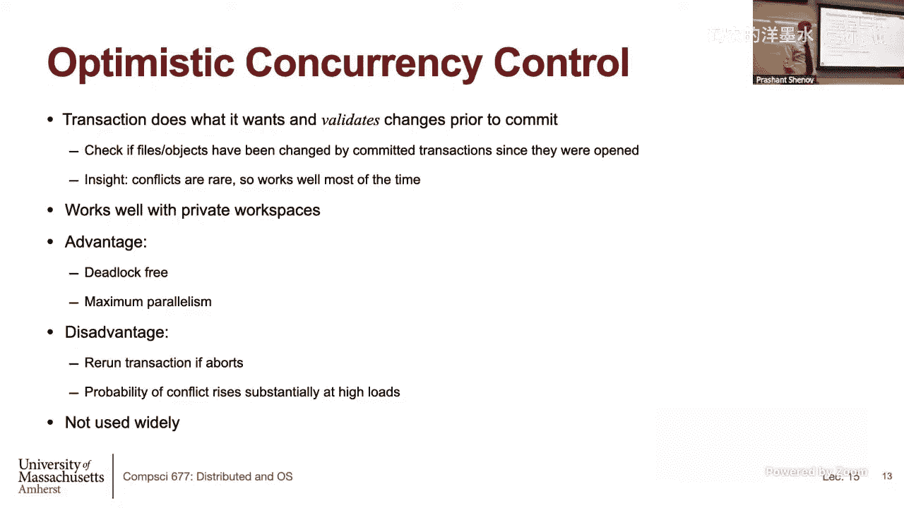

Okay question is in the previous case will we have a conflict so in this case if you are using optimistic concurrency control all three transactions are touching the same data item so by definition thats a conflict so the optimistic concurrency control technique will just kill the transaction right so this will only succeed if you actually have locks or some other approach it not because this one will be doing exactly what we said don't happen which is conflicts are rare。

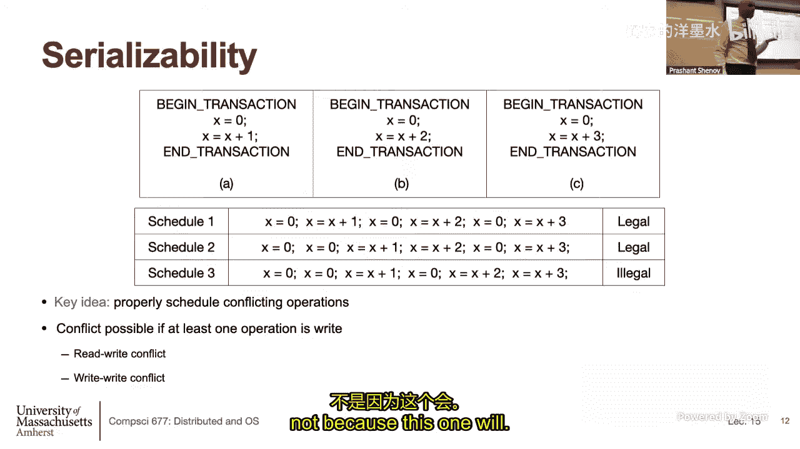

So if you touch the same data item by definition， it will flag as a conflict。This no。

Good question is if you have。No locking mechanism， How will you track if the same data has been touched by multiple data items。

 you can do this in number of ways so if your private workspaces。

 you have your own copy when you go to merge the changes you can see which data items you are modified and then you can go and check if those data items are modified in the database since you started you can keep a timestamp on the data items and say this transaction began at noon this data item was modified after that and you are this transaction also modified it so there is a conflict so you can have many ways to detect it we will talk about timest based techniques in just a moment。

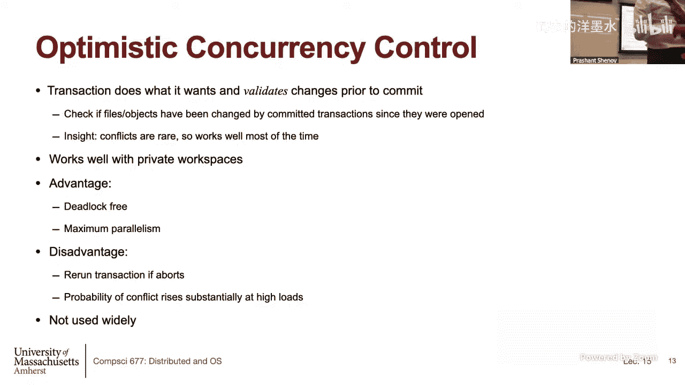

Okay optimistic concurrency control now then the rest of the techniques are going to be called pessimistic concurrency control the reason they are called pessimistic is they will assume locks are needed okay transaction can conflict at any time so lets use locks and prevent this type of conflict from occurring in the first place you still want concurrency so you are not going to take like big database locks you will take fine grain locks and still allow some concurrency but you will not let two transactions modify the same data items because you have a lock this will prevent the conflict from occurring。

Now there are many techniques that are actually used to implement locking based concurrency control a popular one is called two phase locking is best shown with this picture so basically in a true phase locking approach the transaction has two phases okay there's something called the growing phase of the transaction where it keeps acquiring new locks as the transaction touches newer and newer data item okay maybe you touch one record you get a lock before you make that modification then go to the next instruction it touches some other data item in the database you grab another lock as you touch new items you will grab lock so this is called the growing phase the x axis is time y axises the number of lock cell the growing phase you keep getting more locks and then after a while。

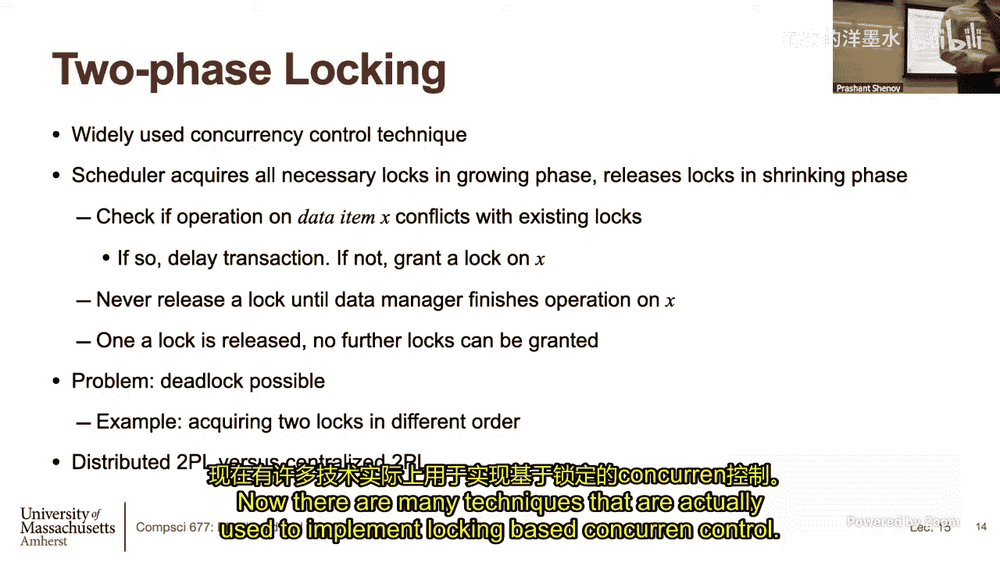

The transaction has touched all the data items it needs to touch in the transaction。

 you will essentially not grab any more lock but once you are done with each of the data item in the transaction you can start releasing the lock maybe you are done touching the new York San Francisco flight so you can release that lock and maybe youll then look at the next segment and so so you have the shrinking phase where you actually go release the locks so you acquire locks in the growing phase you release lock in the shrinking phase there are some additional constraints you can put on this growing and shrinking phase that will prevent deadlocks fromally because the big problem in any locking approach or two phase locking is deadlock I presume you know the simplest case you can have deadlocks is there are two data items A and B the transaction one tries to grab a lock on a and then a lock on B a transaction2 does it in the opposite order it tries to get a lock on B and then a and then you might have a。

where transaction one runs it grabs a lock on a and then you switch to two。

 it grabs a lock on B Now the two transactions are waiting on one another you deadlock right so same thing can occur here you have two transaction in a growing phase transaction one grabs a lock on a and ask for B and transaction two runs it grabs a lock on B and gets once once on a and then you are done you have deadlock and the system will not make progress so just having a growing phase and a shrinking phase does not actually guarantee you deadlock free execution you have to have additional constraints that acquire locks in a certain order in an increasing order that prevents this deadlocks from occurring you won't go into those details here that's how youll write a transactional system but the basic point with two phase locking is you have to grab locks locks are more fine grain are on individual data item not on the entire database that's the only way you will get concurrency and you got to do it in a careful way to prevent it。

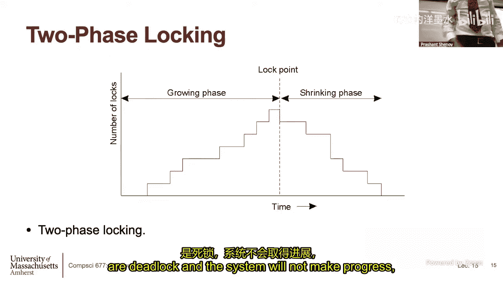

We didn't talk about what that careful way is， but you understand at least why there can be data。

So if you do this then you essentially have more standard concurrency control techniques that is lock based this is not what you may have implemented in your lab because concurrency control is not a requirement you just had needed consistency which means presumably you just got a lock on your order database or something like that and that's fine you will have to you will have to realize that that will give you sequential execution because there is no concurrency by definition if you get a full lock on the database if you had to grab locks on individual stocks for example not on the entire database then you would have done something that resembles this approach but again that was not a requirement in your lab so there's no expectation you do it but at least you understand how you can implement concurrency。

😊。

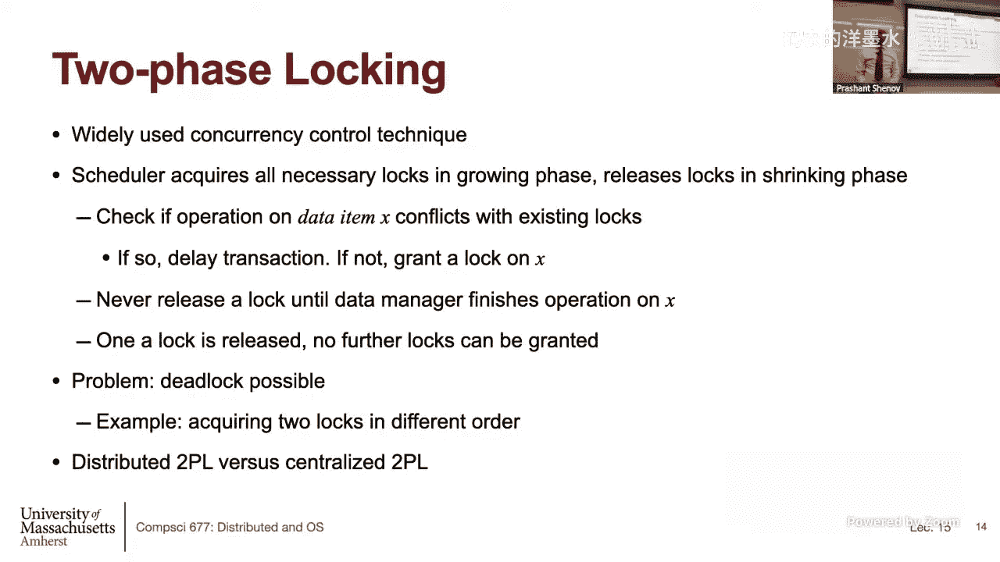

This clear。Okay so that's two phase locking， there is a version of two phase locking called strict two phase locking。

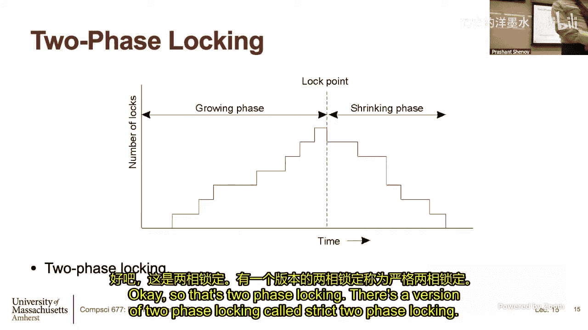

You to strict two phase locking the growing phase is identical but then you wait until the end transaction and you release all locks at much simpler approach than trying to release lock one at a time because you need to know the transactional system needs to know that this transaction done with this data item the remaining code in the transaction doesn't touch it so you have to do extra work to know when to release the lock it's much simpler to have taken all the locks and then the transaction ends you release them all at once this is called strict 2 P or strict two phase locking the shrinking phase is just one step that all locks are released by the transaction。

Okay。

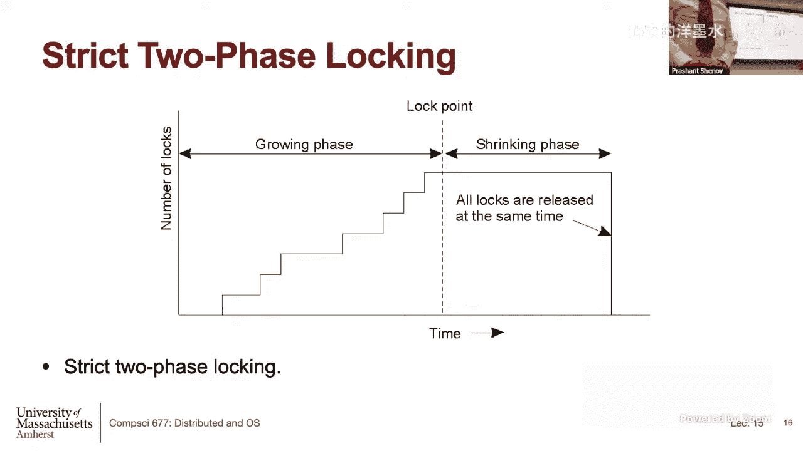

All right， so I have two minutes。 Im going to talk about。

Timet based approach that shows you how you can detect conflicts。

And that will end so in this case we are going to implement pessimistic andcur control but we will now use the concept of times stampamps to detect if if a conflict has even occurred because the question that you are to ask is how do you know there is a conflict and so on so and when you want to a border transaction so here we will give each transaction a timest think of it as a La port clock value whenever a new transaction starts you give it a timest which is the La clock value you can even use real times timess if you want。

Now if transaction I wants to perform an operation that conflicts with transaction J and will define what conflict means。

 but if transaction I has a thing that。Operation that conflicts with J then you you will a T if it does an earlier times time because you'll say a later transaction already modified that data item okay so this transaction needs to a and restart so because you started and someone else has come and made some changes that started after this transaction you about the earlier so that's a route you transaction start with timests and then any time you do an operation you see if some other transaction that started after this transaction have actually made a change to that data item If so you declare a conflict and you so the question is how will you detect that there is a conflict the way you will do this is in addition to having a timest for every transaction you will keep a read and write timest with every data item this is same as let's say the last modified time of your file or the last access time your files have timest right whenever you make a change。

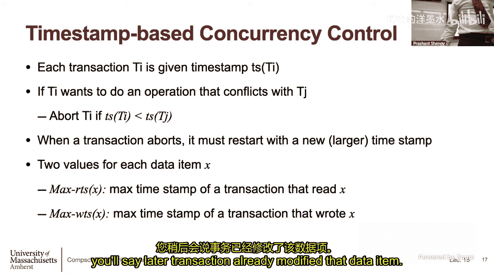

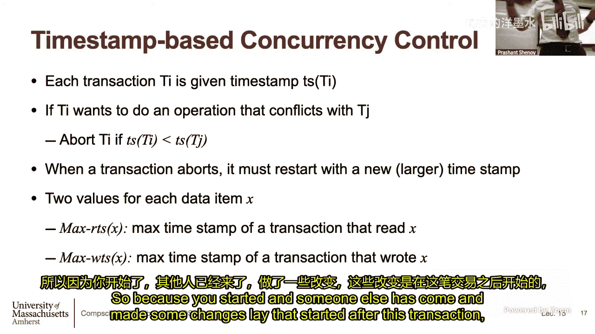

When you write the file， your file system actually updates a timest on the file that tells you when it was last modified。

We will use that same approach in the database where every data item x we have two times1 the last time it was read by any transaction and the last time it was written to when was it last read when was it last modified we keep these two values。

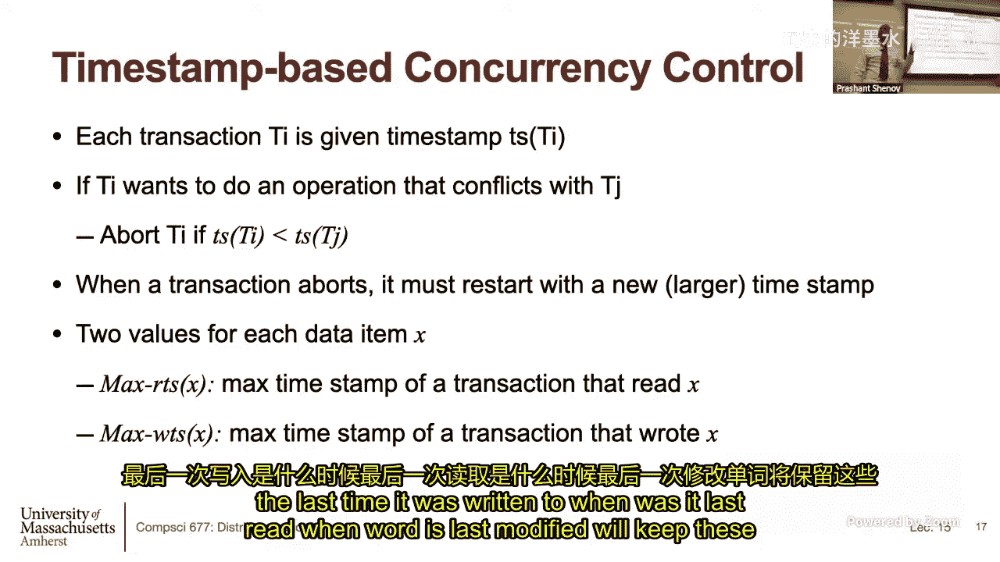

And then it's very straightforward to actually detect that there is a conflict whenever a transaction wants to read X you are going to basically take that transaction in timest and see if there is a newer write times if there is a newer write times time says that that item was modified after this transaction started so you say that's a conflict because some newer transaction come and modified it so that data items times time write timest is higher so you just a the transaction if not you will perform the read because now the read is succeeding and then you will essentially say the max times time to be the max read times time and the timest of the transaction so you check so this is called a read write conflict which transaction is time to read it but some other transaction went and modify it so if you find a read write conflict you say that this transaction cannot be allowed to perform this read you about it if not if there's no read write。

Conflict multiple transactions can read the data item at once is is like a read law so you don't check the read time。

 you only check the right timet and then you update the time and the write is the opposite So if you want to write to X then you are going to check has any transaction rate newer transaction read it or any newer transaction written to it if there's a newer transaction thats accessed it in any way you about the transaction you say that new transaction touch the data item about this transaction Otherwise you perform the right and then you update the right times time to the current times transaction times so this is checking is there a read right conflict or is there a right right conflict you are trying to write that someone else read it or that someone else write it So this is checking for read right conflict or write right conflict either of those two conflicts arise when you write you about otherwise you can。

So this is going to now tell you a little bit about how can you detect when there is a transaction conflict and so on by actually tracking when transactions modify data items。

 etc。Okay， all right。We are two minutes over time， so we'll stop here and continue next time。

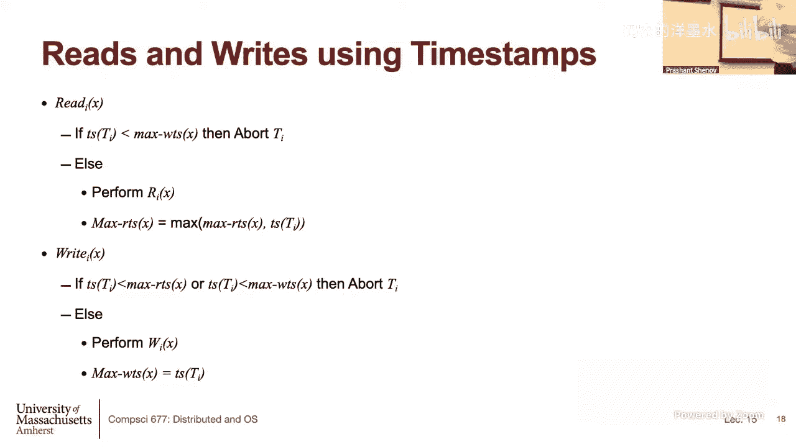