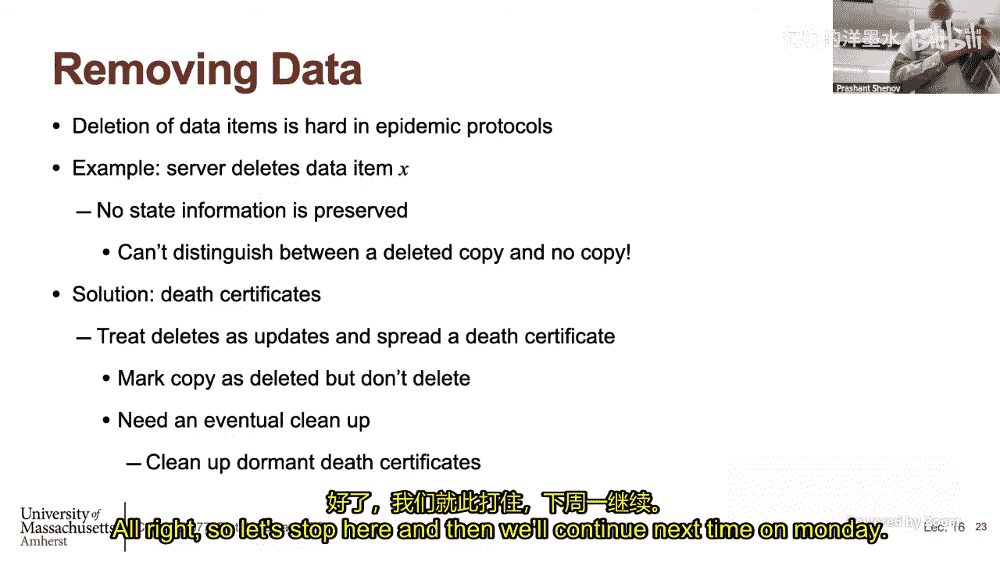

# 【全集 2025 附课件】马萨诸塞大学 分布式系统 中英字幕 p16 Lecture 16 - 一致性模型与复制 -BV19BSYBuE4Y_p16-

嗯。Okay， so let's get started。Apon。So welcome back， we will start a new topic today on consistency and replication。

And before I do so I wanted to make a couple of announcements we have put out the the exam grades right so what we will do is we will。

Add the solutions to。Canvas。Later today and then tomorrow we'll open the regrade window so take a look at the solutions and if you have questions you can of course submit a regrade request by and large the class did fine I think it's just the same as what we have seen historically the mean and the average tend to be in the low 70 so it was 70。

5 so it's no different from what has happened in many years so so I think that the performance of the class is。

Pretty good in line with historical averages so I don't think there's anything vastly worrisome or anything like that。

 but still if you have questions about anything you shouldn't come talk to it's not a problem right so what Ill do is I will continue discussion from last time we will switch now to consistency and replication last time we were talking about distributed transactions if you remember I mention what transactions are what asset properties are and so on and we'll continue from that point on today we'll focus more on consistency aspects。

 remember last time and we were talking about transactions I mentioned consistency we look at that in a more detail but more in the context of replications and transactions we look at datacentric consistency clientcentric consistency and then we will end with eventual consistency so let's start with。

Replication and try to understand why we need to have consistency right so so replication as we have seen comes in two flavors right one is you replicate the data that you this part of your distributed application and or you replicate the computation where the code itself is replicated and is running on multiple machines so today we are mostly concerned about data application so whenever you have replicated the data in your distributed system there's multiple copies of the data okay so and the reason that you have to keep these multiple copies is number one is reliability one machine goes down there are and all of the data and that machine is lost there are other machines with other replicas that you can use or the data as a whole continues to be available or if there data corruption it continues to be available。

So that's reliability the other is performance when you have multiple copies you can then take your request workload and split it across machines that allows you to scale your application up with the size of the distributed system or you can put these replicas in different locations and then have the requests go to the closest replica that's called geographic replication some of this will come back to when we talk about the worldwide web okay but today what we will do is to actually look at a problem that comes up whenever we have replication which is that of consistency okay but before we do that I do want to mention two or three other questions that we will actually look at when we come back to the World web discussion the first one is trying to think about when you want to replicate your data or computation second is if you want to replicate how many copies are you going to make where should the replicas be placed and so on so these are all issues that are related to replication that we will table for。

Moment and come back to but for now you will talk about consistency what is the problem of consistency whenever you have multiple copies of the data if one copy is modified you want to ensure that other copies are in sync with the modification otherwise some replicas become stale and others have more up information and thats a problem then if you go to a stale replica you are getting an old version of the data okay so so you want to ensure that all of the replicated information in your system is consistent with each other okay so that's the problem of consistency of data and。

As we start talking about it I want to start with the very wellknown theorem excuse me in distributed systems it's called the CA theorem CA is an acronym that stands for consistency availability and partition tolerance so that's what CAP stands for but what is the theorem so first thing is it was proposed by a professor at Berkeley' his name is Eric Brewer is very well-known in distributed systems and what he conjecture at the time it was not a theorem it was more of a conjecture but later on I think it was proven to be true but what he conjectured is impossible for a distributed system or he referred to as a web service but really is a distributed system to provide all three guarantees at the same time you want your consistency guarantees which means that if the replicas you want all the client to see the same data which means most up to the data that's a good property。

To have in your system you want availability availability which means if some nodes in your system fail the system as a whole continues to function so that small number of failures do not bring down the system other desirable property of a distributed system and the third one is partition tolerance which means that the network can lose packets the network in this case the network failures which means that some packets can be lost again you want to tolerate that as well so in some sense if you build a system you would like your system appropriate consistency to your clients you want the system to have good availability so that node failures don't bring the system down and you want to tolerate network packet loss and what the theorem says is you can't have all in your system as you design the system you are to decide which two are more important to the application and you have to pick two。

Of the three properties because its impossible to have all three properties at the same time that's what the the theorem says now this is important when you are designing larger distributed systems youve got to ask is consistency really important is availability more important to you tolerate network outages and so on and decide which of the two you want to put in your system because any system that you build by definition of this theorem cannot actually all of these three properties which you would like to have right so so here are some examples of systems we might have talked about briefly and we'll see which two of the three properties they chose the first one is consistency and availability so youre picking the C and the a but you are giving up on network。

Partition tolerance which means that you can are if there are network problems then the system will actually have issues so these examples of this would be things like databases okay where you don't actually deal with if the network problems cluster databases we didn't talk about LAP in this class but we will talk about XFF that's a file system we get to when we talk about file systems and two phase commit is actually coming next next time but but at least databases actually give you consistency guarantee their asset properties they might give you availability properties but they give up on network partition tolerance。

Now， if you look at some other systems， they made other design decisions or choices。

 so if you take distributed locks that we talked about last time。

Now they had consistency they ensured that the lock state is consistent。

We saw that if the network goes down， they can actually deal with some of this。

 but if a node goes down like the node lockmaster goes down。

 you are out of right that's what we talked about so some of the locking protocols we talked about do not do not give you availability guarantees but they give you these other two guarantees and there are other systems like they will talk about web caching and so on which don't give you consistency guarantees they relaxed consistency but they give you availability and partition all and so you can deal with nodes going down you can deal with network going down but you can't ensure consistency because fundamentally if you partition the network into two you can't keep the replicas in sync anymore because they cannot talk to one another so you have to give up consistency in that so these are just examples we are not going to go into a lot of details here but you will need to know that this property of distributed system which is very fundamental actually exist and typically you will see the cap theorem actually shown as a。

angle with three properties C A and P consistency availability partition tolerance and it is basically say speak to when you design your system now this picture here actually shows you all kinds of databases that you can get like you will see things like Mongo Db and escassandra Dyna or relational databases。

Ex me you will see what。Choices they have made at different databases have made different types of choices but the same is true for more general distributors we don't need to go into the details of what each of these mean and what they are doing or what you really need to know is that there is this property called the CA theorem which basically is an impossibility result it says that it is not possible to have all three of those desirable properties in any system and when you design the system you are to give up one of them and youve got to decide which one is the one you want to give up and which are the other two properties you want to。

Okay， all right， so that's a consistency theorem， but now let's actually talk about consistency techniques。

Yeah。Excuse me。The first thing is we got to start with the basics the basics is say that we have replication in the system our data is replicated here it says objects are replicated but really it means the same thing now who handles a replication it is not really important for the consistency discussion but later on when you talk about replication we will see it becomes important you can either put the burden of replication on the application or you can have the system deal with it for you will talk about some aspects of cloud provisioning where cloud systems are going to deal with replication but in other cases the application deals with but either of these two entities。

are going to decide what to replicate and how much to replicate。

 but regardless of who makes that decision consistency still has to be handled and that is what we are going to talk about how do you deal with consistency okay。

就说。To understand this notion of consistency， I just want to take a step back and have you think a little bit about replication and you'll try to see under what scenarios it actually even make sense to replicate So so here's a very simple example let's say youre building some application okay maybe it's for your lab lab3 will actually involve re so you will have multiple copies of your data or multiple copies of your application you can ask does having this multiple copies actually give you benefit in terms of performance or something like that So so the way you will think about this benefit is there is replication is going to come at a cost the cost is the cost of maintaining consistency so you are going to pay some extra cost extra messages how to be exchanged to ensure that data is consistent that's the cost you pay the benefit of replication of course now there are more copies so you can service more。

quest you can scale up that' is a benefit so you can do a very simple cost benefit analysis to see under what scenarios is the benefit of replication going to be greater than the cost of consistency that you have to pay for that replication so that is the question and here is a very simple example lets assume there is some data or object replicated n times then is some number greater than1 now we will assume that this data item is read with some frequency r which means that it is getting accessed with some some rate r but it also being modified at some rate w。

now the modification the right frequency or the modification rate is directly related to the consistency over it every time you write to one of the copy you have to send messages to other copies and propagate that updates all the copies are in sync so if w is your right frequency the cost of consistency is directly related to W and the read frequency is basically the benefit you are seeing because you can then send your read request to different replicas and scale up。

now， if you have a case where the read frequency is much smaller than the update frequency。

 which means that the object is updated a lot， but it is read infrequently。😊。

Okay so in this case you will see that the cost of consistency is high because that is the right frequency okay so you are going to be writing it frequently and then sending all these messages to keep the replicas in sync so there is a consistency cost you paid which is directly proportional to W but the benefit is very small because you are writing a lot but no one is accessing that data that is being updated。

😊，RightSo in this case actually it says that probably the replication is not giving you the benefit you want because the right frequency is much higher than the rate。

😊，But if the opposite is true where the read frequency is much higher than the right frequency then what it says is every time you update it the data item and then you propagate those up to all the replicas you will have lots of reads that access that data item so you have actually recovered the cost of sending all these messages through lots of read request that you service later so if read is much frequency is much greater than right then you can actually get the benefits of replication because the consistency overhead it much smaller than the benefit of having all these reads but in the opposite case it is not not true so in some sense what this is what this very simple analysis is showing is yes replication gives you benefits but it comes at a cost the cost is consistency overheads and then that cost is not negligible you have to way that cost against the benefit of replication so so that's the analysis now I said the consistency cost is related to。

😊，But what it is exactly will depend on what type of guarantee you give and that' is what we are going to look at you will see that depending on the type of consistency guarantee that cost can actually vary it is always related to some is always related to w proportional to W but in some cases higher than other so now lets start analyzing what what is the consistency guarantee you want to provide because the stronger the guarantee the higher that cost is going to be。

Is that clear what I said so far？オ。So lets start with some basics okay so first thing is we will use this term consistency semantics adgacy means what type of guarantee you are going to provide okay what does that guarantee mean so the so this is the picture you want to keep in mind so there is some data that is showed on these disks and you will see that there are multiple disks so the data could be replicated。

There are some applications that are accessing the data Any application can go and access the data from any of the replica you'll see in this case three replicas so this process here accesses the first one that process accesses the second one and so on and then the question is when a process tries to access data what is it going to see in terms of what is the guarantee that the data store is going to provide in terms of what you are going to see ideally you want any of these processes is to see what are called the results of the most recent right which means you see the most recent update thats the most recent copy of the data or the file in the system so thats what you would like but you can see that the definition of what is the most recent update itself is actually a tricky question and that will give us a range of different semantics that some of which are stronger than others。

And so， let us start talking about what these guarantees are and how you can think about their costs relative to one another as the simplest approach is what we will call strict consistency okay。

Excuse me so as the name strict consistency suggests a read request will always return the most recent right regardless of which replica you go to so it means in some sense it means you will never get any stale data you are keeping all the replicas strictly consistent with one another so anytime there is an update all other replicas are immediately updated so whenever any other application tries to read it they always get the most recent version they never get anything still strict called strict consistency okay now seems like a good property to have but as you will see。

This one is actually the most expensive and in some cases。

 you will see that if not actually possible to even guarantee it consists。

 The first thing is it is implicitly assuming a global clock。

It is because you are to ask if I send a read what is the most recent right it requires that you be able to compare time across machines so if the the most recent update happened at time T and then some other machine is seeing a read at time T plus epsilon those two machines have to be synchronized otherwise you don't know what is the most recent right right so you need to know that so implicitly is assuming that your synchronization which you already seen is impossible but let's for the sake of argument assume that you have the perfect synchronization algorithm every machine is tightly synchronized or you can figure out when there right the next read needs to read needs to return that version of that object so let's assume that but there is now a second problem which is that。

😊，The strict consistency semantics require that updates are instantly propagated to all machines。

Let's say the update to a file happens at noth。Maybe one millisecond afternoon there is a request for that file at some other rep okay now strict consistency says that the read which happened1 millisecond afternoonon should get the update that was made at noon but what if it takes 10 milliseconds to propagate this solar network because network latencies are finite they are not instantaneous so it might take you some time to actually send that message messages are not going to reach instantly。

So now， if it takes you longer to propagate the message。

 you cannot fundamentally even guarantee strict consistency because one millisecond afternoon there is no way the message would have actually reached that other machine that it has the most recent update。

Right so as you can see because you can only propagate information at speed of light that's the speed at which you send data over a network okay that still finite there' is always a finite delay between when a right occurs and when you can send the message what read comes before the message has actually reached you cannot guarantee strict consistency in this so so in some sense this is a good property to have but in practice there are lots of problems first it requires clock synchronization second assumes that a right is immediately visible which means you can propagate updates with latency0 that's not true in real system there are actual network delays so so this is hard to actually implement in practice but it is the strongest guarantee you can provide any application。

so now we will start relaxing this to try to get other properties that are good properties。

 but not as strict as strict consistency。Is this clear any questions here？Excuse me。

Next property is called sequential consistency okay This property is one step weaker than strict consistency actually two steps but for now we haven't seen others so this is going to be weaker than strict consistency okay so now we are going to start thinking about reads and write and what rights are visible to what processes and so on and you'll see why this is weaker so the first thing we'll assume is there are end processes in the system these processes are reading and writing some shared data that's replicated across machines or processes So we'll assume that all within a process okay operations are executing sequentially because that's sequential execution so maybe there is a read from a file and then write to a file will assume that the process actually executing them sequentially so those reads and writes are order based on the order in which they appear in the program okay that part should be clear okay and then we will assume。

Furthermore， that when you have multiple processes their reads and write are going to be interleing interlea rather any valid interleaving will be allowed and you to all processes have to agree on the same interleing okay that reserve program order so here is an example for you to understand what all this means right so here are two small pictures at the bottom and there are two different examples so there are four processes in this case there is a single shared data item that is replicated across processes which is called X。

you will see in this case process p1 here this thing w xa simply means that process p1 wrote a to x let's say x is a file very simple right x is a file so you essentially write a to the file okay so you are now return a to the file process b goes and writes B to the file。

Okay， so and you will see that if x x is this time in this case。

 it looks like the a operation a right has happened before the B right。

Now all processes have to somehow agree on the order in which these rights have occurred and they have to see the rights in that same order so if you assume this processes is decided that the be right has happened before the a right that's allowed S per sequential consistency and then when you read it you will first get B because you see that right first and then you will see a because you see the second right later because you actually see them in the opposite order and that's allowed because you are agreeing to that intering and everyone sees in that in that order if theres a strict consistency this would not be allowed you would actually see the first right because that occurred first that would propagate and then you would see the second right we have relaxed at maybe since strict consistency is impossible that process is decide maybe this P2 is closer to P3 and p4 so somehow itss right appears that message appears first and that's allowed in our case because we are not asking for any strict synchron。

and so on what is not allowed as for strict consistency is where two processes see the rights in two different order。

 So in this case， P3 sees B and N Cs a and P4 sees A and N Cs B because that is thisallow you want to agree on some order of these rights and every process as to see them in the same order。

And whatever you pick this okay， so long as you all see them in the same order。

 so the second case here is not sequentially consistent because you' are seeing things in different order。

So it should be clear how this is different from strict consistency because we could say B as the right to B the B right happened before the A right even though in time moderate is the opposite a strict consistency would have only allowed one order here we are allowed either one and then once you agree everyone sees that。

That clear。Okay， so this is called sequential consistency。

 you will see it's now a relaxation of sit consistency next。We will talk about meorizability。Okay。

 so this is a different。A different guarantee is somewhat。

It seems somewhat like serializability that we talked about last time when we were talking about asset properties but they actually are two different things they sound similar serializability in context of transaction simply says a transaction have executed in some sequential order and the output is based on that order so it is really related to transaction linearizability is a consistency guarantees nothing to do a transaction so it is now actually will see that it is a stricter guarantee than sequential consistency we say that a linearizability assumes sequential consistency everything we said before holes and what also is true is if timest of operation x is less than times stamp of y then x should precede Y。

Okay， so let me show you an example， so in this case okay。

Your two rights now there is no message between these two processes between those two rights so these rights are concurrent so you can order them in whatever order you want。

 but if there is a message that went from p1 to p2 between those rights those rights have gotten ordered okay this is basically what we did in La ports clocks if you remember okay because the send is preing the receive the right proceeds that send and another receive proceed right these two rights get ordered based on timet so so what they're saying is if there is some message or there's any way to actually relate these two rights you got to respect the order you can't invert it so if there is a message here then you should have always seen a before you cannot agree on B before it。

Okay， that clear， so thats what。Leal visibility does but I am going to give you another example what does it mean to send a message so here is an example of an implicit message you write a to x process b is going to read that shared data x and is right a and then it writes B。

now this is not an explicit read is not an explicit message。

 but it is a implicit communication between P1 and P2 because p1 wrote a to a shared buffer。😊。

P2 read that shared buffer and got a that is equal and to you sending a message implicitly because some information has passed from p1 to p2 so this this read here between these two rights actually causes these two rights to get ordered。

Even though that's not an you can have an explicit message as per Laport s that will automatically order those rights but you can implicit communication where you are reading that shared data if if there's a read between two rights where you are reading the same shared data that's communication as far as we are concerned so these two rights are going to get ordered so what that means is all processes how to see if you are linearizable a followed by B and here you see one sees B A another see AB that's disallowed as per linearizability you actually have to see AB in both cases。

对。Allright， so that is our linearizability which is saying that you have to have all of our sequential consistency but if there is any way that the timests can be compared between two of these operations then you have to ensure that those operate those are that order is preserved。

Okay， so there is another example here， which I will not go into asthma detail。😊。

s trying to say the same thing。Wwhich is there are three variables that are shared X Y and Z and then what you do is you set each variable and you print the other two so that's a way to communicate between changing the value and then reading that value so that's the right that's the read and then it says that depending on what is printed what is allowed and what's not allowed in this case actually all of these sequences that you see the interleading of these messages are not messages instructions rather there are linearizable and I should have started with the actual programs there are three processes p1p to p3 this process says x is equal to1 and reads Y and Z that sets y and reads the other two and that says z so each of them is changing one of the three variables and then reading the other two so that's essentially message exchange between these processes by accessing shared data structures and then that's the linearizable schedule that says that。

These are different interlyings as you will see of those six instructions and this is what each of those print statements produces。

 all of those are linearizable because。Once you set a value。

 all subsequent print messages actually see that value， that is what it is saying。

Because that's the ordering okay but the other example I gave you is actually easier to understand from a linearizability perspective。

😊，So， that is linearizability so it is strict consistency that is the strictest linearizability one step below sequential consistency is one step further because you will see linearizability is stricter than sequential because it does everything that is sequential and it has an additional condition that makes it stricter not loser。

Allright next one is called causal consistency this is almost like linearizability with one difference it says what causally related rights must be seen in the same order。

 but if there are concurrent rights you don't need to agree on an order you can see them in different order。

In sequential consistency you had to always agree on order whether they are consistent or not in linearizability if there was a causal relationship you actually had to respect that causal you couldn't inward the causal relationship here it says that only respect causal relationships other operations can be seen in different order。

So here is an example that I already showed you so you have two rights that are causally ordered because there is a read between them this read is seeing what that write wrote and then doing another right so these two rights get causally ordered so you have to respect that ordering if you are causal consistent causally consistent you should always see a followed by B here you dont you see B A and AB so this is not permitted as per causal consistency now if I remove this read。

Those two rights are now concurrent because there is no message exchange between those two processes if there are concurrent rights we say we don't care anymore about the ordering you are allowed to see B and AB because they are concurrent we don't actually require you to have any ordering at all if there is a sequential consistency even if they are concurrent you are to agree on something。

It would agree on A B or B it doesn't matter， but you wouldt agree on something。

 all processes had to see those rights here， you can see them in different order。I this clear。

 I mean， it's kind of。Li bit complicated to understand， but once you get that basic idea。

 then it's clear what's going。But， yes。嗯对。Yeah so question is when you say write A and B are you app to a file are you modifying it。

 both of those are acceptable right we are just modifying some shared data item okay you could append and modify it like if you have a file you can open a file and literally write a to the file and save it and then you can write B which either overwrite it or append it doesn't matter you just created two copies right one is before the other okay。

And you could do that to a database as well， so its just any modification is fine we are just talking about modification。

对还不。Yes。So what does the ordering mean so I mean， if you want to think about it there is a very simple way to see it right so let's say。

You these two processes I'm going to make a different example。

 let's say that is you and your lab partner are working on the same file。

You opened your file in your browser， you go and write the letter A to the file。

 you save it your lab partner writes B to the file or modifies it or something like that and saves it now here's a third machine which could be your build machine then the question is how do these files become visible to the build machine which of these versions does it C first that's an example of causal consistent now in this particular case what has happened is you wrote a your lab partner actually read the file and it saw your changes and then made another change this means it's causally consistent because your change got propagated and was seen and then modified again so in this case that all these other machine should always see your update before the other because that's causally consistent but in this case there is your lab partners not reading your file you are making changes independently of your lab partner so you made changes to the same file in this case different machines can see those updates in different order。

even though as per time order， you will see if this is time， this change has occurred before that。

 but we don' not care about that as far as sequential causal consistency is concerned in this case。😊。

That year， what we were saying yes。Any other questions here？So that's causal consistency。他说。

There are many other models we will not go into this There is something called PIO consistency that's even loser which says rights from a process can be seen by others in the same orders but you can have rights from different processes seen in different order which is basically saying you don't even need to worry about causal relationships you can see rights in different order and different machines so it relaxes that and so on so we started with strong consistency we ended with something called PIO consistency which I just talked very briefly it didn't go into the detail but each of this is trying to relax this notion of strict consistency because it's very expensive to mind all of them involves sending messages to update the shared data item and replicas and so on。

So that's something you want to keep in mind。Now there are other ways to think about consistency that don't look at individual reads and write instead they look at critical sections and try to make databases or files consistent across boundaries of critical sections so assume now that before you make a change you grab a lock you make some changes and then you release the lock if you have this model then between the acquiring and the lock and release in the lock whatever changes you make don't have to be propagated you wait until the lock is released and then you make all the changes visible at once this is what databases also do if you remember when we talked about transaction the begin transaction and end transaction and you really only when the commit the transaction do the changes become visible in the database otherwise you can throw out the change right so so these types of。

Techniques which operate at granularity of critical sections do the same thing say rather than worrying about reads and writes which is too complicated lets assume there are abstractions like transactions or locks okay so you have at either at the entry point to make everything consistent and then grab the lock or at release time which is when you release the lock you then propagate all the changes but between the entry and the release any changes are local you are not even sending them out at that point so that is going to actually simplifies know how often you are to implement consistency and send updates and so on okay it is one step weaker than doing this for each read and write operation so。

There is as you will see a sequence of these things you don't have to know every single detail about all of these but we started with strict we talked a little bit about linear asability sequential consistency causal consistency than I said a little bit about50 so youre weakening these guarantees and then you go to these other consistency models where you have weaker consistency guarantees at the granularity of acquiring and releasing law so ass a spectrum of approaches which one you pick actually depends on your particular application and we'll see that many of the systems don't even do any of these that do something even weaker than this as we just see but it's good to know that yes I mean strict consistency looks great but there are other things you can actually have in Europe。

Linearizability is something that you will see is somewhat common in some applications that want stricter guarantee but strict is almost hard to achieve in practice。

All right so I'm going to say one more thing and then we will talk about a much weaker form of consistency which well call eventual consistency okay so this model here is called client driven consistency it says rather than thinking about consistency from the perspective of the database or the shared pile storage or the shared storage let's think about it from the client perspective okay can we reason about the correctness of what is being data is being made visible or the perspective of the client。

What does this even mean so what this says is if there is a client machine a laptop say I'm going to show you okay so so lets say there is a laptop it basically makes a read of some data item and it gets a copy we will assume for sake of argument the laptop moves to another location then it does another read and potentially this time the result is written from a different replica in the system what is it that the client should see。

😊，And the basic idea is after you see something say see some data you shouldn't go to another location and see older data that's bad because you already saw something more recent you go somewhere else you see older data that' is actually this right so so that is what monotonic read says monotonic read says once you read some file you shouldn't go to another location and get an older version of the file that is not allowed monotonic right says once you update a file you shouldn't go to another location and see something older。

that is mono so write and reads are monotonically becoming newer you would never see older versions of it read your rights says let us not worry about multiple clients at a minimum if you read something。

😊，But then you' be sorry if you wrote something you should at least see your changes you should maybe you will not see changes made by others but at a minimum you should see your chain right so you updated your file this actually happens quite commonly maybe you update at a file the file is still uploading to the cloud you go to another look another device you try to access that file since it does not sync through the cloud you might say an older version。

So in this case， you are not reading your rights。This very happens very commonly because cloud systems don't update immediately so you can see this happening right you can if you use any system like OneDrive or Dbox or any of this you can make a change on one device while it's uploading if you actually open that file on another device because your sync hasn't happen you will see an older version that is not allowed as suppose you are not seeing your own update let alone other peoples so these two things says you're seeing updates across client this one is saying you should at least read your rights or write follow reads basically is the opposite it says that right following or read will take place on more recent version of at least you're saying you can update your own copies and see them in the right order so these are consistency techniques that are not looking at the problem of consistency is the perspective of the system and looking at it from the perspective the user and at least the user does not see inconsistent。

Information by once you read something you go and go and get searching older rule now that actually happens quite often as in many scenarios one example is if you go and update your password sometimes okay on one device。

And then you try to log in。😊，To that account on another device sometimes the password has not propagated you actually will see you to use your older password to log in because the databases there are multiple copies of the database they are not synchronized one of them has seen your password change the other one has not seen it so you try to log in with your new password a few seconds later and it says that the password is incorrect so these are all examples show that even these very trivial properties many systems don't even support you will see all kinds of inconsistencies occurring as a result of all this。

Theyre clear。Okay， so we will now get to the last part we had a question。

OkayWe we'll get to the last part which is called eventual consistency so eventual consistency basically says that everything we talked about is too complicated too expensive for the system so we will not give any guarantees what we'll assume is that you make changes to the system those changes will propagate to other copies it will take a while until then things will be inconsistent and that's okay this is why it says eventually things will be consistent and no guarantees on how quickly changes will propagate how much time it will take but that's okay so long as we do this in a best effort manner we live with all the inconsistencies now it turns out this sounds like almost silly that you are not giving any guarantees and it just says too bad things will be inconsistent but that's what many systems actually choose because they find that whatever I talked about is all too expensive So why give any guarantees let these things happen in their own time。

And things will get consistent eventually so that's the basic idea beyond eventual consistency practically all of the systems that I mentioned here domain name system password databases cloud storage all eventual consistent right so you can take any cloud system in this iCcloud Oneri Robbox they give you no guarantees you make a change it may take minutes for you to show up on some other device because they are not giving you any guarantees they are making the best effort to update all the replicas but no guarantees right so many systems are taken this approach and said it's too expensive to do anything more so we will not give you any guarantees youve got to live with all of the inconsistencies for this out yourself。

So now we'll talk about although this sounds。From what trivial there are actually protocols that allow you to implement eventual consistency we will see how to implement all whatever all of what I discussed are just definitions right strict consistency linearizability。

With are all definitions I didn't have how to implement。😊，But at least for eventual consistency。

 we will discuss how to go and implement these ideas。So that brings us to。

A little bit more of definition then well see implementation Okay so so here for virtual consistency assume。

A replicated database a here an example a replicated database there are many copies theres a network in between okay anytime you make a change well assume that the databases will try to propagate those changes to other replicas but there is no guarantee on how much time it is going to take for them to update how frequently they will update eventually these updates will get pushed that is the basic idea the update will eventually propagate all replicas because it is very cheap to implement and well see how to implement。

So that is the basic idea the eventual consistent so the popular approach to implementing this is called epidemic protocols。

So， this idea was designed I think in the late 80s in a system called Byou which was at that time designed at Xeroxpar and they had the following problem。

 they were designing a distributed system in which the devices were whatever were called weak connected。

 weak connected meant that they would sometimes be connected to the network and sometimes be disconnected from the network。

So if the device itself not even connected to the network。

 then clearly there is no way to implement consistency because I cannot propagate a change to a device if it's not even connected so they said this notion of being weak connected means none of these guarantees that we can study can be implemented in the system so we have to think of a new approach and they came up with idea of eventual consistency so this notion of weekly connected devices is still common today so you can think about laptop right so you can have a laptop is connected to the w-fi network you close a laptop take a bus home while you're taking the machine is disconnect it's not connected to any network so if it was part of any system maybe it is trying to upload something to the cloud the cloud system can't send it any updates by definition because youre not even connected so in many of these cases we consistency in the form of eventual consistency is the only thing you can do because remember the cap。

Here Im where I said if you are disconnected from the network you can't give guarantees so that same thing is true here I can't provide guarantees if the device is not connected I can't even send messages to it right so so that's how this came about but then I said how do we implement this notion of eventual consistency so this is where this notion of epidemic protocol comes about right so so this basically does the name epidemic suggest this is how diseases spread。

RightSo so diseases essentially spread infectious this is at least through what is called pairwise interaction so maybe you're sick you go and you shake hands at the friend and you pass on your jump or you go and cough near somebody you pass on your they get sick they do the same thing they pass on the so that's how diseases infectious diseases spread same thing is true of how we will spread update because from our perspective updates are something you want to spread their like germs you want to spread them as quickly as possible to everyone in our network so if a device has an update it's called said to be infected meaning that it has an update it wants to spread it and how is it going to spread it you will do pairwise exchange the infected store we try to contact some other machine and say do you have this update if the machine says no we will just say here Ill give you this new copy you have that update and then that machine gets infected it will do the same thing it will contact some other machine at random and say。

Do you have the update if the answer is yes， there's nothing to do otherwise you will actually send that update so so that's the basic very high levelve idea of epidemic protocol you use pairwise exchange to do this and you will see this is how cloud systems also work right so your machine and the cloud server are pairs whenever your machine contacts the cloud your machine ask the cloud do you have any files that have changed on the cloud if and you pull them down and the cloud system ask your laptop do you have any new files if so you upload them and then you basically spread the updates and other devices will do the same thing the general concept of epidemic protocol there is no centralized cloud you are just doing peer tope exchange of information and' spreading the updates to as many machines as possible。

So there are two techniques that I will talk about that implement the exact same idea one is called antienttropy。

 the other is called rumor mongering also called gossip so epidemic protocols in some literature also called gossip protocols because they are very similar in how either rumor spread or diseases spread but let's start with antienttropy so is peer to peer exchange to spread up this server P is going to pick another server queue in our distributed system at random randomly you say pick a server queue connect to the server and then you can do one of three things you can push an infected data to the other server you can add some infected data is update you push it you can pull you can say ask queue do you have any new information is there any infected data you pull that data or you do both you push and pull so you are randomly either going to push pull or you do push and pull and exchange information。

And this process will repeat then after some time P will pick some other machine do the same thing you will pick some other machine do it and eventually all the data that has been updated will spread because you are randomly connected to other machines and either pushing and pulling information there is no guarantee on how long this will take because everything is randomized it may take a long time to connect to some machine that has never seen an update because randomly nobody connected to that server to push or pull update but eventually someone will and that update will spread that is the basic idea right so essentially this is called antienttropy just randomized exchange where you have two pairs just exchanging information。

Rumor mongering is very similar so also called gossiping so just as I talked about diseases spreading think about how rumors spread right so maybe you learned about some hot news thing that you want to tell everyone so what is that you you will tell talk to all of your friends and you will immediately tell them I learned about such in things and then you will try to push that rumor and then they might do the same thing and so on。

So while the rumor is hot， everyone is trying to tell other people saying this is what I learned and so this rumor is going to spread very quickly but after a while you will stop spreading the rumor you' say I told everyone I think everybody knows by this time so I'm not going to tell anyone anymore which means that from a rumor mongering standpoint after every time you spread that rumor there's a probabilistic back off it says do I believe I told everybody that needs to know and you I start spreading the rumor if so then you will just stop and then you will not spread the rumor anymore but others might continue to do that until they all back off so so after every time you tell somebody you toss a coin with some probability P let's say coin is going to say heads with some probability P entails the probability 1 minus p it's not 5050 well assume that it's different so some small probability P equals say heads and youll say I stop I so that's what you will do so you'll have randomized back。

Or when you stop spreading your rumors。So that is called rumor mongering or gossiping so in this case what you will see is there is if everyone stops spreading the rumor but there are still some node that never heard from you they will never get the update unlike antienttropy where there is no stopping you keep spreading this over and over again in rumor mongering there is some probability you will stop and everybody else stops and some node never see the update to begin with。

😊，So in this case eventual consistency is not fully guaranteed it depends on the probability P of stopping okay and the smaller that probability the more the chances are you will spread it before you stop but that probability can be tweaked and some nodes may never see it in this case so so that that's how rumors are anywhere you can't guarantee that a rumor is going to spread and everybody is going to hear maybe some person does not hear it because nobody told them and then everybody stop talking about it。

So this is a case of eventual consistency where you will not guarantee that the rumor will spread in fact there is this equation here which I will not derive。

 but you will see that there is a exponentially small probability with which you will never see an update because everybody stop spreading it。

😊，That clear。First ever though， does push to have a timing order， otherwise few updates。は終わて。

Push and pull happen same also， is that the question push and pull happen in a certain order？

So the assumption here is that you have time studies you ought to have some way to know what is an update and whether you have a newer version or some others have a newer version so simplest example is you have times timess on files and we assume use NTP or some clock synchronization or clocks are synchronized so you can simply if these are file yourself you can look at file update times and say do I have a newer version or do you have newer or you can add version numbers just a source code control as version number right so you can figure this out so you have have some way to know whether a file is newer or older in that case it doesn't matter whether you do push or pull whether you do push or pull。

 you know who has newer information and you can spread and you can use this to spread multiple data items at once it doesn't have one data you can have set of updates to many different data items that are all spreading this way each data item is like an infection thats spreading a distinct infection but you can。

More of them going on at the same time so room monitoringing is not。快会怀。

The question is if rumor mongering is not eventually consistent， why would you want to use it？

You can think about the other aspects antienttropy never stops let's take a case where updates have stopped no one is updating anything Antienttropy will still require every machine to contact every other machine and both machines say there's no new information so there's nothing to do then you contact other machines so youll waste message there give there are no updates if there are always updates in the system then it's fine to have antienttropy because theres always some useful information being exchanged in rumor mongering there is a stopping probabilitybabil so if updates stop eventually message exchange of you're not wasting network over at contacting machine right so that's the real tradeoff between the two but there is always a risk someone will not receive。

All right so。Theres one more thing I want to mention then we will end that's essentially how are you going to delete data when you have consistent epidemic protocols or consist so as it turns out deleting of a data item is also a type of an update you can go and update file by writing to it thats an update deleting a file is also an update where you remove all the data from the file and file itself is gone we will assume the delete is a special type of an update as far as we are concerned where we remove all of the data。

Now the question is， how are you actually going to spread？The fact that you deleted a file。

So let's say you had a file while it was being updated you could compare it on another machine and say you I have a newer version here or updates but let's say you as a user just deleted the file the file is gone from your folder now if you are using antienttropy your machine is contacting some other machine saying what is the information that I have missing and you say I don't have file a but that machine as file a so you will now assume that that file has appeared and you will get it back so your deleted data item has now reappeared because you assumed it was gone but when your machine contacted some other machine it saw a file that you didn't have and then suddenly you bring that file over and say your deleted data has returned on your machine。

So so if you just trivially delete a file okay and assume that that deletion is going to spread it doesn't spread in fact the file actually reappears because there is no information cap that there is was a deletion so the way you are going to spread deletion is what we call death certificates which means that when you delete a file is actually gone from your file system but you keep a record it's like a death certificate saying I had this file it actually got deleted that's my final update to the file and now when you compare this with some other machine your death certificate will always have a later times time so you will tell that machine saying okay the file was actually delete it so you will start spreading the death certificate through the system and then every machine will start deleting it from their system and then start spreading that death certificate everywhere else so this will basically this is how you are going to implement a delete you can't just simply delete the file and assume that you can synchronize it because theres no record that there was。

a deletion So when you delete a file， these systems have to keep track that the fact they deletion and then spread that information and then ensure that the file gets deleted from all of the machines so this is how you will actually take deletions and as an update and spread them around using epidemic protocol so there's still one problem after a long period of time。

 lots of files would have one created and deleted so there will be lots of death certificate sitting in the system because if you remove a death certificate。

 there might still be some machine because eventual consistency that hasn't seen it and then that machine still has the file it will reappear so you might have to wait a long time to clean up the death certificates。

 but you will better be sure when you delete your death certificates from all the machines and every machine has seen the update even if there's one that didn't see it your file will reappear so when to delete that certificate becomes its own problem so now clearly this。

Doesn't take up too much resources so you can keep it for long periods of time， unlike files。

 but there has to be some policy by which you clean it up。

 but with the assurance that your file doesn't reappear。Okay， yes。This one this have。我就。What。

We even have the same regard to been by another。なか。不是谁。

Yeah so don't fully understand your question but you are asking if the file is modified you are looking at times timess to figure out how to propagate the chain that's absolutely true what I was saying is the file was modified for some period of time and then somebody has deleted the file so then now the file is gone from one machine so that is my most recent update to the file is that's remove the file completely。

Now if you want to synchronize that you are to propagate that information and every machine has to delete the file but as far as the machine where the file was deleted is concerned。

 what does deletion do it just simply remove it from my directory the file that there's no trace of the file at that point so if I compare my directory with some other machines directly saying do you have any updates you will see that you don't have this file because it was deleted other machine still has the file and there's no record that there's any deletion so it will look like the file got created to begin this is how file creation would work as well I create a new file I compare directories and I say you don't have this file I push that that's the same thing will happen again the file reappear right so this is why we need to keep extra information which will call that certificates to say to。

Allright any other questions here we are going to end a little bit early but we are done with consistency and as I said we started with strict consistency we looked at a whole sequence of them and then we ended up with eventual consistency and epidemic protocols which like it or not is what many of these systems including cloud systems implement anything else tends to be harder except the world of databases where you know you don't want to be eventually consistent if you bank databases and things like that then you will have real correctness problems that is where you pay the price but for many other systems you just go with something much。

 much weaker like this。Okay， all right， well let's stop here and it'll continue next time on Monday。

