# 【全集 2025 附课件】马萨诸塞大学 分布式系统 中英字幕 p18 Lecture 18 - 拜占庭容错（BFT） -BV19BSYBuE4Y_p18-

Okay， so maybe we can get started。

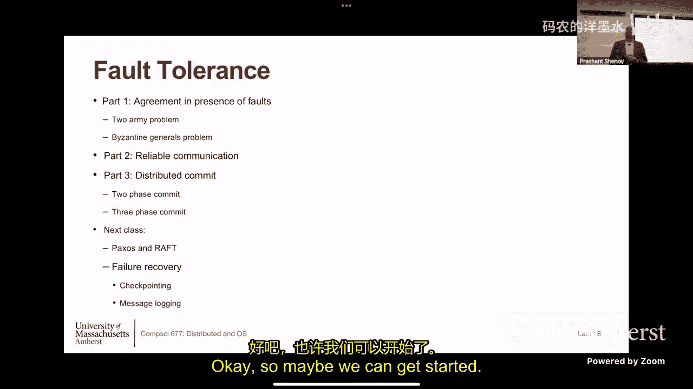

So today we will continue our discussion from last time and where we introduced this new topic of fault tolerance and I'm going to talk about two or three different sets of techniques that we need to look at from a fault tolerance perspective the first one is agreement in the presence of faults youll talk about what agreement is and talk about a problem called the Byzantines general problem then I'll talk about dealing with faults from a network perspective which is reliable communication to some degree when we had done GRPC and RRPCs and RMs we had briefly touched upon this but we are going to look at it again and then the third part is going to be on this problem of distributed commit which is also something you will see gives us both atomicity property and well see how failures have to be handled in。

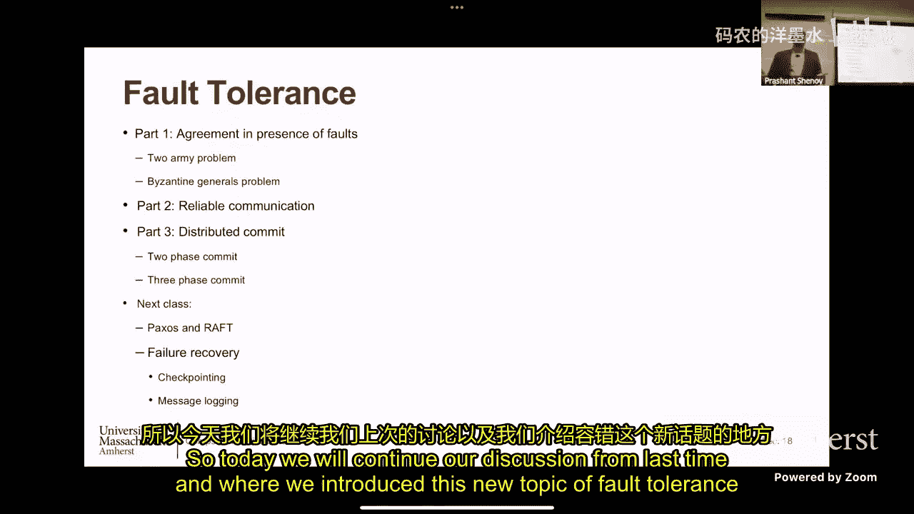

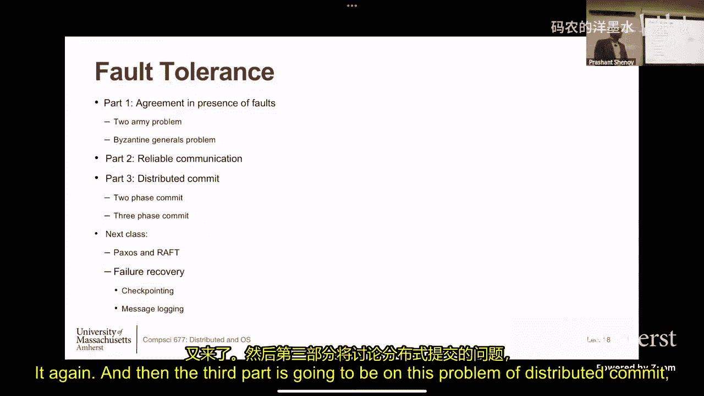

so that's what well do today， but just to show you what we will talk about next time because this topic of fault tolerance will at least be two different lectures next time we'll talk about consensus and we'll talk about this technique called Paxos which is quite popular and industry Paxos and Ra and then we'll talk of some about checkpointing message recovery and so on so that's the agenda for today's class and the next class so let me talk a little bit about agreement first and then I will talk about the Byzanti general problem we'll skip some of the slides we had already covered last time so this is where we had stopped if you remember I describe this simple hardware circuit one bit circuit and I said if you don't have any redundancy in A B or C stages you will actually have no output or bad output and then we said we can replicate each of the element T times have a voting stage that looks at。

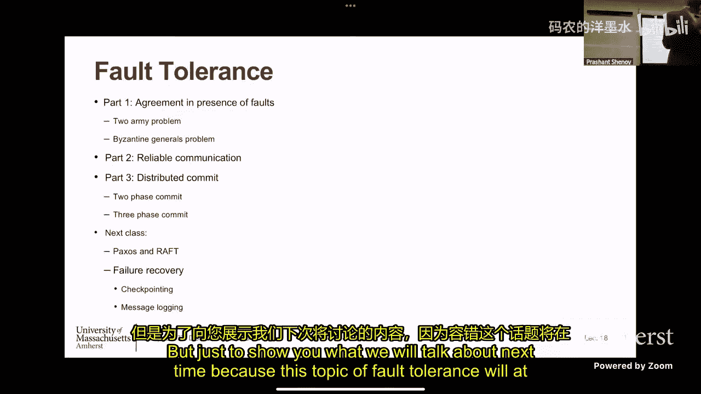

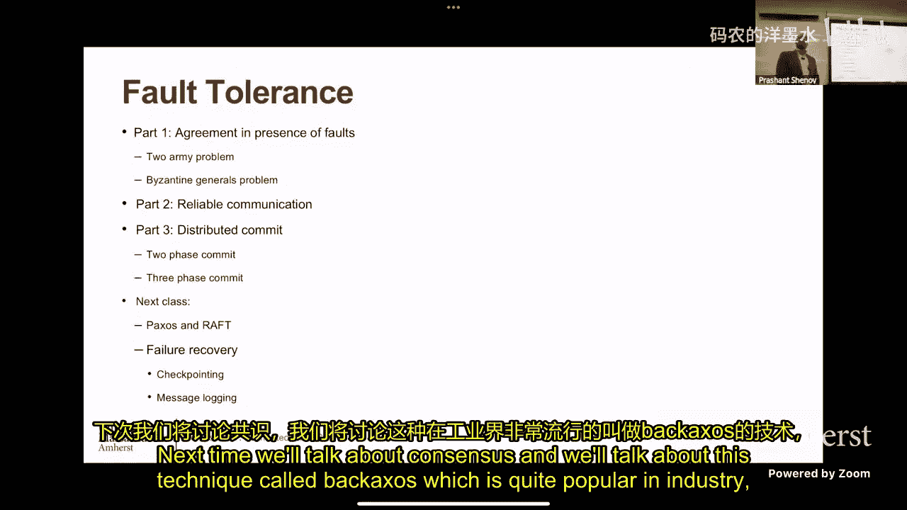

Output and speeds the output to the next state and the water themselves are replicated to prevent the failure of the voting state Okay so every component of this circuit is replicated to ensure that you can deal with failures so well use that concept to now understand how do you do this This is just electronic circuit right so we need to now think about how do we build distributed systems or software systems to incorporate failures of various time right so so。

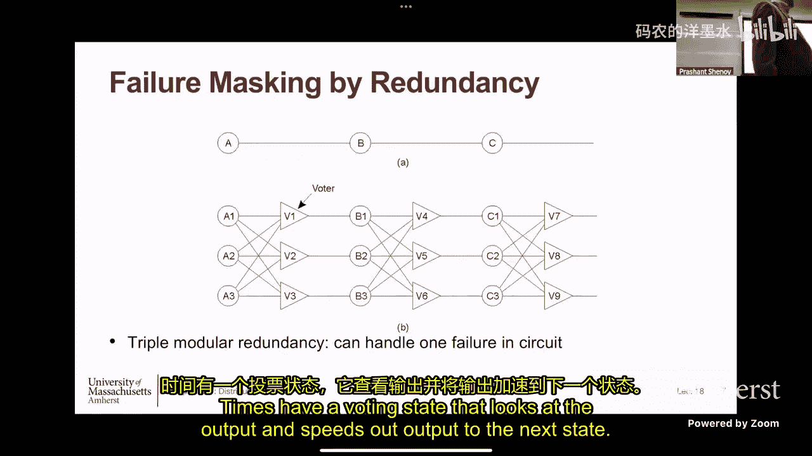

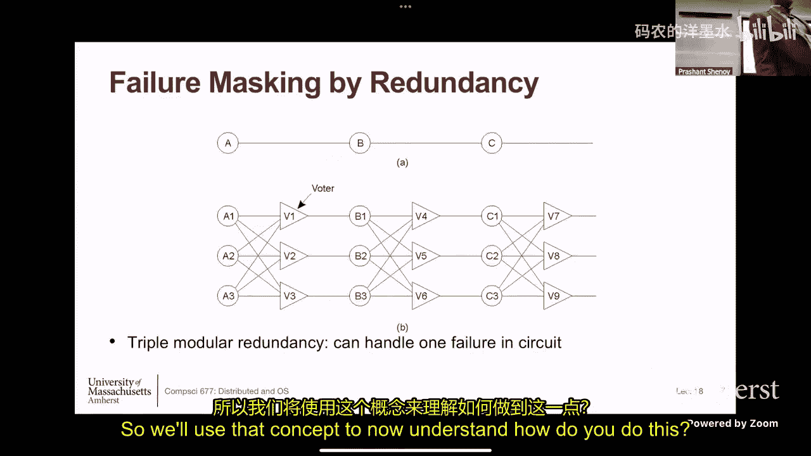

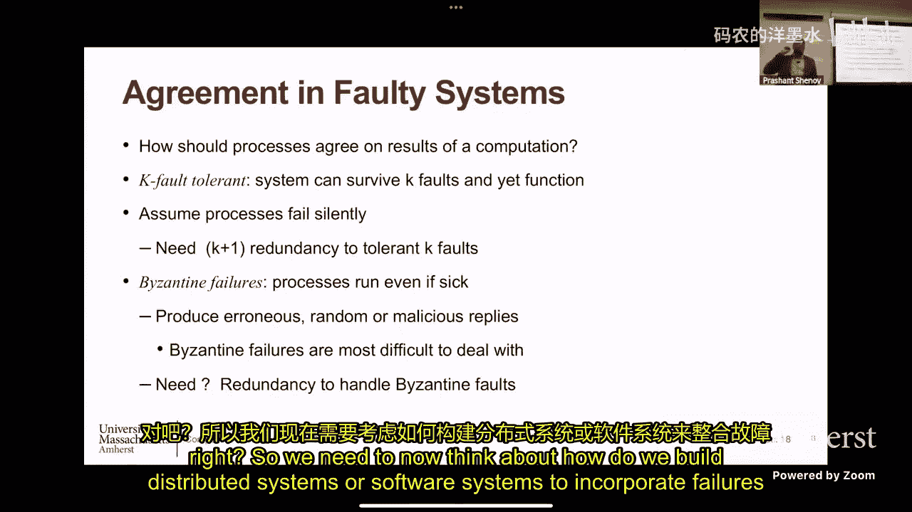

The question we will ask is how should a set of processes in a distributed system agree on the result of a computation the computation could be anything it could just be a request you make to a database it could be an RPC call it could be a web HTP request what that is is not as relevant from our perspective we will assume that there is a computation or a request thats sent there is some response coming and we need to understand how do you deal with failures。

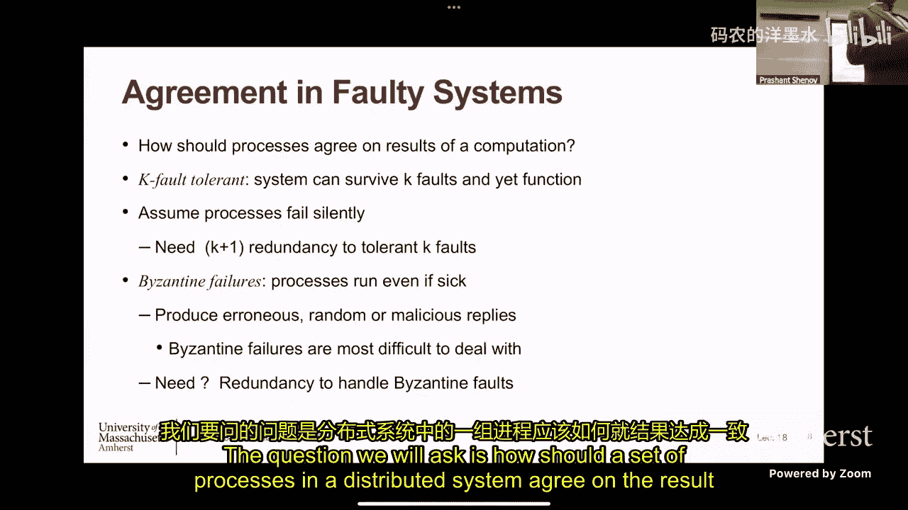

We will talk about two different types of failures the first one is what we will call crash failures and the other is Byzantine failure so so crash failures essentially means that when the application is up and running it produces correct results there is no problem with the results it produces but we also assume that due to bugs okay the process may hang or simply crash in which case it produces no output okay so there are two states a process could be in the process is up and it functioning correctly or the process is crash and it doesn't function at all。

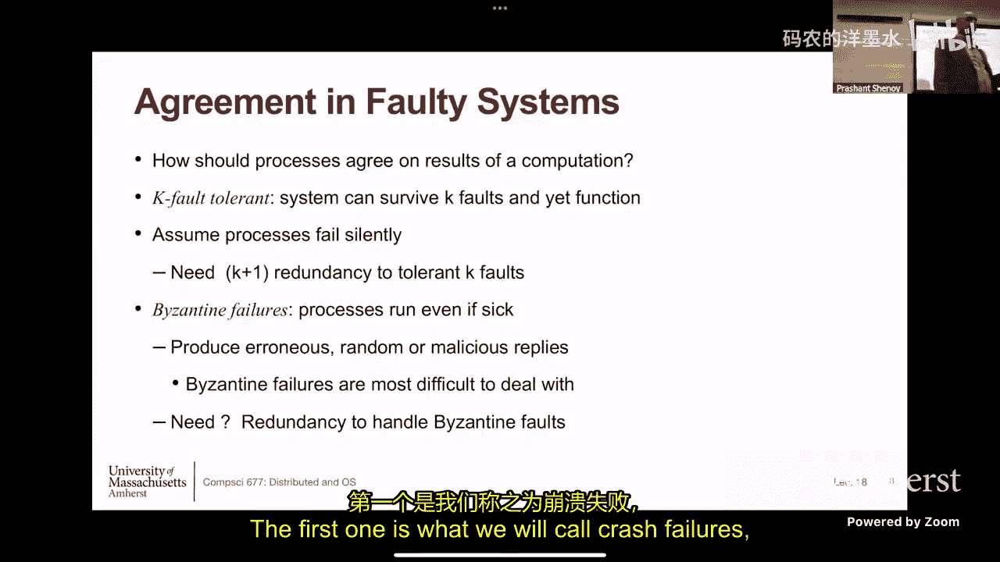

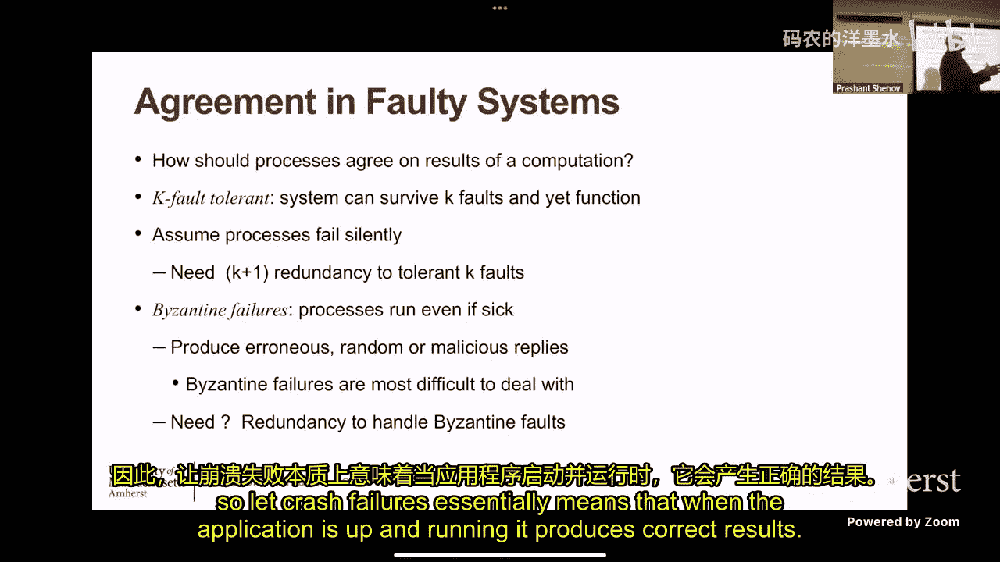

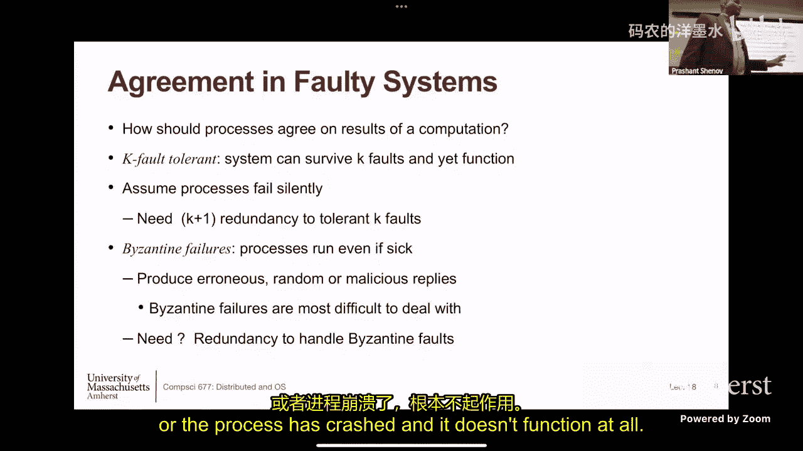

So this is called a crash failure where processes basically crash and then stop functioning so then the question is if you have a system where you want to tolerate k falses of a single component okay we have different components or different processes in our distributed system but lets say for any given component if you want to tolerate up to k concurrent failures how many replicas do you need to handle crash failures how many times should you replicate this process。

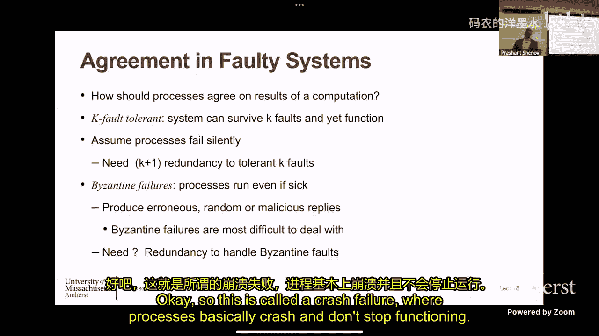

the problem clear what I am saying so essentially you want the system to survive k force and yet continue to function。

So in this case we are assumingsum crash failures which means that processes fail silently and by that that is just a term to indicate you are either up or you are crashed and we will say that you need k plus one redundancy to tolerate k faults so it keep k is1 just as an example if there is a single failure you need two replicas K plus one is two in this case right so if one fails the other is still functioning if you want to tolerate two faults you need three replicas because two can fail and then the third one will continue to run and produce results right so so that is very simple in terms of understanding so if you want to have crash fault tolerance and you want to tolerate k concurrent faults you need k plus one replica the degree of replication is k1 to tolerate k faults。

Okay now let' us talk about a different type of failures which are Byzantine faults okay in Byzantine falls processes can run but produce incorrect results so in crash fault and we said only one of two states either the process is up and functioning correctly or is down and doesn't function now in Byzantine falls you can still have crashes of course but we have other type of problems where the process up is but producing incorrect results maybe there is a bug that is crossing it to produce bad results okay or maybe there is a problem where the the system has been compromise and。

The malicious adversary is causing the system to produce incorrect rhythm so excuse me。

Processes can run even if they are faulty so now you have a problem where you send a request to or a set of components they all produce results but you don't know whether to trust the result or not because the the each component can be present in faulty it can produce bad results can produce malicious results so how do you trust what to。

What result is the correct one right？So， this is called Byzantine faults and if you want to have Byzantine fault tolerance。

 you need a higher degree of replication than crash fault tolerance。

crash fault tallden says k false means k plus1 replica okay we will see that in Byzantine falls I didnt put the degree of replication here I put a question mark but we will see that the answer there is if you want to tolerate k falses you need3 k plus1 replicas。

😊，Wwhich means if k is1 simply to have one process that is  faulty you need four replicas the degree of replication is 4 x which if you think about it as a high cost to pay so you need four machines to tolerate a Byzantine fault of a single machine so that is a high price we are going to pay but we will also see why we need that in today this class。

😊。

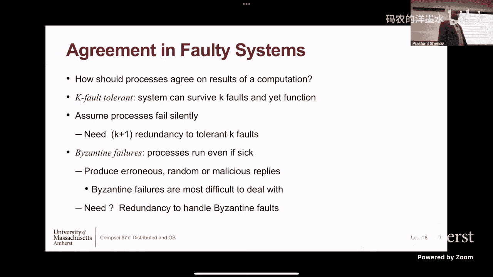

Well， let's start with。我是。A little bit of a deeper dive into Byzantine falls we look at two or three different scenarios so you will start with a scenario where you have two processes in your distributed system and these two processes are communicating over a network。

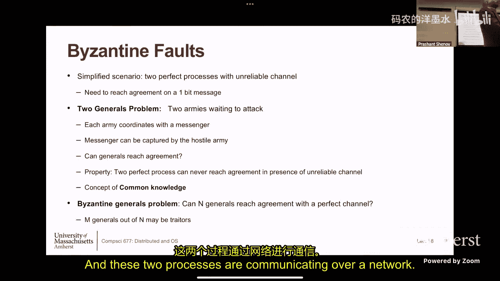

Just two processes maybe it's a client and a server they are communicating our network or there are two components of a server system maybe there are your microservice that are communicating with each other in this case we are going to assume that the processes are simply exchanging one bit messages just to simplify things so either a processes can send zero or it can send one as a message these are the only messages you can send very simple example two processes that can send messages the message could either be a zero or one but we will assume that the processes are actually operating correctly but the network is Byzant in faulty the network actually has falses。

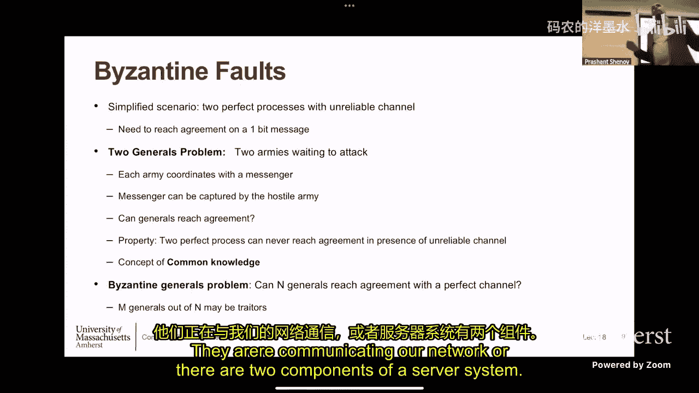

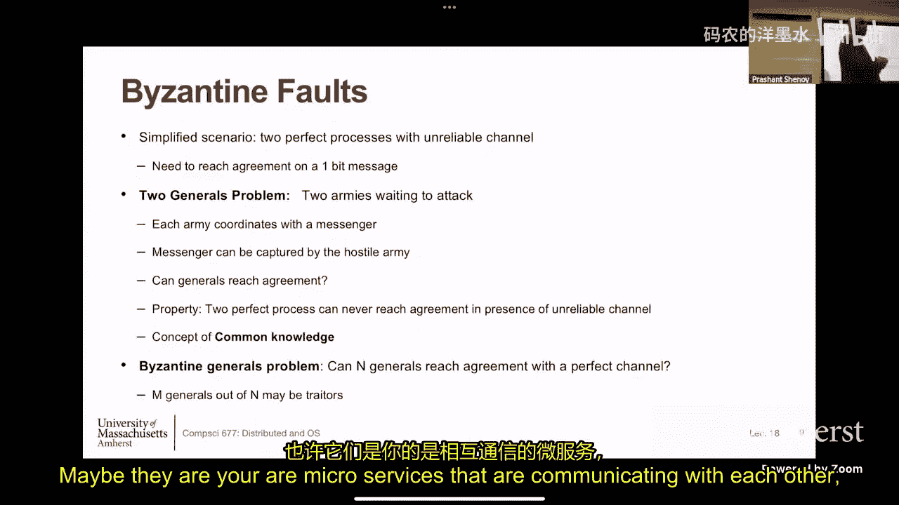

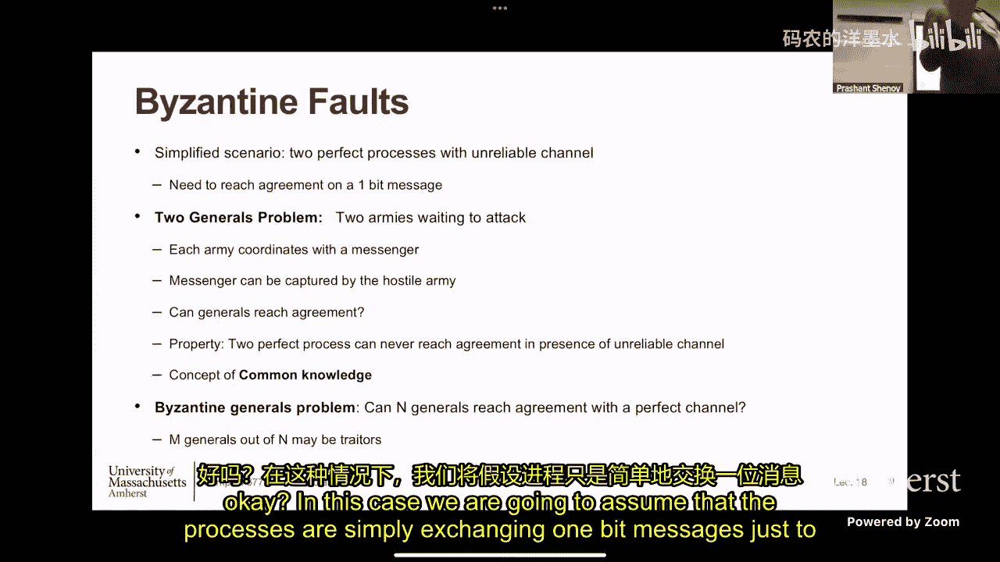

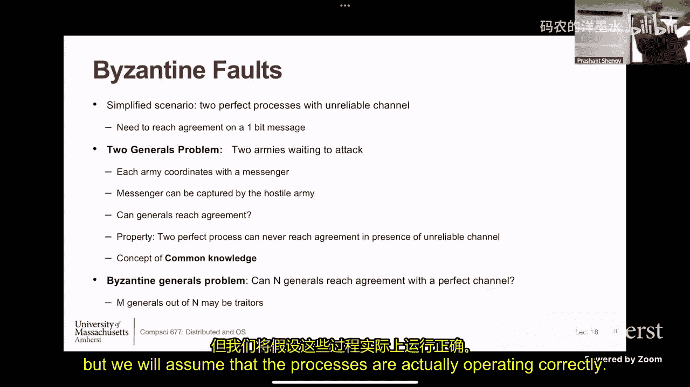

That means if you stand a0， right？😊。

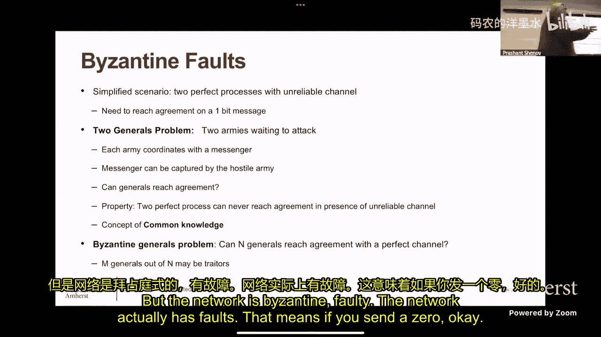

The network may decide to deliver zero which means there is no fault it may deliver the correct message。

 it may drop the message altogether it may deliver nothing you send0 nothing appears at the other end or the worst scenario is you send zero the network delivers one it flips the message。

😊，So， the other end may get no message at all when the message is sent it may get the correct message or it may get an incorrect message and we dont know what the network will do it is up to the network because it is faulty when you send some message we dont know what is going to happen。

😊，And yet we want these two processes to or we want to ask the question can these two processes communicate and coordinate or read some agreement in this kind of scenario where you have a faulty network so in this case the processes is not the problem but it is the network that is the problem。

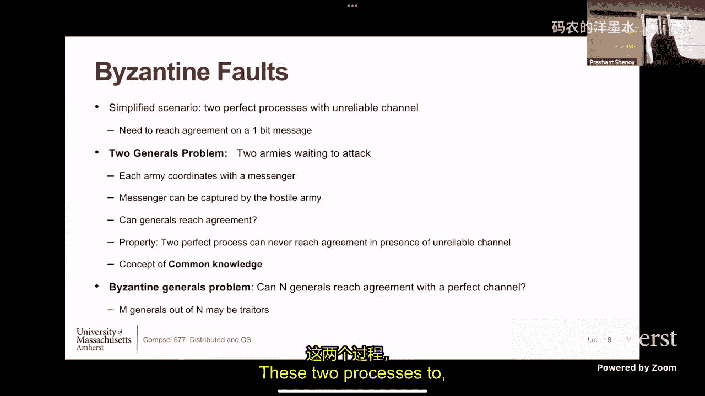

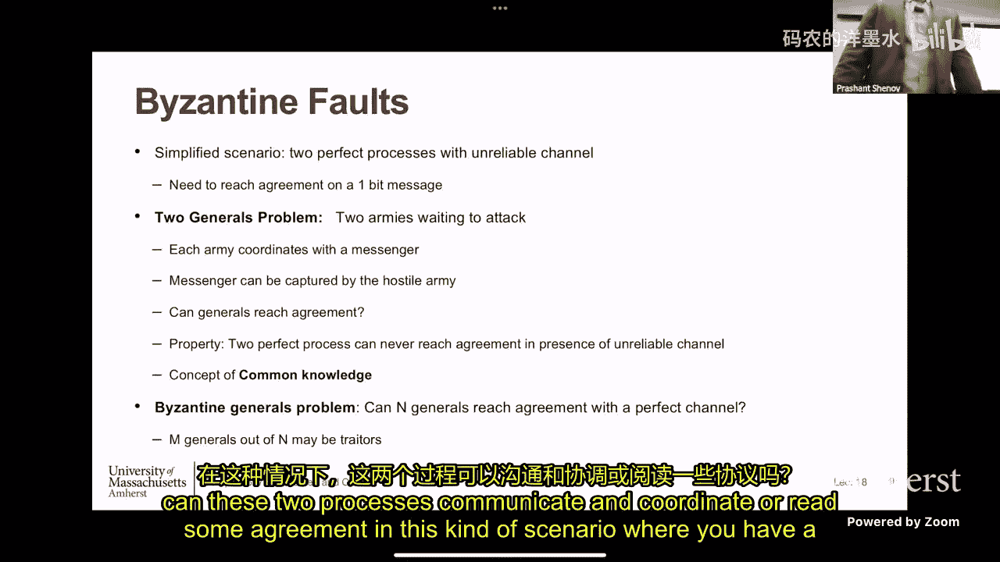

Is a question clear？Now we will try to make this a little more interesting by turning this into a problem that is called a Byzantines general problem and this is the first version of it well see another version so this is the two general version of the problem so here we are assuming that there are armies there is an army with let' us say two battalions we will just call them two armies but it is the same army with two battalions that are waiting to attack and the two generals of this army want to coordinate the time of the attack。

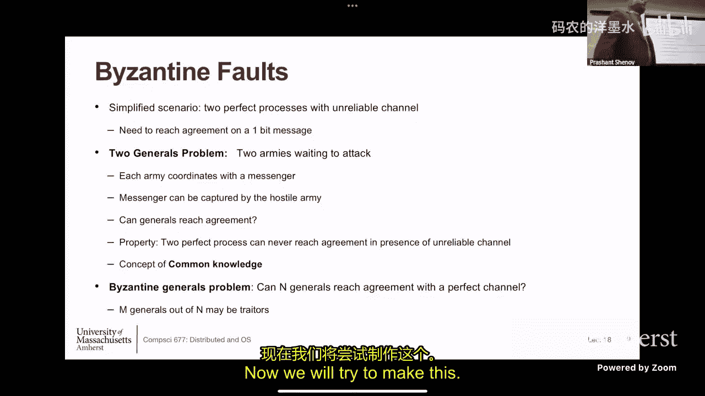

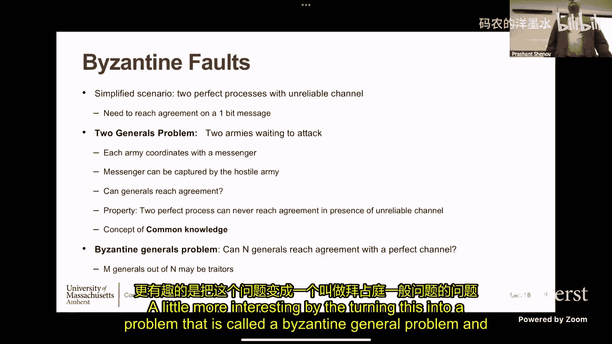

so they want to decide what time they should both attack their common enemy。

And the way they are going to figure out what time to attack is they are going to use a messenger to send messages back and forth to decide on the time。

The messenger will have to travel through hostile territory。

The territory is a network in this case okay so you can assume that anything can happen to the messenger you send a message with the messenger the messenger may reach the other army and deliver the message successfully the messenger may get captured and may never deliver the message or the messenger might get captured and a fake messenger is sent with a wrong message to to the other end so any of these three things can happen which is the exactly three things I talked about in the network case so then the question is can these two generals send messages back and forth and reach some agreement on what time to attack。

对。Is a question clear？Okay， so how are we going to solve this problem？Any thoughts。

Okay so we can send a large number of messengers and try to get some majority。

 but we got to come up yes we will do something like that， but not exactly as you will see。

 but we need to know how the message has been actually delivered successfully because the key question you should ask is how do we know how do both those generals know that they are agreed on the time？

Okay so， let us just take this as a simple example。

 lets say that we will call these two generals A and B or these two armies A and B a sends a message to B to this messenger saying let us launch an attack at 9 a。

哎。So let us for just for example， assume that the messenger actually reaches the other end successfully and delivers the message。

😊，so now B knows that you are to attack at 9 AM。

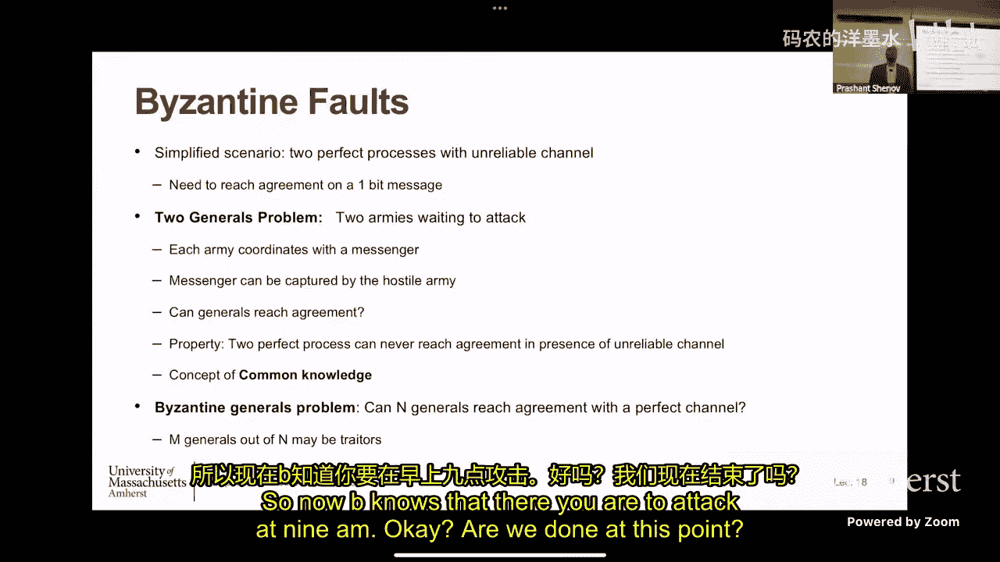

Are we done at this point？Is there agreement that we a said let attack at 9 sent a message to B。

 we received the message。

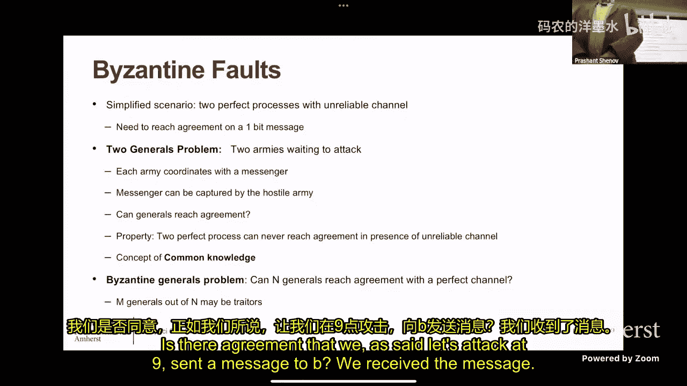

But you want to attack it。Yeah， so we have to send an acknowledgement。

 why do we need an acknowledgement？

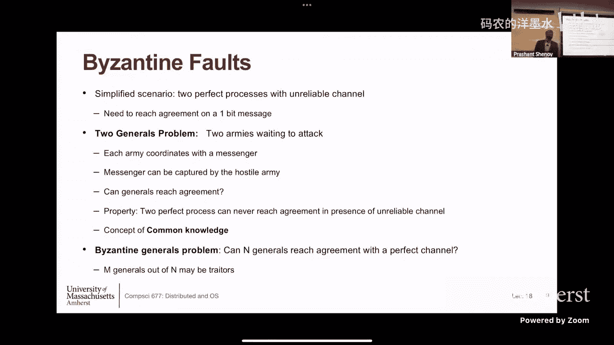

so a needs to know that the message was received because you said it is a hostile terrain right just because you sent the message there is no guarantee the message will be received just because in this example I said the message is received a doesn not know that B has received the message。

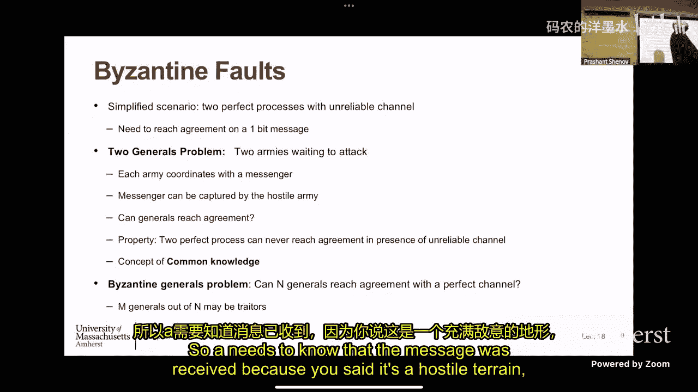

All right。😊，So then what do we do we send an acknowledgement。

 acknowledgement is messenger comes back saying I delivered the message。😊，一でな。Yes。

 so now let us assume again message is lost we have a bigger problem。

 but let us assume the messenger actually reaches the other egg。😊。

Comes back to a and says I went to B I delivered the message and I will come back with this acknowledgement saying I delivered the message so now a knows that B has received the message and that the message was delivered successfully。

😊。

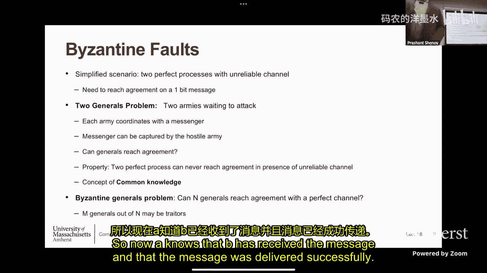

Okay， is this it， are we done now so we can launch an attack？But you especially important thing。

Yes so question is there a potential for the message to be modified yes I said that the message may never reach the message could be modified anything can happen in this case A has actually received the acknowledgement back the messenger came back。

你们。So， it could be a different message， but in this example I just said you received the right message if you receive a different message a bigger problem but I am just saying lets assume that you received the acknowledgement。

The question is， is this have we reached agreement does a know that it is now safe to launch an attack because you sent the message and got an no。

W。In a fully adversarial case。I matter how many time to send data acknowledge。

It was changed by happens every time。Okay， so。In a adversarial setting you can actually not know what has happened you can send the message back and for multiple times and still not know that that's what youre saying right yes so let me try to break what that down so let's just take this case a sent a message to B delivered it successfully messenger came back and said I delivered the message so a now knows that B knows。

To launch the attack at 9 a。 but how does B know that A has gotten acknowledgement？

B does not know that because the messenger could have been captured in transit and then B doesnt at this point know that A has received the message so it cannot figure out that it is safe to launch the attack because all B knows is you got a message you send an acknowledgement don't know that A has God so what will we do we will recur you will say okay you can go back and deliver an acknowledgement to the acknowledgement。

Okay so let us again assume that the messenger has reached B okay so now B knows that a got the acknowledgement to the original message。

Are we done？You are not done because a will not know whether the message was received so you have the same problem right every time you send an act to all the previous messages you do not know that the message was received at the other a。

Okay， so， so you can。Do this in finite times and yet there will be no agreement you are sending acts and act back and forth。

 and yet you are not agreeing that yes， we should launch an attack at 9。

so so this is an impossibility result the result says that two perfect processes which means that in this case the generals are actually reliable they are not traitrs can never reach agreement in the presence of an unreliable channel the network is faulty which was the same as saying our terrain through to where the messenger goes is hostile and the messenger can get。

😊，Captured or bad message can be delivered， you cannot reach agreement。

So this problem cannot be solved。And the other thing I want to mention is this。

Tm called common knowledge common knowledge is basically a term and distributed system it says that what this this information is known to everyone and everyone knows that everyone else knows it so here we are trying to achieve common knowledge which is that a and B both know that the other party knows that you are to launch an attack at 9 a and that every the other party also knows that I know。

So in most cases either I know and I know that they know but they don't know that I know so you are basically recursing and not reaching common law so this is the very famous impossibility results and you cannot solve this problem there is no way if the network is unreliable can you actually solve the problem。

Yes， question。对。下会。Okay， question is， why can we tolerate not tolerate rely on TCP to do a three way handshake。

 so TCP is not trying to solve the Byzantine faulty problem。PCP is just setting and。

Channel between two endpoints， but you are not trying to reach agreement so this is a more complex problem right this is not you are you are not trying to achieve message delivery。

Message delivery just requires an acknowledgement。You are trying to actually reach agreement which is that I know something and I know that the other party knows something and they also know that I know something that's a different property youre trying to achieve then just establish a connection if you just establishing a connection for message delivery a three way handshake is fine I set up a connection you send an acknowledgements and you set up a connection the other way we are done at this point we are not trying to reach agreement right this is a different problem so that is this is why a three way handshake or n handshake where N goes to infinity still does not solve the problem。

This clear。Okay so we will now so this we cannot solve so we will say this is hopeless let's not worry about it let's now solve a different problem we will now assume that the network is not the problem anymore let's assume we are TCP TCP gives us a reliable channel so we don't worry about it tCP will take care of network retransmissions and and corruption of packets in the network etc ceter so we know now we have a reliable channel for our application but lets say now the generals are the problem one of the general is a traitor。

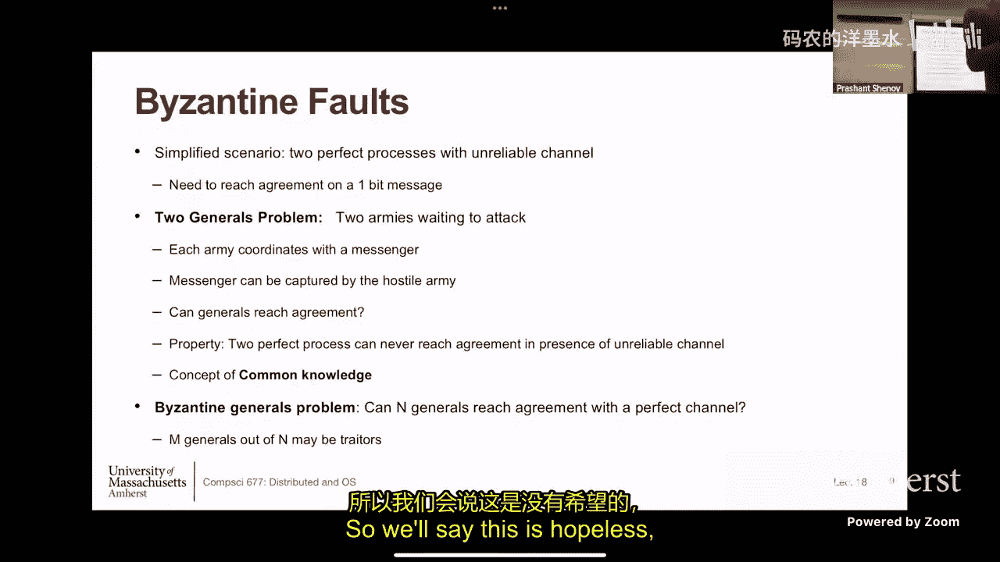

So we have n generals in the in the broader cases where m out of n generals are traitors。

In this example we have four generals1 through 4 the gray one which is number three is a faulty processor that is a traitor so what does that traitor mean so in this case the messages are going to go reliably but when the messages are exchanged the traitr can send bad messages。

It can send incorrect message， sometimes it can send the right message。

 sometimes it may decide not to send any message， sometimes it can send incorrect message。😊。

So question is in this case。😊，When we reach agreement agreement means you have to other other generals have to identify who is the faulty process or who is the traitor and then the rest of them still have to agree on something。

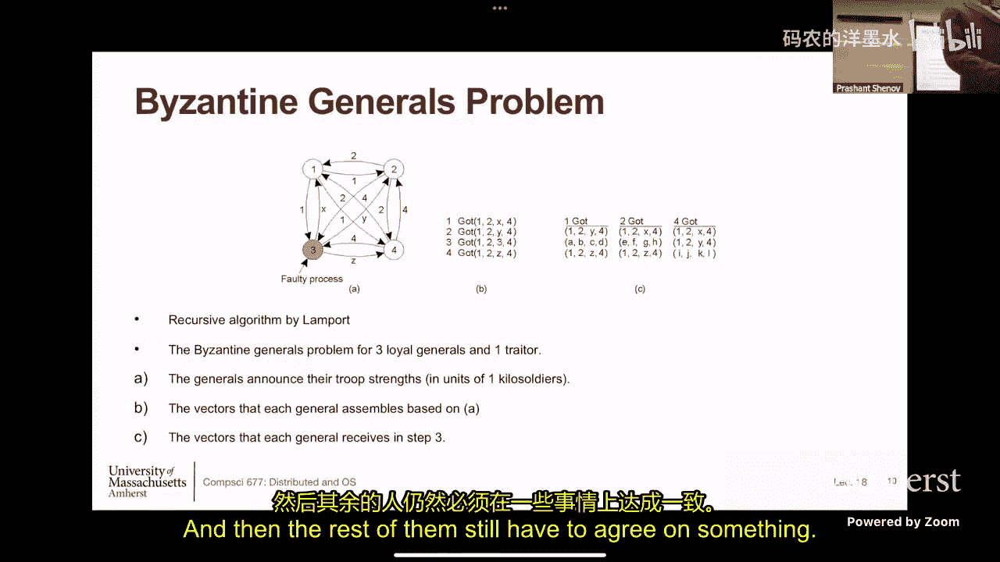

So you want to identify the quality process， eliminate it from the decision making and reach a decision。

😊，Okay， that here。So three loyal generals， one trader。

Well change the problem slightly here in that we are not going to decide on what time to attack but lets say the generals are exchanging how many soldiers each of them have to launch an attack doesn't really matter what the messages but but this just makes it easier to understand so you are sending your troops strength in the number of kilo soldiers is in this thats how many thousand so soldiers do have okay so for simplicity will just assume that general one has 1000 soldiers2 as 20003 as 3004 as 40 so they are supposed to send one to3 and4 as their messages to the others。

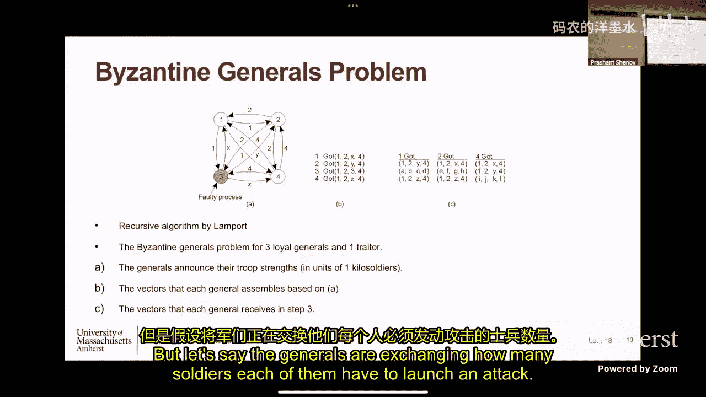

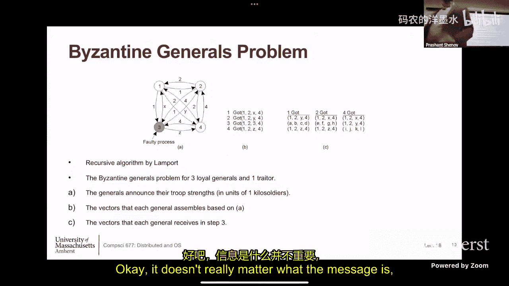

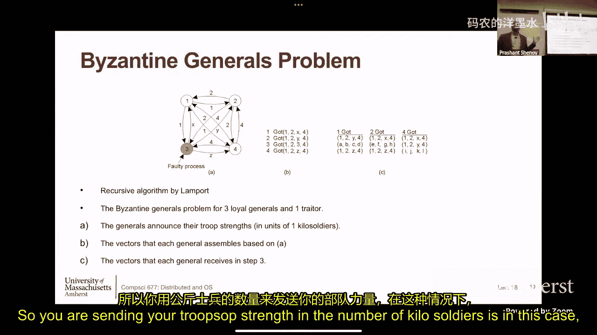

so well now essentially develop a technique where each soldier is going an no soldier extremely me each general is going to send their troops strand to the others and we want to reach agreement where you know everyone else's troops send and you know you are so you know how many soldiers you have in the Army in the aggregate that is the problem you are trying to solve that is the agreement we want to get okay so one is going to send message one to the other three and that is going to go through fine it going to reach the others two is going to send two four is going to send four but three can do whatever it wants it is a Byzantine faulty process so if it wants it can send three or it can send three different numbers to three different generals which is why we say it sends X。

Y and Z okay these we just call them variables because they can take any arbitrary value its a Byzantine 40 plus it can send 3。

 it can send 3 four5 it can send whatever it want okay so we don't know what it is sending so it just sends some arbitrary message they may match they may not match we dont care we need to still figure out how to reach a。

So at the end of round one okay。General 1 gets 1，2， x and 4。As the vector so it knows it has 1，2。

 cent it2，3 cent it x，4 cent it 4。2 is going to get 1，2， y and 4。哎。

3 is going to get  one23 and 4 it gets the right messages it knows how many soldiers it are so three is not is faulty but it actually got the right values and 4 is going to get one2 z and 4。

Okay。So， this is what happens at the end of round one so at this point we are not reached the agreement we just got the first set of messages where each general said this is the amount of soldiers there。

now what we will do is in round two we will take those messages and send them back this is like sending acknowledgement right so we want to say I got these message so instead of sending an acknowledgement you will send the each general will send the vector it receives back to everyone else。

So one is going to send one to x and4 to all the other three and so on and so and but three can again do whatever it wants okay it will send some arbitrary message in this case instead of x y z let's say it is going to send aB c D or something like okay which are variable so that can be arbitrary so in the round two this is what you will see you will get vectors from other so you will get one will get one to y and 4 from2 it is going to get aB c D from 3 and it is going to get one to z and 4 from4。

嗯。In two the same way， okay， but it will get 12 x4， he will get some other garbage values， some 3。

 12 z4 from can then4 is going to get similar values。

is this clear so at this point you will you can identify that the well because you have now this vector you can see that whatever3 is sending is not matching。

😊，Because you are getting the others are telling you three cent some value they don not match。

 but one and two。

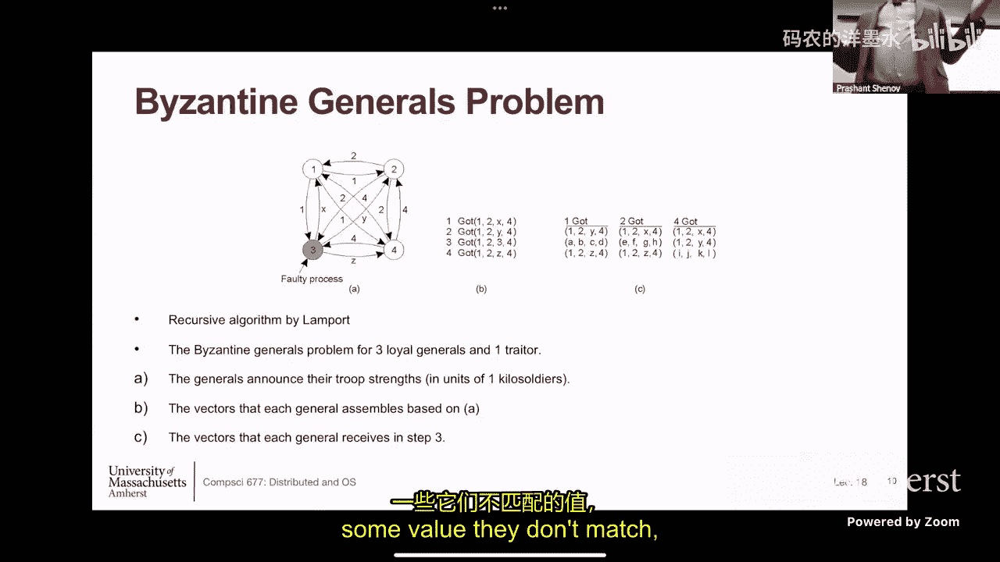

And four are actually matching， so you know now who is the creator because you identify who is sending bad values。

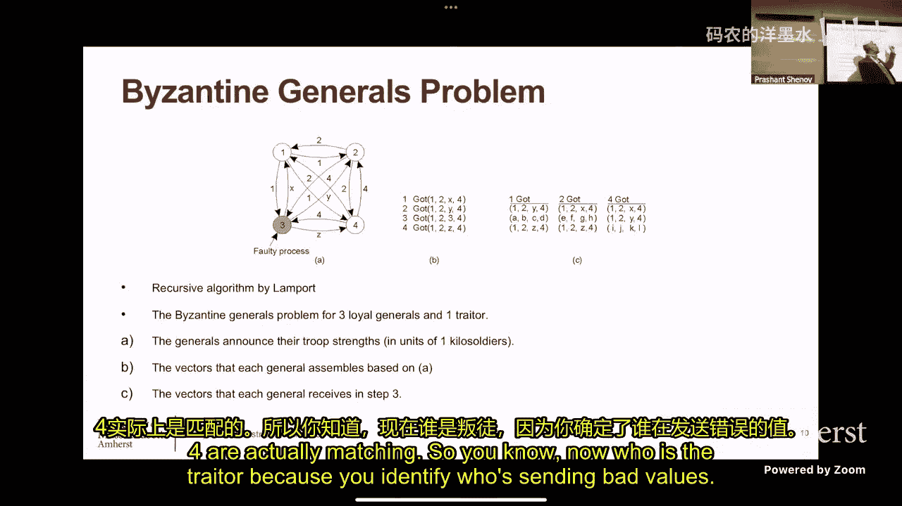

Okay， because that column and that row will not match。

But the others are sending consistent values okay so now you identified that3 is a traitor it is sending bad values so you can eliminate it from the decision making and then one to and 4 can take their values which is one2 and 4 in this case and say that is the troops and then you cannot actually rely on three in this case。

😊。

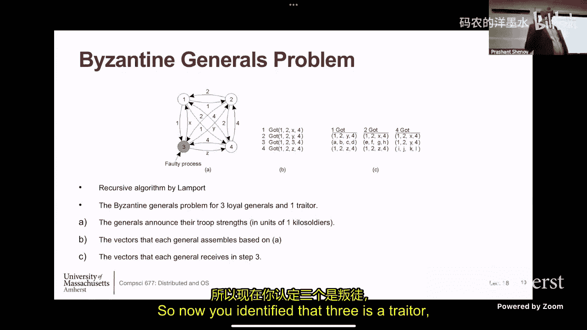

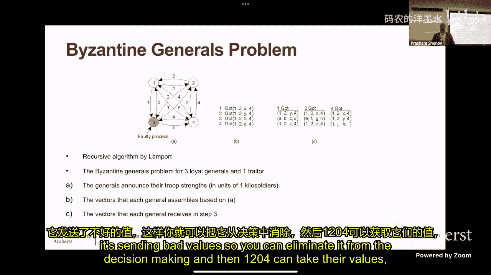

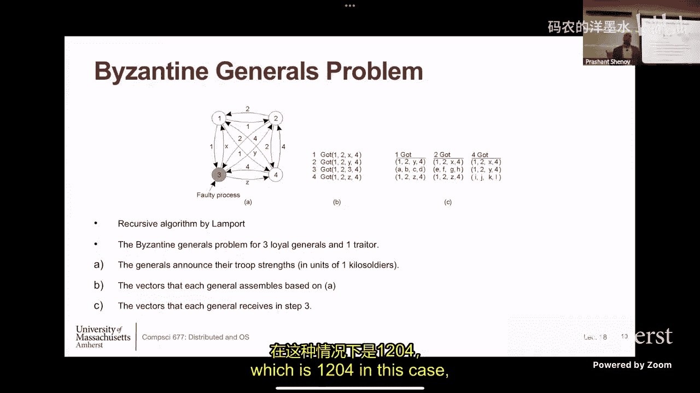

That clear。So， in two in this case in two rounds， which is like sending a message and getting an acknowledgement。

 you could identify the process that was sending bad messages。😊。

Okay because what happened is you had everyone send a message and you had everyone else tell everyone else what message they received from others and because three signed different values to everyone else you could identify that because others told us is what three signed to me and you can figure out at sending different values to different processes。

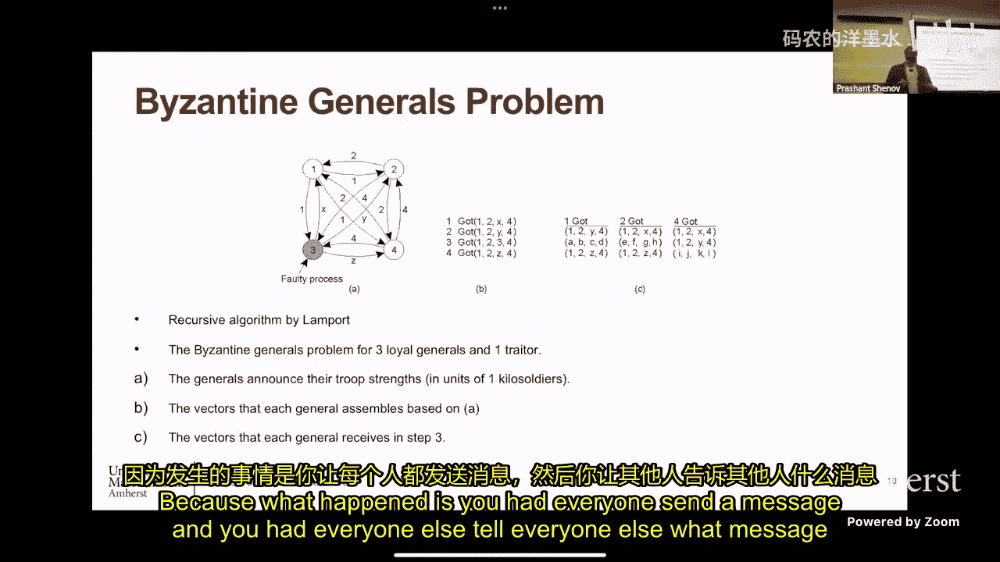

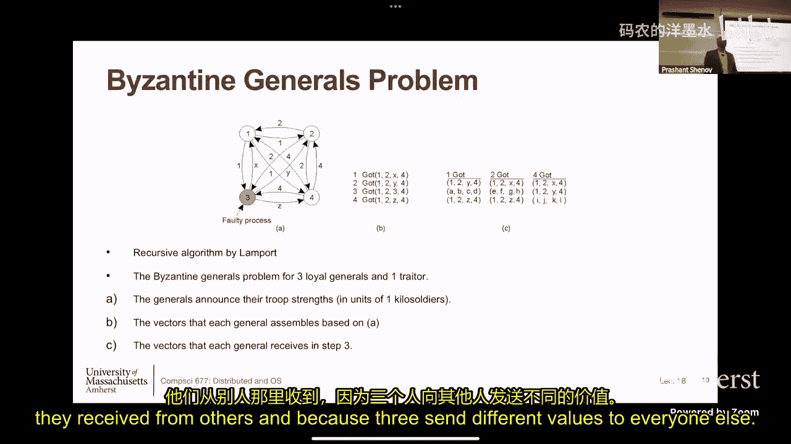

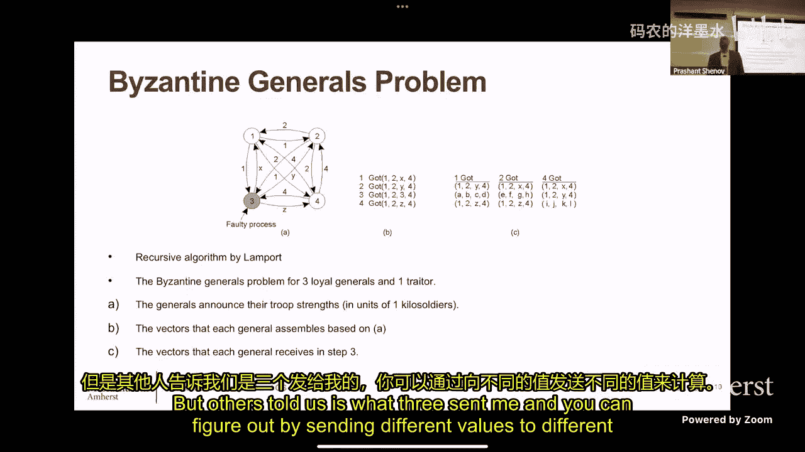

And then you can essentially get rid of three and reach agreement。这个。怎么。

What if it's in song same wrong value？In this case that doesn't matter because you will see that they match so because the point here is not to see that the value values actually mean something lets say this was a computation right you said what  two plus two or something like that right so three is sending some garbage value so you know it doesn not match。

So yes it could send the same wrong value but if the match in this case we dont care because we assume that it is actually doing sending consistent we are more worried about in this case sending the same consistent message then the actual value of the computation but if this was an actual computation where you are sending requests that would matter then you will know that it is sending wrong results because the other say two plus two is four and 3 is saying some garbage。

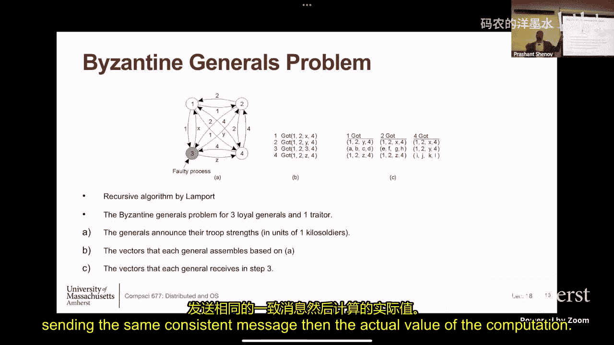

Okay。Is that here what we just said here？this is called the Byzantine general problem and essentially what we have done is identified a faulty process eliminated from the decision making the other three are voting effectively by saying what we each of us see and what should we agree on。

😊。

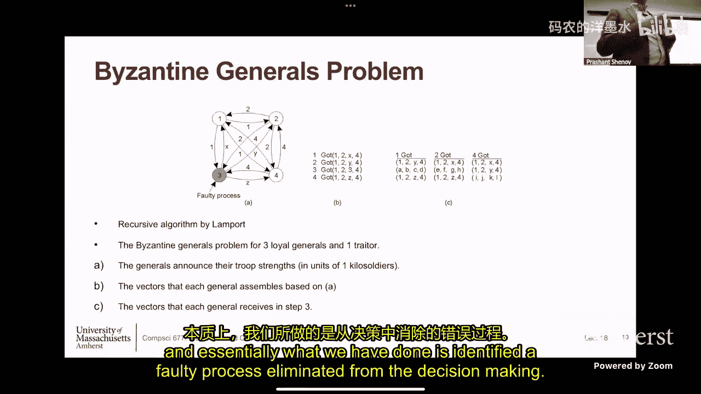

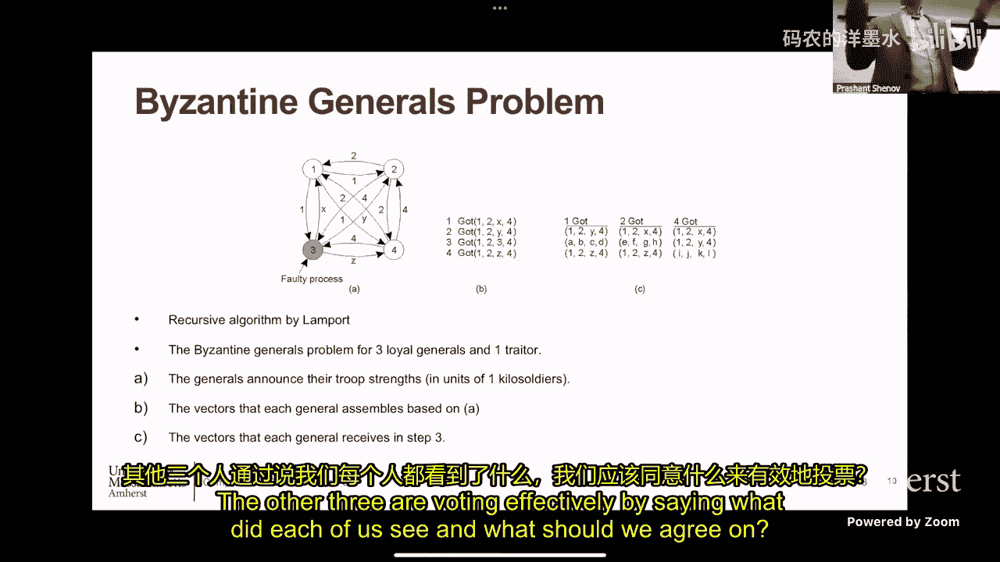

and then you can get to a situation where you can come to agreement which can figure out what what to do yes question。

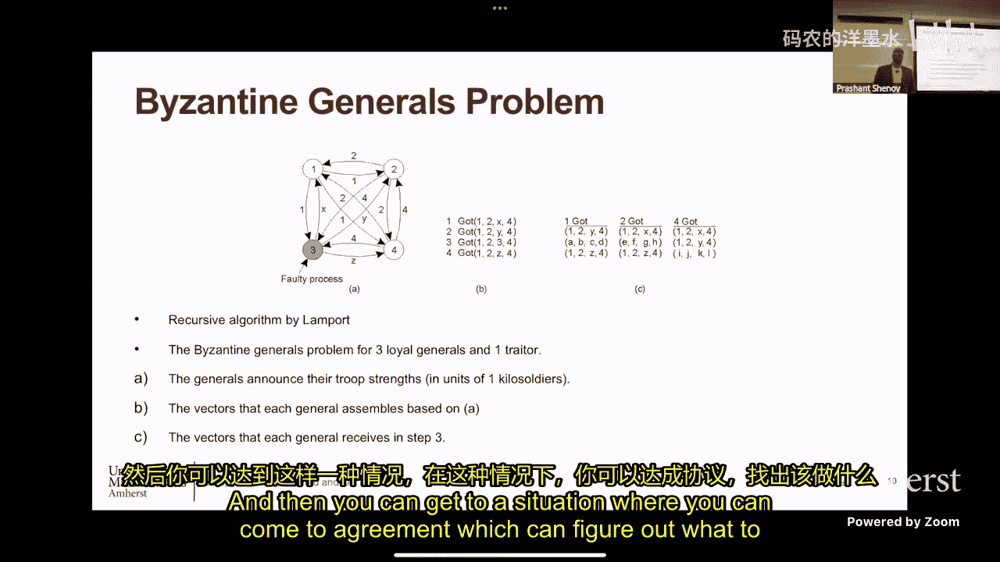

第。

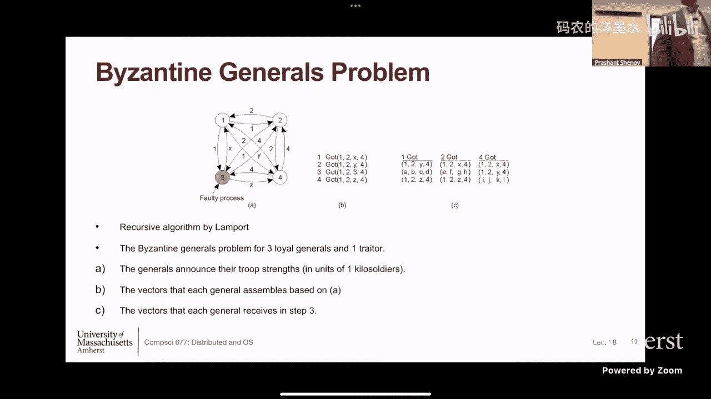

3 will also get three sets of values， but we don since three is faulty。

 it is not actually going to have one two and 4 listen to what it is trying to say。Right。How decide了。

So question is if three grades three sets of values how do we decide which is fault0 so let's take one perspective this is the vector that one got okay just looking at these vectors what does it tell you so you will see that12 and4 are matching across these two but this row and this column dont match which means that whatever three sent it and whatever three cent to others is not matching。

so you eliminate that and so one can figure out that2 and4 are reliable processes it assume it is reliable but it knows that three is not reliable two can repeat the same process it will reach the same conclusion and4 can repeat that process it will reach that conclusion so each general is cannot depend on two others。

In13。Okay。Yes。This is different the first time。 but the next day， we need different。So that case。

 how would we know which one is actually going？Okay so the question is if two send different values the first time and it send the same value the second time what happened right so it shouldn't matter because x y z other A BC D and X and Z are variable they could be same they could be different if there are any difference between any of them there will be a mismatch you will see that whatever three sending is not matching。

No he sending 1，2， Y4。 Now it look like me and。What once in a。

Can you repeat what what three is sending， are you second talking with the second round or the first round for second okay。

好で时。Right so y y z will not match because it will tell you that3 send y in the first round to2 and send z in the second to the third one。

you are to send the same value to everyone if you send to any different values you can figure out that three was actually not sending the same values。

But what do I do like both I said。Butush you are saying would it look like the fourth one and the wrong value。

 you are actually looking at fourth column to see what its values。Okay。

 this is just this is just for telling you what three cent as far as4 is concerned you only look at the fourth column。

 not the third column。Yes。That。8。But it consistently sense the same result。

The question is if three send an incorrect result， but it's the same result this would not work okay that was a question that was actually asked earlier in this case we are just asking it to send the number of soldiers it has right so so long as it's consistent we are just believing it but what you're saying is correct in that if three cents the wrong information you will get them to believe the wrong thing but the answer to what I you said is suppose these were not send me how many soldiers you have but I send you a request and say send me the result of two plus2 so you perform a computation and you send the result in this case if you actually send two plus two is5 and it's consistently send5 but the others are saying two plus two is four then you know that that's which one is wrong so when you do computation you send the same request to four replicas and say give me the answer and then you run this protocol and figure out which ones are right and which ones are wrong。

对。Any other questions here？Okay， so we will now so this we did with four and we could figure out which one is the traitor lets repeat this with three。

 so， in this case you have three is still the rate。

 but there are only three generals in this case one。

2 and 31 and 2 are sending correct values and three is sending garbage value。

Because there's Byzantine faulty。So again we will do the two round protocol right so at the end of one first round 1 gets 1 to x2 gets 1 to y3 gets 1 to 3 because it knows its own value and then you say each broadcast this out okay but at the second round1 gets 1 to y from 2 and it gets aB C from 32 gets 1 to x from1 and it gets D F from 2。

So now you know that。You as in one and two know that there is a mismatch because these values are not matching。

But you don't know which process is faulty。Which process and of garbage value is not clear because is this ABC the correct value or one to y is the correct value you dont know？

because they just don't match in the previous case you actually could look at others saying that there are there is one24 was matching for these two vectors so you could say these are correct and this is wrong in this case one of these is one of this is correct and one of these is wrong but you don't know which one。

😊。

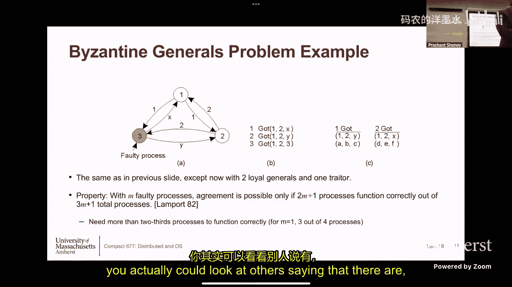

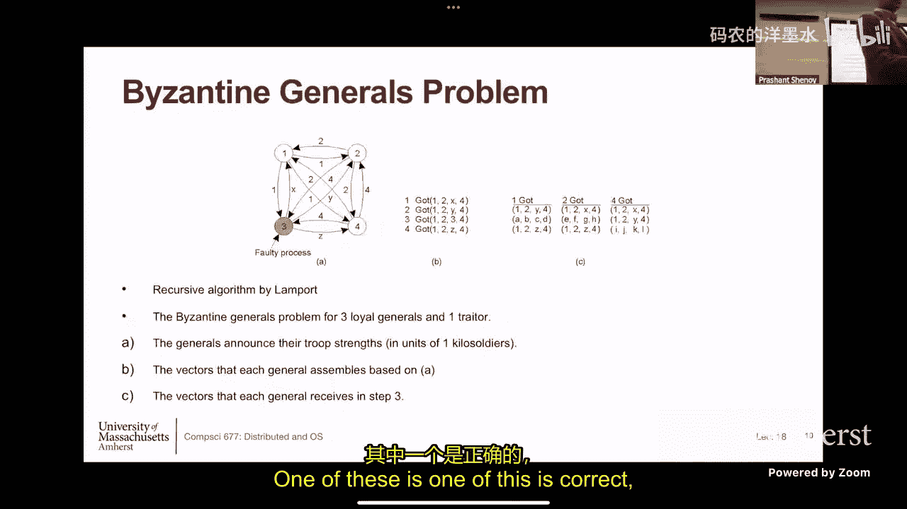

so you cannot you know that there is a fault， but you don't know which process to trust。

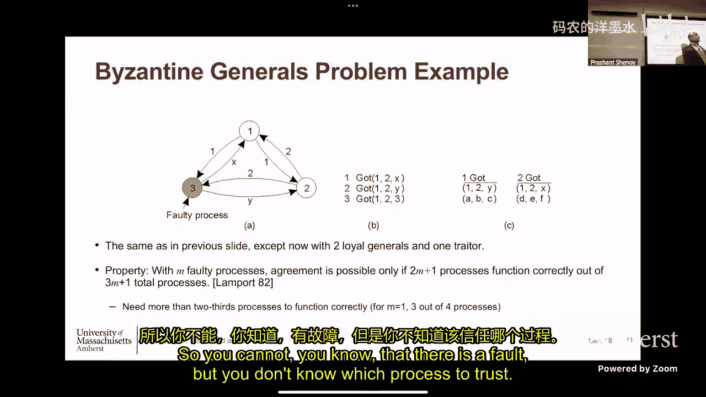

That why its like you are two friends， you ask them something。

 one of them lied to you so the answers are different， but you don' no like。

Right because they are just getting a different answer so same thing is happening here。

 one is hearing two different answers from two and three。

 but it doesn't know what to believe in this case。

So， you cannot in this case， reach agreement。You can figure out there is a fault because the answer is nott matter because if you say what 2 plus 2。

😊，You are essentially going to get two different answers on these two but you don't know which one too I mean of course if its two plus two you can figure out but lets say you are doing a database query and youve got two different results you don't actually know which one to trust。

Okay so this is why you need four processes not three if you have three then that is not enough degree of replication of three get you a fall to state where you know there is a fault but it cannot help you figure out what the fault is just question。

So。就是。That we're in it。Essentialralized system we need3M plus one if we have a trusted coordinator then we could produce this plus one Yes the question is if you had a trusted coordinator you only need the other three and the trusted coordinator can vote but we have to still count a trusted coordinator as one entity in the process so you still have yes you're absolutely right if you added another process here and there was a coordinator you are just voting and two out of three match that's still good right but you still have four elements in the system which is why no matter how you see it you still need four but you're right if youre a coordinator you need three other replicas but there is a coordinator which still counts as one part of the system。

Okay。This clear okay so this is all Byzantine fault tolerance so this should tell you that the theorem that you should have in mind is first thing is we can solve this problem as opposed to when the network is Byant in faulty you cannot solve the problem at all right so when the processes are faulty。

The good news is you can solve the problem and if you have M quality processes。

You need essentially3 m plus one total processes in the system to deal with it okay so when m is one that was four processes okay that means you has one traiter you need four processes there are two faulty processes okay that is essentially seven processes so seven degree of replication to deal with two fault so you will see byzant in fault tolerance is very expensive okay if you say design a system to make deal with byzant in false to just have one component fail and be byant in faulty you have to by four machines you have to have four degree of replications so cost of your system has increased by factor of four。

as opposed to crash faults I said k plus1 right that is very straightforward if k or m plus 1 which is if m is 1 you need two machines which is easy one fails the other one continues to run so that is much cheaper for crash fall all and this is very expensive so many systems will not actually implement byzine fault tolerance。

😊，But this is the that。😊，Number of replicas you need where this has become popular is things like Bitcoin and cryptocurrencies where you need that high degree of assurance that where you have financial transaction so you will pay that price but for a web application typically not and you are not going to have four machine just to deal with one fault or you will assume that only cash fault need to be handled there are Byzantine fault then there are you will not handle them at all。

Just clearious。全不。Okay， question how do we know the number of faulty processes in the system so this is going to be not known this is what you design the system for。

So the developer has to say， I want to design the system。

To deal with k equal to one fault or two fault， and then you decide how many。

So if you are more than that， which is possible system will not work the system is only guaranteed work so long as the number of faults is no more than m。

So that's what you designed it。So you are to think about that and design it in the right M。Okay。Yes。

The question is。Then you're querying a database or sending requests。

How do you know the number of falses less more than。

 so you will not know that that's what I'm saying。If you have a system designed for M falses。

 it will only work correctly if there are at least。

M false right if more than m falses it will still produce some results but at that point the results are not trustworthy and you will not know because that is what you designed it for。

Crash fault tolerance is easy crash fault tolerance means you dont produce bad results either produce correct results if you are up or you crash and produce no results at all right then crash fault tolerance if you have more than k falses your system stops working because you basically if your cable plus one replicas now more than K falls when all machines crash and system doesn't work right so thats the same kind of stuff you will happen here of course you can have more than m falses but if you did not design for it up prior at that point you cannot not have fault tolerance guarantees。

What is the benefit of choosing threshold first thing is most systems will barely stick to m equals1 because anything more than that gets very expensive but yeah the general property says you can pick whatever number of fault you want and the benefit is higher degree of M means that your greater degree of fault tolerance in the system。

So you can tolerate bigger problems that can occur maybe there is a you know earthquake and lots of things get destroyed maybe multiple data centers go down but there are some distant data centers that are still up so you may have more than M machines failing at the same time so it all depends on what kind of failures right it could be network outage power outage natural disaster many of these can or an actual hack into the system can also make things present in faulty。

You have to design for this。对。Yes。个应该的施工。就 that one。我で话。管理。But7。

Right so the question is why do you not need simple majority so the way you want to think about it was the question that was asked earlier right so so lets say you have one voter that is just taking words and others are the ones that are actually sending answers。

So if you have one water， you need at least three machines so that the other two outward the third one。

Right now you can actually now let's say you want our two faults you are saying I need m plus 2 is that what you just said m plus yes so if if the water doesn not fail that is correct if the water is not faulty then you need m plus2 but any two components can fail in this case right so you need to make sure you need to deal with these types of problems。

Okay， so which is why you get to 3 m plus one， which is a lot of replication。Yes。Yes。关系。

You dynamic fund the results。So question is。Can you detect which machines are faulty based on results being inconsist。

 is that your question or no？

Okay的。の产げ。我 whatever probably theres more。

So if you have more machines and I am failing， you can't detect it。

Because they can give you bad results and you will be back to this problem where they will not match so you know that there is a problem but you don't know what is the right answer。

know that is yes so you will need to know so if if you only want to detect failure as 2 m plus one is good enough if you want to handle failures and actually produce answers 3 m plus one is this right so if you have greater than m so long as that M is not much larger you will see that there is a problem because your results will not match but you cannot produce an answer in that system will stop working。

Because water will not be able to figure out what is the right answer。

Okay all right so that is Byzantine general problem it is a classic problem in distributed systems that deals with Byzantine fault but here is basically what we discussed and these are the properties detecting a faulty process okay2 m plus one or 2 k plus one for。

M false okay so that is just saying I need to detect that something has gone wrong。

 not necessarily produce an answer， but if you want to reach agreement which is I detect isolate the faulty processes and produce the correct answers 3 k plus1 okay two third majority is needed always to deal with k faults。

high degree of fault so implication on real systems quite expensive so you better have use cases where you will pay that price as I said。

 the place where this has become widely deployed is things like cryptocurrencies where you have a distributed ledger where you are writing entries but you want all the entries to match and whatnot there you don't want faults or you don't want somebody to be stealing money and things so thats sort of that's where you will pay the price or many other applications they deal with only crash falls they will have much lower degree of replication typically not Byzantine faults。

So that's the kind of design decisions that are made in real systems。

Okay so we will switch gears if there are questions we can still talk about them otherwise we will switch gears。

 talk about communication okay and then we' will talk about distributed come which is the last part okay so this is something we have somewhat encountered when we talked about PCP sockets and things of that sort we will remember that when we talked about RPC semantics I had briefly mentioned there are quite a few problems that can occur when。

The client cannot locate the server， the request message is lost the reply message is lost。

 the server crashes， client crashes after sending the request and we had some techniques which we talked about in lecture3 that said how do you deal with lost messages you do retransmission。

 what happens if the server crashes you wait for keep retrying until it comes back up the client crashes then the server can just stop processing the request not send reply so we talked about that while back actually in lecture three will let's assume that we know that material and we now talk about other types of problem not just messages getting dropped which is what this basically told told us to so in particular we will now talk about one to many communication which we have not looked at so far we only talked about one to one which the client sends a message to server server sends a reply and so on but there are many cases where you will have one。

To many communication， one sender， multiple recipients。

And there are and this is going to often come up in distributed systems because we talked about replicas just in the last class where you make a write and I have to send that right to all my replicas so that they are all consistent that is a one too many where the primary is sending multiple right same right messages to multiple recipients saying that perform this right so that there is consistent so so in distributed system and there is replication one too many communication is often used for the replicas to talk to one another where they want to send the same message to other replicas so this is going to be done through a technique called multicast。

multicast essentially means that you do a send and it is received by n other recipients broadcast means when you send a message every other machine on that network a local area network typically receives it is so broadcast means everyone multicast is just going to a subset Unicast is one to one okay whatever we talked about is technically referred to as Unicast messages in the networking work okay but now we will talk about multicast okay so here is our example where。

The multicast says there is one sender， there are four receivers。😊。

Every message is sent to all the receivers and we are going to essentially see how to do this in a reliable fashion。

😊，Now we know how TCPIP work okay in TCPIP when you sender sends a message to the recipient。

 the recipient sends an act and when the sender gets back you know that you receive the we are not trying to reach agreement or anything there right we are just saying does the sender know the message was received or not that's fine the receiver doesn't need to know that the sender got that that's not the problem problem is does a sender no so that he doesn't have to re so we use simple acknowledgement based schemes in uncast question is can we use acknowledgements in multicast to get reliable delivery of a multicast message so let's ask that question so every time sender sends a message is going to send the same message to four other receivers in this case each receiver has to send an acknowledgement。

So if the sender gets four acknowledgements back it knows all the receiver has received the message okay and it can send the next message and so on and so forth that is just generalizing how tCP works to a multi class scenario you just use act based schemes to send these messages。

😊，And get acknowledge。Exact clear how can I send so this is also called group communication by the way because you are sending messages to a group a group of recipient so so you send a message to a group every member of the group when they get the message and an acknowledgement and when you get all the acknowledgements you know the messages has been receivedive maybe you only get three acts in that example out of four so you know that one of them has not sent you an act you can time out and just retransit to that one so you can do the same thing you do in TCPA as an example so you don't get an act you basically time out and returns。

But now you should ask the question so this is a simple act based scheme。

 but let us ask the question what happens if the group size is very large here it is four lets say you are sending a message to 4000。

😊，Machines， not one of four machines。so you send one message okay your multicast socket okay so you just still use socket like thing you will only send once you are not sending n times you send once the network will deliver it to n recipients your m is 4000。

so， if you use Ag based schemes， you will have to wait for 4000 technologys to come back。

And you have to process all of them。So now what does this tell you from a sender's perspective？

Yes sender is going to be waiting for lots of acknowledgement and processing them okay load on the sender is high okay so for every message it has to receive n acknowledgeledgments and if n is large it increases the burden on the sender。

😊，so Ag bay scheme this is another way of saying A bay scheme don't scale when the group size is large in a multicast system because the larger the group the more the acknowledgements that have to come back and the sender is lowered is going to just keep going up because sending message is not the problem but checking that the message was received is a problem you does now receive lots of。

😊。

So what can you do in this case？You can use what is called a negative acknowledgement or a lack we are going to turn this around and say that the sender does not want to process 4000 acknowledgements so we will say if you receive the message as a recipient successfully don't send anything at all。

But if you don't receive a message。😊，Send a negative acknowledgement saying I am missing something。

Yeah， this is called anack， a negative acknowledgement saying I didn't receive that message。😊，哎。Yes。

 what does the decision know that very sign。Yes， that's my question too。

How do you know you did not receive a message if you didn't receive it。

 when are you going to send a negative effect？😊，To send a negative acknowledgement。

 you first need to know you didn't receive something。

That clear what the question is okay so the answer is not that hard to understand we will assume that your the center is sending more than one message this doesn't work you are sending only one message and Im a receiver I never receive it I dont know I need to send a max so that will not work okay but if you are sending more than one message okay we will assume that messages are number。

😊，Yes that is how ECP works to they have have something called sequence number so every message is number okay so as a recipient I received in this case you will see I received message number 23 and then suddenly I get message 25。

😊，And we'll say our messages are being delivered in order so I know I receive 23 I received 25 I know I'm missing a mess this is when you are going to send a NAack so you have to receive the next message for you to send a NAack for the previous message if you didn't receive that's the way it's going to work because you don't know if you don't get something at all that you didn't receive the so you only send NAC when you receive a subsequent message or maybe there is even a gap you receive 23 and then you suddenly receive 27 I know I have to send a NAack for a sequence of messages in the middle that can also happen because packet losses can actually not be random they can be。

AConstrained and sequence of package ta loss but whatever it is you are sending sequence numbers or you are numbering messages we are assuming messages are going in order so if you receive a message and you see a gap in the from the previous message you send a negative acknowledgement that NAC is in this schedule see the NAG goes not just to the sender but maybe it can go to other nearby receiver so either some other receiver if it still has the message buffer or the sender can then resend the message。

Okay。So， that is how you will have negative acknowledgement schemes okay the only other issue negative acknowledgement is the last message is going to have that same problem。

😊，if I this this is my last message， I need to know that I actually got it so I might need to send some additional dummy messages after the real last message so that an can come back for the last message otherwise there is no subsequent message after that the last message in the sequence get dropped the receiver will not know to send the Mac。

This is clear， yes， question。我不懂手。's getting message。Yes。

 the question is if you get a later message 27， will you keep that and receive a negative acknowledgements？

Yeah so that is what will happen there this is basically at the network level you will buffer the message that came you will send negative acknowledgeknowgments you will get all of them once they outcome you will give them to the application in that Do。

😊。

That so essentially you will see here if you look at this。

 you will see that m25 was received so this receiver is going to buffer it is going to send。

A negative acknowledgements I missed 24 and is going to get that message。The want the。

The if again print in the second floor。Last year。So you are saying if that message again doesn't reach right so the。

The negative aments can have a timeout mechanism right so I send a negative acknowledgement I wait for the message to come it doesn't come in 500 millisecond I timeout sign another negative this is how TCP also sends a right so if you basically you can retransit if I don't receive my a and things so you can have timeout value so this receiver might have to send multiple nas to get the message because NAs can also get lost and we are not assuming the network is reliable yet right so your application seeing a reliable abstraction but the real network is losses so you have to retransit multiple times sometimes。

Yes。We did not。Yeah so figure B is actually showing you a case where you are sending both acts and acts that's not what you will do and this is just to show that the wordSI so the third figure shows your pure NAG base scheme if this was an ag base scheme this would not have sent anything at all right for what you 24 youll send an act for 25 but not 20。

I this clear， yes。こ。Yeah so that's a good question The question is what if 24 arrives after 25 that's a question that so two ways to think about it one is we can assume in order delivery in which case the network will not cause that to happen but that's not true in real networks in real networks packets can be delivered out of order but from the receiver's perspective it doesn't matter it send a NAack if 24 just arrives afterwards not because of the NAg just because the network delivered it late that's okay it'll get 24 maybe another 24 will come because you send a NAack but you have the sequence number and you know which ones have been received then it duplicates can also be thrown out right so you have to do all of that extra work but that's okay that's not a problem。

え？Yesス。Okay， the question is， what if some of the messages from the sender？

Are supposed to be received by subset of ratio right？Yeah。

So if you have a need where some messages lost in this case there are four receivers and one center right so if you have a need where some messages need to go to only two machines other need to go to four machines what you will do is you will construct multiple multicast groups so this is like you will have two sockets two multicast sockets in the first socket maybe only one and two are subscribed to the socket in the second socket all four are subscribed to so if you want to send a message to only one and two you will send it on the first socket and thatll only deliver it to one end if you want to send it to all four will send it to you can construct multiple subgroups okay each of them will have its own socket and that socket will basically tell you that if you send a message to that socket which subgroup will receive it。

RightThis is somewhat like mailing list right so you can think about there are in end students if you want to have a list with only two students youll construct one mailing list if you want to send it all you will construct another mailing list and you will send it once to the list and the list they say right that's exactly how Mariica still work so you will not send a message to all the members if you want to only send and send a subset you will construct another group and send it to that group。

question is the sequence number are they updated per group or for all the messages sequence numbers are on a per group basis。

 so if you have one group they will have their own sequence numbers from the other because those are distinct messages you' are sending right you don't mix them。

😊，This clear okay allright so that's reliable communication' talk a little bit more and then get to distributed commit so there are many so that's the basic abstraction of multica but there are many higher level properties you might want to know this were the kinds of questions that were just asked so first one is 54 property is called broadcast but you can think of it as multicast  p4 properties says if a process a sender sends M1 then sends M2 then all processes in the multicast group must receive M1 before M2 thats no reordering by the network so if you have that additional properties if if you have a multicast protocol that guarantees  p4 that says each sender whatever it sends is delivered in order no reordering。

By default you will not get that property network can reorder messages。

 but you can implement additional mechanisms to ensure 54 delivery。

That's one or you can do totally order delivery this is like our La ports clock saying if two processes send M1 and M2 and they are ordered based on La ports clock saying M1 happened before m2 then they should also be delivered in that order the receiver totally delivered as well so that is totally ordered causally ordered simply says if send of M1 was before send of M2 again thinking about La ports clock like approaches receive of M1 happens before M2 this one puts a total ordering that one just puts a partial ordering only on causally ordered messages but what both of those say is that not only should you order messages from a single process which is what54 does you should try to order sends and receive across processes which is what these two techniques to and then。

We have some other techniques which basically are called state machine replication we will get back to this state machine replication in about two classes when we talk about consensus because that also involves writing to disks and so on log replication and whatnot it requires multicast but it requires many other techniques but this part will hold off but but this should tell you that in addition to multicasting which says I send things to a group I any higher level properties order the messages order messages across senders order messages based on either a total ordering or causal ordering so depending on what you do you will get different types of multicast libraries or group communication library yesing。

Should 54 broadcast imply total order no total ordering will actually imply 54 broadcast because what can happen is in 54 broadcast your have two senders each each sender is sending a sequence of messages all that is saying is I should receive the message from each sender in order but two receivers can receive them in different interleaving so I can receive message one from sender one and then message two from sender to is as one and two in one case and two and one in the other case that is still  p4 because you are only ordering per sender you are not ordering the interleaing this is ordering the interleaving。

This is saying that we have an actual order across sends so total ordering will imply 5 for but not the other way。

Likely or any other questions here。 Okay， so a few more things。 and then we'll get to。

Distributed commit so theres a different technique called atomic multi class so this one is now going to add atomic properties on our group communication what is atomic city。

All or nothing， right So think of a case where。Cender does a multicast。

And the multiCs library actually has to internally send out end messages。

Ser does one send the multicasts libraries makes it n send and it is sending them up and lets say the machine crashes in the middle some subset of the receivers have received the message the others never receive the message。

Okay so now you have your group， not everyone got the message。Sunder crashed。

While sending it now this can cause you know a higher level application a problem because lets say this was a banking example where you had sent your cent was a query saying add 100 to this persons account because they deposited 100 check at the ET。

😊。

So， you are sending a multicasts messages to end of your banking databases okay you send to the first three and the sender crashed okay so the first three updated it the others did not now your system has gone out of sync so if you have group communication where send only reaches some subset and there is some failure in the system it can cause higher level problems so so you might want atomic properties where the multiAs library says either I deliver the message to all the recipients or I don't deliver it at all。

if it goes to a subset then you undo it and say throw it out okay because its not successful delivery and and everyone throws it out so you basically it like it was never sent okay so this is going to add this higher level property called atomic multi cars it is a higher level guarantee you will give okay this requires much more mechanisms than simple retransmits and whatnot。

But the way it is implemented in distributed system libraries is through this notion of a group view。

A group view basically says that each process has a view of what other processes are alive in the system okay and the assumption is while the processes are alive and are working group communication will actually occur successfully when you send they will all receive it because everything looks okay all the processes are up the network is fine we assume your TCP is being reliable and all this kind of the problem is going to occur if some process in that group is going to crash。

If it crashes， that means that maybe you are in the process of sending some message that process did not receive it your receiver crash or a sender a sender can also correct。

😊，So， the way one building block to build atomic multica is to track when process failures occur and the group itself changes。

so this is essentially what is being shown here is the group initially has four processes p1 p2 p 3 p4。

At some point okay and so you'll see the first two sets of messages they reach everyone else in the group then P3 has crashed okay at this point any message in transit will fail if you want atomic properties it will fail and you will undo it but now you want a system to not stop working saying3 is crashed so no more messages can be sent that doesn't work so what you will do is you will identify a new group saying p3 is gone we will now say that the remaining processes are p1p2 p4 the application will acknowledge that you have now a smaller group and any subsequent send will only be guaranteed for p1 p2 and p4 because fundamentally at this point P3 is crashed so you cannot deliver message to P3 until it comes back so so long as at a higher level the application can deal with a fault of p3 you will accept this group chain saying okay next set of messages will only go to this smaller group。

You will continue to send it and at some later point you will see that P3 has restarted you will restored the original group and there has to be some higher level recovery because P3 has missed some messages if this was the database you have to catch up and so on that's not shown here this is simply telling you how sends and receives work so you will keep track of what's the current group make sure that all or nothing property applies to that group whenever there's a failure you have what's called a group change and then you tell the application group has changed and all subsequent guarantees are for that new group which is smaller and then you continue to atomic delivery of messages to this group again maybe p3 rejoins the group changes again and so so you are to keep track of this group changes to ensure atomic multicast is always in because whenever there's a failure at that point if you don't change the group you cannot deliver any more message because your atomic properties will prevent you from doing。

Is that clear what has said to your question？这个。我这个查自己。好。Okay， the question is。

 so in this example when p3 disappeared and rejoined at a later time。

 P3 has missed some messages what will happen。So clearly P3 state has to be synced with P1 p2 and P4 for the system as a whole to continue to run that's not going to be handled by the network library it's not like the multicast library has stored all the messages that P3 has missed and deliver it because atomic guarantees had changed they are only being delivered to P1p2 p4 that has to be handled at the application so again if this was a database application where p1p2 p3 p4 are running databases when p3 joins you can use something like logs so you will basically P3 will say send me all the transaction that I missed so you will send the transaction logs it will these were the ones it missed it will replay this logs it will catch up and then when the state is synced with P1 p2 and P4 it will rejoin the network so those things are handled at an application log they are not going to be handled by the multicast library this thing is only guaranteeing all or nothing property for a set of processes。

And whenever the corrupt process crashes it will change the group you that's all it will do but yes that is an important thing to deal with but you cant just ignore that V3 is out of sync and it rejoins and can just starts as if nothing had happened you have to deal with it。

Okay but we will get to the database and all of those parts in a little way。

All right， so。There was a system designed at Cornell name was ISis that came up with this idea。

 the name is unfortunate in the current context but that's 25。

30 years ago so they came up with this idea of atomic multicast I will not get into the details of what it did but basically it used this notion of a view change that what this example showed it could actually track keep track of which processes are of which processes fail。

 keep changing the group tell the application but for whatever group the application agreed to it would guarantee and all or nothing properly that's what it did we don't need to go into the details of it I just wanted to mention that this idea of design maybe 2530 years ago at this system that was built at Cornell they actually spun it out as a company as well at some point and then they sold it to banking financial companies and so on this product so that's all I will say about Atomic multicast Ill summarize this。

We'll talk about distributed commit so what this slide is showing you are that there is many。

 many ways to implement group communication the simplest approach we saw was a NACbased scheme that scale that was just doing reliable multicast it just made sure that and the message sent all the recipients receive it so there was no message reordering guarantee there's no guarantee across sends of messages across machines or anything like that then we said you can add 50 guarantees on top of reliable multicast that gives you 50 what that simply does is for each sender you send messages and receive them in the same order across senders you might get messages in different order you might get one from one two from the other and then some other receiver might get two first and then one but each senders messages come in order。

Casal and essentially added causal delivery where if two cents were ordered across processes it guaranteed that the received at all the group within the group are also ordered and so that added causal delivery and we said atomic properties where you are going to not get any message ordering but you will essentially get atomic properties all or nothing and then you can combine them you can have5 for atomic you can have causal atomic all kinds of combination so what what this is simply telling you is that is not enough to just add reliability which is what TCPIP does for higher level properties and distributors some you manage stronger properties that is really the takeaway here。

That clear。Yes， your question。Yes， so total order delivery to typically imply。

Basic message ordering so the question is what does basic message ordering mean so here it simply means5 for ordering so yes total ordering will mean 54 ordering so that at none there is not correct it will at least give you that yes I would agree this is taken from the book but yes you are right yes。

好。对。你个。The当。Now question is， if you use a NAC based scheme。

 if you have the last message in the sequence， how does a receiver that doesn't receive it figure out it as you send them back。

The question clear。So， the answer is you are to send additional dummy message saying I am done。

Or something like that right because otherwise you will not know that so you might have to send one or more of these and make sure that you get a knack。

Yes。The total order guarantee 5 orders， so if you look。

Yeah。So what does total order says the process is used。

M1 before M2 all processes receive M1 before M right so you have impose some total ordering now。

Typically total ordering actually uses 54 ordering and then also orders across processes but total ordering does not actually have to respect 5 ordering you could just declare that this is the order and you might have violated 5 order so long as all processes agree on that order still a total order。

But a more practical total ordering will always get。😊。

Ensure5 ordering because why would you deliver process messages out of order that causes problem for the applicant so I send request one and I send request two if you get them in out of order that might cause some problem so the practical versions are total ordering yes they should guarantee that but total ordering by itself doesn't say I have to respect5 ordering it just says I should make sure all processes see messages in the exact same order。

Whatever order is decided， it doesn't have to respect。

But in practical cases， it should imply。

Yes， okay， so we will now talk about distributed commit in the next five minutes we will continue that next time so so the problem of atomic multicast you can think of it as a special case of a more general problem。

This more so what is atomic multicast atomic multicast is all processes that are receivers either get a message or nobody gets the message so the operation here is the sending and the receipt of a message and you are imposing an all or nothing property on that operation but you can now make this operation any arbitrary operation and say I want all or nothing property on top of it。

So we already talked about transactions so it gave all or nothing property and a set of instructions right so so we will now generalize that to this problem of distributed commit where we don't care what the operation is a group of processes want to perform an operation any abstract operation it a processing of a request it could be receipt of a message it could be anything else writing to a file you think of any operation that a process wants and you want all or nothing property on a group that either all of them perform that operation successfully or none of them perform it。

If the operation is receipt of a delivery of a message then this distributed commit will implement reliable multi if this operation is committing of a transaction you are implementing a distributed database commit right but we don' not really care we are just going to give the general library that says you pick the operation and this library will now guarantee that either all of them perform it or none of them perform。

😊，so that problem is called the problem of distributed commit okay so we will have this all or nothing properties so now you have this nice abstraction that you can use for all kinds of things in a distributed application if you have a library that gave you distributed commit property。

so question is how are we going to do this so show you a very simple example today and then we will talk about it。

Next time so we will see a technique called2 phase commit which is called2 PC very old technique it was designed in 1978 that gives us this this all or nothing property it was designed for databases but you can generalize it for any arbitrary operation and then we will also see a generalization of that to say three phase commit and well I'll just show you what it does and then Ill discuss it next time so this two phase commit。

essentially needs a coordinator and this coordinator is going to decide whether all the processes should successfully perform the operation or they should discard the operation because its all or nothing so how are we going to do this the ideas very simple we are going to use voting the coordinator so one of the end processes becomes the leader you have leader election you say one of the processes is the leader it becomes the coordinator to implement distributed commit what is coordinator is simply going to do is is going to ask all the processes did you perform the operation。

or should should we commit the operation let's just ask that so so every process is going to work yes or no okay so either operation should finish successfully or not so you get to word yes or no okay if everyone works yes the coordinator will tell all the processes go ahead and commit everybody is successfully finish this now let's committed which means all of the processes are finished the operation okay if anyone works no。

The coordinateorinator really tell all the processes throw away that operation because it did not finish at least one so it should be nothing so undo everything。

very simple voting approach you ask everyone should we commit everyone says yes answer is commit everyone says what is like a veto is not a majority no means veto。

😊，It's not like and10 of them said yes one said no， so well say yes we'll take majority you know。

 because it's all or nothing even if one says no everybody has to do no right so youll say throw it out So we'll a about the Okay so we'll come back to this。

 This is just showing you。A state transition diagram of how to do this so it is basically called be a simple voting protocol and just two phase commit because there are two phases in first phase you ask you get words in the second phase you tell everyone what to do commit orboard right so that is why there are two phases but we will talk about this next step right so we will stop here today。

