# 【全集 2025 附课件】马萨诸塞大学 分布式系统 中英字幕 p19 Lecture 19 - 分布式共识、帕克斯协议、RAFT 协议 -BV19BSYBuE4Y_p19-

Okay， so you can start a couple minutes early， but let's get started just let me start with some announcements we have put out lab number three。

Okay， it's due。In early May， I think May 3rd。When it's due， the lab has an extra credit part。

In it which is completely optional some of you have asked whether there is any extra credit work you can do you want to make up for any points in some other assignment or exam so we handed out an extra credit part don't attempt it until your lab three is in good shape because you don't want to lose points in the main lab trying to do the extra credit if you finish the lab and have time you can of course。

Look at it the extra credit part actually is based on Paxos which is what we are going to cover today so as of today most of what you need to know would have been covered in the lecture so you should be able to complete the lab as an aside we will hand out another lablet this week which is going to be on cloud computing okay the third lab asks you to deploy your code on the cloud and will give you free accounts on the cloud so you don't have to pay for it okay so the lablet will actually tell you how to activate your account you may have gotten some email from AWs already but we didn't tell you what to do with it okay the lablet will tell you how to activate your account and then you can use that for for your lab。

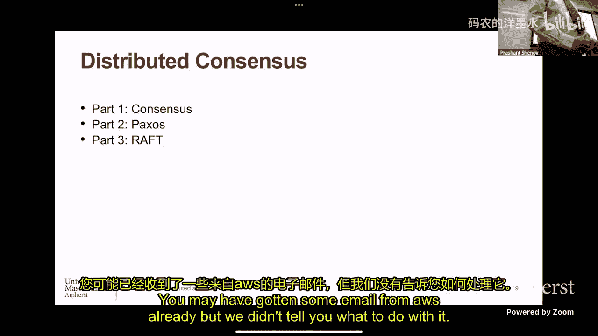

So keep out keep an eye out for the lablet which will come out I think in a couple days right okay so let's get started today we will continue the discussion from last time and we started talking about distributed commit I mentioned that distributed commit is a technique that allows you to give you all or nothing properties to some operation we are looked at transactions where we had this all or nothing properties for a set of instruction distributed commit is going to generalize that for us and we will essentially complete the discussion on distributed commit that I couldn't do so last time and then we will continue that discussion talk about consensus and two techniques or consensus which are Paxos and raft so let's start so here is where we left off last time so so I presented this two phase commit also called。

2 PC as a technique for implementing distributed commit now。

As an aside do not confuse two phase commit with two phase locking this sounds similar This one is called 2 p that's called2p okay they are completely different things one is talking about how do you get locks in the context of transactions this one is just talking about how can you get all the nodes to decide whether to about or commit a transaction or any any operation doesn't have to get transaction in this case so they are two different concepts or don't get them confused but having said that how does two phase commit work so it has a coordinator and the coordinator is just going to ask all of the participants whether to commit the transaction keep saying transaction operation it commit the operation which means it's successfully complete or about the operation which means you are to undo that operation so all of the participants will get to word if everyone words commit then the。

Decision is to commit the operation even if one node says abo okay then you aboard the operation so this is not a majority vote and abo is essentially a veto so which means that if one node says no something went wrong we need to undo everything all the nodes how to undo it so that's the basic idea so you will see there are this is described using a state transition diagram the first one is the coordinator or the second one is all the participants so initially you are in the innate state which means you're starting and then you send a vote request which means you send a request to all of the participants saying should you vote for what you want to do and then the coordinator goes to wait state waiting for the wordss to come in the votes come in it looks at all the words and if all the participants have said commit then it basically sends global commit to all of the participants。

Go ahead and commit the operation if anyone has voted to a board you send a global a asking all the participants to aboard the operation this is the coordinator here is how you can view each of the participants who are also voting so initially all the participants are in each state so if when you get the vote request from the coordinator if this participant decides to a the transaction it's going to send an a to the coordinator and directly go to the a state because this coordinator does not need to hear the results of the voting because you know if this participant knows that if votes to aboard then everyone has to a it can directly make that transaction otherwise it sends a commit request to the coordinator and it goes into this ready state where is waiting to hear back。

Because the coordinator now is to collect all the words and if the coordinator sends a global abo then you make a transition to a yourbo locally if it is get a commit word then you commit the operation locally。

A fairly straightforward approach， coordinator asks for words or ask all the participants word for commit or about。

 get back the words if all the words are yes， you say commit if there at least one is no and everyone has to a。

All right， so the straightforward or the problem in this approach occurs when there are failures。

And the main issue is if there is any failure it's not possible to make a decision often without knowing what might have happened so for example the coordinator crashes in the middle of a vote the participant cannot proceed because they don't know what has happened coordinator is essential to the process that should be clear but the other part is also true if a participant crashes and does not vote the coordinator cannot proceed either because it's an all or nothing property so it may so happen that the vote let's take a simple example of why this might be a problem coordinator sends a vote request here's a participant that was an in it it decides to aboard the transaction and it sends an about vote back to the coordinator but it crashes so it makes a transition to a board but the message never goes out for some reason because of the failure so that participant has already a aboutted and。

opation and God reports the coordinator does not hear from that participant so you it cannot actually make a decision if everyone else had voted commit it cannot make a decision on what to do for exam right so so you can get blocked at many different stages in this process and it is hard to figure out in some cases what to do in particular the biggest problem occurs。

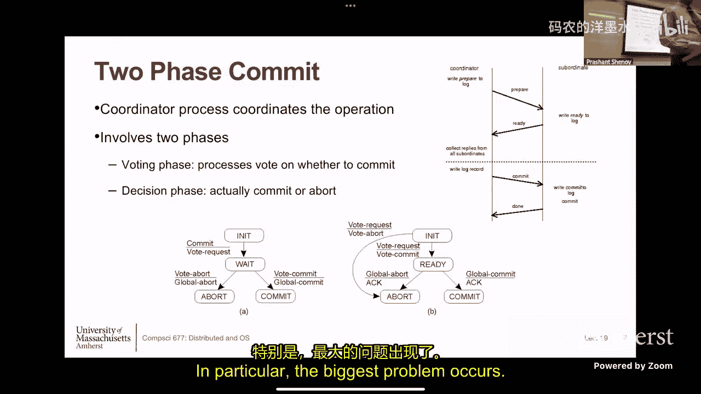

When all of the participants are voted to commit。

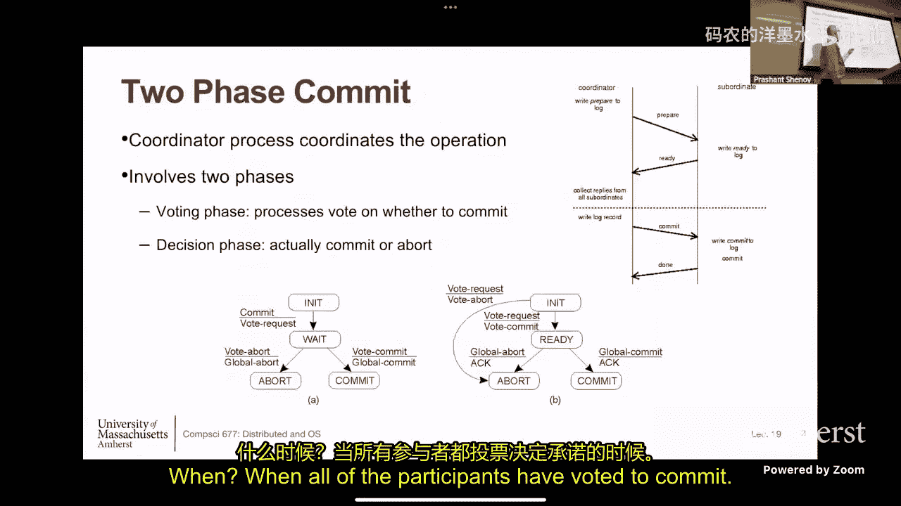

And they are all in the ready state waiting to hear for the results of the word and the coordinator never returns the result because it crashes。

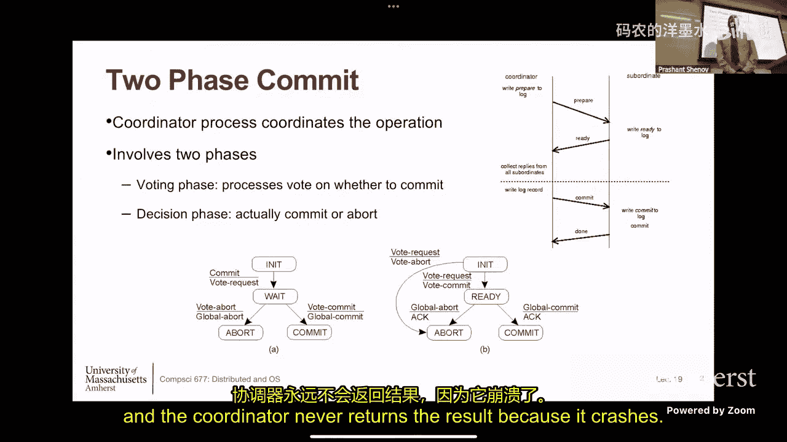

So in this case it' is not possible for the rest of the participants to make a decision without hearing from the coordinator particularly because a coordinator is also a process in the system it is acting as a coordinator but it is also a process so you cannot have a participant ask everyone else saying what did you vote if all the remaining process said we voted to commit you can still commit because a coordinator which is a process in the system have itself voted to about so you cannot just make a decision without knowing what happened。

So this is a problem because。If you are all stuck as the participants are all stuck in the ready state they cannot make a decision for example they cannot decide the coordinator hasn't responded let's all aboard a transaction because the coordinator may have decided the other way around right so so it is something that you have to keep in mind is to face commit is not going to work when the presence of failures otherwise it works fine right so。

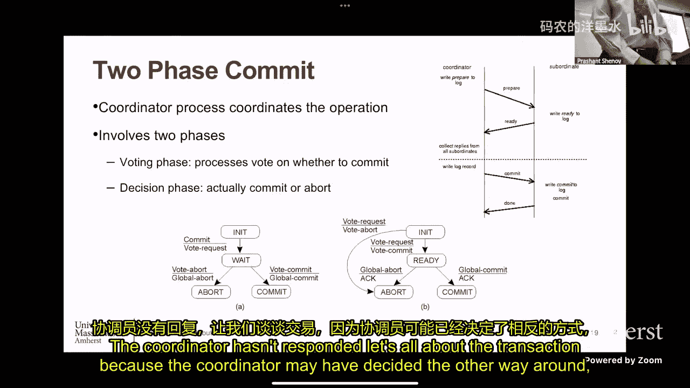

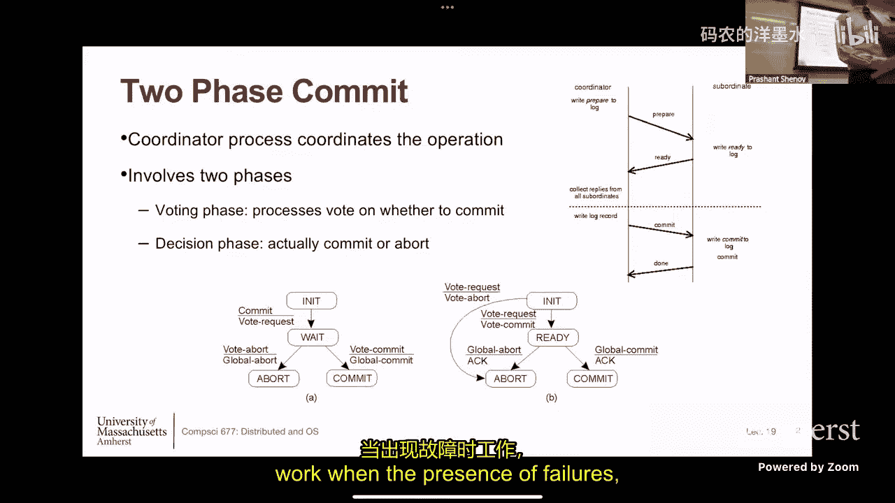

So there are ways by which you can in special cases the participant can decide how to recover but not in all the case so for example a participant crashes and then comes back up and then it finds itself in the in state so it is not even made a word so it can then actually vote and tell the coordinator to a board for example because if it is an in state the coordinator could not have received it word or no decision。

On the other hand， if it comes back up and it finds itself in the ready state you can ask some of the other participants if one of the participant says。

 okay we got a commit vote on the coordinator then you know that the votes were received the decision was made and you just didn't get the decision a crash before the decision came so you can make a transition to commit the same thing is true if if at least one of the participant ends up in a board and this failed participants that has recovered is still in ready and it finds someone else is in a board you can make an a award if youre in it you make a transition board the problem is if all the other participants are also in ready if you're in ready everyone else isn't ready you don't know what the coordinator decided you can't make a decision so this is the case where this protocol is actually going to suffer。

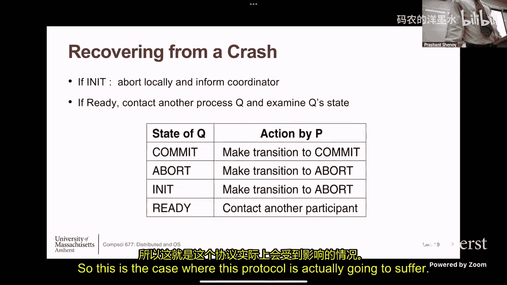

So I will show you now a modification of this protocol which is called3 phase commit3 p as opposed to two phases so what this new protocol does is trying to solve the same problem okay but now you have three stage steps。

Yep your three steps not two or three phases not two for you to actually make a decision okay so here is the approach。

You will see some of this looks very similar so there is a coordinator and there are a participant okay the coordinator will initially ask all the participants to vote should this operation commit or a。

And then it will collect all the words now if any participant says about okay that is， as I said。

 a veto word then you send back a about decision to all the participants。😊。

That part does not change so you ask for words you go to the wait state if anyone says about then you score to send a global abo all the participants you are done now if all the participants have said commit okay in this case in the previous case you would have just told all the participants to go ahead and commit in this case you will tell them to go to a precommit stage okay saying that the decision was to commit but don't commit yet but just go to the precommit state acknowledge that you received the decision and go to the precommit so all the participants will then go to precommit and once。

All the participants are in pre commit then you actually ask all the participants to commit through a global commit so commit takes two steps a board is only one step。

哎。So that is the three phase commit now you can say what did this achieve what they adding this extra step saying let's commit in two stages the participants will be told to go to a precommit state and then told to commit the transaction in a second step what did that achieve for us。

Any thoughts here？Here the question you want to think about is what problem are we trying to solve here to go back to the two phase commit stage remember I said if all the participants are stuck in the ready state and the coordinator has crashed these participants cannot make a unilateral decision。

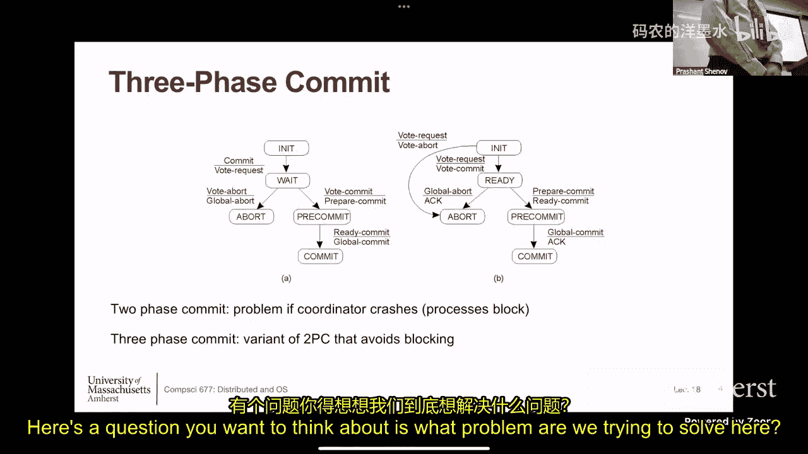

Okay because the participant the coordinator would have also may have voted and done something right so that is the problem we are trying to solve you。

 So now lets say we have this situation where。All the participants find themselves in the ready stick and the coordinator crashes。

Can we make a decision in this case？So one thing you can think about is let's say these。

Participants a coordinator crashed vote were the results or the vote were never told to us let's at a transaction this is what we said we could not do previously so they can all move to anbo state and then if the coordinator actually recovers the worst that would have happened the coordinator it would have gone to precommit it would not have committed the operation because from a wage state you can either go to abo or precommit if the coordinator also aboard the other participants already aboard it that's fine they all read the same decision but if all of the other ones decide without the coordinator to abo the worst that the coordinator would find is it precommit state it can still transition out of that and a because it hasn't committed yet。

But in the two phase commit you could have committed and then the rest of a board and that's an incorrect state where some of them commit others about that's something you don't want here because you are these two stages you are just waiting to commit you are not yet committed so others have changed their mind not change their mind but go ahead and timed out and decided to aboard this is still safe so adding this extra stage before the commit is actually adding safety to the protocol it prevents so a situation where in the presence of crashes some participants will go into a board and others will go into commit that will not occur in this case okay so if you find yourself so。

To find yourself in the in state and the coordinator crashes you can always aboard because voting hasn't even started so thats safe you find yourself to be in the ready state and everyone else is in the ready state coordinator crashes you can still make a transition to a board because the worst that will happen is someone else is in the precommit state and if you are in the precommit state then it's okay at that point to decide what to do because you already know that thats the word that was sent so this is adding an extra step and it is adding failure as that's really the problem that three phase commit or 3 PC solves over two phase commit。

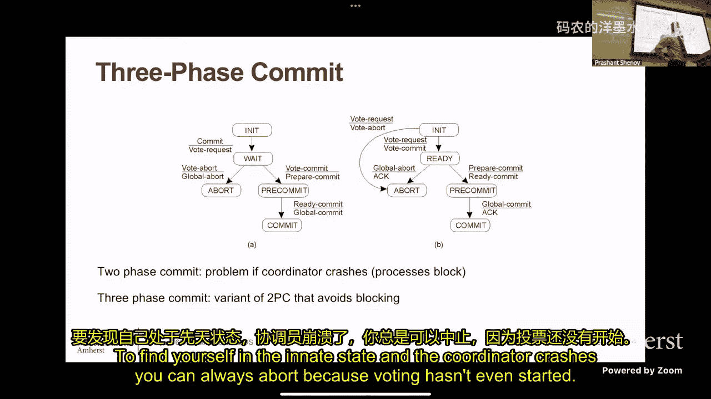

Is this clear any questions here， yes？宝应该都俾少多都水。睇定嘅嘢对。Okay， what the question。

 what if the coordinator？Fails after the precomit state right So pre commitmit state。

Essentially means that you have to send。All of the words to others right so if at least one or more participants receive that vote。

 they would have transition to precomit。And then if some others have not received it。

 they are in ready they can check and they find somebody is in precommit that basically tells you that the coordinator has actually sent out the decision to commit。

 which is why at least one participant is in pre commit so they can all transition to pre commitmit and commit。

 so that's something you can certainly do in this case。Okay。

 now you can have a case where the coordinator goes to pre commitmit。

 but none of these decisions are conveyed to any of the。😊。

Participants in which case they will still been ready waiting for the result to come because they are here they never actually got the results of the okay and I said that in this case it is safe for them to aort because at the worst is that the coordinate would been precomm when it recover it can check where it is and say there is aor it so you can still a you are not yet committed so you have these two cases in this case yes this。

Yeah。Question is， this helps if the coordinator crashes。

That does not help if the process crashes if a process crashes youre right the process crashes and does not even vote okay then the coordinator will be stuck because you can only sign the results after you get all the words there's no majority here you have to get all the words because even if the remaining n minus one node say commit and there's one failed process was going to a board and you say this is majority you cannot proceed right youre actually wait so youre right this is only helping from coordinator crashes it does help with the case where the after voting a participant can crash and then when it comes back up it can make a decision but if it doesn't even vote there is a problem right so that's something to keep in with。

Yes。我。可以。啊。Okay so question is what happens after you reach precommit for you to commit what happens after you the coordinator will send a request to all the participants and go to precommit stage it will wait for an acknowledgement from all of them because you will see that you send already back or an acknowledgement back once the acknowledgement comes you know all the participants are in precommit then you send another global commit and then ask everyone to come right so so the coordinator sending two messages go to precommit and then go to commit once you hear that everybody is actually acknowledged。

え？イエス。不れ外。在。The question is in 2 PC， couldnt the coordinator have gotten an acknowledgement to commit so what happens here in2 PC is everyone is just voted and they go into the ready state。

When theyre waiting right so at this point you either send an abot or a comment so there is all that's all you do to make a decision and you send it and that's if there are no crashes that's fine because you just get votes you reveal the contents of the vote or the election it's not really in election but you essentially vote and you reveal what has to be done but the problem is in this case if you there's a crash there are problems because as I mentioned if you are all stuck in ready you cannot make a decision it will always be stuck in ready。

That is because everyone could have voted to commit the coordinator could have said the decision is to commit it commits but the words that messages don't go out because it crashed before the message left the machine right so now the coordinator is in one state and all the participants might end up a different that is something you don't want。

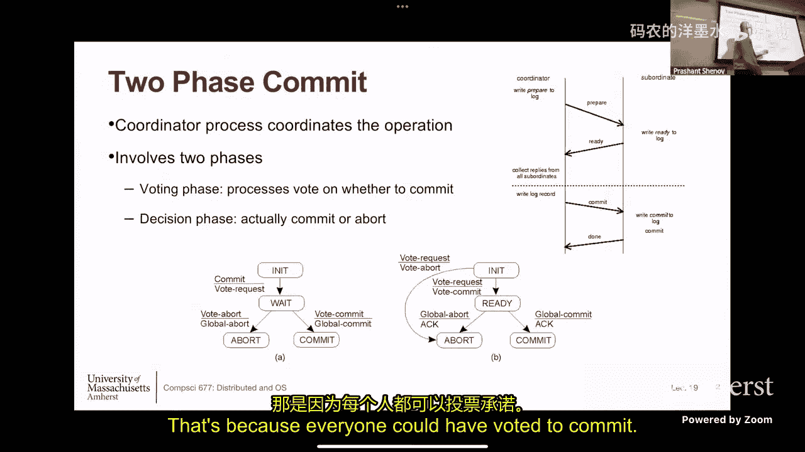

The question is， could you have sent the message before you send the before you make the decision would it have a resolved issue。

 I think？Generally you want to first write out your decision to disk before you send out messages because if you send the messages and don't take a decision and you crash and then you come back up you don't even know what decision was made right so typically you will write the decision to a log and then send it out so that if there's a crash you know what is written in the log what has happened so far so because there is a disc log that's not shown here that has to be maintain thats why you are to do that。

If you do it the opposite， where there are not there problems。All right， so what we now do is。

Say this is too problematic we don not want this situation where you have to wait for everyone to vote。

Okay lets actually relax this and say we want a technique that allows us to make a decision in the presence of some failed participants so long as a majority of them are up the coordinator should be able to make a decision okay how do we do that okay so that's what we look at that is called consensus and we look at taxes so you will see some similarities but the main difference is。

2 phase commit and three phase commit really are not designed to handle failures in some special cases they can deal with it but not in all cases they will always have some problem or the other。

So but pxos and consensus protocols that we see are fundamentally designed to work with a majority。

 even if a minority of nodes are failed you can make progress so that's really what we are going to look at so that brings us to。

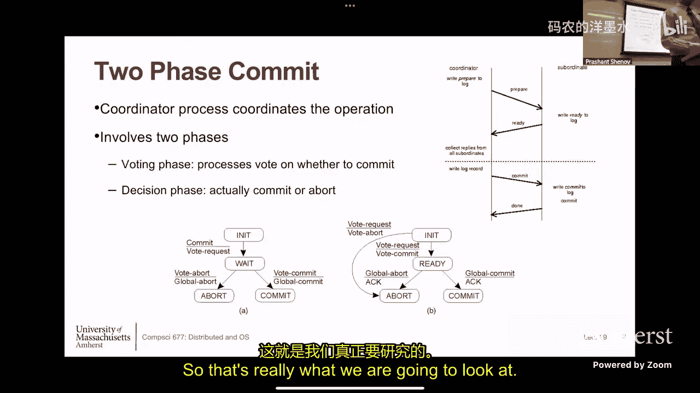

Back to replication and consent so remember two classes ago I talked about replication as a way to implement fault tolerance so I said multiple replicas if some of them fail the others can take over so that was the main idea for replication and typically when you have application being replicd you use replication in one of two ways you use it to get scalability where the incoming workload is split across replicas and you can spread the load but if one replica fails the other can take over right so youre getting fault tolerance and some way to actually distribute the load and the second approach for implementing fault tolerance which is what we are talking about is you always send the request to all the replicas you take a majority vote and then the result is what is sent so this is other way to do replication where every request is sent to all in the previous。

This case the request is sent to one of the replicas they executed and sent back here you send it to all you get back the results you take a majority result or you have them vote on all of them and so that's what we did for 3 p and 2 PC but now well look at how do you deal with just a majority not all of them so that's the other approach we are going to look at which brings us to this topic of consensus。

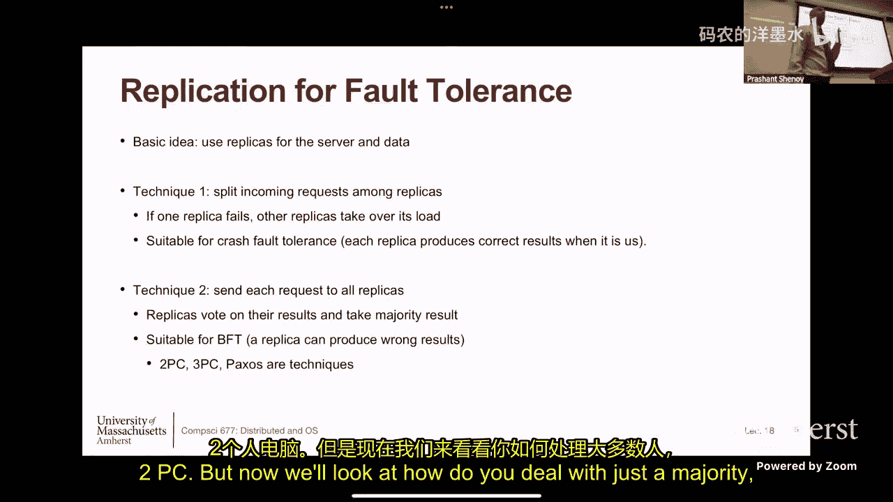

What is consensus consensus simply means a group of processes in a distributed system have to agree on something what they are agreeing on is really not important that's orthogonal to consensus so you could be agreeing on what is the result of a database query okay you could be agreeing on what is the output of a remote procedure called you could be agreeing on in what order should we execute these requests okay or you could be agreeing on should we commit or about the transaction that's what two phase and three phase commit with it so what you are trying to agree on is actually orthogonal to the consensus protocol the consensus protocol just says that these processes need to figure something out whether its the output of a operation or whether to commit the transaction they are just trying to figure out what to do and the consensus protocol or let them agree on what is the right thing。

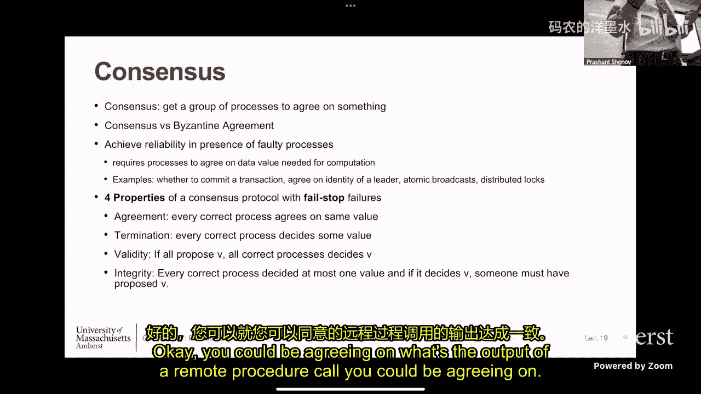

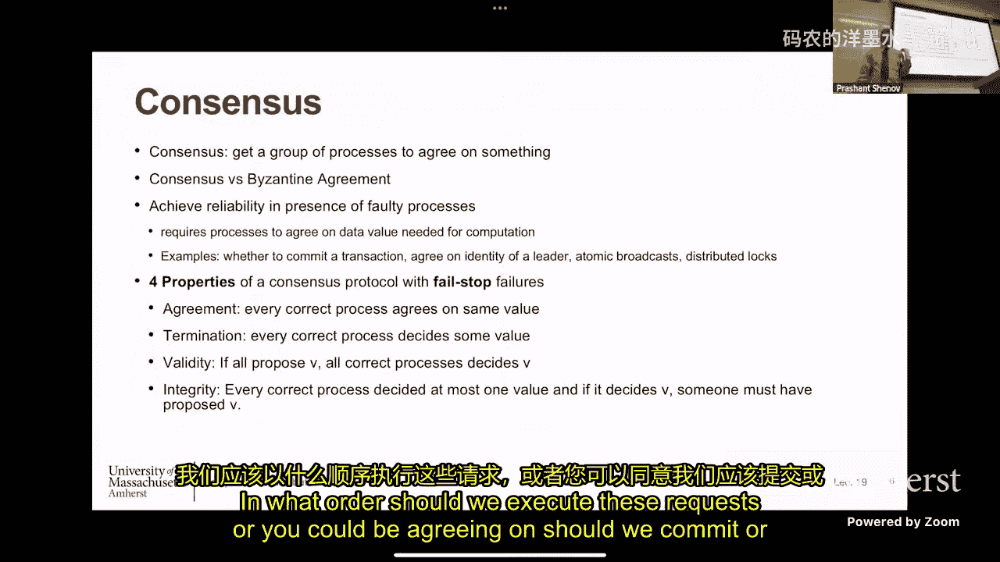

So， that is essentially what consensus means so consensus protocols generally assume that applications not applications processes can fail and they may not actually participate in the consensus protocol when they are fail yet you want to reach consensus but they do not assume that you will produce wrong rhythm。

So well assume that processes are actually operating correctly when they are up or they fail in which case they don't actually participate at all now there is a version of consensus called Byzantine agreement also sometimes called Byzantine consensus this is like the Byzantine general problem where you are trying to be part of a consensus protocol but you may maliciously provide wrong input to the protocol to confuse other processes and yet you want to reach agreement or yet you want to reach consensus so if you want to agree on something where some processes are Byzantine faulty that get such into Byzantine consensus but if you want consensus where you only tolerate crash failures or maybe network failures but you are not assuming that processes are intentionally sending wrong result you are traditional consensus so we are going to only talk about traditional consensus today eventually we'll get to cryptocurrencies where as I said。

You actually need Byzantine consensus or Byzantine agreement because you assume that participants are actually faulty or malicious。

 they are trying to do bad things right here we are assuming you are not trying to do something malicious but you can fail you can just crash。

So that's what consensus mean so remember that for today's class all processes when they are operating are just producing right results they are not trying to provide bad or faulty results so either a process can be up in which case is functioning correctly or it can have crash which means it' not part of the system so these are the only two sticks okay that we are going to worry about so we want essentially four properties from our consensus protocol with crash or what's also called fail failure versus agreement agreement says all processes are going to end up with the same value this was the same thing as everybody commits or everybody abroad right so they should all agree on the same value termination essentially means that every process actually ends up with a value it's not hung forever so you're not going to be in a state where you make no progress so you want the process to terminate you want everyone to agree validity says that you should essentially pick a right value pick a random value。

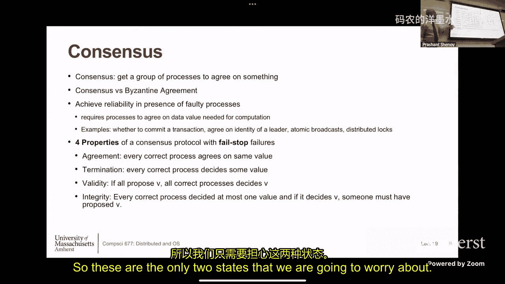

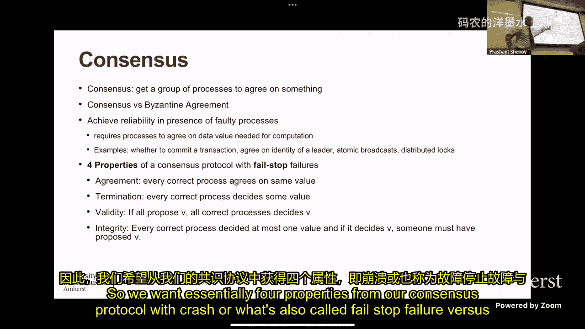

Because a trivial consensus protocol is every time you run the consensus protocol everybody decides false is the answer right it's not a very useful protocol but youve always get agreement because you priority determine that every time you run it will say the answer is zero or answer is false but that's not valid values you want to actually pick something that's valid output of the operation and integrity says that every correct processor decides the value everyone as somebody should have actually produce that value right that should have been an output of a database query that's what we are agreeing on because you don't want to agree on something thats wrong。

So those are these are not the same as asset properties。

 but they're somewhat like that agreement term validity and integrity。

 but we really are not going to get into the nuances of this well just think about we want to reach agreement that we want all the processes to essentially agree on the same value and we'll assume the value is valid so let's try to understand how to do this but before we get to Paxos I just want to reiterate the problems with two phase commit and three phase commit so what you want to understand from two phase and three phase commit are there are two properties that you would like in a typical distributed system or application one is called a safety property that is called a liveness property safety property the way you want to think about safety is safety means nothing bad happens that's a safety property if you have a safety property in your system that means that the system will not do something bad what bad means will change from situation。

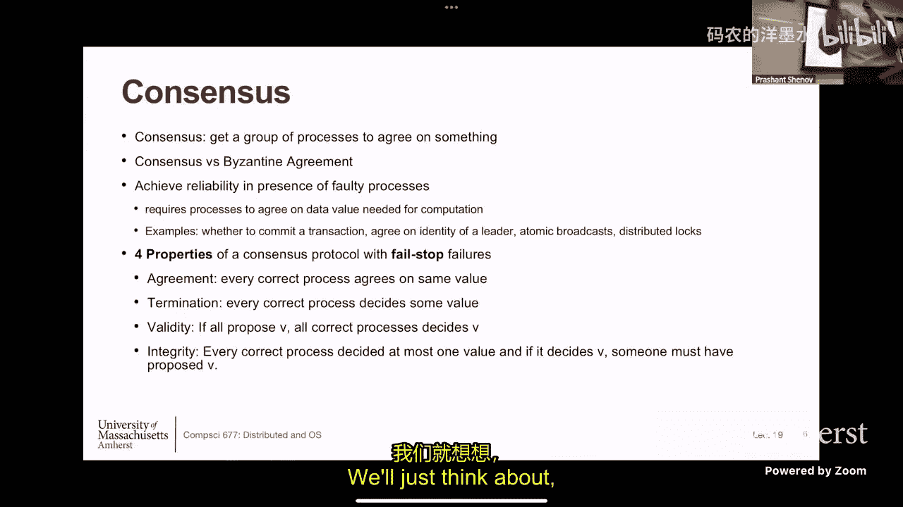

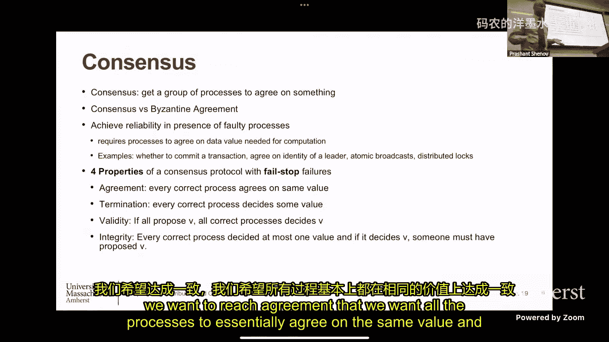

Situation， but you will not do something but okay and liveness property means something good happens that you make progress。

so that is what liveness means so if you go back to two phase commit you will see that they have both says。

😊，They have safety property but not liveness safety property essentially means in two phase commit what does bad mean in this case right in case of two phase commit bad means you don't want some processes to end up with an a and some with a commit so then you violated atomicity and you will I talked about it I explain to you that you always end up in the right state because you give up liveness you say that you would rather hang forever and not make progress because the coordinator crash because making a unilateral decision might violate safety you might end up in the wrong state from the coordinator and then you have violated at right so so you gave up liveness in order to ensure safety ideally you want both you don't want to say that I will give up safety and have make progress or I will have safety but not make progress but the problem at two phase and three-face commit is that they are safe theyre never going to give you incorrect result but sometimes they'll give you no result that。

All because they are trying to ensure safety and will not make any progress in the interests of so what taxes will do is it will give you safety but it will also guarantee liveness when a minority of nodes have failed or some network failures as taken off offline a minority of okay so long as the majority is still functioning okay we will make progress we have liveness but safety is also still there in that system that's what we are trying to actually go go for okay so that brings us to。

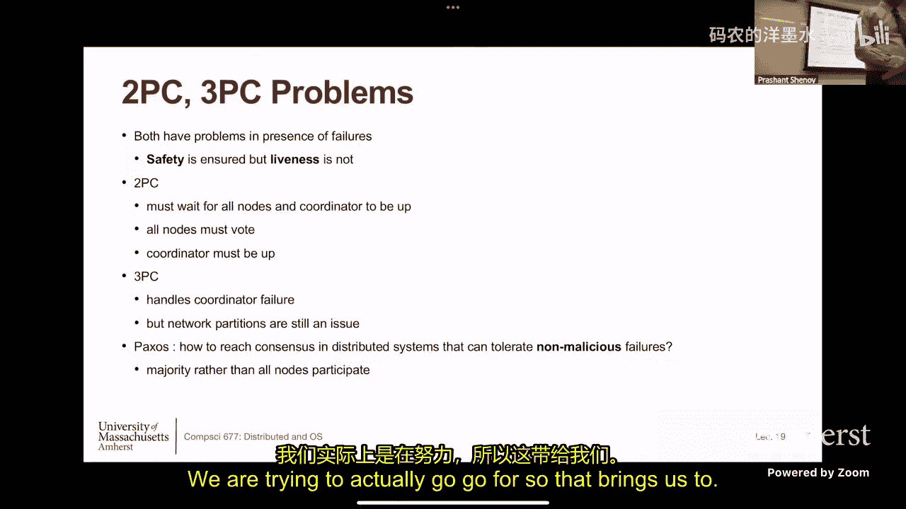

Paxos which is agreement in the presence of failures so so I mean what the agreement is as I said depends on the situation you can agree on who' is the leader you can agree on which is the most recent request you can agree on what should be the result of this database query you can try to get agreement on should you commit or about the transaction so those are all things or types of things you might want to have agreement on Paxos will essentially not care about what it is what you're trying to agree but tell you give you a mechanism to actually reach agreement so that's the basic idea so I'll show you example which will explain how Paxos works but the basic idea not very different from two phase and three phase okay we will have a leader that's like the coordinator okay we have a set of follower the goal of the leader is to convince the followers on what to do and it will。

Essentially use techniques like voting to figure out what the right thing to do is and we will see that there are three phases in this case and you will get to agreement at the end of three phases I should mention that this Paxos technique was。

Independently proposed by Lamportt， you've seen Lamportt several times now and Lisco who is a faculty member at MIT maybe two or three decades and it's our technique that' is used in many industrial systems like Zookeeper Chabi we like encounter some of this in upcoming classes。

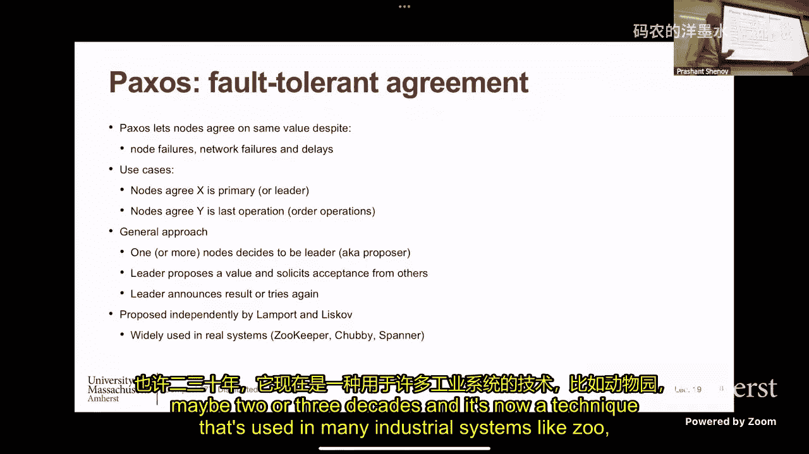

But let's talk about paxos。Yeah， we want safety and we want liveness。

 I'm not going to get into a lot of these details， but let me show you an example。

I just to explain how this is going to work。 so assume this following situation okay there is a leader thats been elected in the system that is going to act as like the coordinator and then there are other nodes。

Wwhich we will call acceptors in this case they are really followers but they acceptors the goal of the leader is to convince that all the acceptors to accept the same value or the same output so that they reach agreement。

😊，so， in this case in this example we will assume that they have to agree on some numeric value maybe you made an RPC request the RPC request returned to everybody has to agree that the output of the RPC request was to that is what we are trying to reach agreement on。

Okay， but what you agree on could vary from situation decision So initially we assume client makes the request RRP request comes to the leader。

 the leader sends it to all of the。Except as they execute the request they all have to agree what was the output it us to make sure they all agree on the same thing。

So here is how it's going to work okay so essentially we will have rounds each round is called a proposal and proposals are number because it may take us multiple rounds before we actually converse to a decision so each time the goal the leader will start a new round it will have a new proposal it will try to get all of the acceptors to agree if it is succeeded then it's done if no it'll start a new round and get them to agree again and so and the reason you need multiple rounds is some nodes may fail they may not respond or a majority of nodes may not respond and the acceptor as to say okay I didn't get any results I'm going to restart pa and try this all over again so itll keep trying until you essentially converse so when step one it is going to ask all of the accepter saying what should we do what should we agree so it's going to send the way you do this is itll send a prepare request and say this is round one this is proposal number。

One okay this is a prepare request means you tell me what what value you should agree on so initially and each of these will keep track of the latest proposal they heard so initially theyre all zero none of them have agreed to anything so the value theyve agreed to is none because we just started this so so this is what will happen so the first round they will all say I don't have a value I'm just going to say nu is their value I know okay so I'm going to send an acknowledgement that's prepare okay saying I acknowledge that we are in proposal number one but I don't have a value my value is none so that's what it is going to send because they don't have any value that they've agreed to yet。

 so at the end of the first round， all that has happened is they all acknowledge that the round started。

 but there is no value they have proposed yet。So， what the leader will do is take all of these if all of them are null it can propose a value it can say I also executed this RPC request the value was two so it can get them to agree on if some of them are sent that value it can also pick there but the has of now uses just got null。

Is this clear so far？So now the leader is saying everyone said nu my output of RPRPC was two I' am going to get everyone to agree on two it is going to try to say let's accept two so it is essentially going to send start the next phase saying okay we started the prepare now here is except phase okay still round one I propose value number two values to is going to send this out。

Okay so the simplest case is nothing no one has failed right so all the machines are up so they will essentially all say okay they will take the proposal number is one。

 they will all turn the null values saying okay I agree with agree to two because as I said when machines are up they function correctly so the RPC and the leader return to all of them should have gotten that same value because we are assumingsum correct execution okay so they should all agree to two so they will say accepted values two and they will just sign an accept saying I agree。

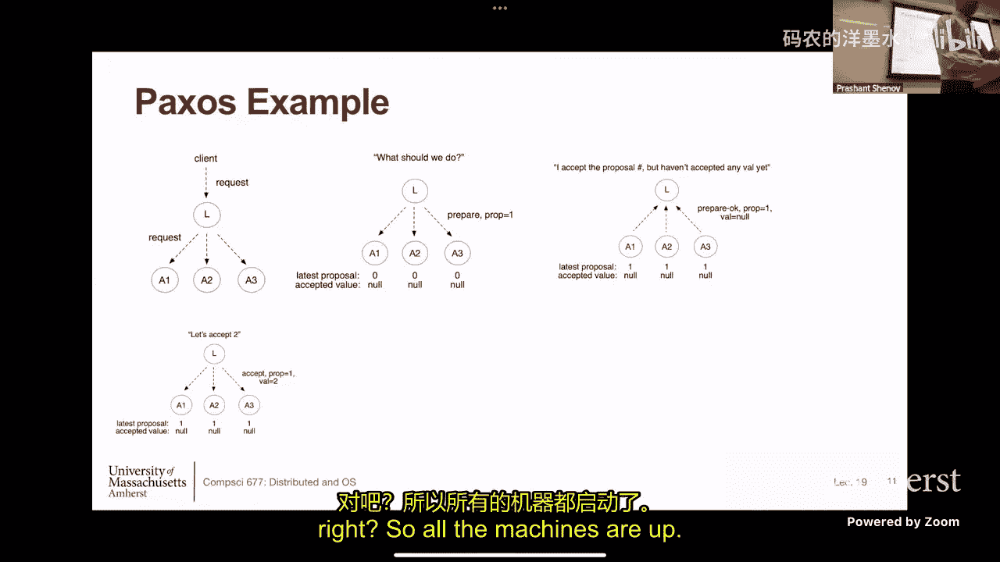

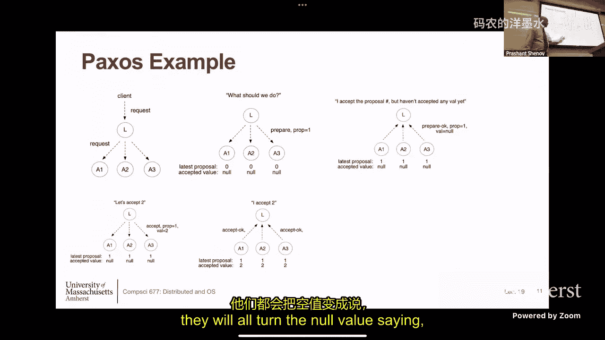

Okay。So， that's it and then you have the final phase where the leader says I got a majority of them to agree to two because they all sent me acknowledgement so I say let' us decide on to。

so you will send a decide request saying we decide all decided that the value that we have that output of this R is2 and you send back a two and then that's it。

It almost sounds trivial but it actually has lots of strategy so let me repeat what we did here we had three phases the initial phase you ask all the nodes what should we do you start around and you say what should we do initially no one has any value theyve accepted so they will essentially just signal okay and then the leader will pick the value in this case and this because if you all get null it can pick a non null value and say let's。

Pick two sends it out if they all or majority of them say okay， you just said decide on。

this is a simple case， no failure so it's fairly straightforward to understand what' is going。Yes。

If the leader says two， but the text of the followers， none of them have two other value。对。Also。

 we decide on to or do we。D关。Okay， question is if the leader says two， but。

None of the followers have to should we accepted on it so you will see the nulls here means what is there the follow okay so the agreement phase you are going to take the computation。

 keep it aside you just agree on what to do so you will essentially have initially have nulls whatever is proposed you will accept it and then from that point on you accepted and if you are asked what have you accepted you will return to so the goal is what the leader to tell everyone what we need to agree on is to is the output of our computation so everyone starts with null and someone proposes to in this case the leader proposes to there's a generalization of this where any of the acceptors could proposed to and then that propagates out I gave the simple case where the acceptors always have null they send null the leader picks and tells them what to but it's okay impacts us for one of them to a propose that value initially go to the leader it will send it by。

Okay。All right， any other questions we are going to look at the failure case。Okay。

 so we will now assume that in the midst of that process there is some failure so here is the example。

So， when the。Except went out we will assume that only one of the node actually acknowledged that except it got2 and it said fine and then there was a network fault and a2 and a3 never responded。

That's a majority failure because two out of the three nodes are not responding okay so this round is going to fail because the the leader cannot proceed if two out of the three had responded。

That would have been okay。The leader would have then left this a3 out and it would have sent the results and the results but in this case two have actually gone down so majority has failed so we cannot proceed with this round so so essentially the leader will timeout it keep waiting for A2a3 and after the timeout expires it will start a new round。

Hopefully A2 and A3 would have rebooted whether if not then this will just keep repeating until at least a majority of the nodes are back online。

 otherwise you cannot proceed okay so majority have to be a phora system doesnt work。

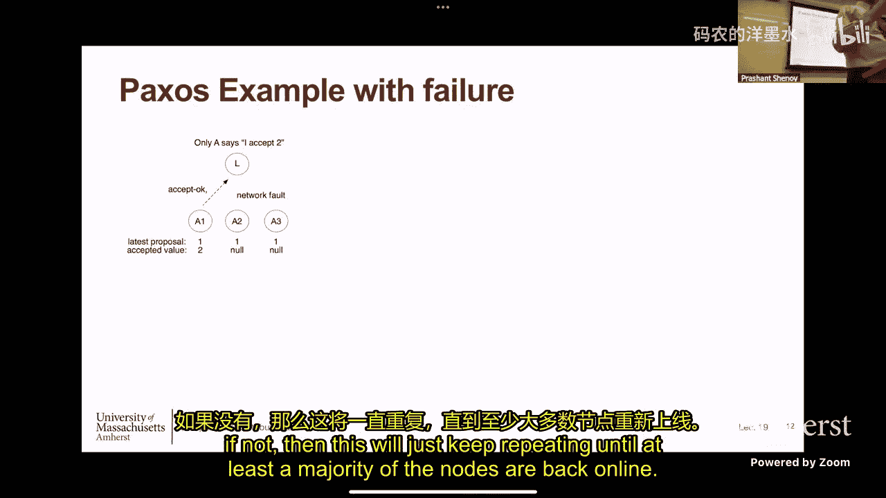

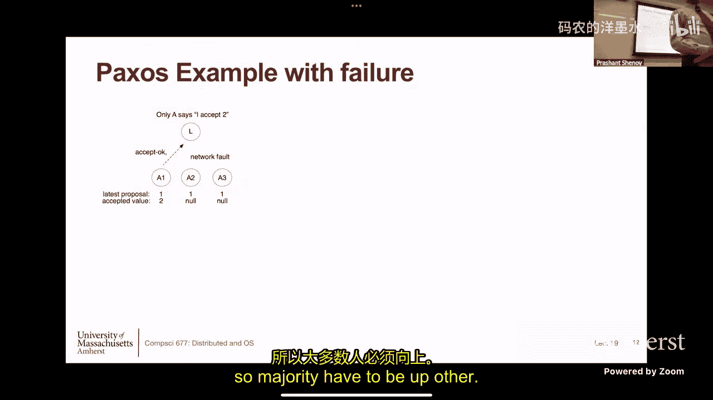

OkaySo here so let's assume now that a2 and a3 are back up so we are going to restart the entire process but now so youll start again with let's start the prepare request and say this is round two proposal number two and now you can see that a1 has already accepted2 from a previous round because it actually got the accept request a2 and a3 were that ones that fade so a2 and a a3 still have null so so leaders has already convinced a1 to accept2 but a2 and a3 haven。

Accepted anything yet Okay so so its basically signing what should we do。

 which is a prepare request goes to all of them Okay so you will see。

Now that a1 is going to say already accepted2， so it is round 2 its value will be 2 a2 and a3 will return nu because we haven't accepted a value yet。

That clear， what I just said so。So a2 so now the leader is going to get 2 from a1 and nulls from a2 and a3 will will still pick2 and I will say lets accept two and is going to send here round two let us accept to will send it back。

To all of them so in this scale let's say there are no failure so they all get this request okay and then they will basically sign an accept okay and you will see that they all update and the I accepted value to two from nu okay so in this case the leader actually told everyone they all said fine and then they sent an acknowledgement and then they had the final decision request saying okay you decided accepted values to。

Okay there is a simple failure case there can be arbitrary failures and paxos leader might fail。

 which I didnt show I just wrote a network failure leader fails to elect a new leader。

And then restart that process and then it will start the same thing again participants a minority of participants can fail that's okay if minority fails that whole process will continue as is because so long as two orders three are responding the leader can continue to make progress that's majority vote。

But if majority go down， the round fails and you are to restart leader goes down。

 round fails you have to reelect the new leader and it will start taxes all over again。

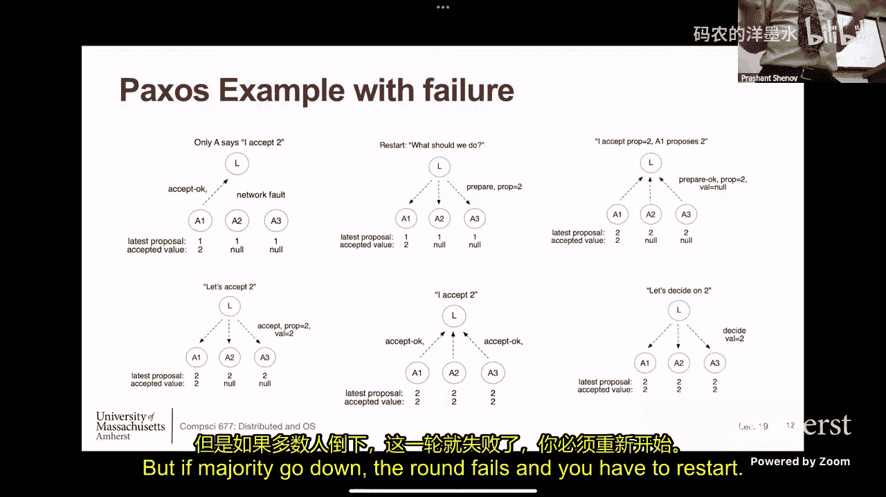

so lots of things can go wrong， but because we can proceed with the majority unlike two phase commit and three phase commit。

 we can reach agreement with the majority of the nodes being up。Is that clear。ミクションジェす。对。Hello。Plus。

 but by the time。でそこでなの。So what happens。Okay question is if a node fails and by the time it gets it reboots that proposal has already been accepted a decision has been made right so so you can always go back to the leader and say that tell me there is if that round us concluded you can catch up later you will see exactly that in draft so you basically maybe a3 goes down for an hour several operations will happen in that one hour when it comes back up it can go back and read the log from any of them saying tell me whatever I have missed and it can just replay theres no need to redo anything you're just asking what happened just tell me what was decided because the majority decided it so itll just have to get the decision from someone else。

Good。Yes。在。Okay question is if in the second proposal what has come back from a18283 is to null null so what is the leader trying to accept is your third your question the leader has to always accept a non null value a value that was actually produce by an operation the operation produced to it should not accept null because that was one of the properties of consensus saying you could always accept null there's nothing to do I can always say every consensus operation outputs null so I don't actually have to ask anyone I say yeah let's decide on null so that's not a useful protocol you want a protocol to accept a value that was actually produce by the computation which I said let's say the GRPC return to but technically in this case you should accept to not null。

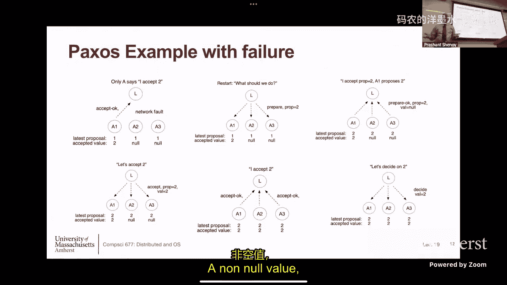

你在他。Okay so question is if I get two null null there are two nulls and two why is the leader accepting to that's your question that so in this case we are not actually having a majority vote to decide the majority have to be participating in the Paos protocol so it's not like they voting it's not like you will vote two to3 and then you vote pick two because there is no crashes right so you always assume that you will have the right output so it's not a majority of what has been reported to you okay but the majority have to be participating and so long as there is even one non null value that's the correct result of the operation that's what you have to now convince the rest to actually agree on so it's a little different from assuming unlike two phase commit where you say should we vote or not you get all of them and you take a look at the results that's not what we are trying to do you' are not trying to take the two out of three of what to accept but you want all of them to respond。

And so I agree to whatever you're telling。Okay。Thatly is。Are there what？Okay， question is。

 are there any rules on how many replicas you need？So。

 you need in this case this is the simplest case you will need at least two so that there is a majority right but you can have any arbitrary number so long as you have n plus lets say if you have n replicas you need。

Strictly greater than half to be up。That's all you need right so so you know if you can't have two because then if one of them goes on that's not a strict majority。

 but if you have three then you know that at least two Arab it's greater than half。

So the only rules are you need out of n replicas， strict majority， half plus one。

 at least that many replicas are to move up。Yes。好，这申。我不是。

The last picture the question is the last picture as you said decide is that proposal two or three that's just the last phase of the current round round there are three phases there's an accept phase which is asking sorry proposed phase which is saying propose a value what should we decide there's an accept facing let's accept this value is a decide facing we decided on the so this is still the same round it's not a new round okay all right so I think I'm going to actually show you the protocol long so this is just explaining in pseudo code whatever I explain so step one phase one is the prepare phase this is where the leader is going to start a new round is going to send a prepare request and the round number to all the nodes upon receiving a prepare request。

Essential if a new round has already started because this replica is really slow and maybe a new round started and you never actually responded to a previous round request you can just say I got a new request already a new round has started so I'm going to send a reject I didn't show this case in the example because this is only going to happen where you are some replica that failed and recovered or a replica there is really far away where messages reach them out of order。

So maybe then the previous round message reached after a new round started because the coordinator timed out and then it started a new round and then the previous round requester and then you can just say I already saw a higher proposal number a new round has started so this round must be already over by now so you just send a reject and send a cleanup message otherwise you will basically send this is the current round number I am going to essentially you accept that a value will send that otherwise that value will be none。

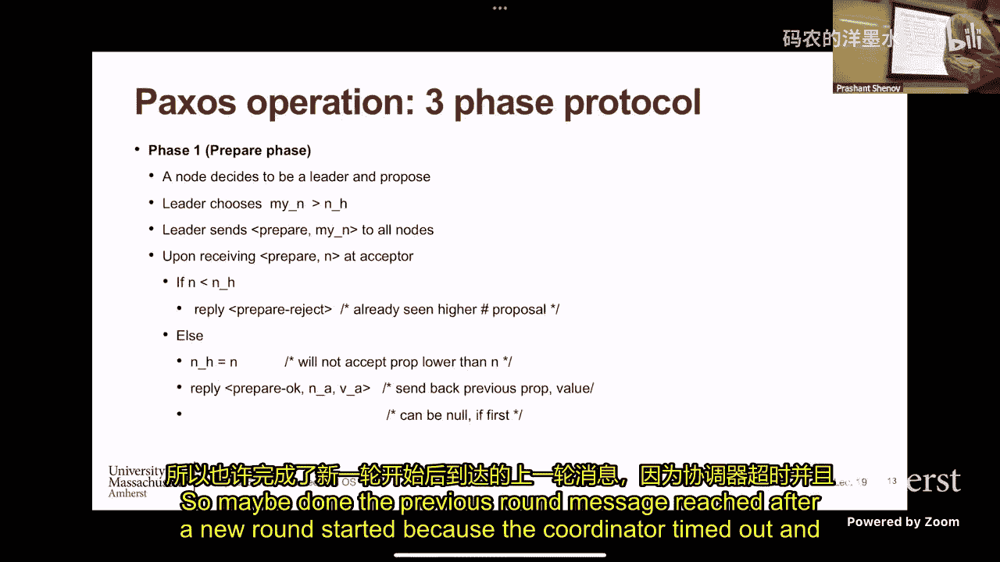

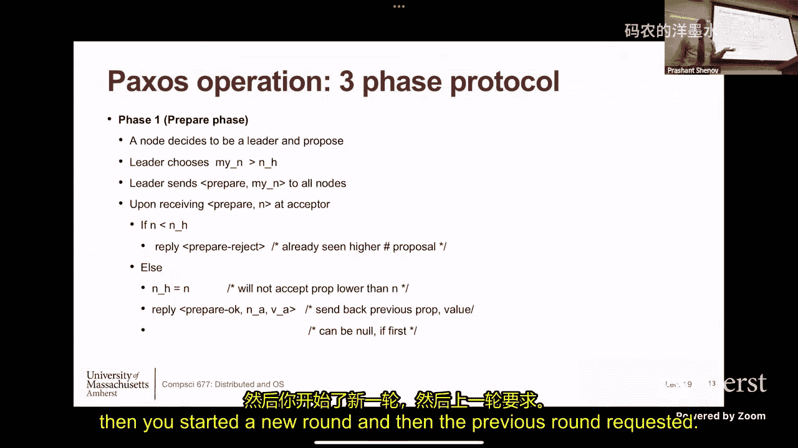

Yeahep。So， if you are this is a subsequent round initially it will be null。

 but if you already accepted something from the previous round。

 you just report that back that you already accepted。

So that is the phase two which is the accept phase if the leader gets a prepare okay or an acknowledgement from majority it will start with the prepare otherwise you will time out and restart the first okay so you will take all the values that came back okay if all of them are null leader picks the value if any of them is non null you can pick that value because you know that something you proposed previously and was accepted so you will pick that value okay and then you will send an accept request with the round number and that value to all the nodes okay and then。

Of course if you don't have a majority restart but now a participant when they get the accept request they are essentially going to update their values and send an acknowledgement of course if your previous round then you say this is an old round I'm not going to take this there's a new round I started so every time you have to check if this is the latest round otherwise old messages are coming because of out of order delivery or the network got blocked and sent a message late you will reject that message。

so you want to have strictly increasing round numbers old messages are always discarded and step three phase three is the decide round this is where everybody is already majority of agree so you simply send a decide request with the value is sent all the acceptors and you might have other nodes that are not participating in Paax is not required that every node that's a replicas to participating in Paaxos you can have a subgroup that's deciding what to do and everybody else is told so you might have nodes called learners that are just not participating but they want to know what was decided sorry that trivial cases where all nodes are participating they're all acceptors but the special cases if your large number of nodes some smaller group is actually running Paaxos and telling everyone what the outcome was so you will send this value not just to the acceptors which is what I showed but any other node in the system that needs to know what happened。

Yes。对。Okay question is what happens if this decision fails right so in this case if you don't get an acknowledgement saying your message was received again this will fail and you will restart at any point if you don't get an acknowledgement you will have to restart from majority and if you get from majority thats okay minority may not have to respond。

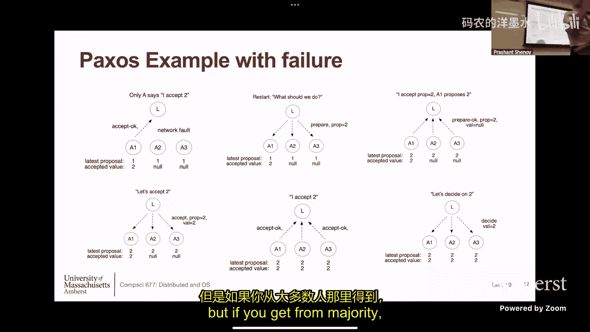

so you will see here what you just asked if you do not get an acknowledgement。

 you will delay and restart boxes and so that's going to happen as well。Is this clear？Okay。So。

 there are many properties that I will not prove here。

 but what we have to ensure is each round number is unique， it keeps increasing。

And you are to ensure that when there are acceptors in extra round as at least one node in common。

 that's true because if your majority vote if when are two majorities in different numbers of nodes failing the intersection will have at least one common node so you will ensure that if at least one node is common across majorities in different rounds will still end up with the same result because you would have some of those would have accepted a value and then the value essentially you are to make sure that you always take the highest number proposal and agree to that you should not agree to something from a previous proposal because that round would have already timed out and failed so you want to make sure you always take the highest number proposal or the latest round and that's what you agree to so these are all properties to ensure no failures not no failures there are failures but you want to make progress in the presence of failure now。

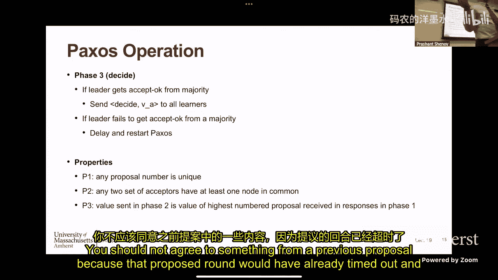

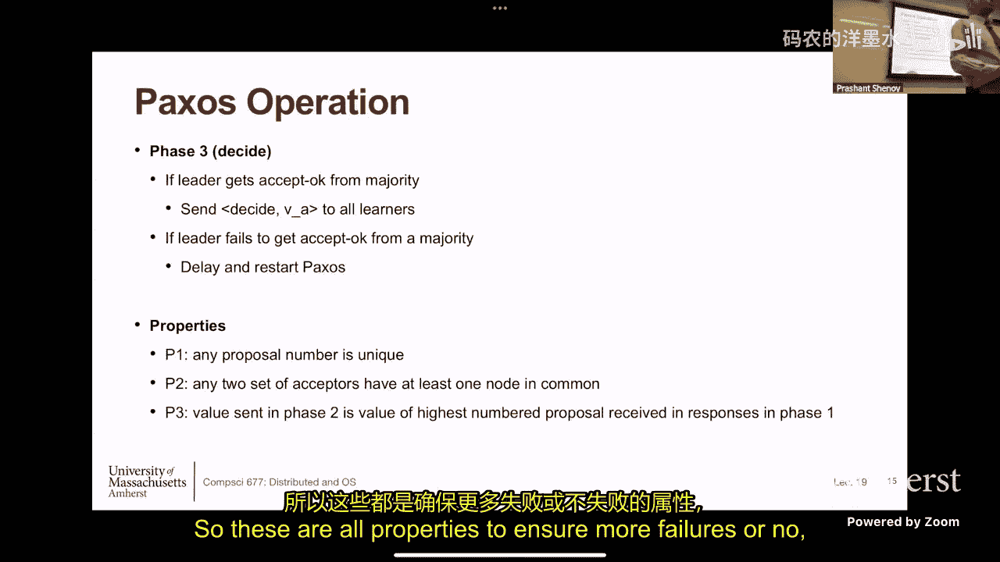

There are lots of use cases you can think of right as to what might go wrong network partitions I already showed you an actual example so long as there is a majority on one side of the partition you can continue to run right the case I didn't show you is。

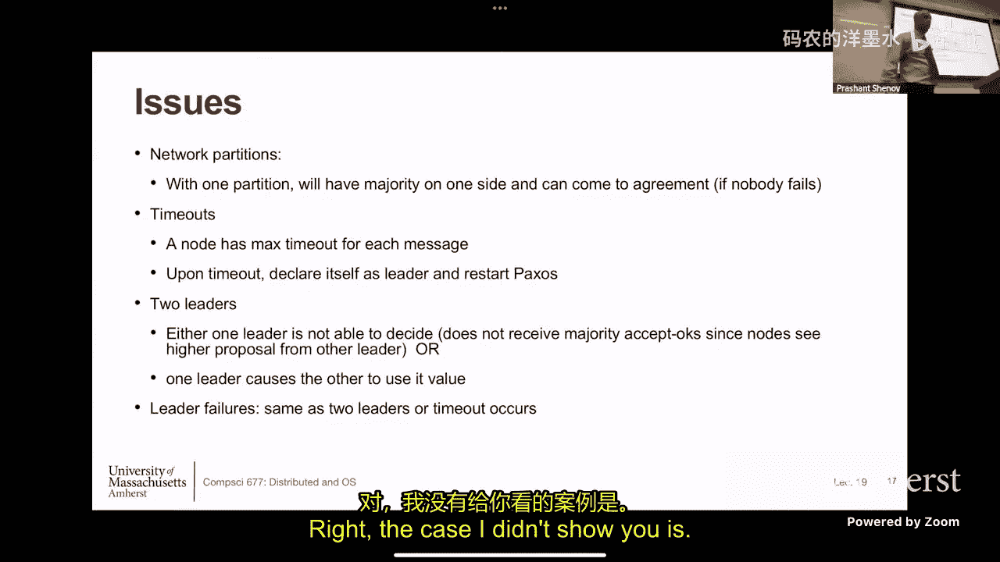

In this example I showed you maybe there are 10 nodes okay 10 of them nine of them disappear and only one of them actually goes to this leader this leader can wait for those nodes to come back but an alternative is those other nine nodes can pick their own leader and they can make progress because you have a majority on the other side of the network partition so you cut the network into two nine of them are on this side and the leader and one of them are on one side so this this option showed you the leader is just waiting and those nodes rejoin but maybe they won't for a while but those other nine nodes can pick their own leader they still have a majority and can make progress。

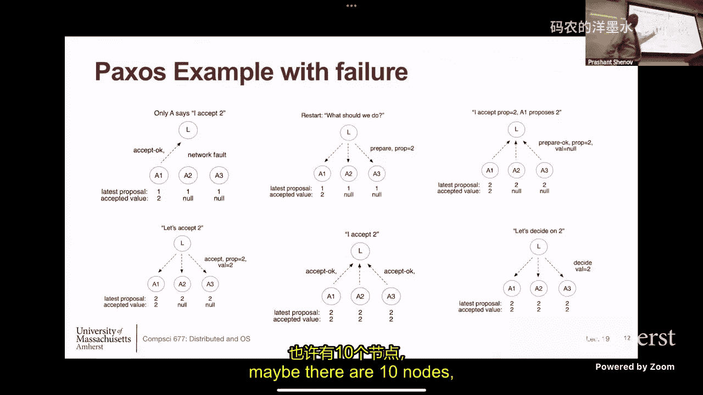

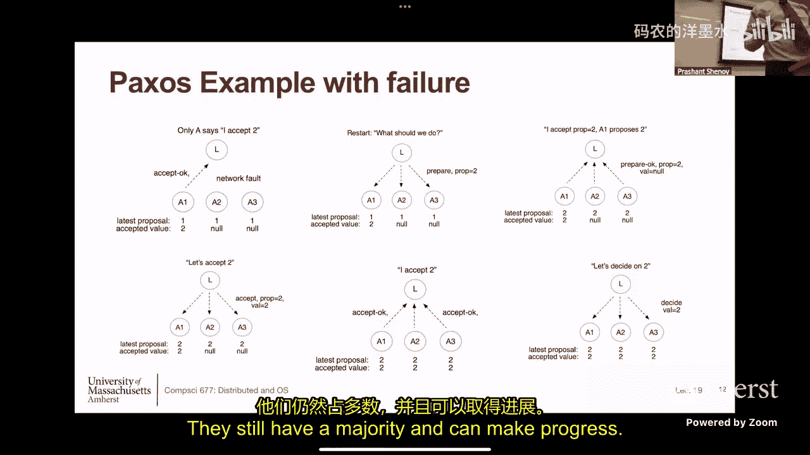

So that's another thing that I didn't show you so but that can happen so you can have majority on any one side can essentially continue to make progress if there's a timeout thumb node doesn't respond it's slow you can essentially restart pack so you can elect new leaders and so on。

What you want is essentially if there are two leaders， you don't want bad things to happen。

 but that will not be the case because you will always have a majority on one side So why would you have two leaders is exactly this case I just explain to you maybe there are 10 of these acceptors nine of there's a network partition nine of them are on one side is one acceptor and one leader are on this side those nine chill like their own leaders now your two leaders in the right there's a leader with a minority partition a leader in the majority partition now by definition the leader in the minority partition cannot make progress because it's not getting responses from the majority but the other leader is making progress so when the network heals again you want to make sure that there's still again one leader and they made the right decisions so you have to have some of these additional techniques because you might have partitions you might end up in multiple leaders a network comes back now youre two leaders what you do you want to make sure all of those cases are。

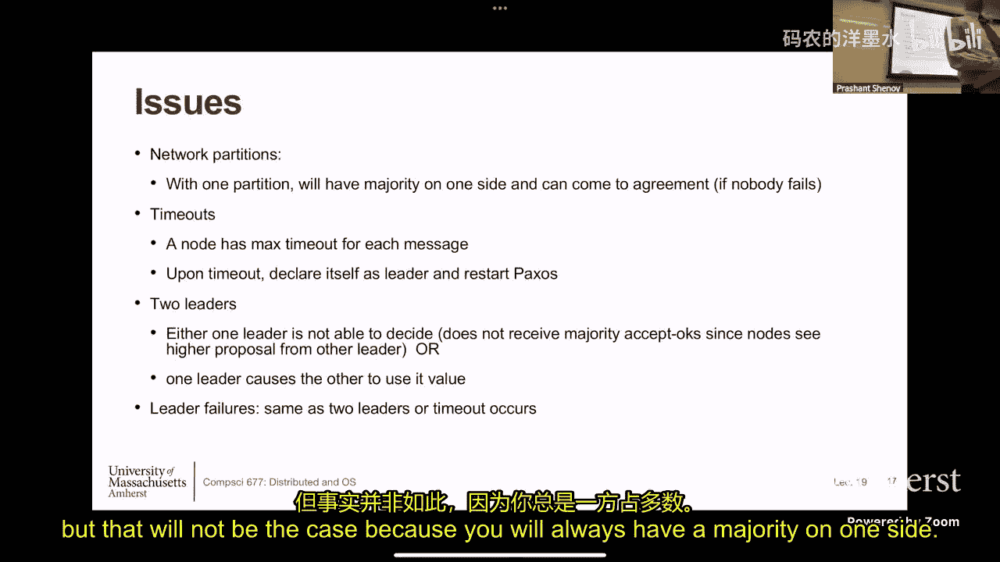

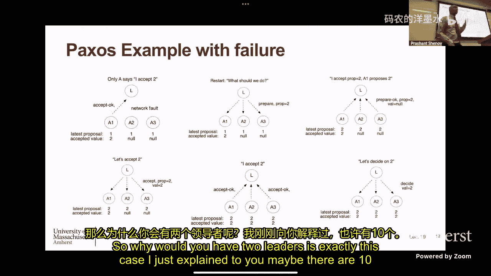

But the good part is because only one partition can have a majority。

 only one leader they will actually make progress or this will just sit there and keep timing out。

That clear so so lots of failure cases like this which I will not go into a lot of details but you kind of get the idea why you are to deal with them。

 but because we always stick with a majority vote we are guaranteed that only one leader can make that that is the basic idea。

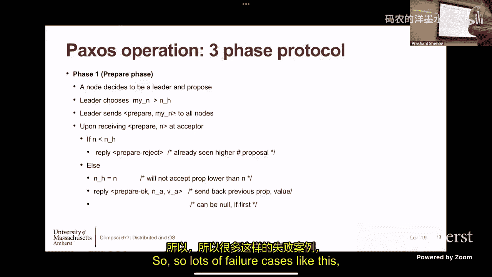

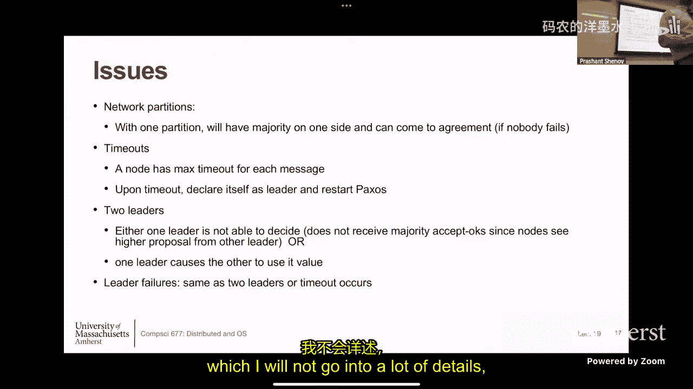

Yes。Okay， is it part possible both partition don't have majority yes。

 you might have some node that simply crash。Right the example of 10 nodes lets say five of them crash two of them end up on one side three of them end up on another so is a crash in a network partition there is no majority there is no majority there is no progress the basic rule is there has to be a majority to make progress if you don't even have majority there is no progress yes you cannot network partition there is no majority on either side because in addition to the partition some node just fail then you cannot do anything。

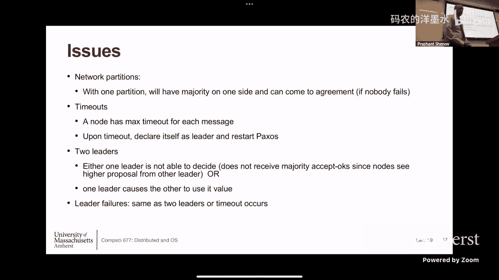

Okay。So that paxos we now see another protocol called raft so this is a different consensus protocol trying to do the same high level thing youre trying to get agreement but this one has a。

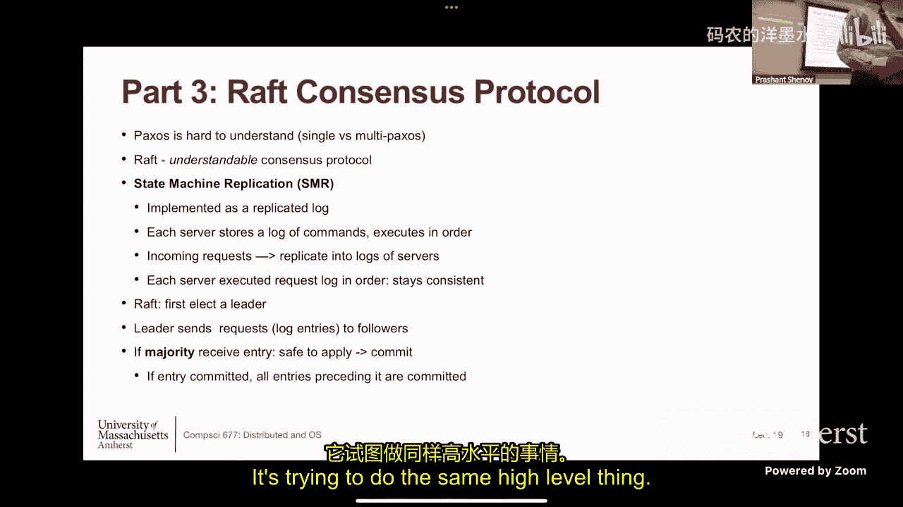

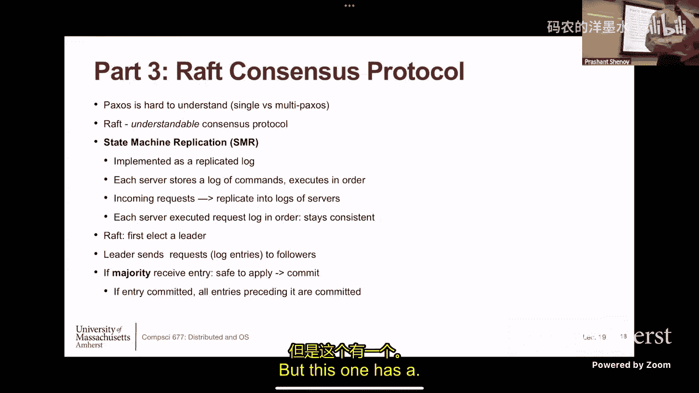

Different way on how to do agreement because raft is trying to reach agreement on only one thing and that thing is there are multiple requests coming into the system let us agree on the order in which the request entered the system。

You are not agreeing on what is the output of an RPC operation you are not agreeing on to we commit the transaction about the transaction tax is the more general case where you can agree on anything in raft you are specifically trying to agree on requests are coming into the system there are multiple replicas all the replicas need to agree on the order in which they entered the system if you say there are three requests A B and C all of them say a came in first B came and C came if they all agree thats what we are trying to reach agreement some ordering okay and the ordering specifically is the order in which request are right and will see why that is the case。

So some people think raft is an easier protocol to achieve consensus because it you will see that some type some of this is easier you' are not having multiple rounds and so on but it has its own nuances as well now raft the main thing I want the reason I wanted to mention raft is raft essentially implements consensus on whats called state machine replication or SMR and I explain what SMR means so the basic idea in state machine replication the name seems fancy but the basic idea is very simple in fact let me show you a figure here's the figure。

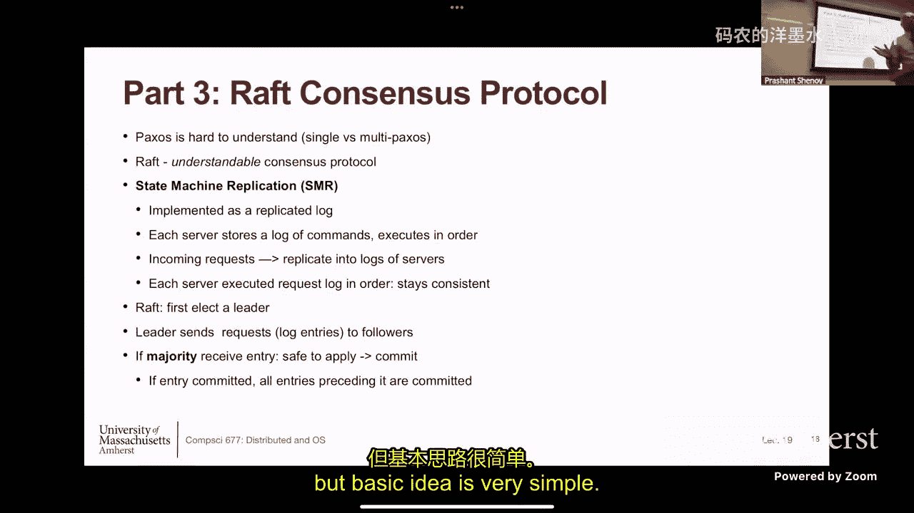

So initially there is a left side of the figure and a right side of the figure lets just take the left side so we will assume that there are some number of replicas in this case request come in。

They send to all the replics。Okay， and you want the replicas to。

Execute the request in the same order。You saw remember the database exation。thing。

Explain way back when where there are two queries coming in one database replica gets query a followed by B。

 the other gets b followed by a if they execute them in two different order。

 their database state may be incorrect。So you want to keep the state the same if you are if all the replicas are identical have the exact same state and you have set of requests you execute all the requests and the replicas in the exact same order。

 the final state should also be the same。each state is only modifying that let's say the database in some way so you want to ensure that all the replicas are going to execute requests in the same order then all the replicas will always be identical in terms of that state that is the basic question now what how does the how do you do this essentially what you do is you essentially keep a log the log essentially just keeps the request in the order youre executing right so here is an example of a log which says。

so the log says I executed a request which assigned3 to the value X then I executed a request that assigned 2 to the value Y then I updated x to1 and updated z to 6 these are all requests that are coming in there updating database records which are x Y z and the number is as what it has been updated to so you just have this log that says I received this request each request made the following operation I have kept this log every database actually keeps this log anyway if you think about the redo log that I was explaining when we talked about transaction all these logs are already maintained now the point is since there are multiple replicas if they get this requests out of order and you execute them in different orders you might end up with different sticks。

So you want to make sure all of them are going to execute them in the same order the way we are going to do this is that we are first going to insert the request into the log and then the database will take each request from the log and replay it and say this is what I'm going to do and if the logs are identical on all the machines it follows that you are simply taking a next request from the log executing so the idea is you want to make sure the logs are consistent and then each database or each replica just pulling the next request from the log and blindly replaying it and then so long as you start with the same state you execute the same request in the same order you end up with the same state so all your replicas will always be consistent。

Okay so the state here is the log okay and when we say state machine replication we are simply trying to replicate the log thats all we are trying to do we want to make sure the same log is on the machine all machines and is identical and then all these machines are simply pulling requests from the log and executing it。

So our consensus problem has reduced to keeping a log on each machine a log is a file on each machine and ensuring that the file contents are identical across machine that is the problem we are going to solve rather than all these paos like protocol we are just one now make sure there is a log on each machine and each machine has the same log same request in this log and again you cannot crashes some machines might disappear and come back and then their log is out of date and it has to reynchronize the log so we want to make sure that even though some minority machines have gone offline and come back you always make sure the log is identical we refercur to the same state。

I that clear okay this is called state machine replication the state machine is basically a term for a log so it is essentially log replication and we want to ensure consistent log replication that allows us to ensure that all of these machines have agreement on what order to play request。

😊，Is that clear what I'm saying in Earth？

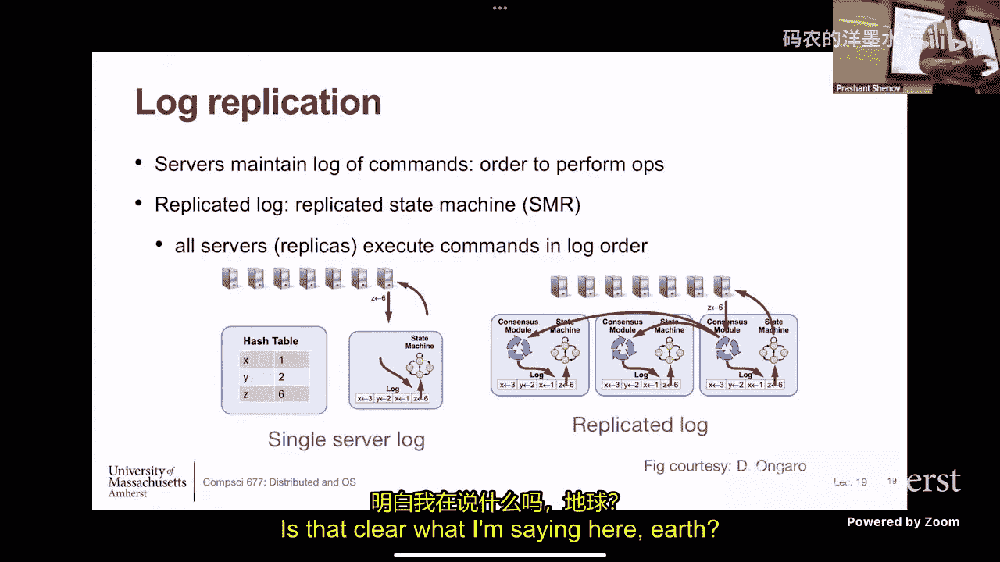

So let's talk about how this is going to work。So we will essentially assume a leader based consensus protocol which is ra so we there will be a leader okay so what will happen is request will come to the leader the leader will first put that request into its log okay now the leader has a log its updated the log and its goal is to tell all of its follower saying okay now here is an update you need to make to your log so your log and my logger identity。

So all the requests will come to the leader， the leader will decide on the order。

And it will start inserting these requests into the log。

 that' is the order in which all the replicas have to put them in their log and that is the order in which all the replicas will execute those requests。

 it doesn' not matter what order they receive the request。

 they have to execute the request in the order that the leader tells them principal。Is this clear？

All right， so。We first essentially pick a leader and then here's how it's going to work right so so we'll assume that time is divided into terms Ter are like rounds in each round you will have a leader and then in that round is the job of the leader to tell the followers what order to put request into the log and what order to replay those requests across rounds are terms there can be election a new leader may be elected because maybe the leader fail maybe the leader said I'm done go pick a new leader why the leader stop being a leader is not are concerned but we'll assume that so long as the leader is stable you have a round when the leader disappears a new round starts new round has to start with a new leader election we know how to do leader elections I'm not going to talk about that I'm going to talk about what happened after a leader is chosen in the green phase where you are doing log replication。

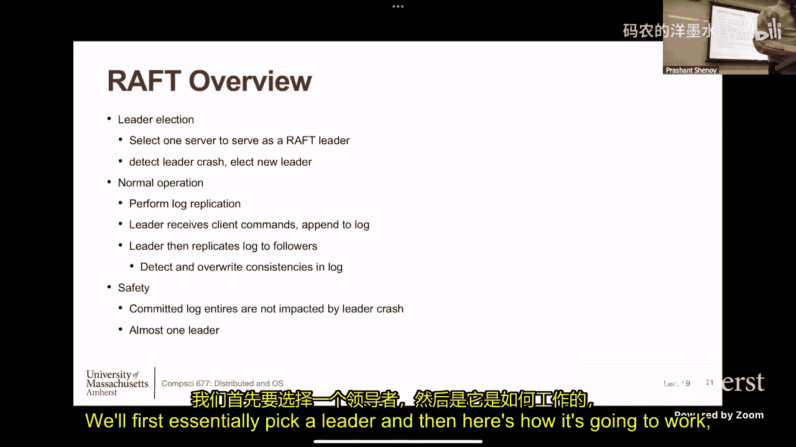

That clear your question。

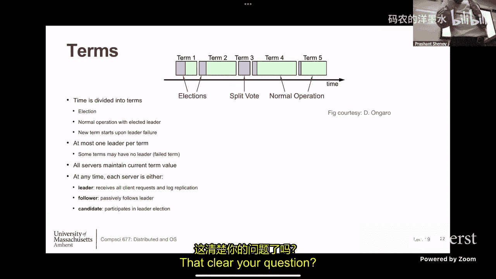

All right， so here let me show you an example。So we resume。

The leader election will assume that if you have essentially no RPC is received for maybe half a second there are no messages in the system for half a second you assume leader okay and you start a new leader why half a second that's what the designers pick okay you could up with some other values saying if I want heard from the leader for some duration D you assume the leader failed you pick a new leader here the duration is somewhere between 100 to 500 millisecond so and then you pick a leader we won't really worry about how to choose a leader we did that already several classes ago but now let's look at how normal operation works okay leader is going to receive request from the client。

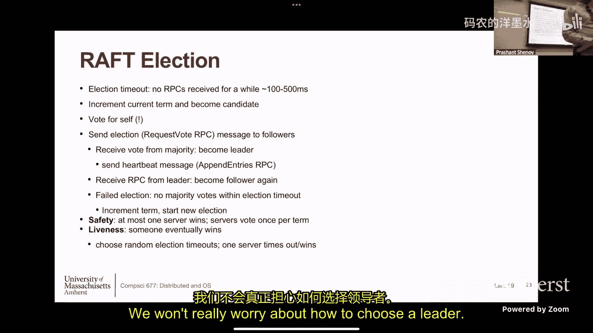

It is going to receive a request so it let's say leader is just a database right it is going to receive queries from the query it is going to insert this queries into its log here is the leaders log。

So you will see that each request each entry in the query is numbered one through8 okay the colors here stand for a term okay so the green term had a green leader then that leader maybe decided not to be leader then a new term started which is yellow term theres a new leader now we are in the purple term this is the current leader okay so it is now adding it so leaders will change over time and now this is the log of the current leader its goal is to make sure all the followers have exactly that。

That's all we are trying to achieve here so essentially what we going to do is going to first enter the newest entry into the log let's say x is4 okay so you'll do an append entry and then it will send RPRPC to all of its followers saying go add that it okay to get an acknowledgement you are done will be all of them the majority said yes we added it so you have consensus you said I added this entry my majority of my followers added this entry we are done okay and if majority hasn't actually。

Acknowledge then maybe you are to start a new round。A you have a re。So now the problem comes when。

Yes。Some followers have failed and then they come back up and they find that their log is very different from the leader log because they didnt receive some of these entries they had fail so you are to essentially reconstruct that log。

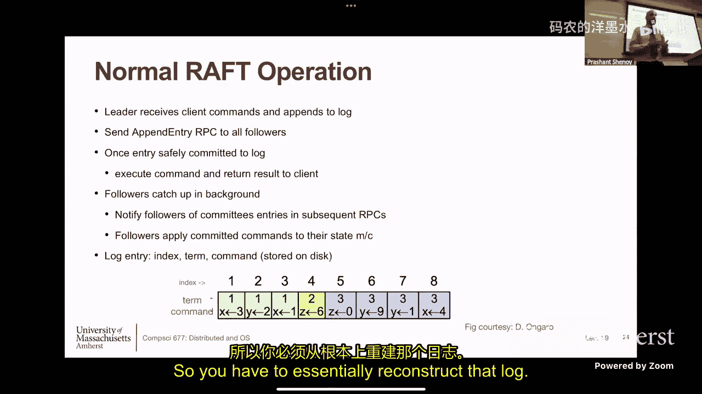

So this is the example。meSo here is an example where a follower came back up it has four green entries and here is the leader the leader has three green entries。

😊，One yellow entry， one blue entry okay so it has to essentially repair the log at the follower because this this。

あるよ。Follower has an incorrect entry and it is missing two entries the yellow and the blue。

So you will see how to do that okay and here are other examples that the top one is the leader okay you will see that it has a yellow green yellow pink and blue。

😊，Terms right and you will see that these followers are all kinds of problems this follower has one missing entry this follower has several missing entries okay these follow are extraneous entries this follow seems to have a term where nobody else has seen it maybe it got partition it picks some leader it added some entries and then disappear right so this has extraneous entries these have also extraneous entries and so on so you can have all kinds of problems so when a follower comes up it might have missing entries it may have entries that the leader never agreed to that are just extraneous that have to be discarded。

So you have to do log repair。Okay， so essentially the question is how are we going to do log repair。

 what is the simplest way we can do log repair？But it was。Yes。

 you have to take the leader's log and sync it all。Yes。Let's take the missing entries case。

Okay so how what is the simplest way you are going to sync a log of the leader with a follower log that is missing some entries in theuff the prefix is the same the suffix is missing some entries。

 what should we do。How are we going to sing what's the simplest thing you can do to sing this？

You can replace the entire thing that is simple definitely simple but but less efficient yes I should say simplest but efficient thing to yeah you could just have the leader sign the entire log but logs might be quite long so maybe you want to do something little more efficient than that right yes。

😊，They ask for logs after a particular test。Okay， so you can ask for log after a particular timestamp and say you replay that。

 you could do that。So another thing you could do is you start with the most recent entry in the log。

Lead a log and you keep rewinding the log until you find a matching entry。

So then you know how many entries are missing so the reader might say do you have entry 10 you say no do you entry 9 you will say yes then you say okay you are missing entry 10 so you will send that missing entry so essentially you can do a di。

Rather than sending the whole law you can do a diff saying what what is the most what is the prefix you have you find that and then you replay all the remaining entries because you know the follower doest have so in case of follower B you will go all the way to entry 4 and then this you will basically send the remaining remainder of the log。

Okay。Now when you extraneous entries you have to do extra work you essentially you have to ask it to throw those entries and then also find the prefix that matches and then go for so so in this case in C you just have an extra entry 11 which is not there at the leader so you might have to tell it to go all the way back to 10 and then you reach the prefix there nothing so you just have to delete。

That's6 step。And in this case， you have to delete these two brown looking entries saying you seem to have some extraneous entry throw them out right so essentially you want to keep。

So find a efficient way to go backwards until you find a match and then make sure all the entries that are missing are either sent or the extraneous entries are delete。

Or both because you might have some missing entries， some extraneous。Once you do this。

 then these logs of the followers are repair and then they can rejoin the RAft protocol where they can start adding entries to the log。

so the simplest case is where there are no problems， all the followers are consistent。

 new request comes in。Leader adds it to its log now there is an extra entry and then it has to tell the followers to add that same entry it will send an RPC saying add this entry。

 they will all add the entry， send an acknowledgement you are done。

Right because you just added an entry now everybodys sync them。

The more problematic is is some followers are because you are doing majority still right so long as the majority say they are done you are still done but the minority that didn't respond will now have inconsistence in their log so when they rejoin they have to essentially rethink their lock there are some questions you have to question and somebody else had to。

Okay， question is a follower has a bad entry， why are we discarding it？こ。So， in this case。

 the goal is that you have to take the leader log and you have to replicate where this extraneous entry came we don't know。

 for example， it may have so happened that the reason you are this extraneous entry is this node was a leader。

It essentially added two entries into its log and it sent an RPC request to all the other followers to add it but then it crashed before it could make all of the log so now it has two entries in its log because it was a follower at one point but it never got the others sorry it was a leader at one point but it never got its follower to accept it so then you are to remove those entries that's why you might end up with these entries because as I said the first thing is when the request comes in you add it to your log then you have to convince others to add it to their log so in this case this case will happen where you are a leader you entered something but you couldn't get others to it as one example。

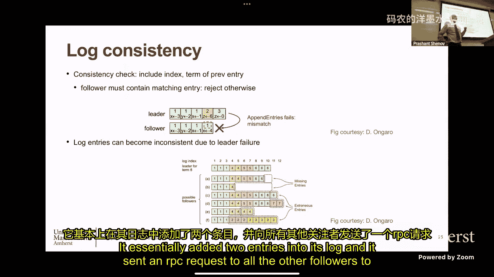

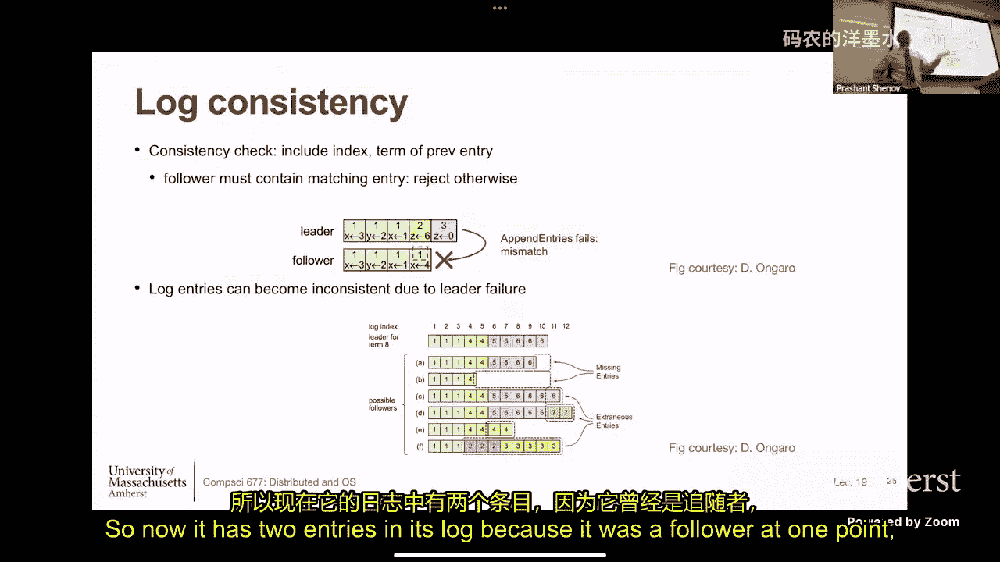

Okay question how do we deal with losing that particular entry so in this case you just remove that request and eventually the client will get a timeout saying the request did not succeed。

Because you could not get agreement， is there some question here。

It is there possibility of having it。え的に。Okay question is there a possibility of having an extraneous entry and then a correct entry that's your exam question so technically you shouldn't have a case where the middle of the log is the problem if you do this protocol right the prefix should always be right and it should be either youre missing entries in the suffix or your extraneous entry if you are the middle that's problematic then you cannot just go back to the most recent correct entry and played and the reason again why you will not have the middle entries to be wrong is the follower comes back up it's not allowed to add new entries to the log until it is synchronized so only what you said will happen is you are already entering entries。

 new entries to the log valid entries when you havent repaired your log So if you add entries to a bad log then you will have that case but we are assuming that you will make sure the log has been repaired before you allowed to add entry so you shouldn't have that case there's some question。

Okay any other question okay so so this is why raft ensures that only the suffix can have problems otherwise you will have to go all the way to the beginning and compare entry by entry to fix the log and that might be expensive so you don't want that case。

Yes。有。How do you know what point you to traverse back so you could。

 for example go to the log followers log and say give me the index it says index number four you will basically go there and then make sure it matches if not you keep going back until you find a matching entry and then replayrave it。

Yeah so you can your most recent entry may not be a matching entry it could be an extraneous entry。

 but you go back because it is indexed by。My entry number right so you go back to the prefix most recent prefix that's a match that's the basic idea so you go step by step until you find the most recent match。

Is it supposed to be expensive well this is going to be linear operation right you are going to go backwards in time until you find a match but that is the only thing you can do the other thing is what was explained earlier you can send the entire log but if is log is maybe one year long。

Because it's just a long log， you will essentially end up sending a lot more data than trying to rewind it to a point where it matches the leader you're just trying to rewind a point where matches the leader and you replay the rest of the log okay so it depends I mean if yes if this follower was offline for a really long time you might actually want to just replace the follower log but it's always better to do this。

In general， that's more efficient， your question yes。Okay。WeHave a short dog。those。こ that。

呃 father is father there。Yeah so question is is there an optimization where if you have a small log it's cheaper to send the entire log rather than sending lot of messages saying do you have entry 10 then you say no do you have entry9 you say no you keep doing this until you get to four so that's like already you spend six messages asking wouldn't it up been cheaper to just send the entire log that may be the case you could certainly do that that's not what RA does but it's an optimization for sure for small log it may be cheaper to send that entire log and renc rather than getting tracking one entry at a time but yes right。

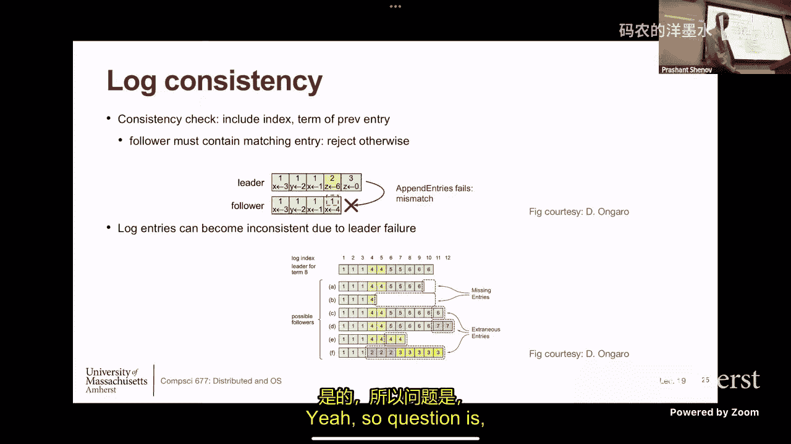

Any other questions here？Okay， if there are no questions。

So this is log repair I already mentioned this here。

So I will briefly mention checkpointing here as another way you can do recovery。

 we talked about PAxos， we talked about consensus if you remember when we had done distributed snapshots。

I talked about how do you take snapshots， how do you recover from fail nodes and so on so this is basically the alternatives to keeping log is you checkpoint state so logging is one approach where every operations is put in a file when the fail node comes back up you figure out which operations were not process that this node you get the log and you replay those operations that's one approach the other approach is you take a distributed snapshot of all of the replicas every so often and if there's a failure you go back to the most recent snapshot and play things from that point on a distributed snapshot will work if youre actually using something are not using the computation something like a simulation if youre a database where you are actively receiving requests you can't say I took a snapshot at midnight I'm going to roll back there and I'm going to throw out all the operations that were committed to the database since then because then you log。

Some operations so if you have database like situations logging is the right approach if you are doing simulations okay checkpointing might be cheaper you might say checkpoint every hour I don't have to write every single request to a log and have the logging over and added it to my computation right so checkpointing is an orthogonal approach to ensuring you can recover failed replicas to something like logging logging allows you to keep。

Keep track of the state on a per request basis。 checkpointing periodically keeps track of the state by checkpointing the entire state using distributors So this is something I wanted to mention as an alternative approach that's used in some computation not and things like databases or web services where Paxs and logging like ra like logging is the N but in other batch computation this is often cheaper rather than writing logs which can be expensive because you might see all the overhead or to pay just execute one request all of the logging and Paxs to send all of those messages to execute each request So it does get expensive So this is an alternative that's used in certain types of applications in your application well'll just say that and then we'll end it here today next time well start talking about a new topic so let's stop here。

