# 【全集 2025 附课件】马萨诸塞大学 分布式系统 中英字幕 p21 Lecture 21 - 边缘计算、网络缓存 -BV19BSYBuE4Y_p21-

Okay， we'll get started in just a second。Yeah。Okay。

 so let's get started so we are going to continue the discussion on worldwide web from last time。

 so today we have three topics to cover is web caching， which I'm going to start with。

Then there is content distribution networks and edge computing they are all related。

 as you will see each one will build on the previous things we talk about。

 So let's start with web caching so。This two figure should already be familiar to you。

 we've seen it several times The top figure here shows you a typical client server system as it exists in the web so your web browser that' is talking to a web server and then we said you can turn this into a client proxy server system where there's a proxy server sitting between the browser and the web server okay in this case it's a web proxy and specifically today we are going to look at what how do you design this web proxy when its main functionality is caing so this proxy is going to cache web pages and images that you get from web servers so your browser is first going to contact the web proxy with some URL if that URL is cached at the web proxy youre going to get those contents immediately don't have to go to the server and then you are done and if not you have a cachemiss that is going to require the cache。

Contact the server， fetch the content， put it in the cache and then hand it back to the browser okay so that's the picture you should have in mind this is a slightly more complicated version of web proxy caching that we are also going to discuss today so this version of web proxy caching involves multiple caches and in this figure you will see that there are three proxies each of them has a cache the principle is the same you might have a client as you see here it contacts the web proxy with the httP request if that cache at that proxy already has the content you just return it to the proxy are done now if the cache at that proxy does not have the requested URL in the previous case in the simple case you are just going to go to the web server that's a cache miss you go to the web server and get the contents but in this case because there are other proxies nearby you can actually。

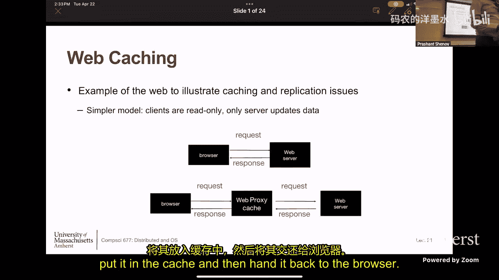

Those proxies if they have the content before you go to the server and the idea is if there are other nearby proxies。

 maybe you can fetch the content faster than having to go to the web server now if you have this model where there are multiple proxies that are collectively working together to serve client requests you get what is called cooperative cache typically caches are standalone this previous picture showed you a single cache the browsers or clients connect to that cache and the cache can either return the content talk to servers but if you have more than one and they are actually working together as I just showed you here you get cooperative caching so we are going to look at both of these aspects today they will start with single level cache and then will generalize that to。

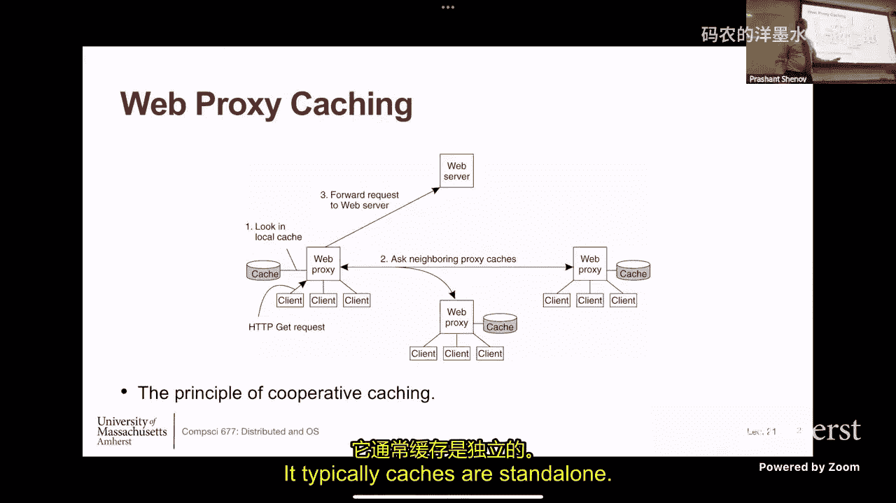

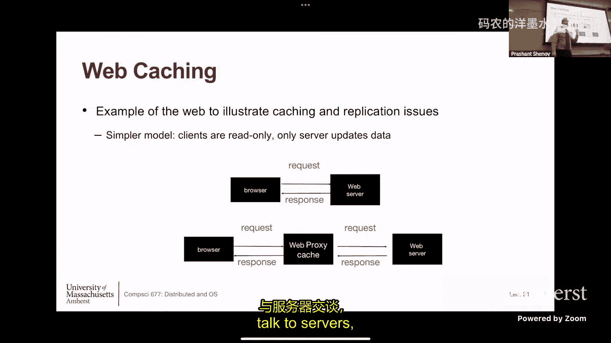

With multiple cache okay but the more important thing we will discuss first is consistency if you remember when I talked about replication I said when there are multiple copies of any data item in a distributed system you need to ensure that all of these copies are consistent with one another the same is true of a web cache you can think of a cached web page as being a replica of the original web page at a web server now let's assume it's a cached version of some news website page let's say CNN as an example so you have the CNN front page that's in the cache now if the front page on the original server is going to get updated then the content and the cache have become still they are out of date because the copy on the server has changed now somehow you need to make sure that whenever there are updates at the server the cache actually does not serve sta content。

maybe another browser sends a request saying it wants to get the homeage of CNN and then the cache might say it's already in the cache and return a sta version and that's not good because now the user is seeing and out ofd version of the web page so you want to ensure that whatever contents are kept in the cache are always kept consistent so that's why you need to deal with consistency we talked about consistency models a few lectures back here we are going to look at some simple consistency techniques that try to use some of those ideas and implement them in a web caching framework so so I think the thing you want to keep in mind as we design some of these consistency techniques is that web pages are actually going to be very different in terms of how frequently they are updated and how frequently they are actually access so let's say that there are some I'm going to use the term object to mean either an。

TMl page or images or anything else that's embedded in the page。

 so you will say some objects are static， which means once they are created。

 they are never going to change。So those are called static objects and many other web pages tend to be dynamic that change frequently news websites are a good example they are going to be maybe there is a breaking news section in that news website that gets updated frequently every few minutes so the page actually changes every few minutes and then there may be other pages that change every few days or maybe once you create you don't change it at the update frequency is going to vary from a few minutes to a few weeks to never。

😊，Now the access frequency might also vary access frequency means the popularity of that web page how many users are accessing that web page per unit time every second there are some pages are very popular popular new sites ecommerce-commerce side they are all extremely popular they get millions of users accessing them every day and then you might have less access pages that maybe personal websites or other pages that don't get very much access so that's called a popularity of the page that also very significant and we need to keep both of these issues in mind as we design consistency techniques so we will look at a few but by and large always a proxy cache going to maintain consistency of an object which would be a web page or an image so suppose that this object has changed on the server。

😊，Somehow the cache has to be told that the object has changed so that if that object is cache it's invalidated from the cache so so the way you can do this is a simple thing is the server can then send a notification to the cache saying the object is changed that could then invalid message saying if the object is cache discarded from the cache so then the server the cache can then just remove it so that your own store sale content or the server can actually send the new version rather than saying invalid it you can just send the new version of the page and then the old version in the cache gets replaced with the new version so in this case also things are fine so either you can send an invalid it or you can send an update。

Is this clear？now there are two ways you can do this。

 which is either you can use a push base technique to。

Do either of those two things or you can use a pull based technique and we'll look at both and try to compare them a little bit。

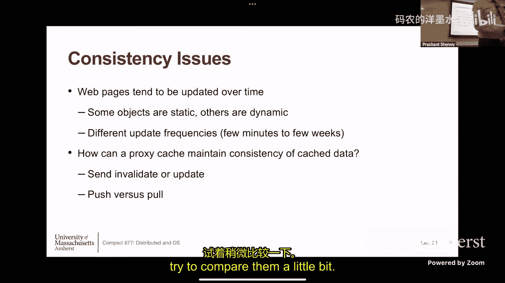

lets start with the server push approach as the name server push indicates okay it is the responsibility of the server to push invalidation or update messages to the proxy cache or every proxy cache that cache is content whenever something changes at the server okay the server observes that a web page has been updated its responsibility is to push an invalidate message or an update message to every proxy cache that has it。

So， the server has to keep track of all the proxies that have requested content from it。

It does have a list。And whenever a web page changes it can look at the list of which proxies have cache that specific URL and then it has to send a notification it is to notify the proxy okay the notification could be one of two types an invalidate message that is going from the server to the proxy or an update message invalidate simply means this URL has changed invalid it from the cache which means remove it from the cache so then the sta contents are removed okay update means you actually send the full new version of that object and then the old version in the cache gets replaced with the new version。

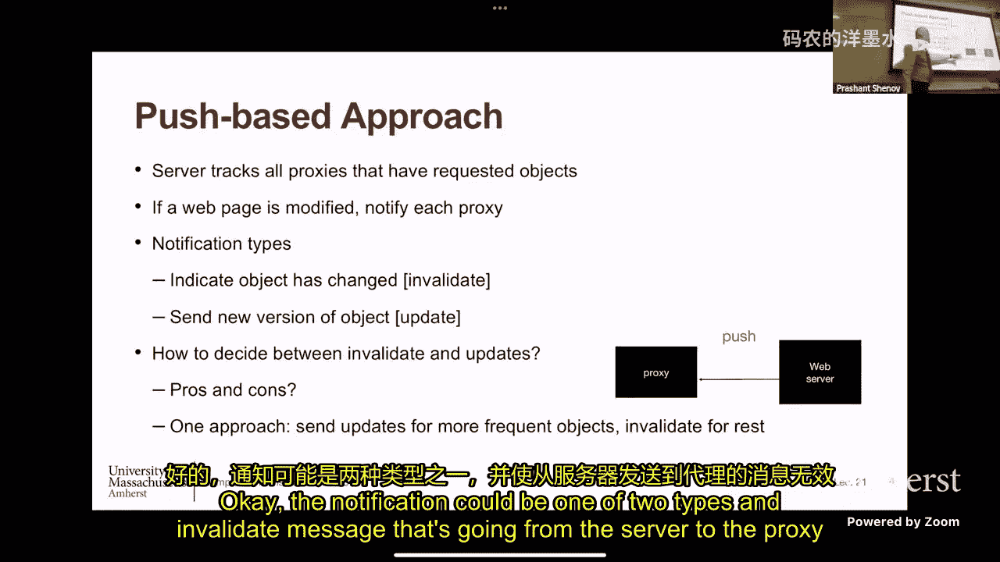

Okay。So question for one question you can ask is suppose that a web page has changed the server has one of two choices to notify all the proxies okay which one should it pick should it send an invalid message or an update message and under what scenario would you send one over the other？

Any thoughts on this？The question clear。the server has to note a web page has changed and the server so now the server's responsibility to notify the proxy in this case is only one proxy shown for simplicity。

 but there could be more than one has to notify the proxy。

You can do this through an invalidate message or an update so when would you send one over the other？

Yes。当时。放生答佢到。好。好的。好虑。Yes so that's good observation the first question is you should ask what is the overhead of these two techniques okay an invalid message is going to be a short message is going to just have an invalid with the URL and you just send that right so that's a fairly short message in terms of overhead an update actually includes the entire page or it could be an image it could be larger in size so the overhead or the size of an update message is going to be larger than the size of an invalid message okay so you have to if you are going to send a larger message you want to make sure that the extra cost of sending a longer message is going to be worth the that you are to make sure that you。

That you want to pay that extra cost in terms of the benefits you're going to get so as was just pointed out。

 you will send an update if the web page is popular at the proxy。

 there are lots of users requesting the that content at the proxy then the server can pay that extra price and say here is the new version and then you send the object gets replaced and then the next request that comes to the proxy automatically gets the new version of the page on the other hand。

 if the URL that has changed is not very popular it's infrequently accessed by the user there is no reason you want to send an update because what if nobody accesses it afterward you pay all this extra cost are sending this page but nobody accesses it because it's not very popular its infrequently so in that case your better object sending an invalid so that the object is removed from the cache there's no stale version and then if somebody accesses that。

Sub it is going to be a cash miss and the proxy is going to request it anyway。

Is that clear okay so so whether you pay that extra cost of an update is going to depend on the access frequency of the object or the popularity of the object。

So as that is what mentioned here send updates for more frequently accessed objects in for the rest。

Yes。我刚在。て。Okay question is can both of them be used in the same system yes there is no reason to just have one or the other the server can have both of those options so as and it can decide for certain URLs it uses updates for others to use invalid。

Yeah so question is does it mark popular pages how is that going to work So in this approach if you are going to dynamically decide between updates and invalids you need extra information you need the server needs to know the popularity of web pages at various proxy it needs to know what's the access frequency and keep in mind access frequency may not be static you might have let's say breaking news item on a news website there are lots of accesses to that because everyone is trying to read the news but maybe two days later you are not going to get access to the page something else gets popular so the popularity of any page is not going to static over time it will itself sell vary but whatever it is for the current point in time the server needs to keep track of it so it can decide between one or the other and it needs to keep updating the popularity because if there's a big change it might switch from one or to the other so。

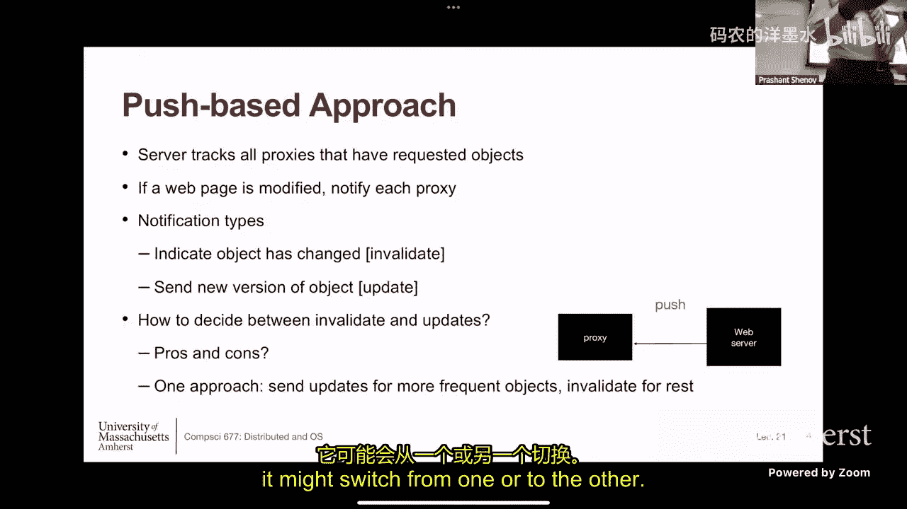

Those are all things we have to do， but so that brings us to some advantages and disadvantages of server push based approaches。

 so the first thing to keep in mind in server pushes。

It gives tight consistency guarantees because as soon as a Web changes you are sending out messages to the proxy。

 proxies will then make the appropriate decision of either discarding stale content or replacing it with the new version so you are going to get reasonably good consistency guarantees I would not call this strong consistency because there is always a delay between the time of web pay changes to the time that message actually arrives at the proxy so that small amount of delay means you cannot really call this strong consistency which is what we had studied when we are talking about consistency models。

But it is tight it is red reasonably close to strong but not exactly strong consistent Okay that is the first advantage the second advantage is in this case。

Prooxies can be passive， okay they are just caches， the server is doing all the work。

Of deciding how to implement consistency。Because there was job to notify the proxy。

 proxies are not doing it。是。😊，Disadvans， there are several first is the。

Servo has to keep state the state in this case is the list of all the proxies that have cached content from it。

Because once a proxy request a web page and keeps it in the cache until that webage is discarded from the cache the server has to keep track of that proxy and every time that web page changes it has to send it either notifications or update that state information okay so this has made the server state full HTP by itself is a stateless protocol there is no state but if you add consistency。

Overheads or to at the server on top of just HtP， you are making the server state so this amount of state could be large for popular pages there may be thousands of proxies that are requested tens of thousands of proxies that were requested a paid every time it changes you have to keep track of all of the proxy IP addresses the URL and then send them notification so you can have a substantial amount of state that you would have to keep at the server in this case so so it's a stateful technique and second issue is the state might have to be kept indefinitely if the proxy decides to cache an object for a long period of time the server is responsible for sending invalidate or update messages for that long period of time and that could be a very long period which can turn to infinity so you might have to keep the state for a long time once the。

Prooxy decides to replace or discard that content then the server can stop sending notification but until then you have to send notification okay so there is this issue where the server becomes stateful and the state has to be kept for longer period which also means that if the state is kept in the memory of the server not on disk and the server crashes all other state disappears right so you have to make either you keep it on disk in which case you can survive reboots or if you keep it in Ramm then if you reboot the server all of this information is gone so you are not giving any consistency guarantees because you don't know which proxy is caching waterbe。

Yes。哦系。Yes。都好嘅时。think the话。So， that is a good question so question is the cash size might be limited。

 it is not infinite at every proxy may be limited by the size of the disk so if your cash replacement。

😊，W which means that new items are brought in old items are removed I think all of you are implementing cash replacement in lab3 right you're using least recently used LRU as your cash replacement technique so so web proxy will also implement some sort of a cash replacement then the question is how is the server to know that contents have been removed we didn't actually talk about that but if the proxy could notify a server saying that an item is removed from the cache as one exam right otherwise the server will not know what is actually stored at the proxy whether it been removed or。

 but that's an additional overhead that the server has to get this information from the proxy if it remove otherwise itll send wasteful messages。

Yes， from understanding。对。合理赔。你个三年的。呃我了问点啊。驾驶证第一。Thatでていです。Yes。

 so I think that you're asking about the lab right or not yes。

 so from the lab perspective you're implementing something very straightforward whenever something changes you just invalid it you don't have to send an update。

 you just invalidate it from the cache why that's much simpler than actually sending a more recent version。

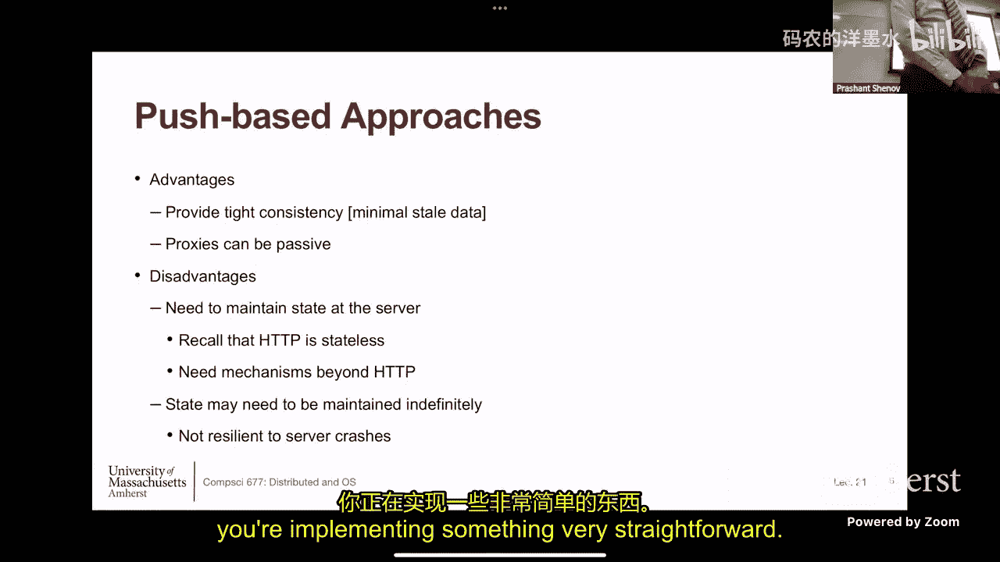

Okay， yes。All right so now lets talk about the other approach which is pool based okay so in this case everything is flipped okay so in a pool based approach is the responsibility of the proxy to maintain cash consistency okay so。

Essentially what the proxy is going to do is for every cached page is going to periodically pull the server。

 has this page changed？😊，If the server says yes， it has changed， then you invalid it。😊。

You remove it from your cache because now your stale version of the pig okay but if the server says no it hasn't changed then you can keep it around you know that the web page is still current whatever your cache is the same as whats at the server。

So this is called a polling based technique okay so you can pull the server to keep checking whether the web page has changed or not and interestingly enough you can do this with standard STTP messages with no extra protocol needed the way you do this is STTP the STTP as you all know STtTP as a get method which is what you use to get a web page you say get and have a URL and then you fetch the page now it turns out that STTP supports what's called a conditional get so you can specify a condition and the get will work only if the condition is true the condition is false the get will return null。

So the type of condition you are going to actually specify is who you call it called an if modified since and you specify a date right so so you can basically the proxy and say I fetch this page yesterday at no okay so now when you pull the server you say HttP get if modified since yesterday no so you specify a date saying if it has been modified since this date I fetch the page then send me the new version otherwise if it doesn't change is return on so thats called a conditional get thats supported by HttP this is called IMSS if modified since then IMS get。

So you can simply use an IMS STtP message to keep poll its a type of a poll it says tell me if it has changed okay if it has changed you are also asking for the new version of the page clearly and if it doesn't change then you just get nu so you know that whatever is in the cache is current so you can implement a poolbased approach using simple STTP server push approach is of course you don't use STTP except now with the newest version STTP supports push ifTP has always been a request response protocol but the newest version supports push or with that you can actually do server push but anything that's older you don't have STtP as your pushbased protocol you implement some other one but poolb always been possible using STtP now that brings us to this next question saying how frequently should the proxy check with the server。

I said you pull the server periodically and then the server will tell you if the page has changed or not so that' is good but then how frequently would you do it。

should you do it every minute， every hour， every six hours right so you can pick your polling frequency right and depending on what you pick you may get different results。

😊，so let's take an example let's say go back to this example of the front page of CNN or New York Times right there is a page that gets updated frequently at least it has some breaking news section and so on so they will get updated every few minutes now if the proxies decides to poll every six hours。

 you fetch the page and then you pull after six hours what is going to happen。

Is a question clear you fetch the web page you put it in the cache your polling frequency set to six hours which means you poll every six hours and the web page is changing every few minutes at the server。

What does this mean？Good。You will serve outdated content right you will fetch the page few minutes later it will change but the proxy is not checking with the server anytime soon it is going to check after six hours right so for the next six hours all request to this proxy for that page will return an old version of the page。

The users will see stale content。Okay， so thats fine so we will say okay that is not a good idea you should not pull every parallel or lets start polling every minute or every second。

😊，so every minute or every few seconds you are going to send an httP request to the server and if you have a page that's changing frequently that's good because every few requests maybe you get a message from the server and yes the page has changed since the last time you fetch the page and here's the new version so in that case you will get。

The newest version of the page in your proxy but now if you use the strategy and you are trying to pull a page that doesn't change very frequently。

let's take our class website and I update it twice a week with the lecture note。

Right so it' is being updated once every few days if you check with the server every second saying has it changed it is just going to keep saying no it has not changed so you are wasting a lot of requests asking the server has it changed has it changed a server says no it has not changed so you spent a huge amount of overhead in terms of messages just to check when the request always returns the null。

So that's not very useful from a efficiency standpoint。Right， so。So what does this tell us？

In terms of polling， what should the proxy do？Can you speak up a little what what？Okay。So。

 the best approach is to somehow know how frequently the web page might be changing at the server and match your polling frequency to the update frequency。

For frequently changing pages poll more frequently for less frequently changing pages poll less frequently that' is a good strategy because then you are matching your update frequency not update polling frequency to the update frequency but that is easier said than done because how is the proxy to know how frequently the web page is going to change at the。

Yes。Yes， you are to come up。You will come up with the adaptive technique we'll get to that in just a second but you're right but normally a proxy is not going to know right how frequently a web page will change what does it know it just know is an HTMLl page with a URL so somehow it has to discover the update frequency so that's an additional overhead it on the proxy but let's try to figure it out how to do right so exactly what what was said here heres an adaptive approach right so what you are going to do is you will start with a conservative update frequency so first time you fetch a page you know nothing about the page so you will say let's poll every second。

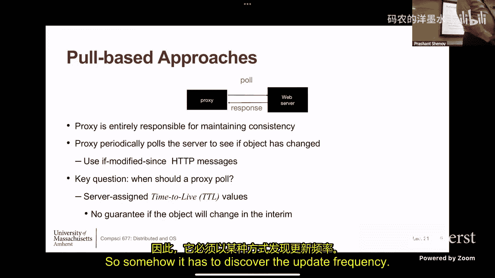

So you pull the server maybe if let's assume for this example is this page is not very frequently updated once a day just as an example so the first time you ask the server server says no it hasn't you so then rather than asking again a second later you reduce the frequency you say I'm going to now ask every 10 seconds so 10 seconds later you ask the server again and IMS request it says it hasn't changed so then you increase it further and so you do this until you hit a time and the server says it has actually changed so now you discovered when you fetch the page originally when it change next so you have some notion of an update has occurred after so much time that has elapsed since the page was so it tells you something about how frequently the page is changing so you can then use that。

Frequency to actually pull but there is no guarantee that the update frequency is static either。😊。

Think about maybe you have a block so you can update your block anytime you want that doesn't mean if you update it right now you are going to wait two days to update it。

 you can update it after a few hours few days so the update frequency is not going to be static it can change so the polling frequency also has to actually be adaptive so essentially if you find that object has been updated between two poles you actually reduce the polling frequency just in case it has changed so that was that exponential back of suggestion that was made so you can decrease exponential you can decrease nearly whatever it is you got to decrease it and then if between two successive poles there has been no update you can increase the frequency a little bit otherwise you decrease so this way you can keep adapting the polling frequency to whatever the update frequency and if it keeps changing you keep changing the polling frequency so this is an adaptive approach which does not assume any prior knowledge of the object。

Udate characteristics， the right frequency can change and the polling frequency will keep tracking it。

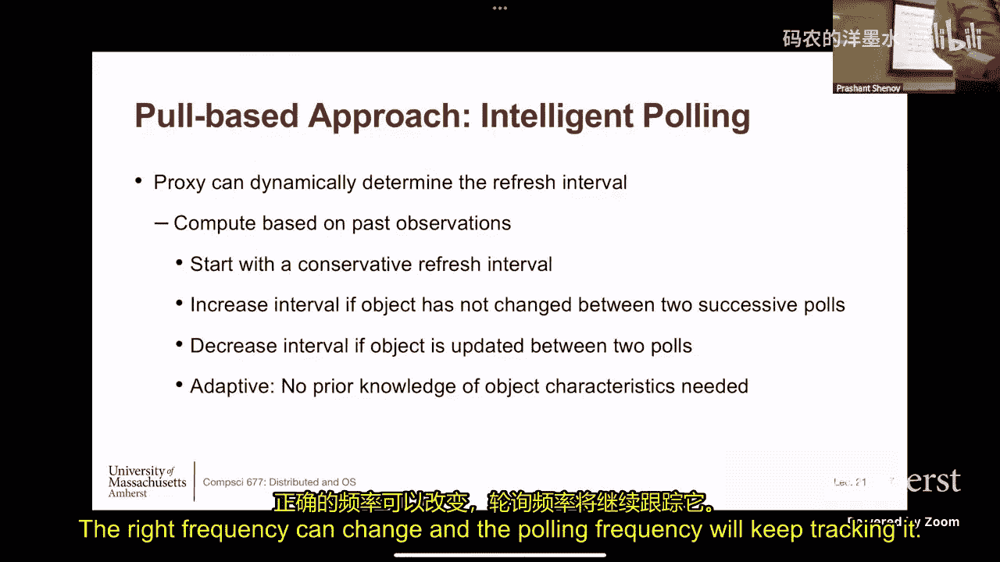

Is if。Okay so that's our polling based approach so that brings us to advantages and disadvantages here the simpler technique than push you can use if modified since conditional get requests or everything can be implemented using HTP the server is now stateless all the work is being done by the proxy the proxy is the one polling the server just has to respond there is no state at the server and the pushb approach so this is going be resilient to both proxy and server failures because the server fails and there's no impact on the polling frequency the proxy changes you can just restart your adaptive interval from a small value and keep increasing。

SoNo harm done maybe a few more messages get sent。So those are the advantages。

Disadvantages of the approach is that the consistency guarantee is going to be weaker than server push the server push approach always assumes that as soon as a page has been updated the server will send notifications to all the proxies so the proxies now shortly after a page changes that that you have to invalidate it from the car。

In this case， you are to wait for the next poll， whatever that is。

So so there' is going to be a period between the time of a page has changed at the server to the next poll and in that period。

😊，You are going to be having stale content in your cash so in your request you will see stale content so it is weaker guarantees than what server or push will provide okay。

Now you need more intelligence at the proxy to decide the polling frequency adapted and so on so assess to have more overhead at the proxy the message overhead is also higher than server push right so if you think about the message complexity of the protocol in server push for every update there is one message that goes to the proxy that's a notification or whenever it changes there's a web page that changes at the server you send one message either a notifier an update in the polling case there may be many round trip messages where you are doing conditional gets before the page actually changes because you might use a more conservative frequency for example so there is going to be higher message overhead than the server push。

Is that clear。Any questions here？Yes。Practice those website。对的。Okay。

 question is in practice do websites maintain their own proxies are proxy generic so I will answer it two ways。

 so the way。in the old days right you could just download a web proxy it was open source and you could deploy your own web proxy and it would do something like this the website had no control over the proxies they never actually did server push proxies had to actually use poolb because servers that no control over anything users were doing you could deploy a proxy for example the CS department can deploy a proxy and anyone whos accessing web content actually goes through the proxy so maybe cache content is delivered to them faster that's how things used to work that's not how things work anymore it's actually the servers are now using a thirdpart system called a content delivery network which will get to that will actually use caching to accelerate content so it has actually now moved from the users deploy this to get content faster to servers that have lots of content to deliver actually use a caching based system usually a thirdpart caching。

A system to deliver content right so we will see both of these so this is something we already seen the CDdn will get in just a few slides。

Yes， when we talked about how there were different classes。Yes。24月份。有没。

Are you asking about the push based approach with the push？Yes in。Okay， that's a good question。

Question is in the pool based approach， do we have one type like in the push base you are a notify message that could be an invalidator or an update？

Quion is in a push base do we have only one or two right so so it turns out that it is actually combined because you are always using a conditional get。

So the conditional get is serving both as a notify and an update if the content has not changed the conditional get returns a null which essentially is like a notify saying nothing has changed but if the object has changed the conditional get the conditional will be true and then you will fetch the content because it is a get request after all so so at that point it becomes an update。

its basically both of these are at play there and depending on whether the condition is false or true you will get if they equivalent to a notify or an invalid versus as an update if that makes sense。

Is that clear any other questions here？Okay， so we will now look at a different approach which is trying to combine both server push and client pool into a single approach we saw that these were not client but proxy pull and server push into one approach。

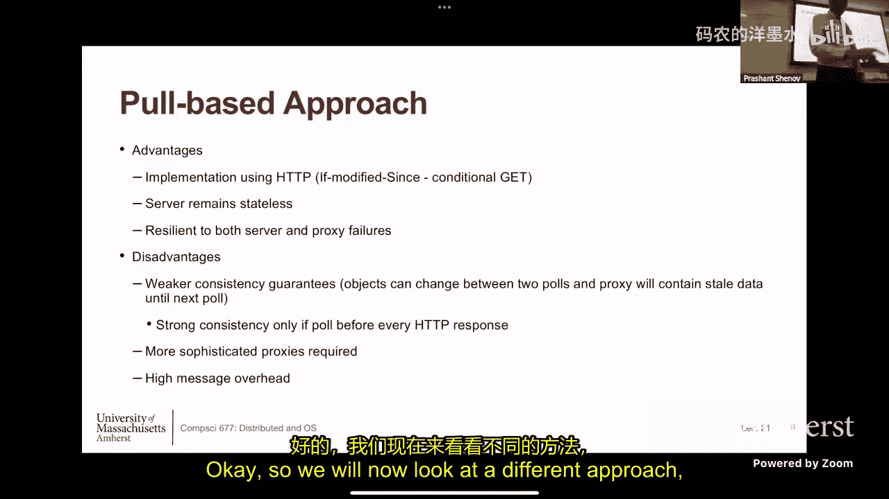

This brings us to a concept called leases which we have not encountered yet okay this is the first time we are hearing this term this concept of leases is a more general concept and distributed system today we are going to look at this lease concept in the context of web proxy caching okay but let me explain what a lease is first and then we will see how are we going to use it for proxy caching so。

What a lease means is it it's like a lease that you might sign to rent an apartment right so what is a lease a lease is effectively a contract okay it's a contract between two parties where you agree to something and you get something in return right so maybe you know apartment case you are basically agreeing to use the apartment and you are going to pay a rent for that period and theres a duration for the lease which says it's valid for a certain amount of time。

In distributed system it's a similar concept where a lease is a contract between two entities in a distributed system for a period of time and the two entities agree to something in our case because we are talking about web proxy caching what we are agreeing to is the server will agree to notify the proxy of any updates to a page so the lease says this for this duration of time the server agrees to send notifications whenever the page is changed so you can get a lease for one hour and then the server is obligated for that one hour to send any notifications whenever that page changes a lease can be gotten on a per URL basis so how are we going to use it for web proxy caching so here is a picture that is going to show you what actually happens so heres a client the browser is going to send it says read but is really sending an HtTP message which comes to the proxy let's assume this the first time the proxy gets a request for this。

URl so it cache does not have that page so it's a cache miss What is it going to doNormally it would just go to the server。

 get the content， put it in the cache and return that content but in this case we will send a get request but it will also send a lease request so it'll say I want this page but also I need a lease on this page the server is then going to send a reply but then it will actually specify you have a lease for a certain duration the server gets to pick that duration so now the proxy can cache the content and so long as the lease is active it is guaranteed that the server will send it notification so it knows that so long as the lease is active its contents are going to be fresh you not have sta content because server needs to notify once the lease expires you can the proxy can do one of two things it can just discard the page from its cache saying the lease is expired so it' no longer save to。

Keep the page in the cache so you can just throw the page on or you can renew the lease you can send a request saying I need a another lease on the object and then the server will give you another lease for a certain duration and then you know that it is fine to keep the page because it's going to be fresh。

That clear so what a lease means in this case or lease is basically in this case a contract between the server and the proxy or the server agrees to send notification or push notifications while the lease is active and once the lease is expired the server can stop sending notifications to the prox。

Unless it gets renewed。so now lets ask what does this do for us how is this first of all hybrid approach or what does it give us in terms of what the properties were for server push and pool and so on。

So， first thing is depending on the duration of the lease you can get different properties so let us say the server for just for example it server gives an infinite duration lease。

And this duration is infinity， it never expires， what does this technique do？Okay。

 the server is now going to send messages， notifications forever。

 so what this lease based technique has essentially become a server pushup。Right。

 because in Ser push， there was no lease， the server was obligated to keep sending。

Kind of invalidates or updates indefinite。Untilil the proxy effectively told it to stop because it throughout the page or something like that so so if you give in finite duration leases has become serverable if the lease duration is0 okay this is the same as client pull because what will happen is you will get the content okay and then the lease will immediately expire so then the proxy really has to go and ask for that content again with a new lease which is like holy。

Right so every time a request comes it doesn't know if the page is valid or not it is actually going to pull on demand a request comes in to ask the server maybe you send an IMS request okay and the server says the page has changed or not depending on one or the other youll fetch the new page put it in the cache and respond if it doesn't change you will just respond with whatever you cache okay so so zero duration leases this becomes analog is to。

Proxial in finite duration leaves it becomes the same as server if you have something in between it as I mix of the two。

Is that clear what I just said？OkayAll right， so now that brings us to the question of how does the server know what least duration to pick this is somewhat similar to asking how do you decide the polling frequency for a pole based approach？

so what can we do， how should the server decide for a page how much duration leads to give it？

Can we do something like what we did in the whole based approach？

Tighed to something that we know about the web page。Yes。都是说来。Yes。

 so you can ask depending on how frequently you are。

Asking for lease renewals depending on how frequently the page is getting accessed at the proxy。

 depending on how frequently the page is getting updated at the server。

 you can use any of these techniques， not techniques metrics to decide how long or short the lease should be if it's a popular page at the proxy just as an example the server can give a longer lease because that page is being frequently access so it's in the server's interest to make sure that the proxy is responding with the current version of the page not sending stalecon so you can have a longer lease that allows the server to send notifications for a longer period of time but if the page is not popular and there is no reason to have a longer lease the lease can expire and then let the proxy ask for a new lease later on when somebody else accesses that so you can tie the lease duration to the popular of the page which means the number of HtTP requests that are coming in for that web page。

You can tie it also to how frequently the web page is changing at the server because the update frequency is directly connected to how many messages the server needs to send。

Right so maybe for popular pages you might say thats a lot of overhead I can reduce the lease duration if the load on the server is high for somebody reason so that will allow you to not increase its load further because then it has to send lots of messages every time of web pages so you can tie to the load on the server and update frequency as another example so there are many approaches。

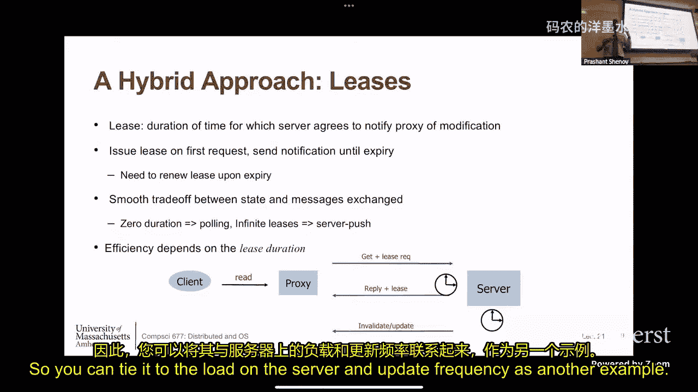

You can use okay so I mentioned age based lasers which say depending on how old the page is the whole if the page is not changed frequently。

 you can tie it to the the age of the page， you can make it。

directectctor to the renewal frequency of the page how frequently is the proxy asking for it which is tied to the date frequency to the read frequency you can tie to the load on the server okay the load is high then you can make the leases shorter so all kinds of techniques can be used but regardless。

Of which technique you use， you come up with a lease duration， you hand the proxy lease。

 and then so long as the lease is active， you have to send notification from the server's perspective。

Is that clear？Okay。So。One thing this does is it gets over some of the disadvantages of this server push approach because now the amount of state the server has to maintain can be controlled by controlling the lease duration if the state is growing significantly you can start giving shorter lease so that they expire once the lease expires you can throw away information about the proxies or share the state space can be reduced or vice versa if you are not keeping a lot of state at the server you can afford to give longer leases so you can keep some more information so in the server push approach you are no control over the amount of state that was maintained here you can use the lease duration to control so you can get over some of what we talked about the disadvantages of the pushbased approach。

你等。Yes。If a page is popular typically which is called the renewal frequency base or popularity base。

 it is better for the server to give longer leases。

That way you are not making the proxy do extra work of renewing the lease。

 you can keep a longer lease and keep sending notification that's the better approach。Yes。Yes。

 regardless of which policy you use the server has to server in some case the proxy have to track some metrics and use that metric to decide that is true right because without knowing that you cannot adapt or change the least frequency on per URL basis。

Then you can statically configure the lease duration and not have to do any of this。

 but that can waste messages。So this is adapting it to some characteristic of the workload。

Okay so that's lease base and we will now switch gears and talk about cooperative caching and then well get to content distribution networks so so we are going to now go from a single proxy to many proxies so assume now your distributed system where there are many proxies deployed maybe by single organization maybe different organizations but these proxies have the ability to cooperate with one another they can talk to one another and they can collaborate with one another to serve user content。

The question is what does this give us and how does it help right so here is an example。

Of one approach this is called hierarchical proxy caching because the caches are arranged in a hierarchy a single level hierarchy where there is a parent cache which is the root of the tree and three leaf caches so it is three1 level tree with four caches stored you can have arbitrary levels are nesting in a hierarchical caching approach but this is just showing you a very simple approach and you will see at the top is your web server at the bottom are client the blue things are client which are browser and in the middle is your web proxy system。

😊，It's a proxy system with four caches， so let's now ask what is going to happen。

So here is an example where this proline here。Send a read request read means you ask for made HDP request a get request so it goes to that proxy that proxy is going to check if the web page a is actually cached or not and lets assume it is not cached its a cache miss。

now if that was a single proxy a cache ma means you are to actually go to the server get the web page using a standard HtTP request and then put it in the cache and respond to the user browser with that page but this is a cooperative caching system or rather than immediately going to the server this proxy is going to ask its neighboring proxies whether they have the page so here is what they you will see that these red arrows are actually sending。

A request to two nearby leaf crxy as well as the immediate parent that。

The red arrow is labeled ICP that ICP stands for internet cash protocol。

 which was a protocol that was developed for caches to talk to one another and request content。

So you are essentially sending requests to。Your peer caches and one level the parent of this peers saying is the page available right so if any of them have the page they will respond to the cache with the page and then you are done youll send back a response the to the user。

And the idea here is these caches are closer to the requesting cache than the server the caches are further away than you did not gain anything from this but itll take you longer to get it from a far off cache then it then go into the server but if there are caches nearby maybe they can communicate faster and it can you can fed the content that's the reason youre trying to do cooperative ca but we'll assume in this case that the web page is not cached anywhere so none of these caches have it so this is called a global miss you don't have it locally that's a local miss the proxy other proxies they don't have it either so that's a global miss right so so you get this green arrows back saying it's not available so then you actually forward the request to the parent saying go get this pig if this is a multilevel hierarchy the same thing would repeat this parent would ask its leaves it would ask its parent and this request will propagate up the tree。

But we are already at the root in this case so because the parent has already said it doesn not have it it going to send the STDP request to the server the server will send a response back to the parent。

 the parent will send it back to the cash， the cash will send it back to the browser。え。

Is that clear what's actually happening？Okay so that basically is how you are going to handle misses hits are fairly straightforward if you have a local hit you basically ask the cash is going to return the result and you are done or if you don't have it to ask the neighboring caches they return the result and you are done the problem is when you don't have it your request is percolulating up the hierarchy until you fetch the content from someone who has it or the server。

What is the advantage of hierarchy？Here you actually are multiple caches right so there are serving other users to render them in a hierarchy so that you can cooperate and try to fetch the content from one another so effectively this。

4 caches are acting as a union of one big think of this as one big logical cache which is constructed from four small physical caches right so when you make a request you think about does this logical cache have the content somewhere in the system if so you track it down and you fetch it from it so you don't need to have that content at your local cache but if it is somewhere in your overall system is there in your logical cache you can get it that's the idea of cooperative cash okay。

对。好的。好意思。这明。Just他 on那。Okay question is what is the benefit of the layer why are you doing this or this is a very simple four node system where maybe you could have just asked all the node there are no need for hierarchy。

 but assume that you have thousands of these。that are cooperating you don't want one cache to ask 1000 other caches saying do you have this content or not you want to somehow limit the range of what you're asking to nearby caches so the hierarchy can allow you to localize your request only those caches that are near you rather than asking some cash that's very far away a that's going to be very slow you might have as well gone to the server and B is wasting a lot of messages so you can limit the overhead and try to get it faster if possible that's the basic。

啊。对。the question is is the parent going to ask is it much further so each node is asking its nearby caches not necessary that those nearby caches are actually close to the leaf that's solid。

是。But having said that， what is one disadvantage you can see from this？

Example that I just showed you。不是。If there is a cache miss and specifically a global cache miss is going to take a long time here's a user right they are just asking for a web page and you can see how many messages have been exchanged just to get that web page it would have been much better in this case for that user to forget about cache has just go to the server and fed the web page it would have much faster than all of this extra work that has happened just to see if the web page is even presented at any cash and to fetch it。

So what is is saying is that global misses are actually very slow and expensive。😊。

Expensive in terms of the messages that are exchanged and slow because you are asking there are maybe multiple levels your request is percolating up and you are trying to see is this web page anywhere in the system of these caches eventually the answer is no that is when you go to the server。

so hits are good because if you have a local hiter you have to get it from another nearby cache that is still faster than going to the server。

 but misses are not good。From a users perspective it takes a long time the user is waiting for the web page and the page doesn't seem to load that' is not a good experience you put the cache so that the page would load faster you could get it from the cache instead of going to the server now when you have global miss you actually give worse performance to the user then if there was no cache at all。

That clear okay so then there is a question okay， if you want to have cooperative caching but you want to get rid of some of this extra overhead。

 what can we do？how can we actually get rid of this over it， I it clear what Im asking？

And you don't want global misses to slow you down。But you still want hits to actually speed things up？

不是。嗯。So you can say I can send the request to the actual server and the parent okay you could do that but one of the reasons you put the cash in there in the first place is to also reduce the load on the server so that you can absorb some fraction of the request that are going to the server or absorb by the caches so the server doesn' not have to see them and the server load is lower okay if you were to ask the server then you did not I mean you could do that that is not a bad approach but it does not actually achieve some aspect of why you have caches which is to reduce server yes。

Make check。喂说的。啊对。You are saying if there's a cashm， you only send it to the parent is that。Existing。

Okay， so you can figure out if it' is existing in the children or so so there are two approaches right this approach says you have something to say。

好。you can put a bar you can say after ask for caches I'm just going to go to the server because taking too long you can do that too right so so all good ideas but here is a approach that kind of there goes away with some of this overhead so you see first of all those black nodes are caches that square at the top is the server those white boxes at the bottom are client so its no longer a hierarchy it is basically a flat。

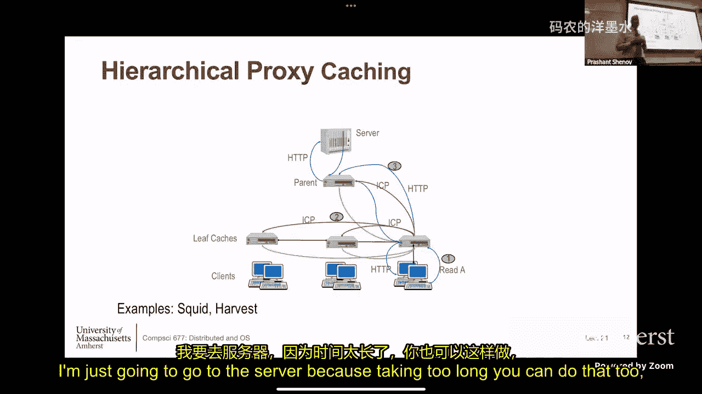

Level where your clients proxies and servers but these proxy caches are still cooperating with one another but the the there is one difference which is every proxy now has a table that not only tracks what is in its cache that you have to keep track of right but it also keeps track of what is present in nearby caches。

So you just have a table saying this is these are pages in my local cache these are web pages and nearby cache one these are web pages in nearby cache2 okay now client sends a request to the cache you do a table lookup the table lookup says it's locally present then you are done you just fetch it from your local cache send it the table lookup says it's nearby cache too has it you ask that cache you get it from the cache and you send it the table lookup turns up empty you say that's a global miss nobody seems to have it so you just go to the server and fetch it。

so you basically removed all of that message exchange and replaced it with just a table lookup。

And you solve the problem of having slow global misses because now you are not asking a lot of cashs before you figure out no cash in the system has the paid before you go to the server。

😊，Is that clear， what I just said？So that's shown in this example here where。😊。

You have a table which is still prevail example you are trying to get the same web page a and here is that one entry in the table which says x has it so the client is sending a read request tool for a the local cache doesn't have it it does a table look up the table look up says x has it you see the red arrow goes to node X you fetch x and you return。

Is that clear， yes。Okay question that's a good question which is going to be my question also is how is this table actually maintained because now every web every cache has to track not only its content but also contents at nearby cache and remember caches are performing cash replacement they invalidating entries so the contents in the cache keep changing so the table and all of the caches have to be kept up to date that table is out of date this idea is not going to work very well for example if the web page was nearby but you never updated the table you will go to the server that's wasted extra over it or vice versa if you think x has a and you send the request there but x is already replaced a then you are going to effectively send that request there and then it won't find the。

So you have this problem so youve got to make sure that table so essentially the consistency of the table has to be maintained just as you maintain consistency of the cache whenever any cache makes an update to its local contents it has to broadcast that information to all nearby proxy so that they can update that table so long as you have an accurate snapshot of whatever is in all the nearby caches and you keep that in your table then everything works well but if you have incorrect information things may not work well so for the worst case is when you actually have a table entry indicating that a web page is in a nearby cache but that cache has just replaced that entry but hasn't yet updated the table so you can assume now you ask for object a the table says it at X X had a but it just invalidated it just remove it but before it can send a message to update the table。

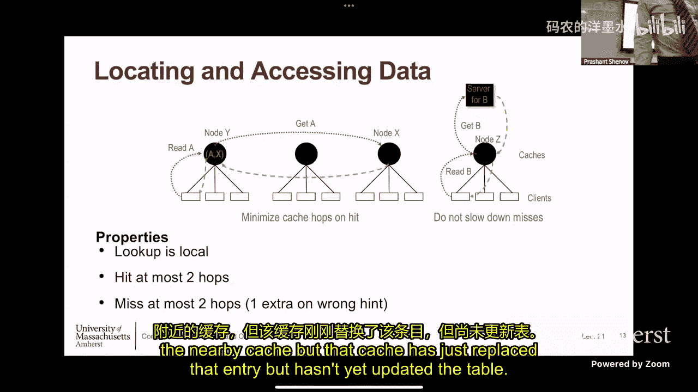

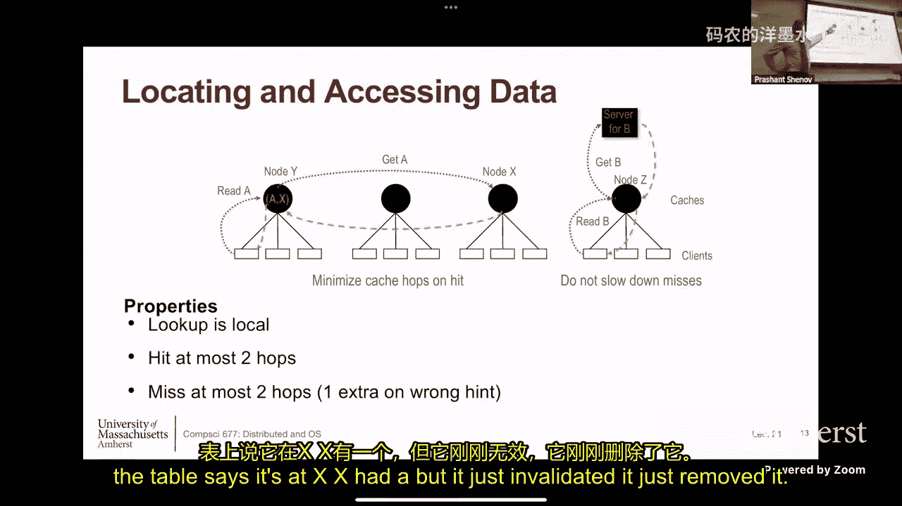

This proxy is going to send a request then itll arrive at X X will say doesn't have it。

 but then it will say it's a miss so it will go to the server， get it。

 update the page and so the worst case is the lookups are always local hits are atmost two hops because either you get a local hit or you get a remote hit or another cache but misses are also atmost two hops right so you can get a miss with the table and no one has it you just go to the server get it but you can also make a mistake where you think somebody else has it you send it there and they are just replaced it then you are to basically have an extra but that's okay that will be rare hopefully if you have good table update protocols。

Is that clear so this is now doing cooperative caching but it got rid of all of the hierarchical problems and slow global misses your question。

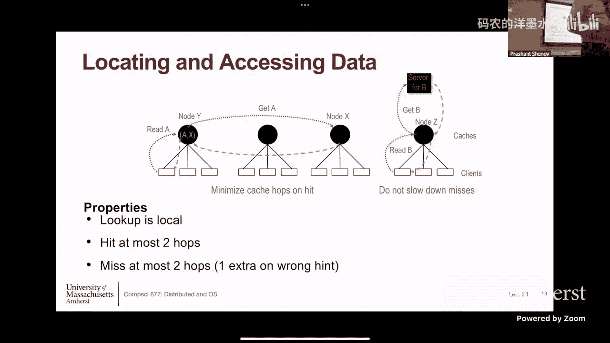

Correct， so that brings us to the last part。What I want to say today。

 which is effectively gets us to content delivery networks and edge computing。うう。So edge computing。

Essentially is a field that is analogous to cloud computing which now you have some familiarity with your data lab let you are going to use it in the lab and so on so。

What edge computing says is rather than putting lots of resources in a large data center。

And you and help of calling it the cloud let's put compute and storage resources at the edge of the network which is close to the user This is why it's called edge computing right edge essentially means it's at the boundary of the network where the users are actually about to access it so for example。

 if you have let's say a wi-fi router in your house you have someone who's providing wifi service so if you deploy these resources oneh away that's the edge of the network so that's fairly close to the user so the idea in this case is whenever you deploy these resources close to users they are good from a latency perspective because now the user can access this service。

 whatever that service is at the edge instead of going to remote server。

The our web proxies already emroided that idea we are implicitly assumed that our proxies are close to users otherwise there would be no reason to do proxy cam as well go to the server the proxies are far away so we have already assumed that the proxies are close in effect we were assuming that the proxies are deployed at the edge of the neck。

That way when a user accesses a web page， you go to a fairly closed by resource。

 which is your web proxy it access it from there if it is a hit and you are done。😊。

Now edge computing will generalize this idea saying you don't just need to deploy caches at the edge。

 you can deploy any service， you can deploy web servers。

 you can deploy other types of services from the edge。

 you can stream from the edge if you are watching a YouTube video other than it coming from a far off server if that video is cached nearby you can actually stream from that so there are lots of services you can implement if your resources at the edge。

So there are many providers that specialize in edge computing and there are also cloud computing providers which are started deploying resources at the edge。

😊，So if you actually go and look at you have all now have Amazon credentials。

 if you go look at Amazon services you will see it also offersed services so you don't need to just get a server from US East as your central which actually get your server either in Virginia or in Ohio you can actually go towards what's called an AWS local zone there's a local zone in Boston for example so they have deployed servers there so that's not really edge but it's closer to you much closer than going to Ohio or Virginia right but they're also deploying caches which are even closer so you can use AWS servers to actually deploy your caching services and cash close to the users and so so so this is now become an entire area of research and also for industry to provide services at low latency so we'll talk about all kinds of things you can do but the thing you want to keep in mind is lower。

Latency then adds cloud servers because edge servers are closer to users potentially higher bandwidth because you don't have to go multiple hops on the internet where some routers may be congested and you might get worse network bandwidth or you might get higher bandwidth from the edge and you can tolerate failures in the core of the network because the edge might still be connected to you but there might be false elsewhere so you can actually maybe a little more resilient to network failures than if you are actually accessing so this entire area actually complements cloud computing in many different ways so in some cases you might choose to deploy your services on the cloud other cases you might have decide to do it on the edge in some cases it may be a combination web proxy cachings at the servers are in the cloud the web servers but the proxies are at the edge。

so you are deploying now resources at both locations。

So a little bit of history before we start talking about details。

 this whole area actually aose from two different domains so there were two things that were happening in the late 90s early 2000 both of which actually gave rise to what is called edge computing today so the first thing is content delivery networks and the second thing is mobile computing so let me give you a little history about both then we'll talk about the details so content delivery networks are essentially think of them as commercial services or companies that are in the business of providing caching as a service right so if you need to deploy web caching for your website rather than deploying your own web caches you just go to CDn which has already deploy these caches at lots and lots of location and you just sign a contract and say cash my web pages and deliver them and then the CDdn service will start caching your pages and。

Users will be directed to nearby caches rather than the server so CdnNs are essentially companies or commercial services that have deployed a very large number of caches already for you So anyone who has a website or maybe has a website with lot of rich content can just sign up for caching server and offload the content to cache and deploy I mean not deploy deliver it from the cache so this is especially useful if you are web page has lots of images and video because delivering that content from the server increases the load on the server but if you put these items in the cache then users can access them from the cache the load on the server is reduced。

 you don't need a big server you can have a small server with a big CDdn sitting in front of it and it will absorb the workload for you so so that's。

One area that gave rise to edge computing we started with caching but then CDN provider said you already have these servers。

 why not do other things， why not all host application you can put some containers on the cache and and deploy other services so that gave rise to edge computing。

That's one。Area， the other area that gave rise to this。

Motion of age was mobile computing so back in the 90s and early 2000s you had laptops and maybe other mobile devices there were no smartphones back then that were still fairly limited in their capabilities limited amount of processing limited battery power maybe one to battery life lot not a lot of storage and so on so if you wanted to run any compute intensive application on your laptop either it would run very slow or it would basically chew up your battery and you would be out of battery very equity。

So， one thing you could do as a mobile computing application developer was to not necessarily run the application locally。

 but run it on a nearby server and then have it send results back to you。

So this was called computational offloading right so computational offload basically says you can take any application or part of an application and then just run that part on a nearby server which in this case happen to an Ed server and then have it do all the work for you in this this edge server was maybe a server that does not battery powered is using grid power so it doesn not have the same problems it's a standard server so it is more capable than a mobile device so you could essentially do all of that extra work on a nearby server。

so that' is computational offload and because the server was nearby， you can do low latency off。😊。

Now。Today's laptops are a lot more powerful but that problem hasn't gone there are other mobile devices that have the same problem so take ARVR headsets as an example so you can wear those headset they have limited amount of battery on them they are doing lots of compute because they are showing you high resolution content but they don't have the resources they don't have a GPU on them or anything like that so often these ARVR headset depend on a nearby PC or a nearby server that is doing all the computer and just sending it content to display。

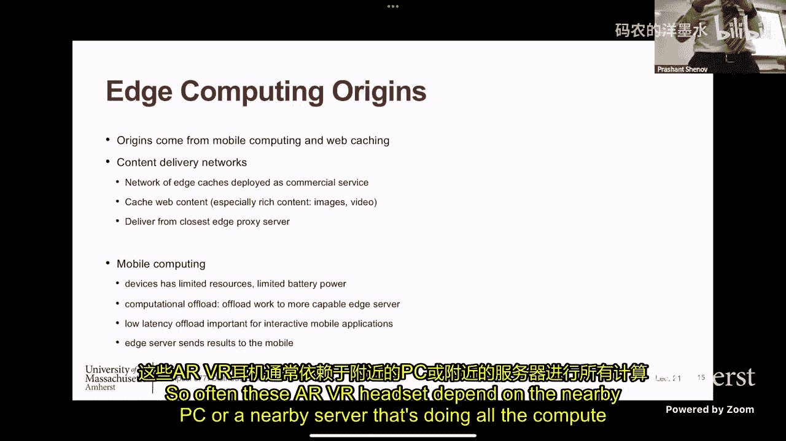

So your application doesn't actually run on the headset it runs on an edge server or maybe a local PC and is displaying so that's an example of using edge computing for new generations or devices but in the old days you didn't have powerful mobile devices so every device that needed to run more compute intensive workload used edge offload so that's our history so this has come from two different domains but with that history let's talk a little bit about some details of CDNs so here is a use case of a CDN I'm going to talk about one commercial one which is called akamite so this was the earliest deploy of CDn its still the biggest one today so they have some hundreds of thousands of servers that are deployed in more than 1 thousand0 networks in across maybe 80 or more countries so practically anywhere you go。

There is going to be a akaai cache nearby there are several of these akama caches in the UMass network for example if you have any website that has signed up for CDdn service from akaai access that website your content is actually coming from a machine thats at UMamass even though you might think you're actually accessing some other website far away the content is cash locally so you get it fairly quickly right so only for services that use the cdn right so so practically every news website streaming websites they all use this type of content right Netflix for example runs on a very large CDdn YouTube has its own big CDdn that's that's used to deliver content video services make heavy use of cdn services that way you can deliver this content from nearby caches rather than from a distance server but lots of web content。

As that too now the way this is going to work okay you might say okay lets say I go to CNN or New York Time website okay when I put that URL in my browser my browser is actually connecting to that server how is the content coming from the cache how does this work so I'll give you an example of how。

😊。

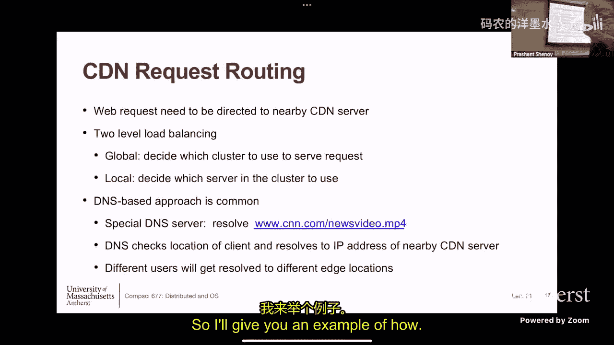

You can actually make this work and then we will come back to the slide here So so here is a client the client is trying to access some content so here is the origin server so let's assume that's the CNN server that's a web browser So the first web page has to come from the origin server So maybe you go wwwcnN dot com index dot hml that web page you will get from the server and that's going to come back to the client but inside that web page will be embedded all kinds of images。

Or video content or whatever else you have on that website。

So all of those links will now actually point to a cache。URL rather than the CNN URL。

So essentially maybe rather than saying cnn。com/image。jPG， you will basically have akaai。cnn。

com or something like that slash image say so when the client tries to get it it will now go to cache and fetch it rather than going to the server because youre replaced the links inside a web page with cdn versions of those links so the links are pointing to cache rather than pointing to server。

I that clear so that' is the first thing， but that's not all of it。😊。

Because what I told you that this Cn service might have hundreds of thousands of caches so you just pointed it to generic cache。

 how is it going to come from a specific one？so this is where some of the intelligence comes in。

 the client is going to try to resolve that URL to a IP address。😊。

So it is going to do what's called a DNS lookup DNS stands for the domain name system okay DNS is a service on the internet that takes a name of a machine and gives you its IP so if you say www。

um。edu your web browser actually sends that to a DNS server or the DNS server will give you the IP address。

And then you if you have the IP address then you can connect right so you probably know what IP address and port numbers are from your socket program right so you are going to send that request to a DMS system and then the DMS system in this case。

It has intelligence it figures out where is the client coming from it does what is called geoI location it says the client is based in Amherst Massachusetts so then it will ask where is the nearest cache that I have that is close to this user and then it will return the IP address of the nearest cache so different users we are trying to get that exact same URL will get sent to different IP addresses that belong to different caches in the and that will be an IP address of a nearby cache so so when you do the DNS resolution this client will be sent to a nearby。

Cash， and then that cash will return the results to。

so and you will change where you send a user to based on their physical location and what is the closest cache that has the content right so all of the hard work is actually being done in the DNS system which is doing redirection and load balancing and we will talk more about this next time because we ran out of time today but that' is the basic idea of how CDN works。

 let's stop here we'll continue tomorrow。

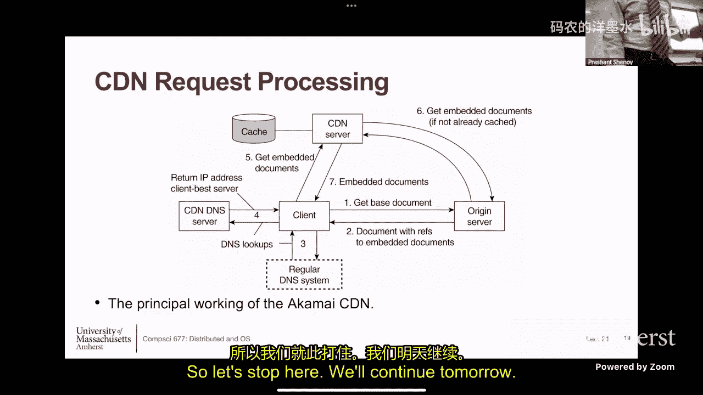