# 分布式系统：第21讲：边缘计算与网络缓存

在本节课中，我们将继续讨论万维网，重点学习网络缓存、内容分发网络和边缘计算。这些主题相互关联，我们将逐一深入探讨。

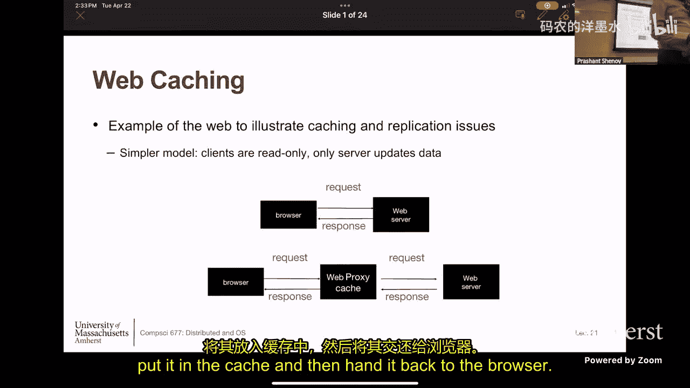

## 概述

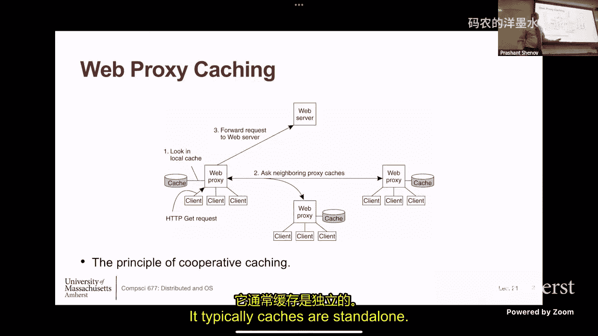

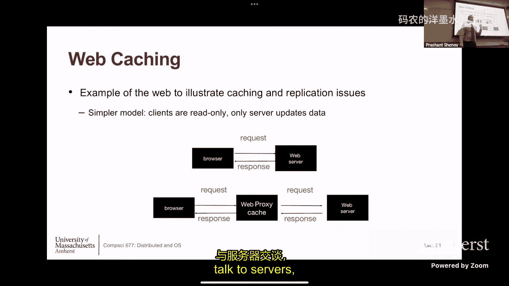

我们将从网络缓存的基本概念开始，探讨如何设计缓存代理服务器。接着，我们会将单级缓存扩展到多级协作缓存，并讨论如何保持缓存内容的一致性。最后，我们将介绍内容分发网络和边缘计算，了解它们如何利用缓存技术提升网络性能。

## 网络缓存基础

上一节我们介绍了客户端-服务器模型。本节中，我们来看看如何通过引入代理服务器来优化这个模型。

一个典型的客户端-服务器系统如下图所示。你的网络浏览器直接与网络服务器通信。

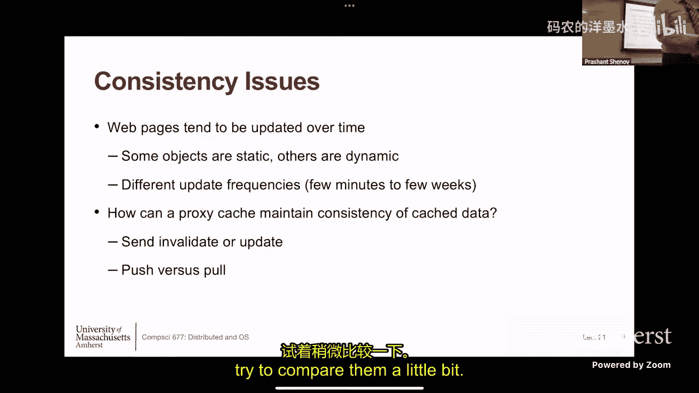

我们可以将其转变为客户端-代理-服务器系统，即在浏览器和服务器之间放置一个代理服务器。这个代理服务器的主要功能是缓存网页和图像。

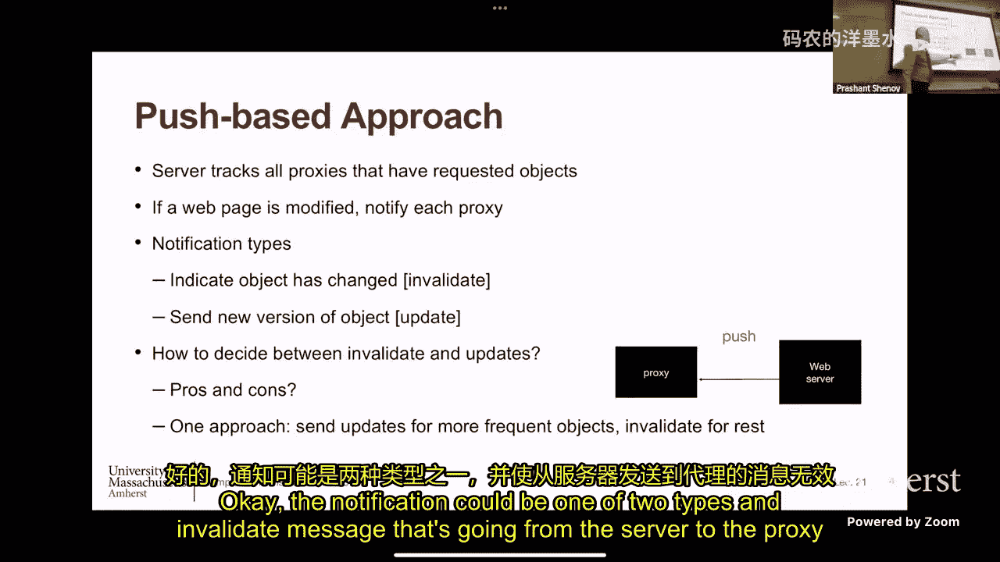

其工作流程如下：
*   浏览器首先向网络代理发送一个带有URL的请求。
*   如果该URL的内容已缓存在代理中，浏览器会立即获得内容，无需联系服务器。
*   如果缓存中没有该内容（即缓存未命中），代理会联系服务器，获取内容，存入缓存，然后返回给浏览器。

下图展示了一个更复杂的版本，涉及多个缓存代理。

其原理类似，但当一个代理缓存未命中时，它可以先询问附近的其他代理，看它们是否有所需内容。如果附近代理有，就可以更快地获取，而不必直接联系遥远的服务器。当多个代理协同工作以服务客户端请求时，就构成了**协作缓存**。

## 缓存一致性

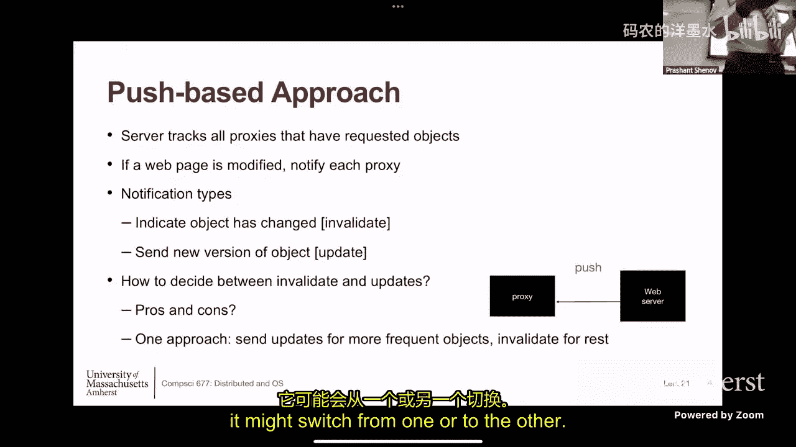

当我们讨论复制时提到，分布式系统中任何数据项的多个副本需要保持一致。网络缓存也是如此，缓存的网页可以看作是原始服务器上网页的副本。

假设缓存了某个新闻网站（例如CNN）的首页。如果原始服务器上的首页更新了，那么缓存中的内容就过时了。我们需要确保服务器更新时，缓存不会提供过时的内容。因此，必须保持缓存内容的一致性。

在设计一致性技术时，需要记住网页在更新频率和访问频率上差异很大。
*   **静态对象**：一旦创建就永不改变。
*   **动态对象**：频繁更改，例如新闻网站。
*   **访问频率（流行度）**：有些页面每天有数百万用户访问，有些则很少。

我们需要在设计中考虑这些因素。

### 保持缓存一致的机制

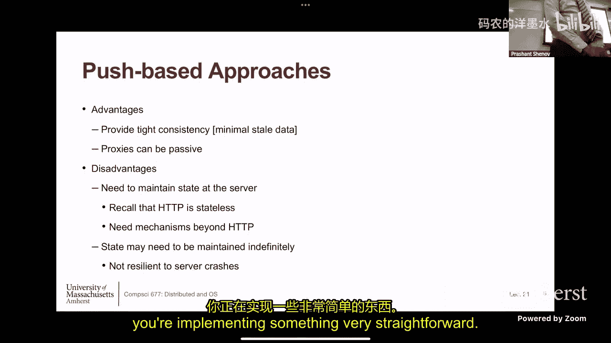

当服务器上的对象（网页或图像）发生变化时，缓存必须被告知这一变化，以便使缓存中的旧版本失效。

以下是两种通知方式：
1.  **失效**：服务器发送通知，告诉缓存该对象已更改，缓存应将其丢弃。
2.  **更新**：服务器直接发送对象的新版本，替换缓存中的旧版本。

实现这两种通知，有两种基本方法：**服务器推送**和**代理拉取**。

## 服务器推送方法

顾名思义，**服务器推送** 方法由服务器负责。每当服务器上的内容发生变化时，服务器有责任向所有缓存了该内容的代理推送失效或更新消息。

服务器需要跟踪所有从其请求过内容的代理列表。当某个网页更改时，服务器会查看哪些代理缓存了该URL，然后向它们发送通知。

通知可以是两种类型之一：
*   **失效消息**：告知代理该URL已更改，应从缓存中移除。
*   **更新消息**：直接发送该对象的新完整版本。

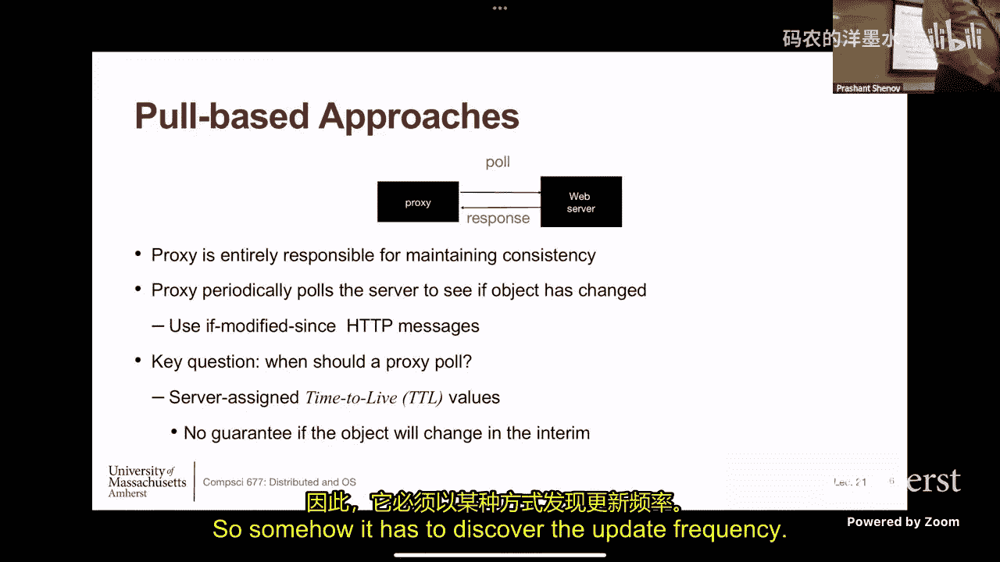

那么，服务器应如何选择发送失效消息还是更新消息呢？这取决于对象的访问频率（流行度）。
*   **更新消息** 开销更大，因为它包含整个对象。如果对象在代理处非常流行（被频繁请求），发送更新是值得的，因为后续请求能立即获得新版本。
*   **失效消息** 开销较小。如果对象不常被访问，发送失效消息更合适。这样，对象从缓存中移除后，如果真有用户请求，代理会因缓存未命中而向服务器获取最新内容。

在实践中，系统可以同时使用两种方式，由服务器根据每个URL的流行度动态决定。

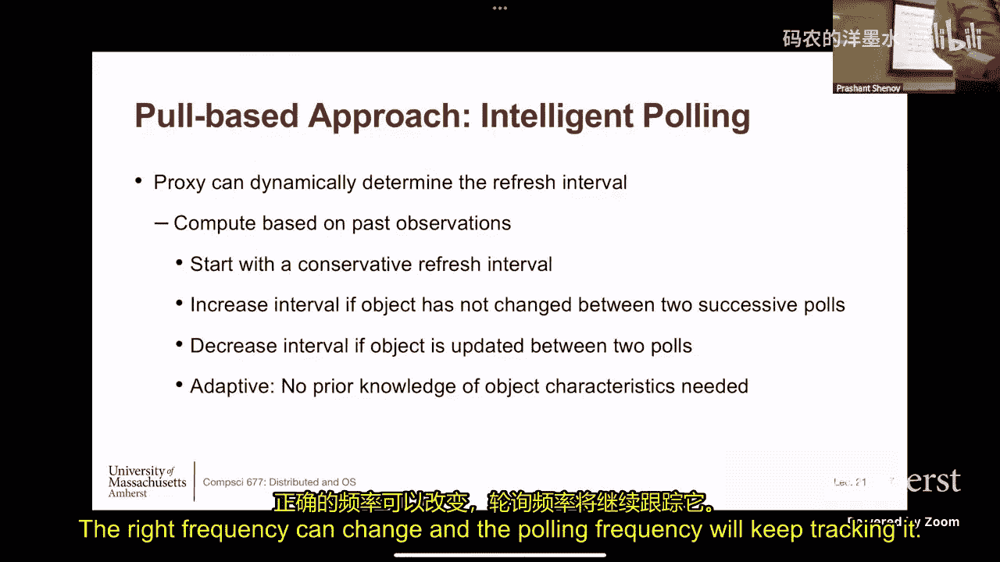

### 服务器推送的优缺点

以下是服务器推送方法的优缺点：

**优点**：
*   **提供紧密的一致性保证**：内容一旦在服务器上更新，消息会立即发送给代理，使缓存内容能快速更新。
*   **代理是被动的**：所有一致性维护工作由服务器完成。

**缺点**：
*   **服务器需要维护状态**：服务器必须记录哪些代理缓存了哪些内容。对于热门页面，这个状态列表可能非常庞大。
*   **状态可能需要长期维护**：只要代理缓存着对象，服务器就需要持续发送通知，这可能持续很长时间。
*   **状态管理复杂**：如果状态存储在内存中，服务器崩溃会导致状态丢失；如果存储在磁盘上，则会增加开销。

## 代理拉取（轮询）方法

在**代理拉取**方法中，维护缓存一致性的责任转移到了代理身上。代理会定期向服务器轮询，检查缓存的页面是否已更改。

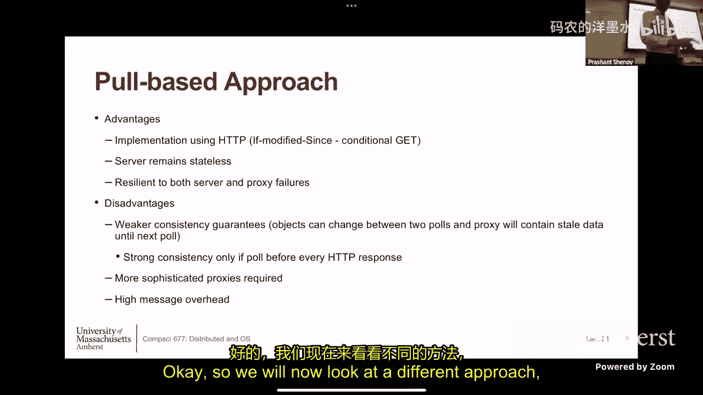

这可以通过标准的HTTP协议实现，使用 **条件GET请求**，具体是 `If-Modified-Since` 头。代理在请求中指定它上次获取该页面的日期。如果服务器上页面自该日期后未修改，则返回一个空响应（如304 Not Modified）；如果已修改，则返回新版本。

关键问题是：**代理应以多高的频率轮询服务器？**
*   如果轮询频率太低（例如每6小时一次），而页面更新频繁（例如每分钟），那么用户将在很长时间内看到过时内容。
*   如果轮询频率太高（例如每秒一次），而页面很少更新，那么会产生大量不必要的请求，浪费网络资源和服务器资源。

解决方案是采用**自适应方法**，使轮询频率与页面的实际更新频率相匹配。
*   代理可以从一个保守的频率开始（例如每秒一次）。
*   如果多次轮询都发现页面未变，则逐渐增加轮询间隔（例如到10秒、1分钟）。
*   一旦发现页面有更新，则缩短轮询间隔。
*   通过这种方式，轮询频率可以动态适应页面变化模式。

### 代理拉取的优缺点

以下是代理拉取方法的优缺点：

**优点**：
*   **实现简单**：可使用标准HTTP协议，无需额外协议。
*   **服务器无状态**：所有工作由代理完成，服务器只需响应请求。
*   **容错性好**：对代理或服务器故障更具弹性。

**缺点**：
*   **一致性保证较弱**：在页面更新后、下一次轮询前的这段时间内，用户可能看到过时内容。
*   **代理需要更多智能**：需要实现自适应轮询逻辑。
*   **消息开销可能更高**：在页面实际改变前，可能已经发送了许多轮询请求。

## 租约：一种混合方法

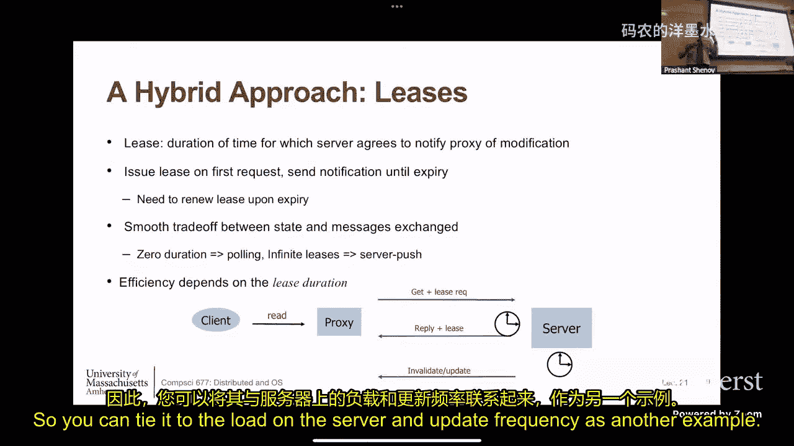

租约是一种结合了服务器推送和代理拉取思想的混合方法。**租约**是服务器和代理之间的一份有时间限制的“合同”。

在租约有效期内，服务器**承诺**会向代理推送任何关于该页面的更新或失效通知。租约到期后，服务器不再有此义务。

工作流程如下：
1.  代理首次向服务器请求某个页面时，同时请求一个租约。
2.  服务器返回页面内容，并指定一个租约期限。
3.  在租约期内，代理可以放心缓存该页面，因为服务器会主动通知变更。
4.  租约到期前，代理可以续租；如果不续租，则可以丢弃缓存页面，或转为拉取模式。

租约的期限决定了其行为：
*   **无限期租约**：等同于服务器推送方法。
*   **零期限租约**：等同于代理拉取（按需拉取）方法。
*   **有限期租约**：是两种方法的混合，平衡了状态开销和一致性强度。

服务器可以根据页面流行度、更新频率或自身负载等因素动态决定租约期限，从而控制需要维护的状态量。

## 协作缓存

之前我们讨论的是单个代理缓存。现在我们将扩展到多个代理**协作缓存**的场景。多个代理可以合作，形成一个更大的逻辑缓存池。

### 分层代理缓存

一种组织方式是**分层代理缓存**，缓存以树形结构排列。

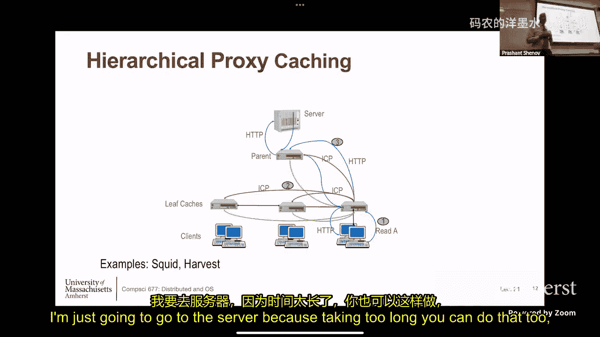

工作流程如下：
*   客户端向本地代理请求页面。
*   如果本地代理缓存命中，直接返回。
*   如果未命中，本地代理会向其兄弟代理和父代理查询（使用如ICP之类的协议）。
*   如果任何上级或同级代理有该内容，则返回。
*   如果都没有（全局未命中），请求最终会转发到原始服务器。

**优点**：缓存命中时，可以从更近的节点获取内容。
**缺点**：全局未命中时，需要经过多轮查询才能到达服务器，延迟可能比直接访问服务器还高。

### 基于路由表的协作缓存

为了克服分层缓存的缺点，可以采用扁平化、基于路由表的协作缓存。

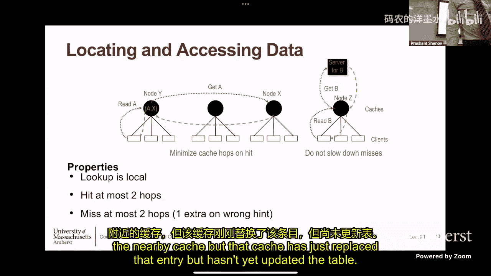

在这种设计中，每个代理不仅维护自己的缓存内容，还维护一个**路由表**，记录附近其他代理缓存了哪些内容。

工作流程如下：
1.  客户端向代理请求页面。
2.  代理首先检查本地缓存。
3.  如果本地未命中，则查询路由表。
4.  如果路由表显示某个邻近代理有该内容，则直接向该代理请求。
5.  如果路由表显示没有代理缓存该内容，则直接向原始服务器请求。

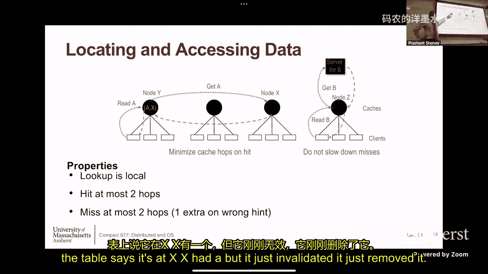

**优点**：
*   避免了分层缓存中全局未命中时的多跳查询开销。
*   命中通常只需1跳（本地）或2跳（远程代理），未命中也最多2跳（到服务器）。

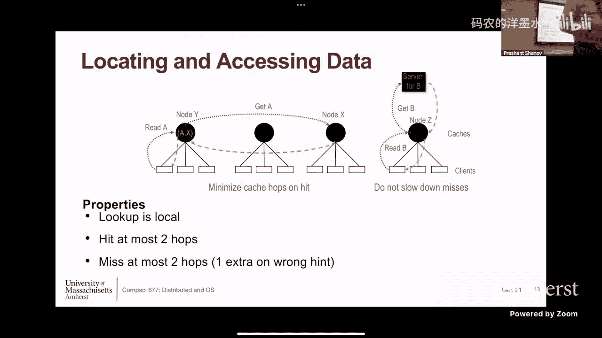

**挑战**：
*   需要维护路由表的一致性。当任何代理的缓存内容发生变化（替换、失效）时，必须及时通知其他代理更新其路由表，否则会导致错误的查询。

## 边缘计算与内容分发网络

边缘计算是云计算的一个类比和延伸。其核心思想是将计算和存储资源部署在网络的**边缘**，即靠近用户的地方，而不是集中在遥远的数据中心。

网络代理缓存本身就是边缘计算的一个早期例子：代理被部署在靠近用户的位置以减少延迟。边缘计算将这一思想泛化，允许在边缘部署各种服务（如Web服务器、流媒体服务、应用程序容器），而不仅仅是缓存。

**边缘计算的优势**包括：
*   **更低延迟**：资源更靠近用户。
*   **更高带宽**：减少经过互联网拥堵节点的跳数。
*   **更好的故障容忍**：即使网络核心出现故障，边缘服务可能仍可访问。

### 内容分发网络

**内容分发网络** 是边缘计算的先驱和重要组成部分。CDN是提供**缓存即服务**的商业公司。它们在全球部署了成千上万的缓存服务器。

工作原理（以Akamai为例）：
1.  网站所有者（如CNN）将其静态内容（图片、视频）的URL指向CDN的域名（例如 `akamai.cnn.com/image.jpg`）。
2.  当用户浏览器解析这个CDN URL时，会向DNS系统发起查询。
3.  CDN的智能DNS系统会根据用户的IP地址进行**地理位置定位**，计算出离用户最近的、拥有所需内容的缓存服务器。
4.  DNS将该缓存服务器的IP地址返回给用户浏览器。
5.  浏览器直接从最近的CDN缓存获取内容，速度远快于连接原始服务器。

通过这种方式，CDN将内容“推”到了网络边缘，极大地提高了内容分发的效率和用户体验。

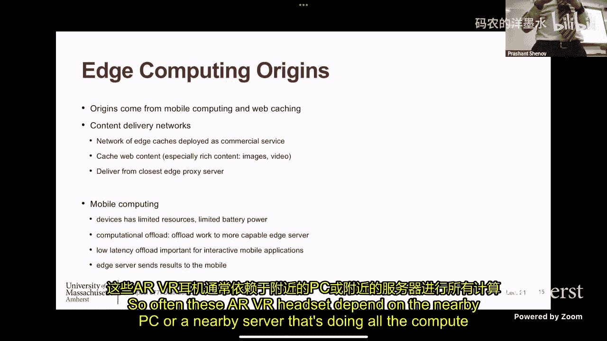

## 总结

本节课我们一起学习了分布式系统中与网络内容分发相关的关键技术。

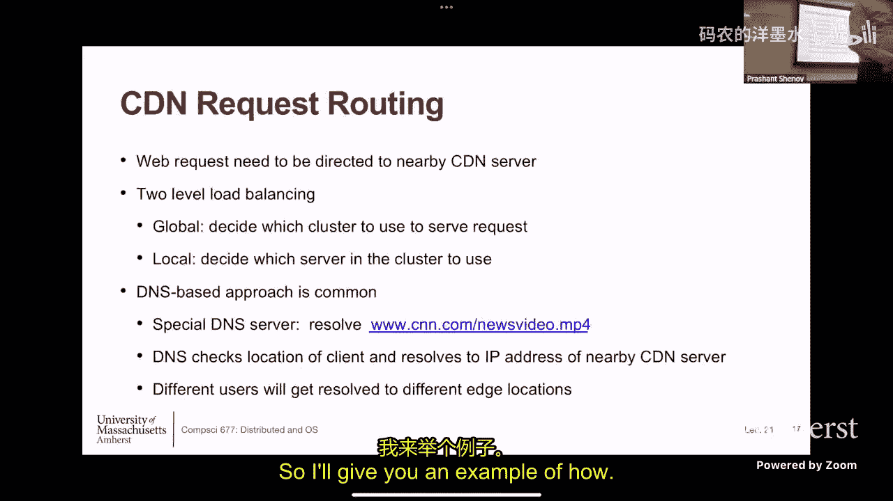

我们首先深入探讨了**网络缓存**，从基本的客户端-代理-服务器模型开始，理解了缓存如何加速内容访问。接着，我们重点研究了**缓存一致性**问题，分析了三种主要方法：
1.  **服务器推送**：由服务器主动通知变更，一致性强，但服务器负担重。
2.  **代理拉取**：由代理定期轮询，服务器无状态，但一致性较弱且可能产生额外开销。
3.  **租约**：一种混合方法，通过有期限的合同平衡了状态开销和一致性强度。

然后，我们将视野从单个缓存扩展到**协作缓存**，介绍了分层缓存和基于路由表的扁平化缓存，了解了如何通过代理间的合作提升缓存效率。

最后，我们探讨了**边缘计算**和**内容分发网络**。CDN作为边缘计算的商业实现，通过在全球边缘节点部署缓存，并利用智能DNS进行用户请求路由，极大地优化了大规模内容分发，降低了延迟，减轻了源站压力。边缘计算则更进一步，预示着未来更多的计算和服务都可以在靠近用户的网络边缘完成。

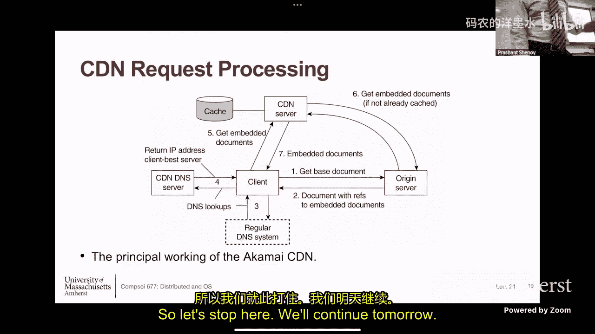

这些技术共同构成了现代互联网高效、可扩展内容分发的基础。