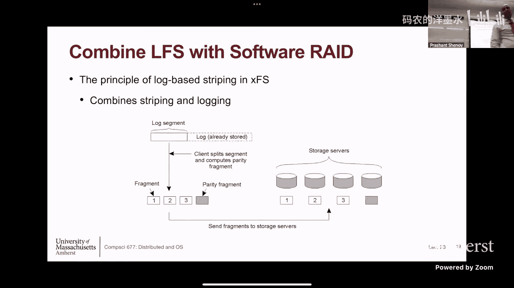

# 【全集 2025 附课件】马萨诸塞大学 分布式系统 中英字幕 p23 Lecture 23 - xFS, Coda, HDFS, GFS -BV19BSYBuE4Y_p23-

Okay， so I guess it's going to be a very small class today。Get started a couple minutes early。

 but we can get started。So today we will continue our discussion from last time on distributed file systems last time we did a case study of NFS network file system and today we will continue that discussion and we will talk about codeda which is a very different file system and then I'll talk about XFS log structured file system and then if time we have time at the end I'll briefly introduce HDFS and objects storage system but a couple slides from last time that from NFS that I couldn't cover let me finish those then well start talking about codeda so remember NFS is a client server file systems to files are stored on the server client will actually access the files from the server using RPC so the question is let's say the client is trying to read or write a file it sends an RPC message but maybe the message you know does not get delivered it gets lost or something happens to the message。

Then what should happen in this case right？But typically what will happen in an RPpC system is the client will time out if it doesn't received a response from the server and resend the request okay so you will see here it send request number1。

234 it basically didn't hear back in time so it sent another request same request went again1 to34 but from the server's perspective if you're receiving the same RC multiple times if you execute them multiple times let's say then you have a problem because the RPC could be right RC saying append a character to the5 so it may be that the reply was lost the RC was received but the reply didn so it was successfully executed at the server the client times out and sends the same request again then you are going to have an incorrect result where the same RPC has now appended that character or some data twice when it should have only done it one so this goes back to the RPRPC failure discussion we had a while back when we were。

about distributed communication and I said that RPRPC execution must be item important okay item important is just a term that says that no matter how many times you execute a certain operation。

 the results are the same right so if you have that property in a system it's called item importanceency right so we want to ensure that our RRPC executions are item important right so so in this particular case。

 no matter how many times the client sends the same request you should only the result that the server should be as if the RRPC was executed exactly once right so that's the that's the property you want So how do you implement item importanceency So in this case what the server is going to do is it's going to keep a log or what is called a request response cash the log is going to keep track of all recently executed request and the response they generate So when a request comes in RPRPC request。

Then the server， the NFS server will first look at the cache or the log saying have I seen this request previously has it already been executed if the request is present in the log and there is a valid response you will just take it from the cash and return the result so you will say maybe the reply didn't reach the client to let me just retransit the reply you won't execute again but if you don't see the request in the log or that cache then you say Ive never seen this request before so this is a new request it should be executed like normal and you will execute it process it and put it in the cache so those are the scenarios that are actually shown here where。

You will see the scenario mentioned where the request in the third figure where the response request is sent it's processed。

 you put it in the cash， but the reply is lost， you send it again。

 you take it from the cash and you return it do not execute again so if you maintain this type of cash you can implement item importances in a fairly straightforward manner so that's one way you can deal with RpC failure and even simpler approach is to not use UDP as your transport protocol you use TCP in which case if the request or the response is lost TCP takes care of that for you。

 you don't need to worry about it at an application level to keep this type of a cash but if you are running your RPRPC on top of UDP for efficiency reasons you will need techniques like this to be implemented。

Yes， question。Under go， under whatever process request we have are they also。They have make个。

ction number there are yes。Yeah， so no con question。The couple of if price。啊3。嗯。So， I want。

We want to make sure that the server process it correctly。Yes， just it yes。

Okay so question is what happens if you get two similar RPCs。

 how do you know that its whether it's a duplicate or the same RC retransmitted。

 you need to distinguish between those two cases so the thing I did not explicitly mention is every RPC request needs to have a unique ID so if you're sending two distinct RC request they will have two different unique transaction Is or RPC IDs so you can track which RC it is so if they retransmit the RC it will go back to the server with the exact same number but if there are two let's say right calls each of them says append this character。

 the same character to the file they are too independent request so you're not actually looking at the request itself the RPC request to figure out if it's a duplicate you're looking at the RPC ID to check whether it's a duplicate so that's how you're going to distinguish between duplicates and non duplicate。

Yes， your question。Okay how do you ensure unique transaction Is across clients So if you just so that's a good question but there's a straightforward answer to it So if you just have integers as Is across clients there's clear chance that the Is might get duplicate so so you just have a integer that's increment you might have two clients have the same transaction Is。

 then it's not unique a more straightforward way to make it unique is clients have their own Is so you can have a client I and integer from that client for example。

 you might want a IP address which is unique to a client and then an integer append to that IP address that gives you now a sequence number for that client so you can disambiguate across clients by adding a unique client I in addition to the RPC I that way you can distribute so that's a very straightforward way to root of course there could be。

Other ways where you can take the integer space and say you get IDs x to y if it is a large enough integer space。

 maybe you don't need to worry about it and some other client gets x plus 1 through something else so you can do that。

But you need a way to make sure they're unique。okay。

 one more thing and then we'll end NFS and start the new topic which is going to be quota。

 but I do want to mention that because client and the server are all talking over RPCs。

RRPC is whether you use TCP or UDP go or the network unencrypted right so whatever data you are sending from the client to the server is vulnerable to snoooping by ar so if you are trying to write to a file and you are sending the contents of the file are going as a right RPC from the client to the server if there is anyone on the network that intercepts that packet you will actually get to know what the contents of the file are that are being written。

Yeah because it's anened traffic RPRPCs， none of the RRPs you have developed for any of your labs are encrypted right so if your client and the server are on the same enterprise network。

 maybe it's less of an issue but if the client and the server are actually operating over the internet your traffic is actually unencrypted on intranet which is bad because someone can now figure out youre writing to something confidential to a file and now someone can look at the contents of the traffic and figure out what is being written and so on so that's not good so what NFS version4 onwards has started doing is they actually allow you to add security to the RpC layer so you have something called a secure RpC which encrypts all traffic before sending it and then the server has to decrypt it and vice versa this is important because it will then allow you to have NFS work over larger networks where you do not necessarily trust every entity in the network they can。

Intercept your traffic right so encrypting your operations is important is going to add overhead because encryption and decryption which we will look at in two classes from now does add overhead to the operations。

 but it will provide security so this is something you want to keep in mind。 all right。

So let's switch gears and talk about a different file system This one is called codeda this a old file system this is NFS was designed in the late 80s this was designed in the I would say late 80 early 90s as well so it's almost 30 years old now doesn't really exist it was a research project that never you know became commercial some parts of it were commercialized but not this entire file system this was a file system that was designed at CMU as a research project but that very different goals from NFS which was a client server file system so this is a distributed file system that was explicitly designed for mobile devices so think about laptops or phones that are trying to access data from a server now the main difference between mobile devices and maybe a desktop is mobile devices operate over a network where they can actually get disconnected from the network occasionally right。

So let's say you have a laptop it's on a w-fi network it is now connected to the network maybe you shut down this laptop and go home take a bus home at that point the laptop is not connected to the network right so and then you might start working at your home and the laptop gets connected again so this type of behavior is called disconnect disconnected operations where our weekly connected devices that have often have disconnection weekly connected essentially means that connectivity may come and go not always assured as opposed to a desktop that's connected on a wired network which will largely be up at all time。

So now the question is。If you want to design your file system for a mobile world。

 how what design decisions would you change， how would you make a decision different from， let's say。

 NFS。So what what might we want to change So that's the question that Koda asked and there are several issues that we have to think about right first is client disconnect easy example is let's say you take a flight you go on an airplane right so now even airplanes are wifi but assume that you're on a plane with no w-fi do you open your laptop server is no longer available because you are disconnected from the server when the question is can you actually access any of your data typically if normal file system you will not be able to access any server storage until you are back connected to a network so clients when they get disconnected they will lose access to data that's the first problem you got to deal with second problem you got to deal with is consistency remember in NFS we said the client might cache some data if the data changes the server can push invalids to the client but。

If you are disconnected from the network consistency cannot be assured either right so consistency becomes a problem the client is not even connected so when you design your systems for mobile devices you got to think about these issues right so so here is how quoda is going to work quoda allows you to have what is called a disconnected mode so if you are now disconnected from the network for any reason coda will allow you to continue to access your data as if nothing has happened as if you are still connected the way is going to do this is going to aggressively cache files so that when you disconnect some subset of the files you typically access or already cached on your machine and when you are trying to open your files it will pretend like you are still connected but serve data from the cache。

Of course， if the caching algorithm does not cache some files that you try to open when you are disconnected。

 you are going to be out of love but if it makes some reasonable。😊。

Choices on what subset of the data from the server to cache then you can be disconnected and essentially you will not have any problem so this type of techniques now are also seen in cloud based storage for example if you use Google application like Google Ma or things like that they have an offline mode to turn on offline mode in Google you can still use a web browser and read your email because it will cache some of it locally and you will not know that youre disconnected from from the web for example right but this is the system that actually originated some of these ideas maybe more than 30 years ago so let me explain。

Let me explain how quota works so here is diagram of how the client works so think of a client that needs to now has access to server it can be one in one of three states okay it can be in a state called holding it can be reintegration or it can be in emulation mode so when you are connected to the server you are essentially going to be holding mode in holding mode the client the quoda client is going to start downloading files from the server that it wants to cache assuming the client will get disconnected at some point so so that's why you're trying to hold files before the disconnection event actually takes place now you can get disconnected at any point and when you get disconnected you go into emulation mode。

When the client is in emulation mode， the client the quota client will pretend as if it's still connected nothing would have changed。

 you open your machine， you open files， everything looks exactly as this assuming the right files are hoed right so the client will not even see that there has been a disruption you will continue to work as right so so it will make the impact of network disconnection transparent to the user so long as the hoed data actually is the data theyre trying to access so maybe you disconnected for a period of time you go on a play and you modify some files and then eventually you are reconnected you maybe you land and then you connect back to w-fi then you go into reintegration mode in reintegration mode your client will actually talk to the server and first it will upload all the files that have changed to the server so that the server now has the updates and the reverse as well if some of the files that were hoed have changed it will download。

the again so that you have now uploaded your changes and you download all the new data and once that is done where reinegration is complete。

 I will go back hoing mode saying should I have downloaded some more files the user tried to access files that were not present on the machine while there was a disconnection and you might hold some more files or thought files that are not been access for a long time and then this pattern will repeat so you can be in holdinging mode where you can go pre-fetch content and cache them you can be in emulation mode where you are disconnected but the mobile device does not actually make that disconnect visible to the user it looks like you are connected you can access your files。

 nothing would have changed from the user's perspective and then once you connect again all your changes are sync to the server and changes from the server are brought to the client。

Is that clear at a very high level what codeda is trying to do correct so that is the basic operation in codeta this is how you can allow your users to continue to access the data even if they are disconnected from the server you could not do this in NFS because NFS by default actually uses the server to perform all of this tasks so if the server is you are disconnected from the server all of the data that is stored on an NFS volume becomes unavailable until you reconect okay codeda that' is not the case。

YeahAll right so some more details about coda before we talk about other issues that are relevant in this case so here is kind the thing you want to keep in mind this is a distributed file system where you can have multiple servers each server can post some subset of the data so here you will see that there are two file servers that are part of the codeda file system maybe some types of data stored on this file server。

 some other types of data stored on another file server there is a volume database that keeps track of got files and what directories are on what server that's what that's your metadata that you're going to check because trying to figure out which files are on its server and then so each file will belong to exactly one volume the volumes can be replicated so this does not show you any replication it just shows you two file servers so if you want you can say this data can be now replicated across multiple servers it supports that。

Feature as well that way one server fails your data is still available to clients on another server so you can tolerate clients getting disconnected from servers。

 you can also tolerate servers getting disconnected or failing if you use replication if you do not use the replication features of course if the server goes down then whatever you hold it on your machine continues to be accessible but if you want to get new data or anything like that you will not get it until the server comes back but if you have replicated it you will actually have that as well so you can distribute your files across machines or partition them across machines servers that is you can also replicate them if you want additional fault tolerance properties in your system that's how codeda is going to store your files now this notion was not there in nFS NFs has some basic replication capabilities but by and large you do not use it in that mode in codeda you do so you use these feature so heres an example of what。

Happens if your server replication and some server disappears so let's assume there are three servers in the system as is shown in this figure S1 S2 and S3 and they're replicating the same volume so maybe there's a directory is replicated on all three and then you cut the network in the middle as is shown here so so client A continues to access those files on servers1 and2 client B can access that exact same set of files on server3 because theyre replicated on all three missions so clients can continue to access the file they can make changes and so on and when the network disconnection goes away the servers have to synchronize the content servers are to say S1 and S2 will talk to S3 and say what files changed on S3 theyll bring them over and they will say push their updates over to S3 so that the files the replicate what directories are synchronized but you might have a case。

where there is a right right conflict this client opened a file4 and this server modified it and this client a opened the same file for on S1 and S1 modified it as well。

😊，Okay so now you have the same file was modified on both servers and you cannot just overwride one of the changes you have a right right conflict where the same file was modified something has to be done about it the first thing is。

You got to detect that there is a conflict。And once you detect the conflict then second thing is you have to resolve the conflict so so these are two things you got to deal with so first question is how is codea going to resolve this not resolve detect the conflict so essentially what codeda is going to do is keep track for every file it will version the file okay every time you write to a file it will increment the version number so you know what version of the file you are talking which is like updating the last modified timest but you have an integer that is tracking every time the file is updated a new version number is assigned to that file。

So not only is it going to keep track of the version number on of the local copy of the file。

 it will also track whether the rights that were made to that file on that server。

 let's say S1 have been sent to the other server so in some sense it will have a version vector that will track not only its version number but whether the version was actually updated version was transmitted to others or not this is somewhat like the vector clock timest but it's not really vector clock it is a vector that is getting incremented on every update but you keep track of who which subset of servers have been sent this so in that specific example that I was talking about let's say you start with version1 of file2 for the version vector is going to be 111 which means all three servers before the disconnection a version one of the file everything is consistent at that point and then this example you have this broken network there's a disconnection to the network。

is partition into2 client a can continue to access the file on S1 and S2 and B can access it on S3 client1 will update the file and then the version vector on S1 and S2 is essentially going to become2 to1 there the two of these servers are going to increment the version to2 but they cannot send the update to S3 so they will assume the update was never sent so the version vector will say2 to1。

And the same thing will happen on the other partition where B will write to the file S3 will increment its version vector but it cannot send the changes so its version vector will remain 112。

😊，now， when the network is healed that there is no longer a network disconnection S1 S2 and S3 will try to reconcile the changes right so they will say who was changed。

Okay then they will say who has the newer version Okay the the way you figure that out is through the version vector if one version vector is strictly greater than the other version vector you say that is the newer version of the file you update。

😊，But now you are going to compare2 to1 with112 and say which vector is greater and this is the same problem as you had in the vector timest for a vector to be greater all elements or that vector have to be greater than the other element at least one element has restricted strictly get greater and you will say two to one is not greater than one12 that there is one1 to greater than 2 to one some elements of the first vector greater than the corresponding elements in the second vector and vice versa so that will signal to you that this is a conflict that the file was changed on both。

😊，sets subsets of servers and now you have a conflict so this is how you will actually figure out that there is a conflict okay once there is a conflict detected the server will not be able to resolve the conflict at the file system level you will just tell the user that there is a conflict not different from if you use a source code control system like get if there are you can essentially to have two users update the same portion of source code and you will have a conflict that has to be then manually resolved so you will do the same thing here you will actually trigger manual reconciliation you will tell the user the file was changed you can figure it out figure out which one is the later version merge the changes do whatever it is that needs to be done to get the file back and then say that the conflict is resolved that will become the new version of the file。

so you will see some of these ideas that are present in Gt and another system they originated 30 years ago in a similar context but it was more of a file system context okay we keep track of version numbers you can track when there are conflicts you can force manual reconciliation。

Now if the file had only changed on one partition like this one you would have two to one here and the version number would be 111 here and then you know2 to1 is a version vector that is strictly greater than 111 so you just overwride S3 there is no problem no conflict。

But if they are chained on both partition， you will identify the conflict and force the user to resolve。

Is this clear any questions here？All right so。So the last thing I want to say is in addition to tracking version vectors and so on。

C also try to give you database like guarantees transactional semantics so you could open a file and then create a transaction like session where you make a bunch of changes and then do the equivalent of committing the transaction at that point all of the updates that were made will get committed as one atomic operation or if the transaction fail it is as if the process didn't right to that file at all all of the rights that were made in that transaction all get under but gave you this transactional semantics which allow you to serialized operations and things of that sort。

These kinds of semantics are typically not given in file system those are more database like concepts but Koda was a very early file system that gave you transactional setic and then almost two decades later these transactional semantics are adopted in NTFS or Windows file system which is NFS also supports transactional semantics in certain cases it' is useful when are your files are databases typically if you're opening a file just for reading and writing you don't want additional transactional over it but if your file is a database then its a good thing to have you can actually implement your asset properties in a much more straightforward manner if there's OS level support for some of these。

They're clear。Any questions here？Okay so now well talk about another interesting file system this is also a research file system this is called XFS X you'll see lowercase X that x is more like a cross it says that this is no server that is why they chose that name so this is basically whats called a server less file system unlike codeda and NFS which had a client server architecture in XFs there is no server you just have a set of clients some of the storage space on some of the clients may be used to provide server like functionality your files are completely spread out across all the clients is more like a peer to peer like environment but its a real file system it provides file system like abstractions but there is no real server in this case any client can be a client it can provide some of the functionality of the server because clients may not have lot of disk space you are to use a disk space on lots of client。

As one big logical storage and then put your files across all of them to give you a big storage subsystem that can store lots of it you just a client5 is only going to store my file it may not work because I'm under storage it might have as much lower okay so。

Essentially the idea was to remove the bottleck， a research prototype that was developed but their idea was if you have some number of servers whether there is one or some small number it will still look like all the storage is centralized on the small subset of servers they might become a bottleling if there are lots of clients trying to read or write the small number of servers will become a bottleneck but if you have lots of clients in your system each client has some storage is connected to a good high speed network why not make use of the storage space and bandwidth that's available across all of the servers and remove the server bottleling that was their design go you'll see what all things they did to achieve that goal so Ben said let's get rid of the server any machine can act as a server or multiple machines will collectively act as the server in this kind of system this system was developed at Berkeley the quoda one was at CMU they both are actually very interesting。

Systems in their own right but I'll give you all of the interesting things they actually did in case of XFF XFS actually uses two concepts that were designed in other previous context first was it used this notion of disars and striping and I'll explain what disars and stripping is and the second thing it used was something called a log structured organization so log structured organization came out of file system called log structured file system LFS they took that idea and implemented it in XF rate storage diskars and stripping came out of the storage world where you had this notion of a redundant area of inexpensive disk also called ray to build larger storage systems and they took that idea and implemented it in XFS as well so to understand XFS you now have to understand this two independent systems that they built on Ill explain what each of those does。

And then we'll see how they come together in exercise。

That year okay so lets start with rate redundant area of inexpensive disk so let's keep xFs aside for now I'm going to just describe what rate is its independent of xFs it can be used in many different things and we will see what that does then we will see what LFs does and then bring that to two things together Okay so lets start with red okay what does rate me okay so lets to understand what rate is let me give you first an exam lets take a server a single server file server thats a lots of disks。

Not lots of disk space， but lots of independent disk， lets say you put 20 disks in that server。

rather than just your machine typically we will have one disk right so think of a server that is 20 disks or 100 disks and so and the question we want to ask is what is the reliability of the storage on this server。

😊，that is the question so you should understand this you should say what is the reliability of a single disk？

Then we can ask what's the reliability of end disk so essentially the reliability of a single disk tends to be 50 to 100000 hours which is several years you take a single disk the typical mean time to failure which is called MTTF that's typically the lifetime of that component or the disk before it fail tends to be a few years so words on average you buy a new disk it will last for a few years after a few years or use it it may fail that's true for computers as well you buy a computer run for several years after a while things get over something might die and the machine might that so typically electronic devices storage a lifetime of a few years now if you put hundred disks you no longer can assume just because each of those disk as a lifetime of a few years your system lifetime is actually a few years that's not the case because components can fail independently if you go back to my discussion of a distributed system where I said if。

😊，Each component fails with probability P whereas a probability There's no failure and I said it's one minus pre to the power n as n grows I said the probability of a failure keeps approaching one right same argument is true here even though these components are independent each of them has lifetime of a few years you put them together you essentially get much lower lifetime so if you have 70 disks and each disk has a 50000 lifetime hours the probability of this entire array not having a failure it goes down to 700 hours that you can see is a few weeks so if you put a lot of disk maybe every few weeks there's a chance a disk might fail that's just elementary probability is what it so essentially mean to failure has dropped from six years to one month。

So you cannot now say Ill buy a server I will put 7 to this lots of storage on my server and then maybe in a month later one disc。

😊，Now some of your data became unable so so what you will now need is to essentially make sure that disk failures can be automatically handled。

You don't want that disk failure to cause loss of data because there some data is stored on it if the disk dies and the data becomes suddenly available so you don't want that to happen so then the question is how are we going to organize our storage on the server which are lots at disk that will allow us to ensure higher availability or better reliability because components are now going to fail much more across the system if more frequently than the lifetime of a single component this is going to give us this notion of a disk array。

so what is a disk area so disk array basically says that I can take multiple disks okay I can combine their storage and make this and provide this abstraction of a single large logical disk to the rest of the system and this is also I take an area of this and make it look like one bigger disk so I'm going to draw a picture here to show you right so。

Here is disk one disk2 disk3 disk4， so if I just put four disk we must store it server we just look like four independent disk you can store files on disk one or disk to or disk3 and so on okay but if you turn this into disk array this will just look like out。

The end user will just look like one big disk that has the total storage of all the independent disk you can no longer pick where you put your data you just put it on this logical disk and the file system which are in this case is the storage area controller will decide where your data is going to go。

So that's the notion of a disk array。😊，Is that good so far okay so that is the first concept second concept is okay now that we have the single logical disk abstraction if the user wants to store their file where should you put it which dish should you put it on。

That if if you didn't have a disk array the user wants to store a file they have to choose at which directory and which disk does it go they are manually making that choice depending on which directories now we are kind of abstract and right away we have this big logical disk the user said create a file fo then the question is where should the system put that file。

对。Near as disk okay all the disks are on the same machine so they are equally near so we didn't put them this is just a single server right and we get to xFs we will put them on different machines but these are all on the same machine so the machine is just looking like one big disk。

Yeah， you can put the store， you can put the file on the disk with lease load。reasonable choice。

 you created the file， you put it on the on a disk that at the least load。

 but now after a while the load changed。😊，Load is not going to be static and turns out that now became the most heavily loaded this so you ended up making a bad choice because you dont know because the load is low now you created this file it next stay on the server for months or years that the load will remain low later。

Nords will change over time。Any other thoughts， what can we do？So。

How will you distribute it exactly a？关。then be random。You can pick at random is what youre saying。

So you could pick at random occasionally that is a good choice but you might have the because you are now storing things at random you pick a this eye at random you see that it has lots of files already on it you don't have enough room to keep your file because you dont control the file size either files says is not equal some files are big some files are small so you may get uneven use of storage。

 you may get uneven use of bandwidth。Right。So a better answer is we don not pick we just put all the files to distribute their content on all the disks。

So what you will do this is what will will get us towards what called striping you do striping you will take a file you will chop it up into smaller chunks which we will call blocks this block so maybe you will take a file you will chop it up into one kilobyte disk block you will store the first block on the first file you install the second block on the second file so the third block on the third file you will do this in roundrop in fashion。

So， that means that every file is now stored here in pieces on all the disks。Okay， so first block。

 so you will essentially you can just do round ro in striping， which is block I goes on disk i modem。

Right so that's where you'll end up。So now the question is what did the striping give us。

 why did we do this？or maybe going back to the discussion we just had how did it overcome any of the problems that I was talking about load storage space。

 etc？Yes， I think that will ensure are you beautiful love。Okay。

 so first thing is let's say you're trying to access the entire file。Okay so the file has。

 let's say in this simple example four blocks block one is on this one block to this2 so right so so you can now send a request to my the logical disk saying read file4 it has four blocks if one request will go to this one then one requests goes to two three and four so your requests have gotten evenly distributed。

There is no imbalance in the system。But second more important property is you are now getting parallelism which you did not get before you are you can read the file at the speed of all end disks if you had a single disk that stored all four blocks you were basically read them sequential because disks are sequential you can't read blocks concurrently so so now you got parallelism as well you are sharing is like almost doing parallel processing because you stored and then you are retrieving in parallel so so you could balance your load。

😊，because each file request assuming you are reading more than one block goes to multiple disks okay you don't need to worry about is this disk full can I put a big file all disks are equally used because all files are getting distributed you get parallelism。

As well。RightSo so disk carriers will give you good properties they don't need you to choose which disk to use whether that grid disk which was least least loaded at one time become more heavily loaded whether runs or storage space。

 all those problems are gone you got parallelism as well。😊，Okay。

 so these are all benefits of striping。But now let me talk about some limitations of striping let because I said when your lots are this the chances of this system experiencing failure have gone up。

😊，Right so。So let's say this too has failed。Okay， so what's going to happen？

 so now if this tool has fail， all the data on that disk is no longer available。

Now if you are stored individual files on independent disks like before then the files that are completely stored on disk1 disk2 or disk3 will stay accessible but the files that were stored on disk2 are disappear so only if if you use independent disk and a single disk fails only some fraction of the files disappear but we use stripping we put all the files on all the disks so one now if a disk fails all your files are impacted because。

🤧Okay。One fourth of your data is gone so every file some blocks or that file have disappear。

which is much worse than if you had not used striping from an availability perspective。

 you got all of these benefits of striping， but you have a big problem which is if there is any failure in the system all of your data is there not some fraction of the data that is only stored on that disk。

So now what we need to do is we have a disk array but we need to add redundancy to it so that if that disk goes down you can still access this data that is going to get us to this red acronym which says redundant array of independent is this is an array of independent is but this is not redundant。

That we didn't keep any extra information， you just use stripping。

But when you add redundancy you will now get better properties so question is how will we design that redundancy？

That year so far。O。So by the way this if you don't use redundancy and use stripping this is called rate level zero okay rate actually has numbers that numbers tell you what degree of protection or what type of protection scheme is present if you have no protection at all no redundancy that is called rate zero rate zero means it is an array okay there is no redundancy we have to lock about what rate 1 and others do in so what is the first thing you think and think of if you want to deal with failures。

If some disk fails， how will you make sure the data continues to be available this？

You can replicate okay so in the red world this is called mirroring okay I took that four disk example okay and then for every disk now there is going to be a backup disk so there are now your four disk system will look like a two disk system from a storage perspective because other two disks are backing up the previous disk so what that means every time you do a right that right has to go to the the disk if that is right of a block that has to go to the primary and a secondary。

so that because these are mirror mirror means are identical copies of one another when you read you can read from either one because the design data is present on board okay so this is essentially called rate level 1 it is called mirroring。

😊，So， it allows you now to tolerate disk failures like essentially the the previous case if that disk fail。

 there is a mirror available so none of your data is lost。😊，So。

 you can continue to access it by accessing the backup disk。

 it has all of the data that was present on the primary disk that fail。so。

 essentially each right is become two physical rights because every right has to go to the primary disk and the backup disk okay if you write to the entire array you have to write to all of the backup disks as well reads can be optimized because reads can go to either the primary or the backup because both of them have the same data but it is an expensive solution。

You basically double the cost of your storage system。

 you want one terabyte of storage you got to buy two terabytes of this because you got to have a backup disc for every primary disk so it is 100% over it in constructing this system。

So simple solution， but you doubled your cost and we want to see if there is a less costly solution available。

Is that clear what we just said？Okay so that is rate 1 we will now come up with a better approach which is called rate 2 sorry not rate two we will start with rate 4 and then we will look at rate 5。

So here is another approach rather than using mirroring we can keep some redundant information but that redundant information will protect the data on multiple disk not just one in mirroring each block it protects one block on the primary is basically2 is the cost but we can do something better which is try to protect maybe more than one block and this is going to get us to this notion of what is called a parity block so here are here's a five disk system the black disks are data disks the green disk is essentially a disk thats stored extra information iss just as we have a mirrored image thats an extra disk so so in this case the cost of extra storage is one fifth for four disks you added one extra disk to store redundant information prevent from 50% to 20% which is better when the question is how are we going to make sure that keeping that one disk around。

Allow you to tolerate the failure of any of the blackness。

 This is where we are going to use some simple。XR operations to understand how this is going to work so here is how you do it okay so you are still going to use stripping so here we have you will see d0 d1 d2 d3 d4 so those are blocks of a5 so if you want to store the first four blocks you will store d0 here d1 on the next one d2 d3 then you will x those blocks。

You will use the XR operation on all of those blocks and the resulting operation resulting data is called the parity block and you are going to store it here on the green disk and our claim is going to be if any of D0 D1 D2 or D3 become unavailable we can use the parity block to reconstruct that block the parity block is not a mirror of that information but you can reconstruct it with parity the question is how do we do it so let me give you an example okay so I presume you at least know what x or is XR operation so here is essentially a X or B to take two bits A and B two variables which one bit each a X or B and it gives you C the XR operation tells you if you look at the XR table if you say that if your C and B you can get A so if you do C X or A this is going to give you back B or if you have C X or B it is going to give you。

is is a property of X if you just look at the X table and you do this。

 you will convince yourself this work you cannot do this for more than two。

 you can do it for three it is the same thing。😊，Is that clear， first of all？

Do I need to explain that or is that so that is the property of XO So now what that means is lets say d0 becomes unavailable。

That this disk has failed the first disk here has failed the way you are going to reconstruct d0 is you are going to read d1 d2 d3 and the parity block you are going to x all of them it will give you d in this simple example if that that this that those a goes away。

you are to then read the block B， you are to read C。

 and then you have to do Xr over them that allows you to reconstruct or you have to do Xr over them that gets you back a。

You will do that exact same thing whenever any of these blocks become unavailable you read the entire group okay minus that block。

 you exc that group， you get back that block that disappear。😊，That clear what I just said。so。

 this is called raid 4 so you keep a parity disk that is going to protect a set of disk your question。

Okay if two blocks fail the question is what happens if two blocks fail so all of the rate schemes Im going to talk about today are designed to tolerate one disk failure per parity group so two block disks fail then you cannot get your data thats like just as if you are no redundancy one disk fail data loss you will have data law but you can design。

There are higher levels of rate that allow you to tolerate two disk failures which we will not talk about I'm just going to stop at rate5 today and we end there but yes you can have other schemes okay these are all coding theory schemes by the way you are using simple parity is the simplest form of code where you have written and information your question is。

So this is rate for what's special about。Having four D， zero3 B，3。

 couldn't this just be extent to power？number disk and one par yes the first question is you had one is why only four can this be extended to any number so so when you design or design you configure and rate array you are to configure the size of the parity group which can be arbitrary you can have 10 disks and one par it is that one pary disk will protect those 10 disk so you can design how you want to protect them and there will be some implications as well see in just a second of if you have large parity group there's an impact on the pary disk so you might not want to have gigantic groups where maybe 10 disks are backed up with a single parity because it will have an implication but let's now ask the question how reads and writes are going to work in a parity in disk sorry in read4。

let's first assume okay the simplest case is you write a large file which means that in this case let's first sake of example assume the file has only four blocks D0 d1 d2 d3 it will ignore the the letters four block so the file is a four block file you update the file you write the whole file in this case what as far as the file system is concerned what it will do is itll take the four blocks it will do an Xr it will compute the P block and Ill write file blocks or itll write d0 to first there is d1 second is D2 d3 and the parity block and you are done so this is the large right case in a large right case you take the blocks because large right means its a big right with lots of data you are trying to write at once you take the blocks you compute an Xr and you write the parity and the blocks you are done。

Now let us take the small right case， lets say you open the file you write one character to the file it is a large file you write one character and you save it maybe only d0 changed。

In this case， so what do I need to do to update everything？you got to recompute the parity。Okay。

 because XR will change the par if any of the data has changed。Okay so how do we do that？

so first thing to update the parity is you need all of the blocks that all because you are doing X over them okay so you are going to read d0 d1 d2 d3 and the parity block you will read all of those and you will update the d0 block with whatever change you made you will do an XR。

 that will change the parity block and then you write d0 and the parity block but because those are the only things that change d1 d2 d3 didn change in this。

😊，Is that here what I just said so small write will require to read the entire parity group which is all the data blocks and the parity blocks into memory then you make a change to the block that chain you recompute the parity by doing an exct and then write two blocks out so n blocks are read recompute the parity two blocks are written so small write involves n plus two operation n block reads and two block rights even though you change a small block small amount of data so small write are very expensive in this case this is called a read modify right cycle so you read you modify the block you change and you write it right out the data and the parity block。

So in rate 4 small rights are expensive large rights is no problem you just you don't have to read anything if they are overwriting it you just compute the parity and just overwride the blocks write the parity block so you have one extra right if you are writing the entire parity block but if you are reading writing one block you havema higher over it yes。

Can we not just be the old。Whatever data we had at P0。And then， the build。

What we have is the society that we have given。T1 x3 D to3 K。Then be again， to the third of the。

OkaySo your question is can you read D0 and the par okay you Xr them you will get this middle okay and then you can update these two and you can do that too but still you got to read so that's an optimization that you just suggested which still requires you to read data Xr and write bad data whatever it is your read modify right cycle whether you read the remaining data and Xr it other you read D2 and p and you xr it that gives you the combination of these three is fine that's a good observation but still there is a high over it if you saw normal file system one right is just one right or the block you're not reading anything in writing here there is additional over it that's the main point you want to make。

Okay so that is a that is a problem okay we can't solve that problem with parity but it is a problem you want to keep it but here is the other question right so lets say you are trying to now write to different disks。

😊，so maybe you are updating the first disk and the third disk cancel any right operation will always touch the parity disk as well because every right will update the parity block so if the first disk gets maybe one end of the rights of the entire system second disk gets one end this disk is going to get the sum of all the right this load will be n times bigger and the load on all the remaining disk because any right on any of this will fundamentally also update the parity block so the parity disk will get all of the load of all the remaining disks as well when you are doing right not reads but when you are doing right so in other words the parity disk is going to quickly get overloaded if you have right incentive system。

Is that clear what I just said？Because whenever you write you have to essentially update the parity block that should be clear because if you update any any block the parity changes so what that means is any update or any of the disk also causes a right to the par disk and so the par disk sees the load thats sum of the right loads on all the other disk so what can we do in this case so this will cause a system overload right so we don't want that this to be overloaded。

Yes。这个比较。有。Can you repeat what you said if you par？Yes。Yeah。

 the question is if you write to all the blocks in the parity group and the parity needs to updated only one I'm just talking about different applications writing to different parts of the disk。

Not that you same application writing to one file there are many files on this disk there all been striped application one write to one block of file one application two write to another block of file two application three writes to some other block this parrated disk will see this the load on all caused by all of those that's what I'm trying to say not that one application wrote。

To the entire parity group in which case you are right that is true but in any case here is the what I was talking about there so if in rate4 if you have D1 to D3 or do an ex at the parity any disc fails you can replace whether that or not replace reconstruct that data by taking all the remaining data and ex but all parity blocks are stored on the same disk but parity block will become a bottle what are we going to do now。

我对ね。不是。系。Okay， so one suggestion is dont write update the parity every time okay every once in a while you go and construct the parity and write it you will get better。

Performance but you are putting the system at higher risk because if you did not update the parity as soon as the right happened and the disc fail that file is actually now corrupt because you don' not have the parity to reconsr any other data that does not change is still fine right so yes you can trade performance and reliability。

That's a tradeoff you can make。There are other things you could do。Yes。

So that was the same suggestion if you make it a you can make it asynchronous that might reduce the load or you can batch the rights and so on。

 but you will lose reliability because you are holding off and updating the parity in the meantime if theres a disk failure that you don't have the parity to reconstruct whatever data was written before the asynchronous update of pary right so yes you will have that problem but you could distribute the pary why should we put the pary on one disk。

You could say for the first paric group disk5 store the pary block for the second one。

 I put it on disk4 and so on right so rather than having one dedicated disk I distribute the priority sorry parity not the priority so this will mean that all the disk now share the load of the priority updates rather than only one disk getting it and now you have more balance system you still have to update the par disk you still have to do the read modify right but at least the load is more evenly distribute it where you don't have a single disk becoming the bottom so if you use rate4 but then remove a dedicated par disk and distribute it you end up with rate5 which is still by and large used in many storage system the default。

Protection level if you buy a disk array is recommended to at least rate 5。

 you can then add higher level rates to tolerate multiple disk failures。

 but rate 5 is minimally recommended。😊，诶。So yes。A problem of small rights is not gone on if you are parity you will still have that problem a small rights and you can't change that。

 but at least we solve the imbalance problem。largearge rights there are no issues。

 small rights in rate5 or rate4， you have that problem。Yeah， even rate  three。

 but we didn't talk about rate three。Alright so this is red this is your background for XFs we haven't gotten to have XFs uses but at least now you know large storage systems they will have multiple disk they will have hardware controllers because it Xr is going to be computationally intensive so if you have high over highr based applications you will actually have a disk controller that is implementing X in hardware you can do this much more efficiently rather than writing code where you read it you actually do this X and memory write and back you can do this in hardware to improve performance and so on but still we have all the issues of small disk rights and whatnot so we'll keep this in mind so XFs is going to essentially use not hardware rate unfortunately use software rate because that disk are not on one machine remember I said it's a serverless file system your set of end machines all of them act as。

Part of a storage server， so first thing is you are going to take your files and you are going to strip them across all the clients。

Okay so essentially you will do whatever is did in red but you will put disk block one on the disk of machine one and block two on the disk of machine two so they will be on different machines in red all the discs are on a single machine right here you now distributed it across same concept except that you are striping over a network not stripping our disks on the same machine right so you will essentially。

Then you are to use software rate because some machine has to compute the parity there's no controller on one machine to do it。

 but you will essentially do striping across machines。

 you will lose software rate to update parity but everything else is the same。

So now you have used the storage space on lots of clients and make it look like one big logical disk as far as XF as is concerned so its aggregating the storage space on multiple machines and making it look like one big storage system and these machines that none of them is a server they are all like peers they can be client or a server。

Is that clear。Okay， so that's the first concept。Second concept log structured file system and that' is also part of xFS so let me explain what log structured organization is why it matters and so on。

 so this was a completely different file system that were also designed in the 80s。

In early 90s an XF actually took that idea and implemented so we need to understand what log structured organization is okay and then we will try to understand what this is so so the log structured file system was designed with one specific goal which was if you have a storage file server with a big memory cache how are you going to optimize that design of the file system and the reason and really see why the cache actually makes a different so think about a standard server your data is stored on disk disks are slow always the discs are slow so you always put a cache in a file system any file system you will have a memory cache where recently access data is in the cache if there's another request for that same file the same block you serve it from the cache you don't go back to disk is will always speed up performance so you always will have caching in any file system in any operating system to speed up disk access。

え。Now consider a case where you put a big cache because you have lots of Ram let's say you put one gigaby of your 10 gig or whatever 15 16 gig for an OS cache so what is now going to happen is every time there is a read request that came into the server you first look at the cache your cache hit you are done which is return the result is a cache miss you go to the disk you will read the data you will put it in the cache and it will return it so maybe next time you access the same data now its already in the cache so over time you will take。

The data that was most recently accessed and you will put it in the cache so your cash hit will keep increasing because you have if your traffic pattern has locality of reference which means more recent recently accessed data has a higher chance of getting accessed again you will have higher cash hits。

So now consider in this example where you have a system with a cache and Im want to make a small picture here。

So this is your disk。This is the server， this is the cache。

this is essentially a request come in whenever there is a cash miss you go to the disk if it' is a cache hit you are essentially going to grid so so the number of requests that are hitting the disk are strictly smaller than the number of requests that are coming into the system so some of them are being absorbed by the cash。

Okay well let us assume in this is in this file server where the number of reads and write are equal 50% of accesses are reads。

 50% of accesses are rights， that is what is coming into your file server。

Some of these data is absorbed by the cache， what do you think will be that what the traffic will look like as far as the this traffic is concerned？

It will definitely be lesser because you are going to absorb the cash but in what sense will it be less well let us ask the question what happens in case of a write and what happens in case of a read right request comes in。

嗯。Even if it's a cache hit that the data was already cash you will update the cache and return but that data has to be still written to disk otherwise the machine fails you never wrote that data to disk your data would have disappeared so every right request will eventually trickle between immediately trickle or it will eventually trickle to the disk and this depends on the type of caching this is called right through or write back write through caching essentially means if the right request comes in update the cache immediately update the disk is called right through rights are flowing right through the cache to the disk。

Right back caing says write to the cash and then you go the request goes back and later on you are going to write to the disk but you will still write to the disk。

well in both cases you got to update the file eventually otherwise you will not have persistent data right so what this is saying is every right will eventually trickle to the disk。

what about res？ the only disk reads that are seeing by the disk are the misses if you have a high cash hit rate。

😊，Most of the reads are being served by the cash only a small fraction of the metricling to the disk so even if you have 50% reads and 50% rights coming in as far as the disk traffic is concerned it will be predominantly right and only a small fraction of reads so your disk traffic is looking largely right traffic and occasionally there are reads for the misses that are then going to be served from the cash after this point。

so， what this is saying is you should now optimize your file system for a right predominantly right oriented traffic because that is the traffic that disc see。

If you if you assume that the disk traffic is equal reads and equal rights and you optimize it for both reads and write you misoptimized it because that is not what the disk traffic is looking like that is what the server traffic might look like but not the disk traffic so in a world where you use a lot of caching the disks are seeing a lot more rightss than reads when the question is how are you going to optimize your file system for a right predominantly right only traffic right so this is where we get to this notion of a log。

SoWhat the log structured file system says is typically when you write to a file different rights are going to go to different parts of the disk right because what the file system will do is when a write comes in it say what block is available on my disk and then if you see some block that is not being used you will put that data there and then the next right comes will say what block is available and that right might go to some other part of the disk so typically write go to random locations on this but if you write only traffic what you are going to do is you are going to write sequentially to this。

You will basically start at the beginning right comes in you will write the first date block at block one second block two block three and so on So this is why it's called a log you're just writing it sequentially like a log and the reason that optimizes your performance is when you have magnetic disk old style is not SSDs that you have now in your laptops those disk spinning this there like a CD that's spinning and then when you're trying to write a different location your disc head has to go back and forth trying to write because its mechanical so there's some overhead and doing the disk back head back and forth to write to the correct location that's expensive so rather than doing that right sequentially the disc head is just always writing to the next location so that's most effective so in your old magnetic disk case sequential light give you the maximum performance because there is no disk seek over it at all so you are optimizing performance by writing it sequential question yes。

Okay question why would that not be the default behavior so so if you write as a log there are some issues let's say you wrote to a file okay when you wrote that block to wrote that data to block file now you open the file and you update it in a normal file system that right will go back to block file which is what you update it but in a log structured file system because you are writing as a log this block will be written to the end of the log okay and then you have to mark that previously written block has deleted because you just have a sequential log。

And you are just writing to the the you are basically written this for you are writing the next data here if that data is updating some data that was written previously in the log that data is now going to be marked as deleted。

So you created a hole in your log。Over time your log will get fragmented because you always write new data to the end but that data is overwriting something that was previously written so you are marking some middle parts of your log as being overwritten so you will if you have lots of fragmentation then you are back to the same problem and you go to the end of the disk and you cycle back。

You will then only be able to write to the parts that were deleted and then you are going to because that's not sequential anymore。

 you will start writing to random locations so all your advantages are disappeared。

Is that clear what I just said because you wrote to the log and as you write each new block your rule is I append to I don't go and overwride in a normal file system you update a block you go overwride the block where it was previously stored you dont go and create a new location and put it elsewhere here every time you update to create a new location for your data。

So you are right always app to the end but you are creating holes because you are updating blockss that are already written so you have empty space here empty space here you cycle back to the beginning some parts of the disks have been written some parts are available so now you will write to one hole and then you jump to the next hole you cant write sequentially advantages disappear。

So so what will we do？In this case。Is that clear there are some problems with this approach。

 it looks good， but then you have a problem？😊，So you have to run garbage collection。

What garbage collection is going to do is any de fragment that this it will read all of that。

 it will compact it and put all the un space at the end。😊。

Right so now you have created extra overhead it even though there are no reads and write you got a periodically garbage collect by reading all of the block。

 compacting it， writing it as a chunk， freeing up space so I have big segments that are free that I can write sequentially as a log so there is extra overhead in the system where you are to garbage collect that overhead it does not exist in any other file system you don't actually do any garbage collection a def fragmentation but default because you can write to random location so long as there is free space you can write anywhere but in this case we cannot write anywhere we want to write sequentially you want sequential chunks that are free right so you got to deframent every once single that introduces over it。

So this is why log structured file systems are a very good idea。

Because of these problems of having holes in the middle that you do def fragmentment they never actually took off but it is a good idea you can just write as a log and it says optimize for right performance so long as you are willing to pay garbage collection over it' still a good but you don't want user to say my disk is creaking it I'm not doing any write but look at the amount of traffic because it just seems to be doing lots of reads and write we just started garbage collection everything slows down so you don't want that as a user experience so it never really took off its good idea but coming back to XFS it decided because now you are stripping across machines we will essentially use log structured organization in particular we will actually write parity groups we will essentially write a par group as a log we will compute the parity write it but then within each disk you'll create logs so youre writing sequentially across this you are going to these disks are on different machines by the they are not on the。

machines you are going to compute this parity， but then the next one will be sequential to return to the end of two and so on。

 were constructing logs on each disk that allow you to do sequential writing youre getting parallelism across disks and so on So it is combining log structured organization with rate right so you will think of your entire disk as one giant log right always app to the end of the log and that's basically allowing you to strike and then within each youre essentially also app to the next location on that disk and so on so you're getting height through wire right throughput on each other disk youre getting parallelism across this so youre trying to combine some of these advantages。

Is that clear？Any questions here so that is going to bring us to the end of xFS you talked about log structured organization read and then the fact that this a server as you put it all together you get xFS yes question。

都飞。don be of。给关。But we need to remove something。可以。Yes one。The new space that we have。brother is one。

都就年。不定。啊这我东司。Yeah so first thing is I didn't fully understand your example。

 but you still need to do garbage collection if block one gets updated。

It will get written to the end of the log and itll get written somewhere else and this block will be marked as deleted the pary you actually don't delete anything just mark it as deleted in some other data structure the other blocks a valid data the par is valid so some of this goes down you can still reconstruct because you didn't overwrite this data yet but you just marks software saying block one is been deleted eventually when you do garbage collection you will read all of this information you'll compacted some other data will have valid data will get written here and then you will reconstruct the pary and write it so you are never going to have the example that I think you are mentioning where if one block of a pary group get deleted I have to move something else because you are not actually only marking it are deleted in a data structure but the old data is still there so the parity is still valid for failure recovery only when you do de fragmentation and garbage collection will you redo all of that it will have a lot of background over。

When you read， reconstruct the parity， compact， write it out and so on。哎。Yes。好错。我不应该。But today。

 on discuss。The I don't。Okay， question is in rate 5 if one disk has failed。

 how do you know which where the parts of the files are stored thats your question right okay so as far as。

Rade is concerned it is operating below the file system it doesn't know anything about file it knows only things about blocks raid and this operate at a block level they only you know block one block those all you know is there is a block number one block number two block number three you exc them I got a parity block which is stored in as block4 this is all that the rate understood。

The file system operates on top of rate where it keeps track of which files are mapped to which blocks of the file so the simple answer to your question is a file system has metadata which is your in which is additional data structure that says block one of the file is on this and that block block2 is stored here and so on so the file system allow to read its metadata to know where the data blocks are stored thats not understood by rate rate does not know anything about files rate is operating at a block level which is one level below the file system it only knows blocked the file system layers a file abstraction on top of its block and to do that you have to keep track of the file data and the file method。

嗯。No。好的 by这个好的。我还是。Okay question is the parity block is not available so let's say one disk failed okay that parity block in this example block4 is gone and some other data are gone other parity blocks are still valid for other parity so what will happen is for this parity group that parity block has disappeared but the data has still there so the next parity group the pary will be on this three so one data blocker disappeared but the parity is there so to read that parity group you have to read the rest of the data X right so you will actually decide based on what is stored where which disk has failed how to do this。

All right。