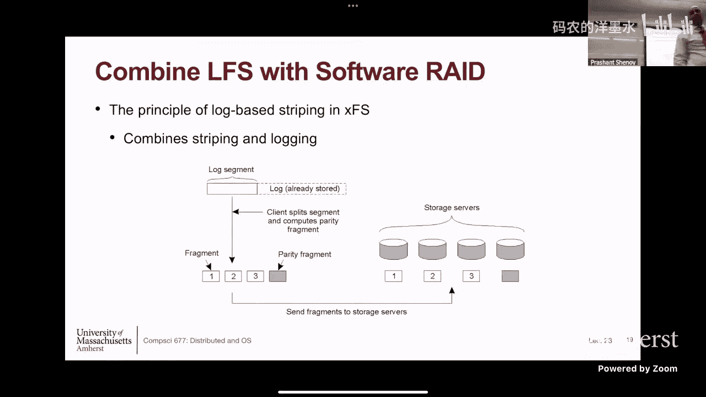

# 分布式系统：23：xFS, Coda, HDFS, GFS


## 概述
在本节课中，我们将继续讨论分布式文件系统。上一节我们介绍了网络文件系统（NFS），本节我们将探讨几个设计目标迥异的系统：Coda、xFS、HDFS和GFS。我们将重点关注它们如何解决客户端断开连接、无服务器架构、数据冗余和性能优化等核心挑战。

---

## NFS的补充讨论

上一节我们介绍了NFS的基本工作原理。本节中，我们来看看NFS如何处理请求失败和安全性问题。

### 处理RPC请求失败
在NFS中，客户端通过RPC向服务器发送读写请求。如果请求或响应在网络中丢失，客户端会超时并重发请求。这可能导致服务器重复执行同一个操作，例如将同一段数据追加两次。

为了确保操作的**幂等性**（即无论执行多少次，结果都相同），NFS服务器会维护一个**请求-响应缓存**（或日志）。其工作流程如下：

1.  服务器收到RPC请求后，首先检查缓存中是否存在该请求的ID。
2.  如果找到且存在有效响应，则直接从缓存返回结果，不重复执行操作。
3.  如果未找到，则视为新请求，正常执行并存储其ID和响应到缓存中。

通过这种方式，即使客户端重发请求，也能保证操作只被执行一次。

**核心概念：幂等性**
一个操作是幂等的，意味着多次执行与单次执行的效果相同。在RPC中，这通过唯一的请求ID和服务器端的缓存机制来实现。

### 区分重复请求与独立请求
一个关键问题是：如何区分一个RPC是之前请求的重传，还是一个全新的独立请求？

答案是：每个RPC请求都需要一个**全局唯一的ID**。这个ID通常由客户端标识符（如IP地址）和一个自增序列号组合而成。服务器通过检查这个ID，而非请求内容，来判断是否为重复请求。

### NFS的安全性
NFS的RPC通信默认是不加密的。这意味着在网络中传输的文件数据可能被窃听。从NFSv4开始，引入了**安全RPC**选项，可以对通信进行加密，但这会增加加解密的计算开销。

---

## Coda：面向移动和弱连接环境的文件系统

上一节我们讨论了在稳定网络环境下的NFS。本节中，我们来看看为移动和经常断连的设备设计的Coda文件系统。

### 设计目标与挑战
Coda的设计目标是支持**断开连接的操作**。移动设备（如笔记本电脑）的网络连接可能时断时续。Coda需要解决两个主要问题：
1.  **断开连接时数据访问**：客户端离线后，如何继续访问文件？
2.  **一致性**：客户端离线时修改了文件，重新连接后如何与服务器及其他客户端同步？

### Coda的工作模式
Coda客户端可以在三种状态间切换：

1.  **预取模式**：客户端连接正常时，主动将用户可能需要的文件**缓存**到本地。
2.  **仿真模式**：当网络断开时，客户端进入此模式。它使用本地缓存的文件来服务应用程序的请求，对用户而言，系统看起来仍在正常运行。
3.  **再集成模式**：网络恢复后，客户端进入此模式。它将本地修改的文件上传到服务器，并下载服务器上已更新的文件，完成同步。

通过这种机制，Coda对用户隐藏了网络断连的影响，提供了连续的访问体验。

### 数据存储与冲突解决
Coda支持将文件分布在多个服务器上，并可进行复制以提高容错性。

当网络发生分区，不同分区内的客户端修改了同一文件的副本，重新连接时就会发生**写-写冲突**。Coda使用**版本向量**来检测冲突：

*   每个文件都有一个版本号，每次修改递增。
*   版本向量记录了该文件副本在各服务器上的版本信息。
*   同步时，比较版本向量。如果两个向量无法区分新旧（即互不包含），则检测到冲突。

以下是冲突检测的逻辑示意：
```
初始状态:       版本向量 = [服务器A:1, 服务器B:1]
网络分区后:
客户端在分区1修改文件 -> 版本向量 = [服务器A:2, 服务器B:1]
客户端在分区2修改文件 -> 版本向量 = [服务器A:1, 服务器B:2]
重新连接后比较:
[2,1] 与 [1,2] 无法判断谁更新 -> 检测到冲突！
```
一旦检测到冲突，文件系统无法自动解决，需要**用户手动介入**进行合并，类似于Git中的合并冲突。

### 事务支持
Coda还提供了类似数据库的**事务语义**。用户可以将一系列文件操作包装在一个事务中，要么全部提交，要么全部回滚，这为需要强一致性的应用（如数据库）提供了便利。

---

## xFS：无服务器的分布式文件系统

前面介绍的系统都基于客户端-服务器架构。本节中，我们来看一个截然不同的设计：**无服务器的xFS**。

### 设计理念
xFS的目标是消除中心服务器的瓶颈。它利用网络中所有客户端的存储空间和带宽，构建一个逻辑上统一的大存储池，文件被分散存储在所有参与节点上。

xFS的核心思想融合了两种技术：
1.  **RAID（冗余磁盘阵列）**：用于跨节点分布数据和提供冗余。
2.  **LFS（日志结构文件系统）**：用于优化写入性能。

### RAID技术基础
为了理解xFS，我们需要先了解RAID。RAID将多块物理磁盘组合成一个逻辑磁盘，主要技术是**条带化**和**冗余**。

*   **条带化**：将一个文件分割成块，以轮询方式存储到多个磁盘上。
    *   **优点**：平衡负载，并行读写提升性能。
    *   **缺点**：任何一块磁盘损坏，所有文件都会丢失部分数据。

*   **冗余**：为了解决条带化带来的可靠性下降问题，需要引入冗余数据。常用方法是**奇偶校验**。
    *   **RAID 4**：使用一个专用磁盘存储奇偶校验块。通过异或运算，可以从剩余的数据块和校验块中恢复出任何一个丢失的数据块。
        *   **问题**：所有写入操作都需要更新校验盘，使其成为性能瓶颈。
    *   **RAID 5**：将校验块均匀分布到所有磁盘上，消除了单一校验盘的瓶颈，是常用的方案。

**核心概念：奇偶校验与数据恢复**
假设有数据块D1, D2, D3，校验块P = D1 XOR D2 XOR D3。
如果D2丢失，可以通过 D1 XOR D3 XOR P 计算得出 D2。

### 日志结构文件系统
LFS是为优化**写入密集型**负载而设计的。传统文件系统的随机写入会导致磁盘磁头频繁移动，效率低下。

LFS将所有写入（包括数据更新）都**顺序追加**到一个日志的末尾。这带来了最高的写入吞吐量，因为磁头几乎不需要移动。

然而，LFS也有缺点：
*   **空间碎片**：更新文件时，旧数据位置被标记为废弃，在日志中产生“空洞”。
*   **垃圾回收开销**：需要定期进行“垃圾回收”，读取仍有用的数据块，压缩后重新顺序写入，以回收碎片空间。

### xFS的结合
xFS将上述两者结合：
1.  它在多个客户端机器之间进行**软件实现的RAID条带化**，将文件块和奇偶校验块分布存储。
2.  在每个客户端的本地磁盘上，采用**日志结构**的方式顺序写入分配到的数据块和校验块。

这样，xFS同时获得了跨节点的并行I/O能力、通过奇偶校验实现的容错性，以及日志结构带来的高顺序写入性能。

---

## 总结
本节课我们一起学习了多个具有开创性的分布式文件系统：
*   **NFS**：经典的客户端-服务器系统，我们补充了其幂等性实现和安全考量。
*   **Coda**：专为移动和弱连接环境设计，通过积极缓存、版本向量和冲突解决机制，支持断开连接操作。
*   **xFS**：创新的无服务器架构，通过结合RAID的条带化/冗余技术和日志结构文件系统的顺序写入优势，构建了一个高性能、高可用的分布式存储池。



这些系统展示了根据不同的设计目标（如性能、断连支持、无中心化）所采取的不同技术路径，为现代分布式存储系统奠定了重要基础。