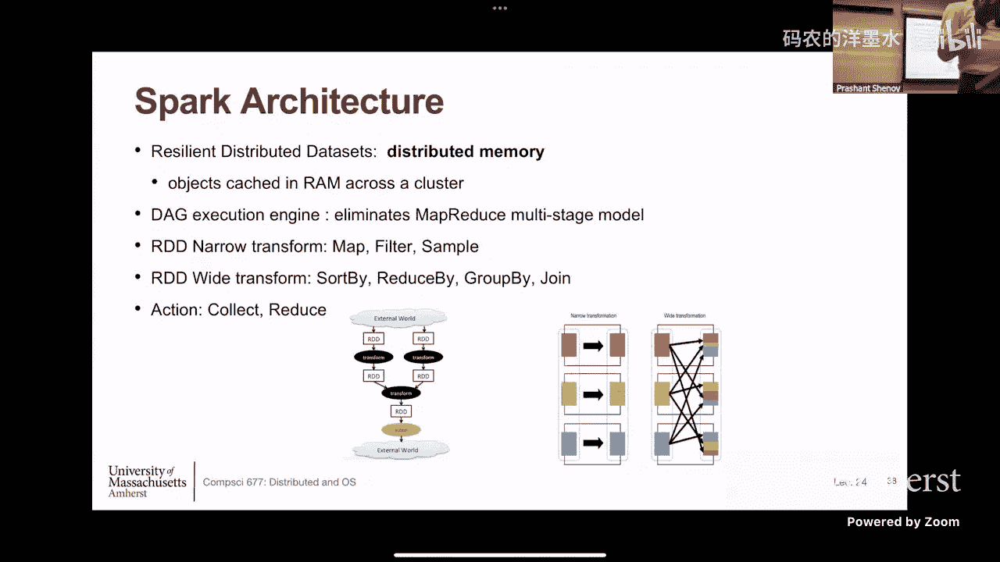

# 【全集 2025 附课件】马萨诸塞大学 分布式系统 中英字幕 p24 Lecture 24 - 中间件 -BV19BSYBuE4Y_p24-

Okay， so let's get started some minute or two early。

 but let me start with some announcements we have a final exam coming up so I'm going to give out some。

Materials to help you study for it， so Ill give out the sample exam is really last year's exam。

We also give the steady a study guide so you can look at。

All the material we covered since the midterm and focus on what you need to know that will give you some indication of what you need to review for the exam it the same deal as the midterm closedbook closed notes you can bring one cheat page of cheat sheet handwritten you can use either side so same same thing as before the one thing I will change is I had previously announced that the final exam is comprehensive which means it covers the entire course but I will change that to only focus on material since the midter。

So that will reduce your review stuff in half you don't have to look at the first half right so because anyway the final exam usually focuses on the second half of the course so might as well just。

Say that explicitly。Okay all right there is still a lab out there is a lablet and a homework out which is due after the lab so long as you started the lab on time didn't take late days but either way focus on the lab first and then the final homework in the lab and then we'll have the exam All right let's get started so today we will talk about a new topic which is distributed middleware there's quite a few case studies this is a set of case studies we are not going to go into a super detailed look at any of these systems but this is just a highlel overview broad sweep of a set of these systems in the Java world in the Windows world we look at architect blackboard architectures if we have time but most likely we run out of time at the end and then we look at it next time we'll talk about Hadoop and so that's what we have planned for today but before we do two slides from last time I could not cover which。

I still on distributed file systems so last time we talked about XFS and we talked about coda which are two file systems that focused on either mobile computing or serverless file systems but the next two are actually widely used commercial systems so I'm going to talk about them very briefly so at least get a sense of what they look like how they differ from NFS XFS coda the first one is HDFS so this is the Hadoop distributed file system so this is the file system that is used when you have large data processing applications specifically if you use something like map Red that is used for large scale data processing the data that is actually used by map Red computations is typically stored in HDFS so higher level question is what is HDFS design goal and how is it different from a general purpose file system So this one and the next。

One will be special purpose for specific tasks so HDFS is designed for high throughput access to application data so it's really designed for high throughput operations because you are going to read a lot of data process it and then occasionally write back some intermediate results so its optimized for large data sets Okay so the whole idea here is you are going its a file system that is optimized for accessing files that might be gigabytes or tens of gigabytes in size Okay so how do you design a file system to deal with these kinds of data set in a typical file system。

The mean file， the median file size tends to be on the order of a few kilobytes less than4 kilobytes often so what that means is on a normal file system let's say you look at your laptop and you analyze the files on it you will see that the average file size even though you might have some small number of large files average file sizes a few kilobytes inside so general purpose file systems are designed for smaller file they do work for bigel but they are optimized for small files SDFs is the opposite optimized for large files is optimized for read it also does right but it's optimized for reads and so but and it has a few goals I show you picture on next slide a it has to have fault tolerance built in which means that if some nodes go down you need。

The ability to continue to access your large dataset sets second is it designed for batch processing rather than an interactive task so you are not going to use HDFs if you want to open a file in editor edit something and write it back that's not what it is designed for it designed for very large amounts of data that maybe its machine learning training data sets。

 maybe it's some large data processing tasks you read it you know process it。

 you write back some intermediate results So that's called batch workload so design for batch general purpose file systems are actually design for interactive but the support batches La data sets and large data doesn't mean lots of disks you can also lots of nodes you might have a large number of machines each of which has a large amount of storage So this file system spans machines and spans disks across machine the other ones we were talking about had until we got to exc。

Still makes a first where single machine distributed file system this one can span hundreds of more so it as I said it essentially assumes what is called a verb model that's an acronym the verb essentially stands for write ones read many what basically means is the file system is optimized for applications where you create files that means you write it out to this that's creation and then you read it many times but you often don't change a file once it's created and that's true for data sets if you think about large image data large text repositories you don't go and edit that data a data meant for data processing youll create it and then read it many。

 many times across tasks so that's what it is designed for and then well see that it actually tries to computations to where the data is stored to reduce network and IO access but let me show you a picture of how this works so there are two important things to keep in mind as for。

DFS is concerned there are many servers in the system servers are used both for computations as well as data storage right so if you have a cluster of maybe 1 hundred servers the disks on the servers can be used to store HFS data the CPUs can be used to do computation So machine acts both as a compute node and a storage node that's the first thing but as far as the file system layer is concerned as DFS is concerned any machine will have one of two responsibility it will either be a data node or a metadata node so here the yellow nodes a data nodes。

 the blue node is metadata node and if you remember two classes ago I said what is metadata metadata is data about the data every file is stored in the system you are to keep additional information about it which is called metadata typically owner of the file size of the file and index pointing to where the data of the file is stored and so on in this case since。

Our file system can have hundreds of servers， the metadata node track for the entire file system whereas the file stored which machine is it stored which thiscon that machine is is it stored and so on and furthermore since fault tolerance is an important consideration here the file system uses replication so every file by default that's a configurable factor but every file and every block of that file is replicated three times the degree of replication is three so you create a file you will basically have three copies of every block of that file on different servers of the system so even if two machines go down and two of the blocks become unavailable there's still a third one so that's the degree of replication they pick as you can imagine if you compare that to the rate discussion had last time beside even mirroring in that case which just meant that you keep an extra copy for every primary file was。

So here they went with a philosophy that says disks are cheap。

 we don't need to do par kind of stuff that we talked about last time lets replicate all the files so they replicated three times so every file is replicated three times which means the metadata nodes how to track where are the three copies of the file and files are large so they don't have to be necessarily beow on a single machine they can be stripd or replicated on multiple machines。

Okay， so all of this。Our design decisions they made separate the data from metadata so there are servers that are exclusively just answering questions about you want to access a file whereas that file stored on the machines that's your metadata and then as the data is concerned you will replicate it tries that's a configurable factor but that's the default a replication factor is three and furthermore you will take a file youll chop it up into smaller chunks the chunks here will be much larger than typical file system data blocks because the file themselves are large so if you have gigabyte size files your chunks or blocks will be megabytes it size not kilobytes because that's just too much over it to maintain on a normal file system the block size will be kilobytes in HFS it may be orders of magnet would bigger because the files are themselves bigger so many different design decisions very quick glimpse into HDFS as to how it is different from。

Typical file system。Any questions about this is just a high level over we are not going to get into a lot of details yet。

 but if there are questions I can answer them before talking about one more。Okay。

 so the other file system which we will talk about is very similar to HDfs at some level is the Google file system called GfS so it is also designed for。

lararge file accesses by and large right so it has similar design decisions as you will see it uses notion of a coordinator or a master which is really a metadata system so so you will see it keeps track of data structures and the index for where the file is stored and so on and then the machines that stored the data are there called chunk servers in the GfS terminology those essentially just stored the data and the chunk servers really run on top of Linux so there's just a layer it's not a full flash file system So Gfs runs on top of a standard Linux file system and blocks in GfS are essentially stored as files on the underlying file system but they will be given name rather than a actual file name they might be given block X Y Z as the name of the file but that's really a block of a file that's stored at the GfS layer so you will see at the bottom you have the Linux file system So again many。

 many servers that are keeping track of。あ？Where the blocks of the files are stored that's actually in the master but again you will see very similar design decision okay rather than using things like parity that allows you to store written and information more efficiently they just said storage is cheap disks are cheap so let's just replicate content right so GfS also uses replication factor of three and every data every file that's stored in GFS is stored on three different machines or at least every block is stored on three different machines blocks might be distributed across machines so clients will access a file what you will do is you will first do a lookup on the master and look for where the file is stored and you might have choice of three machines to get it from you can pick one of them and then go access the content from right because you have three replicas to access。

So very similar architecture。As at GDFS。One last thing I want to mention before we move on are object storage systems。

 which is what you might have seen if you looked carefully when you did the AWS the Amazon Lalet so object storage systems are also a form of storage where you can store lots of information lots of data but they are not file systems specifically they have a different interface from a file system in a file system everything you store will be in terms of a file the file will have a name you can open the file and do reads and write that's how you access it in an object storage system you can store large amounts of information as objects so they are called objects rather than files objects don't have names but they have a handle handle is like a hash of that object content so you use a handle to get to that object and then rather than reads and writes you are what are called getss and puts you will use get to get a portion of the object you will do put to put。

someth into the object so similar interface but not exactly the same thing is not designed as a file system okay so it's basically used for large amounts of archival data and there are many kinds of object systems but by and large they make design different design decisions from file system the one thing you will see that similar as HDFS and GfS is there is a separation of data from metadata that will be a metadata part of the object storage system that will map a handle that you give which is an object kind to the location of that object kind and then where is it stored and so on so this is archival the canonical example of an object storage system that is widely used is Amazon's S3 service。

S3 stand for simple object simple storage service that's why3 S and you use htTP get inputs to create object delete objects and so Okay so you use this for backup for storing large data sets and so on you are not you going to use this to do any interactive reads and write that's a very different type of a storage system largely used in cloud based system not not in other kinds of system。

Any questions here before we move on this？啊， so。So there is a bullet there it says the handles are location transparent and location independent and what that simply says is the handle think of a handle as our large numeric ID so looking at the handle you will not know。

Where the object is stood， the location will not be。

Made visible location independent says that internally the system can decide to move the object somewhere else and then the handle name will still be the same so it is actually independent of where the data is stored and specifically in Amazon's case it actually keeps its buckets it also uses a replication factor but it replicates it across data center right so you can have your primary copy of the object let's say in US East region which is going to be Virginia but it might keep additional copy is one in Europe somewhere else in California and so on and the reason is they assume that entire data centers can fail rather than a machine can fail so you keep your objects replicated geographically so even if an entire site fails because there's a power outage you will have other locations available so and the location handle sorry not local the object handle will not tell you the location and internally to figure out what might。

The closest available location and get the data from there so so you have all these additional features that are built in to the object storage system specifically in this case that the Amazon's object storage system。

え。Any other questions？Alright so let's move on to today's topic which is middleware right so what I'll do is go through several different middleware systems that are out there these are all distributed middleware system will encounter several of them so youll get some sense of how you can use them to write higher level application so this is the picture you want to keep in mind most of this middleware systems that will talk about today our object oriented in nature right so and we have seen this picture before when we talked about RMs right so we have an object the object is on the server right so and then you can have a client it has some methods that it exposes it a state and then you can access that object from another machine using RM methods expose methods right so that's the picture you want to keep in mind when the object is distributed right so the main thing is you can have this object state itself spread across machine it' is not necessary that the entire object is on one machine it could be。

Applicated and so on that's what we will add to what we have seen before in an RM word but but this is the picture you want to keep in mind so with the first middleware system we'll talk about is essentially Java so Java not not the standard Java you write but the enterprise version of Java okay so Java comes in flavors the typical version that we use as developers to write our code but as also an enterprise version that is used to write business application so this is called enterprise Java and in the enterprise Java word that is a additional type of object that supported it's called a beam so you can say how is a being different from a standard Java class that becomes an object when you run it and its specifically。

Because it is enterprise Java they are called enterprise Java beans or EJBs okay and we will see that enterprise Java beans can come in different flavors but by and large this is a class that you will write it will be and it will be instantiate as an object but the new feature that we will add here is the state of that object will persist across invocations of that program right right now if you write a Java。

Code and use run that code any objects that are in your program okay or your process rather will disappear if you shut down the process if you restart the process the old state is not going to be there anymore it is gone in this case because this is a business application you can persist the state right so essentially what that will do is it will keep the object state on this so that if you restart the code it will read that object state and the object state will look exactly the same as it was before so all of those it's a stateful。

Class that will persist across restarts of the program and so that's how you want to keep in mind of course there other types of beans as you will see but one feature that you will not see typically in your standard Java is this notion of classes that or object that persist so but other than that the way you write EJB applications very similar right so there's an interface and there is the implementation of the interface it allows the interface allows you to create delete objects you will have persistent objects which will be called NtT beans I'll talk about them again in the next slide and then we'll see that there are classes that are going to allow you to implement your objects the implementation of it is the business logic of the application that's essentially the code of the application that you'll write for each object those are the methods and so on so that part has not changed but let's look at now the four types of EJB so first one is what is called stateless。

Beans， so these are essentially。啊呃。like standard Java classes except that they don't have any state at all right so if think of if you write some Java class but there are no private variables no public variables right so you just have code in them so you dont really keep state just some compute and returns result but it doesn not have in realstead that is basically the equivalent of a stateless session a stateful session beats。

Essentially is just more like a standard Java class right so it will have some variables that could be state that didn't maintain but it's not going to persist right so that's just standard notion of what a Java class will do so it's essentially has notion of a session it has state but that state is not going to persist if you make it an NtT be it's basically a state that' is going to persist on this so the EJB code will try to write the state on this so that if you restart it any AJB objects will come back as they were before all the other one。

 this one doesn't have state restarting it has no impact at all but this state of the stateful session beans will be gone so so those are the three types of objects you will have stateless objects stateful objects and stateful object that persist on this so you have these three choices and then you have something called a message driven beanss that allow you to send messages and by messages I don't mean the type of RMI messages you can actually have messages that also。

Pist across invocations and so on and to explain that let me go back here So you will see that in enterprise Java not only do you have this notion of NT beanss。

 there are additional services that are provided out of the box to write this business applications the RM1 is there also in standard Java but you will see that are three more JDBC is essentially a service that allows these applications to connect to databases so there Java database connector that's what is meant by JDBC so if you want to access databases you will use the JDBC service that is a JMS service here that is basically used for messaging so you can essentially send messages back and forth and these messages will be kept and persisted so you don't need to accept the message immediately they'll go and set in a queue and then you can go and accepted at a later time so they will be persisted on this as well so that's a special type of messaging service that EJB。

We will support， we will see it again in the next couple of middleware systems as well so this is。

The world of Java this is how you can use EJBs and enterprise Java as a middleware system to write higher level application right so a lot of business applications use EJBs that can also expose web based interfaces now so you can write your web based applications in this format okay that's one middleware system。

let' us look at another one and then we can try to compare these two okay the second one is called coba this ejBs are still widely used this one is actually not used as much in fact it was developed and then it really didn't take off at all and it basically just。

failed and never became popular but its worth at least looking into and there will be at least one use case Ill explain where it still in use but not widely use。

 but the thing here that you will。C， and the reason it iss called corbine is the at the heart of this middleware system is something called a broker。

😊，And specifically it's called an object request broker or an orb and Coba essentially stands for common object request broker architecture its an acronym which you don't need to remember but that's what it means so so what is this or so essentially think of the orb as being the communication plane of the middleware all the services that this middleware supports use the or to essentially send messages back and forth and communicate back and forth and so on so it's a core of the middleware platform and it's communication between objects and clients and it will handle all kinds of other things that distribution heterogeneity and so on and we'll talk a little bit about some of what it does so the way you will write your application code is here are your application object that's the code you will write as a developer a corebra developer but there's all kinds of additional services that will be provided to you by the Corba architecture that you can use to write your application。

You will see there are literally dozens of them and they provide all kinds of functionality where you can just use that service rather than writing your own code so the corebar designers。

😊，View was there are lots of things that distributed system developers use over and over again let's abstract them out and make it make them their own services and then when you write our application you use those services to essentially leverage whatever functionality that was their view and they said so that these services talk to one another we will essentially use this communication layer which we'll call an art and essentially allows you to do things like RM so that's basically sending messages back and forth across machine so let's look at and these services they're called vertical and horizontal facilities and common facilities but really don't want to distinguish between them but let's just see an example of all these kinds of services so here's a table it's not even an exhaustive one that tells you about some service so that is so you will see that there's a concurrency service that will allow you to implement trade pools。

Is a transaction service that allows you to provide atomic properties on any code you write there's a notification service that allows you to get notified there's a licensing service if you want to sell your application and give a license you can use a licensing service for their customers to use and so on so there is a persistent service this is very similar to what I was talking about in enterprise Java where you can take the object state and you can persist it to this you will see there's a security service that allows you to encrypt information theres a time service that allows you to do time synchronization there's a query service So there's a lots of different services so what this should tell you is that this is a very heavyweight middleway because it has lots of in-bedil service that come out of the box and even if you want to write a small application youll still to make it work with all of these services because that is how the designers of core intended for it to be used。

So so this is actually both a pro and a con the benefit is lots of this functionality is built in okay a con is that to write even a simple application there is a big learning curve you have to go and understand all the services which one to use for an application and so on and furthermore it may not be very efficient if you want to write a small application you get all of this extra overhead gets built into your application。

Right so from an efficiency perspective it's not the best middleware because it's very heavyweight if youre writing some heavy duty application。

 maybe you will use a lot of those services and it may be worth that cost to learn all of the functionality and write your code that way but otherwise it might not be the best way to write an application you might be better of just using something simpler like Java orM or some other lighter weight middleware but that's how they designed it and that was also the reason it actually failed because developers thought it was too complicated they couldn't write their code in such a complicated system so they did not adopt it and it basically ended up not going anywhere but a lot of the pieces that were built in Coba have lived on in other forms so it's actually good to see what Coba did beyond just looking at the table and see some of these other interesting things that added that we are not seen elsewhere so we look at two or three of these things。

First we'll talk about the object model so if you look at this picture。

 this should look very familiar it more like an RMI model where essentially the stub is now replaced by the orb right so whatever you are called Stubs in RpC and RMI word as become an or and you see that there application on the server client side as an application on the server side you essentially use the or to communicate back and forth so so that's good and that's no different but the thing that coby allowed you to do that went beyond standard RpC and RMI methods is this notion of dynamic invocation interface which means that when you write the code you don't need to specify what object and what methods you are going to call you can bind to this object at runtime import its interface at runtime and then make method called so you don't even need to know when you write the code what is the exact object that you might be interacting with you can essentially。

Dynaically pick an object to interact with import its interface and it will tell you all the methods it has and then you can sign method。

 make those methods that's not something we have seen elsewhere whether it is in the Java world or elsewhere you are to actually expose the server methods to the client and you are to actually name the methods in your code if there is a method that's what you will call here you can use function pointers and things like that to decide on the fly at runtime what to call So that's an additional functionality they provide which other systems don't have but newer system like newest version of python actually support this type of functionality where you can figure out at runtime what methods to involve so that's one thing。

The other thing is the RMI calls that coba supported went beyond synchronous so if you remember way back when we were talking about RCs or RMs I said they come in many flavors you can have synchronous you can have asynchronous you can have one way you can have deferred synchronous you saw all kinds of timing diagrams all of them came from the coba word so so when you make an RMI call you can specify is this a synchronous method is it an asynchronous method do I want one way RRPC do I want deferred asynchronous RRPC or RM it supports all of them。

so you can decide which one is best for your application and we've seen all of this before so I'm not going to go back and explain what they were but essentially synchronous was blocking as synchronous was not blocking one way was just you send a request don't wait for the acknowledgement and deferreder synchronous was to reverse our PC right so this is where it originated from and some other systems used some subset of this but Coba supported all of them right so you could figure out which ones to use for your code。

The other interesting thing that Corba introduced was the new this notion of an event service so the way an event service is implemented in Corba is through this middle thing called an event channel。

And this is where essentially this notion of a published subscribe model comes in a publish subscribe model also called a pub subm is a different way of designing a distributed application we have not actually written any code in this class to write a pub sub application but it is still a very popular way for writing certain types of application so there is how it works in a publish subscribe paradigm you the components of your applications can either be a publisher or a subscriber publisher produce data or event subscribers consume data or even this is also called a producer consumer paradigm。

If you are taken an undergrad O class you might remember producers and consumers so that's equivalent here to publishers and subscribers so publishers will produce data and they will actually send it to the event channel and subscribers have to subscribe to certain types of data and they have to actually provide a subscription to the event channel whether when a new notification not a notification a new event or a data item is published to the event channel it will check is there any client that a subscribe to this type of data or event and if there is a match is going to deliver it to the consumer so the way you want to think about this is you don't actually directly send messages from one component to the other you use the event channel as an intermediary for communication when you produce a data or an event it's not addressed to any one component specifically so when you send a message using sockets and so on you are to specify the recipient。

Either using an IP address and so on or when you make an RPC call the recipient is the other end that's implemented that RPC call so you know who you' are sending your messages to that's not the case in an public subscriber the publish subscriber publishers produce data they go and sit in an event channel you think of this as a big buffer and there are subscribes and if theres a match you will essentially deliver it so thats how you will write your application。

using a public subset now this published sub paradigm can be also implemented internally using a push or a pull based approach。

This figure here on this slide shows your push push approach where publishers which are labeled as suppliers here or whenever they publish data they are pushing that data into the event channel the event channel checks for subscriptions and for every match is going to push a matched data or event to a consumer okay so both our push but you don't have to do it this way you can also implement an event channel using a pool pool approach where you will see that the event channel is。

Periodically polling publisher saying is there any new data or event to publish Okay and he'll pull it and put it in the event channel Ill just s it them the job of the consumers here also to pull the event channel saying is there any data to be retrieved and then if there's a match retrieve So that's a pull pull model same event channel but you are using poll based techniques as opposed to push and you can use。

Any combination can use push on one side and pull on the other side if you sew wish right so so all of that is supported in Corba as well。

Well this is something that's new we are not encountered as before。

 and we will see another instance of essentially using this type of。Event and notification service。

I this clear so its a good way to implement notifications right so if you think about your phone apps they often send you push notifications right so the one way to actually do this is to have an event channel where the server side is pushing notification your phone is actually subscribe to notification or the app on your phone has subscribe to notifications so this is why the system will then push a notification to you so so these kinds of services are implemented using event channels and so on not coba based other types of systems but nevertheless thats one use case yes。

Yes， if you want so that's a good point if you want to do cash invalid， the cash is could。

Subscribe to events and specify what data they have and a server could push events when a data change that would be another any type of notification you can use this and sending invalid is the type of a notification。

Any of other questions yet？Okay so there's one more thing here where rather than using a push or a poll you can the clients can essentially have an asynchronous notification where you register whatever you subscribed to with the R and then theres a callback whenever there is an event to be pulled and then you go and pulled so rather than periodically polling which may be wasteful because there may be no data to retrieve and the consumer keeps asking you can use a callback system where you register a callback and whenever there is some data to be pulled you get a notification that there is some information at that point you send a request to the server and get a response server in this case is the event channel not the actual consumer or the producer。

So asynchronous。Method in vocation can be used to essentially pull data from the eventile。

 so that's the thing to keep in mind。So let's move on to another system which is called Decom okay so now we are moving so we started with Java EJBs then we talked about Koba which is really platform independent it worked on many different platform and now we are going to move to the Windows world and look at some middleware systems that were present in the Windows world and it will start from an older system and then get to dotnet in just a second so Dcom is a middleware system that Microsoft design it stands for distributed component object model。

Okay。Pretty standard distributed object model something we have already seen it looks very similar to eJBs in many different respects but let me give you a little bit of history as to how this all arrows so the precursor to decom or something called comm comm essentially stands for component object model so think of comm as a way you can do RPCs but really on a more of single machine。

So if you have a system of processes that dont communicate with one another using an RPC like interface on a single machine in the Windows world you use co and the reason Microsoft came up with this co layer was they had all kinds of windows so there were scenarios where these processes needed to communicate with one another so this was their RPC like layer but it designed or optimized largely for single machine communication and then on top of comm so they added another layer called Olay which was object linking and embedding。

So， the Olay layer was designed specifically for Microsoft Office applications to talk to one another so you could for example。

 take a figure that you made in PowerPoint and you could directly embed that into a Word document。

That's called object embedding right so you embedding one object into another so now or you could create a bar graph in Excel and then you could put that bar graph in a word document so you could directly drag and drop it and then somehow word knows how to talk to Excel and import all of that and if you updated the Excel document the word figure would automatically change because word and Excel are talking to one another and they are essentially using RPC messages back and forth and using the O layer layer to communicate so that allowed you to embed one object into another specifically you can now view Excel spreadsheets。

 PowerPoint documents Word documents as object and each object and then import or export other objects from it so that's how they essentially layer Olay on top of that and then when when you had essentially webbased document they added another layer called active X that allowed you to do something similar in the web world but will ignore that or just。

The moment but then eventually you needed a ability for machines to communicate with one another and that got you into decom where they made the whole thing distributed eventually Decom was renamed dotnet which is still what they used today dotnet just added language independent so in this case you could essentially write the client in one language and the server in another language and to still allow communication similar to our GRPcs where language independent you can have rpCs that go across application component that are written in different language just a brief history every 10 years I think there's a new name and a new layer that gets added but we are still in the dot network which is the Microsoft middleware that used to write applications using Windows。

but at the heart of it still an objectbased model still has very similar so this was the history that I just already mentioned which Im want to ignore in this slide because I already talked about it but let's now look at how decom and dot networks so if you look at this picture it looks very similar to everything we have been talking about your client machine the object is sitting on the server machine you will see that theres a stub at both end okay there is something called a registry which allows you to register what objects are where and so on that's called a service control manager。

But the way communication works very similar to RPps and RM so you can have communication go back and forth and there are some similarities to the coba world which we will ignore here because there's not really important what is important is this is still by and large distributed object model and furthermore it has very similar features to what coba has so it will see that there are persistent objects which are called essentially moniks which allow you to take an object that was created on a previous instant and loaded back from this so you can create persistent object just as your Nt beans you have something called a moniker which is like a pointer to an object that allows you to reconstruct an object and there are other repositories where you can store the object state retrieve the object state and so so it has standard objects like Java does but it also persistent object because they wanted to have similar。

Funality to what is there in Egb and quoma to write business application so similar。

 very similar things。The persistent object is one thing that added to standard RPC mode。

Is that a question that？All right。It was a very quick overview through several different systems but by and large nothing very other than the event channel really haven't learned anything new because we have already looked at RpCs and RMs and use it only a new other thing was that you can persist the state of your own but now well talk about a very different kind of system which is called a distributed coordination mode now this is going to go back to lecture2 when I talked about Blackboard architectures and I'll restate what I had said then because you probably forgot what I had said maybe 20 classes ago so but distributed coordination systems are basically use or used to implement blackboard based architecture application so let's try to understand what this is and how it works so the first Im want to present at taxonomy so a little bit abstract but then we'll try to make it more concrete and I'll explain。

What a blackboard architecture is so so this is a taxonomy of how clients and servers might interact in any distributed application and you will see that there's a table at a。

The bottom here， which tries to you know classify all of these distributed systems in four different buckets depending on how they coordinate in the temporal dimension and how they coordinate in what' is called a differentialial or the space physical or spatial dimension。

So and so in either dimension you are coupling can be strong or weak。

 which is written as coupled or uncoupled and I'll explain what coupling means and so on but let's take the simplest thing which is you are coupled in both dimensions where you will say couple in differentialial and temporal which is labeled as direct in that this is essentially all the applications you have been writing where the client and server are both executing and they are both communicating directly with one another so this is essentially they are coupled in both time and space couple in time means the client and the server have to be running at the same time then you are coupled in time coupled referencely means that they actually need to know who they are talking to the server has to address the client client has to address the server you need to know their IP addresses and so on and so so this coordinate all the applications youve encountered so far now let's look at the other three which you probably have not encountered and so well make a。

T weaker in one or both dimension so let us essentially take the one that is uncoupled in the temporal dimension but coupled in the spatial dimension so a good x way to understand this is an email application。

Email is a way to communicate just as clients or or RPRPC is a way to communicate but when a sender sends an email to a recipient there is no expectation on the sender's behalf that the recipient is actually logged in and actively checking their email the email will be delivered and read at some later time。

😊，So now you are decoupled in time you are communicating with someone where they don't actually have to look at that message immediately。

😊，I can look at it at some later time right so that is essentially called a mailbox based communication where you are decoupled in time but it is coupled differentialentially because every email is addressed to someone so you know who you are sending the message to。

RightSo essentially if you know the recipient and you mentioned the recipient in your message that means you're coupled in the referential dimension and a temporal means that the send and recipient are both communicating actively at the same time so if you relax this you have essentially a mailboxbased architectures where you are decoupled in the temporal dimension but coupled in the refer the mailbox coordination so if you go on the other dimension where you are coupled in time but decoupled referially you essentially have a public subscribe paradigm that we just talked about because remember in the public subscribe paradigm I said when you publish an event it's not addressed to any particular recipient in particular you just say here's an event you put it in the event channel and consumers decide which event they want to take from the event channel so unlike RPpCs which are sent to a particular server unlike email which is address。

To a particular recipient， the public subscribe world messages are not addressed to any particular component in the system in particular。

 you just say here's an event of publish so that gives us this meeting also called meeting oriented because in a meeting it's like you call a meeting but you don't you announce that there's a meeting but you not address to particular person or recipient is the same thing so this is called meeting oriented and then the last one which is what we are going to talk about today is called generative communication are decoupled in space and time So here clients and servers are components of the system are communicating through some messages but the messages are not addressed to anyone in particular and neither are the vendorers and recipients are communicating at the same time So it decoupled in space and time that's called generative communication also called Blackboard based architect So there's an easy way to。

stand how you can be decoupled in space and the referential and temporal dimension and yet communicate the best way to understand this is the same example I had actually shared in the earlier class。

 which is let's say there is a notice board。Right where you can go post notices。

Right so you know what that means right so so you can go and put a notice there say let's say you are moving you want to sell your furniture so you make a flyer saying that I have to sell my sofa and all of this furniture and you post a note and then you put your contact information there right so now you created a message you put it on this notice board it is not addressed to any particular person。

You just put it as general interest and you put it there so you don't know when you publish it who is going to see it whether anyone will actually want it or anything like that。

 but you just posted a notice now maybe somebody comes at some later time maybe they want to see if someone is selling furniture and they scan notices they look at your note and they say okay maybe I'll contact this person and see if they still have for so the communication has now been decoupled in time because you posted the note and somebody might have come days later and looked at your note so it's not communication not happening at the same time the sender and receiver are not communicating a real time yet so there is some time lag between when data was published and when it was consumed and as in this example any data you produce is not addressed any particular recipient you just put it on the notice board and somebody else comes and takes it later。

So this cr of communication this is why its called a blackboard or a noticeboard architecture。

 you post notices on this shared system which it looks like a blackboard someone there comes and takes it at some later time。

Is that example clear okay so it is clear why it is decoupled in referential and temporal dimensions yes your question。

被保你这个。怎没。这 is一个30。Okay， question is in public subscribe， why is it coupled。

In the temporal dimension yes so the point is that the event channel does not buffer messages for long periods of time when an event is published it checks what subscriptions are active and immediately delivers it So if a client comes to us later you are not going to go you miss hundred messages and deliver it so that thing does not exist right if you did that you are essentially back in this blackboard architecture so think of a blackboard architecture as something like an event channel which persists messages so you can come back later at any point and look at past messages in event channels is all real time the sender and the receiver have to be running and you get delivery immediately。

I that clear any other questions here okay so if we will look at a case study of this system called Genie it's a system that was developed in the Java world that essentially implements this bulletin board mode so let's think about I was giving this example of a notice board right but you should ask that's not a distributed application thats a real world example which real distributed application might use an architecture of this why would you want to write an application where you are sending communicating with entities you don't know okay you just publish some messages and someone else comes at some later time looks for this what examples can we think of where something like this is useful。

Any thoughts here， yes。You could do social media yes thats that's although you will not use a Blackboard based architecture there you could post messages and someone else can come take a look at it that's very close to what I was talking is a bulletin board a physical bulletin or any other lower level systems application。

 not not like a user communication oriented application。😊，到。

To one example you want to keep in mind is these types of architectures are used for configuring your system on the flight so there this entire class of systems that are called zerocon services zero configuration services and I'll give you an example we will understand what I mean where you don't have to preconfigure something on a system you can come and discover services and configure them on the fly so here's an example right so let's say you take your laptop and you go and visit a friend you connect to their home Wifi network and now let's say you want to print a document and they have a printer in their house what is the normal process you would have to go to。

We print our document。Anyone printed anything yes you would search for the printer so you had to configure the printer because you went to someone's house you never printed there that printer won't be preconfigured in your machine so you will have to configure the printer you will have to add information configure it potentially get the driver and it will print after that right so what if you could simplify this right。

Another so in this case your machine can go and discover what printers are available and when you say I want to print it will just say here is a list of nearby printers I will show you that printer okay you will just I want to print to that printer and then it will configure itself and print it。

😊，That makes your life as a user much easier because you don't have to go and manually do anything at all your system went and figured out this is a new w-fi network heres a printer that seems to be available it showed you that printer you just print your life is good and this is by the way how your modern operating systems work if you go into some environment it will show you printer you have an iPhone and you actually look for a printer it will show you nearby printer because it able to discover but what does this have to do with a blackboard architecture so this is how you can implement this blackboard architecture services can advertise themselves using a blackboard in our example the printer would go and post and notice on this blackboard architecture saying I'm a printer I'm H model X Y Z this is my IP address port number and so on and your machine just has to go and look or is there a printer service being advertised on my Blackboard architecture and it might find some number。

a printer and there might be other services， maybe there is a storage service or maybe you are essentially having a streaming service that for your house it can show you all kinds of services that have advertised them this can be easily implement it using Blackboard architecture where services are advertising themselves other machines come look for services in this case you're looking for a print service and then you find them and then you can the machine the printer did not know beforehand when it advertise itself which clients will come and print so you couldn't send a message to a laptop saying I'm a printer if you ever need to print here is my you couldn't do that because you don't know who is actually going to ask for this print service So you are better of advertising somewhere where some other machines can come and go discover this service so for things like service discover which is something you actually implement and distributed systems where you can go and discover services that。

Available in your network， you can use Blackboard architecture because you can advertise the services and go and discover them on the flood。

so nothing needs to be preconfigured or told right so so that is an example of where you would use a blackboard architect right now with that background let's look at how we implement this type of middleware。

So in the Java world you will implement this using what's called a Java space think of a Java space as essentially a replicated database every record in the database is a notice or a service that is being advertises a couple a couple basic you publish a couple it advertises something it's like you post a go and post a note in your system so and then you have essentially publish or subscriber type scenarios where you publish data items they will persist so this is not like an event channel in this middle where they are able to persist in in the system so theyll just stay there as a notice as and post someone else can go and query saying show me all matching printers or show me all notices that match a certain criteria so you send a query or you can even make a subscription and be notified you can do either of these and then you will be given whatever is matching in that bulletin board architecture so this。

System that you see at the bottom that is essentially a database that's where you in the genie world is called a Java space so you are publishing data items that go and sit as tuples in there and then when you query them you will be getting tus that match or you can have a subscription which says if there' is ever a matching item that is published notify me right if a new printer appears notify me and then it will be notified so you can do these two things here right but。

Here are some and this is the example I was just talking about so here's your Java space where you can write and then that will publish some item you have written A and B and then this third client here essentially goes and looks for some data item and it can retrieve it when you retrieve it one of two choices you can remove it from the Java space because if you say this is a onetime item that I consume nobody else can consume it youll allowed to remove it but if it's a longstanding tu then you just leave it there because someone else can come and ask for the same data item so you can have both of those functionality in your Java space。

And the way you are going to implement the Java space as I said so I'm going to show you is it's a replicated database so you will see here that there are two figures here in the top figure you will see there the database is replicated three times so so also on the bottom figure and way you are going to decide。

How to replicate is one of two kinds either you are going to say that all rights are broadcast which means every tuple is going to be put in all of those replicas so this is the equivalent of let's say you have a notice board on each floor of this building every notice is going to be posted on all of these floors that means if I am looking for something I just need to go to my local notice board and look for it because every notice is replica I don't have to go to another floor to look for something so the same is true here if rights are broadcast reads are going to be local that means if I'm going to query something I just go to one of the replicas query I don't need to look at anywhere the opposite is also true where the right can go to a local one where that's the equivalent of I going to post a notice to the nearest notice board but now if you are looking for something you are to query all of them so in this case reads are going to be broadcast to all rights are local so either your local rights broadcast reads。

broadcast read local read so this is how Genie allows you to configure Java spaces right so this one is essentially showing tus are broadcast reads are local。

 but the opposite can also be true。Which is essentially stored shown in the second figure where right is done locally。

 but the reads actually are to go to all of。So this is how you will implement your genie based architecture right so internally its a database that is going to store all of your information and then it will support queries on top and the ability to write to the Java space。

Any questions here？And so that does yes your question。

Okay question is in the example of a home wfi network where will this exist so if you actually use genie which a home w-fi network does not use。

 but let's assume you use this system， you would be running a genie service on maybe some computer on your network and it is going to be advertising itself so that's how you would implement G。

 but that's not how your home wfi network work because there's no real bulletin board that's implemented so the other way you will essentially implement service discovery is that every service is broadcasting its identity continuously on the network so every second a printer is going to send a broadcast message I'm a printer Im at isip doesn't go into a bulletin board is like I go and keep shouting every soft and saying I'm a printer and then I'm looking for a printer I just wait for the next broadcast and I find it So typically there are two ways to do service discovery the genie world is where you are going to。

Post your information into a shared twople space and you go retrieve it further。

 The other one is you essentially send broadcast messages that goes to every machine in the network and then the machine just has to listen。

And when it sees a broadcast it will basically add it to its list。

 that is how some of the things that Apple does actually so they are essentially listening for broadcast because they don't use this type of server which is more efficient but broadcast means you'll keep sending this information over and over again but that's certainly a way to implement it。

Yes， your question。来。到。来点咁见你收去。Okay question is in the blackboard architecture and I'm going to go back to this figure the clients can communicate it each time the server should be running so when I said that components where decoupled in reference differentialential dimension and temporal damage are talking about client the server has to be running but the server is not directly communicate it's just facilitating the communication so is these components that are decoupled in place and time not this not the Java space itself that so Java space has to run it's not like you publish that server disappears and comes back that's not what we are talking about these are the components that are decoupled。

All right， so very quick overview of two more systems and then we are done so were to quickly talk about distributed data processing middleware systems specifically Hadoop and Sp which if you taken this class systems for data science you probably look at this in a lot more detail but just in case you have not and want to just show you what these applications so these are middle systems that are designed for data processing there for compute and data processing they support all kinds of scientific applications which are also called big data applications there are some examples here genome sequencing looking at lots of images and processing and these are brain scans you can think about lots of financial data being processed lot of clinical data when many different scientific domains as lots of data big data sets and youve got to process them and these middleware systems are designed where you can use a cluster of servers。

so it is thats why its a distributed system where you are paralleling the processing across multiple machine first parallel processing of large data set so that is what these middleware systems are going to give us so large data sets we need to parallelize the process so here' is an example of how you could do this。

so this is called the map Red programming model， so the way you are to implement a map Red based programming model is you are to take whatever。

Application you have that doing the data processing and you have to essentially map it to two stages there's going to be something called a map stage which is going to do the first stage of the processing and then there's going to be the second stage which is called the reduce state and so here is how it will work so you will essentially have a lot of machines there are three of these nodes that does shown but typically you might have dozens each of them is going to read some chunk of data itll do some preprocessing on that data and we will decide which of the machines to send it on the second stage so so you read some information you do some processing and then you do what is called a shuffle the shuffle says where do I send it next for phase two and so you will see this all these black arrow says some data that's processed by node one goes back to the reduce on this node or node one and this one goes to node two node3 and so and then once get it in the reduce phase you do the final processing so essentially you are going to have two stages。

of processing the map stage and the reduced state and then there is going to be data exchange。

 which is the middle stage， which is called a shuffle。

So you have to write your application in this format。

For you to figure out how to do some large scale data processing so just as an example lets say you want to do a simple application you are given a lot of text files and you want to do word count word count simply says I want to count which words are present in this text file and how many times they occur。

Thats what a word count application right so so lets try to ask a simple in this map reduce case how are we going to essentially a parallelize this processing and B map a constructor map reduce version of the word count program right so it should be clear how you are going to do the sequential right sequential if you just add one。

Machine you are going to sequentially read all of your text files you are going to construct an index and for each word you will have an entry and if you encounter the word you will increment that entry so at the end you know how many times each of the words have occurred that is your sequential way of doing work How will you do this in parallel。

 so in particular， let's try to map it to these three state forcess。

Any thoughts on how to is a canonical example of mapreuce？

Not very hard to figure out you're done things like Mu soil。

As the first thing is we have a lot of text data so we will partition it right you will say node one does the first third there are three nodes right the second node2 is going to look at the second third and the node3 looks at the last third of the data so you took your data partitioned into three so I paralleled。

so now what do I do next？N one can start reading its information。

 right so it will start encountering words。And we got to count this word， so how do we do this？

Okay so you can create some index structures and decide how to count and shuffle so how are we going to do this I'll give you very simple there are many different ways to do this but heres a simple one okay let's take the words here because the words are going to start with from a through z will say all words from let's say a to D are going to be counted by node1 all words starting from a to D and then e through some other letter will be node2 and then this will be node two so your partition the word space into three chunks。

哎。That's what we do so now node1 gets reads some text and it finds the word apple it's going to say I'm going to send that to the node one of the reduce phase because it's responsible for counting all words starting in a if you get let's say pair then you will say I'm going to send that to node3 because thats the node thats counting all letters all words starting with P and so on so that's your shuffle so you read words and you decide which of the nodes are send it to for counting the reduced phases are doing actually doing the counting so the reduce nodes are going to keep receiving words from the mappers and as they get each word they are going to keep that index that we talked about so here youll keep index for all words starting from a through C every time a word comes in incremented and the same thing here and here but at the end of this you read all the words you send it to the reduces the reducers count you now have an index that has actually counted all the words in parallel。

Is that clear？That's a very trivial map reduced program where you just parallelized your data processing。

Right so given any type of computation you have to write it in a mapre format where you are to see what is the preprocess in our case there is no preprocessing at all you just had to figure out what is the starting alpha character of the world and then decide who to send it to that's all we did all the counting happen here but there could be other applications where you actually do some processing here and some processing here and there is some data exchange in the shuffle。

Yes，嗯。Okay question is what is the need for multiple mapping process if each process reads entire data but each node does not read the entire data if this is a large corpus of text files let's say you have million text files each of it has some text you want to count words across all of them you will say。

First 33% of the files are responsibility of this node next 33% here。

 so each of them is reading different information and then parallelzing it and counting that it is not doing it if you read all of it then you don't need more than one map you can do it with one。

Is this clear？Okay all right so that's map produced there is a platform that was built to do all of this which has lots of different。

Subcomponent one that we did talk about already is HDFS right so in Hadoop this is Hadoop is a system that implements mapre the data or the text files in this example as talking to you would be stored on HFS we will have lots of these files and these node will be reading from HDFS doing the shuffle and then eventually the mappers will write out the final results back to HDFS that's the only component we have actually encounter but there are many others we'll talk about sparking just a moment an edgebase that's a database that Kaafka that's a messaging service there are yarn and meos which implement scheduling and so on which we will not talk about me we did encounter we remember resource offers so that is the scheduling framework that Hadoop actually came up with and then it works with Had meos as well so this is the ecosystem which we will。

Ignore about what I will do is talk a little bit about one of those which is called SpR which has become a very popular data processing platform so here is essentially SpR it is an Apache project it is built on top of map Red。

And I'll explain what it does so it's more efficient than doing mapre and we'll see why but what it supports at top of it is all kinds of higherleum you can make SQL queries you can do machine learning training you can write graphb application and so for the purpose of this class ignore all of that just assume you have the map reduce model and we'll see how spark makes it more efficient so what happens in the map Red model is when you do the shuffle phase the shuffle data can be written out to disk and then the reduces have to read it back from disk so the maprs read the original data from disk they process it and they create new intermediate files that are stored so you might create a file for node one to read that's your intermediate output the shuffle could be direct messages you send or they could be data you write to files and then the reducers read those files and process information because the amount of data is large。

You cant always store it in memory necessarily so the shuffle phase sometimes involve disk this significantly slows down the data processing because any io as you know is slow disk are slow compute is fast so you are going to essentially slow down your map reduce computation because there is intermediate iO in between spark has tried to resolve this problem by saying that lets not。

Toward the data in this， we will essentially create a distributed memory cache。😊。

So in the shuffle phase instead of writing the data to this we will write it to our inmemory cache and furthermore the reducers in this case can go and read it from an inmemory cache rather than actually reading it from this but this is a distributed inmemory cache because any single ra of one process or one machine it is not going to be large enough to store large dataset set so you will take all the ra that is available on all the machines create one big logical cache which is basically going to be union of the physical caches on each of the machines so essentially this system implements the equivalent of what is called distributed memory which we are not encountered at all in this class its the first time I've actually talked about something called distributed memory so just think of distributed memory as not different from physical memory where I can go and access any location on memory but now I can access memory locations on other machine。

ケ？So that is the concept of distributed memory the way it is implemented really is its a distributed cache because you basically have the cache is stored in memory so I am actually accessing cached items that are stored on other machines not just my local care so it is going to implement this concept of distributed memory okay so objects are cached in RAM across the cluster and。

😊，Essentially every intermediate output is constructed or not constructed realizes something called an RDD which is an acronym for resilient distributed data set so what spark does is whenever you produce an intermediate output you create this object called an RDD that is essentially stored in memory but as you can imagine machines can fail memory is volatile so the machine reboot that data is gone machines can fail and so on so if I am going to rely on this cache for my subsequent stages of the computation because remember this is just intermediate output I generated an output I stored it in RA the next stage is reading it one machine reboot it some other data is gone。

Right so I need a way to reconstruct that data otherwise I will not be able to complete the next stages so RDD is automatically allow you to reconstruct that data by tracking which computation produced it and if a machine fails and how to reconstruct the RDD it will re triggergg the computation that the RDD was created from and reconstruct it so here we are not keeping redundant copies one way to deal with failures is I create redundant copies one machine fails I go to another but RamM is not going to be a resource that you have in abundance it will be less memory than your disk so you cannot actually use redundant so so we will do recompute as a way to construct it so so you will have your distributed cache the distributed cache will store objects called RDD is every RDD object will keep track of which program and what code generated it what data has generated it and if the machine fails the spa system automatically。

Regenerate it for so it will just look like access has become a bit slow because that data is being regenerated right but so long as machines don't fail this is going to run much faster than map produce because all the intermediate output is stored in ramp。

So you are reading from memory rather than reading from this so you can do all your map reduced style distributed processing but much much faster that is the main advantage of spark this is why it's become very very popular you talk to anybody in database world or anybody to do data broad large scale data processing they will actually use Sp to do their work。

So and it has basically more or less taken over what map Red used to do 10 years ago now everything is done in spaR because it used inmem caches as a way to speed up your computation and keep them in a resilient fashion。

Is that clear。嗯。Any questions i'm I'm not going to go into a lot of the details here because that's not important a main concept is distributed memory which implement as a distributed cash because RA is volatile we have the ability to reconstruct any cache objects that disappear because machines fail those are the two concepts that are the most important that allow you to build on what map produced so with that let's end it here today and itll continue next time。

