# 001：导论 🚀

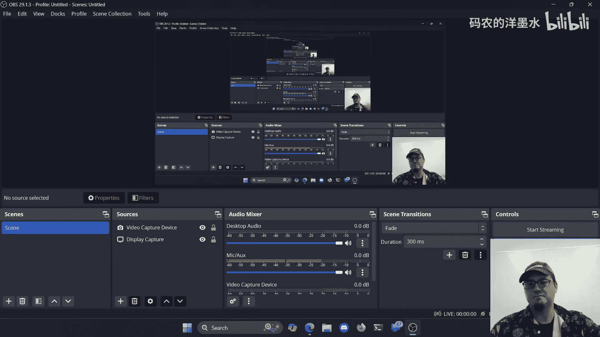

在本节课中，我们将学习课程的基本信息、所需工具、学术诚信政策以及如何设置开发环境。我们将从课程大纲开始，逐步介绍C++编程的入门知识。

## 课程概述 📋

本课程是C++编程的入门课程。我们将学习编程基础、C++语法、问题解决技巧以及如何使用现代开发工具。课程包括讲座、实验、个人项目和期末考试。

## 课程大纲详解

### 教学团队与联系方式

实验室部分由Dr. Saed负责，时间为每周一16:00-17:45。主讲教师（我）不是教授，这个头衔需要满足特定条件才能使用。

**联系方式：**
- 邮箱：请直接发送邮件，不要通过Canvas发送
- 电话/短信：可以联系，但有时可能无法立即回复
- 办公室：位于CIIS大楼，上课前后可拜访
- 虚拟会议：可通过预约安排Zoom会议

### 课程材料与工具

**在线教材：**
我们使用ZyBooks在线教材。这是一个基于订阅的交互式学习平台，你可以在浏览器中直接编写和运行代码。每章完成后可以保存为PDF。

**推荐参考书：**
《Problem Solving with Abstraction and Design using C++》可作为补充阅读材料。

**开发工具：**
1. **GitHub** - 代码托管平台
2. **Git** - 版本控制系统（由Linus Torvalds创建）
3. **编译器**：
   - Windows：Visual Studio 2022社区版
   - Mac：Xcode
   - Linux：需要额外配置

### 评分体系

课程成绩采用加权类别计算：

- ZyBooks阅读与练习：10%
- 每周实验：10%
- 个人项目（4个）：30%
- 期中考试：10%
- 期末项目：40%

**重要说明：** 期末项目必须完成才能通过课程。期中考试为开卷考试，允许使用书籍、笔记和网络资源。

### 课程时间表

以下是课程的大致安排：

- 第1-2周：C++简介、GitHub、Visual Studio入门
- 第3-4周：基础语法和概念
- 第5-8周：核心编程概念（循环、函数、数组等）
- 第9-14周：高级主题和项目开发
- 第15周：复习和期末项目展示

期中考试计划在10月22日进行。期末项目将在课程最后一个月完成，并在期末考试时间段进行展示。

## 学术诚信政策 ⚖️

学术诚信是本课程的核心价值观。违反诚信政策将导致课程不及格。

### 允许的合作

鼓励以下形式的合作：
- 讨论课程概念
- 组建学习小组准备考试
- 讨论项目规范和要求
- 帮助理解编译器错误（但不提供具体代码）

**核心原则：** 可以用英语讨论问题，但不能共享代码。

### 生成式AI使用指南

虽然生成式AI是强大的工具，但在入门阶段需要谨慎使用。

**允许的用途：**
- 学习课程概念
- 生成示例代码供学习参考
- 理解编译器错误信息
- 头脑风暴测试用例
- 生成额外的练习题

**禁止的用途：**
- 生成项目代码
- 校对或修正你的代码错误
- 在考试期间使用
- 将生成内容作为自己的作业提交

**基本规则：** 将AI视为学习伙伴，而不是代写工具。如果你不理解AI生成的代码，那么使用它就没有意义。

## 开发环境设置 🛠️

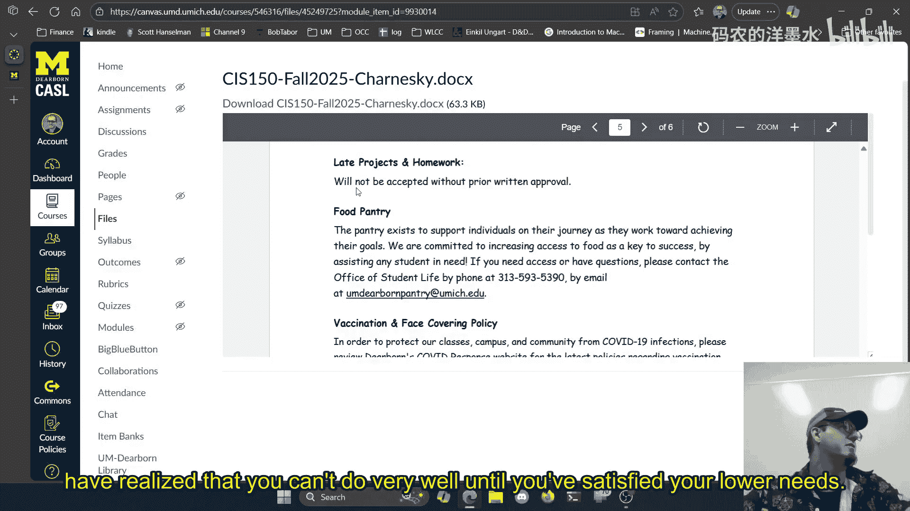

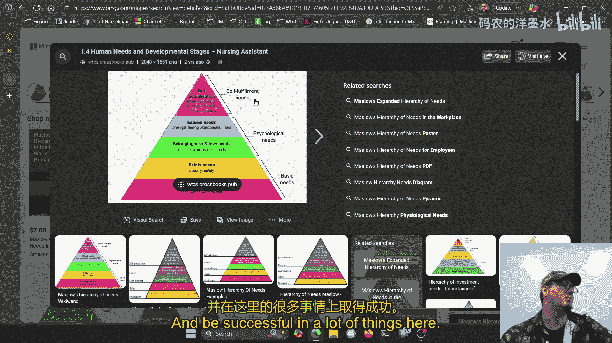

上一节我们介绍了课程的基本要求，本节中我们来看看如何设置开发环境。

### GitHub设置

GitHub是代码托管平台，我们将使用它来管理所有代码作业。

**创建仓库步骤：**
1. 访问GitHub网站并创建账户
2. 点击"New repository"创建新仓库
3. 设置仓库名称为"CIS150-Fall2025"
4. 选择"Public"或"Private"（课程作业建议使用Private）
5. 勾选"Add a README file"
6. 添加.gitignore文件（选择C++模板）
7. 添加许可证（可选，MIT许可证是常用选择）

### Git与GitHub Desktop

Git是分布式版本控制系统，GitHub Desktop是其图形界面工具。

**安装与配置：**
1. 下载并安装GitHub Desktop
2. 克隆你的仓库到本地计算机
3. 仓库通常保存在"Documents/GitHub"文件夹中

**基本工作流程：**
```bash
# 修改代码后
git add .          # 添加更改
git commit -m "描述" # 提交更改
git push           # 推送到GitHub
```

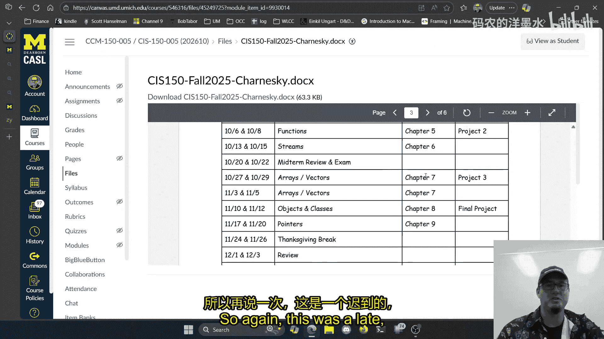

### Visual Studio设置

对于Windows用户，Visual Studio 2022社区版是最佳选择。

**安装步骤：**
1. 运行Visual Studio安装程序
2. 选择"Desktop development with C++"工作负载
3. 完成安装

**创建第一个项目：**
1. 打开Visual Studio
2. 选择"Create a new project"
3. 选择"C++" -> "Console App"或"Empty Project"
4. 将项目保存到Git仓库文件夹中
5. 添加新的.cpp源文件

### 第一个C++程序

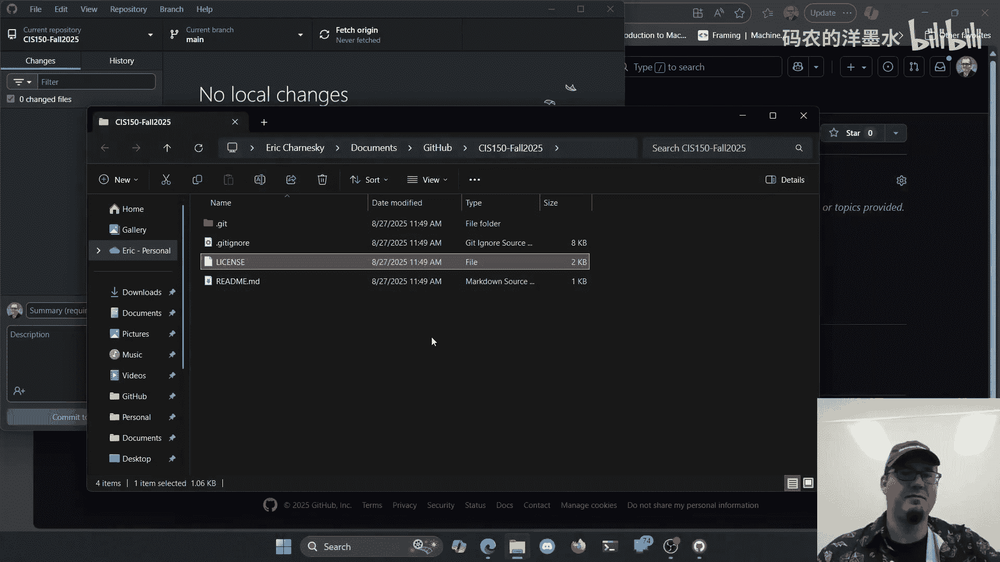

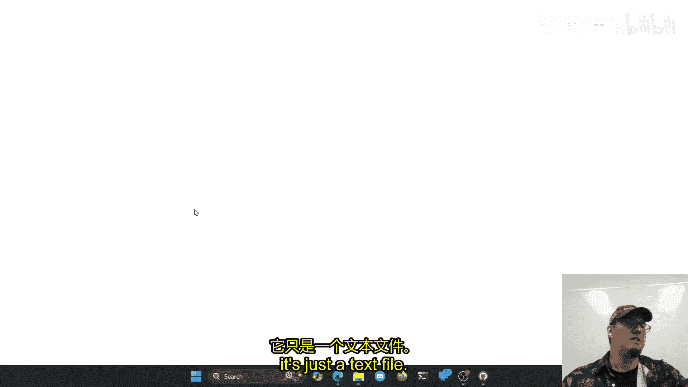

让我们编写经典的"Hello World"程序：

```cpp
#include <iostream>
using namespace std;

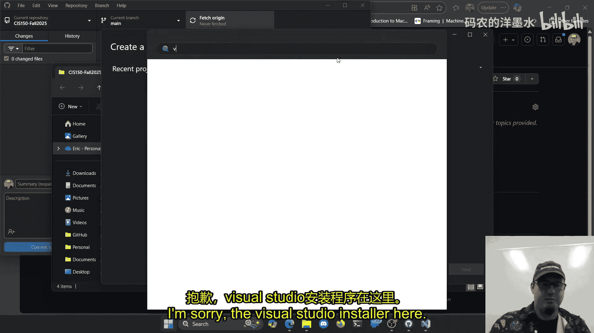

int main() {
    cout << "Hello, World!" << endl;
    return 0;
}
```

**代码解释：**
- `#include <iostream>`：包含输入输出流库
- `using namespace std;`：使用标准命名空间
- `int main()`：程序的主函数
- `cout`：标准输出流
- `endl`：换行符
- `return 0;`：程序正常结束

## 学习建议与资源 📚

### 时间投入建议

作为4学分的课程，预计每周需要投入约12小时：
- 课堂时间：4小时
- 课外学习：8小时（阅读、练习、项目）

如果学习时间明显超过这个范围，请与教师沟通。

### 可用资源

以下是可用的学习资源：

**校内资源：**
1. 教师办公时间
2. 实验室时间
3. 工程成功中心（辅导服务）
4. 食品储藏室（满足基本需求）

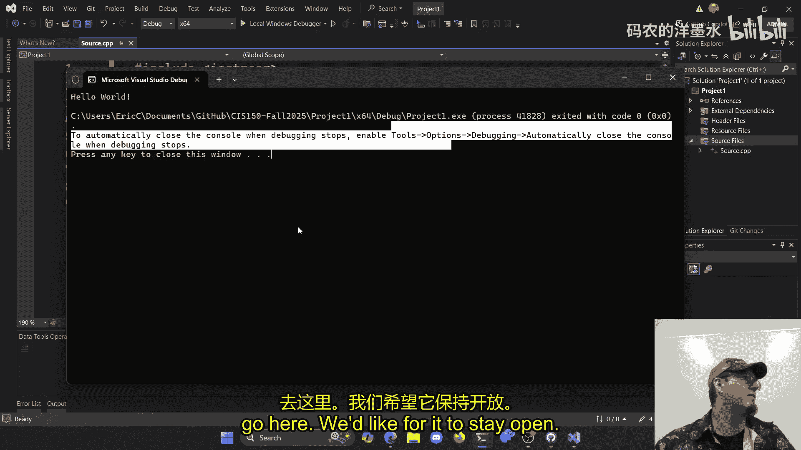

**在线资源：**
1. ZyBooks交互式教材
2. GitHub代码仓库
3. 课程录像（YouTube）
4. 密歇根大学的安装指南

### 成功策略

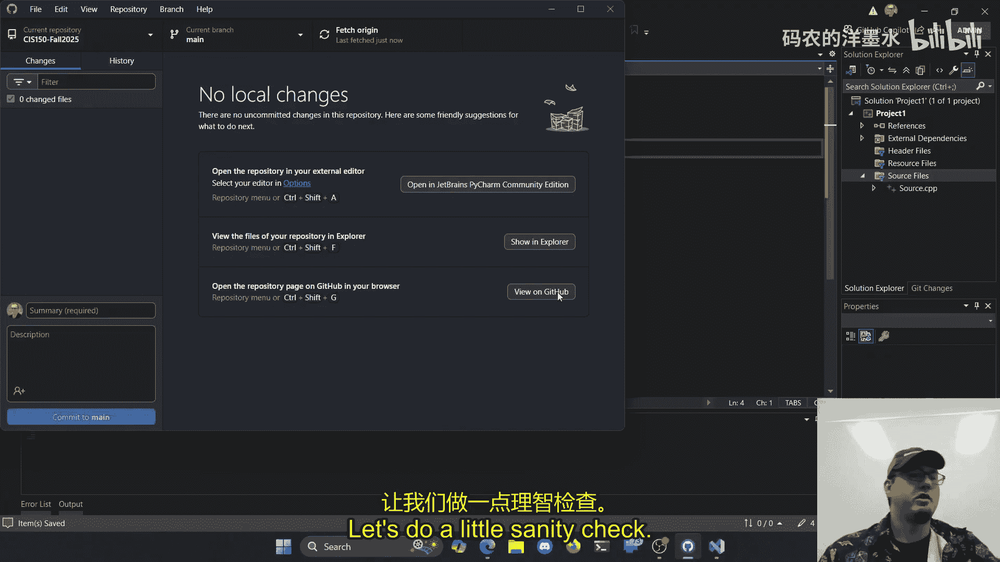

以下是成功完成课程的建议：

1. **保持进度**：每周完成阅读和练习
2. **及时求助**：遇到问题不要犹豫，及时寻求帮助
3. **实践为主**：编程需要大量练习
4. **利用资源**：充分利用所有可用资源
5. **组建学习小组**：与同学合作学习

## 总结与下一步 🎯

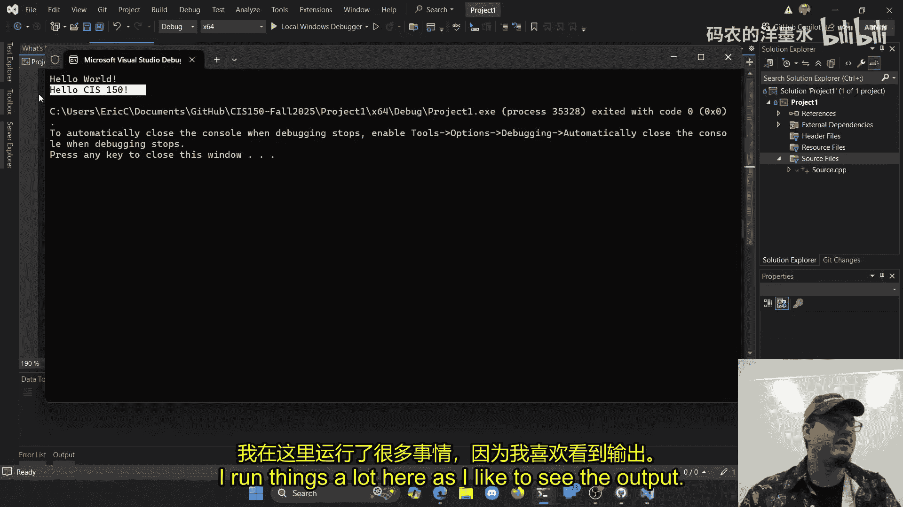

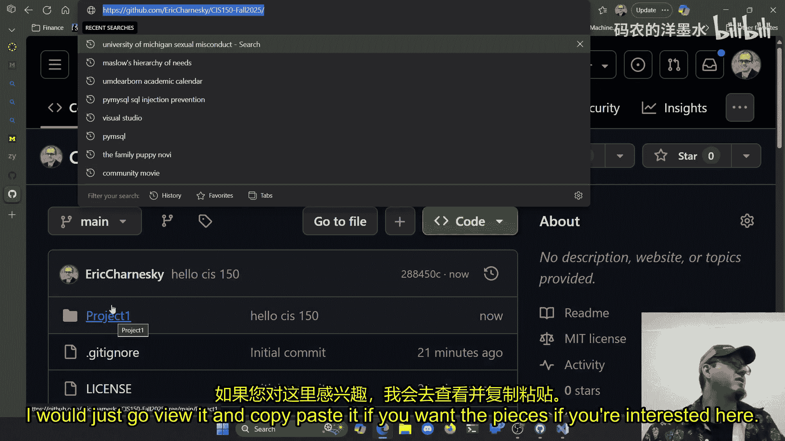

本节课中我们一起学习了课程的基本框架、工具设置和学术政策。我们了解了：

1. 课程结构和评分体系
2. 必需的开发工具（GitHub、Git、Visual Studio）
3. 学术诚信政策和AI使用指南
4. 如何设置开发环境并编写第一个C++程序
5. 可用的学习资源和成功策略

**下一步行动：**
1. 注册ZyBooks账户并完成第1章阅读
2. 设置GitHub账户和开发环境
3. 完成"Hello World"程序并推送到GitHub
4. 准备第2章的学习内容

记住，编程是一项需要实践和耐心的技能。遇到困难时，不要放弃 - 寻求帮助，继续尝试。我们将在下一讲中深入探讨C++的基础语法和概念。

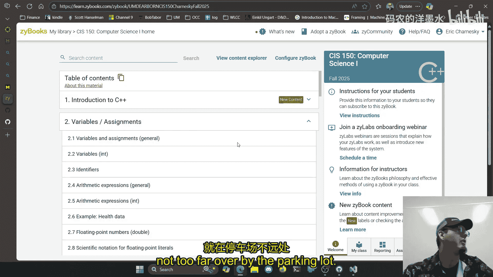

祝大家学习顺利！ 💻✨