# 005：循环结构 part1 🔄

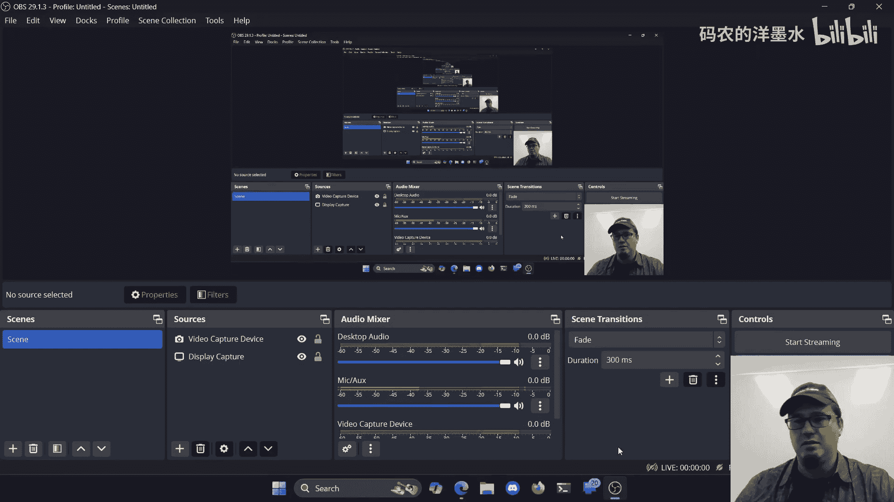

在本节课中，我们将要学习C++编程中一个非常强大的概念——循环。循环允许我们重复执行一段代码，直到满足特定条件为止。我们将从基础的`while`循环开始，然后介绍`do-while`循环和`for`循环，并通过实际例子来理解它们的工作原理和应用场景。


---

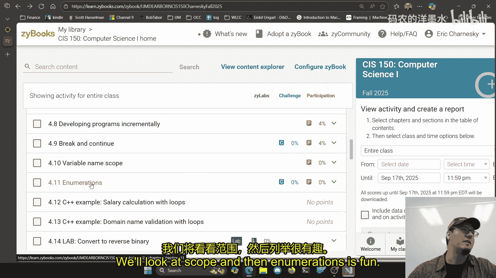

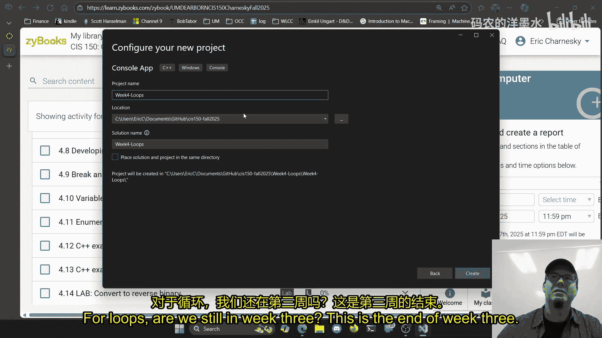

## 概述

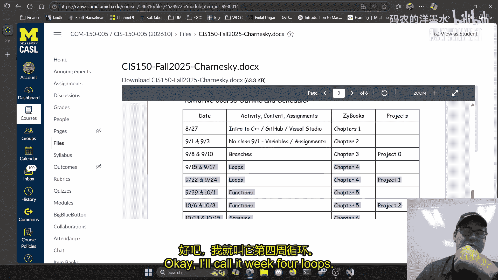

循环是编程中用于重复执行代码块的结构。本节课我们将重点学习三种循环：`while`循环、`do-while`循环和`for`循环。理解循环对于编写高效和简洁的代码至关重要。

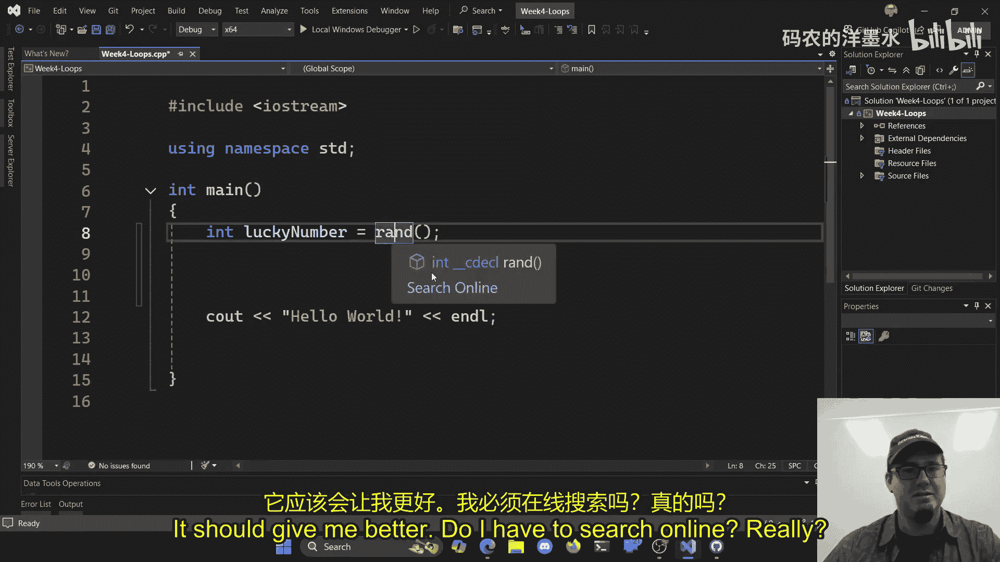

---

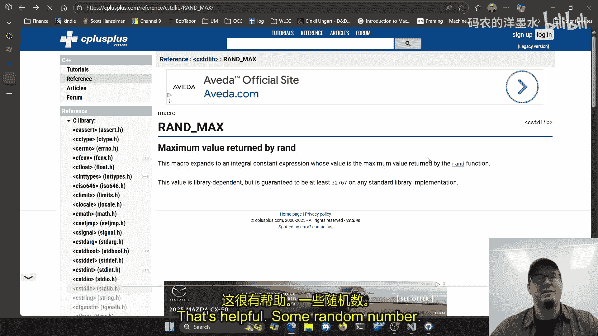

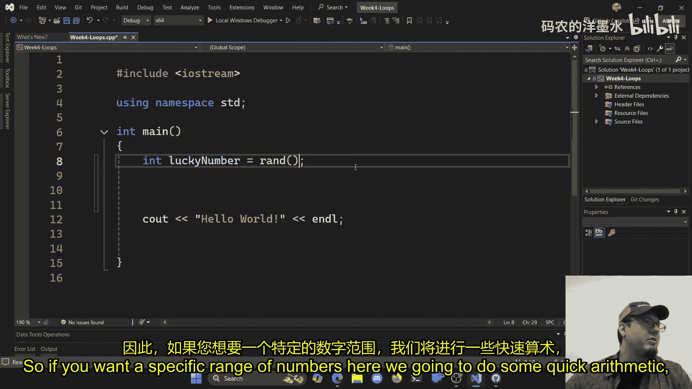

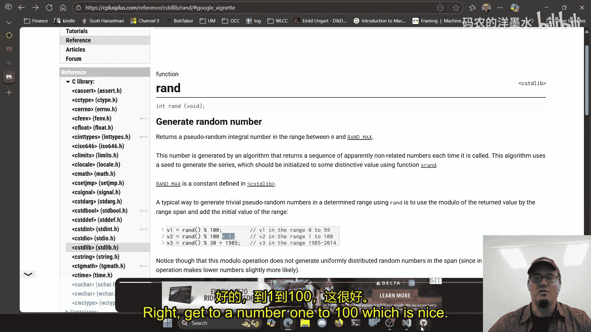

## While循环

上一节我们介绍了条件语句，本节中我们来看看`while`循环。`while`循环会在条件为真时重复执行代码块。它是一种“先测试”循环，意味着在执行循环体之前会先检查条件。


**基本语法：**
```cpp
while (condition) {
    // 要重复执行的代码
}
```

例如，我们可以创建一个猜数字游戏，让用户反复猜测，直到猜中为止。


```cpp
int luckyNumber = rand() % 100 + 1; // 生成1到100的随机数
int guess;
cout << "猜一个1到100的数字: ";
cin >> guess;
while (guess != luckyNumber) {
    if (guess < luckyNumber) {
        cout << "太低了。" << endl;
    } else {
        cout << "太高了。" << endl;
    }
    cout << "再猜一次: ";
    cin >> guess;
}
cout << "恭喜你，猜对了！" << endl;
```


在这个例子中，只要`guess`不等于`luckyNumber`，循环就会继续执行。每次循环都会提示用户输入新的猜测，并根据猜测给出反馈。

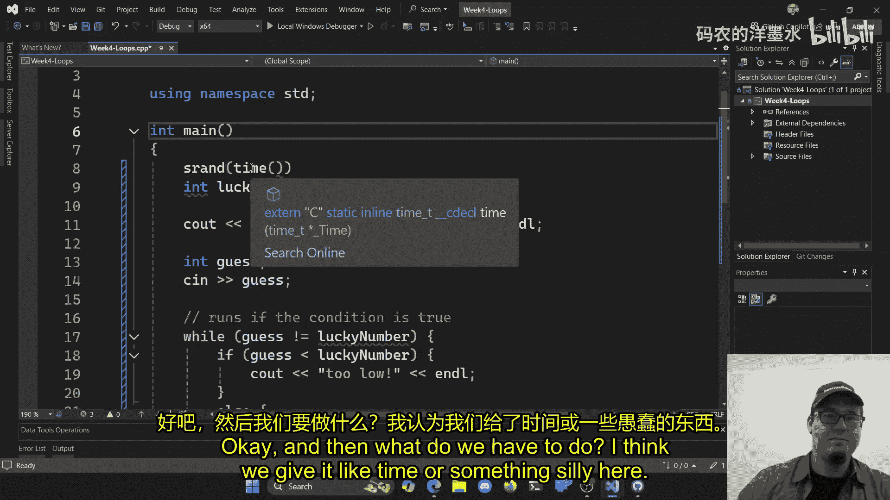

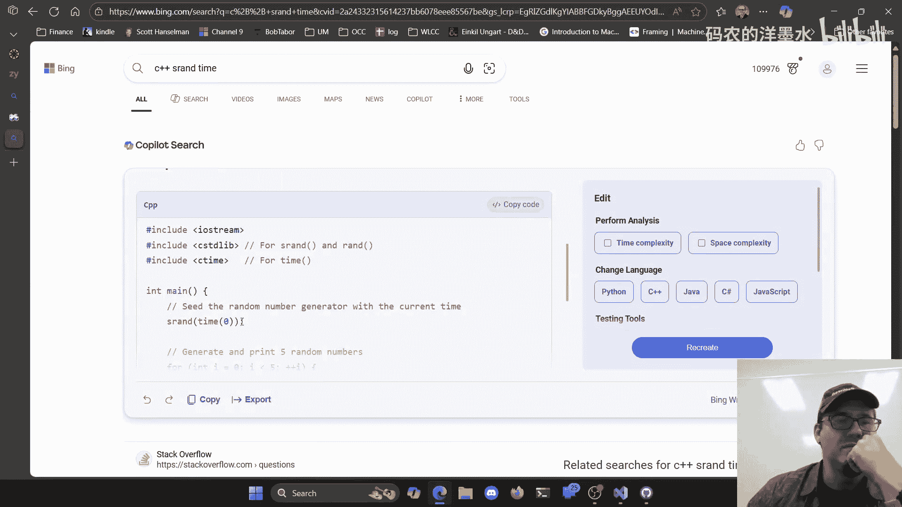

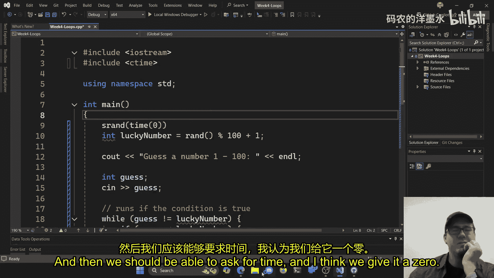

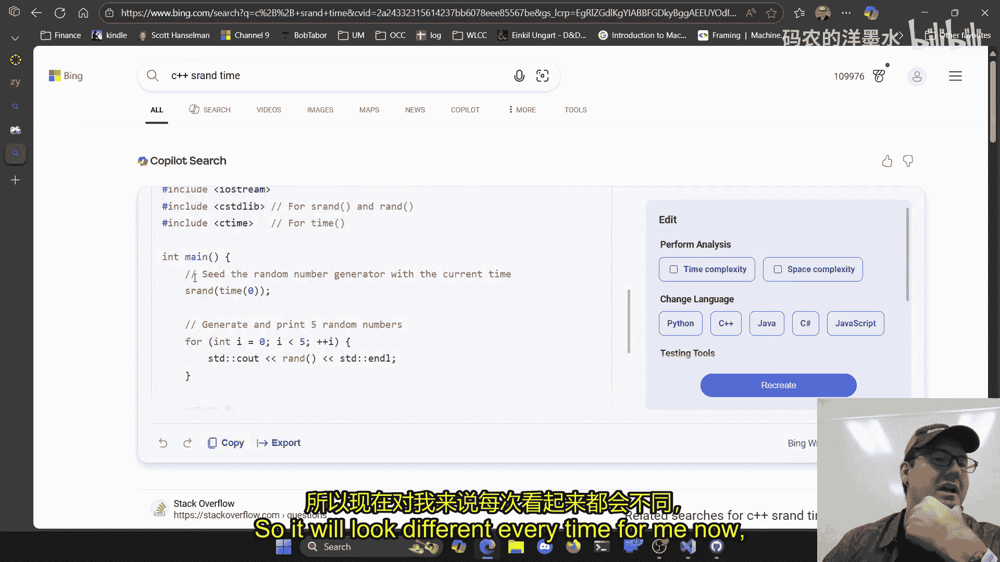

---

## 输入验证循环


`while`循环非常适合用于输入验证。我们可以要求用户输入有效的数据，直到他们提供正确的输入为止。

以下是验证用户输入是否为“Y”或“N”的例子：


```cpp
char playAgain;
cout << "你想再玩一次吗？(Y/N): ";
cin >> playAgain;
while (playAgain != 'Y' && playAgain != 'N') {
    cout << "无效输入，请输入Y或N: ";
    cin >> playAgain;
}
```


这个循环会持续运行，直到用户输入“Y”或“N”为止。这样可以确保程序只处理有效的输入。

---


## Do-While循环


`do-while`循环是另一种循环结构，它与`while`循环类似，但有一个关键区别：`do-while`循环至少会执行一次循环体，然后再检查条件。

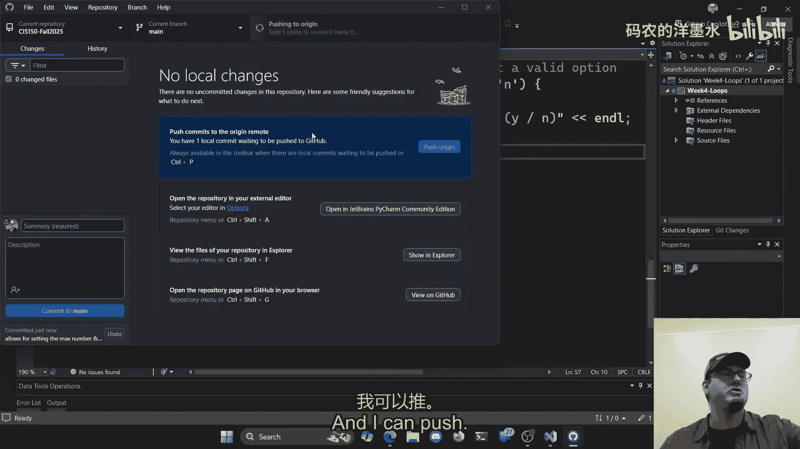

**基本语法：**
```cpp
do {
    // 要重复执行的代码
} while (condition);
```


例如，我们可以使用`do-while`循环来实现同样的输入验证功能：

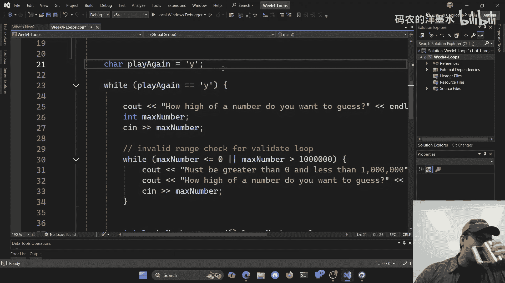


```cpp
char more;
do {
    cout << "你想再玩一次吗？(Y/N): ";
    cin >> more;
} while (more != 'Y' && more != 'N');
```

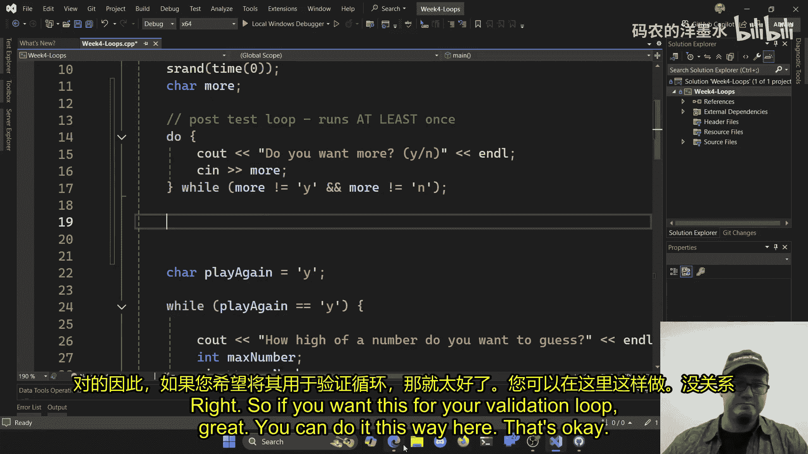

`do-while`循环适用于那些至少需要执行一次的情况，比如菜单选择或初始输入。

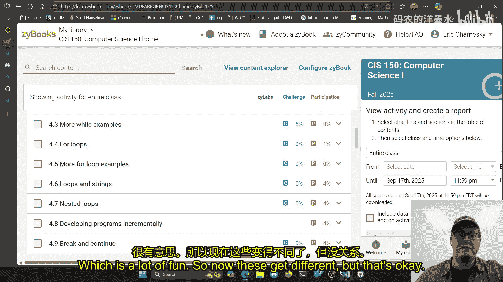

---

## For循环


`for`循环通常用于已知循环次数的情况。它将初始化、条件检查和更新操作集中在一行中，使代码更加简洁。


**基本语法：**
```cpp
for (initialization; condition; update) {
    // 要重复执行的代码
}
```

例如，打印数字0到9：

```cpp
for (int i = 0; i < 10; i++) {
    cout << i << endl;
}
```


`for`循环的等效`while`循环如下：


```cpp
int i = 0;
while (i < 10) {
    cout << i << endl;
    i++;
}
```


`for`循环的优势在于它将循环的控制逻辑集中在一处，使代码更易读和维护。

---

## 嵌套循环


循环可以嵌套在其他循环中，这允许我们处理更复杂的问题，比如打印图形。

例如，打印一个矩形：

```cpp
int rows, columns;
cout << "请输入行数: ";
cin >> rows;
cout << "请输入列数: ";
cin >> columns;

for (int row = 1; row <= rows; row++) {
    for (int col = 1; col <= columns; col++) {
        cout << "*";
    }
    cout << endl;
}
```

在这个例子中，外层循环控制行数，内层循环控制每行打印的星号数量。通过嵌套循环，我们可以轻松地打印出各种形状。


---


## 总结


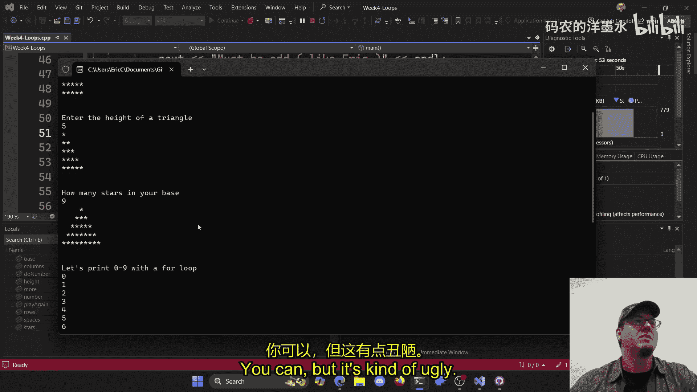

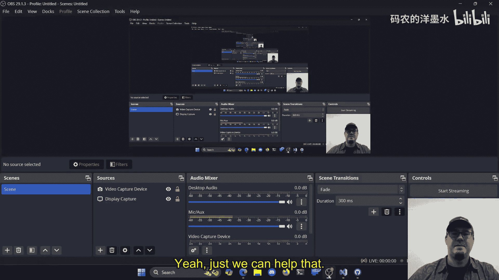

本节课中我们一起学习了C++中的循环结构。我们介绍了`while`循环、`do-while`循环和`for`循环，并通过实际例子演示了它们的用法。循环是编程中不可或缺的工具，能够帮助我们编写更加高效和简洁的代码。在下一节课中，我们将继续探讨循环的高级用法和其他相关概念。