# 009：数组与向量（第一部分）📚

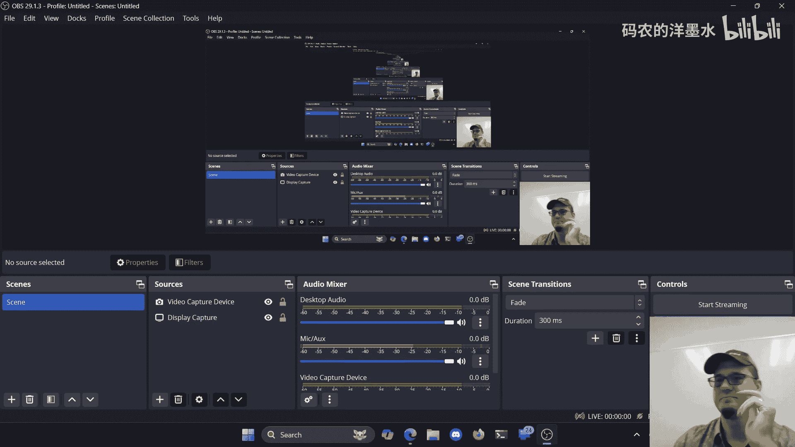

在本节课中，我们将学习C++中两种用于存储多个数据项的重要数据结构：**数组**和**向量**。我们将了解它们的基本概念、创建方法、访问元素的方式以及各自的优缺点。

---

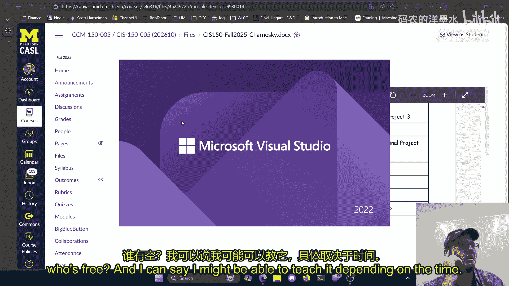

## 概述 📋

数组和向量都允许我们在一个变量名下存储多个相同类型的值。数组是C++中的基础数据结构，大小固定。向量是C++标准库提供的一种更灵活、更强大的容器，可以动态调整大小。理解两者的区别对于编写高效、健壮的代码至关重要。

## 数组：固定大小的集合 🔢

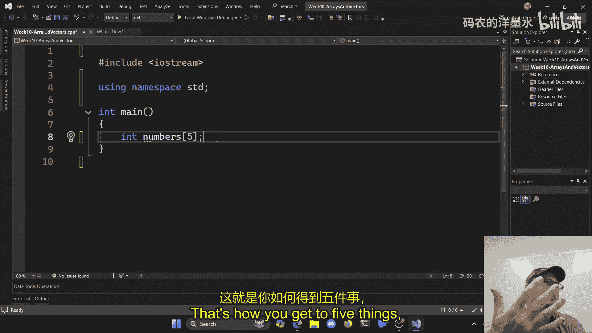


数组让我们能够在一个变量中存储多个值，而不是为每个值声明单独的变量。

### 数组的声明与初始化

要声明一个数组，需要指定其类型、名称和大小（必须是一个常量）。数组的大小在编译时必须已知。

```cpp
int numbers[5]; // 声明一个可以存储5个整数的数组
```

数组使用方括号 `[]` 和索引来访问元素。**重要：C++数组的索引从0开始**。

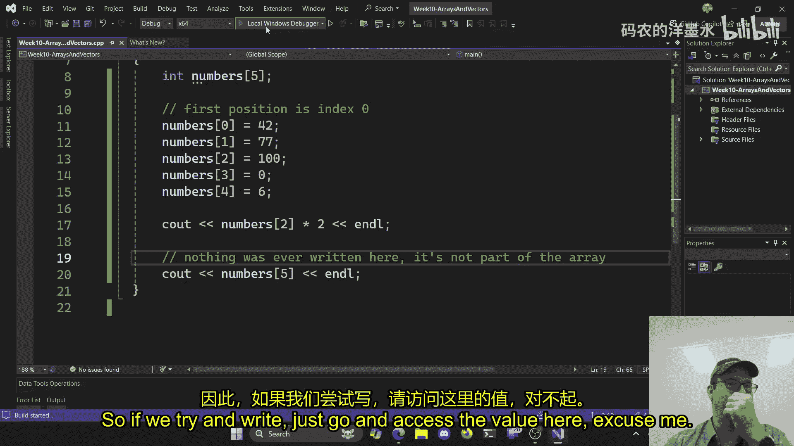

```cpp
numbers[0] = 42;  // 第一个元素（索引0）
numbers[1] = 77;  // 第二个元素（索引1）
numbers[2] = 100; // 第三个元素（索引2）
// ... 以此类推
```

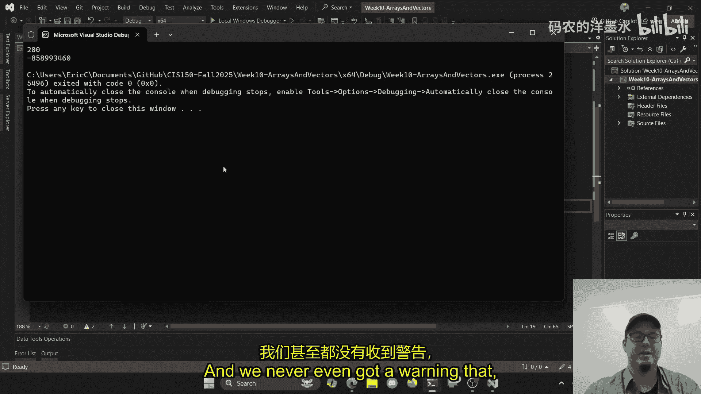

### 访问数组元素

我们可以使用索引来读取或修改数组中的值。

```cpp
int value = numbers[2]; // 读取索引2处的值
numbers[2] = value * 2; // 修改索引2处的值
```

### 数组的局限性

数组的一个主要限制是其大小必须是编译时常量。你不能在运行时根据用户输入来决定数组大小。

```cpp
int size;
cin >> size;
int dynamicArray[size]; // 错误！size不是常量
```

此外，将数组传递给函数时，函数无法自动获知数组的大小，必须额外传递一个大小参数。

```cpp
int sumArray(int arr[], int size) {
    int sum = 0;
    for (int i = 0; i < size; i++) {
        sum += arr[i];
    }
    return sum;
}
```

如果尝试访问数组边界之外的元素（例如 `numbers[5]`），C++不会阻止，但会导致读取垃圾数据或程序崩溃，这是数组不安全的一面。

---

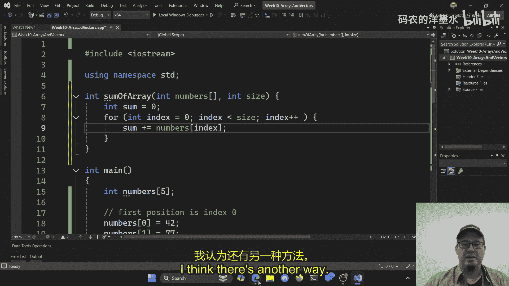

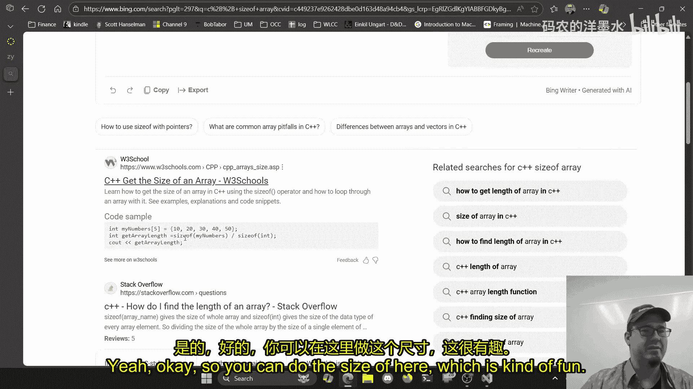

## 向量：动态大小的集合 🚀

向量是C++标准模板库（STL）的一部分，它提供了数组的所有功能，并且更加灵活和安全。

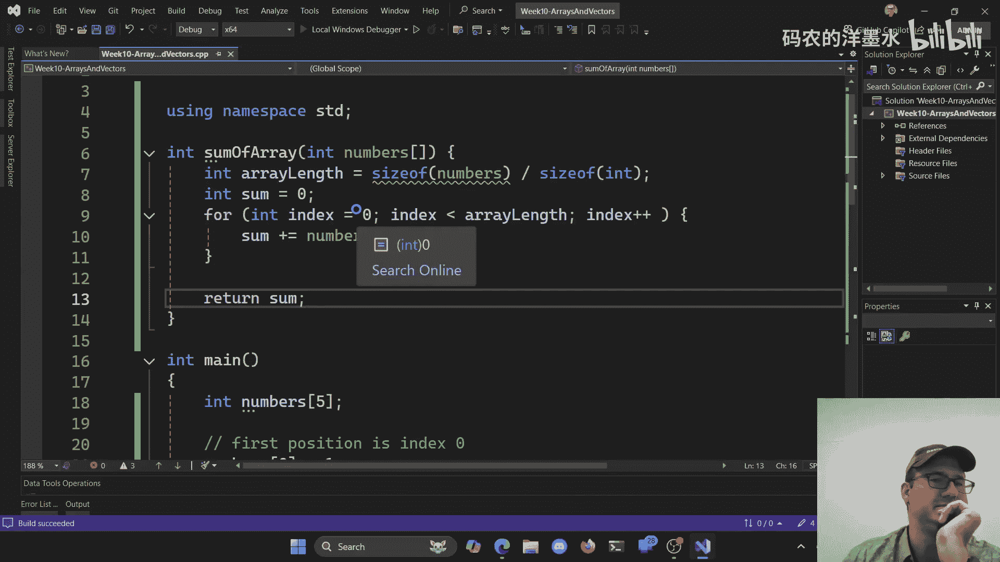

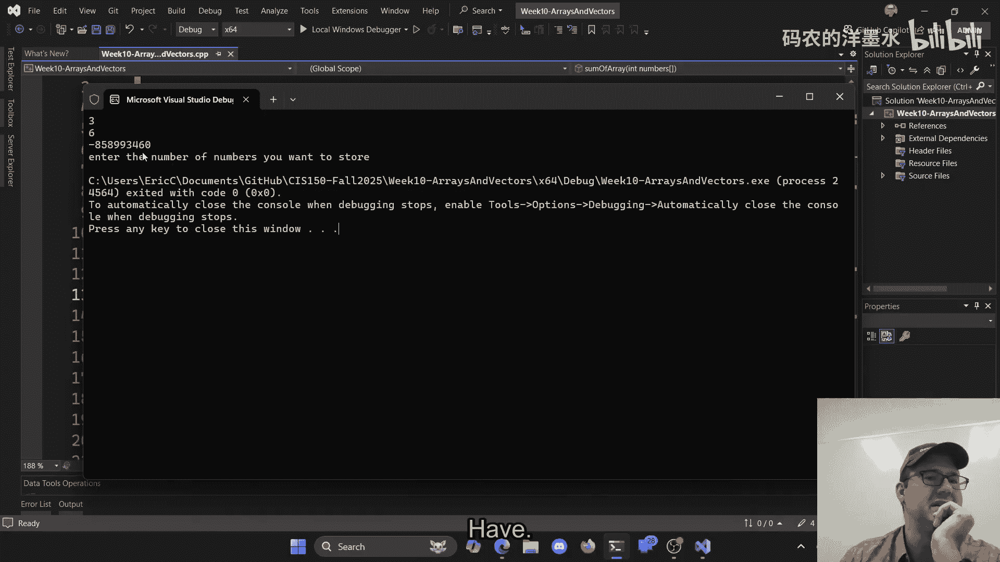

### 向量的声明与初始化

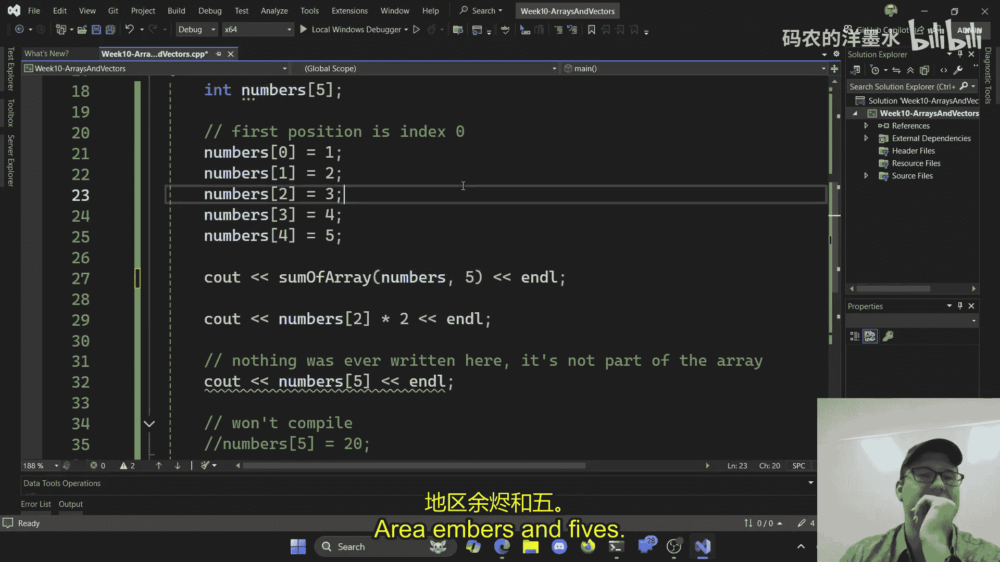

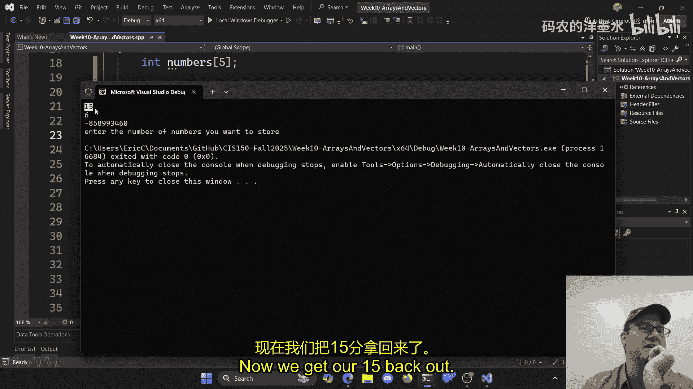

要使用向量，需要包含 `<vector>` 头文件。声明向量时，使用模板语法指定其存储的数据类型。

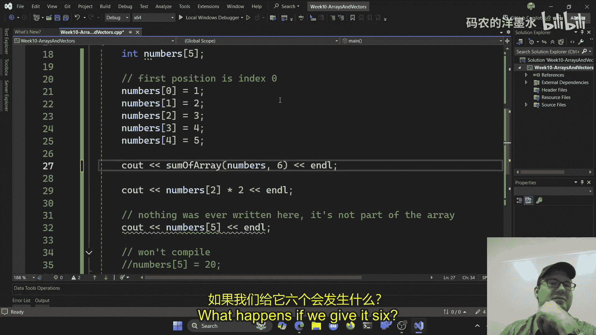

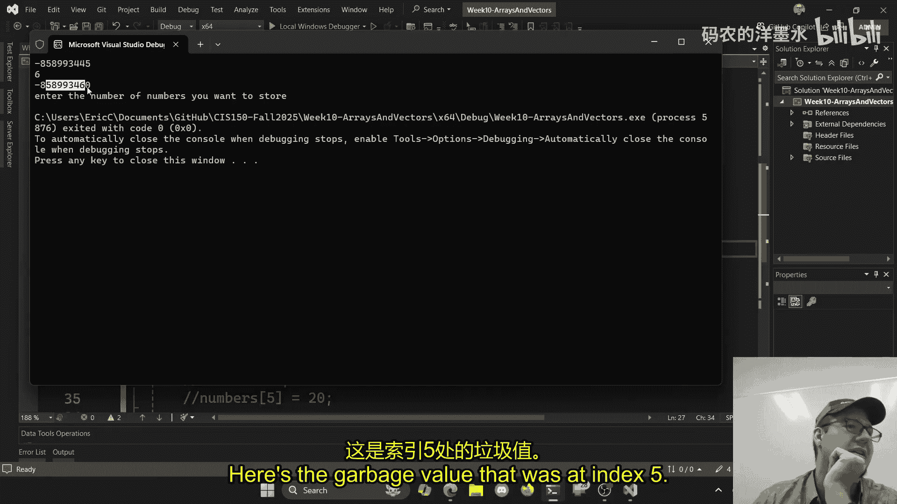

```cpp
#include <vector>
std::vector<int> myNumbers; // 声明一个空的整数向量
std::vector<int> presizedNumbers(5); // 声明一个初始大小为5的整数向量
```

### 访问向量元素

向量提供了两种访问元素的主要方法：使用 `at()` 成员函数或使用数组风格的 `[]` 运算符。**推荐使用 `at()`，因为它会进行边界检查**。

```cpp
presizedNumbers.at(0) = 42; // 使用 at() 设置值
int val = presizedNumbers.at(1); // 使用 at() 获取值

// 也可以使用 []，但 at() 更安全
presizedNumbers[2] = 100;
```

如果尝试使用无效索引（如 `at(5)`），向量会抛出 `std::out_of_range` 异常，使程序崩溃，这比数组返回垃圾值更安全，因为它能立即暴露错误。

### 向量的优势

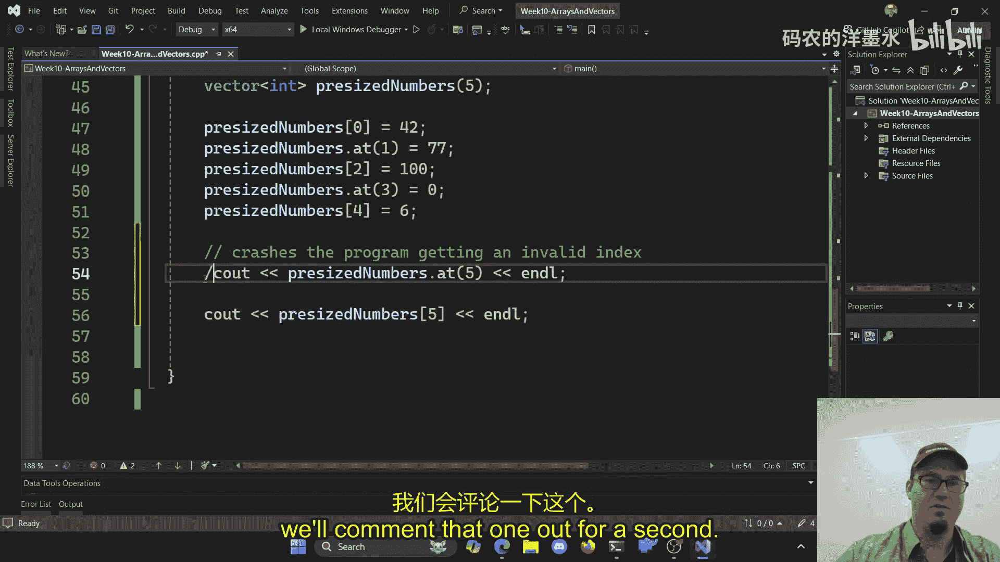

1.  **动态大小**：你可以使用 `push_back()` 函数在向量末尾添加新元素。
    ```cpp
    myNumbers.push_back(10); // 向向量添加数字10
    ```
2.  **知晓自身大小**：向量有一个 `size()` 成员函数，可以返回当前包含的元素数量。
    ```cpp
    int count = myNumbers.size();
    ```
3.  **更安全的函数传递**：将向量传递给函数时，函数可以通过 `size()` 获知其大小，无需额外参数。
    ```cpp
    int sumVector(const std::vector<int>& vec) {
        int sum = 0;
        for (int i = 0; i < vec.size(); i++) {
            sum += vec.at(i);
        }
        return sum;
    }
    ```

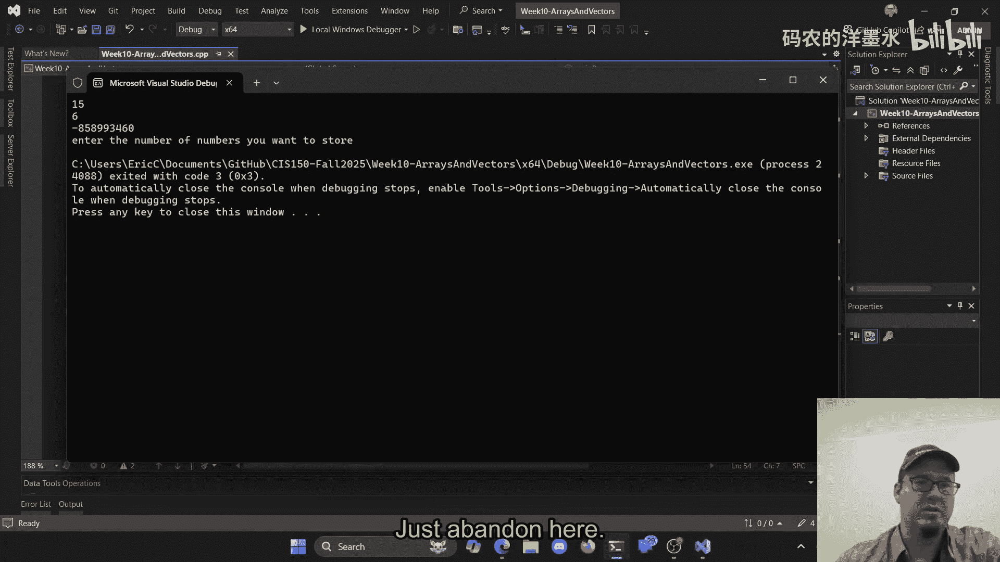

### 遍历向量

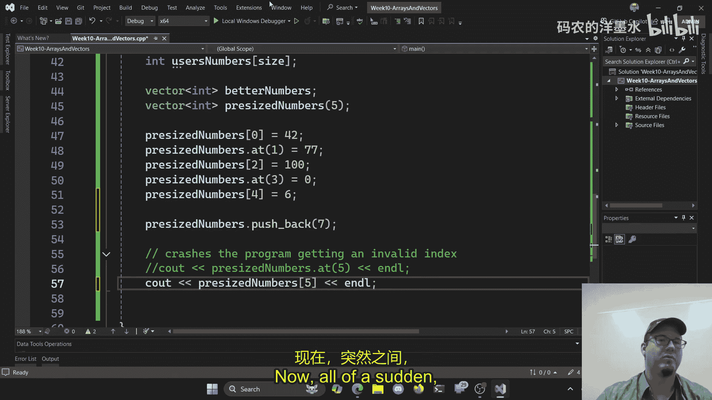

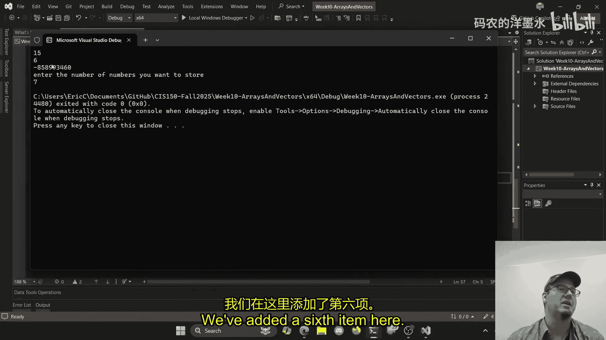

除了使用索引的 `for` 循环，向量还支持“基于范围的for循环”，这使得遍历更加简洁。

```cpp
int sum = 0;
for (int num : myNumbers) { // 对于myNumbers中的每个元素num
    sum += num; // 读取其值
}
// 注意：此循环中的`num`是副本，修改它不会影响向量中的原始值。
```

### 初始化向量

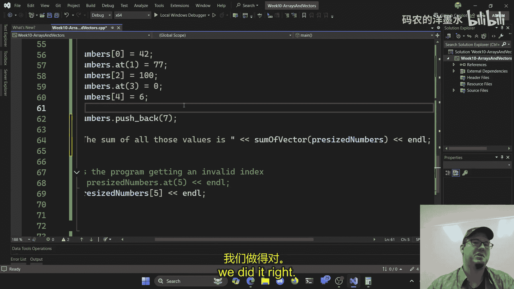

如果事先知道所有值，可以在声明时直接初始化向量。

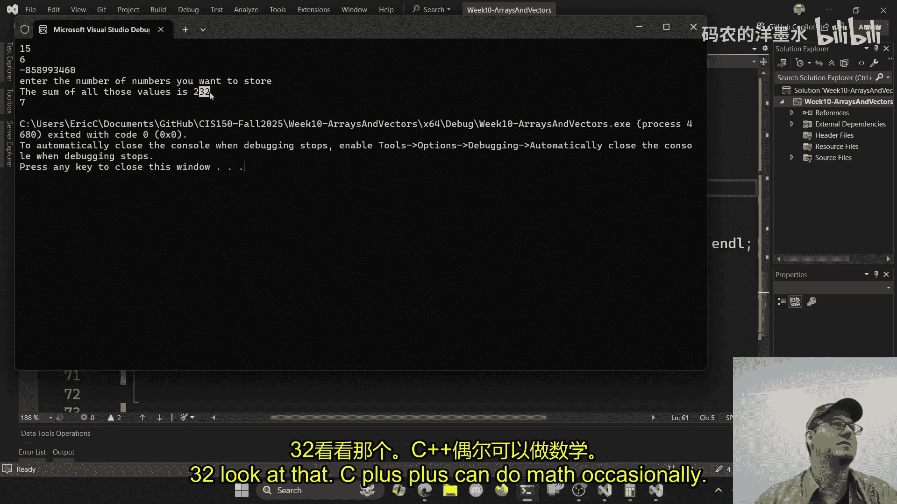

```cpp
std::vector<int> quickNumbers = {1, 2, 3, 4, 5};
```

---

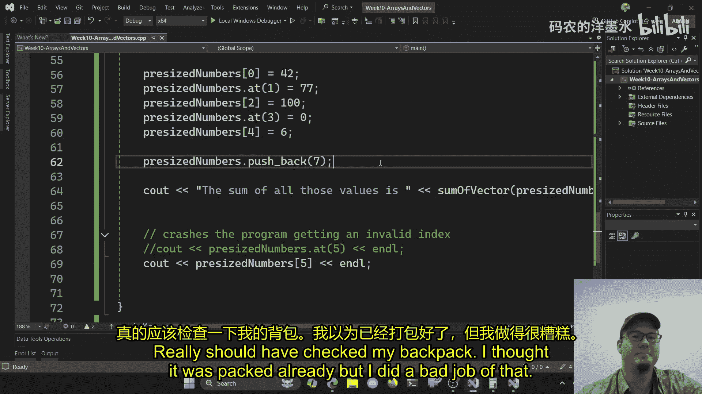

## 数组与向量的比较 ⚖️

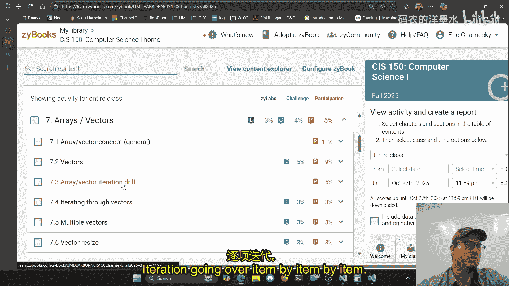

上一节我们介绍了数组和向量的基本用法，本节我们来总结一下它们的核心区别。

以下是两者的关键对比：

*   **大小**：
    *   数组：固定大小，编译时必须确定。
    *   向量：动态大小，可以在运行时增长或缩小。
*   **安全性**：
    *   数组：不进行边界检查，越界访问可能导致不可预测的行为（读取垃圾值）。
    *   向量：`at()` 函数进行边界检查，越界访问会抛出异常，更安全。
*   **传递给函数**：
    *   数组：需要额外传递大小参数。
    *   向量：自带 `size()` 函数，无需额外参数。
*   **性能**：
    *   数组：极其轻量，访问速度最快。
    *   向量：由于额外的功能（如动态内存管理），速度略慢，但对于绝大多数应用来说差异可忽略不计。
*   **易用性**：
    *   数组：语法简单，但功能有限，需要更多手动管理。
    *   向量：功能丰富，更易于使用，是现代的C++首选。

---

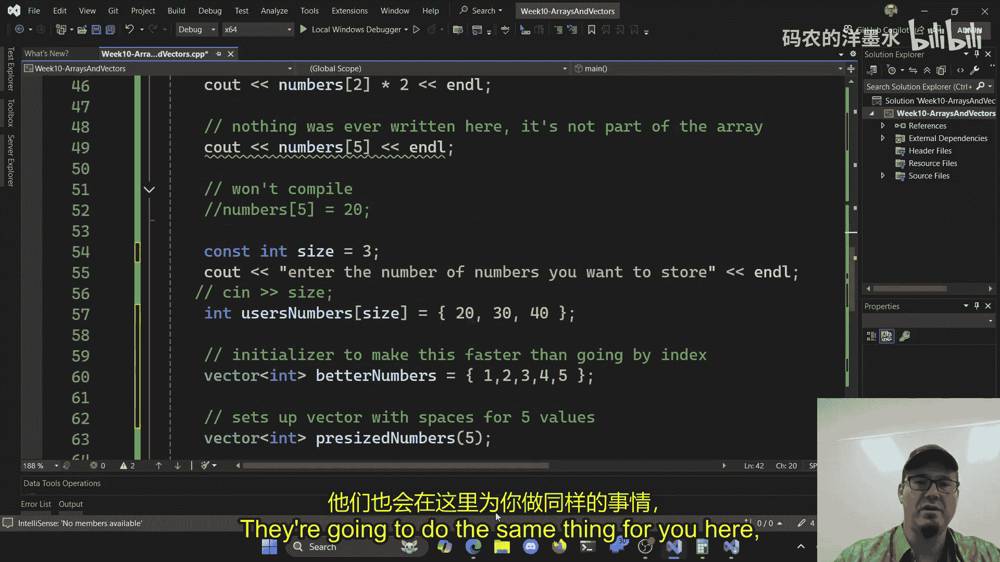

## 总结 🎯

本节课中我们一起学习了C++中存储数据集合的两种基本工具。

我们首先学习了**数组**，它是一种固定大小、高效但不够灵活的数据结构，需要谨慎处理大小和边界问题。接着，我们深入探讨了**向量**，它是标准库提供的动态数组，能够自动管理内存、知晓自身大小并提供更安全的访问方式，极大地提高了编程的便利性和代码的健壮性。

对于初学者和大多数应用场景，**建议优先使用向量**，因为它更安全、更易用。数组则在需要极致性能或与旧代码交互等特定场景下发挥作用。

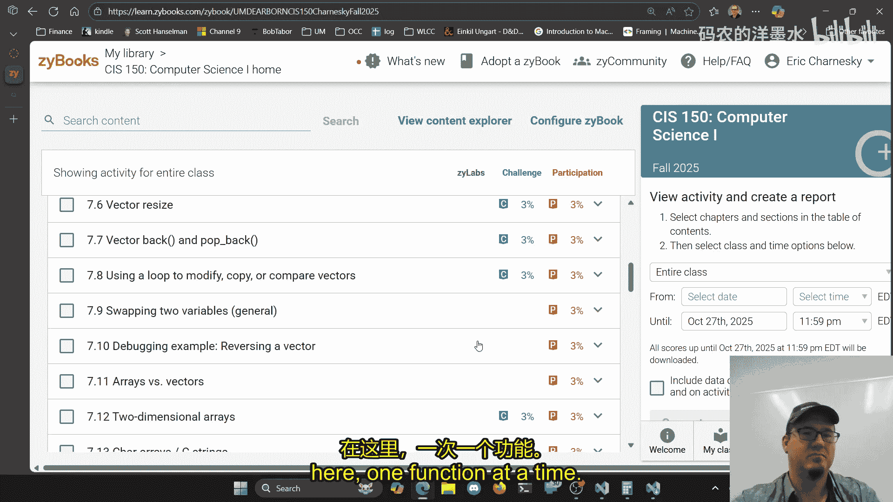

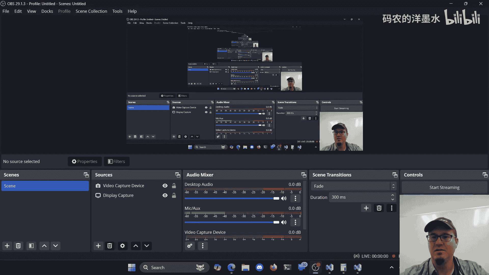

在接下来的课程中，我们将继续探索向量的更多功能（如插入、删除元素）以及更复杂的数据结构，如二维数组和向量。