# 016：面向对象编程 part1 🧱


在本节课中，我们将要学习面向对象编程的基础概念。我们将了解什么是对象和类，如何定义它们，以及如何通过封装和抽象来组织代码，使其更易于理解和维护。

---

## 什么是对象和类？ 🤔

上一节我们介绍了课程概述，本节中我们来看看对象和类的核心概念。

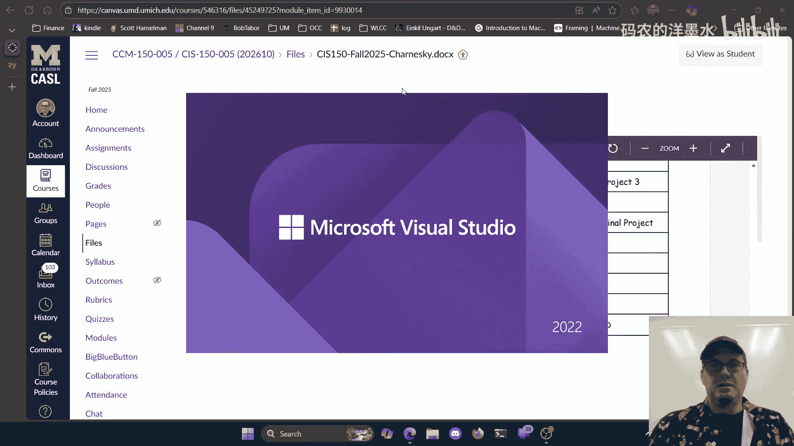

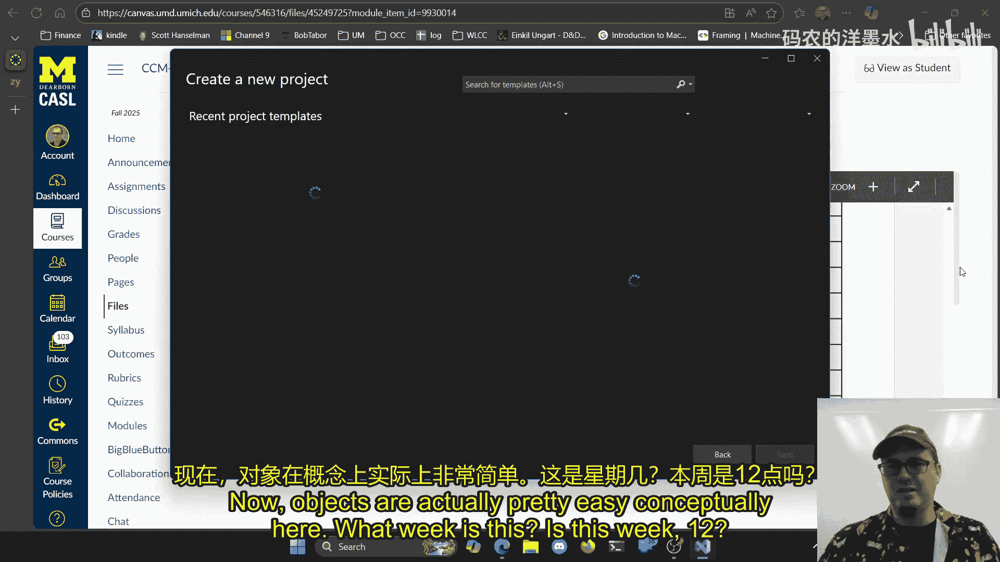

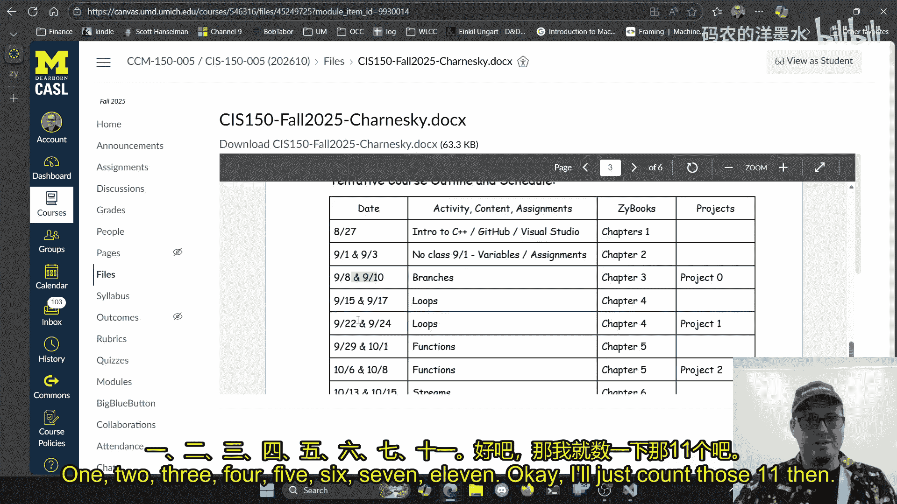

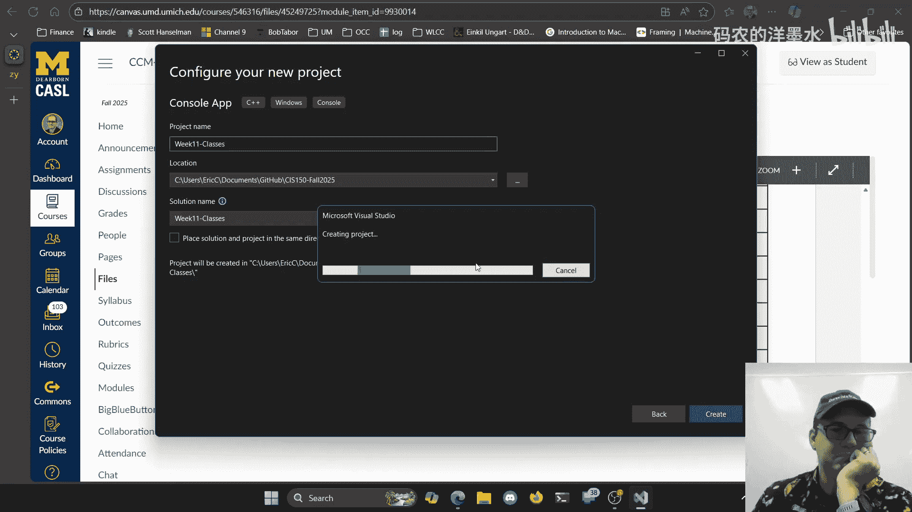

对象是类的实例。这听起来像是一个有趣的区分。例如，“椅子”这个词。当你听到“椅子”时，你想到的是椅子的定义（一个供人坐的东西，有颜色、腿、可能带轮子），还是一个特定的椅子（比如你正坐着的那个灰色的、有四个轮子的办公椅）？类的定义就像是蓝图，它描述了某类事物共有的属性和行为。而对象则是根据这个蓝图创建出来的具体实例。

在代码中，我们通过定义类来创建这种蓝图。一个类通常包含两个主要部分：私有（private）部分和公有（public）部分。

**公式/代码描述：**
```cpp
class Chair {
private:
    // 私有属性（数据成员）
    std::string color;
    int heightInCm;
    int numberOfWheels;
    bool hasArms;
    int minHeightCm;
    int maxHeightCm;

public:
    // 公有函数（成员函数）
    std::string getColor();
    void setColor(std::string newColor);
    int getHeightInCm();
    void setHeightInCm(int newHeight);
    // ... 其他 get 和 set 函数
};
```

私有部分包含了类的属性（也称为数据成员），这些细节对外部代码是隐藏的。公有部分则包含了类的方法（也称为成员函数），这些构成了外部代码与类交互的接口，我们称之为应用程序编程接口（API）。这种将实现细节隐藏起来，只暴露必要接口的思想，就叫做**封装**和**抽象**。

---

## 创建和使用对象 🛋️

上一节我们定义了`Chair`类，本节中我们来看看如何创建和使用它的对象。

要创建一个类的对象（也称为实例化），我们使用类名，后跟对象名。然后，我们可以通过点运算符（`.`）来访问该对象的公有成员函数。

**公式/代码描述：**
```cpp
int main() {
    // 创建 Chair 类的对象
    Chair ericsChair;
    Chair bobsChair;

    // 使用 setter 函数设置属性
    ericsChair.setHeightInCm(30);
    ericsChair.setColor("gray and blue");
    ericsChair.setNumberOfWheels(4);
    ericsChair.setHasArms(false);

    bobsChair.setHeightInCm(40);
    bobsChair.setColor("black");
    bobsChair.setNumberOfWheels(5);
    bobsChair.setHasArms(true);
    bobsChair.setMinHeightCm(30);
    bobsChair.setMaxHeightCm(50);

    // 使用 getter 函数获取属性
    std::cout << "Eric's chair color: " << ericsChair.getColor() << std::endl;
    std::cout << "Bob's chair has arms: " << std::boolalpha << bobsChair.getHasArms() << std::endl;

    return 0;
}
```

每个对象在内存中都有自己独立的空间，存储其属性的值。`ericsChair`和`bobsChair`是两个不同的对象，它们的属性值互不影响。

---

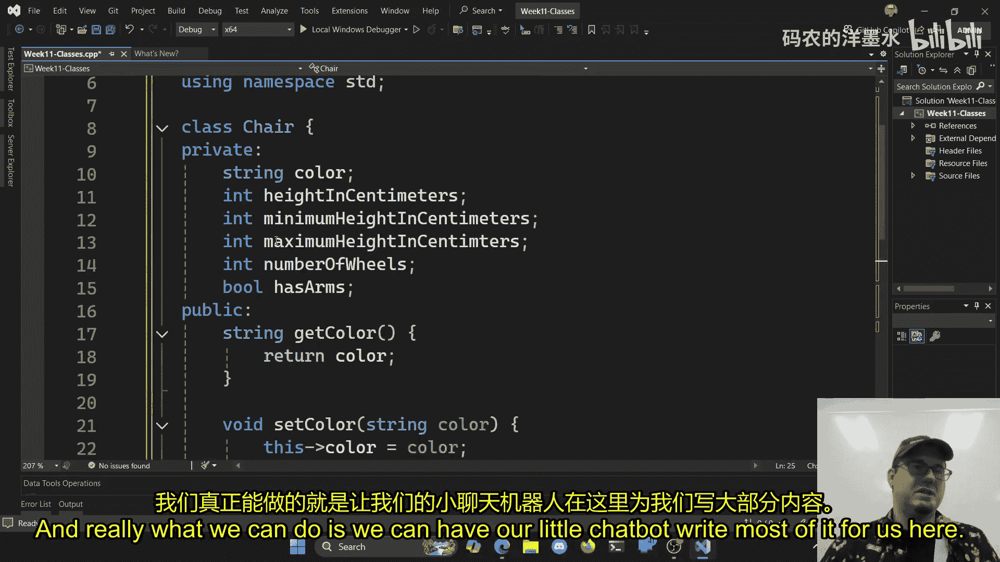

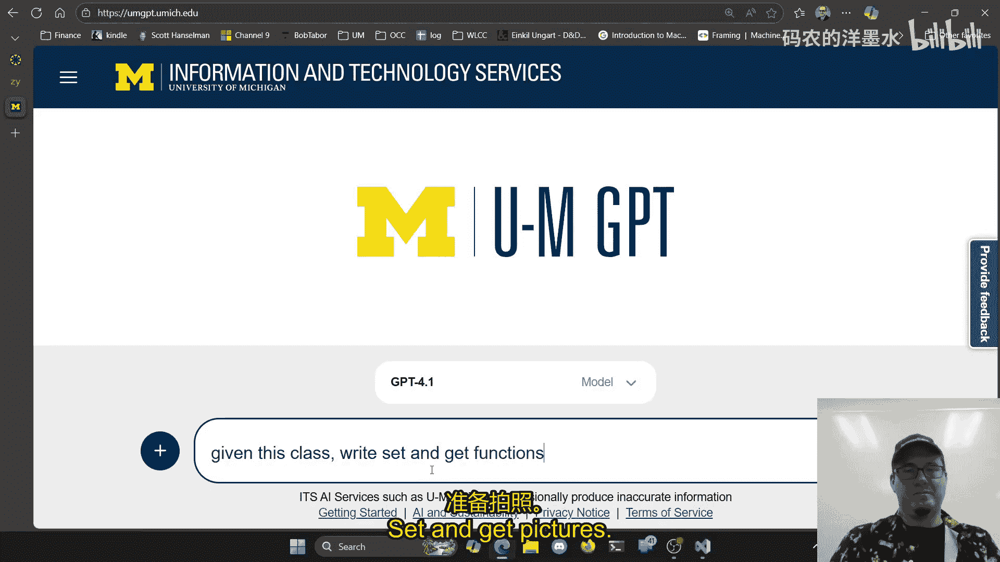

## 构造函数与访问控制 🔐

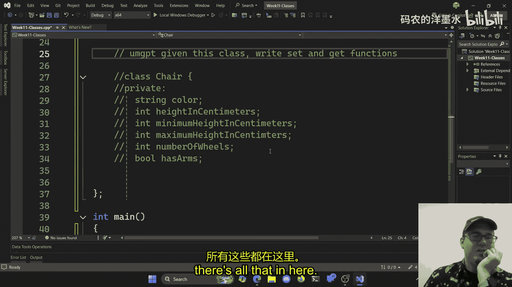

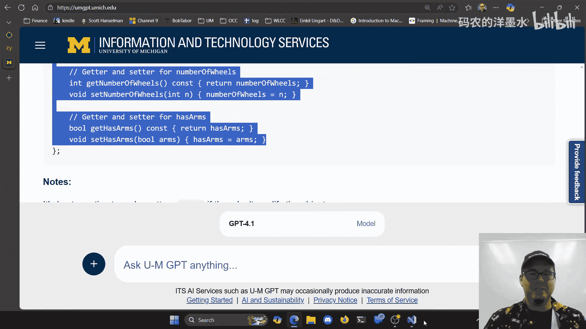

上一节我们创建了对象并设置了属性，本节中我们来看看如何更安全、更便捷地初始化对象。

有时，我们不希望对象的某些属性在创建后被修改。例如，一张彩票的号码一旦选定就不应更改。为了实现这一点，我们可以使用**构造函数**来初始化这些属性，并且不提供修改它们的公有函数（setter）。

构造函数是一种特殊的成员函数，它在创建对象时自动调用，用于初始化对象。构造函数没有返回类型，其名称与类名相同。

**公式/代码描述：**
```cpp
class LottoTicket {
private:
    int number1;
    int number2;
    int number3;

public:
    // 构造函数：在创建对象时设置号码
    LottoTicket(int num1, int num2, int num3) {
        this->number1 = num1;
        this->number2 = num2;
        this->number3 = num3;
    }

    // 只有 getter，没有 setter，号码不可更改
    int getNumber1() { return number1; }
    int getNumber2() { return number2; }
    int getNumber3() { return number3; }

    // 检查是否中奖的函数
    bool isWinner(LottoTicket winningTicket) {
        return (number1 == winningTicket.getNumber1() &&
                number2 == winningTicket.getNumber2() &&
                number3 == winningTicket.getNumber3());
    }
};
```

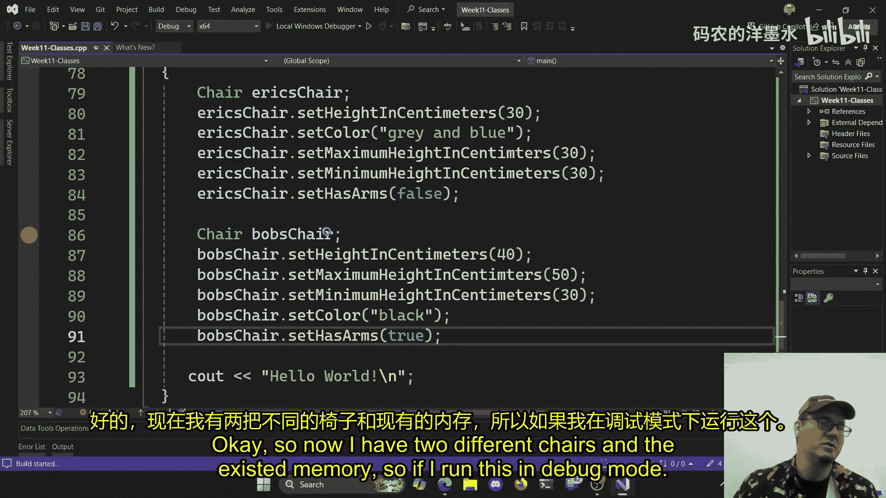

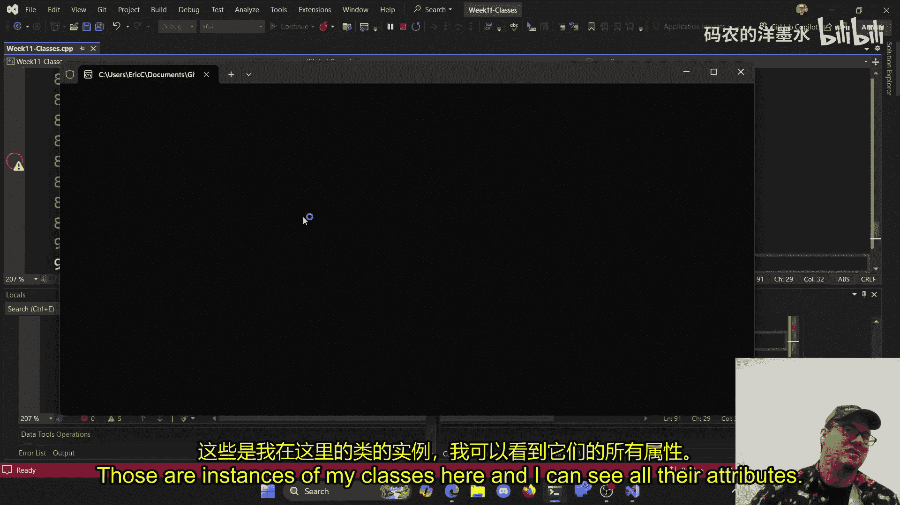

使用示例：
```cpp
LottoTicket winningTicket(5, 7, 1); // 创建时即确定中奖号码
LottoTicket myTicket(3, 3, 7); // 创建我的彩票

if (myTicket.isWinner(winningTicket)) {
    std::cout << "You win!" << std::endl;
}
```

通过构造函数，我们确保了`LottoTicket`对象的号码在生命周期内保持不变。`this`指针用于在成员函数内部指向调用该函数的当前对象，当参数名与成员变量名冲突时特别有用。

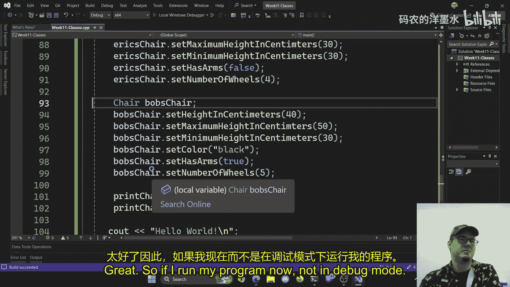

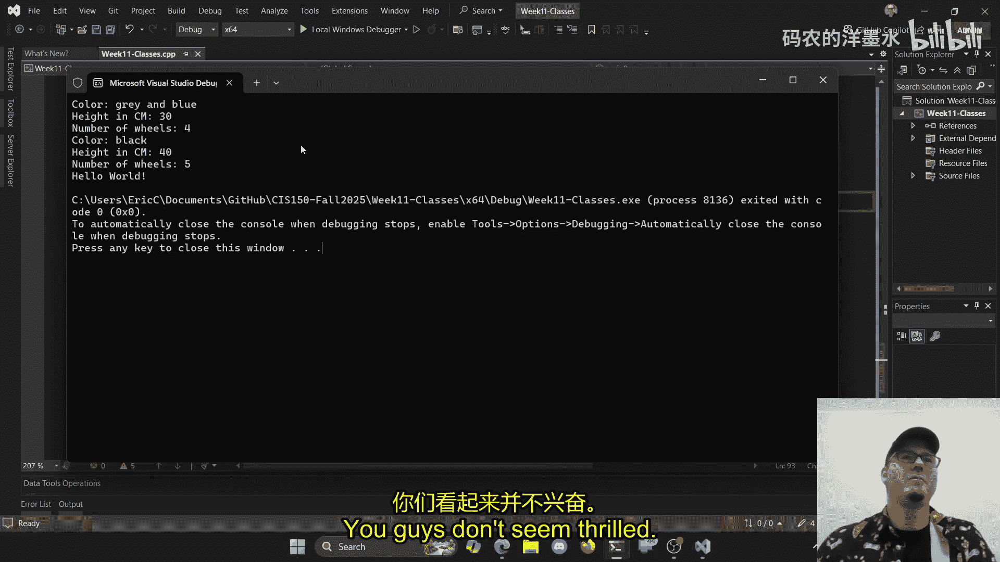

---

## 在类中添加业务逻辑 🧠

上一节我们使用构造函数控制了对象的初始化，本节中我们来看看如何在类的方法中加入更多逻辑。

类的强大之处在于，它不仅能存储数据，还能包含操作这些数据的逻辑。我们可以在 setter 函数中加入验证逻辑，以确保对象的属性始终处于有效状态。

例如，对于可调节高度的椅子，在设置当前高度时，我们应该确保这个高度在最小和最大高度范围内。

**公式/代码描述：**
```cpp
void Chair::setHeightInCm(int newHeight) {
    // 验证逻辑：新高度必须在最小和最大高度之间
    if (newHeight >= minHeightCm && newHeight <= maxHeightCm) {
        heightInCm = newHeight;
    }
    // 如果不符合条件，则静默忽略或未来可以用异常处理
}
```

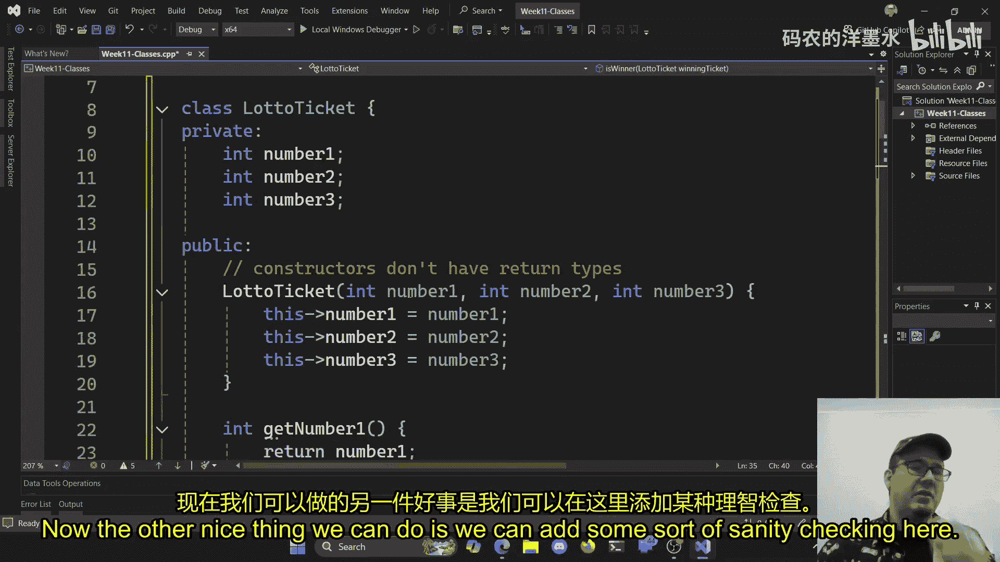

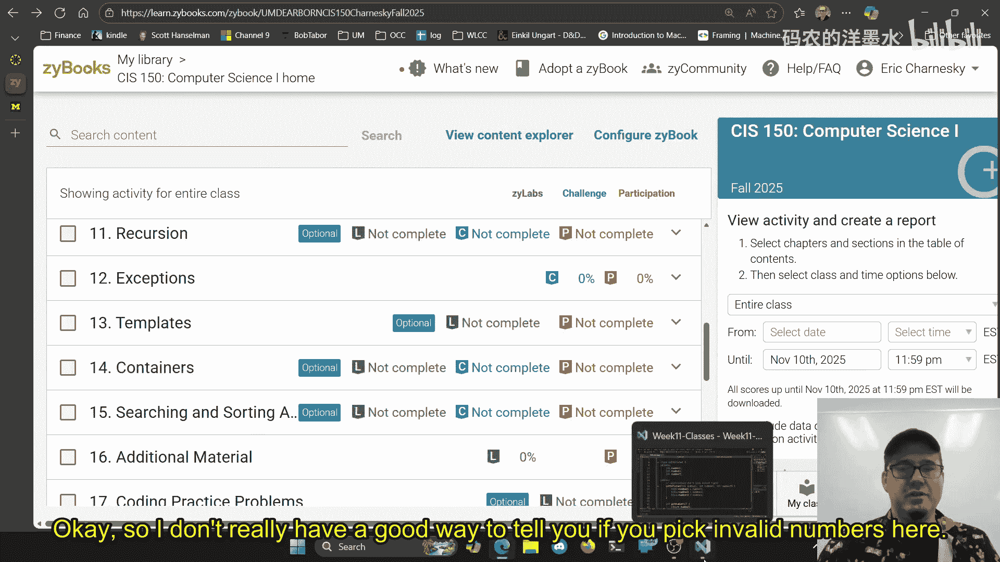

同样，我们可以为`numberOfWheels`的 setter 添加检查，防止设置为负数。
```cpp
void Chair::setNumberOfWheels(int wheels) {
    if (wheels >= 0) {
        numberOfWheels = wheels;
    }
}
```

将这样的规则封装在类内部，是保证对象数据完整性和一致性的关键。类的设计应反映现实世界的约束。

---

## 分离文件与单元测试简介 📁

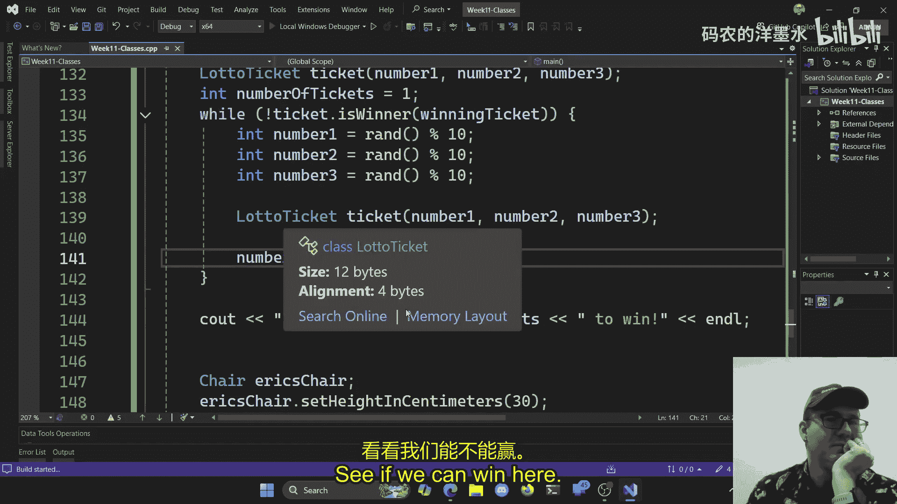

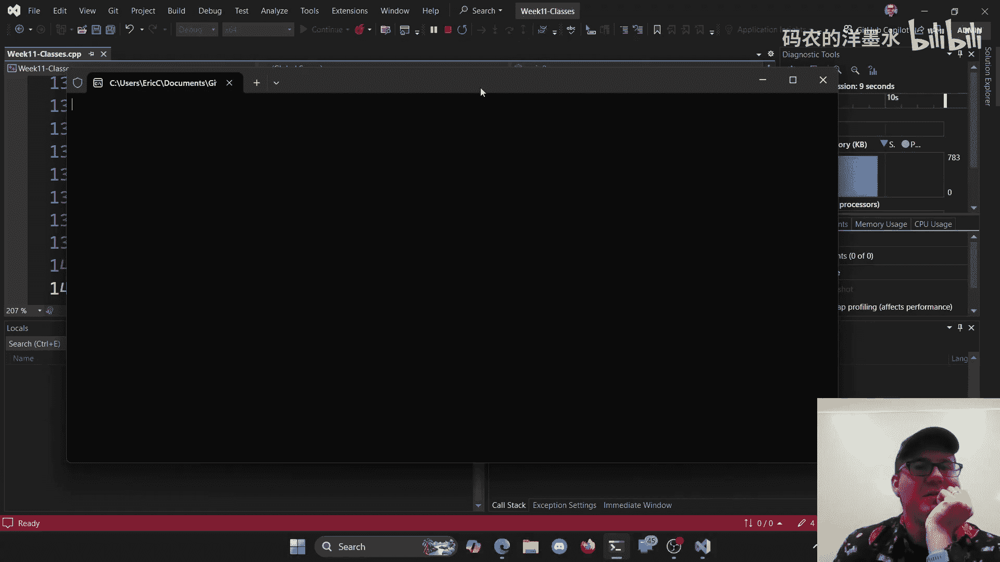

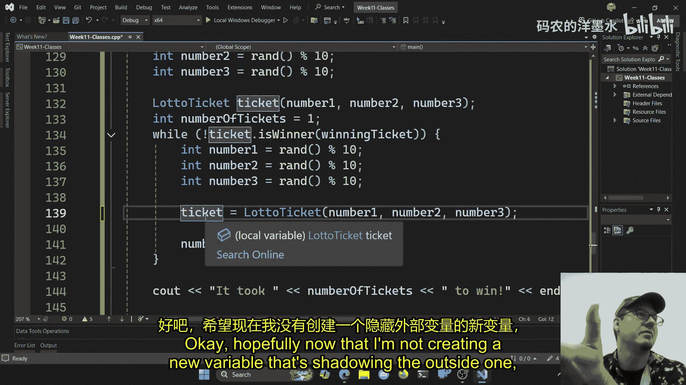

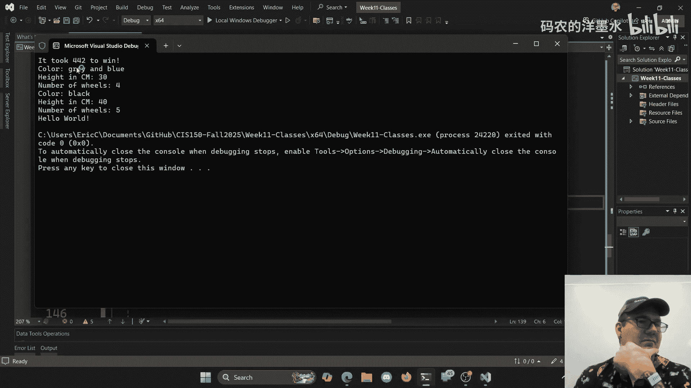

上一节我们在类中实现了业务逻辑，本节中我们简要了解一下如何组织代码和验证其正确性。

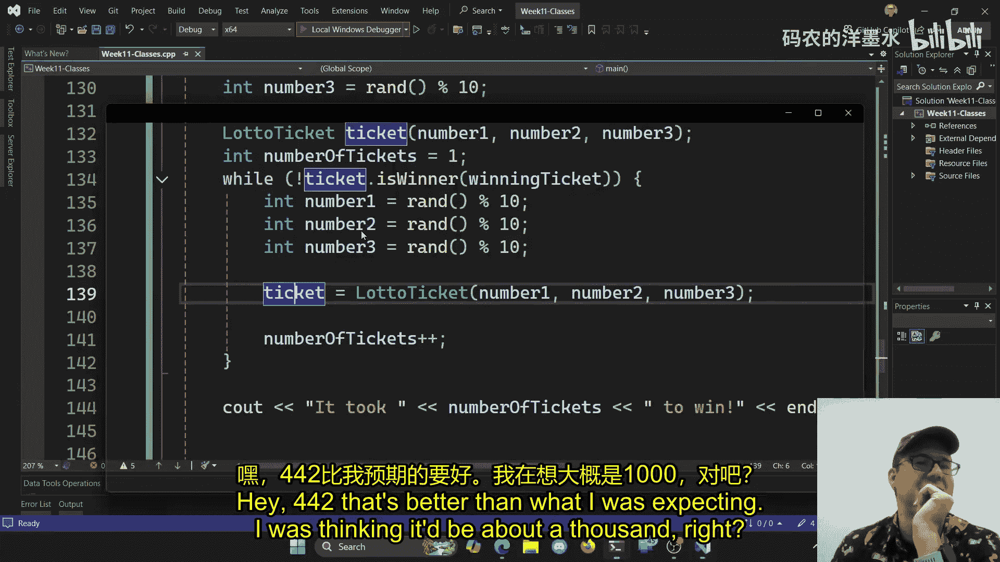

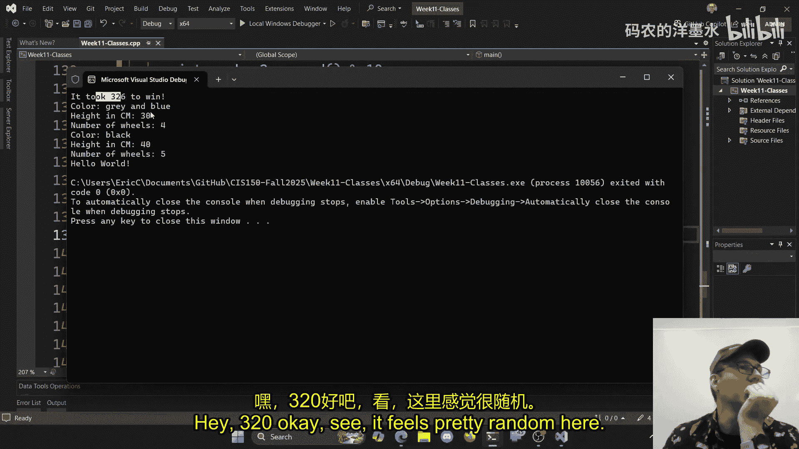

对于较大的项目，通常将类的声明（在头文件 `.h` 中）和定义（在源文件 `.cpp` 中）分开。这有助于管理代码并提高编译效率。

**公式/代码描述：**
`Chair.h` (头文件 - 声明)
```cpp
#ifndef CHAIR_H // 防止头文件被重复包含
#define CHAIR_H
#include <string>

class Chair {
private:
    std::string color;
    int heightInCm;
    // ... 其他属性
public:
    // 函数声明
    std::string getColor();
    void setColor(std::string newColor);
    // ...
};
#endif
```

`Chair.cpp` (源文件 - 定义)
```cpp
#include "Chair.h"
// 实现各个成员函数
std::string Chair::getColor() {
    return color;
}
void Chair::setColor(std::string newColor) {
    color = newColor;
}
// ...
```

关于测试：编写测试代码来验证你的类是否按预期工作至关重要。这被称为单元测试。虽然课程中展示的方法可能不够优雅，但核心理念是创建对象，调用其方法，并检查结果是否符合预期。确保代码“做它该做的事”是开发者的重要责任。

---

## 总结 🎯

本节课中我们一起学习了面向对象编程的基础。

我们了解了**类**是定义事物属性和行为的蓝图，而**对象**是根据这个蓝图创建的具体实例。我们探讨了通过**私有（private）和公有（public）** 修饰符来实现**封装**，将数据隐藏起来，只通过公有方法（API）与外界交互，这体现了**抽象**的思想。

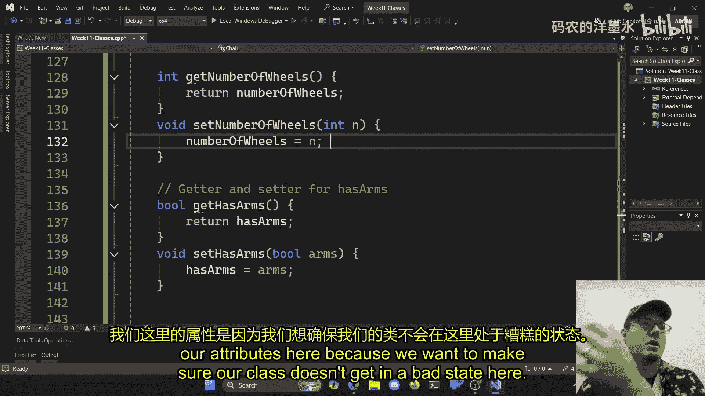

我们学习了如何创建对象，如何使用**构造函数**来初始化对象，并控制对属性的访问。我们还看到了如何在成员函数（如 setter）中加入业务逻辑来维护对象的有效状态。最后，我们简要了解了将代码分离到头文件和源文件的好处，以及单元测试的重要性。

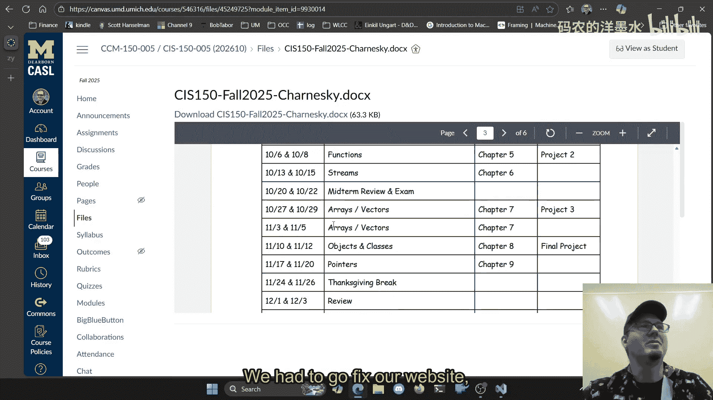

掌握这些概念是构建更复杂、更易维护的 C++ 程序的基础。在接下来的课程中，我们将继续深入探索面向对象编程的其他强大特性。