# 020：期中复习 📚

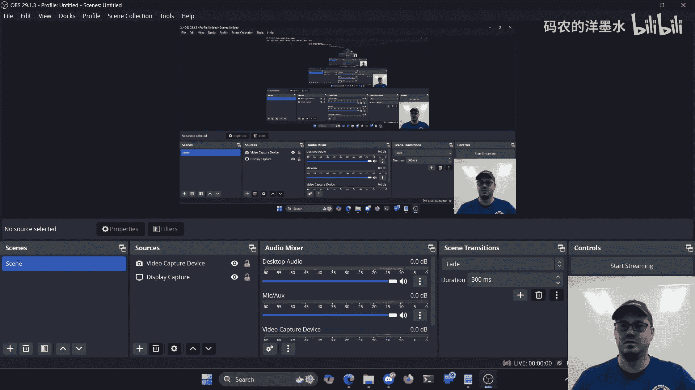

在本节课中，我们将一起回顾期中考试可能涉及的核心概念，并通过分析几个典型的编程题目来巩固所学知识。课程内容涵盖变量、运算符、循环、函数以及文件操作等基础主题。

---

## 概述

本节课是期中复习课。我们将回顾考试中可能出现的选择题和编程题类型，并逐一解析关键知识点。复习的重点包括：变量命名规则、运算符、循环结构、函数定义与调用，以及文件输入输出操作。

上一节我们完成了项目一的评分，本节中我们来看看期中考试的复习要点。

---

## 选择题要点回顾

以下是考试中可能出现的一些判断题及其解析，帮助我们厘清基本概念。

1.  **变量可以命名为任何内容。**
    *   **答案：** 错误。
    *   **解析：** 变量名不能是C++的保留关键字（如 `int`, `return`, `if`）。

2.  **取模运算符（%）给出整数除法后的小数余数。**
    *   **答案：** 错误。
    *   **解析：** 取模运算符给出的是**整数**除法的余数。

3.  **除非提供唯一的种子值，否则 `rand()` 函数每次运行程序都会生成相同的随机数序列。**
    *   **答案：** 正确。
    *   **解析：** 这就是我们通常使用 `srand(time(0))` 来获取当前时间作为随机种子的原因。

4.  **`if-else if-else` 链总是可以用 `switch` 语句替换。**
    *   **答案：** 错误。
    *   **解析：** 反过来才是正确的：`switch` 语句总是可以用 `if-else if-else` 链替换，但反之则不一定，因为 `switch` 通常用于离散值（如整数、字符）的等值比较。

5.  **`for` 循环和 `while` 循环完全可以互换。**
    *   **答案：** 正确。
    *   **解析：** 从技术上讲，`for` 循环的三个部分（初始化、条件、增量）都可以省略或调整，以实现 `while` 循环的功能。但通常 `for` 循环更适合已知循环次数的场景。

6.  **在循环中使用 `break` 和 `continue` 通常是有效的，但它们通常会使程序更难以理解，应尽量避免。**
    *   **答案：** 正确。
    *   **解析：** 虽然有时很有用，但过度使用会降低代码的可读性。

7.  **使用函数的两个原因。**
    *   **答案示例：** 提高代码可读性；实现代码复用。

8.  **默认情况下，参数是以值传递的方式传递给函数的。**
    *   **答案：** 正确。
    *   **解析：** 除非使用引用符号 `&`，否则函数接收的是参数的副本。

9.  **函数只能返回单个值或对象。**
    *   **答案：** 正确。
    *   **解析：** `return` 关键字确实只能返回一个值。但我们可以通过返回数组（一个包含多个值的对象）或使用引用参数来“返回”多个值。

10. **如果参数有默认值，调用函数时必须始终为其提供实参。**
    *   **答案：** 错误。
    *   **解析：** 正是因为参数有默认值，调用时才可以省略对应的实参。

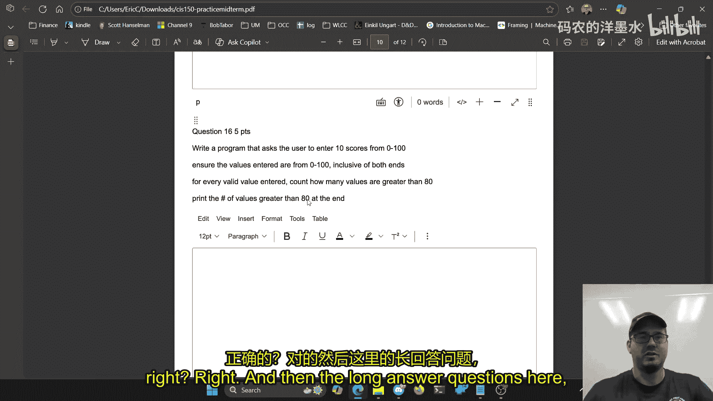

11. **使用文件流时必须做的三件事。**
    *   **答案：** 打开文件；读取或写入数据；关闭文件。

12. **默认情况下，以写入模式打开文件会清除文件的原有内容。**
    *   **答案：** 正确。
    *   **解析：** 如果需要追加内容，必须指定为追加模式（如 `ios::app`）。

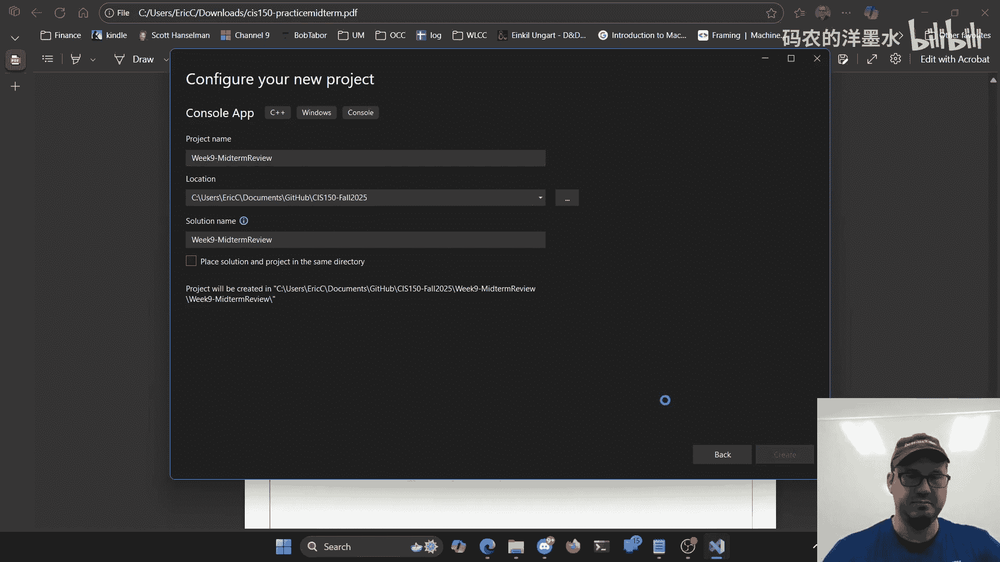

13. **读写文件时必须使用文件的绝对路径。**
    *   **答案：** 错误。
    *   **解析：** 默认使用相对路径即可，也可以根据需要选择使用绝对路径。

---

## 编程题解析

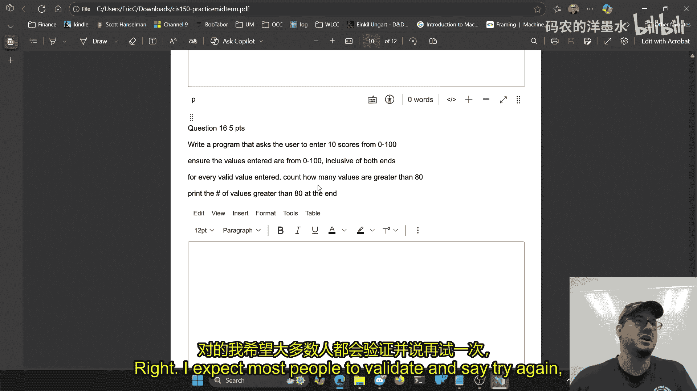

在回顾了选择题之后，我们通过几个编程题来实践如何应用这些概念。

### 题目一：输入验证与计数

**要求：** 让用户输入10个0到100之间的分数。对每个有效输入，统计其中大于80的分数个数，并在最后输出这个计数。

**思路分析：** 这是一个典型的循环输入加条件验证和计数的题目。我们需要一个循环来获取10次输入，每次输入后进行范围验证，并对符合条件的值进行计数。

以下是可能的实现代码：

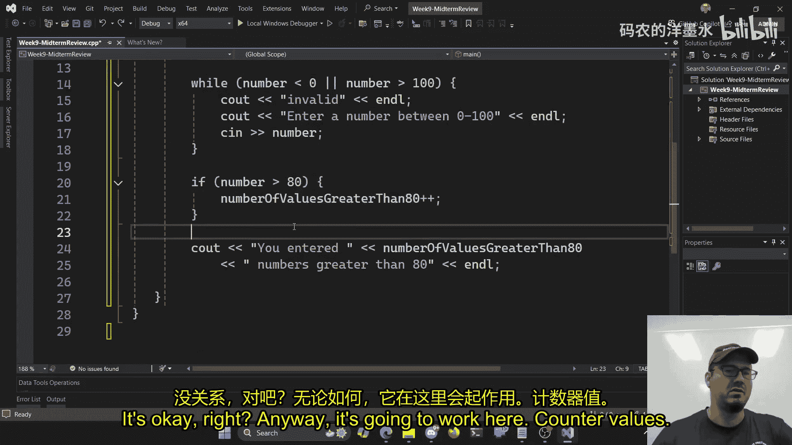

```cpp
#include <iostream>
using namespace std;

int main() {
    int score;
    int countGreaterThan80 = 0;

    for (int i = 0; i < 10; i++) {
        cout << "请输入分数 (0-100): ";
        cin >> score;

        // 输入验证循环
        while (score < 0 || score > 100) {
            cout << "无效分数，请重新输入 (0-100): ";
            cin >> score;
        }

        // 统计大于80的分数
        if (score > 80) {
            countGreaterThan80++;
        }
    }

    cout << "大于80的分数个数为: " << countGreaterThan80 << endl;
    return 0;
}
```

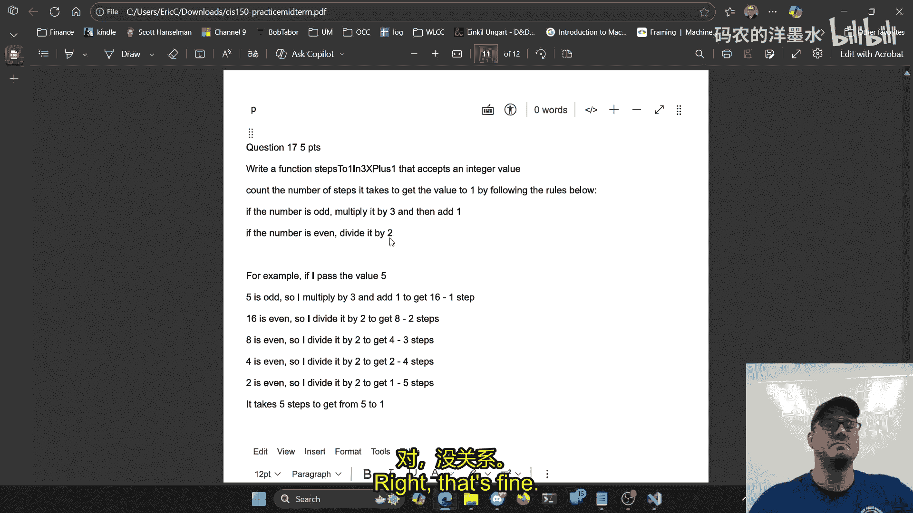

**代码说明：**
*   使用 `for` 循环控制输入10次。
*   内层 `while` 循环用于验证输入是否在有效范围内。
*   使用 `if` 语句判断并计数。

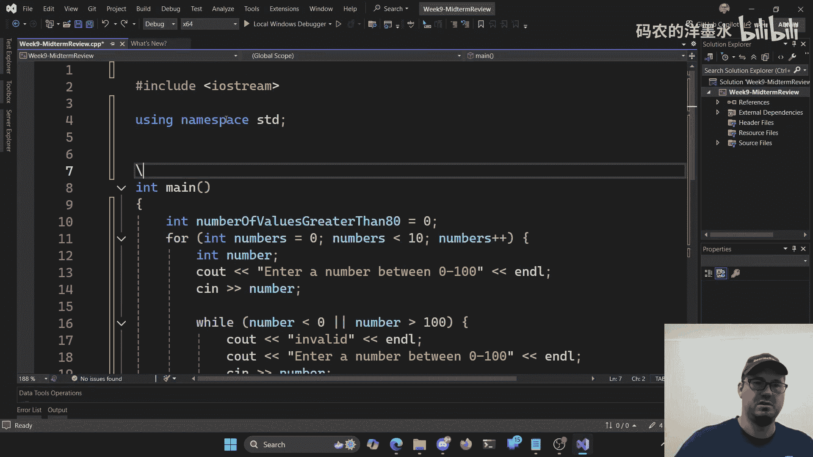

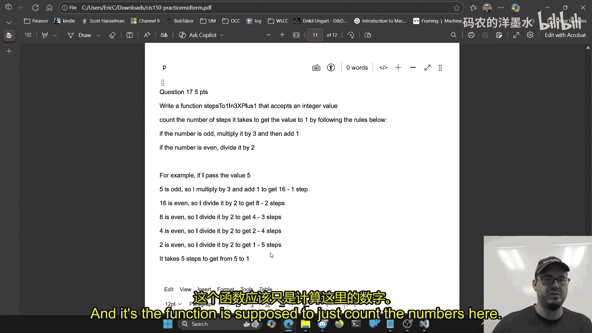

### 题目二：3x+1函数

**要求：** 编写一个函数 `stepsToOne`，接受一个整数，计算它通过以下规则变为1所需的步数：若数为奇数，乘以3再加1；若数为偶数，除以2。

**思路分析：** 这是一个数学趣味问题，核心是使用 `while` 循环反复应用规则，直到数值变为1，同时用一个计数器记录步数。

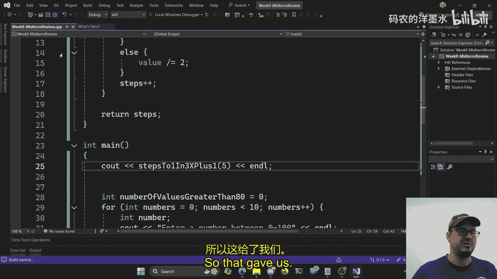

以下是函数实现的示例：

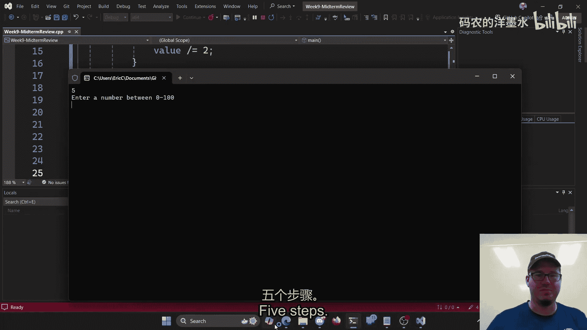

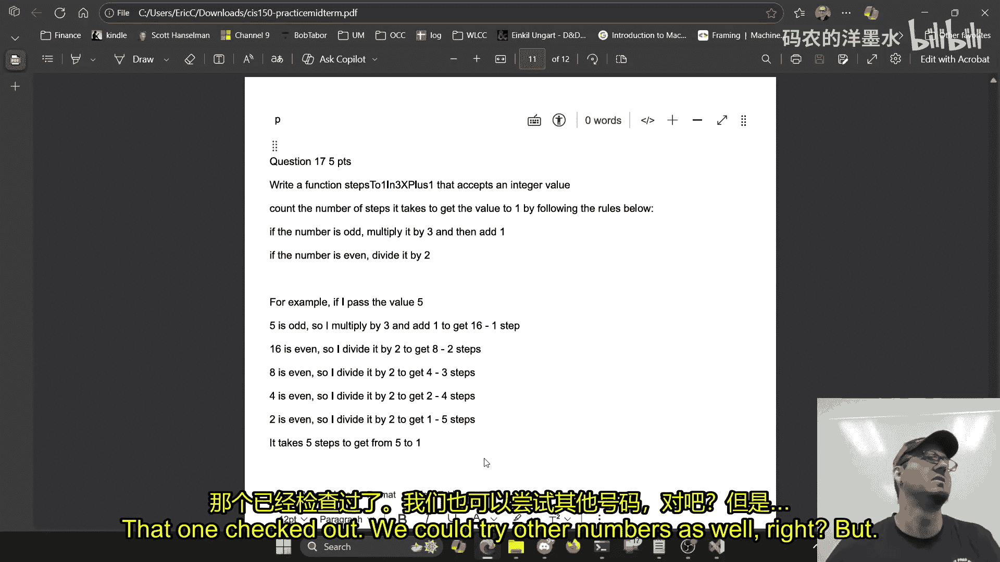

```cpp
#include <iostream>
using namespace std;

int stepsToOne(int value) {
    int steps = 0;
    while (value != 1) {
        if (value % 2 == 1) { // 奇数
            value = value * 3 + 1;
        } else { // 偶数
            value = value / 2;
        }
        steps++; // 步数加1
    }
    return steps;
}

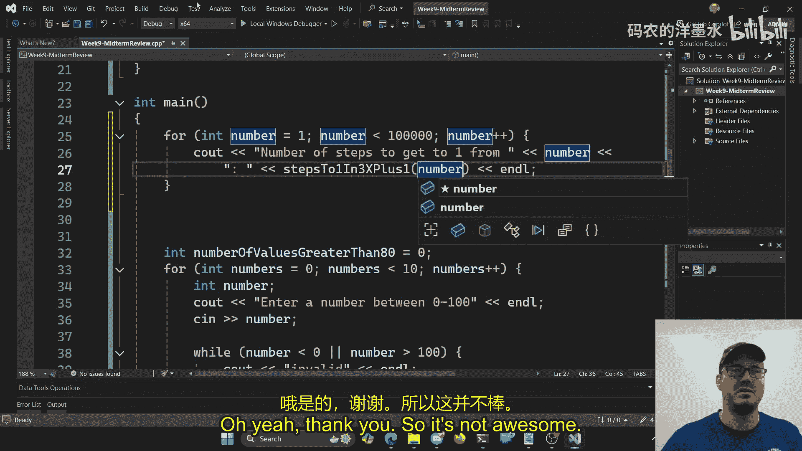

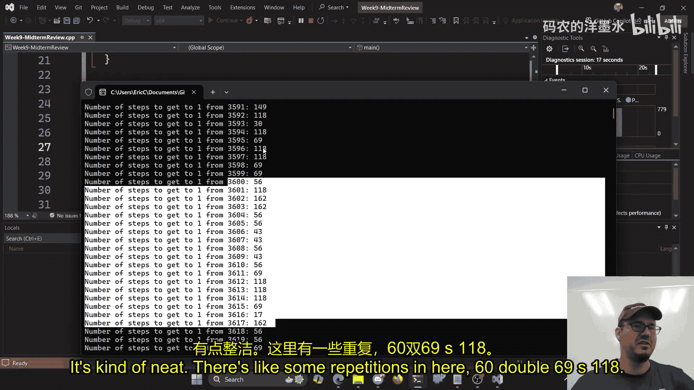

int main() {
    int num;
    cout << "请输入一个整数: ";
    cin >> num;
    cout << "从 " << num << " 到 1 需要 " << stepsToOne(num) << " 步。" << endl;
    return 0;
}
```

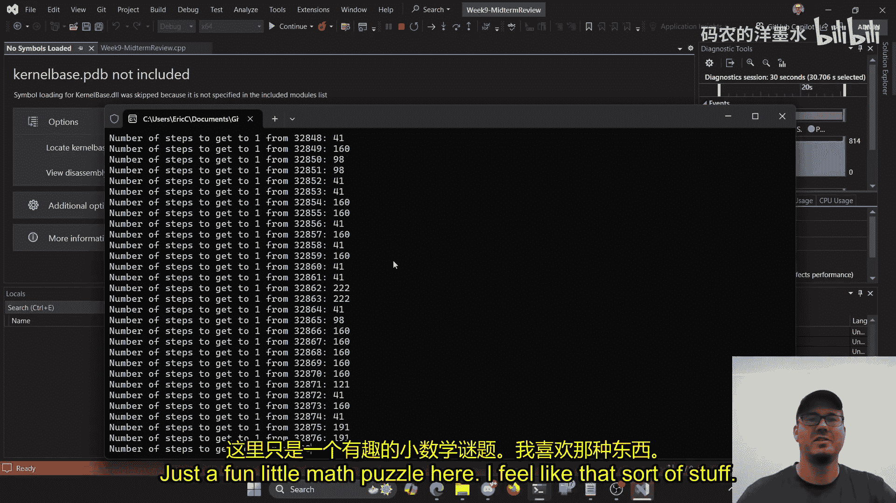

**代码说明：**
*   函数 `stepsToOne` 接收一个整数参数 `value`。
*   `while (value != 1)` 是循环条件。
*   `value % 2 == 1` 用于判断奇偶性。
*   每执行一次规则，`steps` 计数器增加。

### 题目三：统计文件中字母出现次数

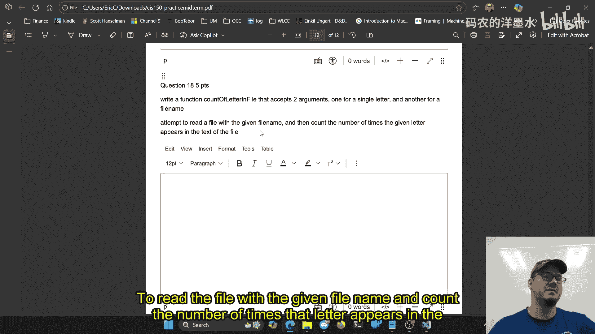

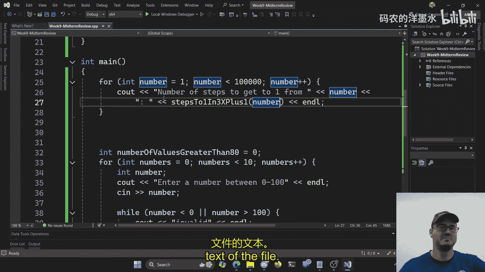

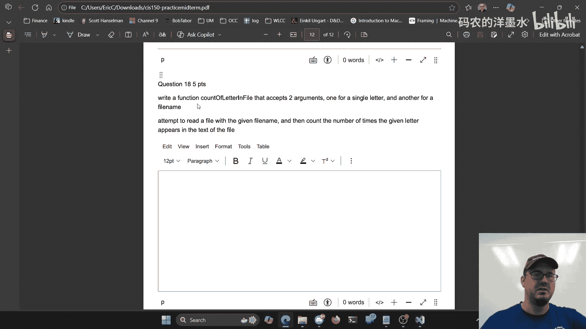

**要求：** 编写函数 `countLetterInFile`，接受两个参数：一个字符（字母）和一个字符串（文件名）。函数尝试打开该文件，并统计该字母在文件文本中出现的次数。

**思路分析：** 这道题综合了函数、文件I/O和字符串处理。需要使用 `ifstream` 打开文件，逐行读取内容，然后遍历每一行的每个字符进行比对。

以下是函数实现的示例：

```cpp
#include <iostream>
#include <fstream>
#include <string>
using namespace std;

int countLetterInFile(char letter, string fileName) {
    ifstream inputFile;
    inputFile.open(fileName);

    if (!inputFile.is_open()) {
        // 如果文件打开失败，可以返回-1表示错误，这里简单返回0
        return 0;
    }

    int count = 0;
    string line;

    // 使用 getline 逐行读取，可以正确统计空格
    while (getline(inputFile, line)) {
        for (char ch : line) { // 遍历该行的每个字符
            if (ch == letter) {
                count++;
            }
        }
    }

    inputFile.close();
    return count;
}

int main() {
    char myLetter = 'a';
    string myFile = "sample.txt";
    int result = countLetterInFile(myLetter, myFile);
    cout << "字母 '" << myLetter << "' 在文件 " << myFile << " 中出现了 " << result << " 次。" << endl;
    return 0;
}
```

**代码说明：**
*   使用 `ifstream` 和 `open()` 打开文件。
*   使用 `is_open()` 检查文件是否成功打开。
*   使用 `getline(inputFile, line)` 循环读取每一行。
*   使用范围 `for` 循环 `for (char ch : line)` 遍历字符串中的每个字符。
*   使用 `close()` 关闭文件流（良好的编程习惯）。

---

## 考试注意事项

在解析完题目后，这里有一些重要的考试提示：

*   **形式：** 开卷考试，可以查阅笔记和资料。
*   **时间：** 题目设计时长约10-20分钟每题，总时长充裕。
*   **工具：** **强烈建议**在 Visual Studio 等集成开发环境中编写和测试代码，确保无误后，再将代码复制粘贴到考试答题区。不要在答题框中直接编写代码。
*   **诚信：** 遵守学术诚信政策，独立完成考试。

---

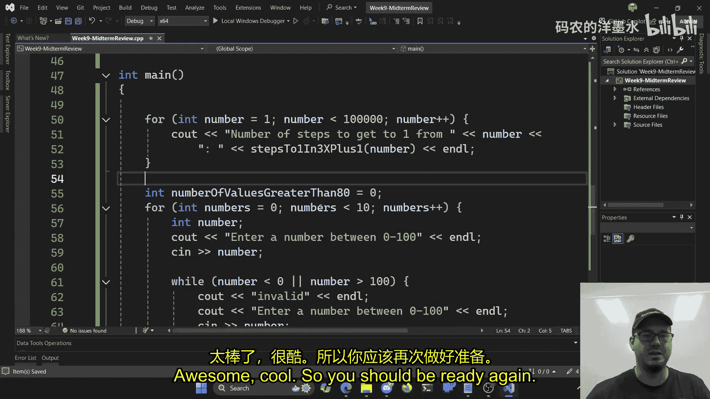

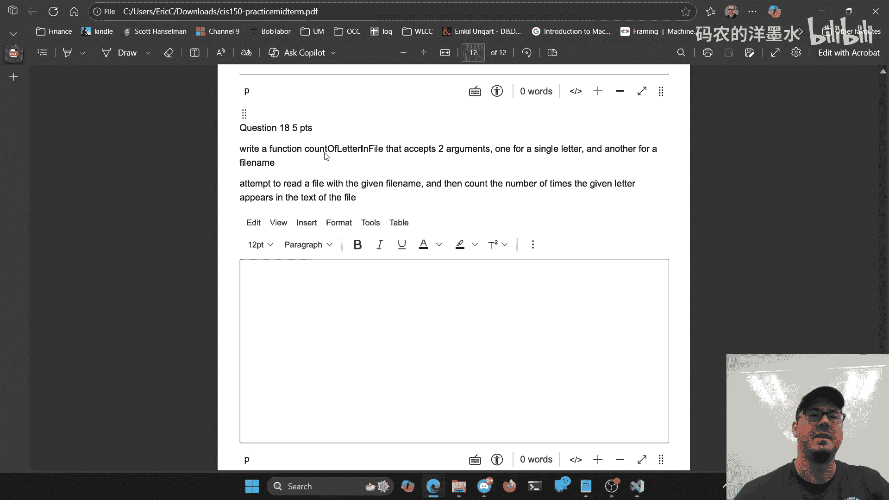

## 总结

本节课中我们一起学习了期中考试的复习要点。我们回顾了变量、运算符、循环、函数和文件操作的核心概念，并通过三个编程题目实践了输入验证、循环计算和文件处理。请大家利用这些知识认真准备考试，如果在复习中遇到任何问题，请及时提出。

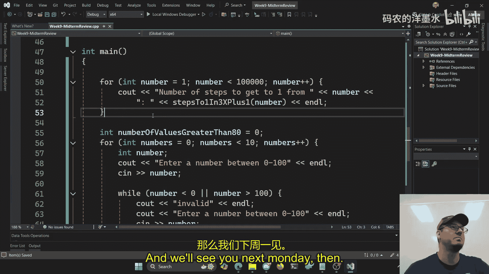

祝大家考试顺利！我们下节课再见。