# 【全集】密歇根大学 C++编程 中英字幕 1080P p01 Lecture 1 - 导论 -BV1TsAZzAEHX_p1-

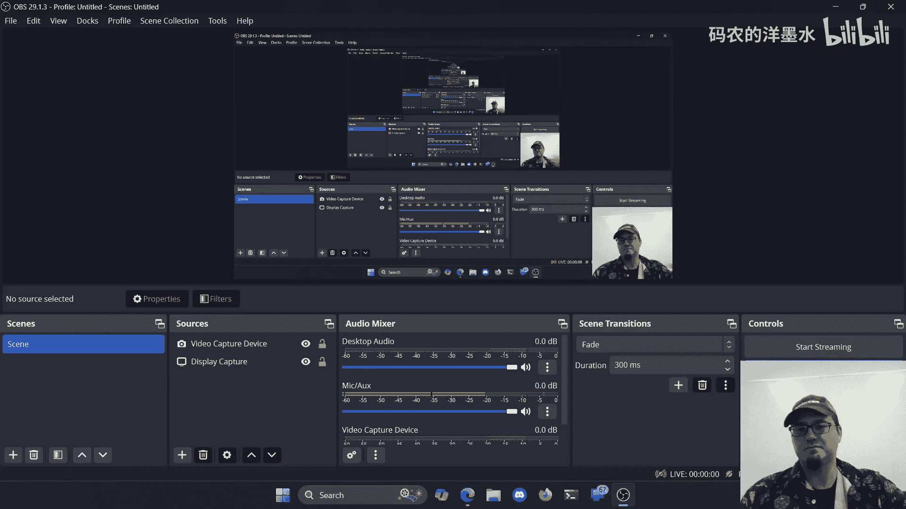

All right， now I'll remember hit record I just posted the syllabus probably like 15 minutes ago if you got your canvas notifications。

 you probably saw something。I'm not going to read it all to you because you should know how to read by now I'd like to imagine as scholar students you can probably read you'll be doing lots of reading here but I want to pick out some of the highlights our lab section is not one that I'm running and due to some scheduling issues here so you've got Dr。

 Saed running labs Monday 4 to 545 unfortunately I couldn't make that time here so he'll run the lab sessions for our class here so it'll be a little bit weird having lecture with me lab with Dr。

 Said he's great it'll go well I'll figure things out with him and we can go from there this is me I am not a professor the university administration does not allow me to use that title until I've been teaching for 12 years and ask very nicely and fill out a lot of paperwork may I please be called professor it's a whole thing don't worry about it you'll probably hear about Leo in the union and our contract negotiations at some point because we'd love to let people down but sure doesn't really matter much but if you call me a professor I'll probably give you a funny look and say I'm not a professor because I enjoy being pedantic。

Why not this is my email address Don't use canvas to send emails because it doesn't go to my direct inbox it goes to the filtered spam like automated email message stuff so just email me actually call or text is great I'm pretty good at texting again lots of kids at home my little guy likes to watch YouTube videos on my phone so I don't always have it with me texting is great I've got an office or shared office space here on campus it's in the ciIS building which has no classrooms it does have a lab most people never go there it's a nice little building they're gonna renovated at some point here I think the board of trustees approved that finally I'll be there before class Monday Wednesday and then after my second class on Wednesday I'll be there as well to about three o'clock so if you want to drop in Ill should be around if you don't see me call or text me I might have wandered off to some meeting or down the hall somewhere go get coffee or I can also meet virtual by appointment other times my schedule is pretty flexible here so those times it't work for you suit me message we can set something up to meet Zoom。

And screen shares work really well who knew in 2025 we could make that work so great course description this should be copy pasted if I did it right from the college catalog。

 nothing interesting here our program learning goals。

 this stuff is really boring here but as part of being an accredited institution through AVS which accreditation should mean our degree worth more you'd like to hope so it's a whole fun highered is interesting here in the program here we have learning goals and the classes。

Individual goals roll up into the program goal， so at the end of the program。

 you should have done these six things here。Sure interesting they're on the website for anyone who cares specifically in this course。

 we'll do a couple other things here， these objectives here that will measure and get assessed and all these sorts of things here they probably don't mean a whole lot yet because we haven't learned what any of these funny buzzwords are so that's okay if you don't know what a UL is that's okay you know what recursive is that's okay we'll get there so we'll come back to these I'll try and refer back to these occasionally but okay do you think now you can do these things because that's sort of the goal here right of all the stuff we learned。

We're going to use an online textbook here they added this section late I don't know if the bookstore actually had the info。

 my apologies so if you need to order through the bookstore and they don't have it pester me and I'll make sure I send I thought it went over to them but I don't。

So let me know but if you don't need to go through the bookstore you can just go right to their website。

 you plug in a code it's a subscriptionbased access again it's cheaper than most regular textbooks。

 but it's a website which is actually really cool I'll show you the website you can write code right into the browser here and it will run it for you which is really fun and nice not the best way to write code but it's nice and easy when the textbook gives you examples for you to hit run on them real quick and type and change things and hit run so that makes it a lot of fun you actually get points for doing this so you do need to go out and do this unfortunately here so and then when you're done you can save the chapters as PDF you have to do one chapter at a time because they don't want a one click button to get their book and send it out places and it puts your name all over it and all sorts of stuff you'll want to do that at some point because then the next class CiIS 200 uses the second half second third。

Nope third third right sorry I've not had enough coffee yet today so we go through a lot of it here but don't get through everything and on some of it we don't go super deep so you'll come back to those topics NciIS 200 you'll do a lot of that sort of cyclical learning in CIS you'll get introduced to a topic and then maybe later you'll come back into a deeper dive in it so we're going intro a couple topics at the end that you'll do deep dives in the next course it's a lot of fun。

We'll go from there and then if you're the kind of person who likes actual textbooks and it can be really useful go check out problem solving abstract and design using C plus this one here don't go buy it just go check it out find it the library or something here I think we've got at least one copy in our library you can check it out and see getting examples from more than one source helps you learn if the only thing you ever do is listen to me you're missing out because I'm not gonna be able to give you all of the information there and maybe seeing it a different way is going to help so you want to get lots of repetition so I'm going give you examples the book will give you examples you're gonna practice in lab's at least three times there before you go and do it in a project the project is more on your own no handholding it's up to you to figure it out all answer questions here but I'm not going tell you exactly what to do here for everything else we'll hold your hand and help that's why we're here so getting another source is great there's tons of great things out online as well。

There's actually too much on there online it can get lost down rabbit holes and things get weirdly specific when it comes to programming so this is a pretty good source here as well that's not not too heavy。

 for applications I like using Github I'll tell you all about it later it's okay Git is a source control tool the code that we write is source code so it's to manage the source code that we write here this Git was created by a friend Linus Tovald。

 the founder of Linux when he decided he could do better than the other tools that exist and he sure did Git is now the most widely used source control tool in the world GitHub is a cloud service provider that provides a central cloudbased repository that you can synchronize with with Git it's also owned by Microsoft and they give it away for free at certain tiers of usages and for classroom use it's free and we could use it for that So we'll be using that。

 I'll show you how to do all that。 Don't worry about it we'll get there later today and every week we'll be using it so you'll get in the habit of doing it a big peeve of mine。

Putting code into canvas you can tell the other props and lecturers that I think they're stupid if they put code in canvas they don't care my opinion。

 it's okay but Cans is a terrible， terrible， terrible place for code。

 It's not meant for code it's a classroom management tool Github is designed for code and I'll show you all the cool things I can do with code and then you'll need some sort of C+ compile compiler I assume most of you are Mac or Linux I'm sorry Mac or PC users rarely ever get someone on Linux we can get Linux working with C+ it's a small pain but for everyone on PC we're can to use visual Studio 2022 the community edition version is all we need we don't need fancy bells and whistles for Mac。

 you can use Xcode and our friends over at Ann Arbor have a really nice guide on how to get that set up and running here off of their website you can go check out if you have any trouble with that Vi Studio super easy I don't own a Mac I don't like Mac again I just they irritate me because I've used a Windows PC my entire life and things just work on。

And they just don't work well on math。Other people swear and that's fine but if you have troubles with your back unfortunately there's very few things I can do to help I can look at your code but that's about it if nothing else is working I don't really know I'm sorry。

Right， whatever seems to care about how you get your grade， I use weighted categories。

 so there's points within each category， but the points are part of the weight of the category。

 so just because an assignments 10 points and a lab is 10 points doesn't really mean they're the same 10 points so it's points within the category so doing your Zbooks you actually get 10% of your grade for actually reading your textbook。

Just kind of cool there's actually a couple activities you have to do along the way slightly more than reading which is fun so do it right and I can run reports to say how much of it you've completed here because everyone subscribes to it and it's linked to my account I'll show you how that works so you give points for doing it I used to not run that report until the event of the semester and then most of the time I'd have about a third of the class who just did no reading at all all semester long and then they crammed it in the last week to get their points。

That's not helpful right that the goal is the book is helpful here I don't want to give you busy work I want to give you practice right and then examples and things so this semester I'm going to changes up and try every week I'm going to run the report and give you a score for the chapter so you've got to keep up with it but that's for your own good here they'll be a little bit of wiggle room there if we need to but ideally you keep up with it it's good for you I promise right we're not assigning readings to make your life harder're assigning readings to help you be more successful in the class and keep up with the class we've got weekly labs they don't start until。

Not next week because of Labor Day， but the week after was we're a Monday lab。

 so no labs next week for Labor Day。We'll make it work。

 it'll be okay so we'll have our class time and then you've got lab after the Monday class before the Wednesday class so we'll see I got to get with Dr。

 Saed and figure out our topic schedule for that but we'll make it work okay so you'll do the labs with Dr。

 Seed you'll have individual projects I got four individual projects for you they make up 30% of your score here we'll have one exam a midterm exam it's worth 10% of your score I'll give you last year's midterm to practice off of this is not meant to be hard this is sort of a checkpoint for you if the midterm went well that's a good sign if it doesn't go well then we should be talking ideally before the midterm doesn't go well you've told me things aren't going well but this is your chance to check in I got paid a lot of money in industry to copy paste code from online。

And not memorize things the more you do something， the more you remember it here。

 but no one ever told me I had to write code and not use my sources。

 not use any resources because that have been stupid why are they hang me right and then you know put my hands behind my back so in the term is open book open notes open internet but not open neighbor right this is an individual effort here but it's。

Can you go find the information if you don't have it off the top of your head Great problem solving and learning how to find things is a super important skill for software engineers right because nobody knows it all there's no way anyone can know everything so you just need to know where to go find it and how to find it and then how to apply that information which is fun and then our final project is worth 40% of the score without this you cannot pass the class that's intentional it's why it's worth so much here this one you can do in pairs we're not going to require it I would recommend you do it in pairs。

 I think a lot of better experience but it's not a core outcome of the course next semester and 200 you'll have to do it in pairs because that's an outcome of the course is working with a team or a partner essentially right there's not really enough work to do a larger group here but as you go group work is pretty common which is great because it's really lonely to be the only developer and an organization and never ever talk with other developers and really more than one person working on something does make it better because。

Development is really a creative process。 There's a lot of science and technical things behind the scenes here。

 but writing code and building solutions here is very creative and problem solvinglving based。

 and you have to think through ideas and being able to bounce ideas off of each other helps you get better results for sure。

Some of the best advice I ever got from an old boss of mine was I should never be the smartest one in the room。

Because then I didn't have opportunities to learn and grow。

And that's held true for a very long time and I'm happy to admit i'm not the smartest one of the like that's okay I enjoy that so we got super lots of really super smart and talented people here at the college we do a lot of really cool things lots of interesting research here the lecturers getting back into that just because it's interesting here are paid to teach our tenure track faculty who have the title professor。

arere essentially paid to research and by the way they have to teach on the side。

 so it's just sort of an interesting system here， but they do all sorts of academic publishing and they bring in research dollars and have to get grants and things and do get funding for stuff here。

 but that's also why they make more money。That's fine so that's the system the percentage to letter grade scale should be standard best I can tell there is I don't think there's any weirdness with this one here and then our tentative course outline a schedule again it might change if we need to but here's the tentative plan usually goes pretty well here soll intro to C++ Intro to GitHub Intro to Visual studio you've got a reach chapter one so that's the assigned reading for this week right so hopefully by next week you've have read it here。

Probably not by maybe by Monday ideally it' it's pretty short it's not too long i'll show you next week we don't have class on Monday have a good Labor day。

 go do something fun barbecue right hopefully or little parade or I don't know what people do on Labor Day anymore we'll come back nine3 we'll cover chapter two。

Goes pretty quick again there's a lot of small pieces here but it's not very interesting all by itself we need to get into the later chapters and then finally we get into two sessions a week here Monday and Wednesday we'll do chapter3 we'll spend two weeks on chapter 4。

 two weeks on chapter 5 and then the projects you've got two weeks to work on them here for the projects so we'll start project zero here everyone count starting counting at zero you'll learn why later in programming land that all normal people do what I promise it's not weird to start counting at zero so Project zero two weeks will be do project one two weeks itll be do project two。

 two weeks sometime around here probably when we do midterm review is plan for it to be due the midterm of exam is planned for 1022 here。

And then Project three， we'll have two weeks， we'll sign the final project we get one more chapter chapter9。

 thanks you can break we're off for the whole week， we'll come back do any miscellane is review。

 catch up anything we might have missed if the schedule has to shift a little bit we got a bit of wiggle room here and then 128 is our last class session here it's time for our final project work time So if you're working with the partner great you can check in with them see everything's going My goal here is because you've got a month to do this that it's done before you have to take your other final exams and you don't have to worry about this class and you can stress about your final exams and other classes so what we're gonna do in our final exam slot is you're actually gonna to present your project so you'll get up in front of the class run it show us it does what it's supposed to do answer a couple questions from the pinix gallery it's maybe five minutes per person goes pretty well everyone has done the exact same thing they've all have gone through what you've gone through here and practice presenting will make it easier no one really likes presenting or maybe maybe we're in the forensics club or something really like speaking。

Why is it called forensics， I've never understood that。

But okay i'm not not a communications person but practice will make you better and this is a sort of thing you'll do in industry。

 you'll take what you've worked on and show your team or presented it to some group in your organization and go through it so。

Practicing it is definitely helpful here right if you do it in every class you'll get easier and get easier and get easier and you'll get more comfortable with it here just like anything else so there's some of the soft skills here that you'll be working out as well so you can be the smartest person in the world but if you can't communicate you're not going to go very far。

You've got to be able to communicate and work with people to get far of the world so we'll probably be in the same room。

 they just haven't assigned it yet that'll come out usually the week before finals or something like that。

 but probably the same room we're 1130 to 230 is our slot for that best type of telephone and final exam schedule。

Right。Our course specific policies， specific policies for me， I'm big on academic integrity。

 this is a big pet peeve of mine and ideally it's a pet peeve of yours here because if cheaters get degrees then people and then degree the degree gets devalued and companies won't want to hire our graduates here because if you cheat your way through school and don't actually know anything and suck at your job they can say。

 oh Im going to hire another graduate from you be。Right。

 so don't let your friends cheat their way through school， right you're here for a reason。

 if you already know everything， don't come。Right。Take the test and pass if you know it all right ideally you're here to learn a couple things here that's that's sort of the goal I get there's high pressure and you have to keep GPs and things like that it's not meant to be stressful in this course here。

 you've got what 10% of your score just from reading your textbook。

 10% of your score from doing the labs， these literally like if you show up and try。

 you'll get the lab done。Basically guaranteed， all you have to do is try。

 right because we're here to help。Right。Put the effort in30% is projects that you've got two weeks per project to work on here to get them done right I've got office hours。

 you can my appointment， I will give you tips and tricks to get you point in the right direction here again when it comes to programming it's a little weird if you run into weird errors you have to work your way through them and learn how to find solutions here when you get into the industry you can't just go ask every time something happens that you've never seen before。

 you need to show some initiative and go try and do some problem solving but after a good half hour or hour of banging your head against the wall come and ask me。

RightUs it takes me less than five minutes to solve any problem that you're run into I've been doing it for 20 years it's okay and with experience I'm familiar with these sorts of things that's what happened that's why you're learning that's why you're practicing here but give it a good half hour to hours before you reach out and I'm happy to help point you in the right direction will save you a lot of time had headache as well I had someone tell me they spent eight hours trying to problem solve something and it was like a one line fix they're like oh man I just wasted all day and I felt really bad like yeah they wasted all day like you should have a asked so at some point there's no return on just trying and trying and trying and spinning your wheels here but give it a try。

All right， thanks， Fssy。For academic integrity， ironically I stole this borrowed it with citation from our friends over at Ann Arbor their EECS 183 honor code collaboration policy I thought was really good and I didn't want have to write it myself and I think was theres was good so I copy paste it here you can go find it yourself from that link up above on their install guide here but it's a Google doc and that link probably changed but anyway collaboration is encouraged again。

Any sort of creative activity goes well talking with other people， collaborating with other people。

 you're you're going to do better with that So ideas of collaboration here right。

 you learn from each other， you collaborate， you help each other。

 reach out and help when you when you need it， but give or help understanding course concepts covered the lecture lab great talk about all all you want。

That's fantastic that helps both of you right， have a study group that's that's awesome practice and study that other students prepare for assessments and exams great study groups are fantastic SiI sessions。

Fantastic right we're like paying someone to do these for you here traditionally lots of students fail 150。

And if you can't pass this class， this major is not going to go well for you here so the college has recognized that and brought in As I support and paid our students who've been in your seat before has helped guide you through it here we're trying to help be successful but again the learning bit is on you we can give you all the tools and resources that we can but you've got to go and learn it you've got to put in the time and practice consult with other students to better understand project specifications Sure。

 talk about the project specifications fantastic discuss general design principles or ideas hey。

 we talked about this in class how do you think that might relate awesome others understand compiler errors or debugging's fantastic hey you're missing a semicolon here something you get this error message Oh yeah。

 I've seen that before great。So help them understand what is going on with their code。

 why are you getting an error here， not tell them what to write and don't copy their work。😡。

For their solution right so the easy way to think about this is you can talk in English all you want。

With each other we're not talking in code we're not sharing code but English level collaboration speaking English with each other I love it it's great it's good for you it's good for them work together。

 get to know each other， find a partner find a buddy school goes better with friends I promise it's one of the weird things of school but it really does go better with friends。

Awesome， if you're not sure， just ask。Right you've got three different ways to reach me like anyga millennial on my phones almost always with me unless my little guy has it here。

 I'll get back to you relatively quickly if you haven't hurt for me in more than like 12 hours reach out again you're not bothering me you're not pestering me it's not going to annoy me I probably just missed it and my little guy swi away the notification while he was watching YouTube right just reach out again okay I'm here to help I enjoy helping that's one of the reasons I like teaching so。

In the spirit of collaboration， right， that that's the goal here。 Collaboration， fantastic cheating。

 not fantastic。😊，Right， when it comes to generative AI。

I would strongly discourage you from using it for most things at this level。

 It's going to be a fantastic resource as you develop your career in computer science and software engineering。

😊，It does a lot of really cool things， but at this level it does too much for you and then you're not going to learn anything and then if you've had the tool do all of the stuff for you by the time you get to 350。

When it can't solve those problems， you're sunk。Right， one of my colleagues enjoys。

Writing programs that AI can't solve he finds that entertaining here of putting in little tips and little tricks and catches and gotchas and things that he gets stuck when you give it to generative AI tools and he finds that entertaining I don't have the patience for it God bless sure it's fun it's kind of like a puzzle right can we beat the computer it's a fun little challenge so。

There are some good uses for it and some bad uses for it right acceptable use allowed use to prohibit a use so use them U of M has its own chatt GBT tool you can use free so you don't have to go pay anybody please don't be paying money for these things it's not worth your money at this time here and it's not going to help you here at this level again。

Good things you can use it for learning course concepts， generating examples of a topic。

 interactively checking your own examples。 it's great for that， Hey。

 can you give me more examples of how to use loops It will spit out all sorts of loop examples because it's crawled all the internet content that's out there right It's good at that sort of thing doing your own sort of example and checking it fantastic。

Not the class problems， right but your own work right， hey， I made into example of the loop。

RightThat sort of thing， understanding compilers， it's pretty good at these because there's so many errors out there that it's seen already。

 it can usually help you So if you're not entirely sure。Say， hey， I'm getting this error。

 Here's my code mid here。 It will probably help you solve it。 It's pretty good at that。

Rainstorming identifying potential edge cases for testing so testing is a very particular topic when it comes to writing code there's a whole school of study around testing and specialist in testing。

My general stance is any code that's worth writing is worth testing。Because if it was worth writing。

 it's worth knowing if you did it right the do with testing is does it do what it's supposed to do and also does it not do what it's not supposed to do？

Right and that's harder to test because our users in the world do the weirdest things with our software and it says。

 hey， enter your age and they spell out the word 90。

Because they're a 90 year old person using a computer I've seen it happen and then our program says well that's not a number because it doesn't understand NN E TY right doesn't know what to do with it so those sorts of things all sorts of edge when it comes to testing here software does a lot of things。

It can be interesting， so testing， thinking about how to test it is very。

 very worthwhile here when we do our projects， you'll want to test it to make sure it does what it's supposed to do。

RightI'm not going to give you all of the test cases and say oh if you plug this in you should get this back out that's un you have to be able to understand the problem well enough to know hey。

 if this comes in this should come out and we'll look at that when we get to the projects here generating additional practice exam questions or coding problems it's good at that hey give me a practice problem for this it will give you tons of examples here so if you've got free time and want to practice great it's good at it。

Queering why your solution for a code that problem or other assignment is correct when you don't know why。

don't know why it's right。This again。That's。Sure this one's a little weird but okay again I stole it that's okay so like it's doing it。

 but I don't really understand it so helping you understand why again essentially。

You want to treat it as another person， sounds really weird because it's a machine， it's a tool。

 like it's not really a person， but anywhere that you would collaborate。

And what we can use generative AI for right course concepts checking your examples。

 the same sort of things you could do with the buddy in class。

 great things we're not going to use it for is generating project code。

 test cases or other work to be submitted right turning in machine generated code AI generated code is plagiarism because it's not yours。

Just like an English paper， you're not going to turn in someone else's words with your name on it and pass。

Right， we all understand plagiarism， English papers， Okay， right。

 so you can't turn in machine generated work。And put your name on it。 that's plagiarism。

 It's a violation of our academic integrity policy so don't use the tool for that And again。

 nothing we're doing is that hard。 it's going to be a little difficult， it's going to take some time。

 energy and effort to get into but I promise you hundreds and hundreds and hundreds and hundreds。

 thousands of students have done it。By putting in the time， energy and effort， okay。

 we did it before generative AI tools， we'll continue doing it after generative AI tools because the goal is that you understand how to write code。

 how to code works here so that later when we use the tools， you can actually check it。

If the only thing you ever do is put stuff into tools and say， oh yeah。

 it works when you get to the point when it doesn't do 100% of everything， you're out of luck。

Because you need to understand how to make things work and how to problem solve and how to fix the things it can' do here because they're not perfect。

Some people think they'll get perfect I doubt it here but again that's just me talk to the smart people who research AI they've got all sorts of papers and things here。

 so other things you can't do proofread your code or correct mistakes you can't be like here's my project fix it。

系。I would like to imagine that one was obvious here， but I had someone last semester like， oh。

 you said I could use AI tools so I gave it to it and said to fix the problems。

 but I wrote it to start。But they didn't write what they gave me like there was some disconnect there so does that make sense you can't give it everything if you're getting a compile error hey i'm getting a compile error at this part here。

 give it the one line two line three line give it that little chunk here。

 don't give it your entire project and say proofread me right。

I'm going to imagine I don't actually know your English profs here and what they teach for composition nowadays。

 but they probably don't say plug your paper in and say fix it。

That's probably a prohibited use in English as well I'm going to guess right ask your your composition pros tell me about this I'm really curious to know here you know。

 proofread specific pieces， great tools， fantastic grammarly's been around for a long time before we have generative AI。

Really fun tool。 I'm bad at English。 It's my only language too， which is super sad。

 Some of you can speak more than one language and you're super smart。

 and I can barely get by with English。 Here's my only language。 but right， other things we can't do。

 Don't ask it for a list of test cases。You can brainstorm or identify potential edge cases like hey what are some of the things I might be missing here but not give me a list of things to test right here's my project how do I know if I did it right what can I test that's too far like oh hey here's a bunch of things I've tested have I missed anything Sure we're brainstorming right the idea with you can collaborate with the money hey if we're building a calculator here I don't know it's going to calculate our food prices here and remember fresh foods aren't taxed but prepared foods are taxed because who knows why our tax law is the way it is here。

Am I missing categorizing something I don't know， silly things like that don't use them during exams right I told you they're open book open notes open internet。

You wouldn't go ask a buddy for answers to your exam， you don't go ask AI for answers to your exam。

 right again？Pretend like it's another person we're collaborating with， which sounds terrible。

 My kids think that Alexa is a real person on the E dots， and it drives me nuts。

Like they they talk about her or she like and we've personified these these machines here for some reason that just irritates me like no。

 it's a computer program and're like no she she talks to me like。Yeah， the computer program does。

 but。All right， and then submitting generated content as your own work when contributing to group assignments again。

😊，Don't use AI generated code especially at this level right later on there's gonna to be great places for it and some of my other classes I teach I encourage them to use it for pieces right and I give them examples if here's a good place to use it because it will save you time energy and effort of doing these really basic repetitive tasks here once you've done it and you understand it great that I'm good with people doing it but again at our level is probably your first programming class。

Okay， good if it's not you're going to be really bored for a while if you're new to C++ so there's still new stuff to learn。

 but we start real basic here。Right， so that's the academic integrity and generative AI policy。

Violations of the academic Code of conduct， I'm sorry， violations of our integrity policy。

 so plagiarism using generative AI in the prohibited uses column。

 right sharing code with someone else here beyond the English level collaboration and we've talked about our violations of our policy。

 I have to notify the dean's Office and the academic Code of conduct Committee。

They do all sorts of things here in the nine years I've been teaching now actually I was an adjunct over at OCC before。

 started in 2012 teaching fresh out of grad school。

 so that's 13 years I've been teaching one time as the academic Code of conductduct Committee said I wasn't allowed to fail a student once and I'm still salty about it here and it's not because they didn't cheat it's because I didn't specify they weren't allowed to do it in this case on an exam。

Because I was letting them use tools for their assignments and they used it an exam。 okay， sure。

 so I'm still salty。For my class specifically the penalty for violating that integrity policy is failure。

 there's no zero on the assignment， there's no try again。

 there's you fail the class cheaters will not pass my class right and ideally everyone should feel the same way。

 you don't want people to cheat their way through the class。

Because then they're going to be your colleagues and they're going to be idiots when you go work with them because they don't know how to do anything it's bad for everybody so don't encourage people to cheat I'm not going to tell you you should wrap people out。

You'll lean on your own ethics and morals whether or not you think that's appropriate。

 but I will not let Jesus pass， okay。I sound like a big jerk， my apologies。

 it's a big pet peeve of mine here。I you have some coffee， I'll sell it out。Okay。

And feel free to interrupt me anytime if you raise your hand。

 I might miss it because I'm usually looking at my screen here， so just Poer， it's really okay。

 you're not going to send me as long as you don't interrupt like 50 times。I'm okay with it。

 I that okay？For projects homework other things I don't take things late without prior written approval we've got deadlines we've got to stick to them there're for your own good if you've got a reason I'm flexible but you've got to get prior approval oh hey I have to do some business travel oh hey I have to go to a wedding I've got something whatever's coming up here hey I was sick I'm okay giving you more time if you need it for some things want to come to the projects the due dates are stuck because when it's due I will actually present a solution in class here I've gotten feedback generally people find this very worth their time so I will actually solve it from scratch in front of you and show you this is how I would go solve this problem so。

So once I've gone over a solution I can't take it from people right and I'm posting all the recordings out to YouTube so if you missed it。

 oh I was sick I didn't come and didn't see your solution。

 well it's out there because it's me the internet and then all the code I write I'll put on a GiHub repository I'll show you what that looks like because I don't put code in Can because that's stupid again you're welcome to quote me on that it's okay right。

Late projects， we have a food pantry， which is awesome。Our friends in sociology， psychology。

 social sciences， people we're in their building social science building have realized that you can't do very well until you've satisfied your lower needs。

 you might have heard Maslaus， Malow， hierarchy with needs， thank you Google。

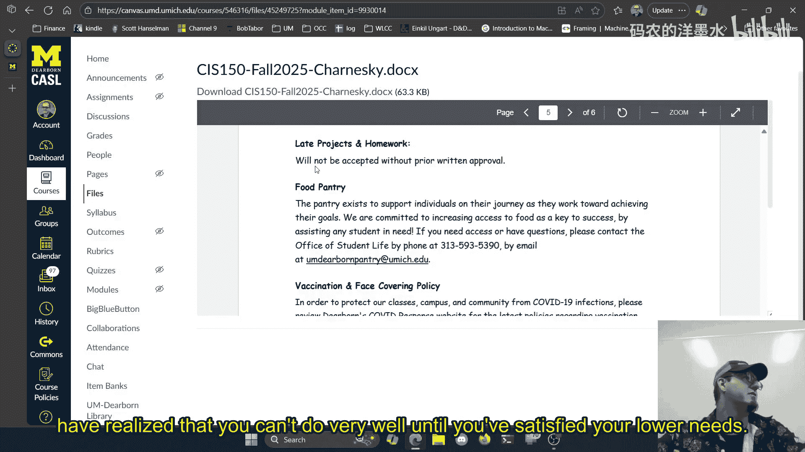

That one looks pretty good suit your physiological needs， food， water， warmth， and rest。

 unless you've got those satisfied， it's really hard to do the next level and the next level and the next level and the next level and the sort of things that we do the high level creative activities here are at the top。

Unless everything else is here， it's really hard to be creative and do good problem solving and learn to write code and be successful in a lot of things here。

 so feel free to take advantage of that， reach out to them， phone or email。

 they're happy to help here。

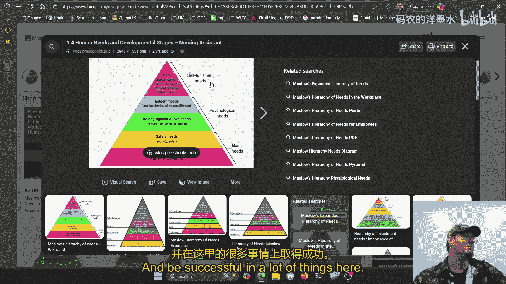

嗯。We still have a COVID policy， I'm assuming in the syllabus template。

 I got this from the syllabus template here， I'm sure。

And then other university wide policies are available in Canva， I didn't copy past them in here。

 you can go look at them here。Just another fun note because I get to talk here and you guys have to listen and this is an interesting to note here。

 the U of M's policy on sexual violence is particularly disturbing to me here and I worry if my kids ever come to U of M let me go look that one up here。

We me find it here I see Michigan thisconduct， I think that's what it is here。Sexual misconduct。

 they have a whole website for that。Here's the policy， Oh my goodness。This is way too big policy。

 Here's the entire policy。 Yes， oh， look， I even have it right to the page because I've pulled this up every semester to show people how terrible is I've complained they don't care what I say。

 but they might care what the students say because you guys give them money。Great。

 I take their money， you guys give them money， so they're more likely to listen to you anyway。

So in order to give consent， when alcohol is involved， you have to be beyond drunk。

In order to no longer have been able to give consent。I find that particularly egregious here。

 but again it's up to you， so if you take issue with that。

 please let them know they might be happy to listen to you more than we so。All right。

 that is all of the stuff in the syllabus， thank you for letting me review you。

Right I'm a little weird here when I went to school I got really tired of people reading to me。

 especially putting PowerPoint slides on the screen and the reading PowerPoint slides and I decided sometime years ago that I thought PowerPoint was stupid and I wouldn't do that。

In one class I use PowerPoint for one session for it's about ethics here and it's like highlights that I go through。

 but I don't use PowerPoint but I like to do is I pull up visual Studio code or visual Studio and I write code and I talk about it。

Most people say it works really well occasionallycca people say it's awful because I get off topic and I go down rabbit trails and at the end of the semester。

 you' be able to fill out a end of semester survey Canvas will remind you and remind you and remind you and remind you to take it and somehow not everyone does it so please take the time to do it because as part of my evaluation process I put together a packet at the end of every year to send to the department chair they have the opportunity to read it I can't promise you they read it But again all of your comments go into my submission here and in one time I got a comment that。

I'm slightly proud of， but also a little bit embarrassed。

 but one of the students had said that Eric is like a swirl with an adrenaline shot。It was fair。

 it's fair， it was a night class here I taught C sharpp at night six to8 45 p。

m on Thursday nights and I brought this full of coffee and I would drink coffee and drink coffee。

 drink coffee and go and go and go。And that's what I like to do I like to talk a lot。

 that's probably why I got into this line of work here。You probably notice I talk kind of fast。

 holler at me， I can take a deep breath。And slow down a little bit if you remind me again。

 I've been doing it for 20 years， so a lot of things I might be like， oh yeah。

 that's easy and obvious and take five seconds on it。If it didn't make a whole lot of sense to you。

 I can promise you didn't make a whole lot of sense to your neighbor。

 do something in a favor and be brave and be like， hey， Eric。

 can you slow down and go over that again and everyone else will appreciate it。

Right promise it's okay， there's nothing wrong with that you're helping each other out， okay？

All right， let's talk about Github first and then we'll get don't know。

 what' show you the Zybooks that's right let we go Zybooks learn Zybooks。com so our Zybooks Zybook。

That's the Zybooks is the' sure has a bunch of chapters here we've got optional chapters here because we're not going to get into everything again we'll get to some of this material in 200 we'll get into some of the pieces here as we go so we'll get into recursion inheritance I've got them marked as optional because we're not going to do all of it and I don't want to take points away from you not having done everything here in the examples right so it's marked as optional here。

So you're not going to get you're not going to lose points for not doing this chapter essentially here。

 but we'll get through all of the first nine chapters here as we go with pointers right if we look at our schedule here。

go through all the pointers here if you want to take a deeper dive into some of these。

 you're welcome to do it again you'll probably come back to these in 200。

When I teach 200 I don't give points for Zybooks anymore。

 it's up to your individual profit if they're going to do it or not。

 but if you print out the PDF like save the chapter。

 print it to a PDF you can go refer to it later if you need that as a resource and not have to pay again unless they're giving you points for doing it again it's up to who overteaches 200 but most of us is said that's kind of silly to make you do it again so just make sure you save it as a PDF I'll remind you several times here because I hate when people have to spend money on things they don't need to but again we'll get through the first nine we'll touch on inheritance and recursion just briefly just in that review session I'll have a couple little brief intros to it here because you'll get into it later in 200 I to kind of talk through it here exceptions that one should be marked as optional Ill fix that sorry and then additional materials is also optional you don't have any of the additional labs labs was an addon purchase that I didn't do for this class it's more programming problems in their Z lab sure whatever。

All that interesting let's look at chapter one， right， it's got a bunch of different sections here。

Don't worry too much like they go pretty quick， it looks like a whole lot here。

 but I promise it goes quick like here's computers and programming。Right。

That was all so these little things here， you have to click on and after you've done it here。

 I'm just going to go to X beat for a second。😊，go to the next one， go to the next one。

now it's see you go the little checkmark here and the little Chevron now you've completed it so when I run the report it tells me how many things you've completed here and each of them are worth some number of points here so you have to go and do these exercises here as you're reading right so it's an interactive textbook。

For some pieces right not everything's indirect， but it gives like little quizzes here as you're going which is kind of fun you know showing you how to do these things so that's what you're going to get scored on right and i'll run the report and i'll show you the first couple weeks right if you missed something along the way I'll let you go back and fix it until we get sort of into the flow of things。

I'm going to be honest， it's a lot of。By work to go and run the report and enter the scores。

 And if I have to go and redo it multiple times to let you do rework。

 it's more work for me and that it irritates me。your goal， sadly， is not to irritate me。

Right to be honest right that you'd want to avoid doing that right Okay so again first couple weeks it's okay if you miss something along the way no worries here and then we get into the actual pieces where you can write some code here。

嗯。So。Here's our little code environment here it loads for a second， just takes a minute。

Here's some C++ code and you hit run。And it goes and does a thing， which is kind of fun， it shows。

 hey， here's going to be the output。It's kind of cool again not my favorite place to write code because it doesn't give you all the features of an integrated development environment like Vi Studio Vis Studio has so many bells and whistles because it's written by developers for developers right so they know the sorts of things we're looking for in our tools here it's lots of fun oh I have to say test there we go。

No， test。They're not running， I might have screwed something up here， I forget。

 and I just said add the。All right， and。Each chapter has all the examples here as we go。

 so again we'll get through the first nine itll be a lot of fun like it's the Lukes chapter。そ。Yeah。

 okay。Questionions about Zbooks again you can go subscribe to it if you have any issues with the bookstore Holer I can help straighten that out here they should have it unless I screwed something up which is possible so again this was a late late section that Zbook so for Gitthub so I'm going go to my Github account here and I'm going to make a public repository which means anyone on the internet has access to it which is great so GiHub allows you to host open source projects for free。

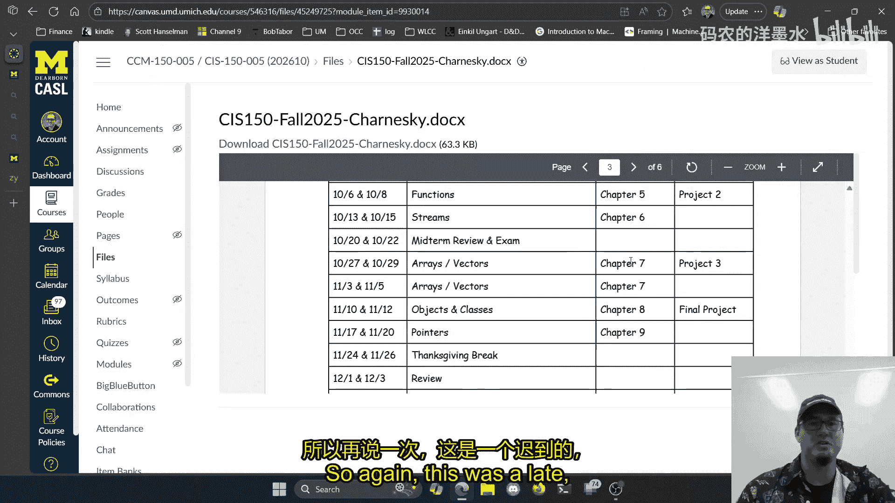

So if you want everyone to be able to view your source code you can do it for free on GitHub which is great for your classwork I'm going to give you private repositories that not everyone in the world has access to because you don't want your classmate to go be able to go and see what you did right that's legal and then it automatically gives me access which is really nice it save some time there's a link'll give you we'll go through the process in lab Do it's not too big of a deal when I'm going to make a repository。

😊，Yeah。So this is EIS 150， fall 2025 here。Mine is public again if you want to make your own you can change these to private here you're allowed to have private repositories as long as you don't have lots of collaborators which is essentially ensures it's probably gonna be a small project here we don't use any templates right now I want read I like readme files I'll show you how to use them for submitting things we're going put stuff in readme files they really helpful so I'm going to check that box here get ignore is an important piece of Git so gett again I mentioned is a source control tool its job is to manage your source code so things that are not source code are things that are compiled are executable programs all sorts of other stuff that goes into it when you make a project to visual studio you get a lot of stuff there's a lot of extra things the visual studio does and tracks and files it creates here so get ignore says hey don't add all the stuff we don't need it's going to ignore certain things here so in ours we want C plus and CP oh my good this what is it here visual studio。

Use the visual Studio ignorer here and then I'm going to put a license online because it's open source if you put a license out there。

 the MIT one sounds really fancy it's like hey anyone can use it just say where you got it from iss basically again go talk to a lawyer if you need to actually license things but that's a quick gist here so here's a repository now Git is known as a distributed source control tool so what that means is I've got these central the origin cloud repository because Github is the cloud service provider so the place that everyone will synchronize with is this cloudbased tool here anyone who wants a copy of the repository can have a copy of it it is a clone of that repository and anyone can have clones so and all you do is you synchronize with the central repository so it's a push and pull systems you're gonna pull changes down from the central repository and you'll push changes back to the central one。

So what I can do， again， I like my shortcuts， there's lots of ways to do these things here。

 but I click the little code button， I say open with the Gitthub desktop。

 assuming you've installed the tool， if not it links you to it， says， hey， go install the tool。Hey。

 go download Gitthub desktopstop GitHub desktopstop is a graphical tool for using Git linked with GitHub。

RightThere's tons of different tools visual studio can work with Git directly I like the Github desktop I find it to be a little bit easier and then no matter what language i'm teaching because I'm teaching C++ and Python a Java and PhP and。

I just did this semester I get to use the same tool so it makes my life easier as well so what this does is say hey I'm going to take this central repository and I'm going make a copy of it here on your computer you can put it anywhere you want I don't care the default is your documents folder and it will make a folder called Github and put everything inside of that one great I like defaults because they make my life easy。

You can put it anywhere you want it doesn't matter we can always go find it later but we just need to know where that folder is that's all we need so I know it's here in my documents folder if you're on Windows it probably goes to a OneDrive documents folder which is then funny because now Microsoft has two copies of it because they run OneDrive and they run GiHub and sure you don't need it in OneDrive because if it's in Git or it's in GitHub it'll be a copy online anyway。

It doesn't matter though， so I moved mine out of Onerive because that irritated me。

I' rather particular， my apologies， sure。My wife says it's endearing。对。Great。

 now I have a copy of that folder on my computer。 So if I want I can say show an explorer on that I can show and finder and we'll open up that folder here in Windows land。

 you're going want to go and change a couple settings real quick when you go to view。

 you want to go to your。😊，File name extensions and hidden items will make your life a whole lot easier here so you can see all of the details otherwise you're missing some things here so there's a hidden folder called dot git the dot git folder is where all the git magic happens don't ever touch this folder。

Just to gar it， pretend like it's not there， but it's nice to know that it's there。

 that's where the magic is happening。 So I actually know how it works。 It's open source。

 but I just don't care。 I use the tool and I'm happy so thankfully other people maintain it the dot get ignore file this is just a text file all it does is say hey。

 if the file looks like one of these things don't add it So anything here and again it's gonna match it's a whole syntax don't worry too much about it anything in debug anything in release anything in build anything in those any logs bin any VS files or visual studio files anything test files。

😊，That's see's got a whole bunch of fun ones here。 Other files， OBJ files that we build out here。

 like， there's a lot of things in here。 Quickp files， sure。

TeamCity files do co so all anything that looks like one of these things like star is a wild card so star will be anything whatever here anything that's a backup it just won't get added to again it's a big file we basically never touch this one we like the defaults it gives us a good one here so it should be fine there's the license file because I picked an MIT license again we can open this one up if you want just like a notepad and see here's the text。

ha， as is no warranty of any kind， sure right。

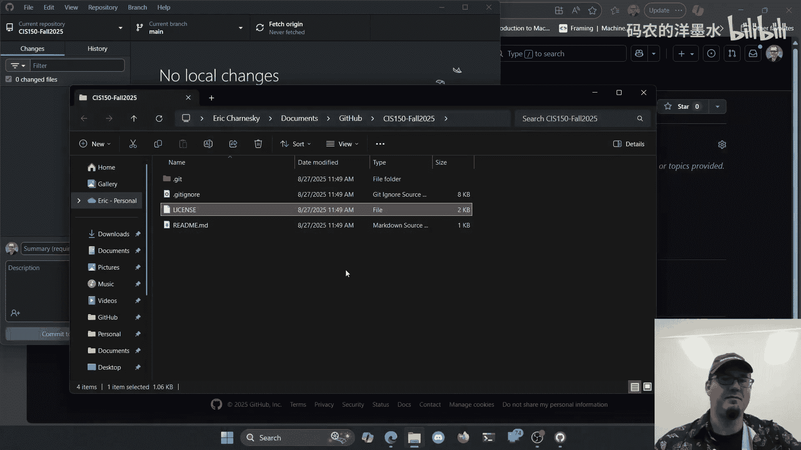

And then there's the readMe file， this is a markdown file MD short for Markdown iss just a text file。

 markdown is a particular format here， you put characters in and it does certain things for you here。

 great。😊。

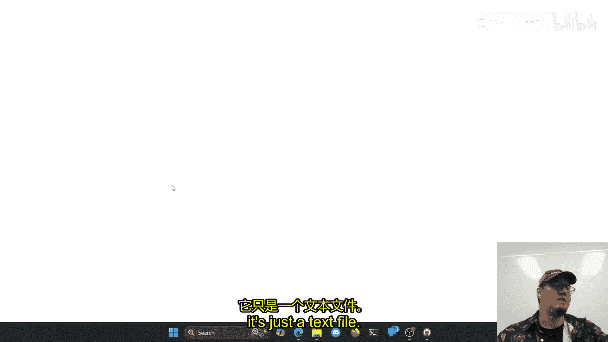

So we got a couple files， so there's a couple things in here already。

 Then what I'm going to do I'm going to go over to visualual Studio now there's visual studio code and there's visual studio。

Microsoft has never been good at naming things， just remember Xbox Xbox 360， Xbox 1。

And now Xbox series X and S and。Like I't I don't know who's in charge of naming things there where they really got to find better people。

 but I guess they're better though than the folks at HBO who had HBO Max and then Max N HBO Max again。

Right。Oh okay， that's fine。 So visual Studio is what you want。 VS code can work。

 but there's more hoops you have to jump through to make it work with C plus plus。

And we don't really want to do any of those hoops right those sorts of things are entertaining for some people some people like hoops and it's fun sure but again we don't want to deal with any of that it's easier not to sorry I am officially aborg I am type one diabetic so this is my artificial pancreas on my hip here it beeps in me all the time if my blood sugar is the wrong number and unfortunately there's no way to shut it up because it's a health issue so it will just beep in me all the time I apologies。

If my sugar goes too low I get shaky and risk of passing out and I'll take a break and go grab a Coke if it goes too high it does feel like crap so I have to kind of keep it in the middle but if you hear that beeping that's me all the time here my pros always hated it during exam I'm like I can't make it not be otherwise i'll die and they're like oh okay you can keep it then。

It would take more than a couple hours to die most of the time so it's a bit of a stretch but I don't want to have to deal with taking it off and feeling like crap anyway visual studio when it comes up it says hey here's a bunch of recent projects these are all ones I did back in the winter semester I don't want any of those ones here I want to make a new project and again it has an option clone a repository from somewhere like GiHub。

It knows how to work with Git。I like the Gitthub desktop again。

 that's just me so we already did all that process， it worked， it should be pretty quick and easy。

 so we're going to create a new project we make a new project。

Oh I should show you I'm sorry the visual Studio installer here so visual Studio when you download it gives you the installer to then go install Vi Studio it's a whole thing it can do tons and tons and tons of things which is really cool it's a great tool so when you go to Vi Studio 2022 and you want the community version it's the free one we don't need any of the balls and whistles from the fancier ones here don't worry about it it says what do you want to do what workloads do you want here so the workloads are what different kinds of development are you going to do here we want desktop development with C++。

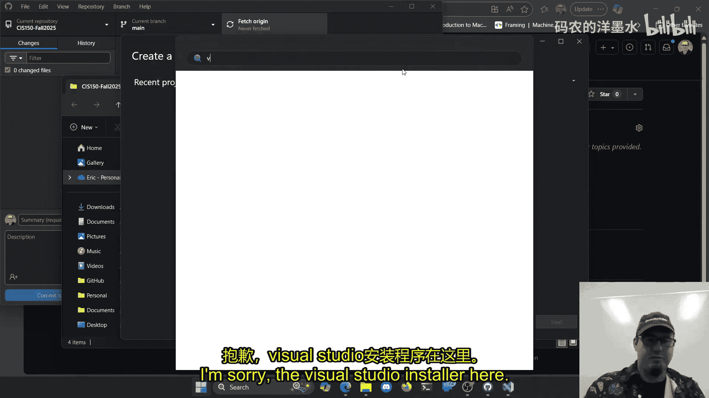

I would hope that wont be obvious since it's a C++ class， but again。

 there's tons of options I get it we do a whole lot of different things here。

 I've got a couple other ones for fun。 you can do lots of interesting fun things with it here as you go but you want to make sure you've got desktop development with C++ installed so we can then go do the C++ stuff so if you don't see your options for C+ it's probably because they didn't pick the right options again go through the guide our friends over in Ann Arbor made they did a lot of good work here I don't need to redo it myself which is great So so what do you want to do so there's project template so in this dropdown here there's a bunch of different languages depending on the workload you've installed go and find C++ here and you want to find now empty project is the basic quick starter one well start with this one and then pretty much every other time we're going to use console app because it gives us some of the starter stuff here。

We'll do this one time and you'll see how obious it is and then we'll do it a second time with the shortcut and you'll be like。

 oh yeah， let's use the shortcut okay but again you've got to see it the heart way。

So we'll do an empty project now this is the tricky part Remember we got a copy of that folder over here in this location so I'm going to come up to my little breadcomumb trail I just click in the white space and it highlights it here control see for copy I love my shortcuts I'll try and explain them as I use the shortcuts if it looks like I'm doing magic I promise it's not magic it's just shortcuts just holler and ask what I just do one time I found a program that like put on the screen as like a little overlay all the keys I was pressing I thought'd be really cool so you can see the shortcuts and stuff I'm typing and then I had to go log into a website and it spit on my password and I felt really dumb so I turned that off because I'll do dumb things like that and that was embarrassing so。

Anyway， copy so now back over here if you want， you can just paste it in or you can click this little three dots and go browse here again I don't like doing more work than I need to so I'll just copy paste I think that's probably the fastest way for me you can have a project name and you can have a solution name a solution is one or more projects at this level and even next level next so at this level will only ever have one project and the next class we probably have a solution with two projects at some point and when you get into bigger and bigger and bigger and bigger software the enterprise software we wrote I think had like。

90 different projects that we maintained in one solution it was nuts here but again it's just a way of structuring things great and then there's a checkbox you can place a solution and project in the same directory some people like that some people don't I've been doing it so long that I'm not used to it looking like this yet so I don't usually check that box it does not matter right for our purposes we don't care right later it's sort of matters not too big of a video deal here so most of the time your defaults are good right defaults are easy we'll just okay here's what's happening we'll just take it and go let's say create。

So it's gonna make a bunch of stuff in that folder here so if I come back to my folder here says hey there's a folder for Project1 again I can look at it I can open it up here and say here's the dot VS this is another hidden folder remember this is going to get ignored by the get ignorere because they get ignore files says ignore anything that's dot VS those are visual studio files that we don't need and then it's a project1 do SLN do solution file here so if you ever want to go open it again you can double click the solution file and it'll open it up and then inside of that is the project one folder that's the project folder with a Cxpro file that's visual something visual something project that's the project file is created project filters and project user stuff。

I don't even remember what half of these things are， it's okay， I just ignore them so。

We can close that back on the Gitthub desktop client， it should say。

 hey there's a bunch of new stuff， green is for new。

Red is for removed and yellow is for changed if your colorblind is's also a plus a dash and a dot here。

 which is nice that they thought of that just one of my colleagues was red green colorblind and hated anytime they used red and green coloring to indicate stuff as turns out that's really hard to see if colorbld。

So all these files are text based files， you can see the contents here。

I don't know it's mostly like garbage magic don't worry too much about it here it's got all sorts of interesting things here they mean a bunch of stuff at some point you might care about it here but we don't care right now。

Hi， here for 150。 awesome， No worries， it's recorded。

So we like that so if we see stuff in the folder we put it in the right spot life is good and then we can keep going so you don't need copilt at this level it's going to do more trouble than it's worth here so in my project now this is the solution Expr Vi Studio is infinitely configurable people can move these things all around all sorts of different places here I like the default makes me happy if want to change it go for it some people have all sorts of really cool setups that they make them extra efficient here。

I love it go for it we're going to see header files resource files and source files for this class well pretty much only ever use source files and CIS 200 will' get into header files and source files Sure lots of fun stuff we'll get there eventually so we want source files so right now it's empty so I'm going to come over to source files a right click and say hey I want to add a new item。

We're going to add a CPP file。SoC+ plus that's CP， so the extensions that CPP。

If the default is source of CPP， you're welcome to change it， labb1， Project1， CPP。

 I don't care if it's source CPP because everything else is named， it really doesn't matter。

Eventually it matters what you call them， but not until next class and now we have an empty CPP file so this is the tab that's showing the file is open in our editor here thankfully you can zoom this one in and out so if you can't see it well let me know I can zoom in more as we go now we get to start writing C++ code。

To make this run， we have to do a couple things。It's going to look like magic it's okay the next version where I say here's the it gives you starter code is much easier you don't have to memorize any of this stuff。

 but let we say includeo stream。Using namespace standard。K Maine。See out hellello world。

Endall is short for endline and then a return zero and life is good so this looks like nonsense it's nonsense it's okay don't worry about it here so these include statements are telling C++ I want to use some code that's already been written in the library please give me this code that's in the standard library because I want to use it so by default C++ is really good at making really small projects really small bits of code here so it doesn't include everything by default you have to tell it hey include this so I want to use the input output stream I want to show something on the screen I want to output that's what see out is our standard output here so using namespace STD is short for the standard namespace some people think this is ugly I do this all the time because it saves me typing if you don't use this line here you have to say hey I want standard colon colon see out and standard colon colon and so essentially it says anything that's in this standard namespace just go find it for me so I will do that all the time here because I like it。

So we're using namespace。Standard， so if you see STD， colon， colon。

That's sure it does the same thing for us here and then int main， so any C++ program that is runable。

 any executable file we want to be able to actually run needs to have this main method or main function。

Its a int because it returns an integer at the end of it running it gives the computer back in integer value that's a really old long old school process essentially zero is good。

 there were no problems anything other than zero and you had a list of error codes in a book that you had to go look up and be like hey。

 my program ended with error code 73 you had to go flip and see what is error code 73 me or error code 29 you had to go look and see what that was here so。

Sure zero is fine so zero is good and then a set of parentheses that defines this as a function again we'll get there eventually and then everything inside the set of curly braces which you've probably never used before in your life that's the shift square braces above the enter key is part of main so we're going to have curly braces up the wazoo for now everythings at does going the end main eventually we'll get to having more things with more curly braces it'll get a little confusing here。

I like having the curly brace here and then the matching one down below and you can see in visual Studio。

 it's kind of hard to see on the projector there's like a small little dashed line and a little arrow here。

 I can collapse this here because all of it is part of main here so you can sort of see it's all here and then by default everything is tabbed in to kind of hang or be indented inside of this to show a visual indication that all of this code belongs to Ma。

😊，All of that white space here， all of the the way we've laid this out here is for people to make code look nice for us to look at it the computer doesn't care so when I hit run now you can click the run button。

 you can press F5 you can go to the this debug and start debugging or start without debugging options you can whatever way you want to do this there's at least three ways to do everything in visual Studio so whichever you like great here so I can go and do F5 and it will run。

It does a little bit of stuff here it says， hey， build。

 so it has to go compile the program and go and run it and then we get the output on the standard output。

 my computer says hellello world， and you get a little message， hey， if you by the way。

 it exited with code zero。everything was good zeros normal here that's option that's good for us and then hey if you want this to automatically close and not have to press any key to close the window。

 go here， we'd like for it to stay open。

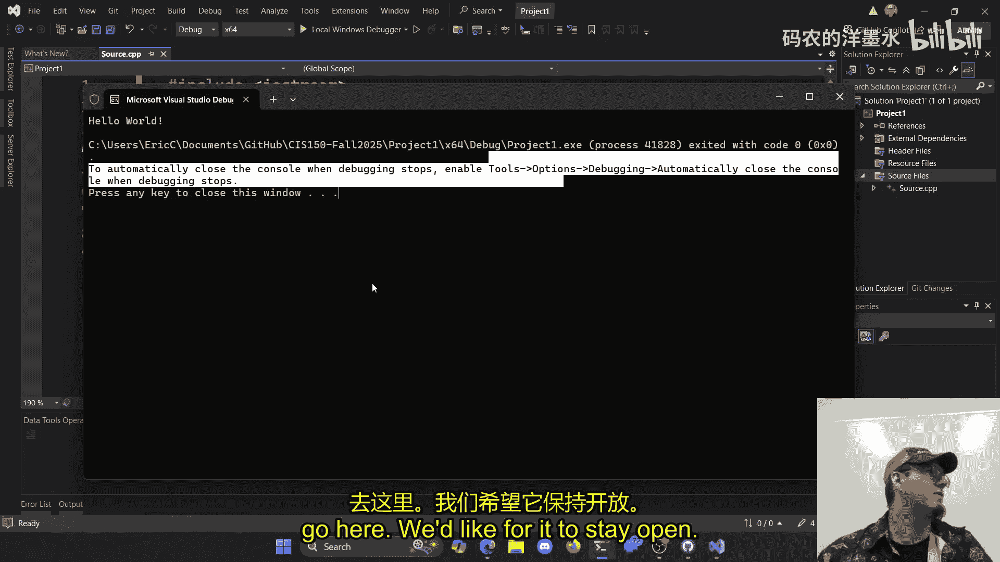

It makes our life easier here because then I can wait until I compress a key。So again。

 this runs and if I go back to Gitthub， it says， hey， I see a source CPP file。

 if you see your CPP files there， life is good， all the other stuff， just let happen， it's okay。

 but you've got to have your CPP files there because that's how you get it into GitHub。😊。

And if you can see it on Github， I'll be able to see it on Gitthub because again you're not gonna to put code into canvas because that's stupid you can quote me on that so all your stuff will go to Gitthub and I'll able to view it there。

 So now the Gitthub desktop coin says hey you got a bunch of new stuff So one of the things Git does is really just a glorified file watcher It job is to watch a folder and look for files to change and it says oh hey I saw some files change here's some new files So what we do with Git is you make commits commit is a snapshot It says at this point in time。

 this is what the folder looked like This is the contents of the files and it saves that and it stores it as a commit so we're gonna give it a summary it says required here it's a small little box the description is a larger box you can type anything you want here I ignore it when you work for somebody who gives you a paycheck youll put what they tell you to put in the box。

Right it's not hard they've got different standards here， some people like certain things。

 I could care less， it does not matter at all what you put here I will ignore these。

 but we'll just say hello world。For some reason， someone decided the very first program you have a right is a hellello World program。

 and we've just kept that tradition alive。I think it's fun。

 You make the computer pretend like it's talking to us right， we'll say， hey。

 I want to commit So now my copy of the repository has that changed。But the cloud doesn't。

 the central repository， the origin repository doesn't have it yet， so I've committed it。

 now we need to go push it and it bs up a big buttons and says， oh hey， you have to push。

Right which is nice It's reminding us so push then we'll take my changes and push them out to the cloud to synchronize so it's not like OneDrive or Google Docs that automatically syncs。

 it's a manual syncing process which if you think about writing code it's probably a good thing you don't want changes to be happening while you're in the middle of it you want to like take your snapshot。

 save it and sync it that sort of thing now now we want to see did it actually make it out there let's do a little sanity check so you can say view on Gitthub here and it'll launch out Github and it gives you essentially a browser like a folder browser here so I can look at all these files here and say oh hey I want to go to project one I want to go to project one again and I want to see my source PPP file and you can see the text right here on the website which is fantastic so。

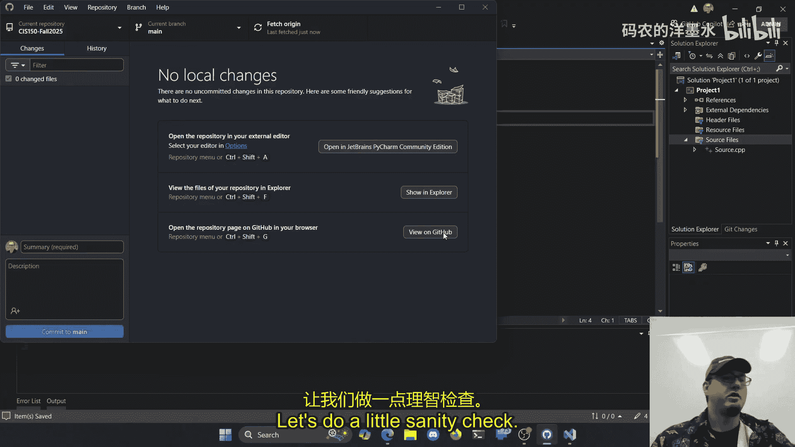

I'm gonna be honest99% of the time when you guys turn projects in， I just look at it on Github。

 I don't even run it and I can just tell if it's going to work or not I I'm been doing it for 20 years right it's okay I'm not not trying to brag I'm just telling you this is what happens here so I just need to look at your code here which is great and the other thing is now you've got a website here you can give me this URL and' like he I'm having trouble with my project here's my code and you can send that to me。

😊，Right and then I can look at it right away you don't need to send me email attachments。

 I hate when people emailly code。It's anaughty because then I have to download it I have to go open it like give me the Github link and I can just go look at it right now。

 I can even do it for my phone， which is super cool。

 So half the time when I'm out of the park with my little guy。

 I can debug stuff from my phone and life is good because I really can't download CPP files and do these sorts of things here。

😊，Oh wow there's my search history that's fun okay it's fine nothing nothing wrong there we got a dog yesterday for my daughter she was very excited it's super cute but it's not home yet we have to wait it's a really cute little dog we've never had a dog before。

So we're all excited。All right， so you can see the code out here now what happens is as we change it here。

 we're be to track those changes at the line level and that's really important and helpful with Git when you start working in a team because I can change one part of the file。

 someone else can change a different part of the file and Git is able to make it work。

Without us having to do a lot of extra things here as we go， so hello world and then we'll see out。

Hello， Cs 150。And so you notice these are in quotes here。

 this is known as a string we'll get into that and't worry too much about it here that's text in my program it's going to be in quotes here and we give that a run。

I've run things a lot here as I like to see the output Hello CSs150 life is good。

 we can close it out Now Github now just says hey， this file's been modified and it says， oh。

 just this line was added here so the old lines 456789 the new 45678910 here this line was added so we will track stuff at the line level giving you this history so the commit again takes a snapshot of the folder at that point in time so hello C 150。

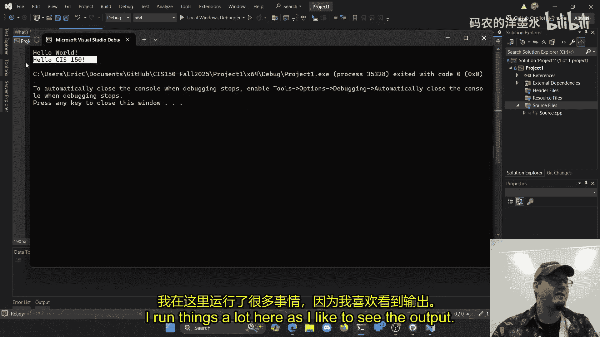

Commit and push makes up to the website life is good here。

 so I'm going to take this link again here so I'm going to add this to Canva so any of the code I write in class I'm going to put out on GiHub。

So you don't need to go download it from Canva， you can go get it right from GitHub。

 you can make a copy of it in there if you want， you can clone the repository I typically don't actually recommend that because then you have to remember to sync it all the time and if you make changes it gets unhappy with you that sort of stuff I would just go view it and copy paste it if you want to pieces if you're interested here go back to Canva and have this here。

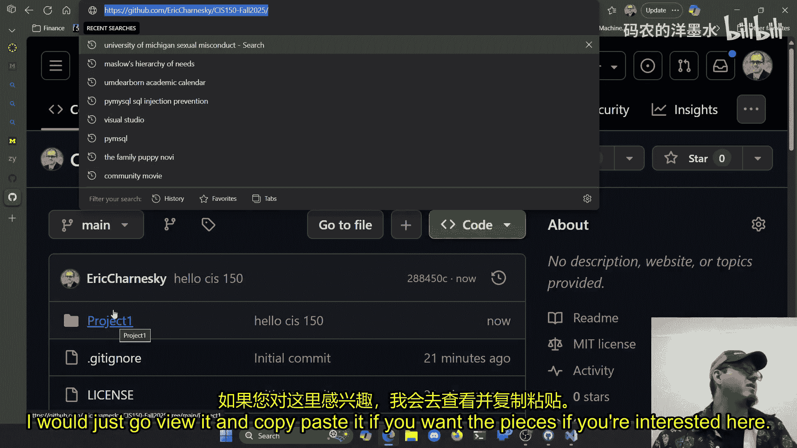

Here's the course repository。Yeah。Of coursese repository look at that it knows I've typed that before published thank you all items sorry I gonna add the recordings cool we got Zbooks Github we've got visual studio or you're going use Xcode on Macre going it usually just works it's the same idea you'll just make your project in the folder in your repository folder so I'll have a new repository for each assignment there's a Github classroom tool that they give to educators which is super cool and it automatically sets up private repositories that I have access to it makes me happy so you'll have a new repository for every project i'll talk with Dr。

 Sae see how you wants to do labs。If he wants you to put code in Canva， we'll just smile and no。

 that's his problem not mine because I don't have to look at it， but I'll talk to him， we'll see。

Think think I've met him once or twice before。Yes。All right。

 and then I've got to set up the grade book still to add the weighted categories you'll probably get a bunch of Canva notifications my apologies once it's all set up those should slow down here as we go。

All right， questions， thoughts， concerns。You okay so far， all right， awesome。

 I think we're pretty good I don't I think you can read chapter one you should be fine here， I don't。

Didn't think we had labs。 I'm really confused now about why we have labs。 I'll figure this out。

 But I don't think we're using the Z labs。U。So let me go I'll go mark those as optional or if they work for you great。

 but we don't。I don't think it's got some labs here。 Read our own labs。Oh， they're kind of fun。

 let's see。Oh， here's a calories calculation here。Bearn from personal exercising。

This is why it sucks when I run and I barely burn in calories。Sure， that's okay。

Go got typer code here Okay， so you got test handle。Yeah， they've got the using standard okay。

 let's see if that one runs we get anything。哎O。So it'll probably run for you。That's cool。

I'll double check and let you know if we got anything here so again we're not going to meet Monday there's no lab Monday because the Labor day we'll meet next Wednesday here for lecture time we'll get into chapter two and i'll talk a lot i'll write some code of a lot of fun。

Try and keep on the same topics as Zybooks here but I'm going to again ideally give you different examples that you've seen it my way you've seen in the books way and then you practice it again you want lots of examples。

 lots of repetition it is a four credit class which means on average you'll spend about four hours a week but we've got lab so that skews a little it's okay in person and then for college classes the expectation is it's two hours of work outside of class for every hour in class so within four credit class you have about a 12 hour a week commitment between lectures lab and practice and homework and readings and exercises those sorts of things here which strongly encourage you to track that just for your own sort of benefit like hey how much time have I put in here if you're putting in more than 12 a week come talk to me。

Right we should have a conversation and see what's going on here how you can be more efficient at your time here again 12 an average like 1314 is probably okay。

 but if you're getting up to beyond that let me know I'm happy to work with you if you're not putting in more than four hours a week。

Things probably aren't going to go very well again a lot of people fail this class that happens it's the nature of the class I used to think anyone and everyone could learn the program I'm slowly changing my mind on that it is a very creative process here that takes a certain way of thinking and it seems like that's hard for some people I think they still can learn it but when I was a couple years ago it's in the lab talking with a couple seniors and like what kind of advice would you give to students in 150 or 200 initial classes and they're like。

If this is hard at that level， quit。Because the classes only get harder and we only ever build on this stuff here and if it's a struggle for your first first year。

 you're going to hate your major and they're like the best thing you can do is just quit。

That sounded like terrible advice。But might actually be good right so I don't mean to scare you off here。

 I'm just just trying to let you know so。If you've got any trouble。

 let me know we'll haveI are they starting up next week for your sessions or yes。

 so we'll start next week online okay。And then hopefully in like two to three weeks sorry awesome okay。

 so S session starting online next week sometime will be able when to meet fill out to find availability then fantastic Okay awesome got any other words of advice for everybody I personally start with5。

I remember that was a pretty hard one， but I just had doing a little extra work as I second and then the tutors over there there are tutors and over here in the tutors school it's called the EOT they are had。

They'll be next to us the engineeringering successccess Center is next to our room in the lab we can go to the HPEC building which is that side of campus not too far over by the parking lot sounds great see you' all next week take care。

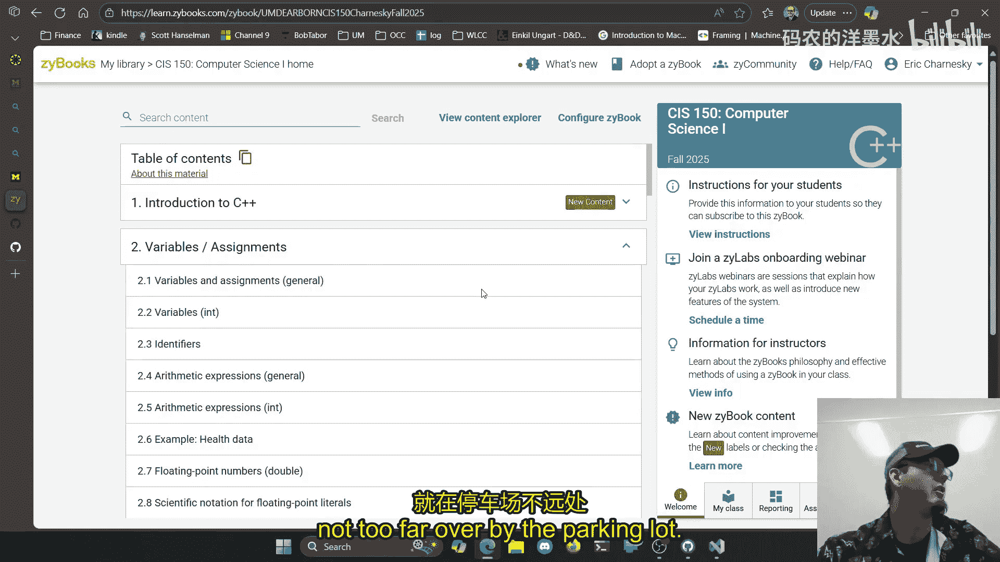